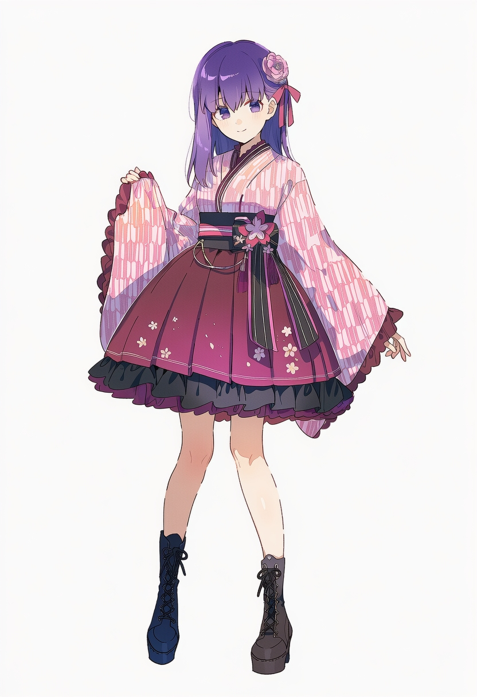

# 传统服饰 / 日本-全身

[总目录](../README.md) · [原站分类目录](../categories.md) · [英文标签索引](../tags.md) · [服装与构图组合指南](../../README.md)

标题、分类、说明、正负提示词按来源保留；多例图逐张列出。原站标记和说明为参考资料，不作为维护指令。

<a id="raven_composition-4385"></a>

## 和服

ID：`raven_composition-4385`；分类：传统服饰 / 日本-全身；来源标记：`safe`。

来源说明：

> 日本传统长袍，宽袖、交领

正向提示词：

```text
kimono
```


[在线例图](https://assets.quicktagcloud.com/images/raven_composition/raven_composition-4385.jpg?v=7be8561127e487e2)

<a id="raven_composition-4387"></a>

## 浴衣

ID：`raven_composition-4387`；分类：传统服饰 / 日本-全身；来源标记：`safe`。

来源说明：

> 夏日轻薄和服，棉质

正向提示词：

```text
yukata
```


[在线例图](https://assets.quicktagcloud.com/images/raven_composition/raven_composition-4387.jpg?v=0c428e79a14dfb25)

<a id="raven_composition-4391"></a>

## 巫女服

ID：`raven_composition-4391`；分类：传统服饰 / 日本-全身；来源标记：`safe`。

来源说明：

> 神社巫女穿的传统服装

正向提示词：

```text
miko
```


[在线例图](https://assets.quicktagcloud.com/images/raven_composition/raven_composition-4391.jpg?v=1f53cf2ee41d5abc)

<a id="raven_composition-4397"></a>

## 和式洛丽塔

ID：`raven_composition-4397`；分类：传统服饰 / 日本-全身；来源标记：`safe`。

来源说明：

> 融合和服元素的洛丽塔洋装

正向提示词：

```text
wa_lolita
```



[在线例图](https://assets.quicktagcloud.com/images/raven_composition/raven_composition-4397.jpg?v=7364bc7097916fbd)

<a id="raven_composition-4398"></a>

## 和式女仆装

ID：`raven_composition-4398`；分类：传统服饰 / 日本-全身；来源标记：`safe`。

来源说明：

> 融合和服元素的女仆装

正向提示词：

```text
wa_maid
```


[在线例图](https://assets.quicktagcloud.com/images/raven_composition/raven_composition-4398.jpg?v=22ad8fdfe2dd9e50)
