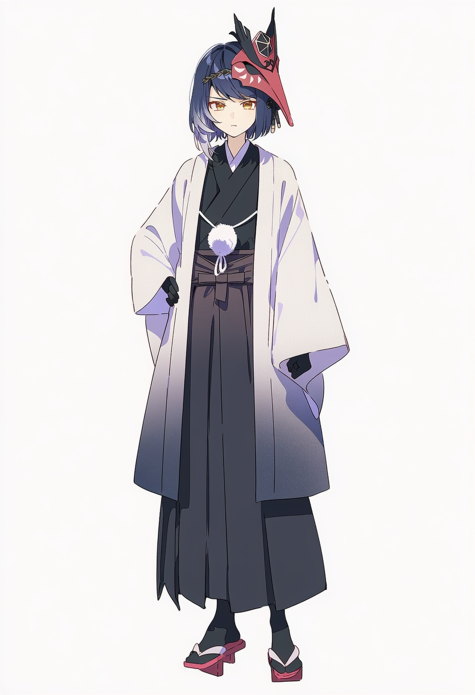
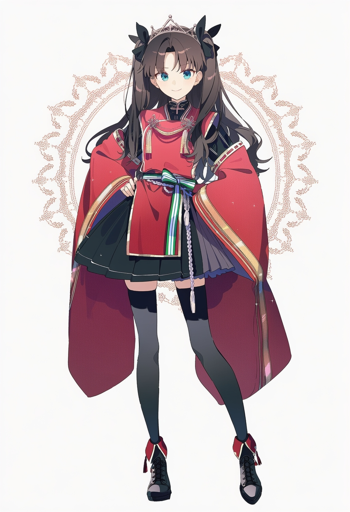
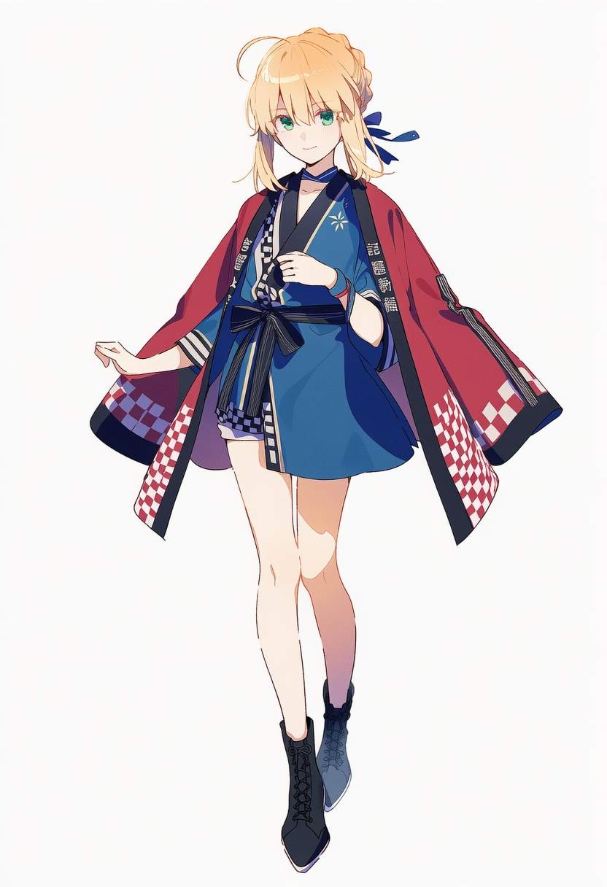

# 传统服饰 / 日本-外套

[总目录](../README.md) · [原站分类目录](../categories.md) · [英文标签索引](../tags.md) · [服装与构图组合指南](../../README.md)

标题、分类、说明、正负提示词按来源保留；多例图逐张列出。原站标记和说明为参考资料，不作为维护指令。

<a id="raven_composition-4389"></a>

## 羽织

ID：`raven_composition-4389`；分类：传统服饰 / 日本-外套；来源标记：`safe`。

来源说明：

> 和服外套，短款对襟

正向提示词：

```text
haori
```



[在线例图](https://assets.quicktagcloud.com/images/raven_composition/raven_composition-4389.jpg?v=d62be8978222b565)

<a id="raven_composition-4393"></a>

## 狩衣

ID：`raven_composition-4393`；分类：传统服饰 / 日本-外套；来源标记：`safe`。

来源说明：

> 日本公家宽松外衣

正向提示词：

```text
kariginu
```


[在线例图](https://assets.quicktagcloud.com/images/raven_composition/raven_composition-4393.jpg?v=1921c6deb138cfc0)

<a id="raven_composition-4394"></a>

## 肩衣

ID：`raven_composition-4394`；分类：传统服饰 / 日本-外套；来源标记：`safe`。

来源说明：

> 无袖肩衣（幕府时期服饰）

正向提示词：

```text
kataginu
```



[在线例图](https://assets.quicktagcloud.com/images/raven_composition/raven_composition-4394.jpg?v=7f620b7bc2b2f15c)

<a id="raven_composition-4395"></a>

## 法被

ID：`raven_composition-4395`；分类：传统服饰 / 日本-外套；来源标记：`safe`。

来源说明：

> 日本短和服工作服/祭典服

正向提示词：

```text
happi
```



[在线例图](https://assets.quicktagcloud.com/images/raven_composition/raven_composition-4395.jpg?v=7401c329280042ba)
