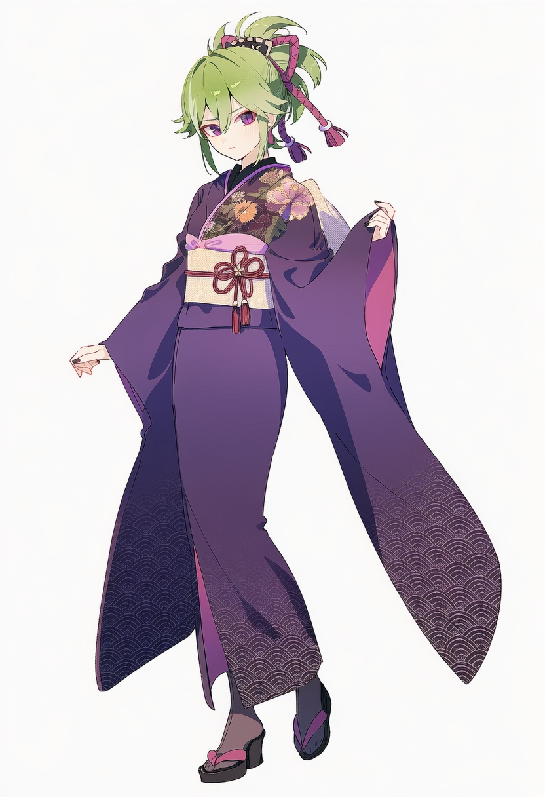
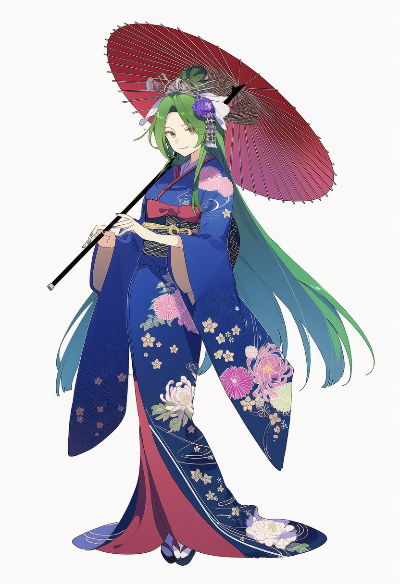

# 传统服饰 / 日本-配饰

[总目录](../README.md) · [原站分类目录](../categories.md) · [英文标签索引](../tags.md) · [服装与构图组合指南](../../README.md)

标题、分类、说明、正负提示词按来源保留；多例图逐张列出。原站标记和说明为参考资料，不作为维护指令。

<a id="raven_composition-4390"></a>

## 腰带(带)

ID：`raven_composition-4390`；分类：传统服饰 / 日本-配饰；来源标记：`safe`。

来源说明：

> 和服服饰腰带宽腰带

正向提示词：

```text
obi
```



[在线例图](https://assets.quicktagcloud.com/images/raven_composition/raven_composition-4390.jpg?v=4c0d4353ea3b00ac)

<a id="raven_composition-4472"></a>

## 发簪(和)

ID：`raven_composition-4472`；分类：传统服饰 / 日本-配饰；来源标记：`safe`。

来源说明：

> 日本传统发簪/簪花

正向提示词：

```text
kanzashi
```



[在线例图](https://assets.quicktagcloud.com/images/raven_composition/raven_composition-4472.jpg?v=814c59eba8d8e44b)

<a id="raven_composition-4473"></a>

## 木屐

ID：`raven_composition-4473`；分类：传统服饰 / 日本-配饰；来源标记：`safe`。

来源说明：

> 日本传统木屐

正向提示词：

```text
geta
```


[在线例图](https://assets.quicktagcloud.com/images/raven_composition/raven_composition-4473.jpg?v=b665e7c9dbf56b61)
