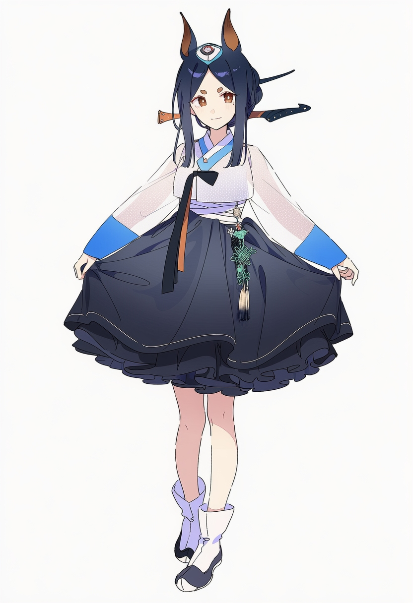
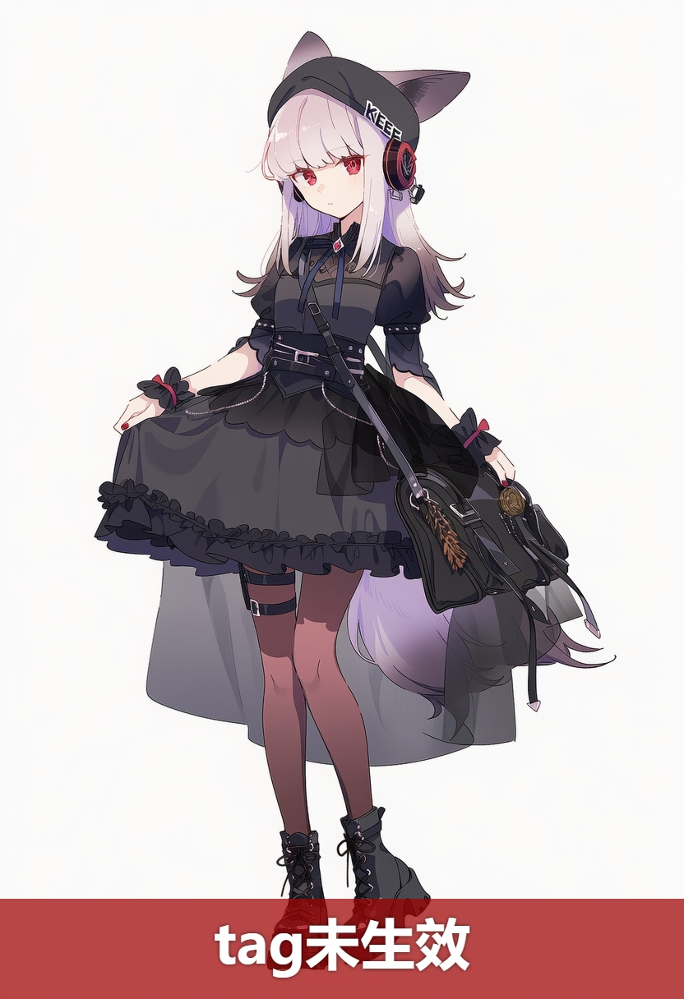
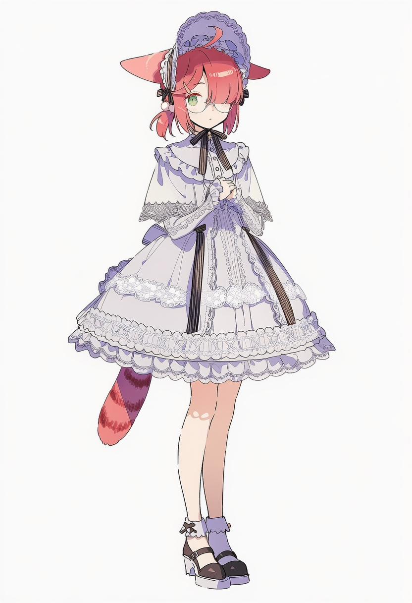

# 传统服饰 / 韩国-全身

[总目录](../README.md) · [原站分类目录](../categories.md) · [英文标签索引](../tags.md) · [服装与构图组合指南](../../README.md)

标题、分类、说明、正负提示词按来源保留；多例图逐张列出。原站标记和说明为参考资料，不作为维护指令。

<a id="raven_composition-4402"></a>

## 韩服

ID：`raven_composition-4402`；分类：传统服饰 / 韩国-全身；来源标记：`safe`。

来源说明：

> 朝鲜半岛传统服饰

正向提示词：

```text
hanbok
```



[在线例图](https://assets.quicktagcloud.com/images/raven_composition/raven_composition-4402.jpg?v=8dc689036a8c827b)

<a id="raven_composition-4404"></a>

## 阔衣

ID：`raven_composition-4404`；分类：传统服饰 / 韩国-全身；来源标记：`safe`。

来源说明：

> 韩国新娘大礼服（花加彩）

正向提示词：

```text
hwalot
```



[在线例图](https://assets.quicktagcloud.com/images/raven_composition/raven_composition-4404.jpg?v=7fc1c67af29e7a82)

<a id="raven_composition-4407"></a>

## 韩系洛丽塔

ID：`raven_composition-4407`；分类：传统服饰 / 韩国-全身；来源标记：`safe`。

来源说明：

> 韩式风洛丽塔洋装

正向提示词：

```text
jo_lolita
```



[在线例图](https://assets.quicktagcloud.com/images/raven_composition/raven_composition-4407.jpg?v=f3ae5cc950162b94)
