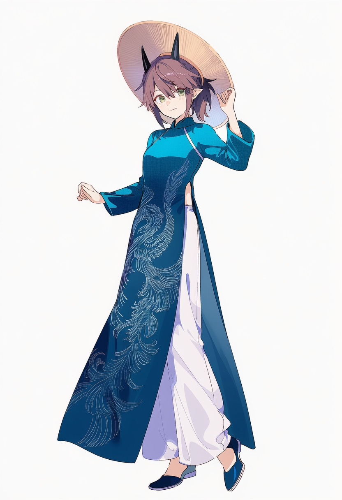
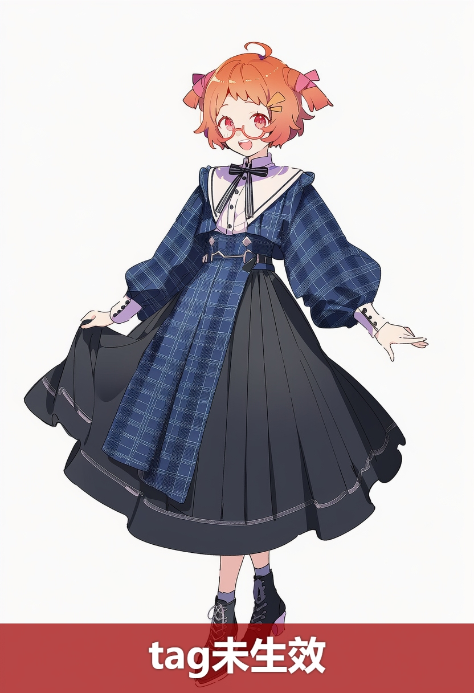

# 传统服饰 / 越南-全身

[总目录](../README.md) · [原站分类目录](../categories.md) · [英文标签索引](../tags.md) · [服装与构图组合指南](../../README.md)

标题、分类、说明、正负提示词按来源保留；多例图逐张列出。原站标记和说明为参考资料，不作为维护指令。

<a id="raven_composition-4411"></a>

## 奥黛

ID：`raven_composition-4411`；分类：传统服饰 / 越南-全身；来源标记：`safe`。

来源说明：

> 越南传统长旗袍，高领开衩

正向提示词：

```text
ao_dai
```



[在线例图](https://assets.quicktagcloud.com/images/raven_composition/raven_composition-4411.jpg?v=6cd2ef220ec91f82)

<a id="raven_composition-4412"></a>

## 越南四身袄

ID：`raven_composition-4412`；分类：传统服饰 / 越南-全身；来源标记：`safe`。

来源说明：

> 越南北部四身袄

正向提示词：

```text
ao_nhat_binh
```



[在线例图](https://assets.quicktagcloud.com/images/raven_composition/raven_composition-4412.jpg?v=576e0aed700b02c1)
