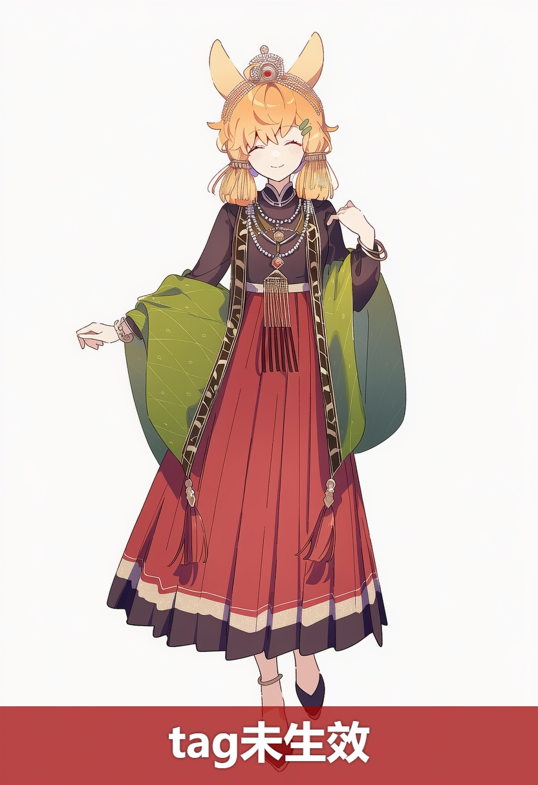
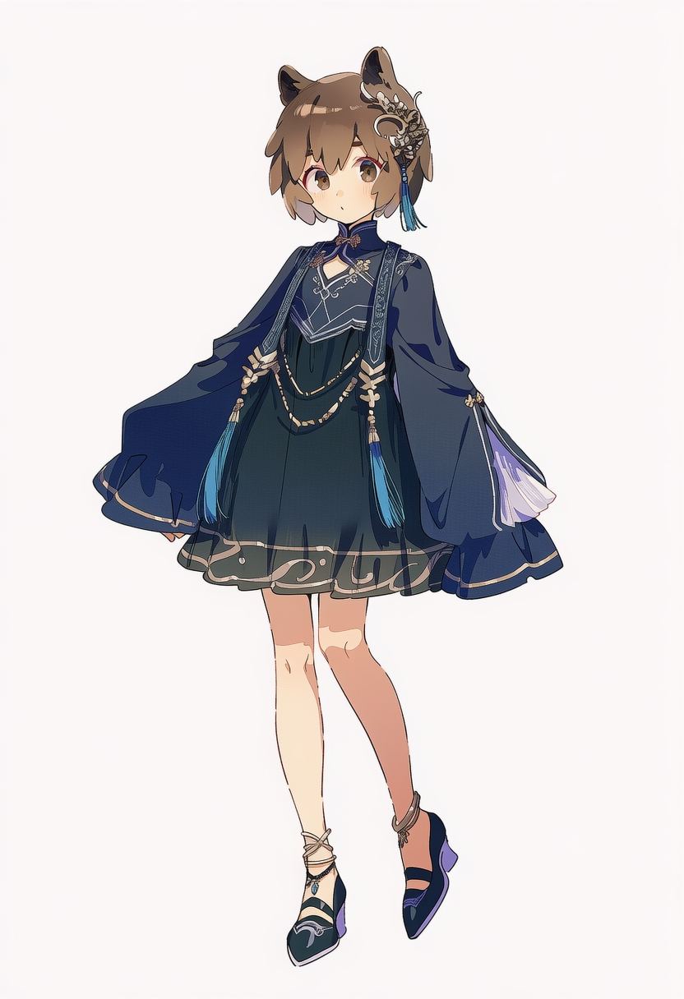

# 传统服饰 / 印度-配饰

[总目录](../README.md) · [原站分类目录](../categories.md) · [英文标签索引](../tags.md) · [服装与构图组合指南](../../README.md)

标题、分类、说明、正负提示词按来源保留；多例图逐张列出。原站标记和说明为参考资料，不作为维护指令。

<a id="raven_composition-4415"></a>

## 眉心痣

ID：`raven_composition-4415`；分类：传统服饰 / 印度-配饰；来源标记：`safe`。

来源说明：

> 印度女性额前圆点装饰

正向提示词：

```text
bindi
```



[在线例图](https://assets.quicktagcloud.com/images/raven_composition/raven_composition-4415.jpg?v=183bebb1a39c7669)

<a id="raven_composition-4474"></a>

## 鼻环

ID：`raven_composition-4474`；分类：传统服饰 / 印度-配饰；来源标记：`safe`。

来源说明：

> 印度传统鼻环

正向提示词：

```text
nose_ring
```


[在线例图](https://assets.quicktagcloud.com/images/raven_composition/raven_composition-4474.jpg?v=fd270bc54aaea8b8)

<a id="raven_composition-4475"></a>

## 脚镯

ID：`raven_composition-4475`；分类：传统服饰 / 印度-配饰；来源标记：`safe`。

来源说明：

> 印度传统脚镯/脚铃

正向提示词：

```text
anklet
```



[在线例图](https://assets.quicktagcloud.com/images/raven_composition/raven_composition-4475.jpg?v=4c83d01356194619)
