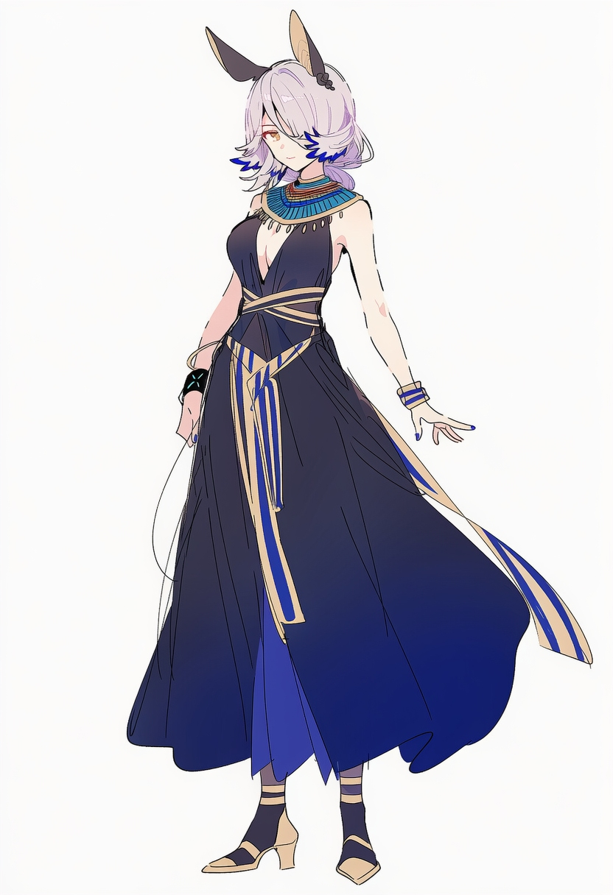
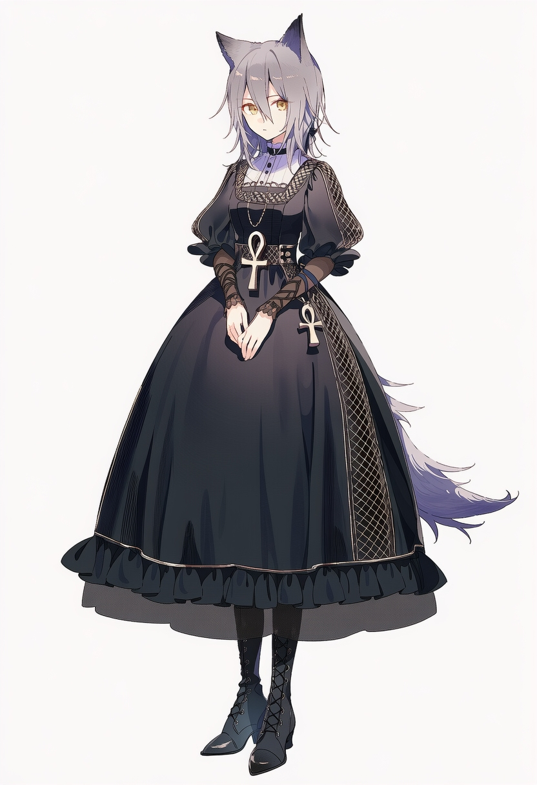
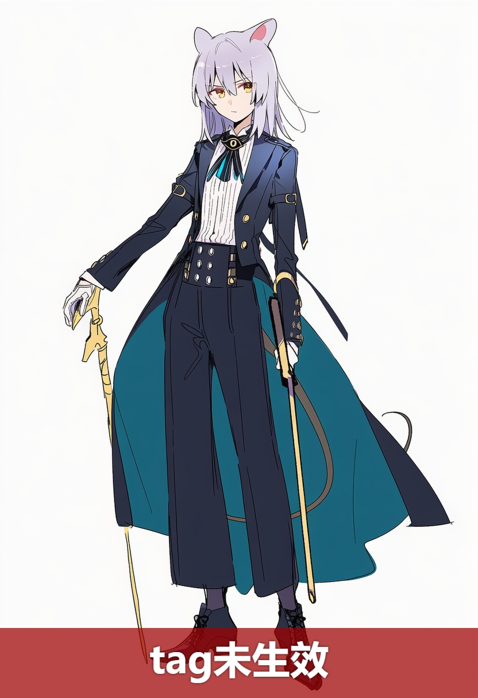

# 传统服饰 / 古埃及-配饰

[总目录](../README.md) · [原站分类目录](../categories.md) · [英文标签索引](../tags.md) · [服装与构图组合指南](../../README.md)

标题、分类、说明、正负提示词按来源保留；多例图逐张列出。原站标记和说明为参考资料，不作为维护指令。

<a id="raven_composition-4420"></a>

## 宽项圈(埃及)

ID：`raven_composition-4420`；分类：传统服饰 / 古埃及-配饰；来源标记：`safe`。

来源说明：

> 古埃及宽大项圈项链

正向提示词：

```text
usekh_collar
```



[在线例图](https://assets.quicktagcloud.com/images/raven_composition/raven_composition-4420.jpg?v=3a29871f611438b4)

<a id="raven_composition-4421"></a>

## 安卡

ID：`raven_composition-4421`；分类：传统服饰 / 古埃及-配饰；来源标记：`safe`。

来源说明：

> 古埃及生命符号饰品

正向提示词：

```text
ankh
```



[在线例图](https://assets.quicktagcloud.com/images/raven_composition/raven_composition-4421.jpg?v=6b421fa4d9f8eb71)

<a id="raven_composition-4422"></a>

## 荷鲁斯之眼

ID：`raven_composition-4422`；分类：传统服饰 / 古埃及-配饰；来源标记：`safe`。

来源说明：

> 古埃及护符眼饰

正向提示词：

```text
eye_of_horus
```



[在线例图](https://assets.quicktagcloud.com/images/raven_composition/raven_composition-4422.jpg?v=c1d29a27f110f187)
