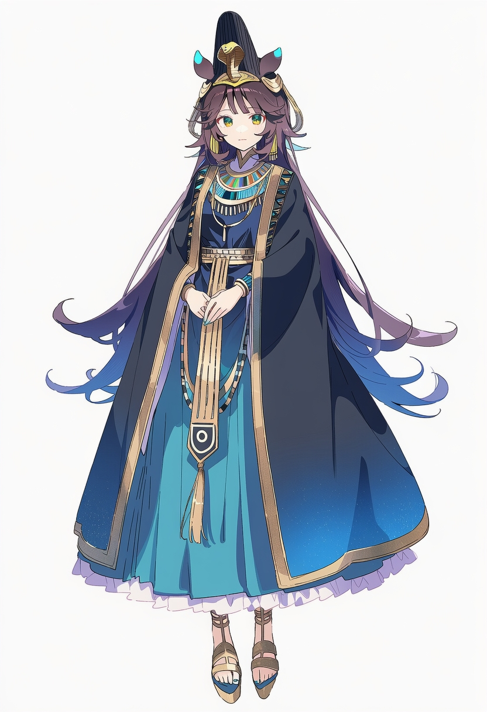

# 传统服饰 / 古埃及-头饰

[总目录](../README.md) · [原站分类目录](../categories.md) · [英文标签索引](../tags.md) · [服装与构图组合指南](../../README.md)

标题、分类、说明、正负提示词按来源保留；多例图逐张列出。原站标记和说明为参考资料，不作为维护指令。

<a id="raven_composition-4423"></a>

## 圣蛇饰

ID：`raven_composition-4423`；分类：传统服饰 / 古埃及-头饰；来源标记：`safe`。

来源说明：

> 古埃及王冠上的眼镜蛇饰品

正向提示词：

```text
uraeus
```



[在线例图](https://assets.quicktagcloud.com/images/raven_composition/raven_composition-4423.jpg?v=b3adb3f5a9c31358)
