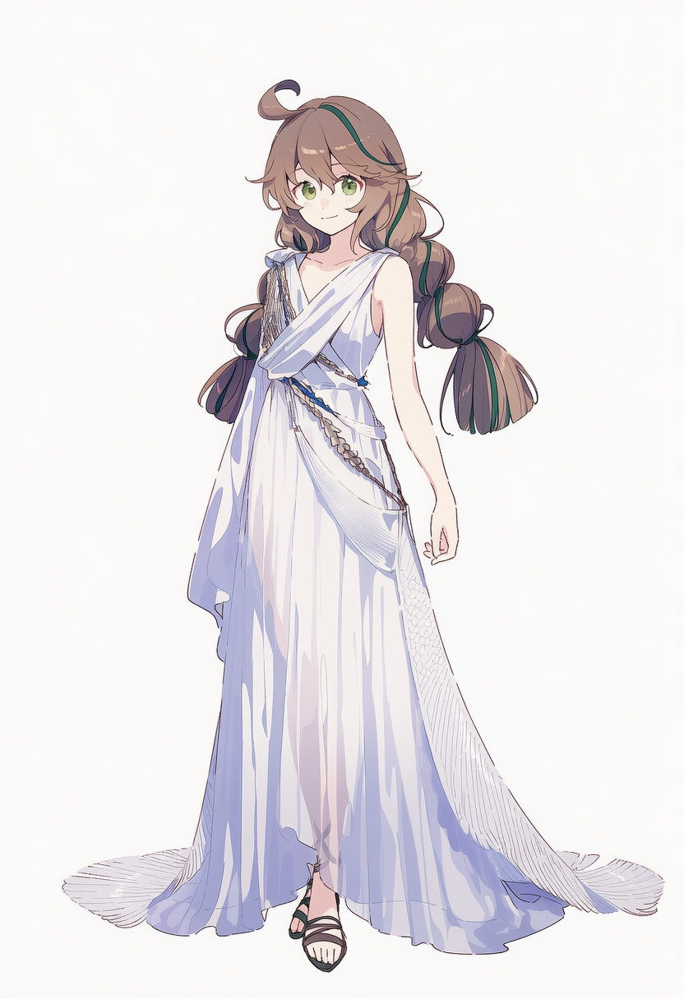

# 传统服饰 / 古希腊-全身

[总目录](../README.md) · [原站分类目录](../categories.md) · [英文标签索引](../tags.md) · [服装与构图组合指南](../../README.md)

标题、分类、说明、正负提示词按来源保留；多例图逐张列出。原站标记和说明为参考资料，不作为维护指令。

<a id="raven_composition-4425"></a>

## 希顿长袍

ID：`raven_composition-4425`；分类：传统服饰 / 古希腊-全身；来源标记：`safe`。

来源说明：

> 古希腊贴身及膝/及踝内衣袍

正向提示词：

```text
chiton
```



[在线例图](https://assets.quicktagcloud.com/images/raven_composition/raven_composition-4425.jpg?v=5e99270553111e6c)

<a id="raven_composition-4427"></a>

## 佩普洛斯

ID：`raven_composition-4427`；分类：传统服饰 / 古希腊-全身；来源标记：`safe`。

来源说明：

> 古希腊女式折叠短袖袍

正向提示词：

```text
peplos
```


[在线例图](https://assets.quicktagcloud.com/images/raven_composition/raven_composition-4427.jpg?v=f511b59bdbc0ec20)
