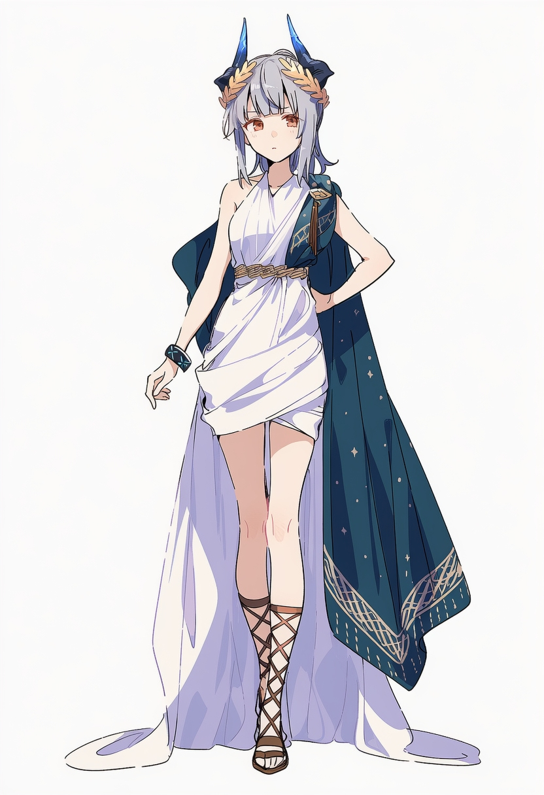
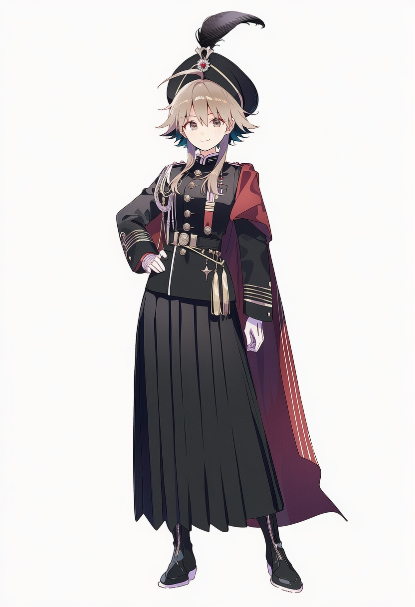
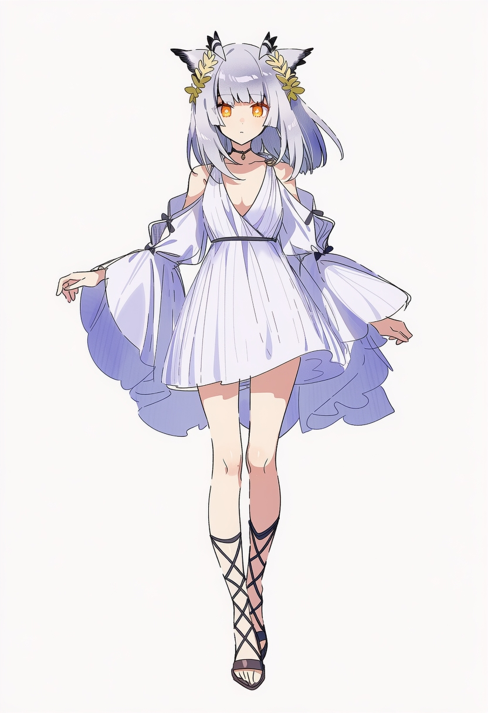

# 传统服饰 / 地中海-头饰

[总目录](../README.md) · [原站分类目录](../categories.md) · [英文标签索引](../tags.md) · [服装与构图组合指南](../../README.md)

标题、分类、说明、正负提示词按来源保留；多例图逐张列出。原站标记和说明为参考资料，不作为维护指令。

<a id="raven_composition-4429"></a>

## 桂冠

ID：`raven_composition-4429`；分类：传统服饰 / 地中海-头饰；来源标记：`safe`。

来源说明：

> 古希腊罗马月桂叶头冠

正向提示词：

```text
laurel_crown
```



[在线例图](https://assets.quicktagcloud.com/images/raven_composition/raven_composition-4429.jpg?v=49a4a4c5c6f5ef8e)

<a id="raven_composition-4432"></a>

## 弗里吉亚帽

ID：`raven_composition-4432`；分类：传统服饰 / 地中海-头饰；来源标记：`safe`。

来源说明：

> 古希腊及法国象征自由的软帽

正向提示词：

```text
phrygian_cap
```



[在线例图](https://assets.quicktagcloud.com/images/raven_composition/raven_composition-4432.jpg?v=20c4d33c7585b99b)

<a id="raven_composition-4433"></a>

## 桂冠

ID：`raven_composition-4433`；分类：传统服饰 / 地中海-头饰；来源标记：`safe`。

来源说明：

> 古希腊罗马月桂叶头冠

正向提示词：

```text
laurel_crown
```



[在线例图](https://assets.quicktagcloud.com/images/raven_composition/raven_composition-4433.jpg?v=4071800318ae4302)
