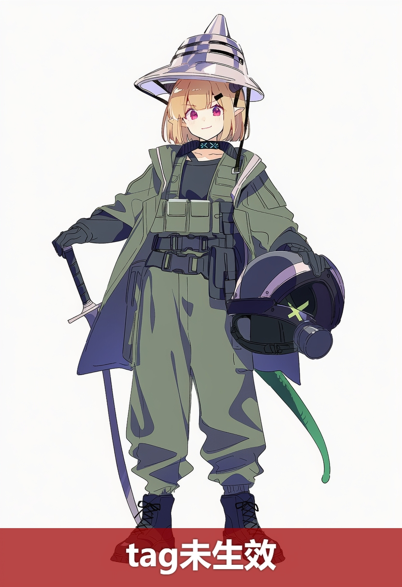
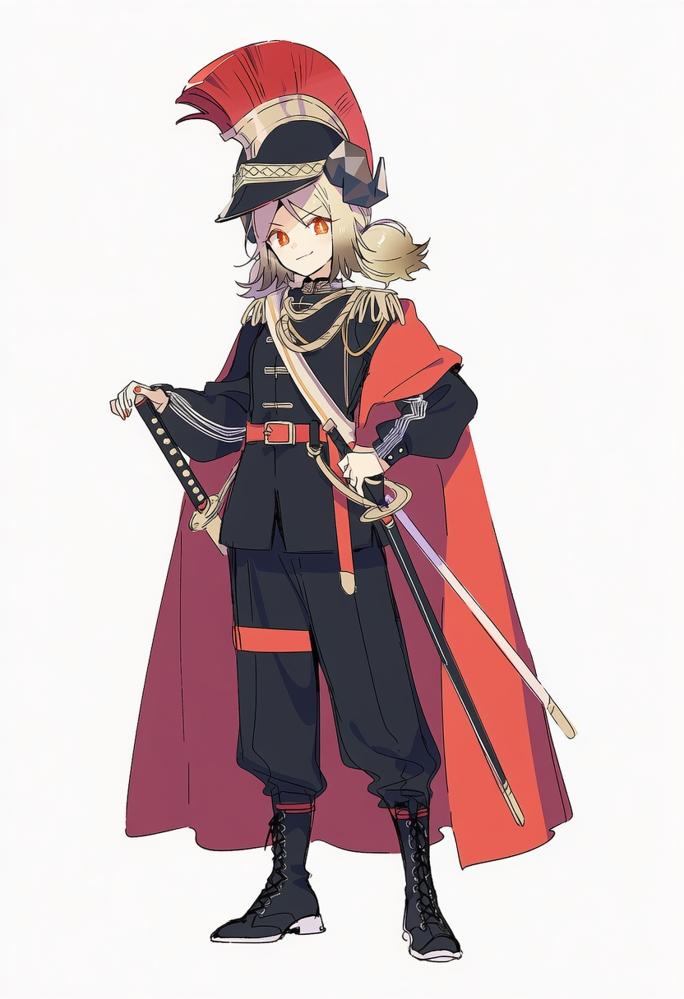

# 传统服饰 / 古希腊-头饰

[总目录](../README.md) · [原站分类目录](../categories.md) · [英文标签索引](../tags.md) · [服装与构图组合指南](../../README.md)

标题、分类、说明、正负提示词按来源保留；多例图逐张列出。原站标记和说明为参考资料，不作为维护指令。

<a id="raven_composition-4430"></a>

## 阿提卡头盔

ID：`raven_composition-4430`；分类：传统服饰 / 古希腊-头饰；来源标记：`safe`。

来源说明：

> 古希腊阿提卡式头盔

正向提示词：

```text
attic_helmet
```



[在线例图](https://assets.quicktagcloud.com/images/raven_composition/raven_composition-4430.jpg?v=55e40f70468c3b7f)

<a id="raven_composition-4431"></a>

## 科林斯头盔

ID：`raven_composition-4431`；分类：传统服饰 / 古希腊-头饰；来源标记：`safe`。

来源说明：

> 古希腊科林斯式头盔

正向提示词：

```text
corinthian_helmet
```



[在线例图](https://assets.quicktagcloud.com/images/raven_composition/raven_composition-4431.jpg?v=55274bde152f52b0)
