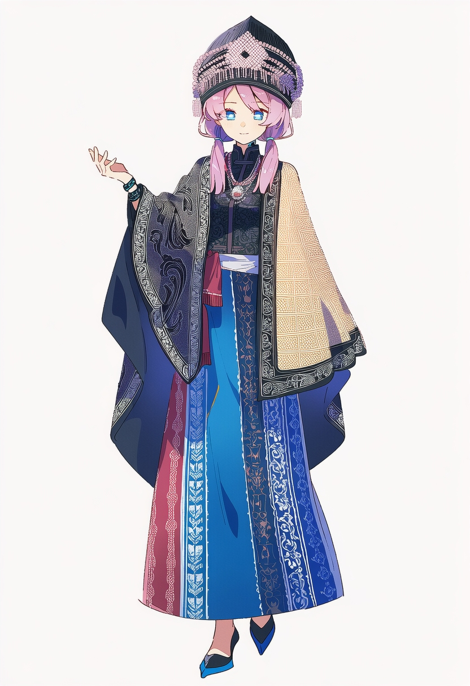

# 传统服饰 / 东南亚-综合

[总目录](../README.md) · [原站分类目录](../categories.md) · [英文标签索引](../tags.md) · [服装与构图组合指南](../../README.md)

标题、分类、说明、正负提示词按来源保留；多例图逐张列出。原站标记和说明为参考资料，不作为维护指令。

<a id="raven_composition-4439"></a>

## 东南亚服饰

ID：`raven_composition-4439`；分类：传统服饰 / 东南亚-综合；来源标记：`safe`。

来源说明：

> 东南亚地区传统服饰总称

正向提示词：

```text
south-east_asian_clothes
```


[在线例图](https://assets.quicktagcloud.com/images/raven_composition/raven_composition-4439.jpg?v=931203a44c4665ef)

<a id="raven_composition-4441"></a>

## 巴厘岛服饰

ID：`raven_composition-4441`；分类：传统服饰 / 东南亚-综合；来源标记：`safe`。

来源说明：

> 印尼巴厘岛传统服饰

正向提示词：

```text
balinese_clothes
```



[在线例图](https://assets.quicktagcloud.com/images/raven_composition/raven_composition-4441.jpg?v=8a8bb40dbe5c502e)

<a id="raven_composition-4442"></a>

## 印尼服饰

ID：`raven_composition-4442`；分类：传统服饰 / 东南亚-综合；来源标记：`safe`。

来源说明：

> 印度尼西亚传统服饰总称

正向提示词：

```text
indonesian_clothes
```


[在线例图](https://assets.quicktagcloud.com/images/raven_composition/raven_composition-4442.jpg?v=32f73aa034707c2b)
