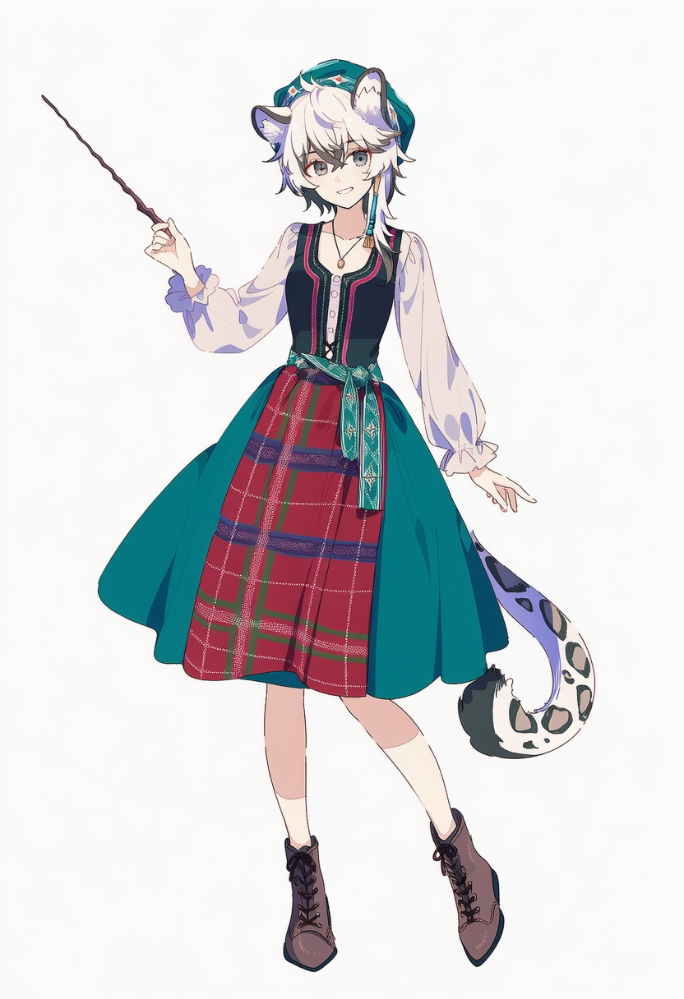
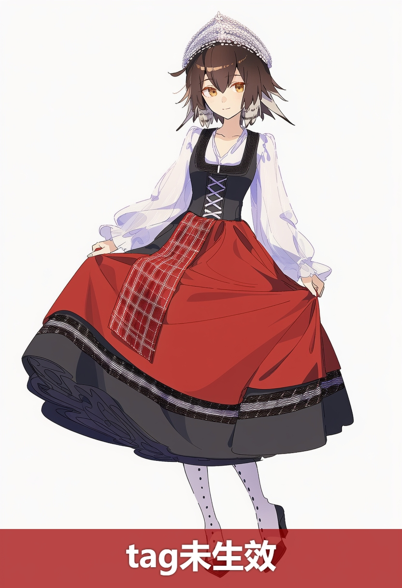
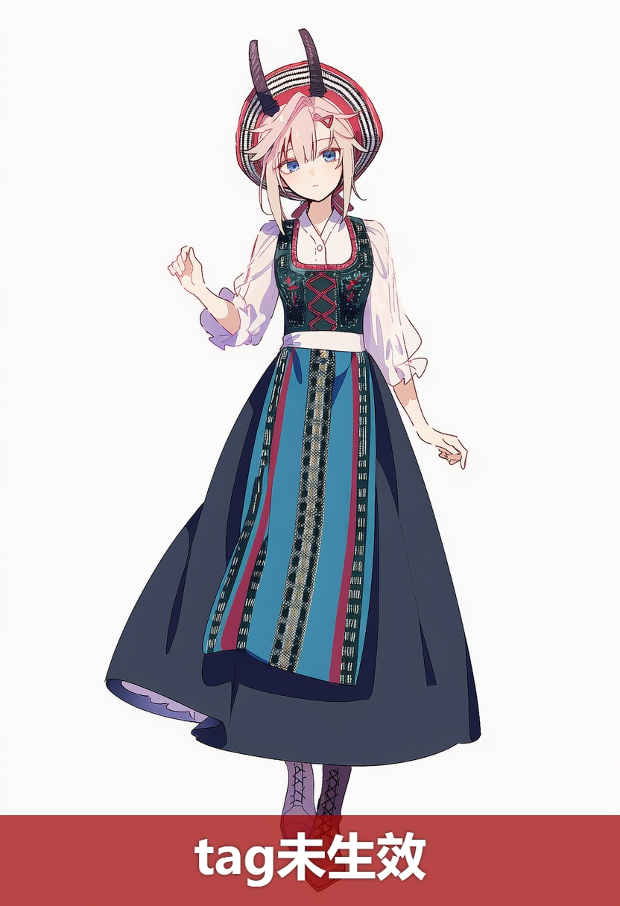
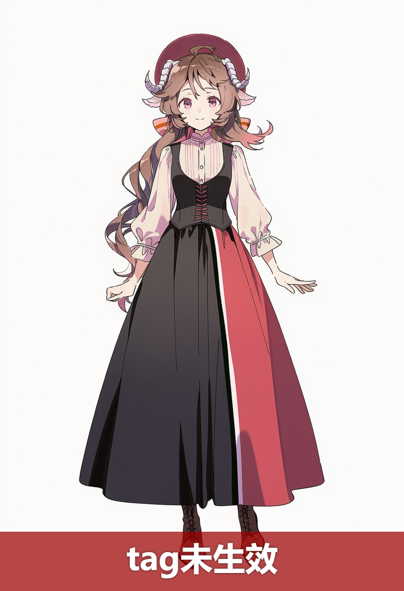
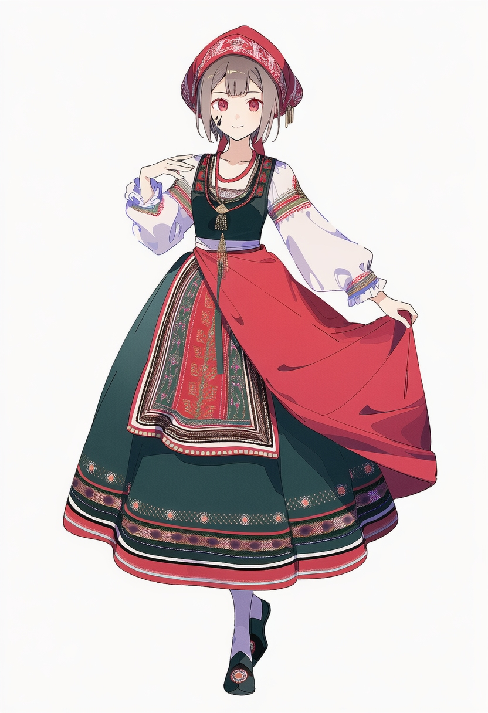
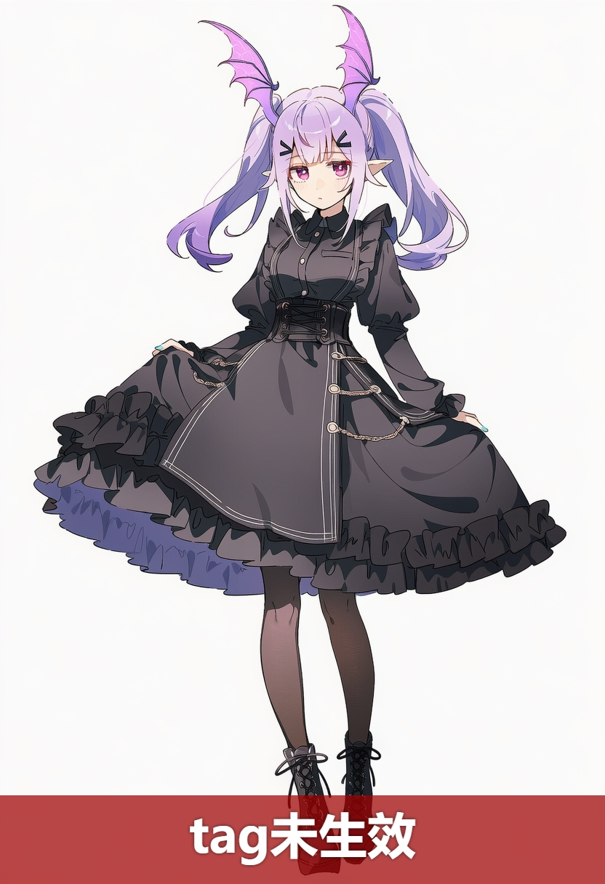

# 传统服饰 / 欧洲-综合

[总目录](../README.md) · [原站分类目录](../categories.md) · [英文标签索引](../tags.md) · [服装与构图组合指南](../../README.md)

标题、分类、说明、正负提示词按来源保留；多例图逐张列出。原站标记和说明为参考资料，不作为维护指令。

<a id="raven_composition-4445"></a>

## 苏格兰服饰

ID：`raven_composition-4445`；分类：传统服饰 / 欧洲-综合；来源标记：`safe`。

来源说明：

> 苏格兰传统服饰（如格子裙）

正向提示词：

```text
scottish_clothes
```



[在线例图](https://assets.quicktagcloud.com/images/raven_composition/raven_composition-4445.jpg?v=70fca7483076d5da)

<a id="raven_composition-4447"></a>

## 丹麦服饰

ID：`raven_composition-4447`；分类：传统服饰 / 欧洲-综合；来源标记：`safe`。

来源说明：

> 丹麦传统服饰

正向提示词：

```text
danish_clothes
```



[在线例图](https://assets.quicktagcloud.com/images/raven_composition/raven_composition-4447.jpg?v=5c972b838e3372a8)

<a id="raven_composition-4448"></a>

## 荷兰服饰

ID：`raven_composition-4448`；分类：传统服饰 / 欧洲-综合；来源标记：`safe`。

来源说明：

> 荷兰传统服饰

正向提示词：

```text
dutch_clothes
```



[在线例图](https://assets.quicktagcloud.com/images/raven_composition/raven_composition-4448.jpg?v=00ac5f51dd24e192)

<a id="raven_composition-4449"></a>

## 比利时服饰

ID：`raven_composition-4449`；分类：传统服饰 / 欧洲-综合；来源标记：`safe`。

来源说明：

> 比利时传统服饰

正向提示词：

```text
belgian_clothes
```



[在线例图](https://assets.quicktagcloud.com/images/raven_composition/raven_composition-4449.jpg?v=39a9c793625831b2)

<a id="raven_composition-4450"></a>

## 斯拉夫传统服饰

ID：`raven_composition-4450`；分类：传统服饰 / 欧洲-综合；来源标记：`safe`。

来源说明：

> 斯拉夫民族传统服饰

正向提示词：

```text
traditional_slavic_clothes
```



[在线例图](https://assets.quicktagcloud.com/images/raven_composition/raven_composition-4450.jpg?v=bbb025321b58054d)

<a id="raven_composition-4454"></a>

## 克里米亚鞑靼服饰

ID：`raven_composition-4454`；分类：传统服饰 / 欧洲-综合；来源标记：`safe`。

来源说明：

> 克里米亚鞑靼传统服饰

正向提示词：

```text
crimean_tatar_clothes
```



[在线例图](https://assets.quicktagcloud.com/images/raven_composition/raven_composition-4454.jpg?v=bb62396f2f9265f5)
