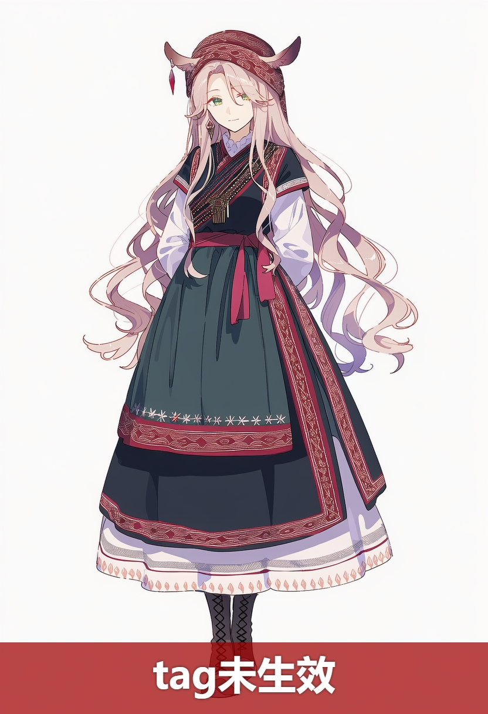
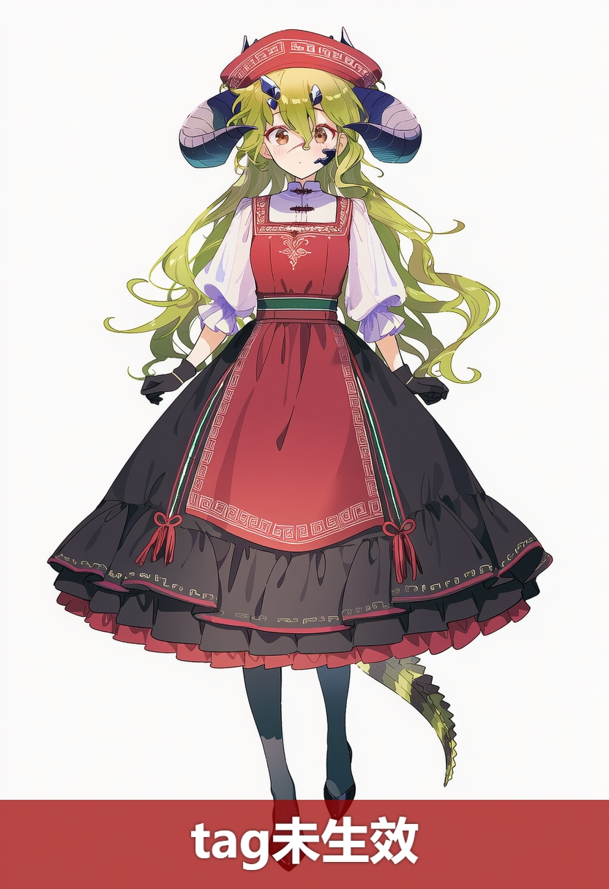
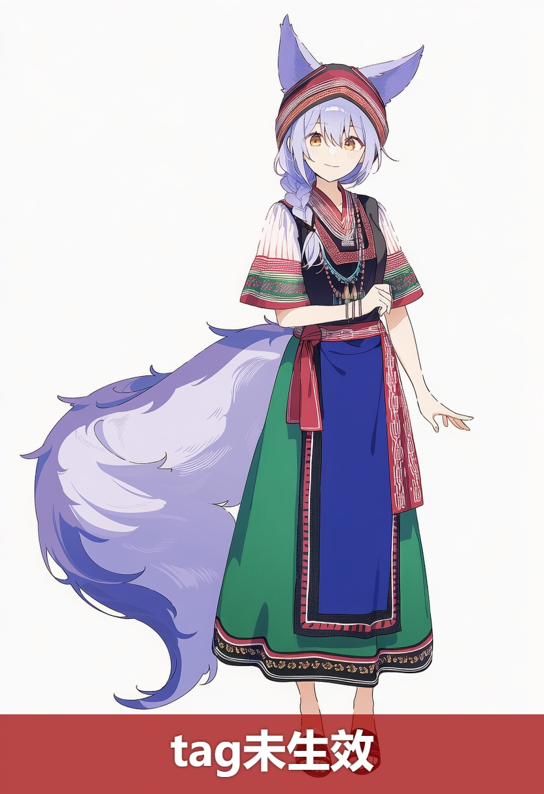
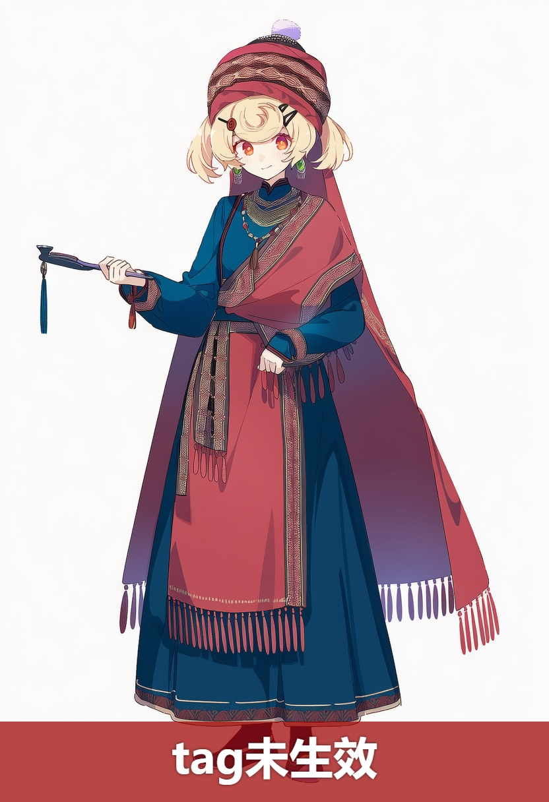

# 传统服饰 / 中亚-综合

[总目录](../README.md) · [原站分类目录](../categories.md) · [英文标签索引](../tags.md) · [服装与构图组合指南](../../README.md)

标题、分类、说明、正负提示词按来源保留；多例图逐张列出。原站标记和说明为参考资料，不作为维护指令。

<a id="raven_composition-4452"></a>

## 突厥服饰

ID：`raven_composition-4452`；分类：传统服饰 / 中亚-综合；来源标记：`safe`。

来源说明：

> 突厥系民族传统服饰

正向提示词：

```text
turkic_clothes
```



[在线例图](https://assets.quicktagcloud.com/images/raven_composition/raven_composition-4452.jpg?v=f8c58666cb8defd9)

<a id="raven_composition-4453"></a>

## 匈人服饰

ID：`raven_composition-4453`；分类：传统服饰 / 中亚-综合；来源标记：`safe`。

来源说明：

> 匈人（匈奴系）服饰

正向提示词：

```text
hunnic_clothes
```



[在线例图](https://assets.quicktagcloud.com/images/raven_composition/raven_composition-4453.jpg?v=bde739981ed8ab42)

<a id="raven_composition-4457"></a>

## 阿塞拜疆服饰

ID：`raven_composition-4457`；分类：传统服饰 / 中亚-综合；来源标记：`safe`。

来源说明：

> 阿塞拜疆传统服饰

正向提示词：

```text
azerbaijani_clothes
```



[在线例图](https://assets.quicktagcloud.com/images/raven_composition/raven_composition-4457.jpg?v=6338cd7d92b4aec2)

<a id="raven_composition-4458"></a>

## 阿富汗服饰

ID：`raven_composition-4458`；分类：传统服饰 / 中亚-综合；来源标记：`safe`。

来源说明：

> 阿富汗传统服饰

正向提示词：

```text
afghan_clothes
```



[在线例图](https://assets.quicktagcloud.com/images/raven_composition/raven_composition-4458.jpg?v=69857e9290eed29b)
