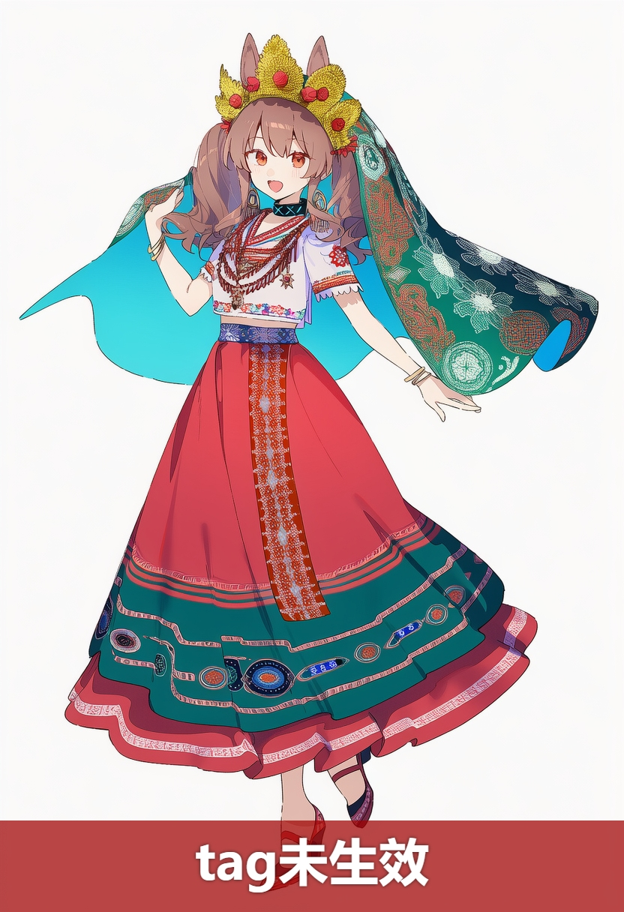
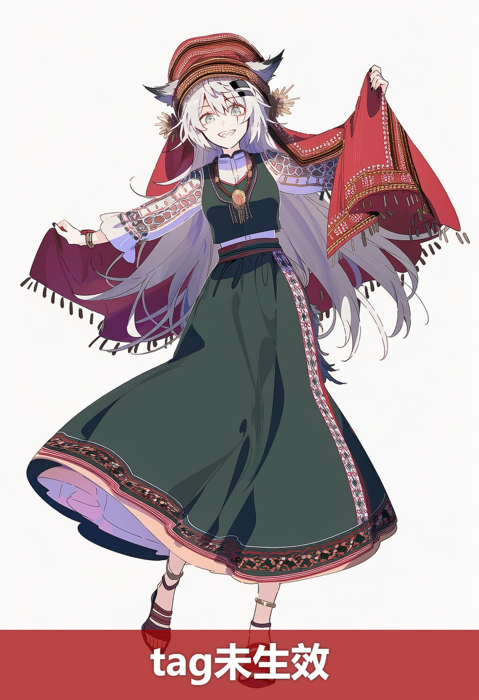

# 传统服饰 / 美洲-综合

[总目录](../README.md) · [原站分类目录](../categories.md) · [英文标签索引](../tags.md) · [服装与构图组合指南](../../README.md)

标题、分类、说明、正负提示词按来源保留；多例图逐张列出。原站标记和说明为参考资料，不作为维护指令。

<a id="raven_composition-4455"></a>

## 危地马拉服饰

ID：`raven_composition-4455`；分类：传统服饰 / 美洲-综合；来源标记：`safe`。

来源说明：

> 危地马拉玛雅彩织服饰

正向提示词：

```text
guatemalan_clothes
```



[在线例图](https://assets.quicktagcloud.com/images/raven_composition/raven_composition-4455.jpg?v=a11c7ba2045e8ade)

<a id="raven_composition-4456"></a>

## 牙买加服饰

ID：`raven_composition-4456`；分类：传统服饰 / 美洲-综合；来源标记：`safe`。

来源说明：

> 牙买加传统服饰

正向提示词：

```text
jamaican_clothes
```



[在线例图](https://assets.quicktagcloud.com/images/raven_composition/raven_composition-4456.jpg?v=f1729fd7d995b91f)
