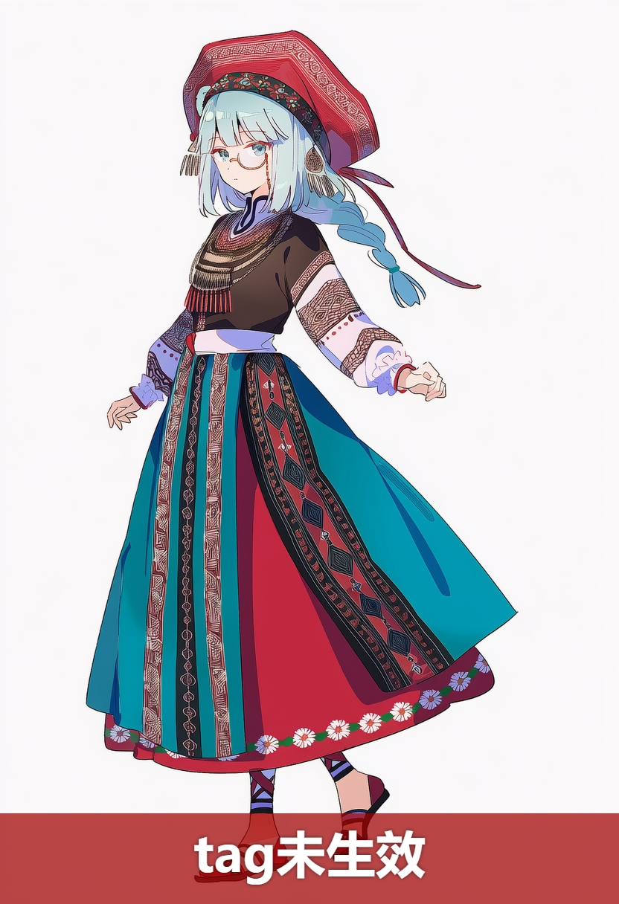
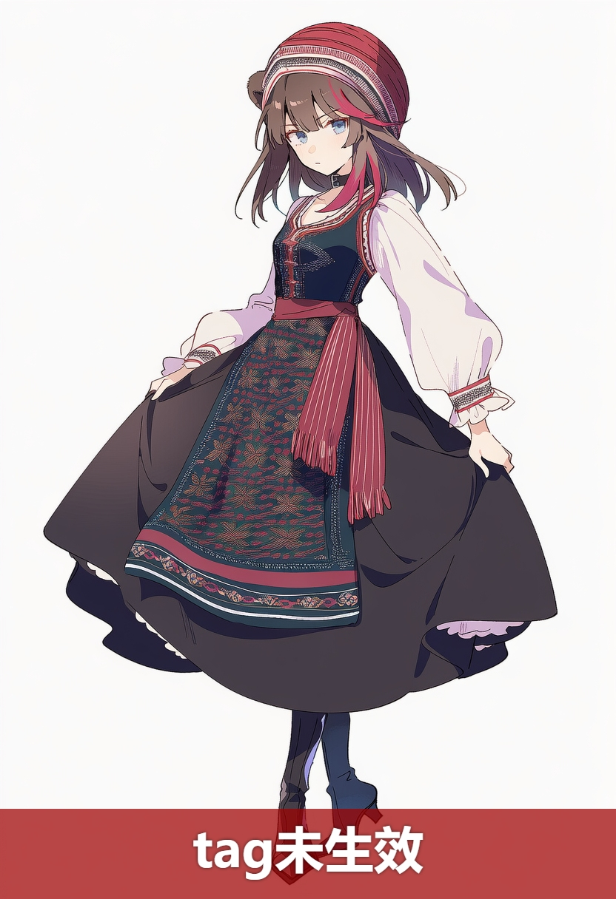
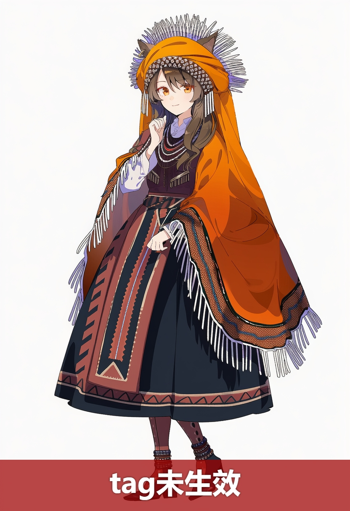
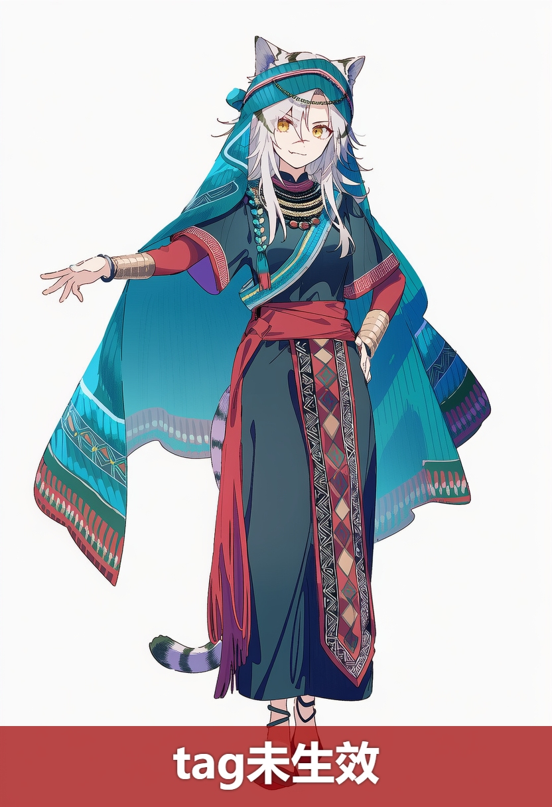

# 传统服饰 / 非洲-综合

[总目录](../README.md) · [原站分类目录](../categories.md) · [英文标签索引](../tags.md) · [服装与构图组合指南](../../README.md)

标题、分类、说明、正负提示词按来源保留；多例图逐张列出。原站标记和说明为参考资料，不作为维护指令。

<a id="raven_composition-4459"></a>

## 阿尔及利亚服饰

ID：`raven_composition-4459`；分类：传统服饰 / 非洲-综合；来源标记：`safe`。

来源说明：

> 阿尔及利亚传统服饰

正向提示词：

```text
algerian_clothes
```



[在线例图](https://assets.quicktagcloud.com/images/raven_composition/raven_composition-4459.jpg?v=0752d1fdae64fdfb)

<a id="raven_composition-4460"></a>

## 突尼斯服饰

ID：`raven_composition-4460`；分类：传统服饰 / 非洲-综合；来源标记：`safe`。

来源说明：

> 突尼斯传统服饰

正向提示词：

```text
tunisian_clothes
```



[在线例图](https://assets.quicktagcloud.com/images/raven_composition/raven_composition-4460.jpg?v=a34f694cff4821d6)

<a id="raven_composition-4463"></a>

## 非洲服饰

ID：`raven_composition-4463`；分类：传统服饰 / 非洲-综合；来源标记：`safe`。

来源说明：

> 非洲大陆传统服饰总称

正向提示词：

```text
african_clothes
```



[在线例图](https://assets.quicktagcloud.com/images/raven_composition/raven_composition-4463.jpg?v=be9b187191648707)

<a id="raven_composition-4464"></a>

## 柏柏尔服饰

ID：`raven_composition-4464`；分类：传统服饰 / 非洲-综合；来源标记：`safe`。

来源说明：

> 北非柏柏尔人传统服饰

正向提示词：

```text
amazigh_clothes
```



[在线例图](https://assets.quicktagcloud.com/images/raven_composition/raven_composition-4464.jpg?v=4eb89ce9301197d4)
