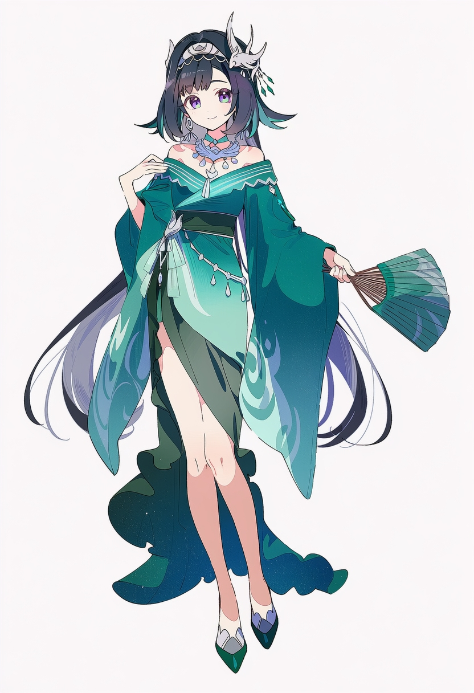
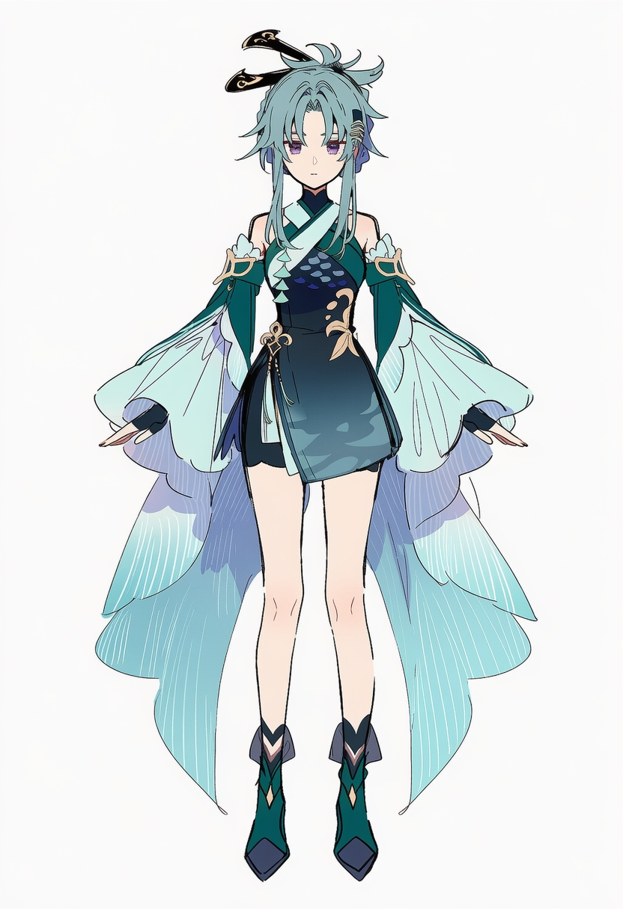
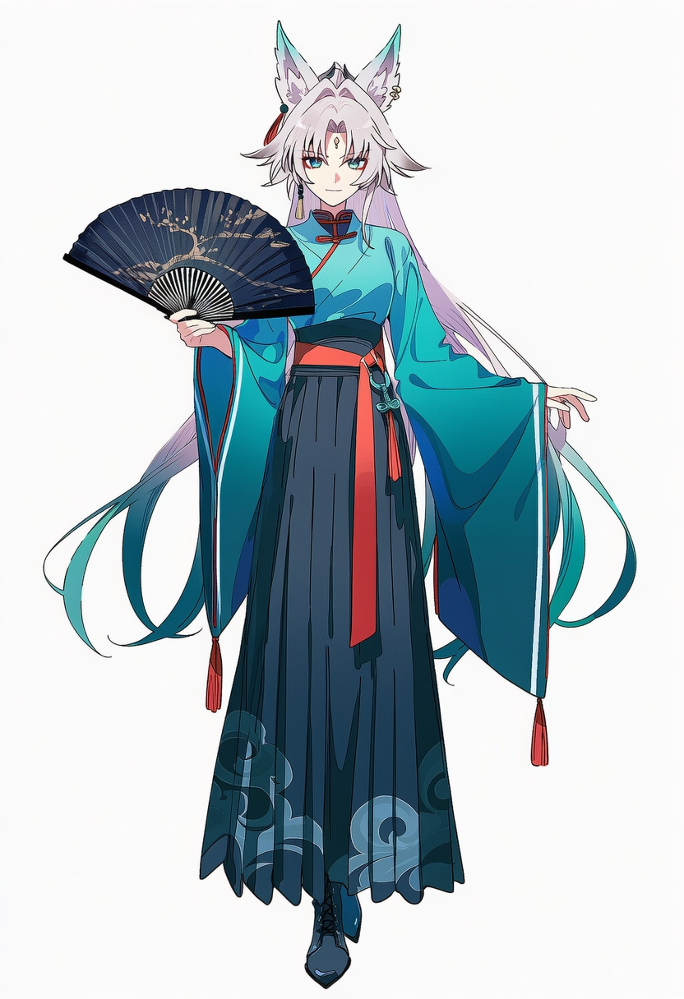
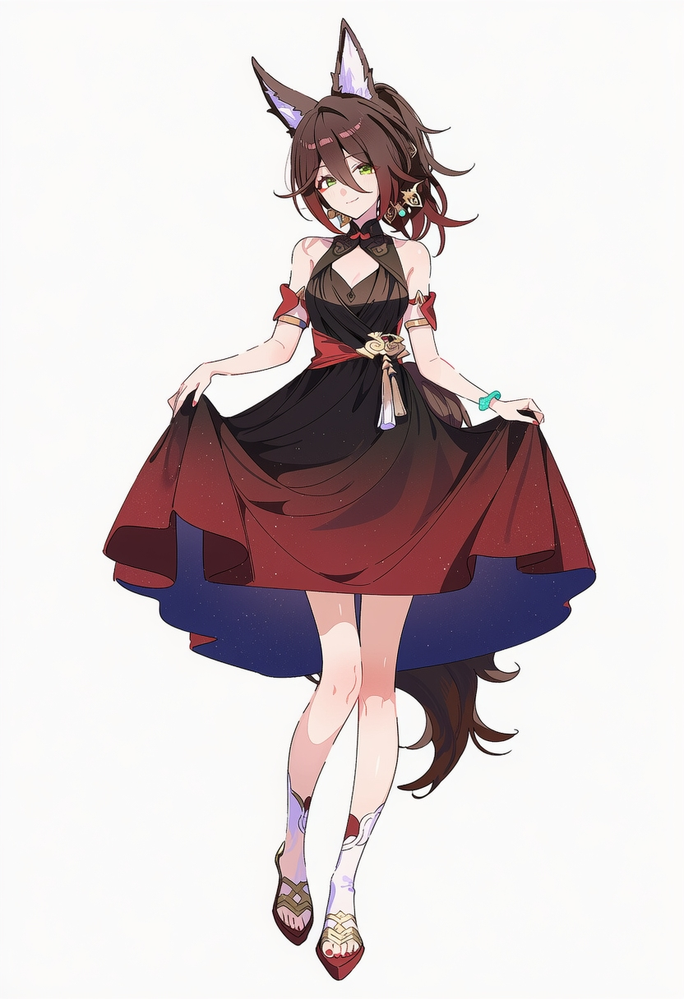

# 传统服饰 / 中国-配饰

[总目录](../README.md) · [原站分类目录](../categories.md) · [英文标签索引](../tags.md) · [服装与构图组合指南](../../README.md)

标题、分类、说明、正负提示词按来源保留；多例图逐张列出。原站标记和说明为参考资料，不作为维护指令。

<a id="raven_composition-4465"></a>

## 团扇

ID：`raven_composition-4465`；分类：传统服饰 / 中国-配饰；来源标记：`safe`。

来源说明：

> 中国古典圆形团扇

正向提示词：

```text
hand_fan
```



[在线例图](https://assets.quicktagcloud.com/images/raven_composition/raven_composition-4465.jpg?v=3e39bf73041054fa)

<a id="raven_composition-4466"></a>

## 中国结

ID：`raven_composition-4466`；分类：传统服饰 / 中国-配饰；来源标记：`safe`。

来源说明：

> 中国传统绳结装饰

正向提示词：

```text
chinese_knot
```


[在线例图](https://assets.quicktagcloud.com/images/raven_composition/raven_composition-4466.jpg?v=728350a3976ce7aa)

<a id="raven_composition-4467"></a>

## 发簪

ID：`raven_composition-4467`；分类：传统服饰 / 中国-配饰；来源标记：`safe`。

来源说明：

> 中国传统长发簪/发钗

正向提示词：

```text
hair_stick
```



[在线例图](https://assets.quicktagcloud.com/images/raven_composition/raven_composition-4467.jpg?v=152c65abab9160e1)

<a id="raven_composition-4468"></a>

## 流苏

ID：`raven_composition-4468`；分类：传统服饰 / 中国-配饰；来源标记：`safe`。

来源说明：

> 玉佩/中国结上的流苏垂饰

正向提示词：

```text
tassel
```


[在线例图](https://assets.quicktagcloud.com/images/raven_composition/raven_composition-4468.jpg?v=c021c8c914c92c3d)

<a id="raven_composition-4469"></a>

## 折扇

ID：`raven_composition-4469`；分类：传统服饰 / 中国-配饰；来源标记：`safe`。

来源说明：

> 中国/东亚折扇

正向提示词：

```text
folding_fan
```



[在线例图](https://assets.quicktagcloud.com/images/raven_composition/raven_composition-4469.jpg?v=6cb6f19c8a169b5b)

<a id="raven_composition-4470"></a>

## 璎珞

ID：`raven_composition-4470`；分类：传统服饰 / 中国-配饰；来源标记：`safe`。

来源说明：

> 多层珠串璎珞项链

正向提示词：

```text
necklace
```


[在线例图](https://assets.quicktagcloud.com/images/raven_composition/raven_composition-4470.jpg?v=249b503f92f68ab6)

<a id="raven_composition-4471"></a>

## 臂钏

ID：`raven_composition-4471`；分类：传统服饰 / 中国-配饰；来源标记：`safe`。

来源说明：

> 古典臂钏/臂环

正向提示词：

```text
armlet
```



[在线例图](https://assets.quicktagcloud.com/images/raven_composition/raven_composition-4471.jpg?v=c1be86dec3f15a10)
