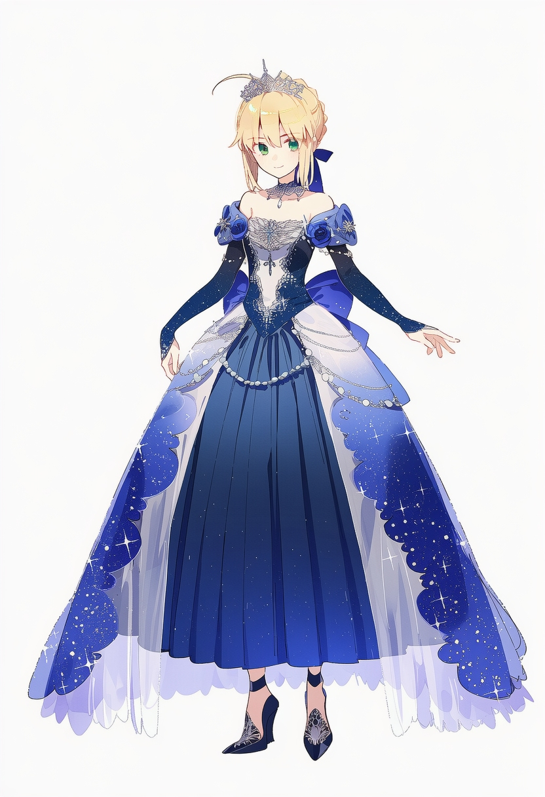
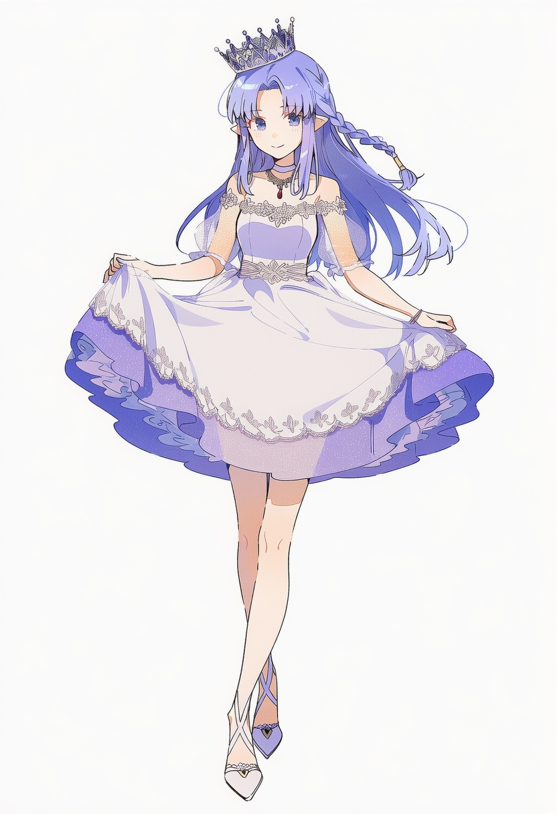
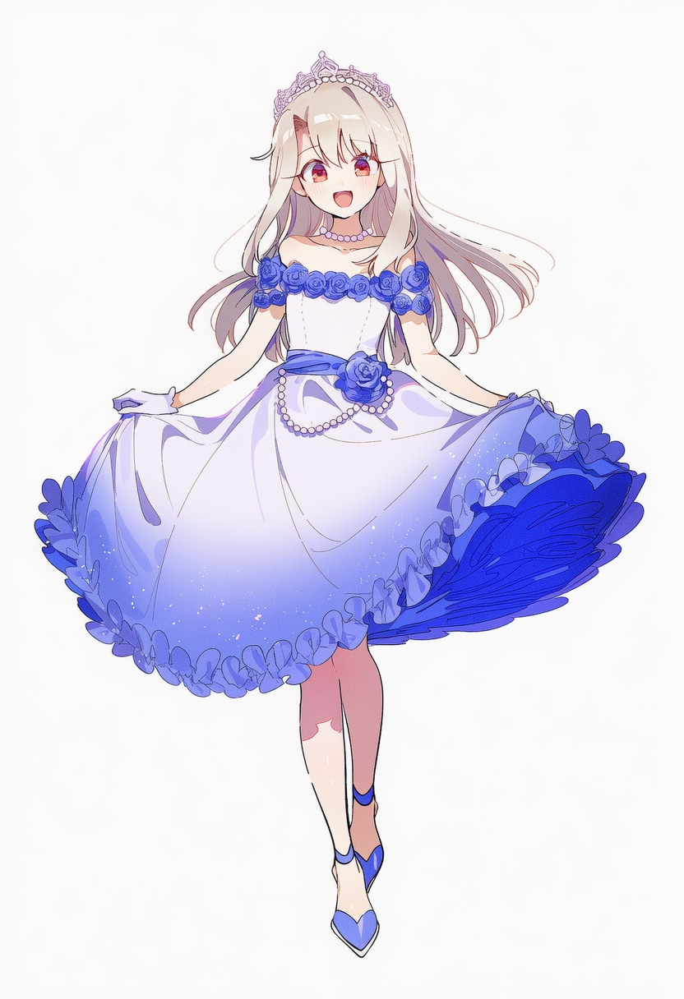
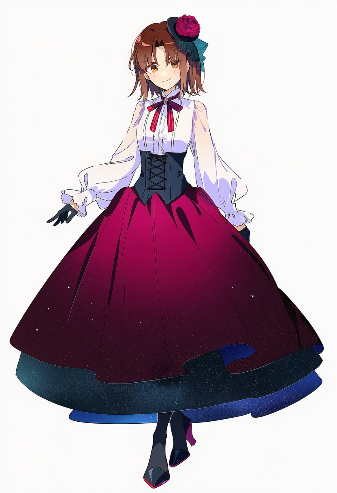

# 传统服饰 / 欧洲-配饰

[总目录](../README.md) · [原站分类目录](../categories.md) · [英文标签索引](../tags.md) · [服装与构图组合指南](../../README.md)

标题、分类、说明、正负提示词按来源保留；多例图逐张列出。原站标记和说明为参考资料，不作为维护指令。

<a id="raven_composition-4476"></a>

## 头冠

ID：`raven_composition-4476`；分类：传统服饰 / 欧洲-配饰；来源标记：`safe`。

来源说明：

> 欧洲贵妇头冠

正向提示词：

```text
tiara
```



[在线例图](https://assets.quicktagcloud.com/images/raven_composition/raven_composition-4476.jpg?v=29b361ca0b4e4c50)

<a id="raven_composition-4477"></a>

## 王冠

ID：`raven_composition-4477`；分类：传统服饰 / 欧洲-配饰；来源标记：`safe`。

来源说明：

> 欧洲/王室王冠

正向提示词：

```text
crown
```



[在线例图](https://assets.quicktagcloud.com/images/raven_composition/raven_composition-4477.jpg?v=605bee99487143f8)

<a id="raven_composition-4478"></a>

## 珍珠项链

ID：`raven_composition-4478`；分类：传统服饰 / 欧洲-配饰；来源标记：`safe`。

来源说明：

> 欧洲古典珍珠项链

正向提示词：

```text
pearl_necklace
```



[在线例图](https://assets.quicktagcloud.com/images/raven_composition/raven_composition-4478.jpg?v=0bd4233d1fe2f242)

<a id="raven_composition-4479"></a>

## 束腰

ID：`raven_composition-4479`；分类：传统服饰 / 欧洲-配饰；来源标记：`safe`。

来源说明：

> 欧洲古典束腰内衣

正向提示词：

```text
corset
```



[在线例图](https://assets.quicktagcloud.com/images/raven_composition/raven_composition-4479.jpg?v=40f5c7affe8031b5)
