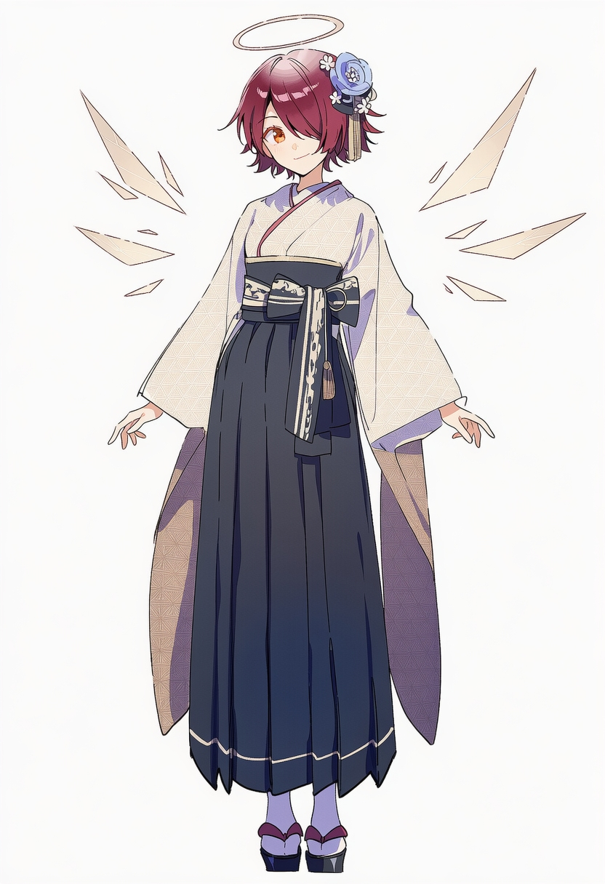

# 传统服饰 / 东南亚-配饰

[总目录](../README.md) · [原站分类目录](../categories.md) · [英文标签索引](../tags.md) · [服装与构图组合指南](../../README.md)

标题、分类、说明、正负提示词按来源保留；多例图逐张列出。原站标记和说明为参考资料，不作为维护指令。

<a id="raven_composition-4480"></a>

## 发饰花

ID：`raven_composition-4480`；分类：传统服饰 / 东南亚-配饰；来源标记：`safe`。

来源说明：

> 东南亚/南亚热带发饰花

正向提示词：

```text
hair_flower
```



[在线例图](https://assets.quicktagcloud.com/images/raven_composition/raven_composition-4480.jpg?v=8aac132da8c9d303)
