# 角色图鉴 / 白毛

[总目录](../README.md) · [原站分类目录](../categories.md) · [英文标签索引](../tags.md) · [服装与构图组合指南](../../README.md)

标题、分类、说明、正负提示词按来源保留；多例图逐张列出。原站标记和说明为参考资料，不作为维护指令。

<a id="raven_composition-4481"></a>

## 25时初音

ID：`raven_composition-4481`；分类：角色图鉴 / 白毛；来源标记：`safe`。

来源说明：

> 作品：世界计划
> 难度：★★★

正向提示词：

```text
25-ji_miku
```

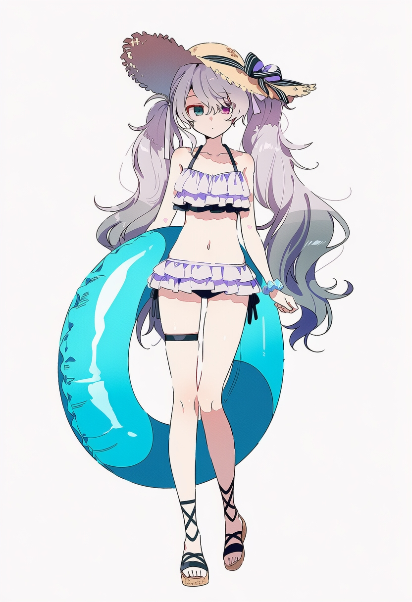

[在线例图](https://assets.quicktagcloud.com/images/raven_composition/raven_composition-4481.jpg?v=157a3fd1e306dfed)

<a id="raven_composition-4482"></a>

## 2B

ID：`raven_composition-4482`；分类：角色图鉴 / 白毛；来源标记：`safe`。

来源说明：

> 作品：尼尔系列
> 难度：★★

正向提示词：

```text
2b_(nier:automata)
```

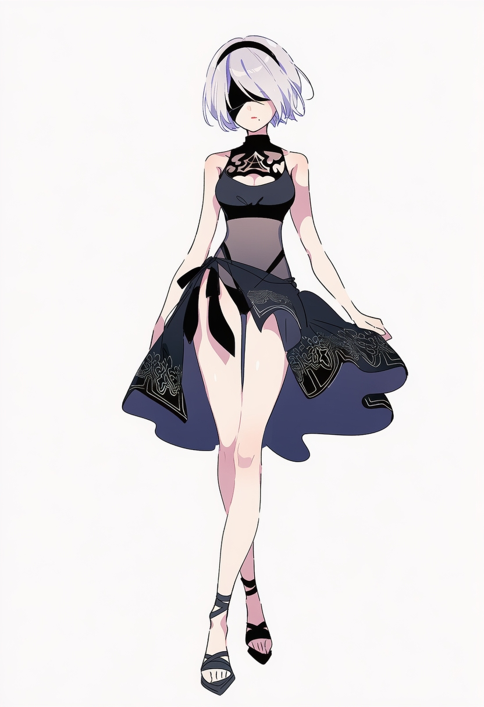

[在线例图](https://assets.quicktagcloud.com/images/raven_composition/raven_composition-4482.jpg?v=de6245d00416aa1d)

<a id="raven_composition-4483"></a>

## 9A-91

ID：`raven_composition-4483`；分类：角色图鉴 / 白毛；来源标记：`safe`。

来源说明：

> 作品：少女前线
> 难度：★

正向提示词：

```text
9a-91_(girls'_frontline)
```

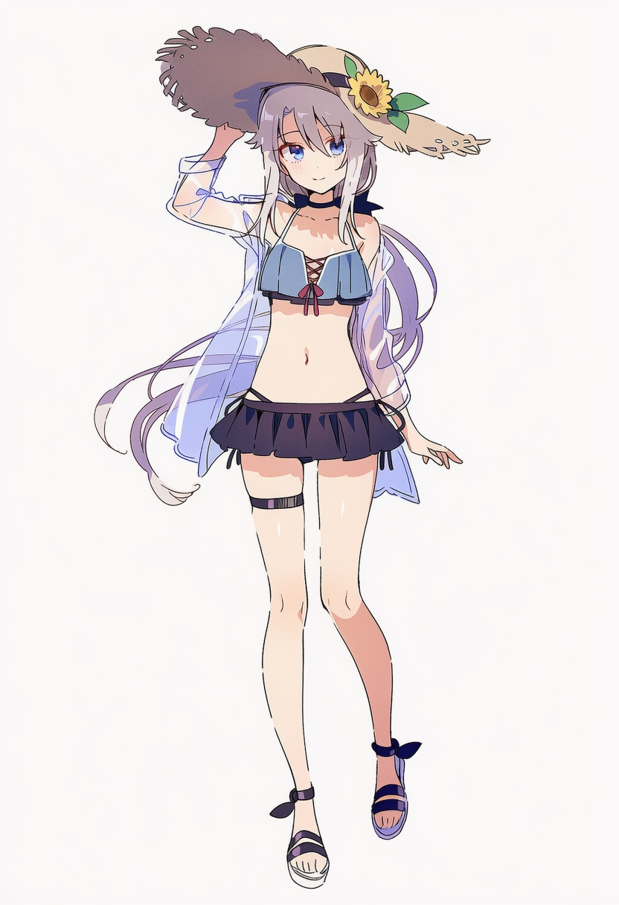

[在线例图](https://assets.quicktagcloud.com/images/raven_composition/raven_composition-4483.jpg?v=31158180a4cbf108)

<a id="raven_composition-4484"></a>

## A.K.I.

ID：`raven_composition-4484`；分类：角色图鉴 / 白毛；来源标记：`safe`。

来源说明：

> 作品：街头霸王
> 难度：★★

正向提示词：

```text
a.k.i._(street_fighter)
```

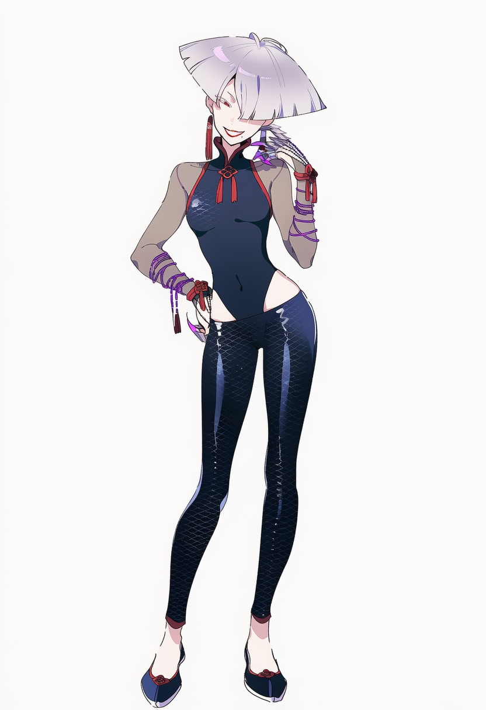

[在线例图](https://assets.quicktagcloud.com/images/raven_composition/raven_composition-4484.jpg?v=c7fc7b75c8b16357)

<a id="raven_composition-4485"></a>

## A2

ID：`raven_composition-4485`；分类：角色图鉴 / 白毛；来源标记：`safe`。

来源说明：

> 作品：尼尔系列
> 难度：★★

正向提示词：

```text
a2_(nier:automata)
```

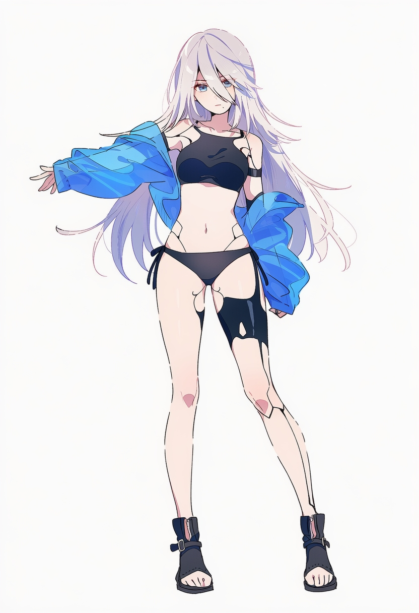

[在线例图](https://assets.quicktagcloud.com/images/raven_composition/raven_composition-4485.jpg?v=79b8cb7f7e0eb913)

<a id="raven_composition-4486"></a>

## 土狼

ID：`raven_composition-4486`；分类：角色图鉴 / 白毛；来源标记：`safe`。

来源说明：

> 作品：兽娘动物园
> 难度：★★★★

正向提示词：

```text
aardwolf_(kemono_friends)
```

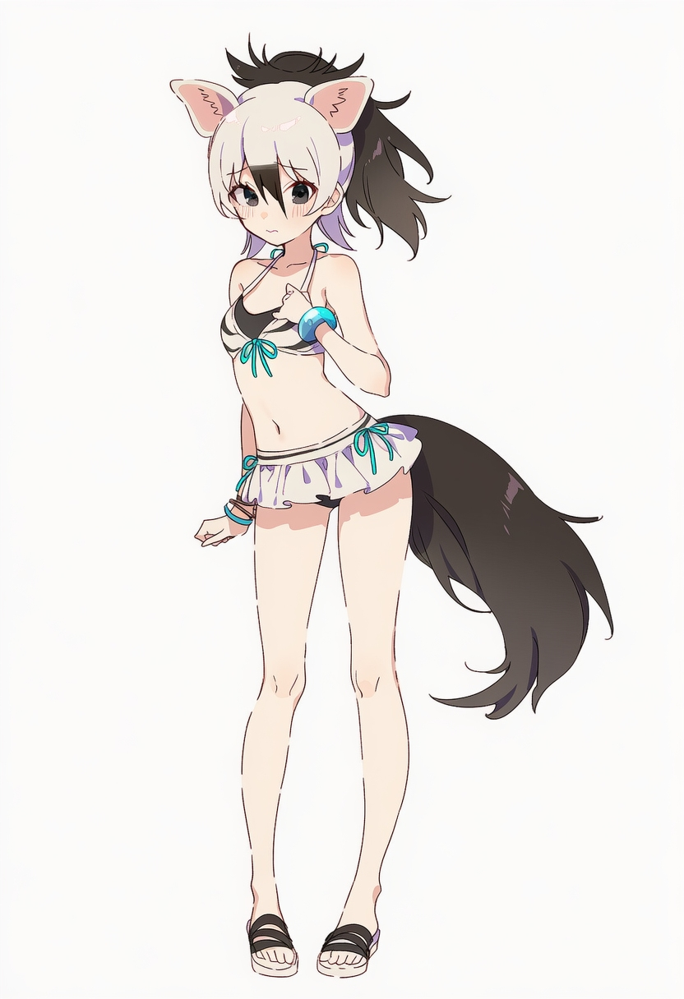

[在线例图](https://assets.quicktagcloud.com/images/raven_composition/raven_composition-4486.jpg?v=09dce1c1993e30a5)

<a id="raven_composition-4487"></a>

## 阿比盖尔·威廉姆斯（泳装Foreigner）（第一再临）

ID：`raven_composition-4487`；分类：角色图鉴 / 白毛；来源标记：`safe`。

来源说明：

> 作品：命运-冠位指定
> 难度：★★

正向提示词：

```text
abigail_williams_(swimsuit_foreigner)_(first_ascension)_(fate)
```

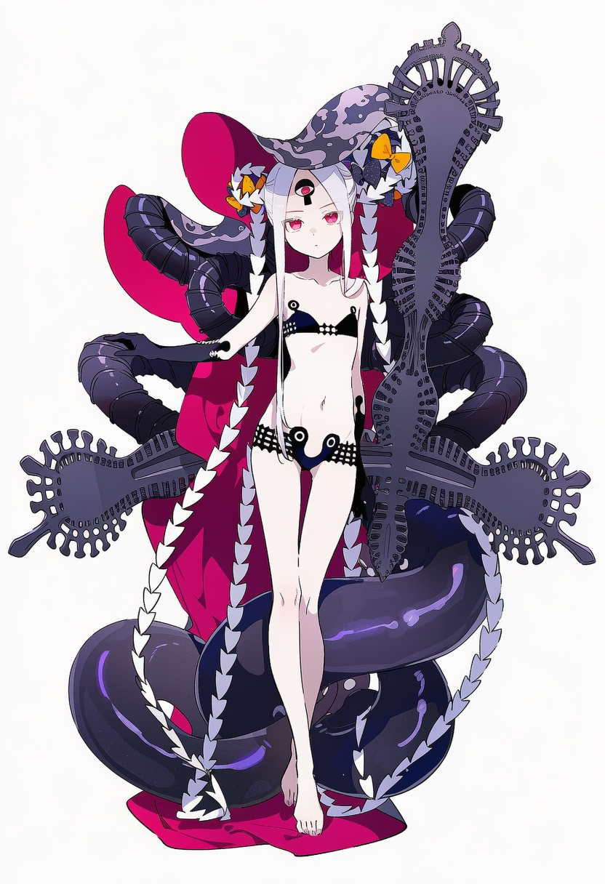

[在线例图](https://assets.quicktagcloud.com/images/raven_composition/raven_composition-4487.jpg?v=f64441c834e8f8e2)

<a id="raven_composition-4488"></a>

## 阿比盖尔·威廉姆斯（第三再临）

ID：`raven_composition-4488`；分类：角色图鉴 / 白毛；来源标记：`safe`。

来源说明：

> 作品：命运-冠位指定
> 难度：★★

正向提示词：

```text
abigail_williams_(third_ascension)_(fate)
```

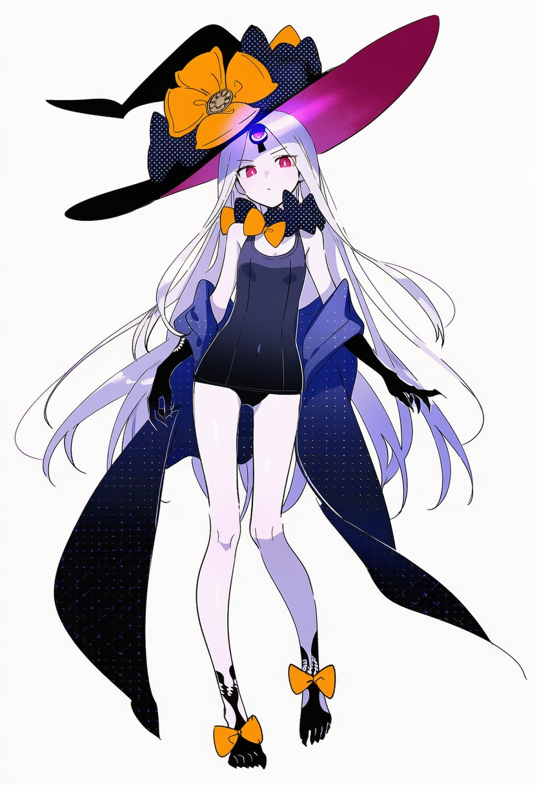

[在线例图](https://assets.quicktagcloud.com/images/raven_composition/raven_composition-4488.jpg?v=90f4054e75414c51)

<a id="raven_composition-4489"></a>

## 战斗修女

ID：`raven_composition-4489`；分类：角色图鉴 / 白毛；来源标记：`safe`。

来源说明：

> 作品：战锤40K
> 难度：★★★★

正向提示词：

```text
adepta_sororitas
```

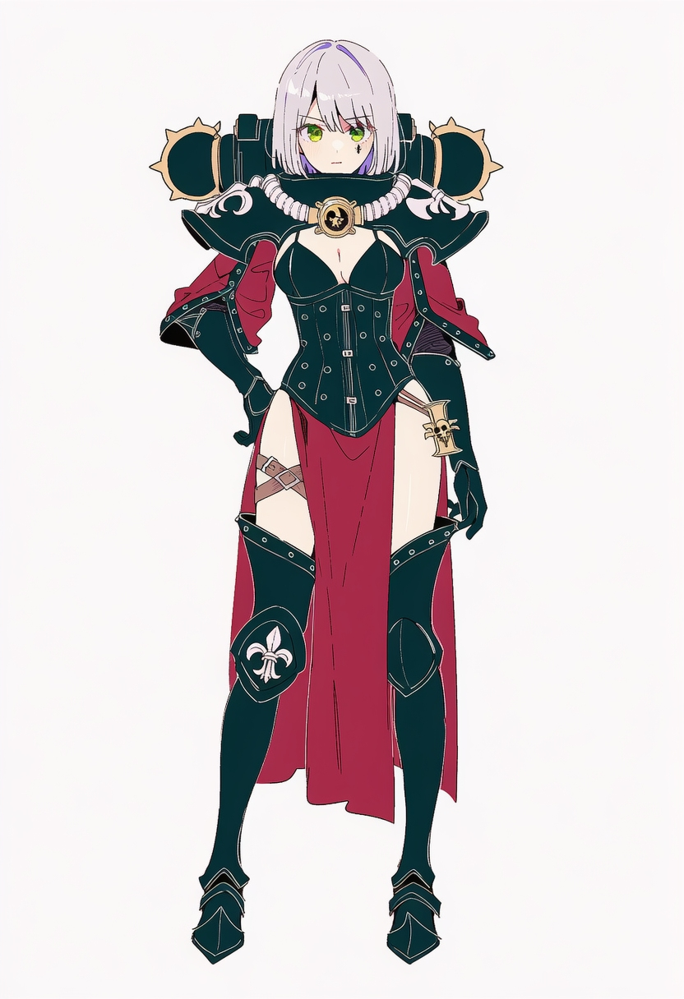

[在线例图](https://assets.quicktagcloud.com/images/raven_composition/raven_composition-4489.jpg?v=f0b80941aeb99366)

<a id="raven_composition-4490"></a>

## 斯佩伯爵海军上将

ID：`raven_composition-4490`；分类：角色图鉴 / 白毛；来源标记：`safe`。

来源说明：

> 作品：碧蓝航线
> 难度：★

正向提示词：

```text
admiral_graf_spee_(azur_lane)
```

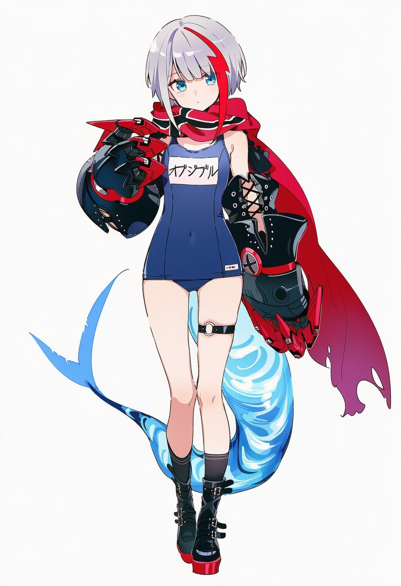

[在线例图](https://assets.quicktagcloud.com/images/raven_composition/raven_composition-4490.jpg?v=0073c759c10f7114)

<a id="raven_composition-4491"></a>

## 埃吉尔

ID：`raven_composition-4491`；分类：角色图鉴 / 白毛；来源标记：`safe`。

来源说明：

> 作品：碧蓝航线
> 难度：★

正向提示词：

```text
aegir_(azur_lane)
```

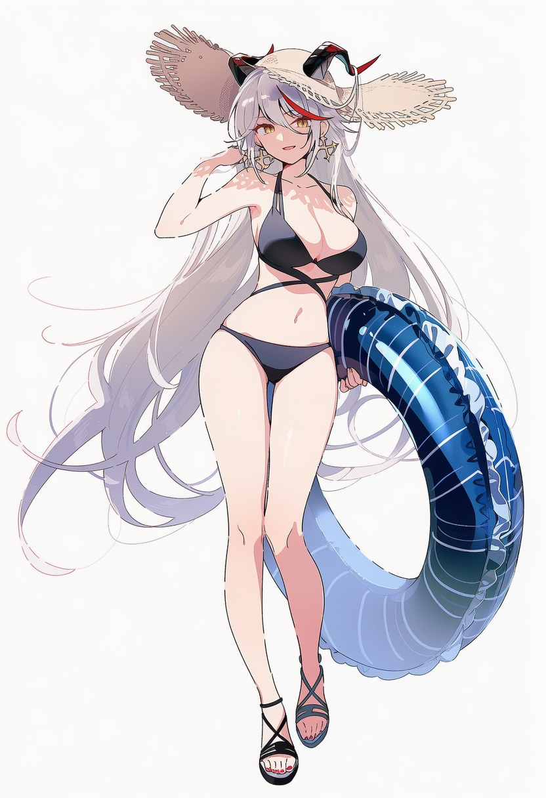

[在线例图](https://assets.quicktagcloud.com/images/raven_composition/raven_composition-4491.jpg?v=844bdd766e211478)

<a id="raven_composition-4492"></a>

## AEK-999

ID：`raven_composition-4492`；分类：角色图鉴 / 白毛；来源标记：`safe`。

来源说明：

> 作品：少女前线
> 难度：★

正向提示词：

```text
aek-999_(girls'_frontline)
```

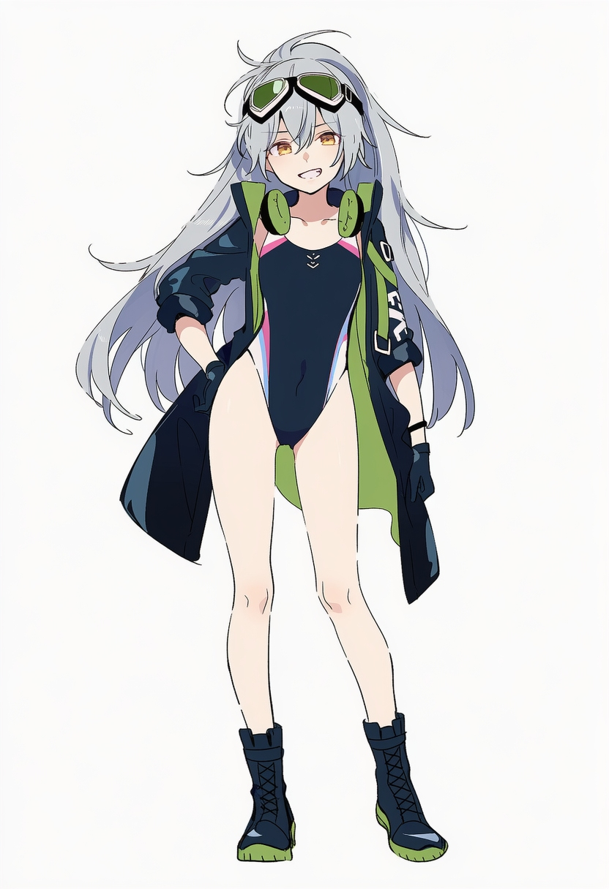

[在线例图](https://assets.quicktagcloud.com/images/raven_composition/raven_composition-4492.jpg?v=648083f18ef8c339)

<a id="raven_composition-4493"></a>

## 艾拉·于尔基艾宁

ID：`raven_composition-4493`；分类：角色图鉴 / 白毛；来源标记：`safe`。

来源说明：

> 作品：高达
> 难度：★★

正向提示词：

```text
aila_jyrkiainen
```

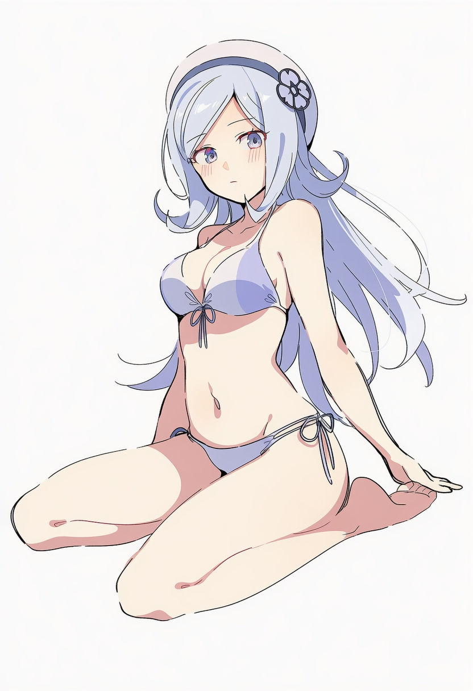

[在线例图](https://assets.quicktagcloud.com/images/raven_composition/raven_composition-4493.jpg?v=9c475dd4dad2d07c)

<a id="raven_composition-4494"></a>

## 艾夏·克兰克兰

ID：`raven_composition-4494`；分类：角色图鉴 / 白毛；来源标记：`safe`。

来源说明：

> 作品：星方武侠
> 难度：★★★★

正向提示词：

```text
aisha_clanclan
```

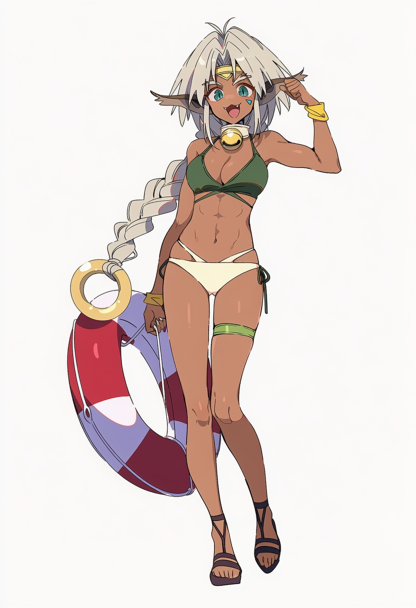

[在线例图](https://assets.quicktagcloud.com/images/raven_composition/raven_composition-4494.jpg?v=3eb0a5b8447b33af)

<a id="raven_composition-4495"></a>

## AK-12

ID：`raven_composition-4495`；分类：角色图鉴 / 白毛；来源标记：`safe`。

来源说明：

> 作品：少女前线
> 难度：★

正向提示词：

```text
ak-12_(girls'_frontline)
```

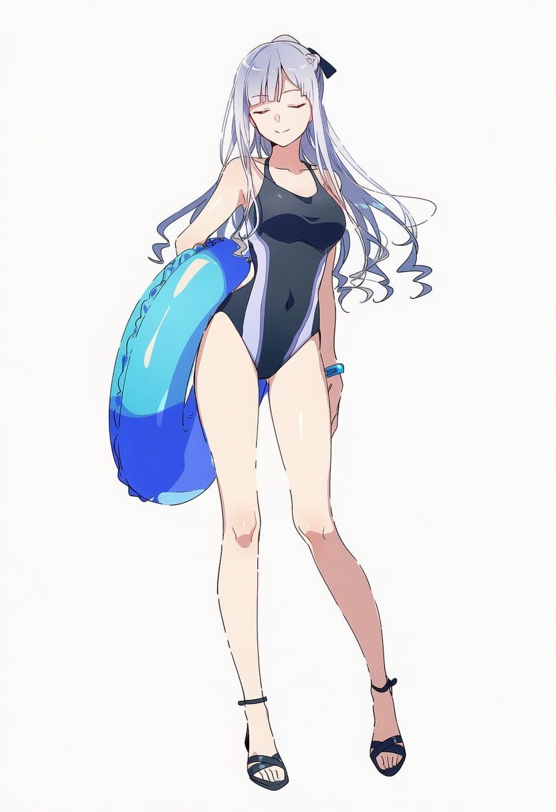

[在线例图](https://assets.quicktagcloud.com/images/raven_composition/raven_composition-4495.jpg?v=e0f18222e0e0203c)

<a id="raven_composition-4496"></a>

## AK-15

ID：`raven_composition-4496`；分类：角色图鉴 / 白毛；来源标记：`safe`。

来源说明：

> 作品：少女前线
> 难度：★

正向提示词：

```text
ak-15_(girls'_frontline)
```

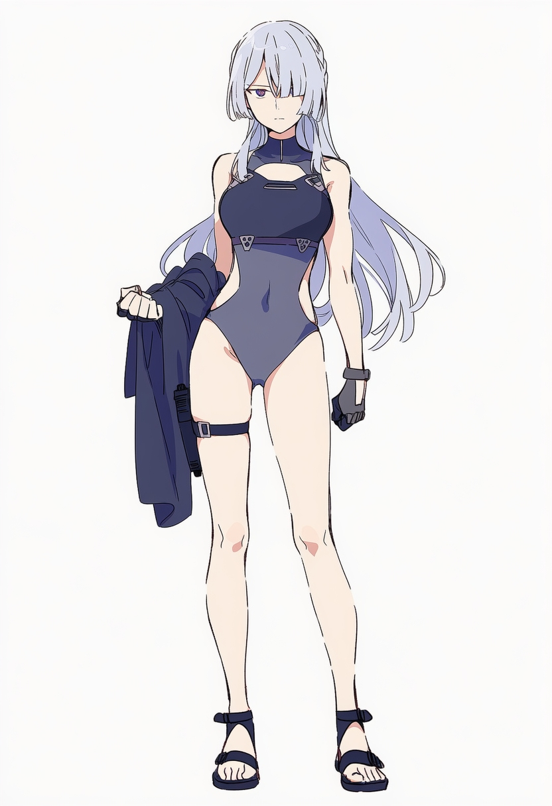

[在线例图](https://assets.quicktagcloud.com/images/raven_composition/raven_composition-4496.jpg?v=5bd968fe4abf14c5)

<a id="raven_composition-4497"></a>

## 秋月栞那

ID：`raven_composition-4497`；分类：角色图鉴 / 白毛；来源标记：`safe`。

来源说明：

> 作品：咖啡馆斯特拉与死神之蝶
> 难度：★★★★★

正向提示词：

```text
akizuki_kanna
```

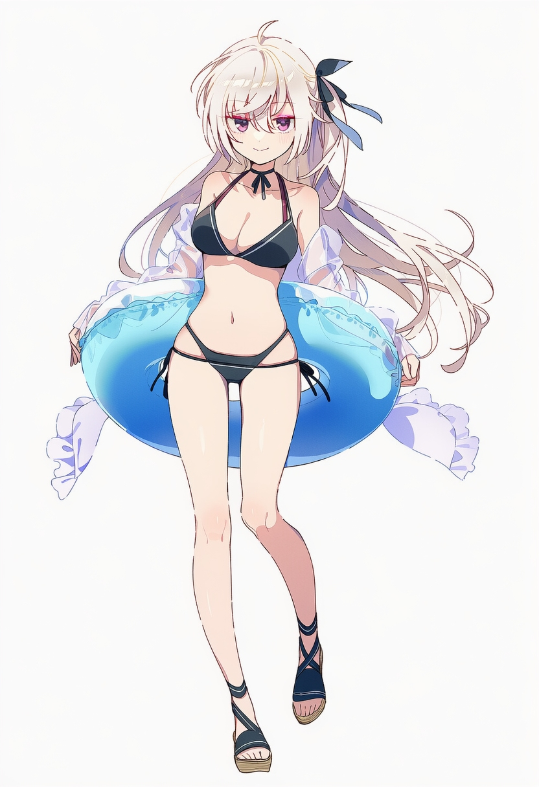

[在线例图](https://assets.quicktagcloud.com/images/raven_composition/raven_composition-4497.jpg?v=9d240905edbf81be)

<a id="raven_composition-4498"></a>

## Akumi

ID：`raven_composition-4498`；分类：角色图鉴 / 白毛；来源标记：`safe`。

来源说明：

> 作品：Vyugen
> 难度：★★★★

正向提示词：

```text
akumi_(yoclesh)
```

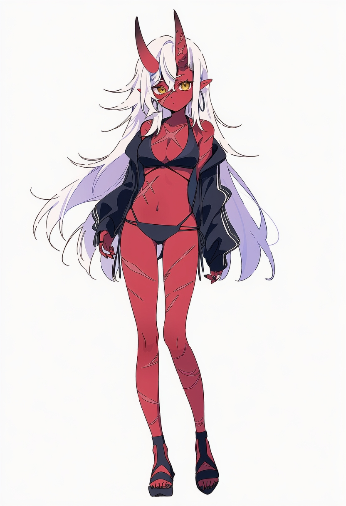

[在线例图](https://assets.quicktagcloud.com/images/raven_composition/raven_composition-4498.jpg?v=2fb8ec9e84b339c5)

<a id="raven_composition-4499"></a>

## 阿拉巴马

ID：`raven_composition-4499`；分类：角色图鉴 / 白毛；来源标记：`safe`。

来源说明：

> 作品：碧蓝航线
> 难度：★

正向提示词：

```text
alabama_(azur_lane)
```

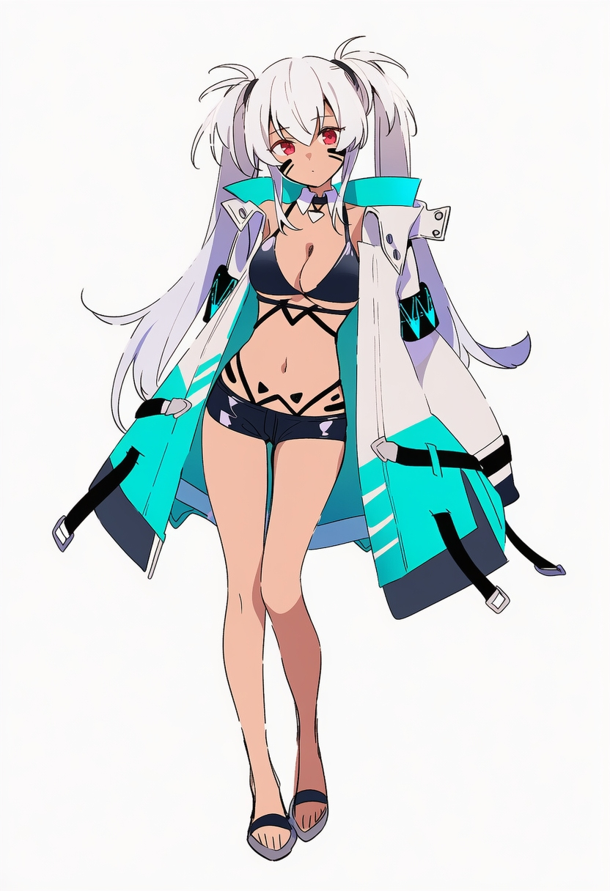

[在线例图](https://assets.quicktagcloud.com/images/raven_composition/raven_composition-4499.jpg?v=012deb78be9e6744)

<a id="raven_composition-4500"></a>

## 炼金术士

ID：`raven_composition-4500`；分类：角色图鉴 / 白毛；来源标记：`safe`。

来源说明：

> 作品：少女前线
> 难度：★

正向提示词：

```text
alchemist_(girls'_frontline)
```

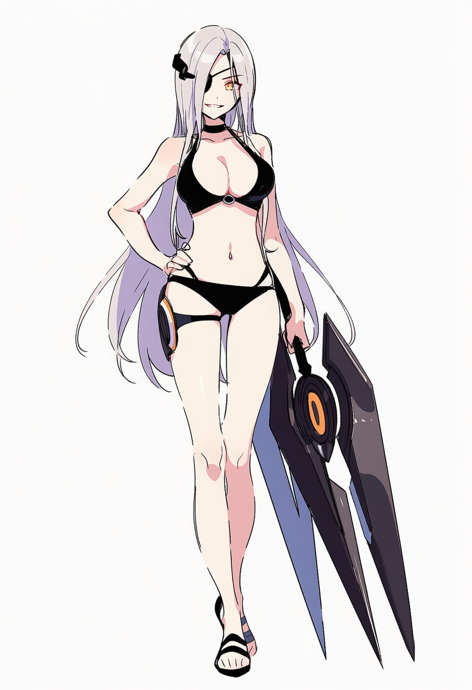

[在线例图](https://assets.quicktagcloud.com/images/raven_composition/raven_composition-4500.jpg?v=9a5a71a966ccb8b0)

<a id="raven_composition-4501"></a>

## 阿尔及利亚

ID：`raven_composition-4501`；分类：角色图鉴 / 白毛；来源标记：`safe`。

来源说明：

> 作品：碧蓝航线
> 难度：★

正向提示词：

```text
algerie_(azur_lane)
```

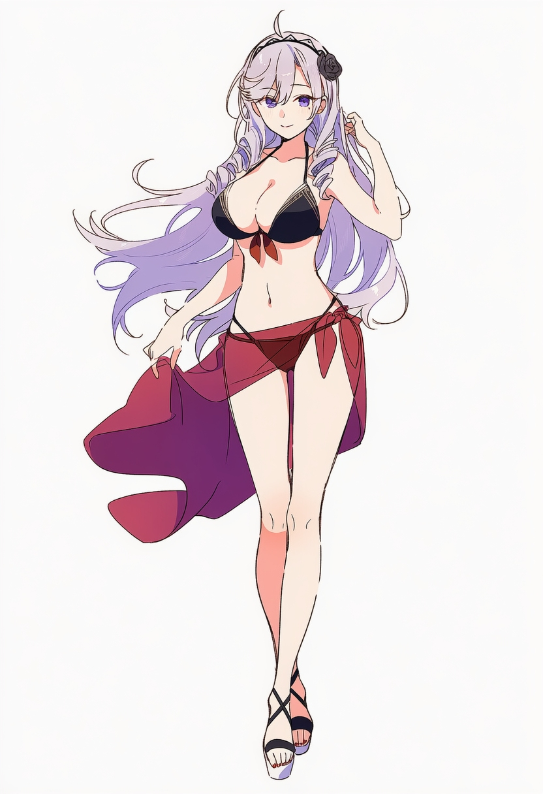

[在线例图](https://assets.quicktagcloud.com/images/raven_composition/raven_composition-4501.jpg?v=71855a7b31be2ea8)

<a id="raven_composition-4502"></a>

## 爱丽丝菲兹·法塔贝尔恩十六世

ID：`raven_composition-4502`；分类：角色图鉴 / 白毛；来源标记：`safe`。

来源说明：

> 作品：勇者大战魔物娘
> 难度：★★★★

正向提示词：

```text
alipheese_fateburn_xvi
```

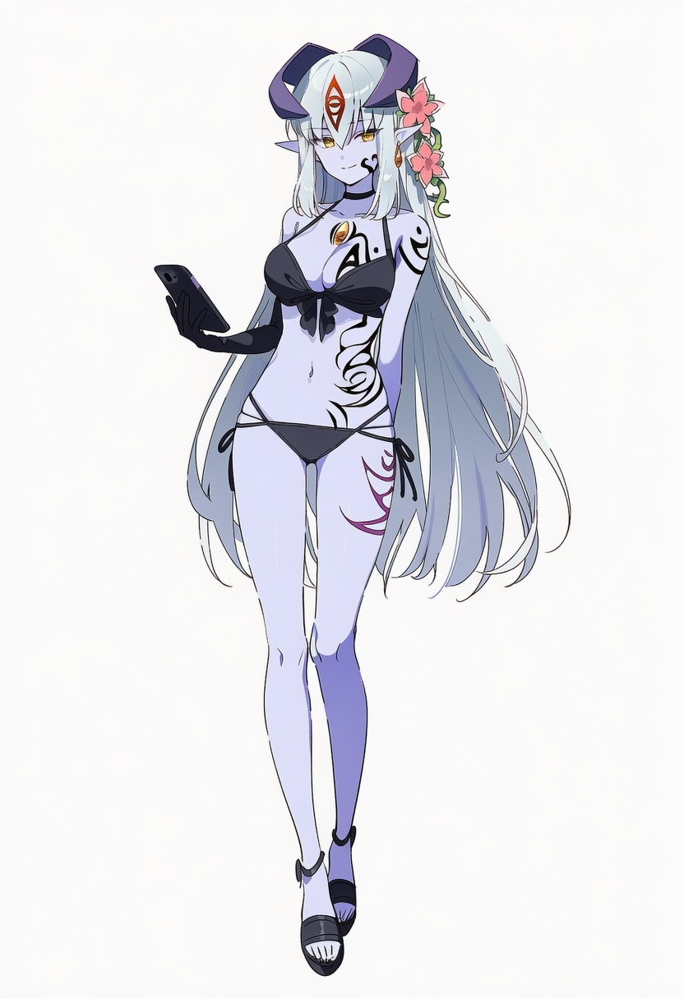

[在线例图](https://assets.quicktagcloud.com/images/raven_composition/raven_composition-4502.jpg?v=880c19d8486b1139)

<a id="raven_composition-4503"></a>

## 艾莉莎·米哈伊洛夫娜·九条

ID：`raven_composition-4503`；分类：角色图鉴 / 白毛；来源标记：`safe`。

来源说明：

> 作品：有时会用俄语遮羞的邻座艾莉同学
> 难度：★★★★★

正向提示词：

```text
alisa_mikhailovna_kujou
```

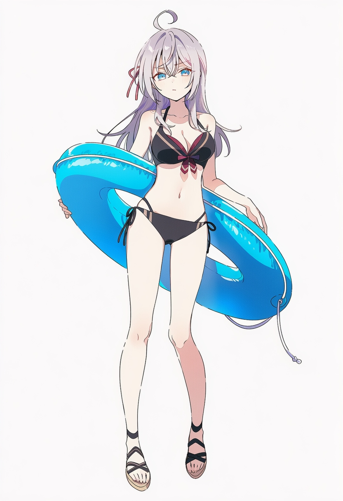

[在线例图](https://assets.quicktagcloud.com/images/raven_composition/raven_composition-4503.jpg?v=be076558f0708dff)

<a id="raven_composition-4504"></a>

## 阿莉塞·莱韦耶勒尔

ID：`raven_composition-4504`；分类：角色图鉴 / 白毛；来源标记：`safe`。

来源说明：

> 作品：最终幻想
> 难度：★★★

正向提示词：

```text
alisaie_leveilleur
```

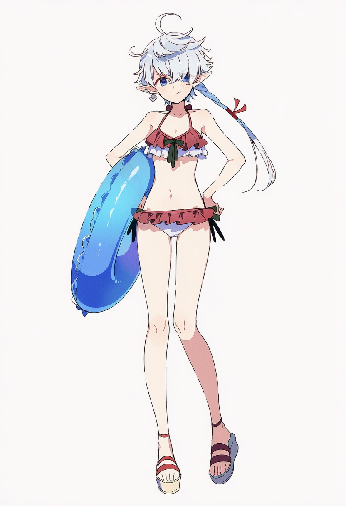

[在线例图](https://assets.quicktagcloud.com/images/raven_composition/raven_composition-4504.jpg?v=086c8a3498294d43)

<a id="raven_composition-4505"></a>

## 艾莉莎

ID：`raven_composition-4505`；分类：角色图鉴 / 白毛；来源标记：`safe`。

来源说明：

> 作品：碧蓝幻想
> 难度：★★★

正向提示词：

```text
aliza_(granblue_fantasy)
```

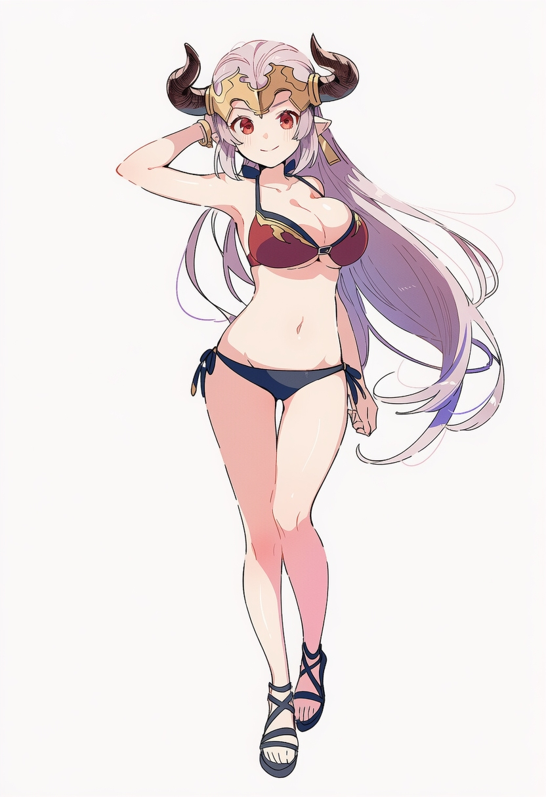

[在线例图](https://assets.quicktagcloud.com/images/raven_composition/raven_composition-4505.jpg?v=e3e7da05b529c43c)

<a id="raven_composition-4506"></a>

## 苏利羊驼

ID：`raven_composition-4506`；分类：角色图鉴 / 白毛；来源标记：`safe`。

来源说明：

> 作品：兽娘动物园
> 难度：★★★★

正向提示词：

```text
alpaca_suri_(kemono_friends)
```

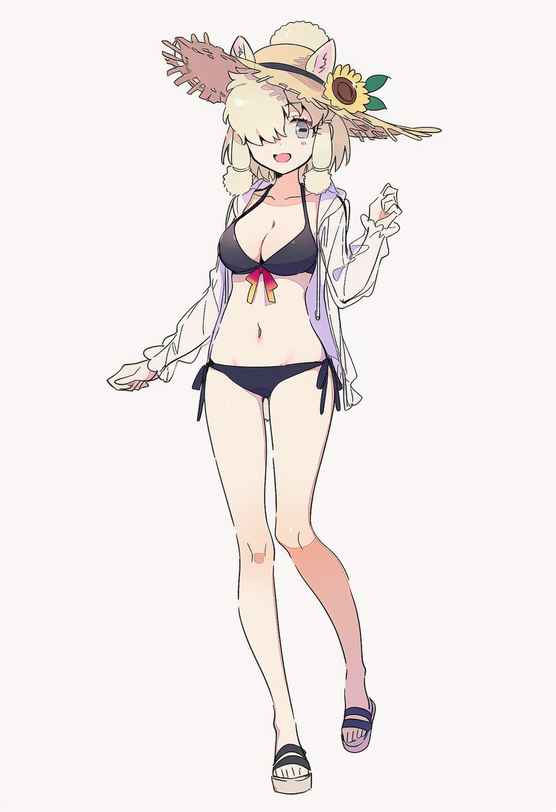

[在线例图](https://assets.quicktagcloud.com/images/raven_composition/raven_composition-4506.jpg?v=08bd03b229ea54ad)

<a id="raven_composition-4507"></a>

## 阿尔泰尔

ID：`raven_composition-4507`；分类：角色图鉴 / 白毛；来源标记：`safe`。

来源说明：

> 作品：Re:CREATORS
> 难度：★★★★★

正向提示词：

```text
altair_(re:creators)
```

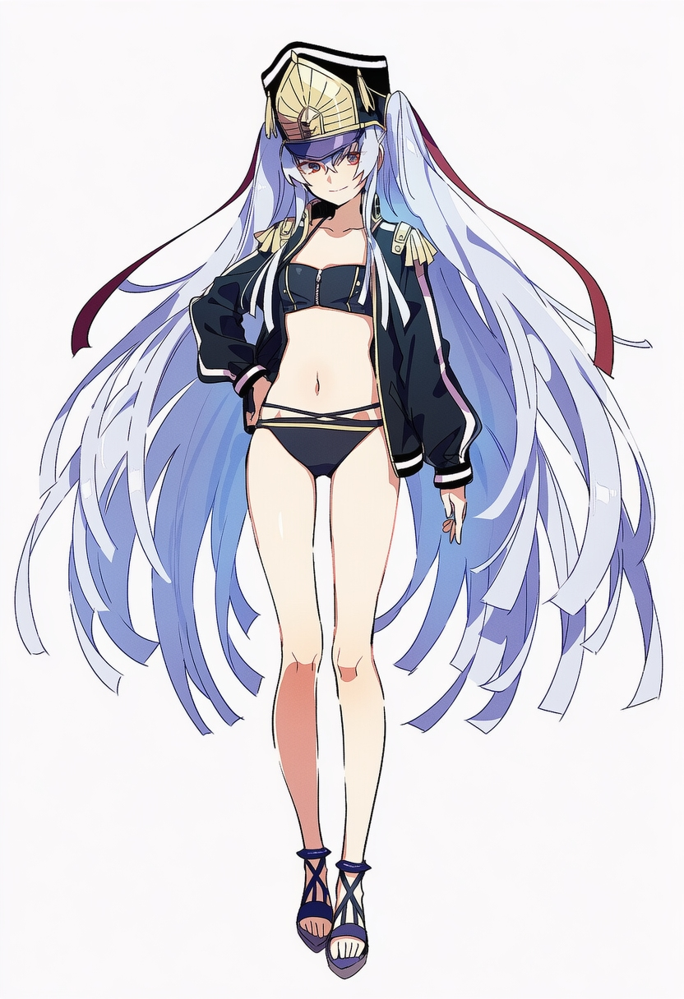

[在线例图](https://assets.quicktagcloud.com/images/raven_composition/raven_composition-4507.jpg?v=9b2d34efe54fe47c)

<a id="raven_composition-4508"></a>

## 阿提拉

ID：`raven_composition-4508`；分类：角色图鉴 / 白毛；来源标记：`safe`。

来源说明：

> 作品：Fate系列
> 难度：★★

正向提示词：

```text
altera_(fate)
```

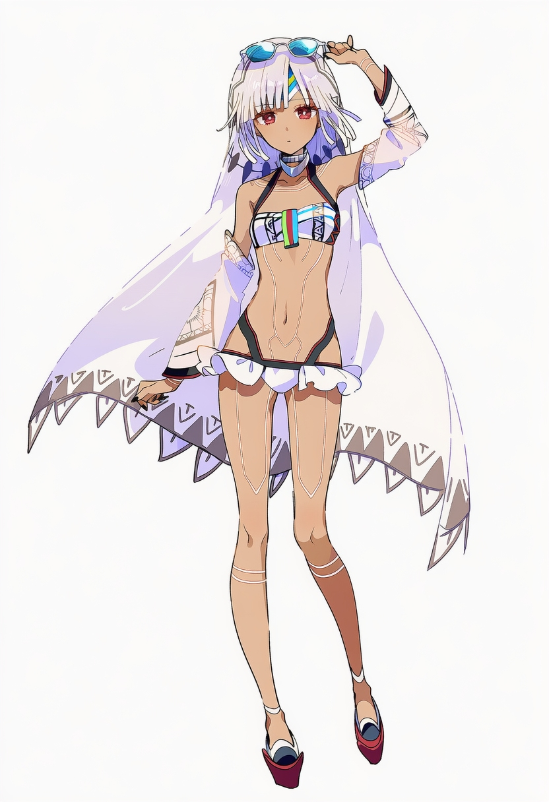

[在线例图](https://assets.quicktagcloud.com/images/raven_composition/raven_composition-4508.jpg?v=4686c36123bd55aa)

<a id="raven_composition-4509"></a>

## 阿提拉·圣（诞）

ID：`raven_composition-4509`；分类：角色图鉴 / 白毛；来源标记：`safe`。

来源说明：

> 作品：Fate系列
> 难度：★★

正向提示词：

```text
altera_the_santa_(fate)
```

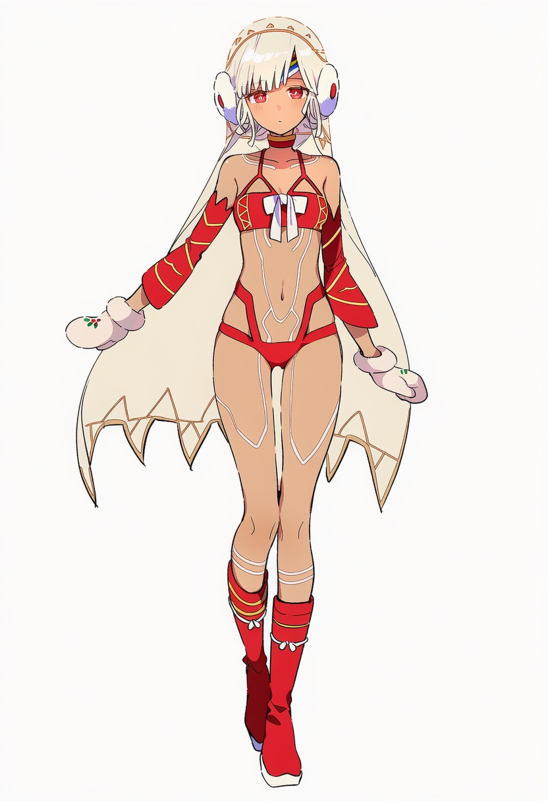

[在线例图](https://assets.quicktagcloud.com/images/raven_composition/raven_composition-4509.jpg?v=c9098b3f4d60e08a)

<a id="raven_composition-4510"></a>

## 亚尔缇娜·奥莱恩

ID：`raven_composition-4510`；分类：角色图鉴 / 白毛；来源标记：`safe`。

来源说明：

> 作品：英雄传说
> 难度：★★★★

正向提示词：

```text
altina_orion
```

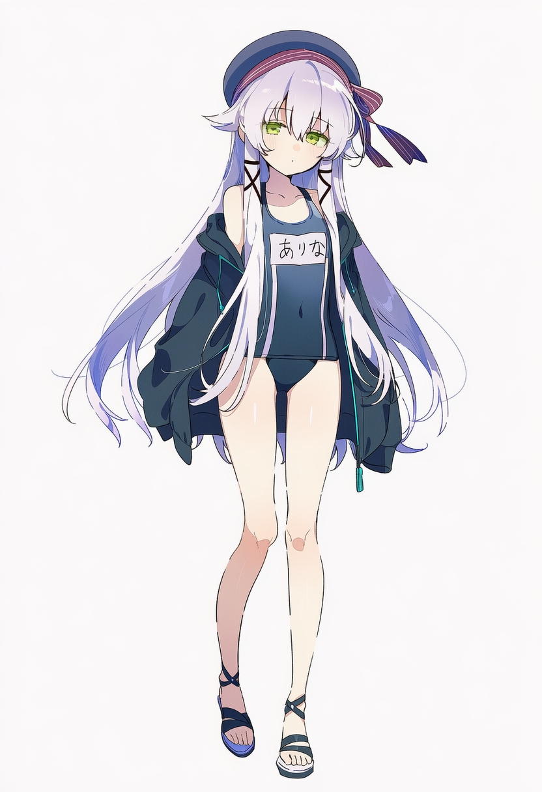

[在线例图](https://assets.quicktagcloud.com/images/raven_composition/raven_composition-4510.jpg?v=0e6f8d622c0fcc06)

<a id="raven_composition-4511"></a>

## 天照

ID：`raven_composition-4511`；分类：角色图鉴 / 白毛；来源标记：`safe`。

来源说明：

> 作品：大神（游戏）
> 难度：★★★★

正向提示词：

```text
amaterasu_(ookami)
```

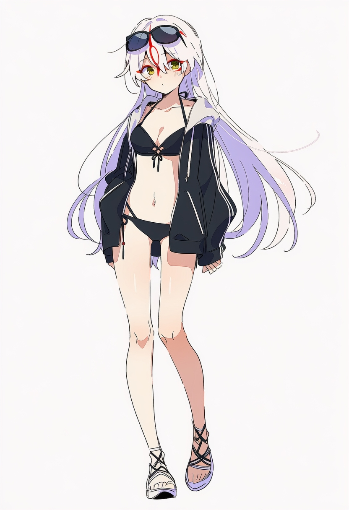

[在线例图](https://assets.quicktagcloud.com/images/raven_composition/raven_composition-4511.jpg?v=e3935065973629e5)

<a id="raven_composition-4512"></a>

## AN-94（露希安）

ID：`raven_composition-4512`；分类：角色图鉴 / 白毛；来源标记：`safe`。

来源说明：

> 作品：少女前线
> 难度：★

正向提示词：

```text
an-94_(silent_rouge)_(girls'_frontline)
```

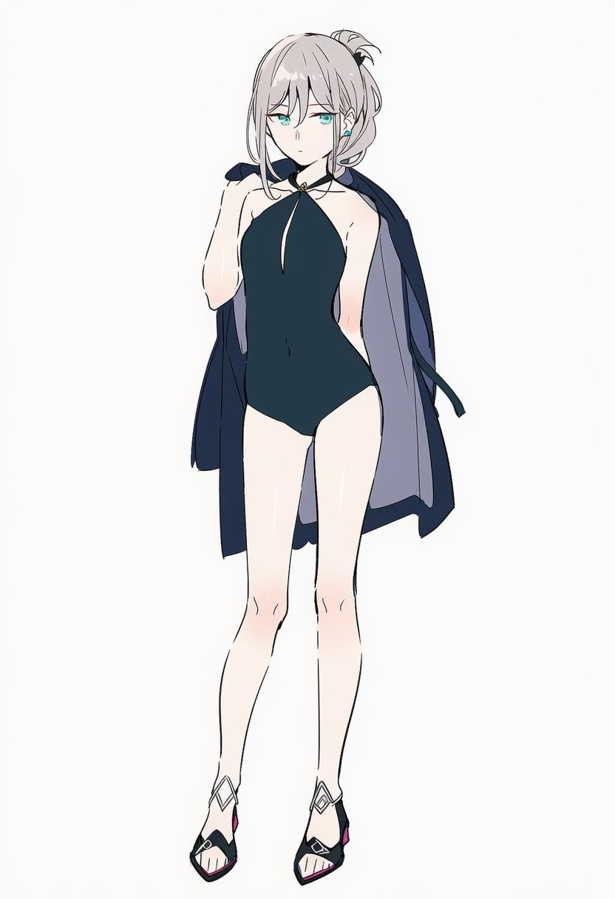

[在线例图](https://assets.quicktagcloud.com/images/raven_composition/raven_composition-4512.jpg?v=c41f47a722b1e9f4)

<a id="raven_composition-4513"></a>

## 阿纳斯塔西娅

ID：`raven_composition-4513`；分类：角色图鉴 / 白毛；来源标记：`safe`。

来源说明：

> 作品：命运-冠位指定
> 难度：★★

正向提示词：

```text
anastasia_(fate)
```

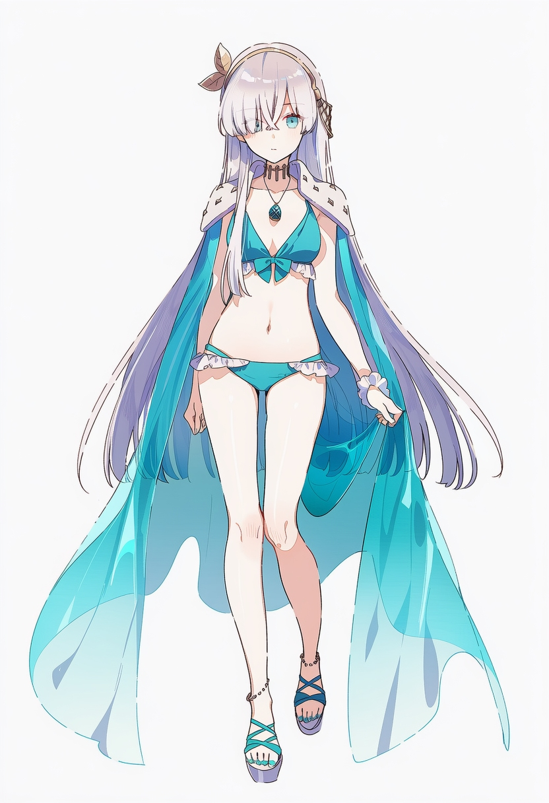

[在线例图](https://assets.quicktagcloud.com/images/raven_composition/raven_composition-4513.jpg?v=0d44e70c2e89f50a)

<a id="raven_composition-4514"></a>

## 安比·德玛拉

ID：`raven_composition-4514`；分类：角色图鉴 / 白毛；来源标记：`safe`。

来源说明：

> 作品：绝区零
> 难度：★

正向提示词：

```text
anby_demara
```

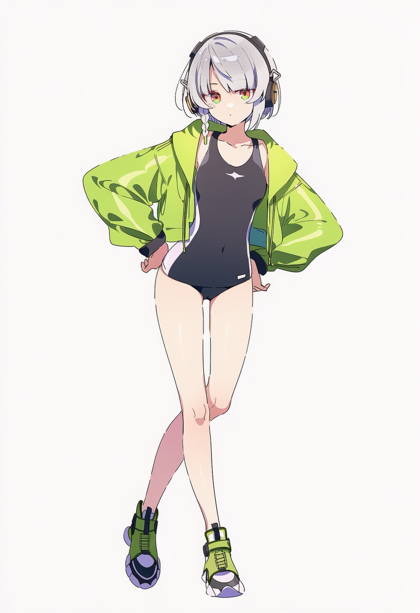

[在线例图](https://assets.quicktagcloud.com/images/raven_composition/raven_composition-4514.jpg?v=902728c68ecd237a)

<a id="raven_composition-4515"></a>

## 安塞利尔·圣洁

ID：`raven_composition-4515`；分类：角色图鉴 / 白毛；来源标记：`safe`。

来源说明：

> 作品：白神计划
> 难度：★★★★

正向提示词：

```text
anceril_sacred
```

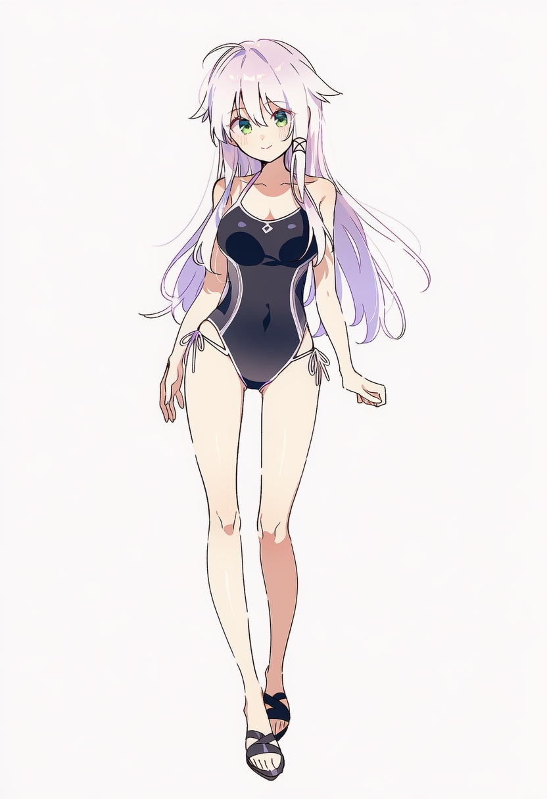

[在线例图](https://assets.quicktagcloud.com/images/raven_composition/raven_composition-4515.jpg?v=d9d9e1164a6cfb71)

<a id="raven_composition-4516"></a>

## 安琪儿

ID：`raven_composition-4516`；分类：角色图鉴 / 白毛；来源标记：`safe`。

来源说明：

> 作品：拳皇
> 难度：★★

正向提示词：

```text
angel_(kof)
```

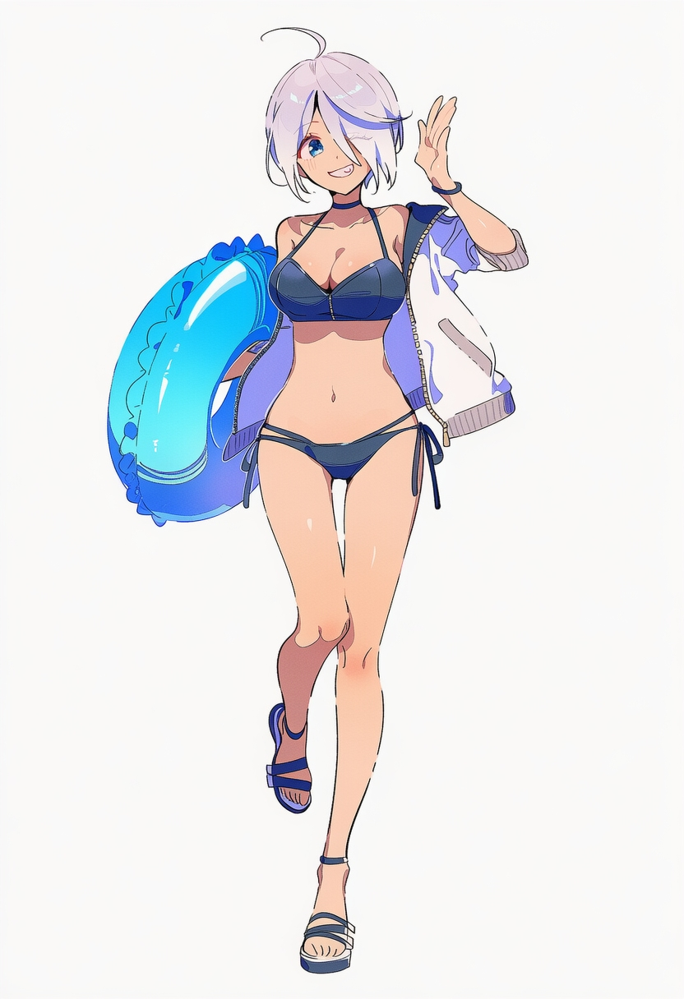

[在线例图](https://assets.quicktagcloud.com/images/raven_composition/raven_composition-4516.jpg?v=49ef5d3f5ecb9f67)

<a id="raven_composition-4517"></a>

## 安吉丽卡

ID：`raven_composition-4517`；分类：角色图鉴 / 白毛；来源标记：`safe`。

来源说明：

> 作品：Project Moon
> 难度：★★★★

正向提示词：

```text
angelica_(project_moon)
```

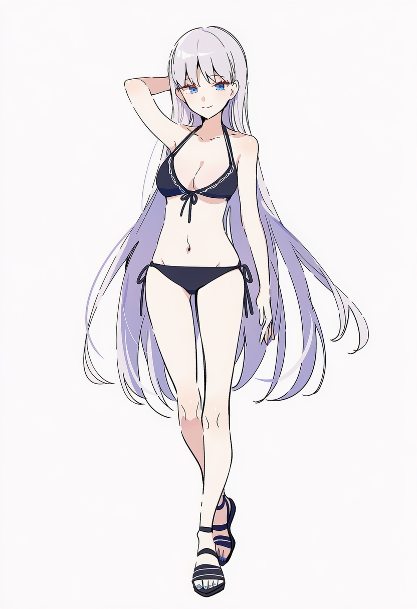

[在线例图](https://assets.quicktagcloud.com/images/raven_composition/raven_composition-4517.jpg?v=63f0fe80cf415611)

<a id="raven_composition-4518"></a>

## Angelise_Reiter

ID：`raven_composition-4518`；分类：角色图鉴 / 白毛；来源标记：`safe`。

来源说明：

> 作品：最终幻想
> 难度：★★★

正向提示词：

```text
angelise_reiter
```

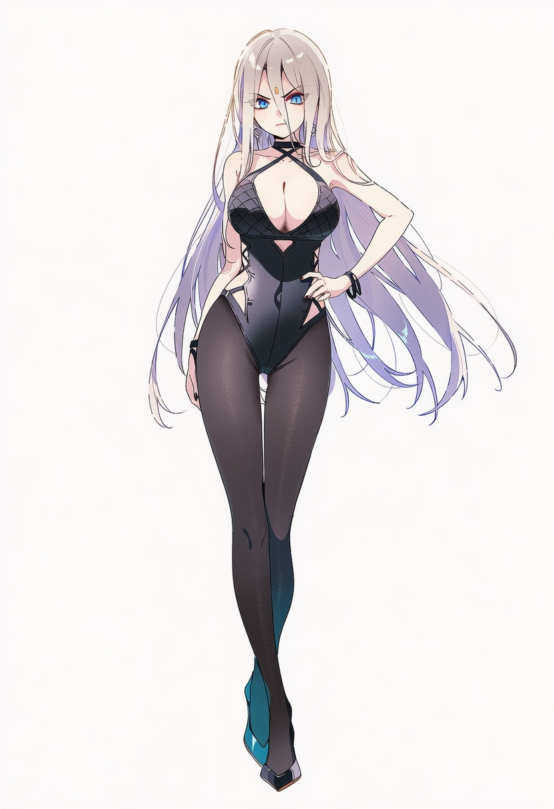

[在线例图](https://assets.quicktagcloud.com/images/raven_composition/raven_composition-4518.jpg?v=47e957c43fe7ff06)

<a id="raven_composition-4519"></a>

## 安娜

ID：`raven_composition-4519`；分类：角色图鉴 / 白毛；来源标记：`safe`。

来源说明：

> 作品：千年战争Aigis
> 难度：★★★★

正向提示词：

```text
anna_(sennen_sensou_aigis)
```

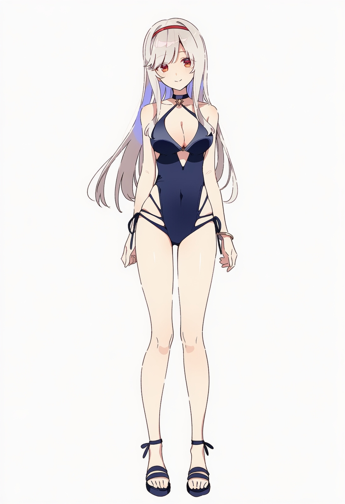

[在线例图](https://assets.quicktagcloud.com/images/raven_composition/raven_composition-4519.jpg?v=0c66eabe77eecfce)

<a id="raven_composition-4520"></a>

## 安娜·锦之宫

ID：`raven_composition-4520`；分类：角色图鉴 / 白毛；来源标记：`safe`。

来源说明：

> 作品：下流梗不存在的灰暗世界
> 难度：★★★★

正向提示词：

```text
anna_nishikinomiya
```

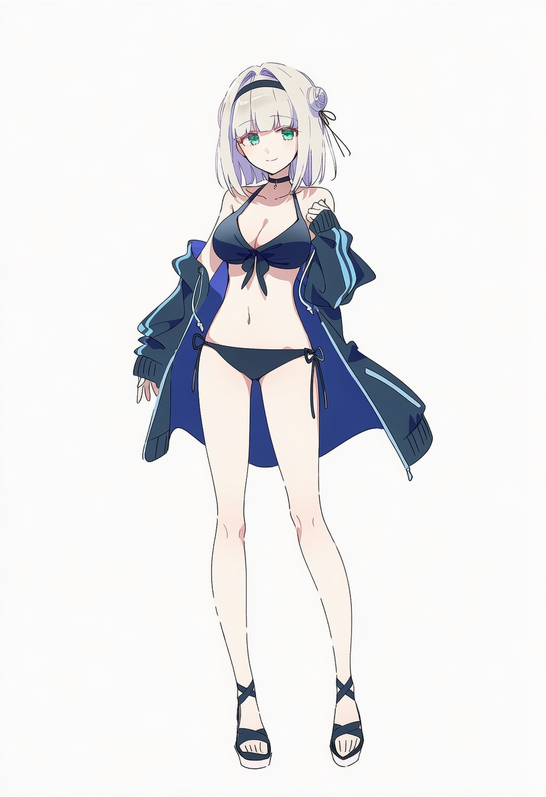

[在线例图](https://assets.quicktagcloud.com/images/raven_composition/raven_composition-4520.jpg?v=ddd334426f21dfb7)

<a id="raven_composition-4521"></a>

## 天鹰

ID：`raven_composition-4521`；分类：角色图鉴 / 白毛；来源标记：`safe`。

来源说明：

> 作品：碧蓝航线
> 难度：★

正向提示词：

```text
aquila_(azur_lane)
```

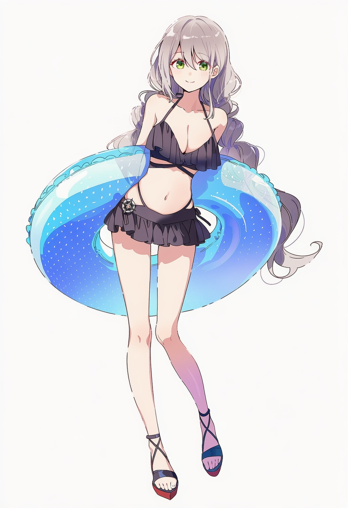

[在线例图](https://assets.quicktagcloud.com/images/raven_composition/raven_composition-4521.jpg?v=814876ea5cae79b0)

<a id="raven_composition-4522"></a>

## 阿拉伯大羚羊

ID：`raven_composition-4522`；分类：角色图鉴 / 白毛；来源标记：`safe`。

来源说明：

> 作品：兽娘动物园
> 难度：★★★★

正向提示词：

```text
arabian_oryx_(kemono_friends)
```

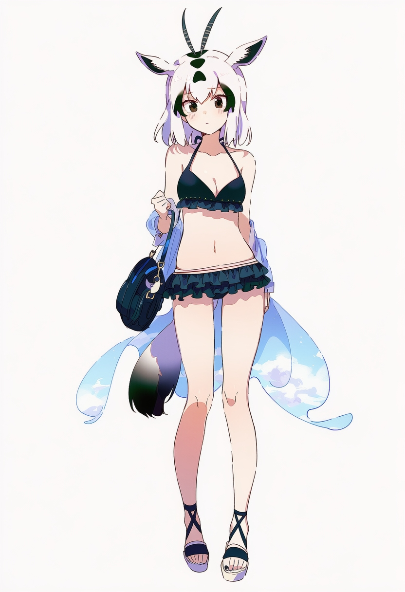

[在线例图](https://assets.quicktagcloud.com/images/raven_composition/raven_composition-4522.jpg?v=5b04df82a01436ee)

<a id="raven_composition-4523"></a>

## 岚千砂都

ID：`raven_composition-4523`；分类：角色图鉴 / 白毛；来源标记：`safe`。

来源说明：

> 作品：LoveLive!学园偶像计划
> 难度：★★★

正向提示词：

```text
arashi_chisato
```

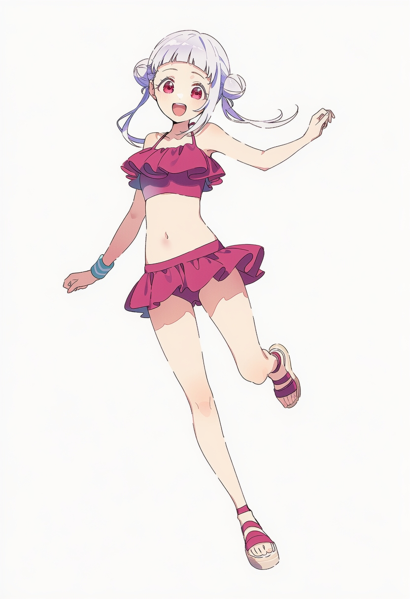

[在线例图](https://assets.quicktagcloud.com/images/raven_composition/raven_composition-4523.jpg?v=135becc8f1cc4165)

<a id="raven_composition-4524"></a>

## 北极狐

ID：`raven_composition-4524`；分类：角色图鉴 / 白毛；来源标记：`safe`。

来源说明：

> 作品：兽娘动物园
> 难度：★★★★

正向提示词：

```text
arctic_fox_(kemono_friends)
```

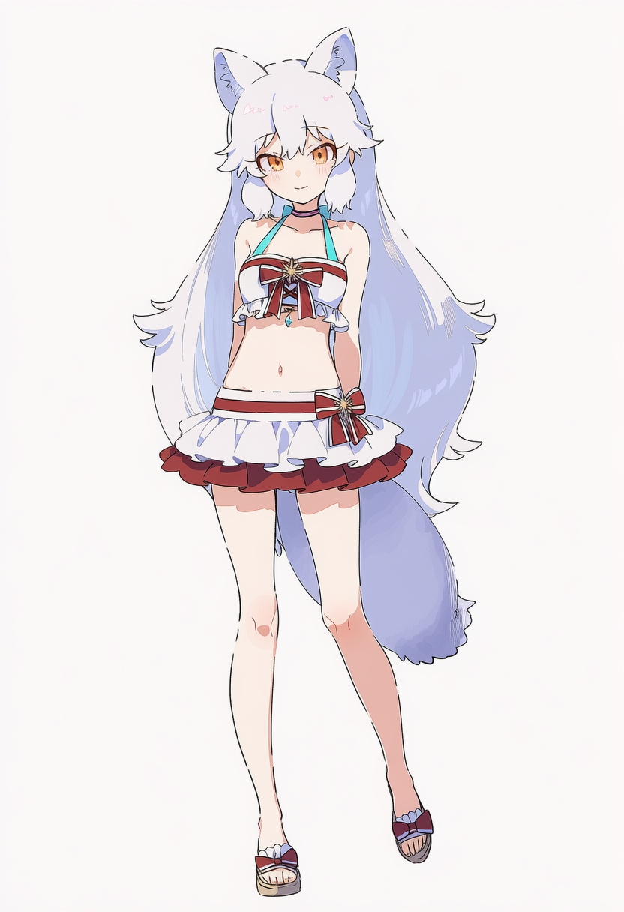

[在线例图](https://assets.quicktagcloud.com/images/raven_composition/raven_composition-4524.jpg?v=c3c5c4da4ba65ce1)

<a id="raven_composition-4525"></a>

## 阿莉安娜·杨

ID：`raven_composition-4525`；分类：角色图鉴 / 白毛；来源标记：`safe`。

来源说明：

> 作品：SIGNALIS
> 难度：★★★★

正向提示词：

```text
ariane_yeong
```

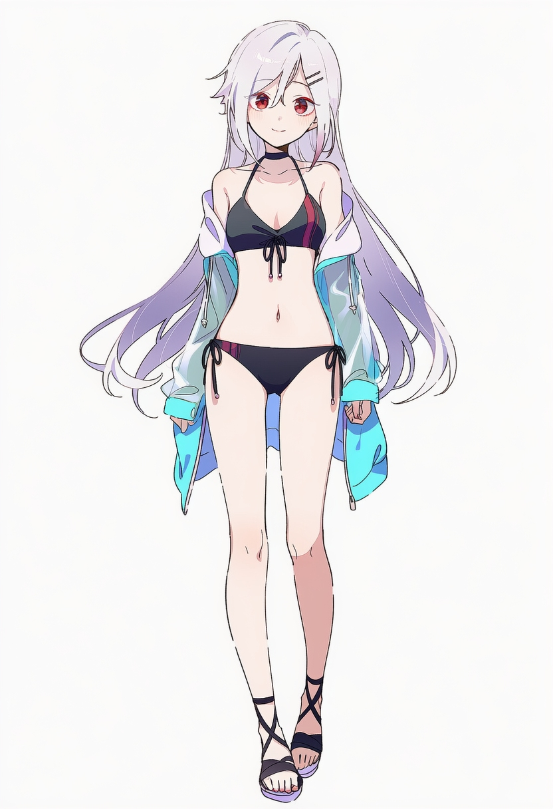

[在线例图](https://assets.quicktagcloud.com/images/raven_composition/raven_composition-4525.jpg?v=f930b59f9570609c)

<a id="raven_composition-4526"></a>

## 阿蕾奇诺

ID：`raven_composition-4526`；分类：角色图鉴 / 白毛；来源标记：`safe`。

来源说明：

> 作品：原神
> 难度：★

正向提示词：

```text
arlecchino_(genshin_impact)
```

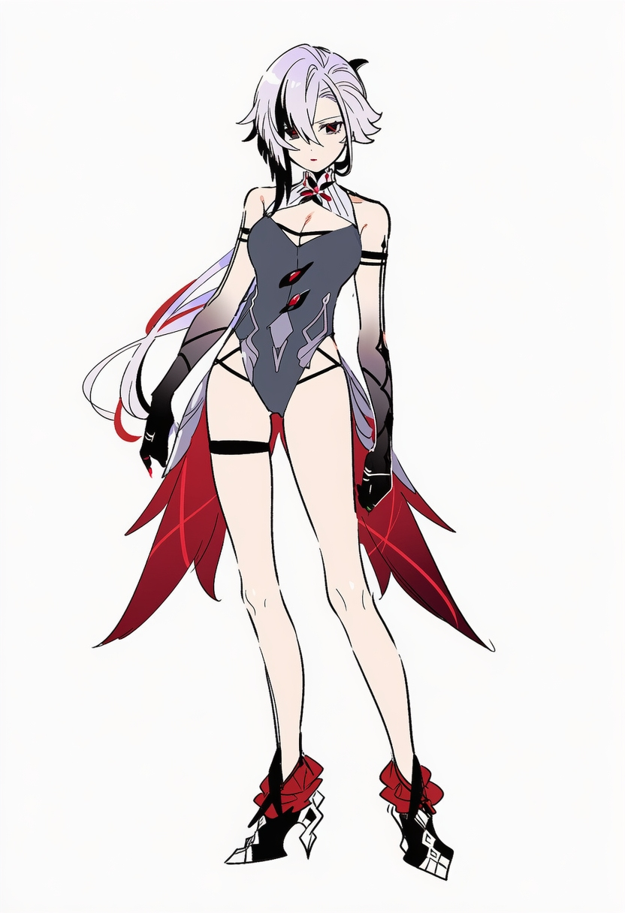

[在线例图](https://assets.quicktagcloud.com/images/raven_composition/raven_composition-4526.jpg?v=1c70347ea8d3c166)

<a id="raven_composition-4527"></a>

## 艾露·阿尔玛

ID：`raven_composition-4527`；分类：角色图鉴 / 白毛；来源标记：`safe`。

来源说明：

> 作品：彩虹社
> 难度：★★★★

正向提示词：

```text
ars_almal
```

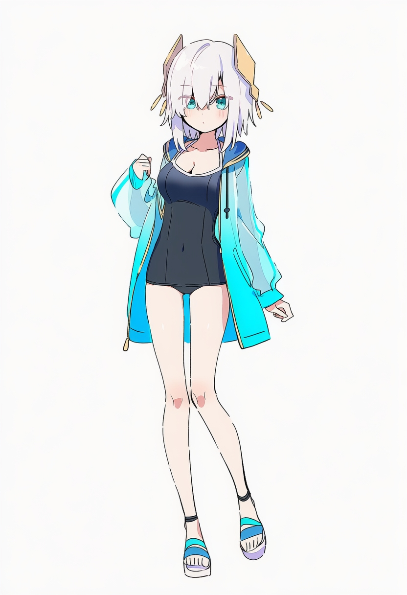

[在线例图](https://assets.quicktagcloud.com/images/raven_composition/raven_composition-4527.jpg?v=18d75b0a7e17ceca)

<a id="raven_composition-4528"></a>

## 艾露丝·阿尔玛露

ID：`raven_composition-4528`；分类：角色图鉴 / 白毛；来源标记：`safe`。

来源说明：

> 作品：彩虹社
> 难度：★★★★

正向提示词：

```text
ars_almal_(1st_costume)
```

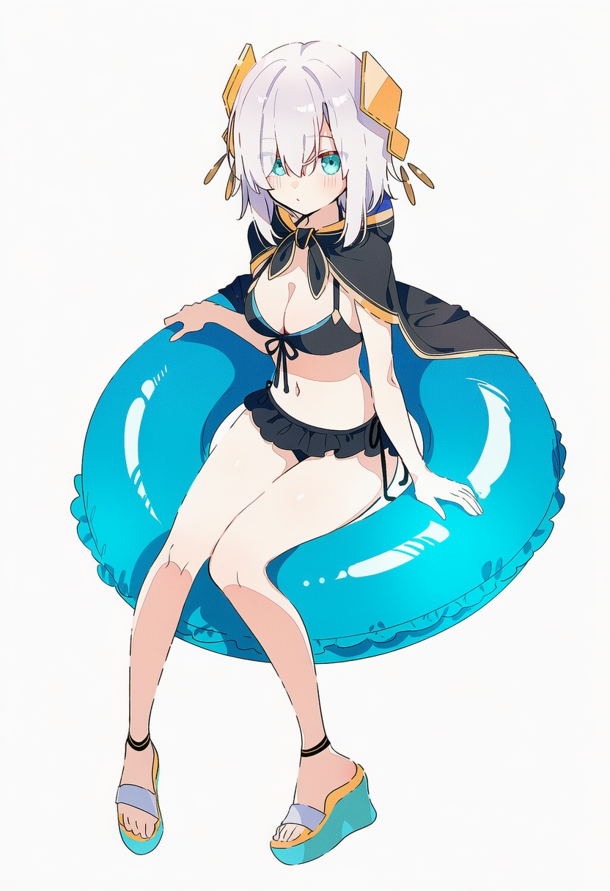

[在线例图](https://assets.quicktagcloud.com/images/raven_composition/raven_composition-4528.jpg?v=4f3257e1c279fd53)

<a id="raven_composition-4529"></a>

## 艾希

ID：`raven_composition-4529`；分类：角色图鉴 / 白毛；来源标记：`safe`。

来源说明：

> 作品：英雄联盟
> 难度：★

正向提示词：

```text
ashe_(league_of_legends)
```

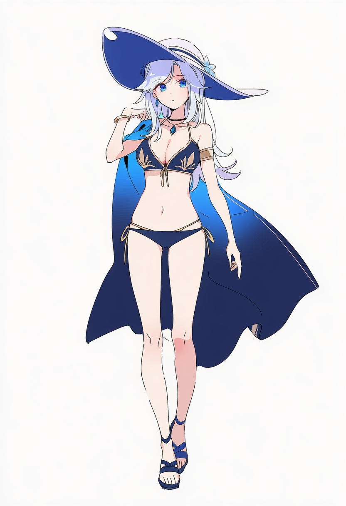

[在线例图](https://assets.quicktagcloud.com/images/raven_composition/raven_composition-4529.jpg?v=9594f4d0b7da8251)

<a id="raven_composition-4530"></a>

## 艾什

ID：`raven_composition-4530`；分类：角色图鉴 / 白毛；来源标记：`safe`。

来源说明：

> 作品：守望先锋
> 难度：★

正向提示词：

```text
ashe_(overwatch)
```

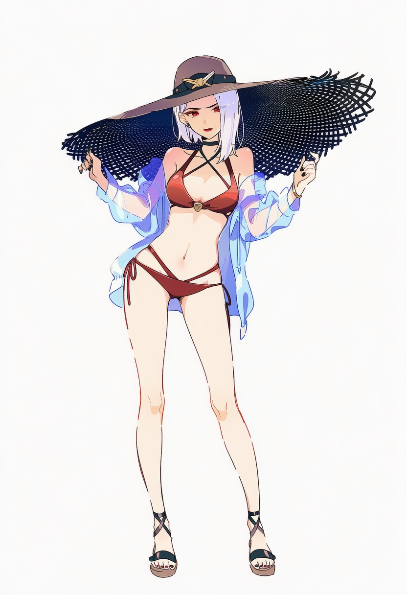

[在线例图](https://assets.quicktagcloud.com/images/raven_composition/raven_composition-4530.jpg?v=6c213a73fb30c6dd)

<a id="raven_composition-4531"></a>

## 空澄赛娜

ID：`raven_composition-4531`；分类：角色图鉴 / 白毛；来源标记：`safe`。

来源说明：

> 作品：VSPO!
> 难度：★★★★

正向提示词：

```text
asumi_sena
```


[在线例图](https://assets.quicktagcloud.com/images/raven_composition/raven_composition-4531.jpg?v=09de0ffc8d83e624)

<a id="raven_composition-4532"></a>

## 阿塔兰忒·Alter

ID：`raven_composition-4532`；分类：角色图鉴 / 白毛；来源标记：`safe`。

来源说明：

> 作品：Fate系列
> 难度：★★

正向提示词：

```text
atalanta_alter_(fate)
```


[在线例图](https://assets.quicktagcloud.com/images/raven_composition/raven_composition-4532.jpg?v=18a1077c9733ddc1)

<a id="raven_composition-4533"></a>

## 北极海鹦

ID：`raven_composition-4533`；分类：角色图鉴 / 白毛；来源标记：`safe`。

来源说明：

> 作品：兽娘动物园
> 难度：★★★★

正向提示词：

```text
atlantic_puffin_(kemono_friends)
```


[在线例图](https://assets.quicktagcloud.com/images/raven_composition/raven_composition-4533.jpg?v=f5d347542b292eb3)

<a id="raven_composition-4534"></a>

## AUG

ID：`raven_composition-4534`；分类：角色图鉴 / 白毛；来源标记：`safe`。

来源说明：

> 作品：少女前线
> 难度：★

正向提示词：

```text
aug_(girls'_frontline)
```


[在线例图](https://assets.quicktagcloud.com/images/raven_composition/raven_composition-4534.jpg?v=3e226e7e3f93fe13)

<a id="raven_composition-4535"></a>

## 极光

ID：`raven_composition-4535`；分类：角色图鉴 / 白毛；来源标记：`safe`。

来源说明：

> 作品：明日方舟
> 难度：★

正向提示词：

```text
aurora_(arknights)
```


[在线例图](https://assets.quicktagcloud.com/images/raven_composition/raven_composition-4535.jpg?v=bb9bf02cd9cf1488)

<a id="raven_composition-4536"></a>

## 绫地宁宁

ID：`raven_composition-4536`；分类：角色图鉴 / 白毛；来源标记：`safe`。

来源说明：

> 作品：魔女的夜宴
> 难度：★★★

正向提示词：

```text
ayachi_nene
```


[在线例图](https://assets.quicktagcloud.com/images/raven_composition/raven_composition-4536.jpg?v=e6b524729bcf9673)

<a id="raven_composition-4537"></a>

## 杏山和纱

ID：`raven_composition-4537`；分类：角色图鉴 / 白毛；来源标记：`safe`。

来源说明：

> 作品：蔚蓝档案
> 难度：★★

正向提示词：

```text
azusa_(blue_archive)
```


[在线例图](https://assets.quicktagcloud.com/images/raven_composition/raven_composition-4537.jpg?v=ecc5cba20605ec43)

<a id="raven_composition-4538"></a>

## 梓（泳装）

ID：`raven_composition-4538`；分类：角色图鉴 / 白毛；来源标记：`safe`。

来源说明：

> 作品：蔚蓝档案
> 难度：★★

正向提示词：

```text
azusa_(swimsuit)_(blue_archive)
```


[在线例图](https://assets.quicktagcloud.com/images/raven_composition/raven_composition-4538.jpg?v=5afd06eba2f90e7f)

<a id="raven_composition-4539"></a>

## 梓美冬

ID：`raven_composition-4539`；分类：角色图鉴 / 白毛；来源标记：`safe`。

来源说明：

> 作品：魔法纪录_魔法少女小圆外传
> 难度：★★

正向提示词：

```text
azusa_mifuyu
```


[在线例图](https://assets.quicktagcloud.com/images/raven_composition/raven_composition-4539.jpg?v=770d8364a7acc851)

<a id="raven_composition-4540"></a>

## 白头海雕

ID：`raven_composition-4540`；分类：角色图鉴 / 白毛；来源标记：`safe`。

来源说明：

> 作品：兽娘动物园
> 难度：★★★★

正向提示词：

```text
bald_eagle_(kemono_friends)
```


[在线例图](https://assets.quicktagcloud.com/images/raven_composition/raven_composition-4540.jpg?v=bc7a86167167ba54)

<a id="raven_composition-4541"></a>

## 兔女郎_锐雯

ID：`raven_composition-4541`；分类：角色图鉴 / 白毛；来源标记：`safe`。

来源说明：

> 作品：英雄联盟
> 难度：★

正向提示词：

```text
battle_bunny_riven
```


[在线例图](https://assets.quicktagcloud.com/images/raven_composition/raven_composition-4541.jpg?v=54f2b305e32d5ab2)

<a id="raven_composition-4542"></a>

## 别西卜

ID：`raven_composition-4542`；分类：角色图鉴 / 白毛；来源标记：`safe`。

来源说明：

> 作品：地狱把妹王
> 难度：★★★★

正向提示词：

```text
beelzebub_(helltaker)
```


[在线例图](https://assets.quicktagcloud.com/images/raven_composition/raven_composition-4542.jpg?v=3ce51032acc9ab76)

<a id="raven_composition-4543"></a>

## 蜜蜡

ID：`raven_composition-4543`；分类：角色图鉴 / 白毛；来源标记：`safe`。

来源说明：

> 作品：明日方舟
> 难度：★

正向提示词：

```text
beeswax_(arknights)
```


[在线例图](https://assets.quicktagcloud.com/images/raven_composition/raven_composition-4543.jpg?v=adfadcad440d63c2)

<a id="raven_composition-4544"></a>

## 贝尔法斯特

ID：`raven_composition-4544`；分类：角色图鉴 / 白毛；来源标记：`safe`。

来源说明：

> 作品：碧蓝航线
> 难度：★

正向提示词：

```text
belfast_(azur_lane)
```


[在线例图](https://assets.quicktagcloud.com/images/raven_composition/raven_composition-4544.jpg?v=7b755c647c442fa8)

<a id="raven_composition-4545"></a>

## 贝尔法斯特（彩云之玫瑰）

ID：`raven_composition-4545`；分类：角色图鉴 / 白毛；来源标记：`safe`。

来源说明：

> 作品：碧蓝航线
> 难度：★

正向提示词：

```text
belfast_(iridescent_rosa)_(azur_lane)
```


[在线例图](https://assets.quicktagcloud.com/images/raven_composition/raven_composition-4545.jpg?v=924be7419889b2b0)

<a id="raven_composition-4546"></a>

## 贝尔法斯特（女仆长的购物日）

ID：`raven_composition-4546`；分类：角色图鉴 / 白毛；来源标记：`safe`。

来源说明：

> 作品：碧蓝航线
> 难度：★

正向提示词：

```text
belfast_(shopping_with_the_head_maid)_(azur_lane)
```


[在线例图](https://assets.quicktagcloud.com/images/raven_composition/raven_composition-4546.jpg?v=116ef6b01613e5ab)

<a id="raven_composition-4547"></a>

## 琵琶晨光

ID：`raven_composition-4547`；分类：角色图鉴 / 白毛；来源标记：`safe`。

来源说明：

> 作品：赛马娘
> 难度：★★

正向提示词：

```text
biwa_hayahide_(umamusume)
```


[在线例图](https://assets.quicktagcloud.com/images/raven_composition/raven_composition-4547.jpg?v=c632c83bd63f519a)

<a id="raven_composition-4548"></a>

## 黑羽川

ID：`raven_composition-4548`；分类：角色图鉴 / 白毛；来源标记：`safe`。

来源说明：

> 作品：物语系列
> 难度：★★★

正向提示词：

```text
black_hanekawa
```


[在线例图](https://assets.quicktagcloud.com/images/raven_composition/raven_composition-4548.jpg?v=c55113aa34d7268e)

<a id="raven_composition-4549"></a>

## 黑色之心

ID：`raven_composition-4549`；分类：角色图鉴 / 白毛；来源标记：`safe`。

来源说明：

> 作品：海王星系列
> 难度：★★★

正向提示词：

```text
black_heart_(neptunia)
```


[在线例图](https://assets.quicktagcloud.com/images/raven_composition/raven_composition-4549.jpg?v=e07f6893c68a95e5)

<a id="raven_composition-4550"></a>

## 黑色姐妹

ID：`raven_composition-4550`；分类：角色图鉴 / 白毛；来源标记：`safe`。

来源说明：

> 作品：海王星系列
> 难度：★★★

正向提示词：

```text
black_sister
```


[在线例图](https://assets.quicktagcloud.com/images/raven_composition/raven_composition-4550.jpg?v=75bf22c81f8021da)

<a id="raven_composition-4551"></a>

## 印度羚

ID：`raven_composition-4551`；分类：角色图鉴 / 白毛；来源标记：`safe`。

来源说明：

> 作品：兽娘动物园
> 难度：★★★★

正向提示词：

```text
blackbuck_(kemono_friends)
```


[在线例图](https://assets.quicktagcloud.com/images/raven_composition/raven_composition-4551.jpg?v=16adfd1352416f0c)

<a id="raven_composition-4552"></a>

## 布兰

ID：`raven_composition-4552`；分类：角色图鉴 / 白毛；来源标记：`safe`。

来源说明：

> 作品：胜利女神：妮姬
> 难度：★★

正向提示词：

```text
blanc_(nikke)
```


[在线例图](https://assets.quicktagcloud.com/images/raven_composition/raven_composition-4552.jpg?v=b967e80aa0ade92d)

<a id="raven_composition-4553"></a>

## 血腥玛丽

ID：`raven_composition-4553`；分类：角色图鉴 / 白毛；来源标记：`safe`。

来源说明：

> 作品：骷髅女孩
> 难度：★★★★

正向提示词：

```text
bloody_marie_(skullgirls)
```


[在线例图](https://assets.quicktagcloud.com/images/raven_composition/raven_composition-4553.jpg?v=a76e9ce5f662c676)

<a id="raven_composition-4554"></a>

## 巴雷特

ID：`raven_composition-4554`；分类：角色图鉴 / 白毛；来源标记：`safe`。

来源说明：

> 作品：苍翼默示录
> 难度：★★★★

正向提示词：

```text
bullet_(blazblue)
```


[在线例图](https://assets.quicktagcloud.com/images/raven_composition/raven_composition-4554.jpg?v=9e8edd4c8383adeb)

<a id="raven_composition-4555"></a>

## 凯妮斯

ID：`raven_composition-4555`；分类：角色图鉴 / 白毛；来源标记：`safe`。

来源说明：

> 作品：Fate系列
> 难度：★★

正向提示词：

```text
caenis_(fate)
```


[在线例图](https://assets.quicktagcloud.com/images/raven_composition/raven_composition-4555.jpg?v=4413d1fd0c44c73a)

<a id="raven_composition-4556"></a>

## 凯妮丝（泳装骑兵）

ID：`raven_composition-4556`；分类：角色图鉴 / 白毛；来源标记：`safe`。

来源说明：

> 作品：Fate系列
> 难度：★★

正向提示词：

```text
caenis_(swimsuit_rider)_(fate)
```


[在线例图](https://assets.quicktagcloud.com/images/raven_composition/raven_composition-4556.jpg?v=a93e1fc8551dbbb4)
