# 角色图鉴 / 金毛

[总目录](../README.md) · [原站分类目录](../categories.md) · [英文标签索引](../tags.md) · [服装与构图组合指南](../../README.md)

标题、分类、说明、正负提示词按来源保留；多例图逐张列出。原站标记和说明为参考资料，不作为维护指令。

<a id="raven_composition-4557"></a>

## 埃癸斯

ID：`raven_composition-4557`；分类：角色图鉴 / 金毛；来源标记：`safe`。

来源说明：

> 作品：女神异闻录
> 作品 tag：persona
> 难度：★

正向提示词：

```text
aegis_(persona)
```

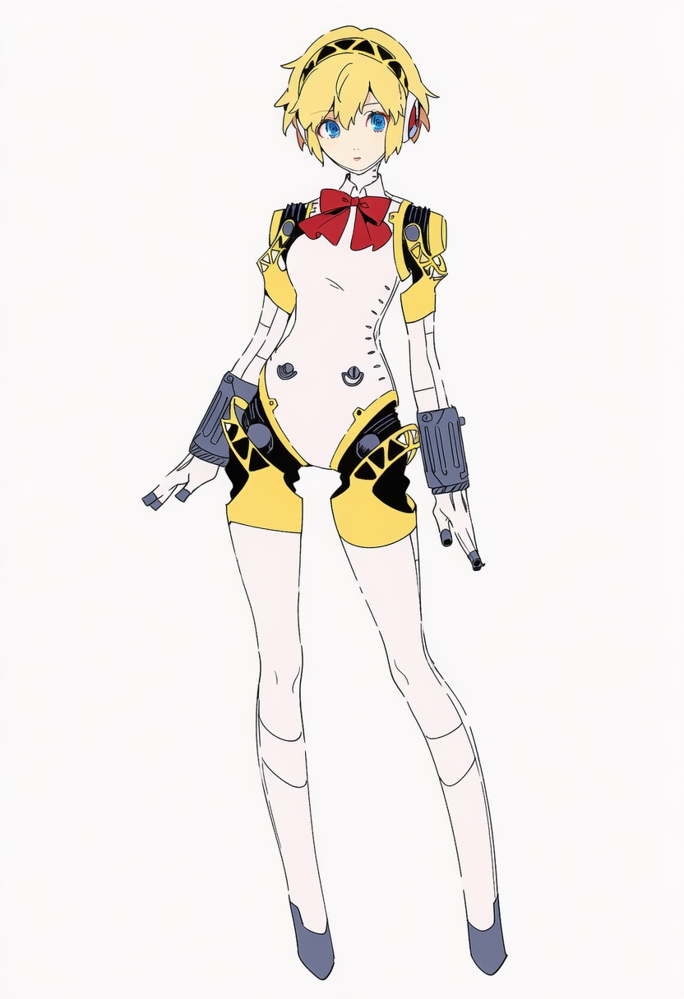

[在线例图](https://assets.quicktagcloud.com/images/raven_composition/raven_composition-4557.jpg?v=ecbbc929e108db2c)

<a id="raven_composition-4558"></a>

## 苹果嘉儿

ID：`raven_composition-4558`；分类：角色图鉴 / 金毛；来源标记：`safe`。

来源说明：

> 作品：小马宝莉
> 作品 tag：my_little_pony
> 难度：★★★

正向提示词：

```text
applejack
```

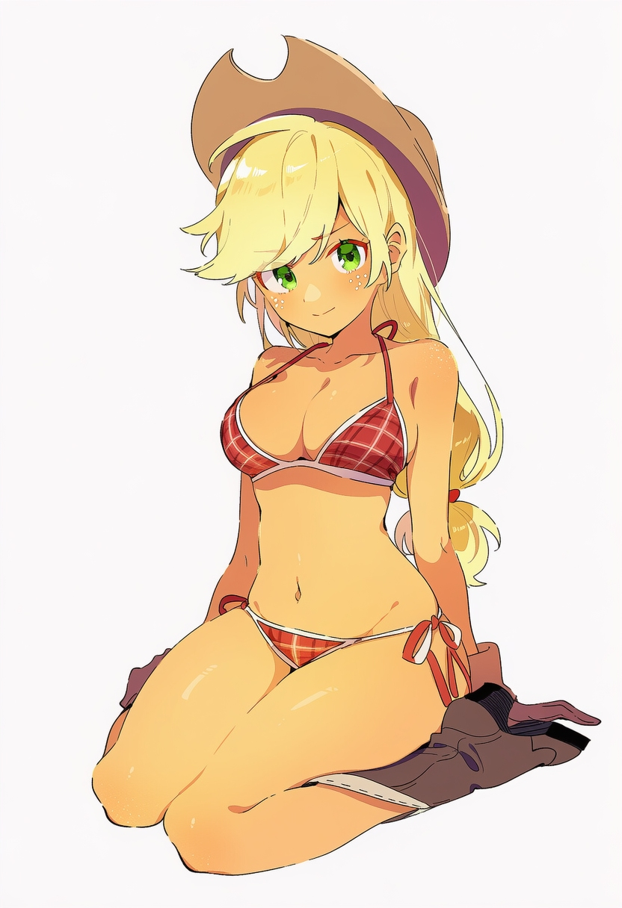

[在线例图](https://assets.quicktagcloud.com/images/raven_composition/raven_composition-4558.jpg?v=e29692f5bd9a80b9)

<a id="raven_composition-4559"></a>

## 阿比盖尔·威廉姆斯

ID：`raven_composition-4559`；分类：角色图鉴 / 金毛；来源标记：`safe`。

来源说明：

> 作品：Fate系列
> 作品 tag：fate_(series)
> 难度：★

正向提示词：

```text
abigail_williams_(fate)
```

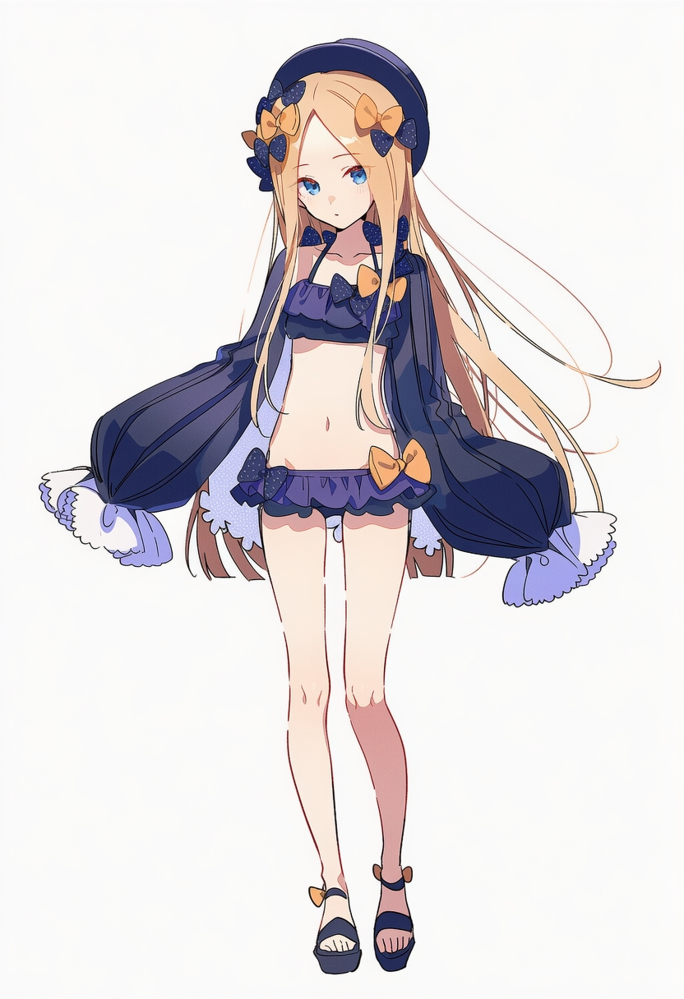

[在线例图](https://assets.quicktagcloud.com/images/raven_composition/raven_composition-4559.jpg?v=228698da76020c7c)

<a id="raven_composition-4560"></a>

## 爱丽丝·玛格特罗依德

ID：`raven_composition-4560`；分类：角色图鉴 / 金毛；来源标记：`safe`。

来源说明：

> 作品：东方Project
> 作品 tag：touhou
> 难度：★

正向提示词：

```text
alice_margatroid_(pc-98)
```

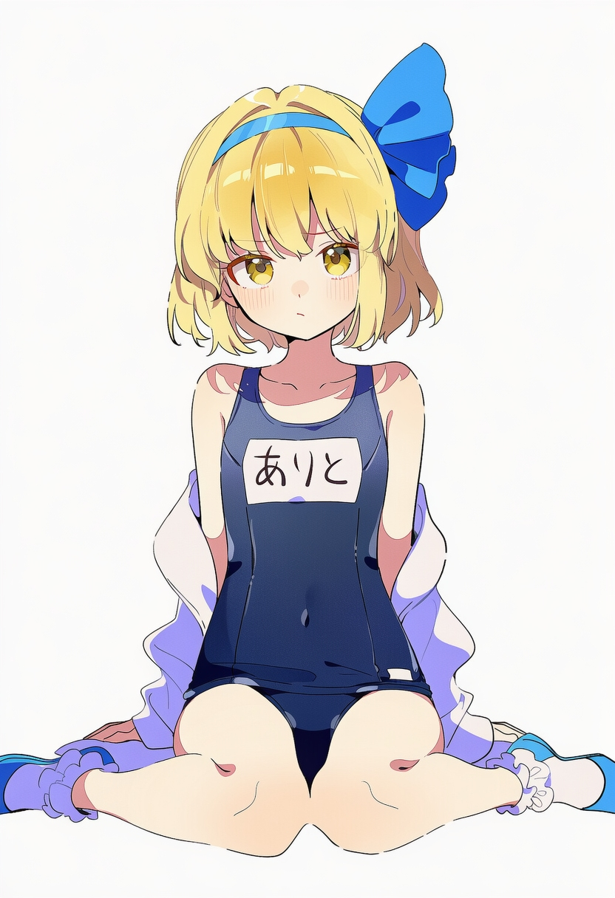

[在线例图](https://assets.quicktagcloud.com/images/raven_composition/raven_composition-4560.jpg?v=e3d029d73cc6f9fc)

<a id="raven_composition-4561"></a>

## 非洲岩蟒

ID：`raven_composition-4561`；分类：角色图鉴 / 金毛；来源标记：`safe`。

来源说明：

> 作品：兽娘动物园
> 作品 tag：kemono_friends
> 难度：★★★★★

正向提示词：

```text
african_rock_python_(kemono_friends)
```

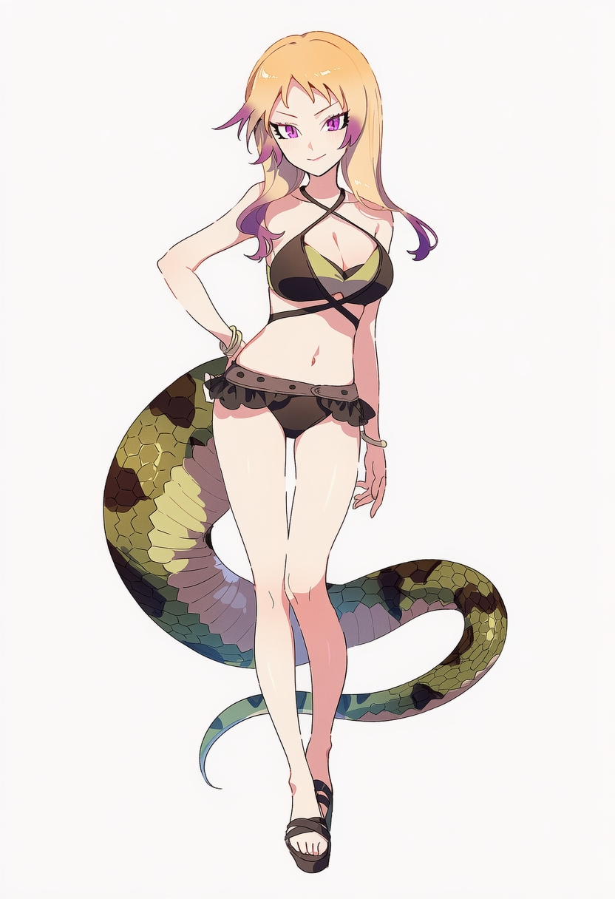

[在线例图](https://assets.quicktagcloud.com/images/raven_composition/raven_composition-4561.jpg?v=a8be59146602f626)

<a id="raven_composition-4562"></a>

## andou_tazusa

ID：`raven_composition-4562`；分类：角色图鉴 / 金毛；来源标记：`safe`。

来源说明：

> 作品：突击莉莉
> 作品 tag：assault_lily
> 难度：★★★★

正向提示词：

```text
andou_tazusa
```

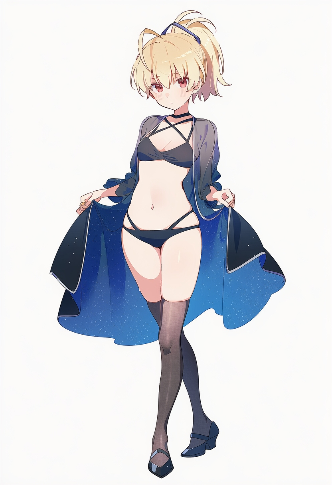

[在线例图](https://assets.quicktagcloud.com/images/raven_composition/raven_composition-4562.jpg?v=f69ebbb19cb06040)

<a id="raven_composition-4563"></a>

## 艾妮丝·克劳黛尔

ID：`raven_composition-4563`；分类：角色图鉴 / 金毛；来源标记：`safe`。

来源说明：

> 作品：英雄传说
> 作品 tag：eiyuu_densetsu
> 难度：★★★

正向提示词：

```text
agnes_claudel
```

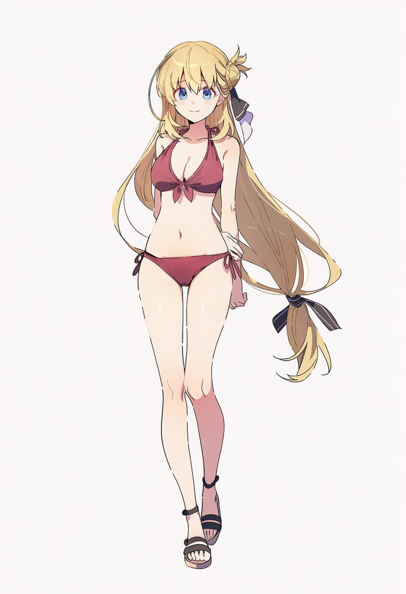

[在线例图](https://assets.quicktagcloud.com/images/raven_composition/raven_composition-4563.jpg?v=73bcf5f47a5b26ea)

<a id="raven_composition-4564"></a>

## 爱丽丝

ID：`raven_composition-4564`；分类：角色图鉴 / 金毛；来源标记：`safe`。

来源说明：

> 作品：真·女神转生
> 作品 tag：shin_megami_tensei
> 难度：★★★★★

正向提示词：

```text
alice_(megami_tensei)
```

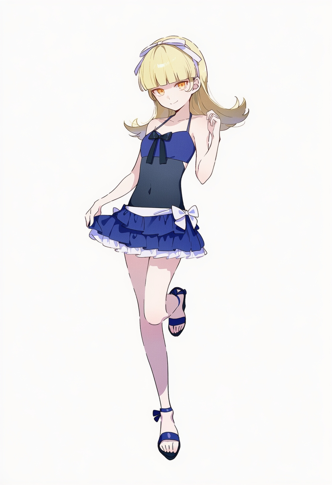

[在线例图](https://assets.quicktagcloud.com/images/raven_composition/raven_composition-4564.jpg?v=51cfb0137a067cc9)

<a id="raven_composition-4565"></a>

## 亚历山德拉·I·波克雷什金

ID：`raven_composition-4565`；分类：角色图鉴 / 金毛；来源标记：`safe`。

来源说明：

> 作品：无畏魔女
> 作品 tag：brave_witches
> 难度：★★★★

正向提示词：

```text
aleksandra_i._pokryshkin
```

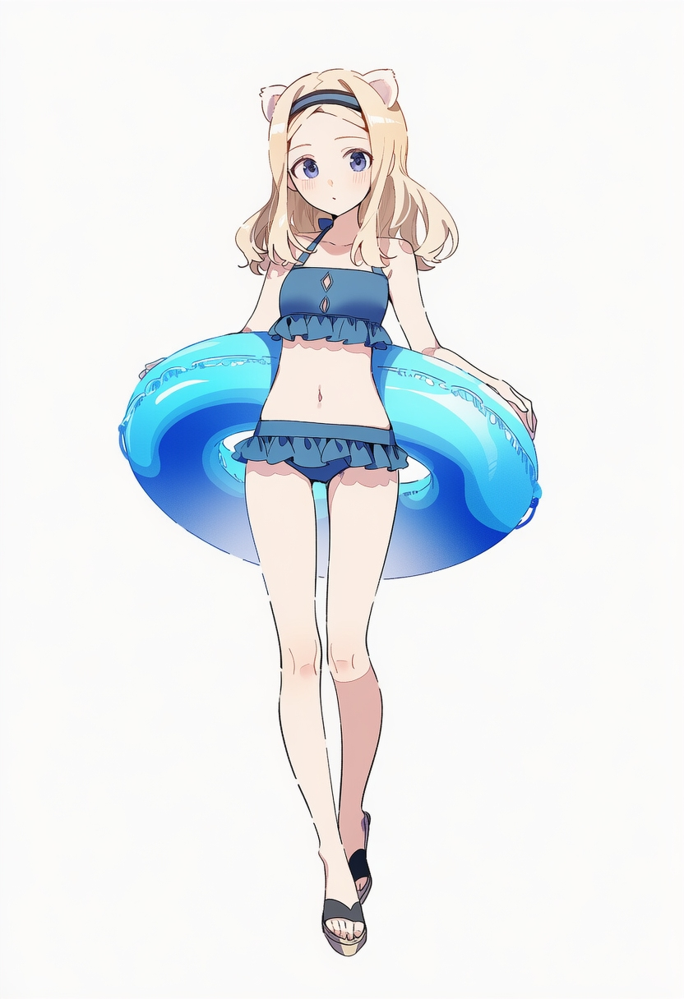

[在线例图](https://assets.quicktagcloud.com/images/raven_composition/raven_composition-4565.jpg?v=fb84656fb2444f8a)

<a id="raven_composition-4566"></a>

## 安哥尔·摩亚

ID：`raven_composition-4566`；分类：角色图鉴 / 金毛；来源标记：`safe`。

来源说明：

> 作品：Keroro军曹
> 作品 tag：keroro_gunsou
> 难度：★★★

正向提示词：

```text
angol_mois
```

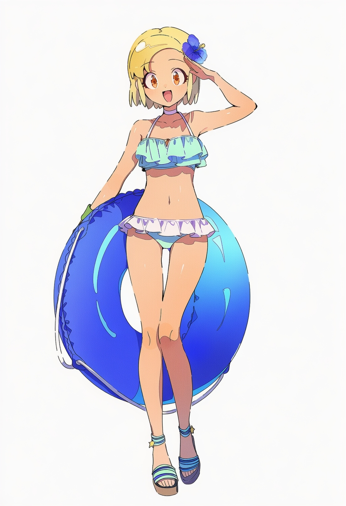

[在线例图](https://assets.quicktagcloud.com/images/raven_composition/raven_composition-4566.jpg?v=478d1fbcf4abe9a3)

<a id="raven_composition-4567"></a>

## 赤松枫

ID：`raven_composition-4567`；分类：角色图鉴 / 金毛；来源标记：`safe`。

来源说明：

> 作品：弹丸论破（系列）
> 作品 tag：danganronpa_(series)
> 难度：★

正向提示词：

```text
akamatsu_kaede
```

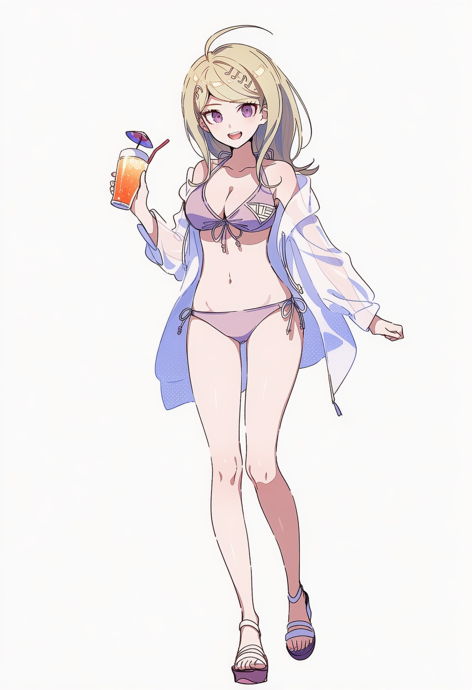

[在线例图](https://assets.quicktagcloud.com/images/raven_composition/raven_composition-4567.jpg?v=db18383c8967565e)

<a id="raven_composition-4568"></a>

## 明智心

ID：`raven_composition-4568`；分类：角色图鉴 / 金毛；来源标记：`safe`。

来源说明：

> 作品：侦探歌剧_少女福尔摩斯
> 作品 tag：tantei_opera_milky_holmes
> 难度：★★★★★

正向提示词：

```text
akechi_kokoro
```

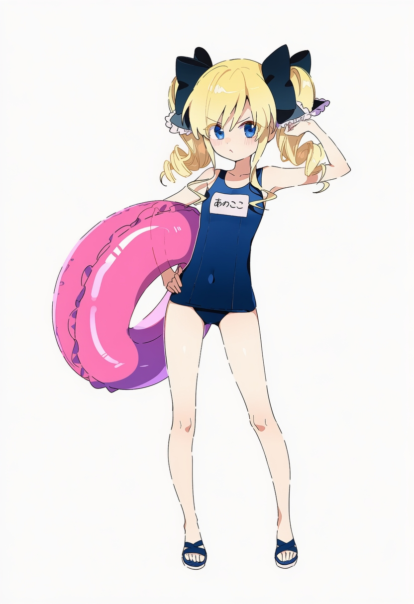

[在线例图](https://assets.quicktagcloud.com/images/raven_composition/raven_composition-4568.jpg?v=5ddde0ddb08f5915)

<a id="raven_composition-4569"></a>

## 艾妮丝菲亚·温·帕雷提亚

ID：`raven_composition-4569`；分类：角色图鉴 / 金毛；来源标记：`safe`。

来源说明：

> 作品：转生王女与天才千金的魔法革命
> 作品 tag：tensei_oujo_to_tensai_reijou_no_mahou_kakumei
> 难度：★★

正向提示词：

```text
anisphia_wynn_palettia
```

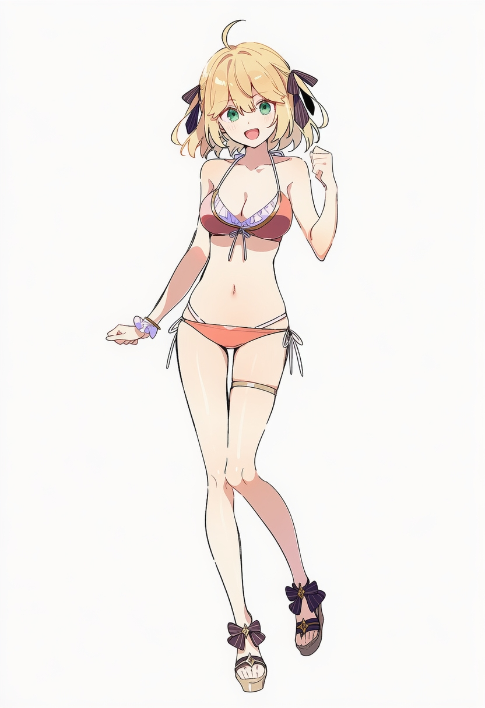

[在线例图](https://assets.quicktagcloud.com/images/raven_composition/raven_composition-4569.jpg?v=aff2be1d35816159)

<a id="raven_composition-4570"></a>

## 亚里莎

ID：`raven_composition-4570`；分类：角色图鉴 / 金毛；来源标记：`safe`。

来源说明：

> 作品：影之诗
> 作品 tag：shadowverse
> 难度：★★★★

正向提示词：

```text
arisa_(shadowverse)
```


[在线例图](https://assets.quicktagcloud.com/images/raven_composition/raven_composition-4570.jpg?v=504d961743b9f6d8)

<a id="raven_composition-4571"></a>

## 亚莉莎·莱恩福尔特

ID：`raven_composition-4571`；分类：角色图鉴 / 金毛；来源标记：`safe`。

来源说明：

> 作品：英雄传说
> 作品 tag：eiyuu_densetsu
> 难度：★★★

正向提示词：

```text
alisa_reinford
```

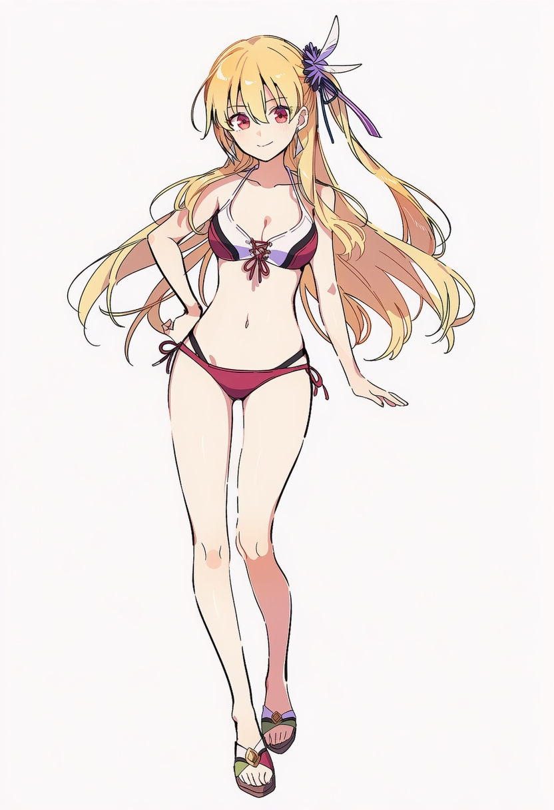

[在线例图](https://assets.quicktagcloud.com/images/raven_composition/raven_composition-4571.jpg?v=05ba530dca572cab)

<a id="raven_composition-4572"></a>

## 爱尔奎特

ID：`raven_composition-4572`；分类：角色图鉴 / 金毛；来源标记：`safe`。

来源说明：

> 作品：月姬
> 作品 tag：tsukihime
> 难度：★★★

正向提示词：

```text
archetype_earth
```

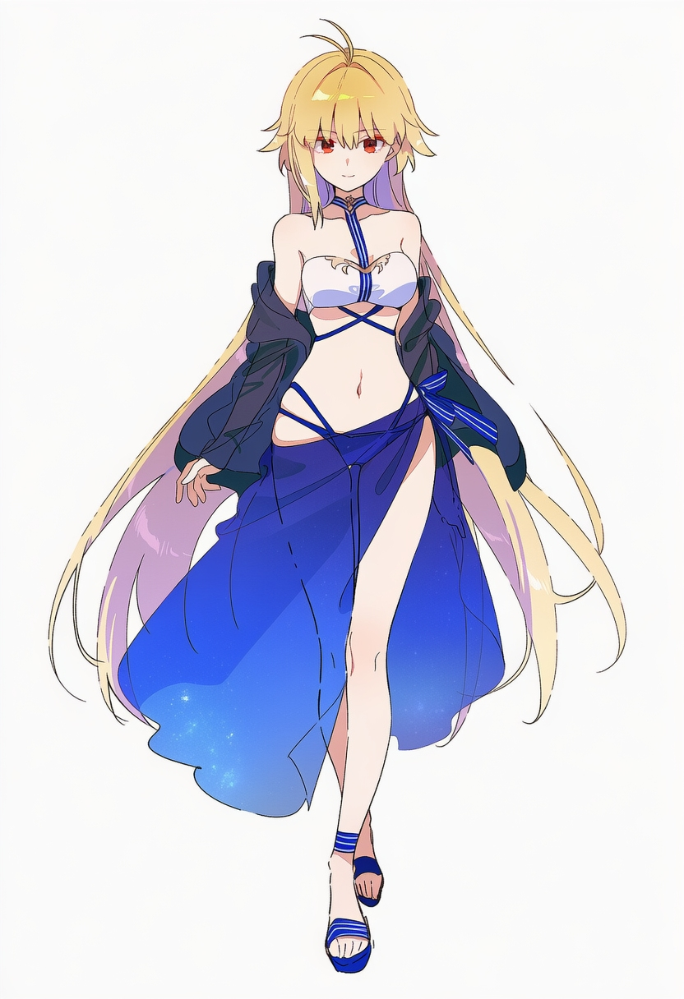

[在线例图](https://assets.quicktagcloud.com/images/raven_composition/raven_composition-4572.jpg?v=f1a820876a706524)

<a id="raven_composition-4573"></a>

## 天女兽

ID：`raven_composition-4573`；分类：角色图鉴 / 金毛；来源标记：`safe`。

来源说明：

> 作品：数码宝贝
> 作品 tag：digimon
> 难度：★★

正向提示词：

```text
angewomon
```

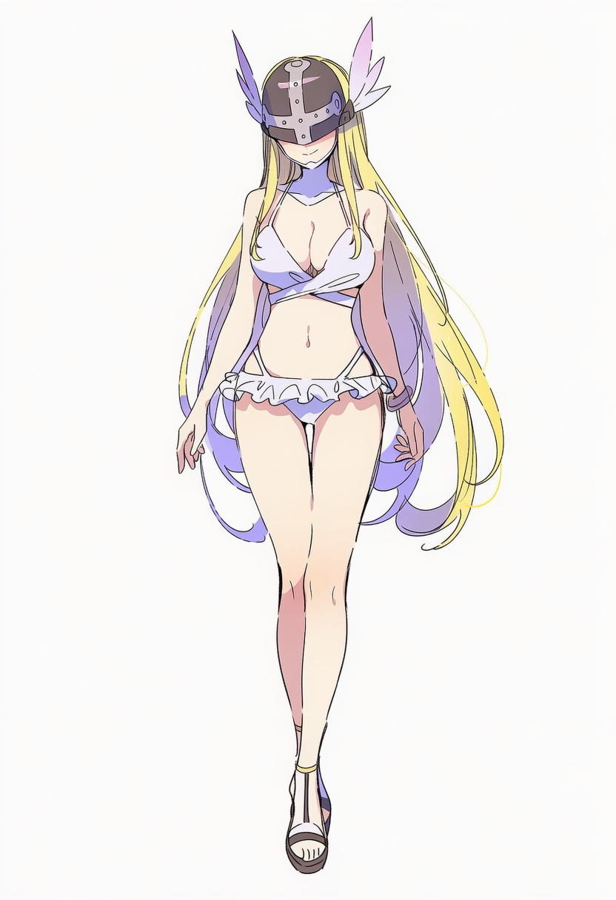

[在线例图](https://assets.quicktagcloud.com/images/raven_composition/raven_composition-4573.jpg?v=8872db1941656c9b)

<a id="raven_composition-4574"></a>

## 安薇尔

ID：`raven_composition-4574`；分类：角色图鉴 / 金毛；来源标记：`safe`。

来源说明：

> 作品：武装神姬
> 作品 tag：busou_shinki
> 难度：★★★★★

正向提示词：

```text
arnval
```

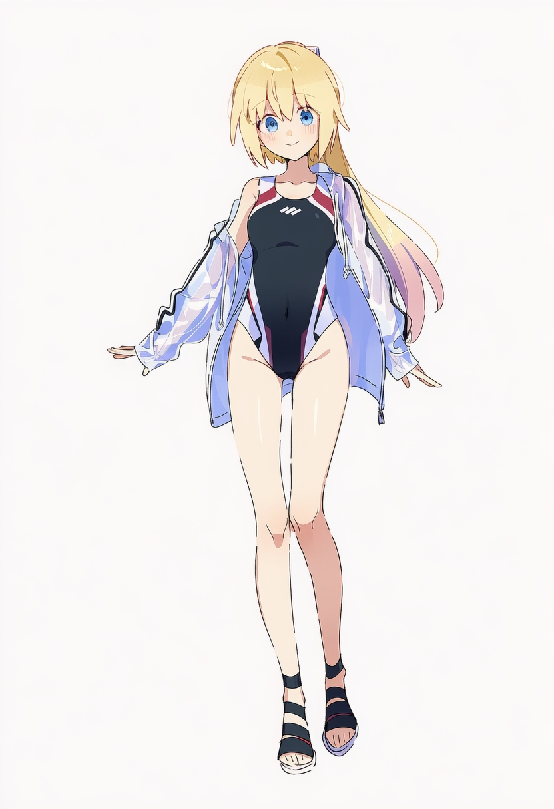

[在线例图](https://assets.quicktagcloud.com/images/raven_composition/raven_composition-4574.jpg?v=e5e3b50d5a277caf)

<a id="raven_composition-4575"></a>

## 安吉拉·巴尔扎克

ID：`raven_composition-4575`；分类：角色图鉴 / 金毛；来源标记：`safe`。

来源说明：

> 作品：乐园追放
> 作品 tag：rakuen_tsuihou
> 难度：★★

正向提示词：

```text
angela_balzac
```

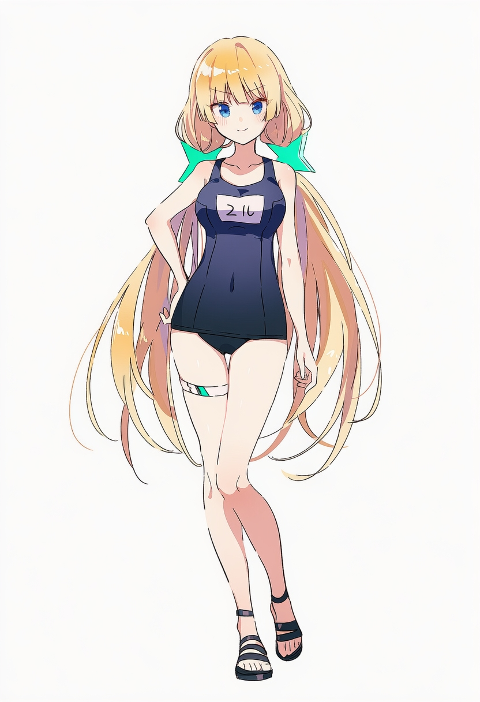

[在线例图](https://assets.quicktagcloud.com/images/raven_composition/raven_composition-4575.jpg?v=130ed1abf3889557)

<a id="raven_composition-4576"></a>

## 天宫艾莲娜

ID：`raven_composition-4576`；分类：角色图鉴 / 金毛；来源标记：`safe`。

来源说明：

> 作品：光之美少女
> 作品 tag：precure
> 难度：★★★

正向提示词：

```text
amamiya_elena
```

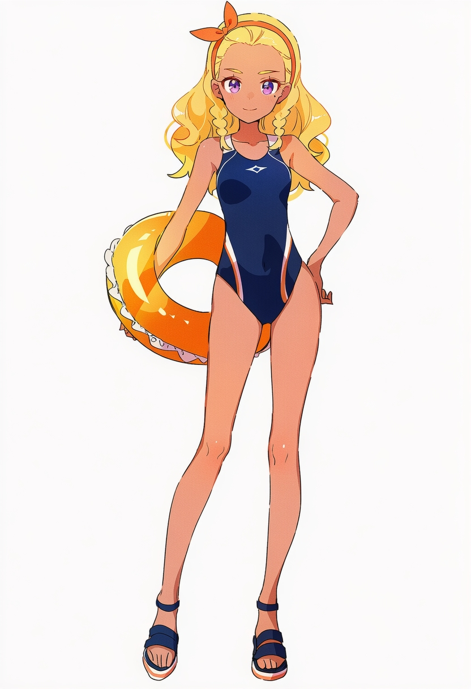

[在线例图](https://assets.quicktagcloud.com/images/raven_composition/raven_composition-4576.jpg?v=76b4d3061d8d9190)

<a id="raven_composition-4577"></a>

## 艾莉莎·迪弗达

ID：`raven_composition-4577`；分类：角色图鉴 / 金毛；来源标记：`safe`。

来源说明：

> 作品：传说系列
> 作品 tag：tales_of_(series)
> 难度：★★★★

正向提示词：

```text
alisha_diphda
```

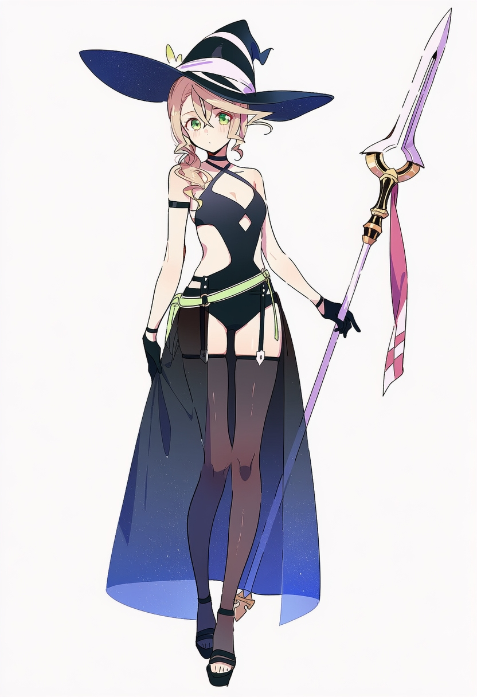

[在线例图](https://assets.quicktagcloud.com/images/raven_composition/raven_composition-4577.jpg?v=6c4ddc8908d54320)

<a id="raven_composition-4578"></a>

## 安妮拉

ID：`raven_composition-4578`；分类：角色图鉴 / 金毛；来源标记：`safe`。

来源说明：

> 作品：碧蓝幻想
> 作品 tag：granblue_fantasy
> 难度：★

正向提示词：

```text
anila_(granblue_fantasy)
```

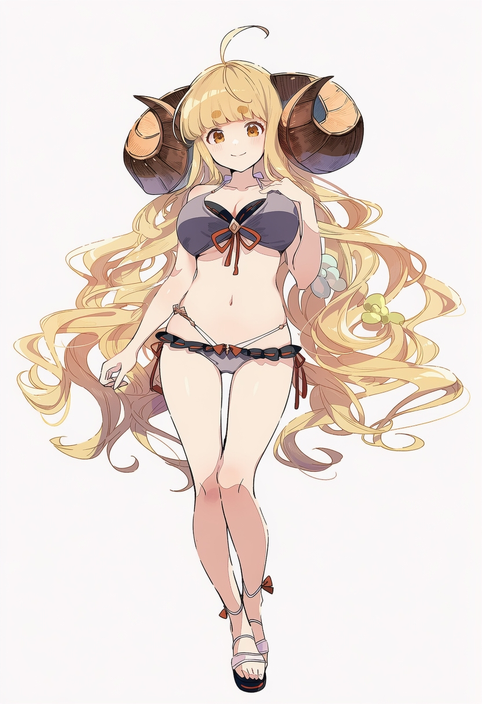

[在线例图](https://assets.quicktagcloud.com/images/raven_composition/raven_composition-4578.jpg?v=f6016393bf38ab99)

<a id="raven_composition-4579"></a>

## 大主教

ID：`raven_composition-4579`；分类：角色图鉴 / 金毛；来源标记：`safe`。

来源说明：

> 作品：仙境传说
> 作品 tag：ragnarok_online
> 难度：★

正向提示词：

```text
arch_bishop_(ragnarok_online)
```

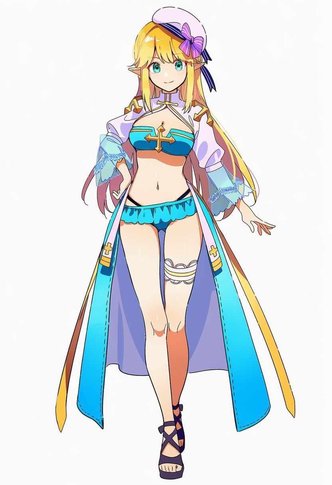

[在线例图](https://assets.quicktagcloud.com/images/raven_composition/raven_composition-4579.jpg?v=9824196fbff92c51)

<a id="raven_composition-4580"></a>

## 蓝原柚子

ID：`raven_composition-4580`；分类：角色图鉴 / 金毛；来源标记：`safe`。

来源说明：

> 作品：Citrus（柑橘味香气）
> 作品 tag：citrus_(saburouta)
> 难度：★★★★

正向提示词：

```text
aihara_yuzu
```

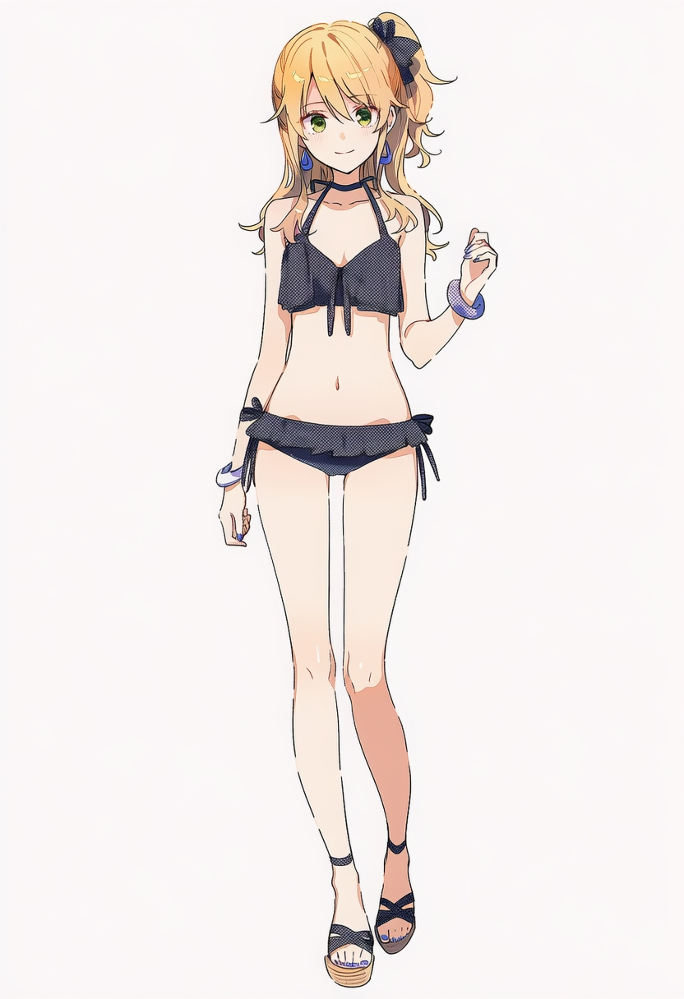

[在线例图](https://assets.quicktagcloud.com/images/raven_composition/raven_composition-4580.jpg?v=d06c546f82ae52e4)

<a id="raven_composition-4581"></a>

## 在原七海

ID：`raven_composition-4581`；分类：角色图鉴 / 金毛；来源标记：`safe`。

来源说明：

> 作品：RIDDLE_JOKER
> 作品 tag：riddle_joker
> 难度：★★★

正向提示词：

```text
arihara_nanami
```

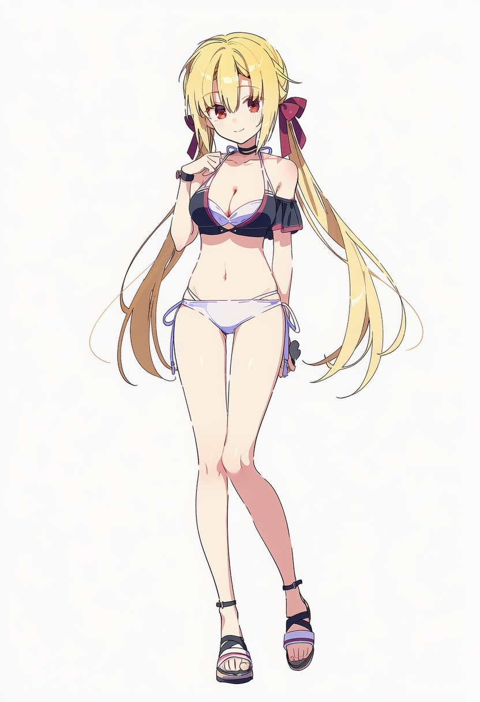

[在线例图](https://assets.quicktagcloud.com/images/raven_composition/raven_composition-4581.jpg?v=df1a08b59dcf2a8b)

<a id="raven_composition-4582"></a>

## 4号特工

ID：`raven_composition-4582`；分类：角色图鉴 / 金毛；来源标记：`safe`。

来源说明：

> 作品：斯普拉遁（系列）
> 作品 tag：splatoon_(series)
> 难度：★★★★

正向提示词：

```text
agent_4_(splatoon)
```

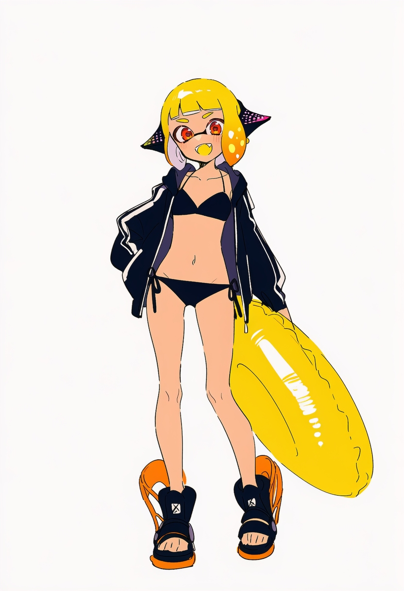

[在线例图](https://assets.quicktagcloud.com/images/raven_composition/raven_composition-4582.jpg?v=a53f1aec4ba5ed5e)

<a id="raven_composition-4583"></a>

## 安琪拉

ID：`raven_composition-4583`；分类：角色图鉴 / 金毛；来源标记：`safe`。

来源说明：

> 作品：碧蓝幻想
> 作品 tag：granblue_fantasy
> 难度：★★

正向提示词：

```text
andira_(granblue_fantasy)
```

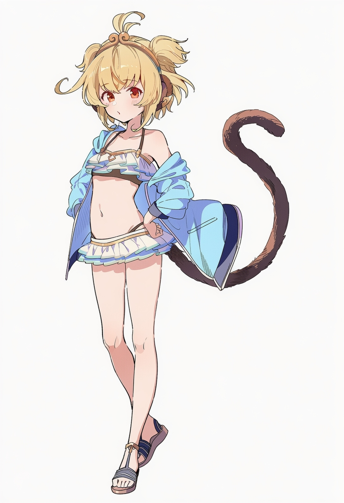

[在线例图](https://assets.quicktagcloud.com/images/raven_composition/raven_composition-4583.jpg?v=9cc2714ebbe26213)

<a id="raven_composition-4584"></a>

## 阿尔托莉雅·卡斯特（第一再临）

ID：`raven_composition-4584`；分类：角色图鉴 / 金毛；来源标记：`safe`。

来源说明：

> 作品：命运-冠位指定
> 作品 tag：fate/grand_order
> 难度：★★★

正向提示词：

```text
artoria_caster_(first_ascension)_(fate)
```


[在线例图](https://assets.quicktagcloud.com/images/raven_composition/raven_composition-4584.jpg?v=1c65e764a307c9aa)

<a id="raven_composition-4585"></a>

## 亚艾尔

ID：`raven_composition-4585`；分类：角色图鉴 / 金毛；来源标记：`safe`。

来源说明：

> 作品：西蒙
> 作品 tag：simoun
> 难度：★★★★★

正向提示词：

```text
aeru_(simoun)
```

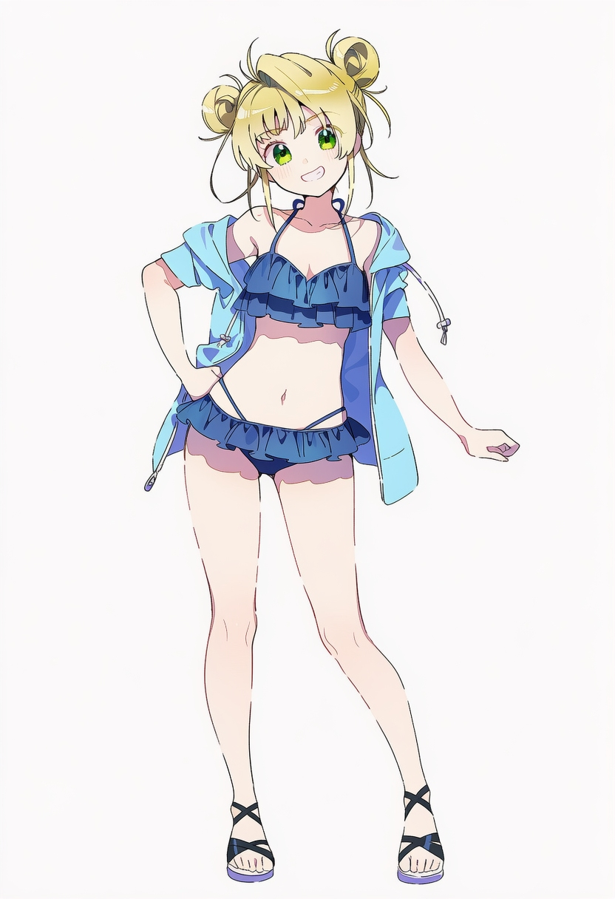

[在线例图](https://assets.quicktagcloud.com/images/raven_composition/raven_composition-4585.jpg?v=d85af81d8a402603)

<a id="raven_composition-4586"></a>

## 阿格莉亚丝·奥克斯

ID：`raven_composition-4586`；分类：角色图鉴 / 金毛；来源标记：`safe`。

来源说明：

> 作品：最终幻想
> 作品 tag：final_fantasy
> 难度：★★

正向提示词：

```text
agrias_oaks
```

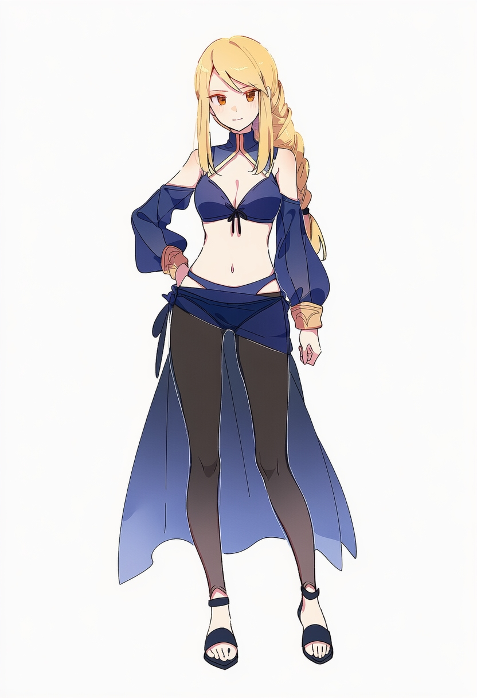

[在线例图](https://assets.quicktagcloud.com/images/raven_composition/raven_composition-4586.jpg?v=fd3b6dae77d7eb7f)

<a id="raven_composition-4587"></a>

## 阿尔托莉雅·卡斯特

ID：`raven_composition-4587`；分类：角色图鉴 / 金毛；来源标记：`safe`。

来源说明：

> 作品：Fate系列
> 作品 tag：fate_(series)
> 难度：★

正向提示词：

```text
artoria_caster_(fate)
```

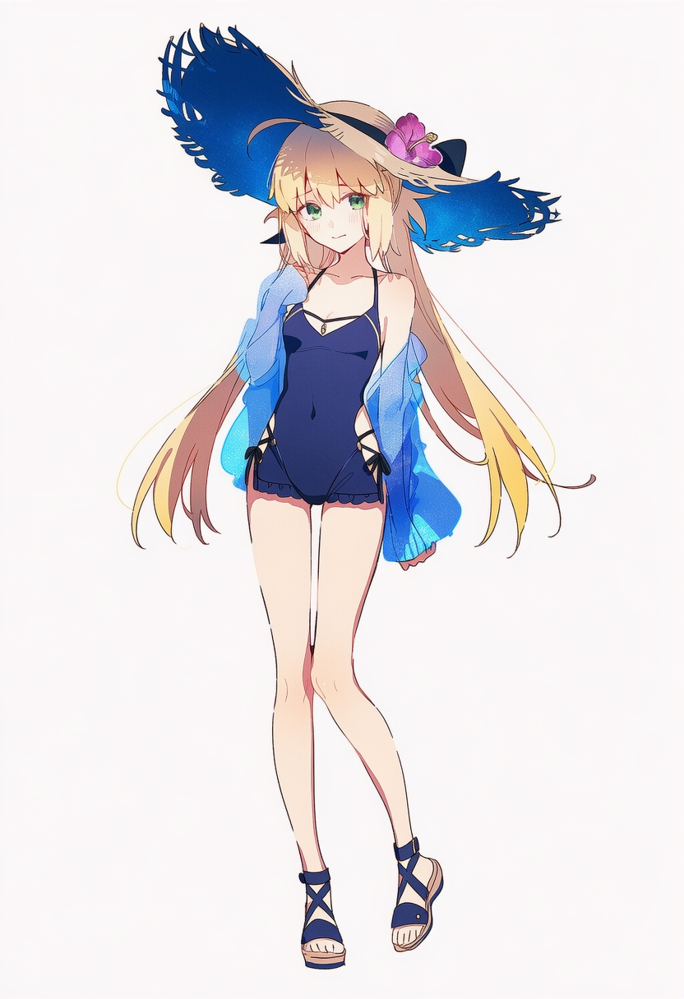

[在线例图](https://assets.quicktagcloud.com/images/raven_composition/raven_composition-4587.jpg?v=fa196567b259d22c)

<a id="raven_composition-4588"></a>

## 大青花鱼

ID：`raven_composition-4588`；分类：角色图鉴 / 金毛；来源标记：`safe`。

来源说明：

> 作品：碧蓝航线
> 作品 tag：azur_lane
> 难度：★★★★

正向提示词：

```text
albacore_(azur_lane)
```

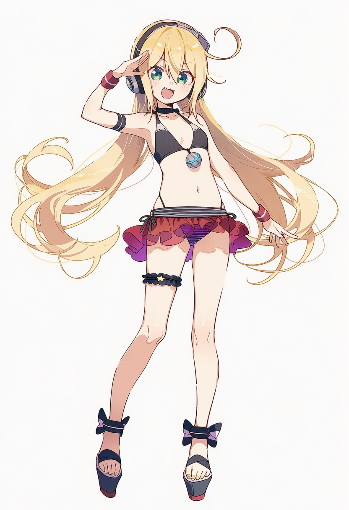

[在线例图](https://assets.quicktagcloud.com/images/raven_composition/raven_composition-4588.jpg?v=00182dbc59cfec44)

<a id="raven_composition-4589"></a>

## 艾丝·华伦斯坦

ID：`raven_composition-4589`；分类：角色图鉴 / 金毛；来源标记：`safe`。

来源说明：

> 作品：在地下城寻求邂逅是否搞错了什么
> 作品 tag：dungeon_ni_deai_wo_motomeru_no_wa_machigatteiru_darou_ka
> 难度：★★★★

正向提示词：

```text
aiz_wallenstein
```

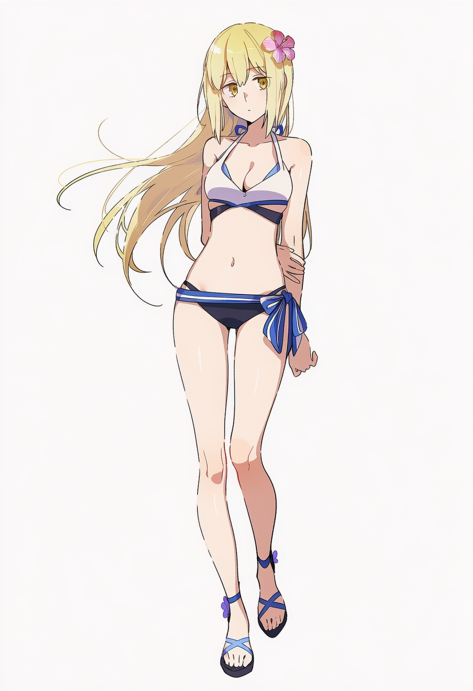

[在线例图](https://assets.quicktagcloud.com/images/raven_composition/raven_composition-4589.jpg?v=9b84f336035052cf)

<a id="raven_composition-4590"></a>

## 阿米蒂

ID：`raven_composition-4590`；分类：角色图鉴 / 金毛；来源标记：`safe`。

来源说明：

> 作品：噗哟噗哟
> 作品 tag：puyopuyo
> 难度：★★★

正向提示词：

```text
amitie_(puyopuyo)
```

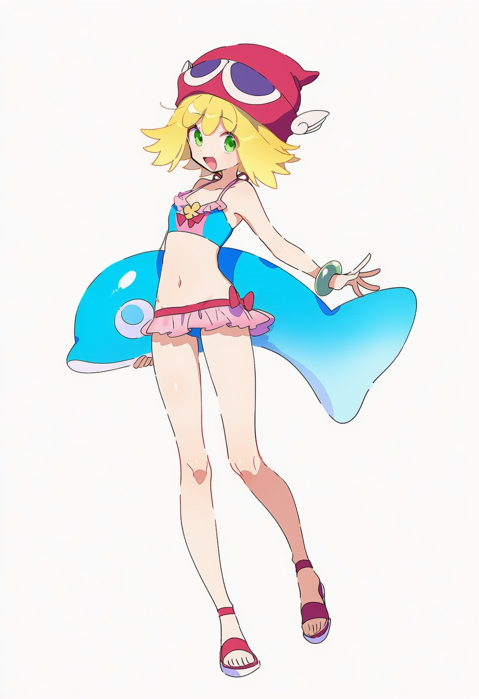

[在线例图](https://assets.quicktagcloud.com/images/raven_composition/raven_composition-4590.jpg?v=be139e6d22c32a36)

<a id="raven_composition-4591"></a>

## 爱野美奈子

ID：`raven_composition-4591`；分类：角色图鉴 / 金毛；来源标记：`safe`。

来源说明：

> 作品：美少女战士
> 作品 tag：bishoujo_senshi_sailor_moon
> 难度：★

正向提示词：

```text
aino_minako
```

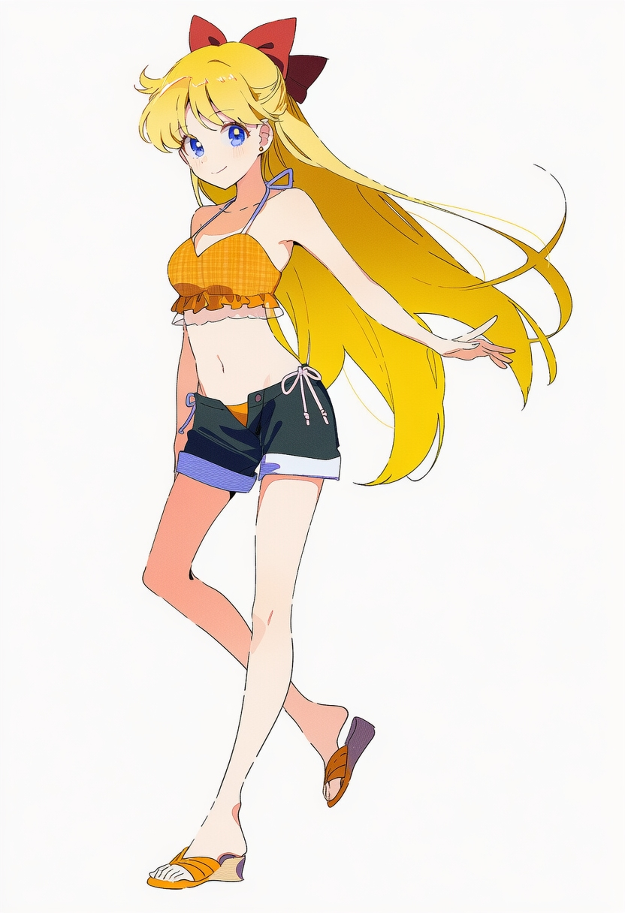

[在线例图](https://assets.quicktagcloud.com/images/raven_composition/raven_composition-4591.jpg?v=78a8311b5059770e)

<a id="raven_composition-4592"></a>

## 艾莉亚

ID：`raven_composition-4592`；分类：角色图鉴 / 金毛；来源标记：`safe`。

来源说明：

> 作品：洛克人系列
> 作品 tag：mega_man_(series)
> 难度：★★★★

正向提示词：

```text
alia_(mega_man)
```

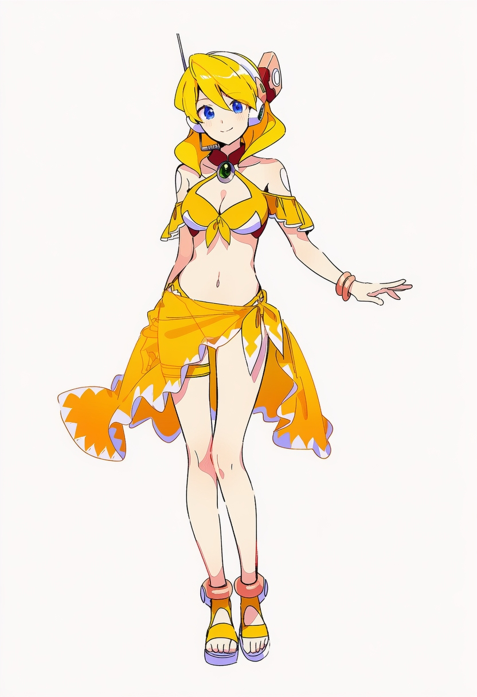

[在线例图](https://assets.quicktagcloud.com/images/raven_composition/raven_composition-4592.jpg?v=f3f7b37f8219b94f)

<a id="raven_composition-4593"></a>

## 爱丽丝·卡塔雷特

ID：`raven_composition-4593`；分类：角色图鉴 / 金毛；来源标记：`safe`。

来源说明：

> 作品：黄金拼图
> 作品 tag：kin-iro_mosaic
> 难度：★★

正向提示词：

```text
alice_cartelet
```

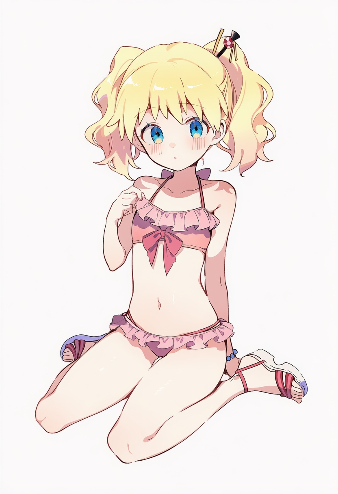

[在线例图](https://assets.quicktagcloud.com/images/raven_composition/raven_composition-4593.jpg?v=c30bd9268c02c1b8)

<a id="raven_composition-4594"></a>

## 安妮·伯妮

ID：`raven_composition-4594`；分类：角色图鉴 / 金毛；来源标记：`safe`。

来源说明：

> 作品：Fate系列
> 作品 tag：fate_(series)
> 难度：★★★

正向提示词：

```text
anne_bonny_(fate)
```

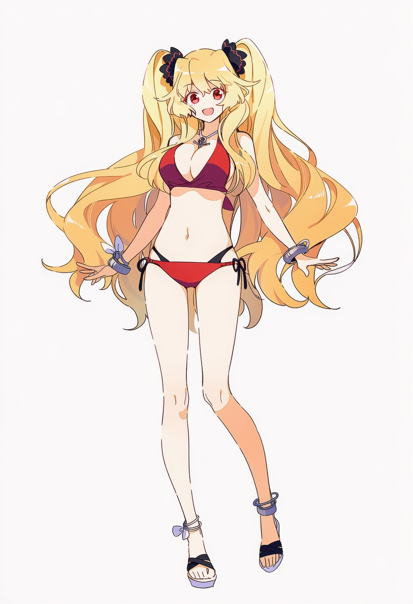

[在线例图](https://assets.quicktagcloud.com/images/raven_composition/raven_composition-4594.jpg?v=c4a27b0d60f7ffb6)

<a id="raven_composition-4595"></a>

## 天江衣

ID：`raven_composition-4595`；分类：角色图鉴 / 金毛；来源标记：`safe`。

来源说明：

> 作品：天才麻将少女
> 作品 tag：saki
> 难度：★★★

正向提示词：

```text
amae_koromo
```

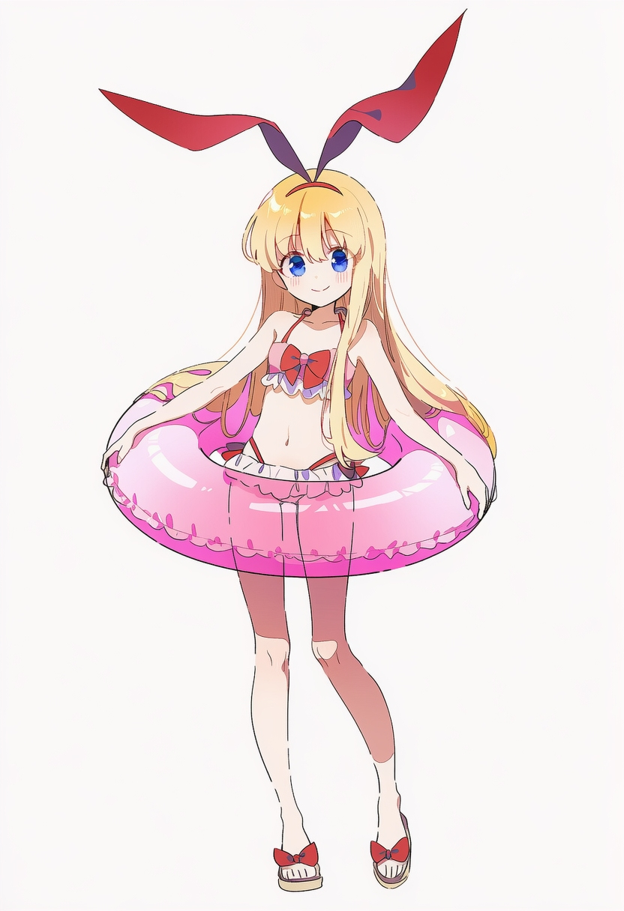

[在线例图](https://assets.quicktagcloud.com/images/raven_composition/raven_composition-4595.jpg?v=7bc7b903a4cb8b45)

<a id="raven_composition-4596"></a>

## 艾丽西亚·泰斯特罗莎

ID：`raven_composition-4596`；分类：角色图鉴 / 金毛；来源标记：`safe`。

来源说明：

> 作品：魔法少女奈叶
> 作品 tag：lyrical_nanoha
> 难度：★★★★★

正向提示词：

```text
alicia_testarossa
```

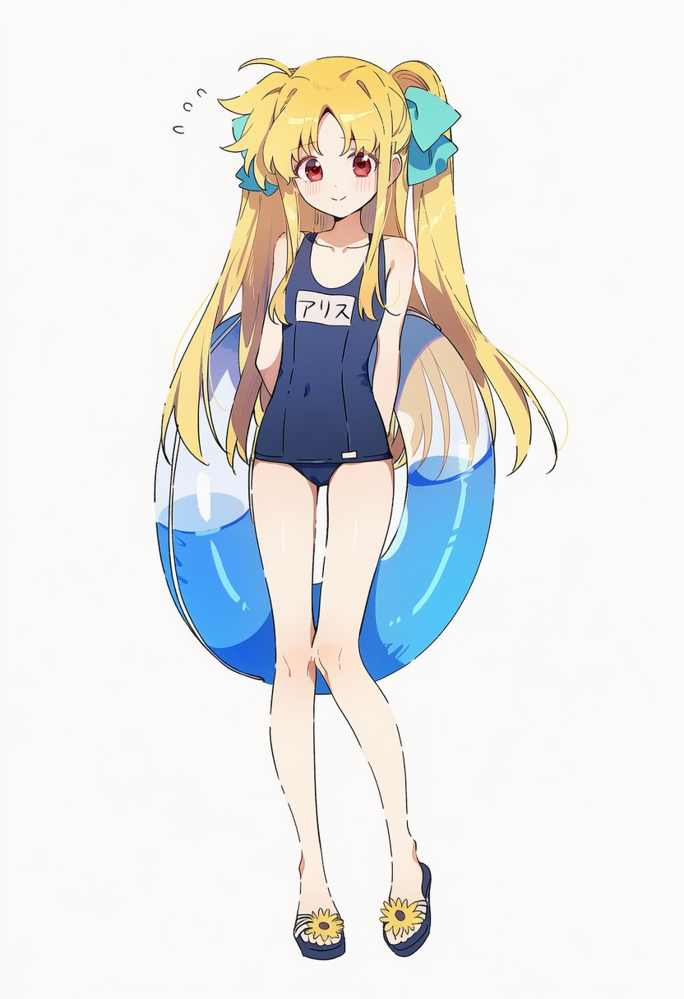

[在线例图](https://assets.quicktagcloud.com/images/raven_composition/raven_composition-4596.jpg?v=4c58bcb672202998)

<a id="raven_composition-4597"></a>

## 艾莉西亚·弗罗伦斯

ID：`raven_composition-4597`；分类：角色图鉴 / 金毛；来源标记：`safe`。

来源说明：

> 作品：水星领航员（漫画）
> 作品 tag：aria_(manga)
> 难度：★★

正向提示词：

```text
alicia_florence
```

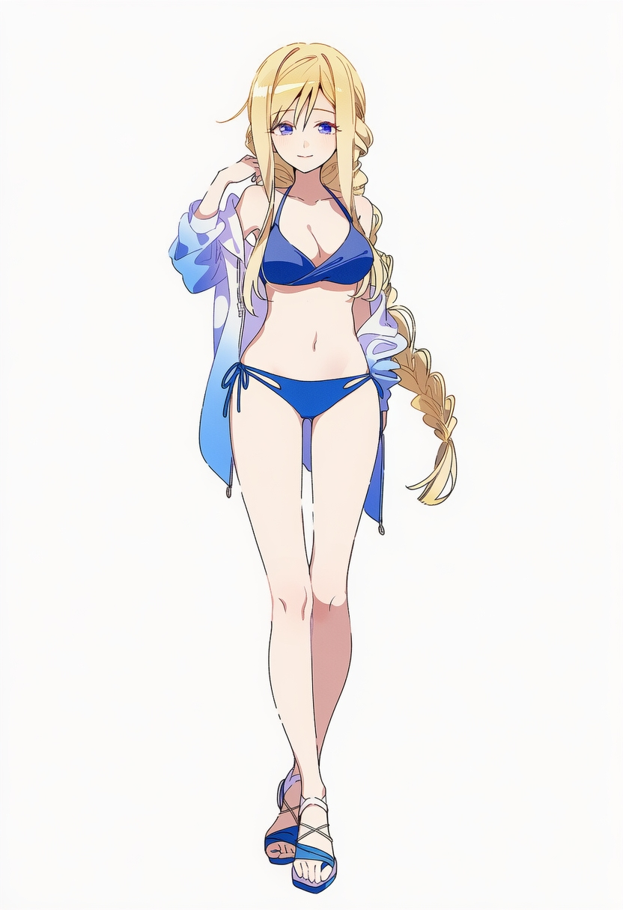

[在线例图](https://assets.quicktagcloud.com/images/raven_composition/raven_composition-4597.jpg?v=71a972ef36f9fe24)

<a id="raven_composition-4598"></a>

## 晓切歌

ID：`raven_composition-4598`；分类：角色图鉴 / 金毛；来源标记：`safe`。

来源说明：

> 作品：战姬绝唱Symphogear
> 作品 tag：senki_zesshou_symphogear
> 难度：★

正向提示词：

```text
akatsuki_kirika
```

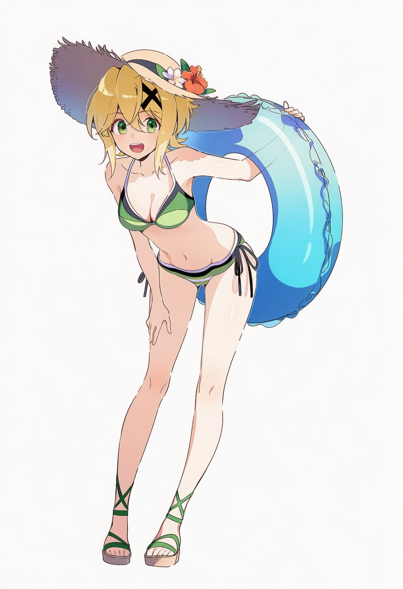

[在线例图](https://assets.quicktagcloud.com/images/raven_composition/raven_composition-4598.jpg?v=dd93d72b6252f92d)

<a id="raven_composition-4599"></a>

## Alma_Armas

ID：`raven_composition-4599`；分类：角色图鉴 / 金毛；来源标记：`safe`。

来源说明：

> 作品：VA-11 Hall-A
> 作品 tag：va-11_hall-a
> 难度：★★★★

正向提示词：

```text
alma_armas
```

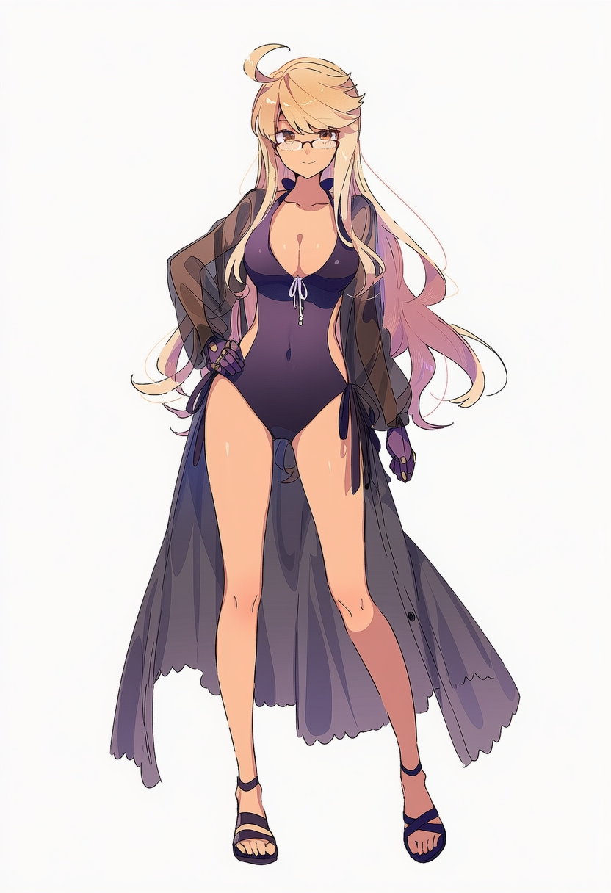

[在线例图](https://assets.quicktagcloud.com/images/raven_composition/raven_composition-4599.jpg?v=70d45044ac0fe6ca)

<a id="raven_composition-4600"></a>

## 弓箭手

ID：`raven_composition-4600`；分类：角色图鉴 / 金毛；来源标记：`safe`。

来源说明：

> 作品：魔界战记
> 作品 tag：disgaea
> 难度：★★★★★

正向提示词：

```text
archer_(disgaea)
```

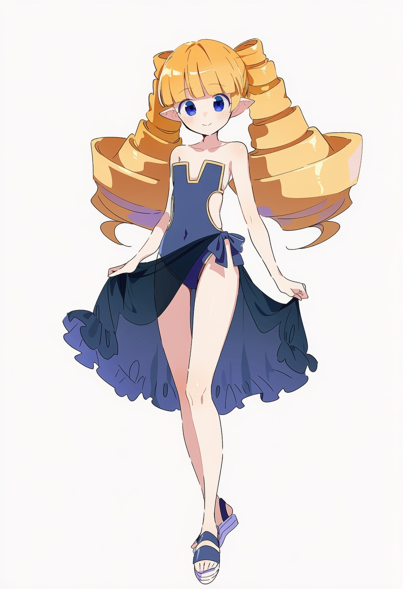

[在线例图](https://assets.quicktagcloud.com/images/raven_composition/raven_composition-4600.jpg?v=1197fb488eb4ba90)

<a id="raven_composition-4601"></a>

## 蓝泽埃玛

ID：`raven_composition-4601`；分类：角色图鉴 / 金毛；来源标记：`safe`。

来源说明：

> 作品：VSPO!
> 作品 tag：vspo!
> 难度：★★

正向提示词：

```text
aizawa_ema
```

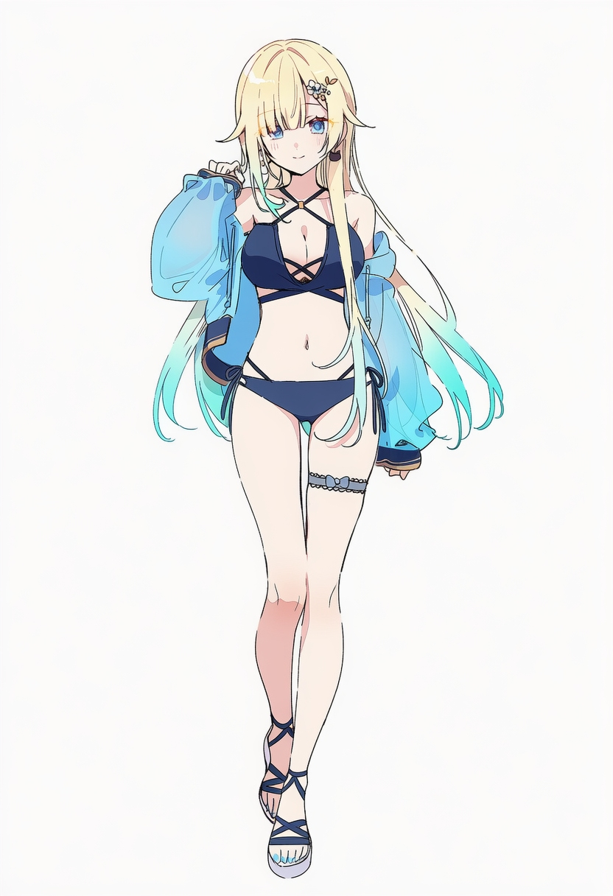

[在线例图](https://assets.quicktagcloud.com/images/raven_composition/raven_composition-4601.jpg?v=1f21a994b12d2079)

<a id="raven_composition-4602"></a>

## 秋穰子

ID：`raven_composition-4602`；分类：角色图鉴 / 金毛；来源标记：`safe`。

来源说明：

> 作品：东方Project
> 作品 tag：touhou
> 难度：★

正向提示词：

```text
aki_minoriko
```

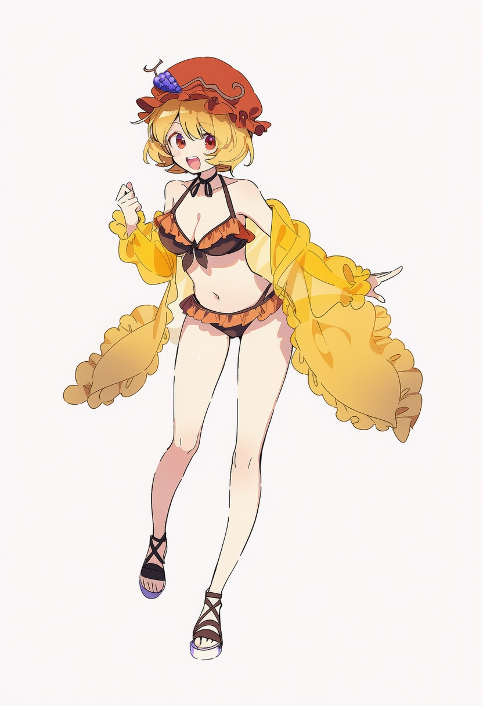

[在线例图](https://assets.quicktagcloud.com/images/raven_composition/raven_composition-4602.jpg?v=2e3240a021810099)

<a id="raven_composition-4603"></a>

## 亚北音留

ID：`raven_composition-4603`；分类：角色图鉴 / 金毛；来源标记：`safe`。

来源说明：

> 作品：VOCALOID
> 作品 tag：vocaloid
> 难度：★★

正向提示词：

```text
akita_neru
```

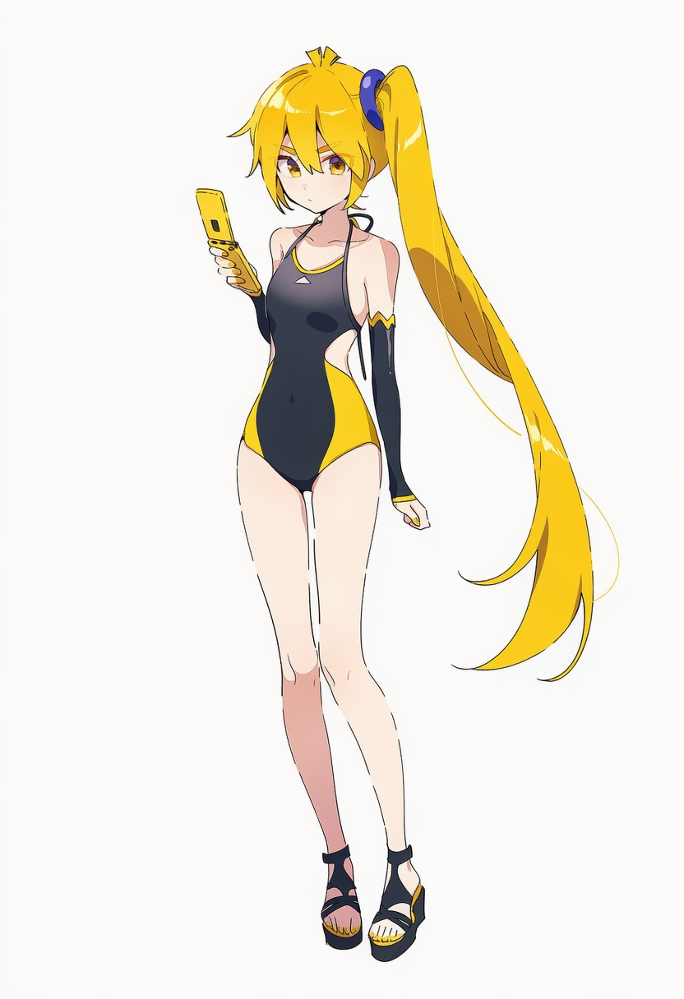

[在线例图](https://assets.quicktagcloud.com/images/raven_composition/raven_composition-4603.jpg?v=125138f4a02f61ee)

<a id="raven_composition-4604"></a>

## 天野Pikamee

ID：`raven_composition-4604`；分类：角色图鉴 / 金毛；来源标记：`safe`。

来源说明：

> 作品：VOMS Project
> 作品 tag：voms
> 难度：★★

正向提示词：

```text
amano_pikamee
```

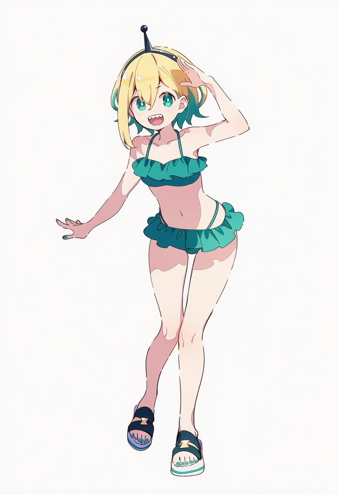

[在线例图](https://assets.quicktagcloud.com/images/raven_composition/raven_composition-4604.jpg?v=5ff18a611c2021b6)

<a id="raven_composition-4605"></a>

## 爱丽丝·滋贝鲁格

ID：`raven_composition-4605`；分类：角色图鉴 / 金毛；来源标记：`safe`。

来源说明：

> 作品：刀剑神域
> 作品 tag：sword_art_online
> 难度：★★

正向提示词：

```text
alice_zuberg
```

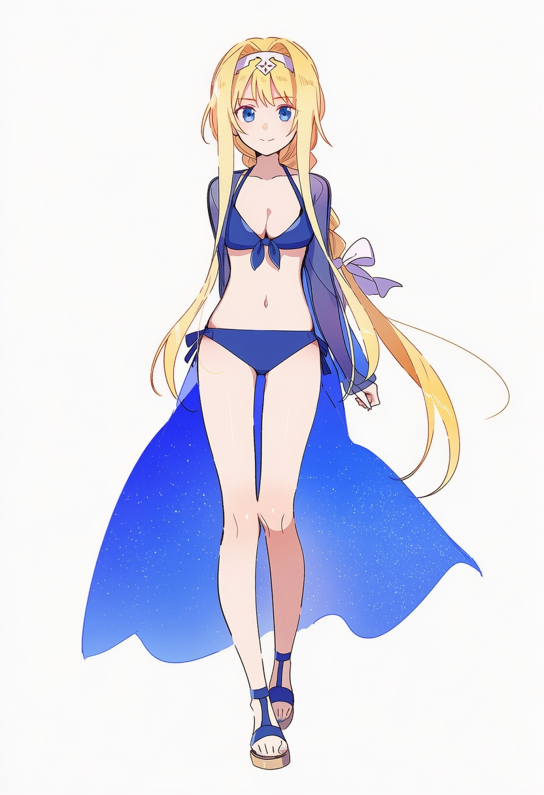

[在线例图](https://assets.quicktagcloud.com/images/raven_composition/raven_composition-4605.jpg?v=e70ca14194c37e41)

<a id="raven_composition-4606"></a>

## 相叶夕美

ID：`raven_composition-4606`；分类：角色图鉴 / 金毛；来源标记：`safe`。

来源说明：

> 作品：偶像大师
> 作品 tag：idolmaster
> 难度：★★

正向提示词：

```text
aiba_yumi
```

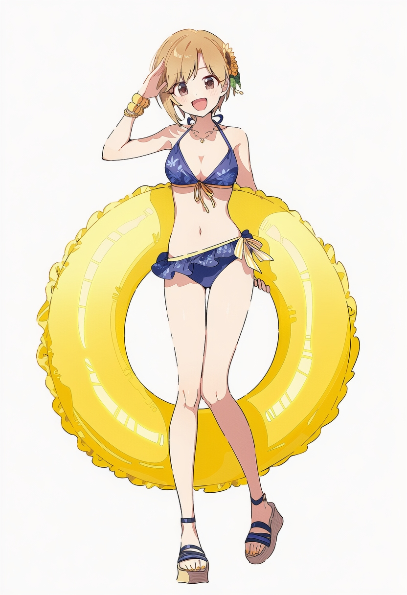

[在线例图](https://assets.quicktagcloud.com/images/raven_composition/raven_composition-4606.jpg?v=b42d3c09e360983f)

<a id="raven_composition-4607"></a>

## 晓组织制服

ID：`raven_composition-4607`；分类：角色图鉴 / 金毛；来源标记：`safe`。

来源说明：

> 作品：uni_create
> 作品 tag：uni_create
> 难度：★★★

正向提示词：

```text
akatsuki_uni
```

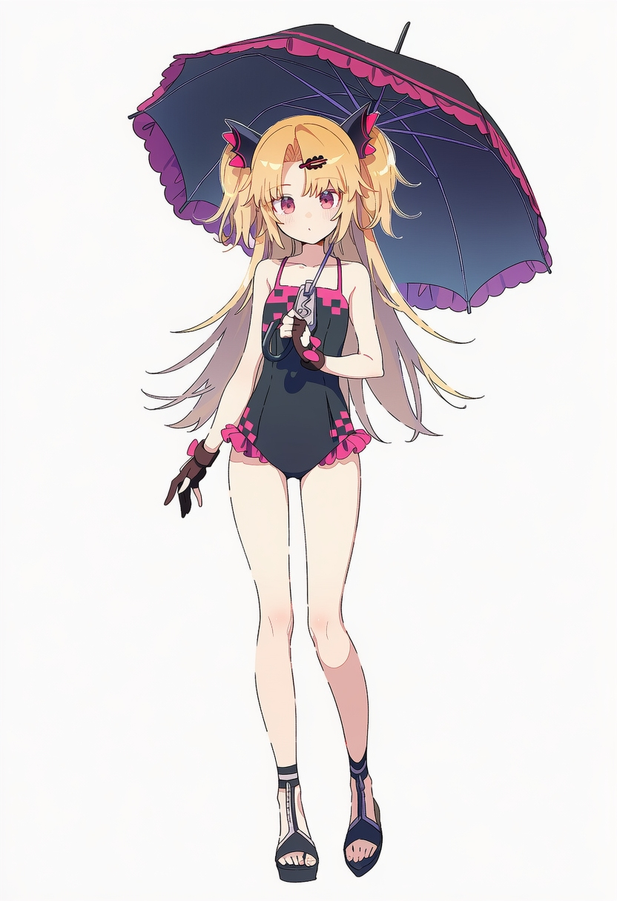

[在线例图](https://assets.quicktagcloud.com/images/raven_composition/raven_composition-4607.jpg?v=bcc63bb9d701b901)

<a id="raven_composition-4608"></a>

## 梣

ID：`raven_composition-4608`；分类：角色图鉴 / 金毛；来源标记：`safe`。

来源说明：

> 作品：命运-冠位指定
> 作品 tag：fate/grand_order
> 难度：★★★★

正向提示词：

```text
aesc_(fate)
```

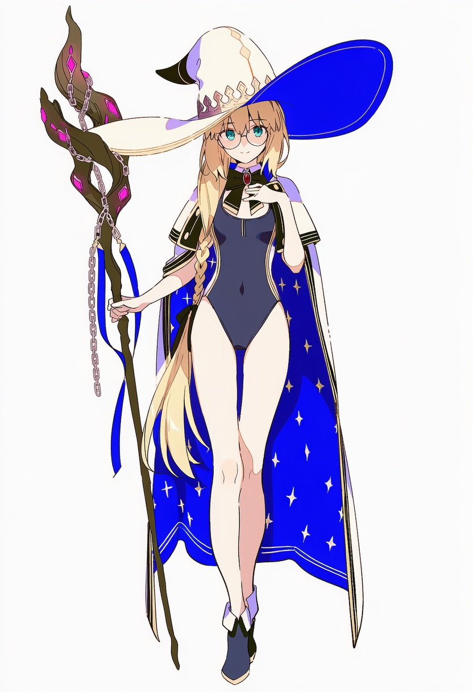

[在线例图](https://assets.quicktagcloud.com/images/raven_composition/raven_composition-4608.jpg?v=eaa90f0858ee40a5)

<a id="raven_composition-4609"></a>

## 青山蓝山

ID：`raven_composition-4609`；分类：角色图鉴 / 金毛；来源标记：`safe`。

来源说明：

> 作品：请问您今天要来点兔子吗？
> 作品 tag：gochuumon_wa_usagi_desu_ka?
> 难度：★★★★

正向提示词：

```text
aoyama_blue_mountain
```


[在线例图](https://assets.quicktagcloud.com/images/raven_composition/raven_composition-4609.jpg?v=bc7a64aceef9c738)

<a id="raven_composition-4610"></a>

## 空弦

ID：`raven_composition-4610`；分类：角色图鉴 / 金毛；来源标记：`safe`。

来源说明：

> 作品：明日方舟
> 作品 tag：arknights
> 难度：★★★

正向提示词：

```text
archetto_(arknights)
```


[在线例图](https://assets.quicktagcloud.com/images/raven_composition/raven_composition-4610.jpg?v=271412b8c7df96a1)

<a id="raven_composition-4611"></a>

## 亚马逊

ID：`raven_composition-4611`；分类：角色图鉴 / 金毛；来源标记：`safe`。

来源说明：

> 作品：龙之皇冠
> 作品 tag：dragon's_crown
> 难度：★★

正向提示词：

```text
amazon_(dragon's_crown)
```


[在线例图](https://assets.quicktagcloud.com/images/raven_composition/raven_composition-4611.jpg?v=61434e58bbf3c7ce)

<a id="raven_composition-4612"></a>

## 弥海砂

ID：`raven_composition-4612`；分类：角色图鉴 / 金毛；来源标记：`safe`。

来源说明：

> 作品：死亡笔记
> 作品 tag：death_note
> 难度：★★★

正向提示词：

```text
amane_misa
```


[在线例图](https://assets.quicktagcloud.com/images/raven_composition/raven_composition-4612.jpg?v=d42415aae25fb032)

<a id="raven_composition-4613"></a>

## 希佩尔海军上将

ID：`raven_composition-4613`；分类：角色图鉴 / 金毛；来源标记：`safe`。

来源说明：

> 作品：碧蓝航线
> 作品 tag：azur_lane
> 难度：★★

正向提示词：

```text
admiral_hipper_(azur_lane)
```


[在线例图](https://assets.quicktagcloud.com/images/raven_composition/raven_composition-4613.jpg?v=883b78efd2c5fbdc)

<a id="raven_composition-4614"></a>

## 亚历山德拉·苏苏

ID：`raven_composition-4614`；分类：角色图鉴 / 金毛；来源标记：`safe`。

来源说明：

> 作品：东京七姐妹
> 作品 tag：tokyo_7th_sisters
> 难度：★★★★

正向提示词：

```text
alessandra_susu
```


[在线例图](https://assets.quicktagcloud.com/images/raven_composition/raven_composition-4614.jpg?v=461ce8de682810f2)

<a id="raven_composition-4615"></a>

## 爱崎惠美留

ID：`raven_composition-4615`；分类：角色图鉴 / 金毛；来源标记：`safe`。

来源说明：

> 作品：光之美少女
> 作品 tag：precure
> 难度：★★★

正向提示词：

```text
aisaki_emiru
```


[在线例图](https://assets.quicktagcloud.com/images/raven_composition/raven_composition-4615.jpg?v=3fa6ba1726824e84)

<a id="raven_composition-4616"></a>

## 爱尔奎特·布伦史塔德

ID：`raven_composition-4616`；分类：角色图鉴 / 金毛；来源标记：`safe`。

来源说明：

> 作品：月姬
> 作品 tag：tsukihime
> 难度：★

正向提示词：

```text
arcueid_brunestud
```


[在线例图](https://assets.quicktagcloud.com/images/raven_composition/raven_composition-4616.jpg?v=306023b3da66114d)

<a id="raven_composition-4617"></a>

## 明里

ID：`raven_composition-4617`；分类：角色图鉴 / 金毛；来源标记：`safe`。

来源说明：

> 作品：蔚蓝档案
> 作品 tag：blue_archive
> 难度：★★★

正向提示词：

```text
akari_(blue_archive)
```


[在线例图](https://assets.quicktagcloud.com/images/raven_composition/raven_composition-4617.jpg?v=fe7891796b229252)

<a id="raven_composition-4618"></a>

## 赤木律子

ID：`raven_composition-4618`；分类：角色图鉴 / 金毛；来源标记：`safe`。

来源说明：

> 作品：新世纪福音战士
> 作品 tag：neon_genesis_evangelion
> 难度：★★★

正向提示词：

```text
akagi_ritsuko
```


[在线例图](https://assets.quicktagcloud.com/images/raven_composition/raven_composition-4618.jpg?v=4fbf5d4d10a53642)

<a id="raven_composition-4619"></a>

## 秋静叶

ID：`raven_composition-4619`；分类：角色图鉴 / 金毛；来源标记：`safe`。

来源说明：

> 作品：东方Project
> 作品 tag：touhou
> 难度：★

正向提示词：

```text
aki_shizuha
```


[在线例图](https://assets.quicktagcloud.com/images/raven_composition/raven_composition-4619.jpg?v=a0cca68a7dcac3be)

<a id="raven_composition-4620"></a>

## 安

ID：`raven_composition-4620`；分类：角色图鉴 / 金毛；来源标记：`safe`。

来源说明：

> 作品：神击的巴哈姆特
> 作品 tag：shingeki_no_bahamut
> 难度：★★★★

正向提示词：

```text
anne_(shingeki_no_bahamut)
```


[在线例图](https://assets.quicktagcloud.com/images/raven_composition/raven_composition-4620.jpg?v=a1fe86289b9124ef)

<a id="raven_composition-4621"></a>

## 爱丽丝

ID：`raven_composition-4621`；分类：角色图鉴 / 金毛；来源标记：`safe`。

来源说明：

> 作品：爱丽丝（爱丽丝梦游仙境）
> 作品 tag：alice_in_wonderland
> 难度：★

正向提示词：

```text
alice_(alice_in_wonderland)
```


[在线例图](https://assets.quicktagcloud.com/images/raven_composition/raven_composition-4621.jpg?v=c92db35f88fc3fda)

<a id="raven_composition-4622"></a>

## 爱丽丝·玛格特罗伊德

ID：`raven_composition-4622`；分类：角色图鉴 / 金毛；来源标记：`safe`。

来源说明：

> 作品：东方Project
> 作品 tag：touhou
> 难度：★

正向提示词：

```text
alice_margatroid
```


[在线例图](https://assets.quicktagcloud.com/images/raven_composition/raven_composition-4622.jpg?v=feba4cf8cb79f54d)

<a id="raven_composition-4623"></a>

## 安娜·柯波拉

ID：`raven_composition-4623`；分类：角色图鉴 / 金毛；来源标记：`safe`。

来源说明：

> 作品：草莓棉花糖
> 作品 tag：ichigo_mashimaro
> 难度：★★★

正向提示词：

```text
ana_coppola
```


[在线例图](https://assets.quicktagcloud.com/images/raven_composition/raven_composition-4623.jpg?v=91666f78512ebe3b)
