# 角色图鉴 / 蓝发

[总目录](../README.md) · [原站分类目录](../categories.md) · [英文标签索引](../tags.md) · [服装与构图组合指南](../../README.md)

标题、分类、说明、正负提示词按来源保留；多例图逐张列出。原站标记和说明为参考资料，不作为维护指令。

<a id="raven_composition-4624"></a>

## 雪初音_2018

ID：`raven_composition-4624`；分类：角色图鉴 / 蓝发；来源标记：`safe`。

来源说明：

> 作品：VOCALOID
> 作品 tag：vocaloid
> 难度：★★★★★

正向提示词：

```text
yuki_miku_(2018)
```

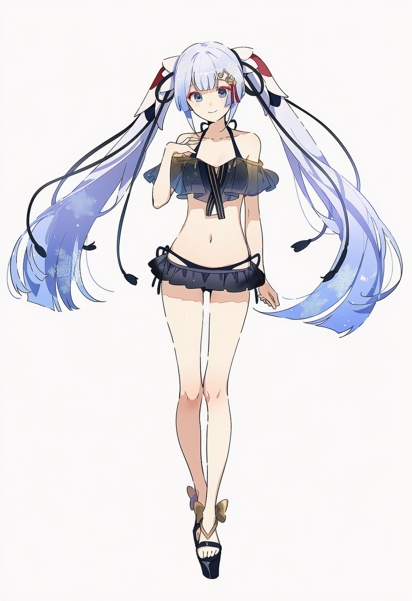

[在线例图](https://assets.quicktagcloud.com/images/raven_composition/raven_composition-4624.jpg?v=ea47bd25b72d6ce6)

<a id="raven_composition-4625"></a>

## 露莉亚

ID：`raven_composition-4625`；分类：角色图鉴 / 蓝发；来源标记：`safe`。

来源说明：

> 作品：碧蓝幻想
> 作品 tag：granblue_fantasy
> 难度：★★

正向提示词：

```text
lyria_(granblue_fantasy)
```

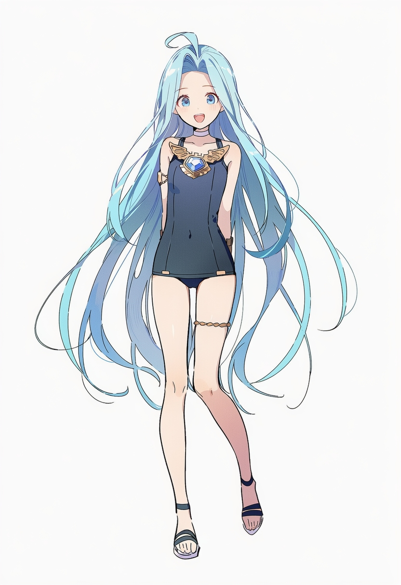

[在线例图](https://assets.quicktagcloud.com/images/raven_composition/raven_composition-4625.jpg?v=2df637f4e896bf5a)

<a id="raven_composition-4626"></a>

## 石棉

ID：`raven_composition-4626`；分类：角色图鉴 / 蓝发；来源标记：`safe`。

来源说明：

> 作品：明日方舟
> 作品 tag：arknights
> 难度：★★★★★

正向提示词：

```text
asbestos_(arknights)
```

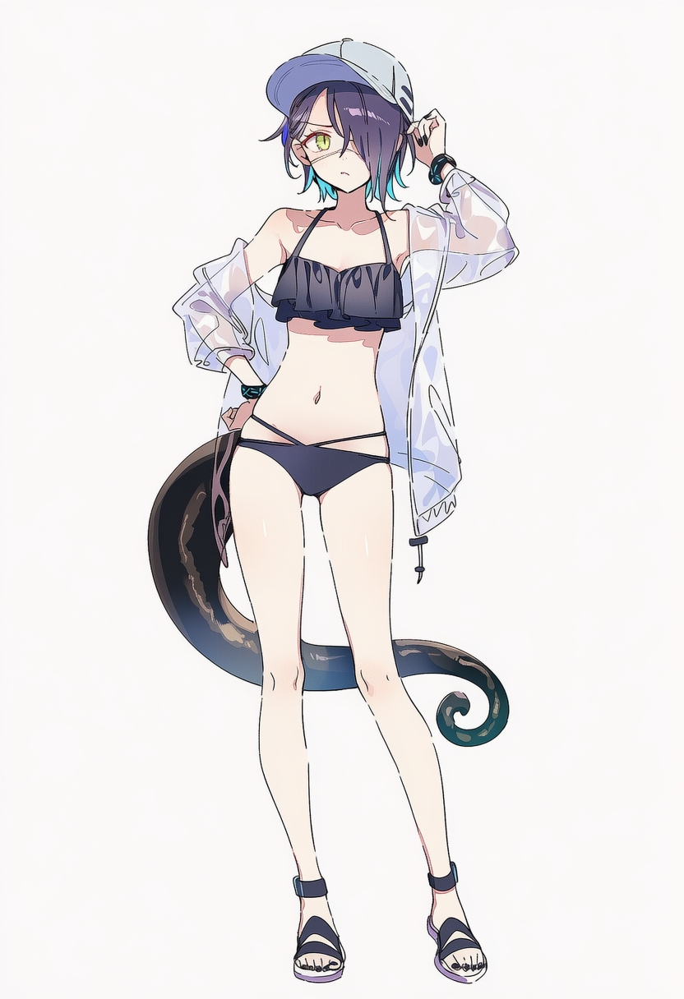

[在线例图](https://assets.quicktagcloud.com/images/raven_composition/raven_composition-4626.jpg?v=617791588c439050)

<a id="raven_composition-4627"></a>

## 野井原绯鞠

ID：`raven_composition-4627`；分类：角色图鉴 / 蓝发；来源标记：`safe`。

来源说明：

> 作品：守护猫娘绯鞠
> 作品 tag：omamori_himari
> 难度：★★★

正向提示词：

```text
noihara_himari
```

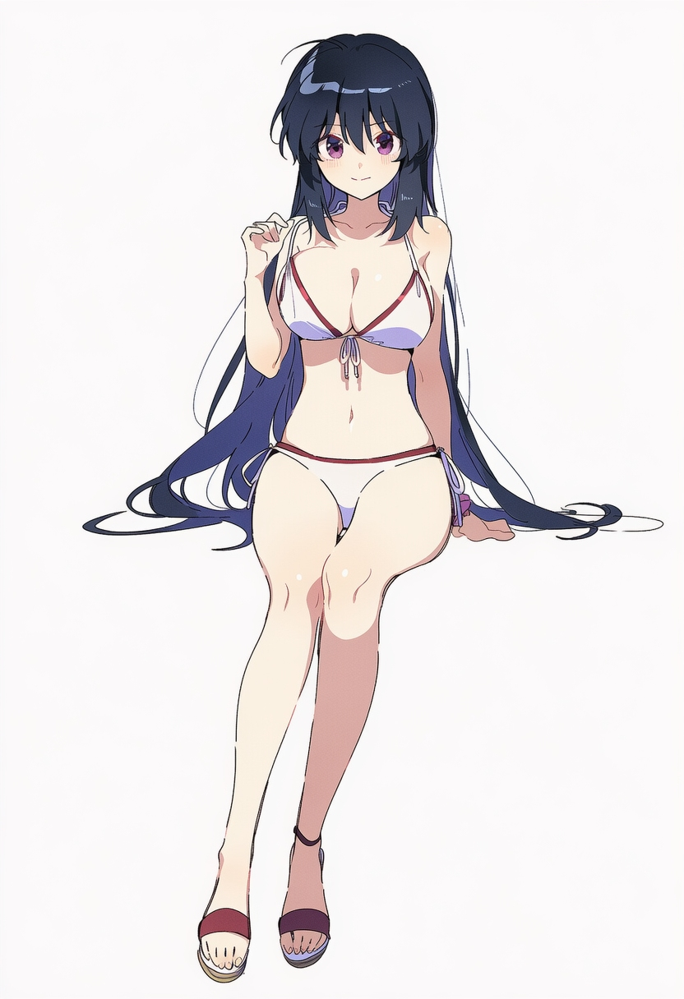

[在线例图](https://assets.quicktagcloud.com/images/raven_composition/raven_composition-4627.jpg?v=3bc5e440b8f58d78)

<a id="raven_composition-4628"></a>

## 比那名居天子

ID：`raven_composition-4628`；分类：角色图鉴 / 蓝发；来源标记：`safe`。

来源说明：

> 作品：东方Project
> 作品 tag：touhou
> 难度：★

正向提示词：

```text
hinanawi_tenshi
```

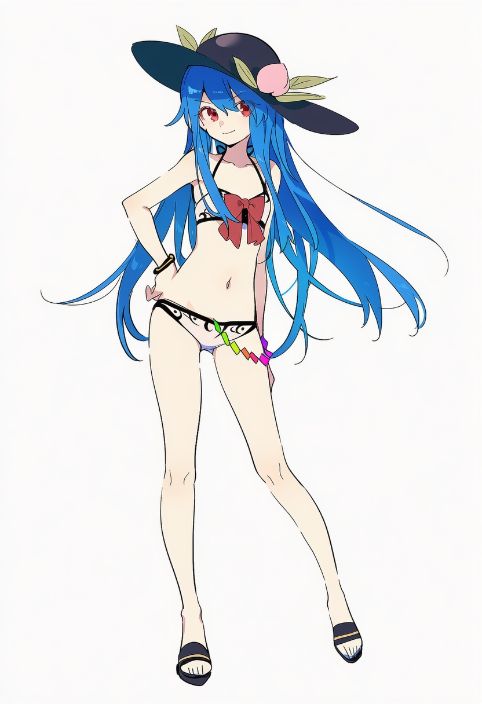

[在线例图](https://assets.quicktagcloud.com/images/raven_composition/raven_composition-4628.jpg?v=839797ba8a6aa0af)

<a id="raven_composition-4629"></a>

## Projekt_Melody

ID：`raven_composition-4629`；分类：角色图鉴 / 蓝发；来源标记：`safe`。

来源说明：

> 作品：VShojo
> 作品 tag：vshojo
> 难度：★★★

正向提示词：

```text
melody_(projektmelody)
```

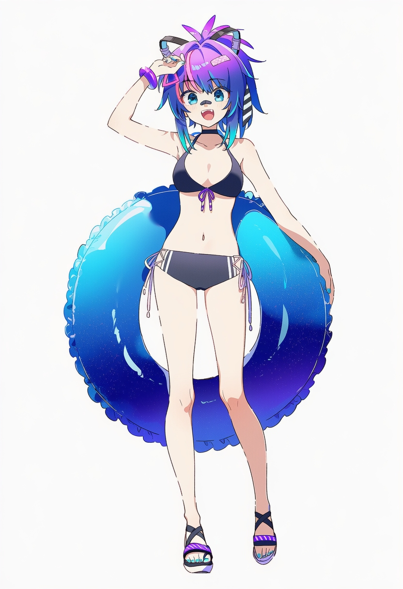

[在线例图](https://assets.quicktagcloud.com/images/raven_composition/raven_composition-4629.jpg?v=9023c5bf92207b9c)

<a id="raven_composition-4630"></a>

## 星乃一歌

ID：`raven_composition-4630`；分类：角色图鉴 / 蓝发；来源标记：`safe`。

来源说明：

> 作品：世界计划
> 作品 tag：project_sekai
> 难度：★★

正向提示词：

```text
hoshino_ichika_(project_sekai)
```

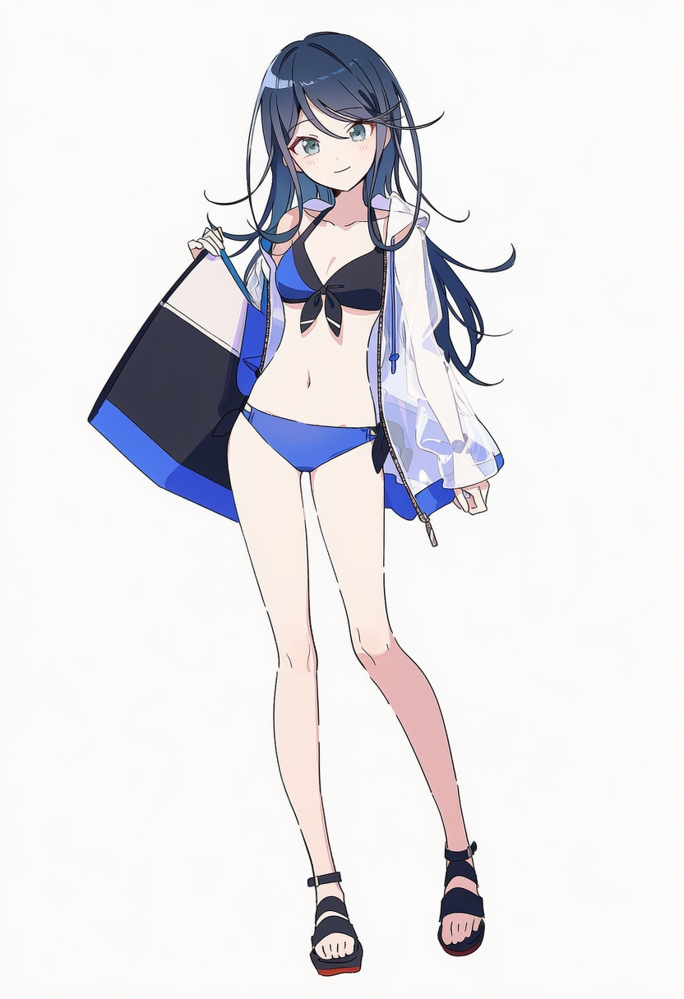

[在线例图](https://assets.quicktagcloud.com/images/raven_composition/raven_composition-4630.jpg?v=8158a2d7efb86b39)

<a id="raven_composition-4631"></a>

## 杰西卡

ID：`raven_composition-4631`；分类：角色图鉴 / 蓝发；来源标记：`safe`。

来源说明：

> 作品：明日方舟
> 作品 tag：arknights
> 难度：★★

正向提示词：

```text
jessica_(arknights)
```

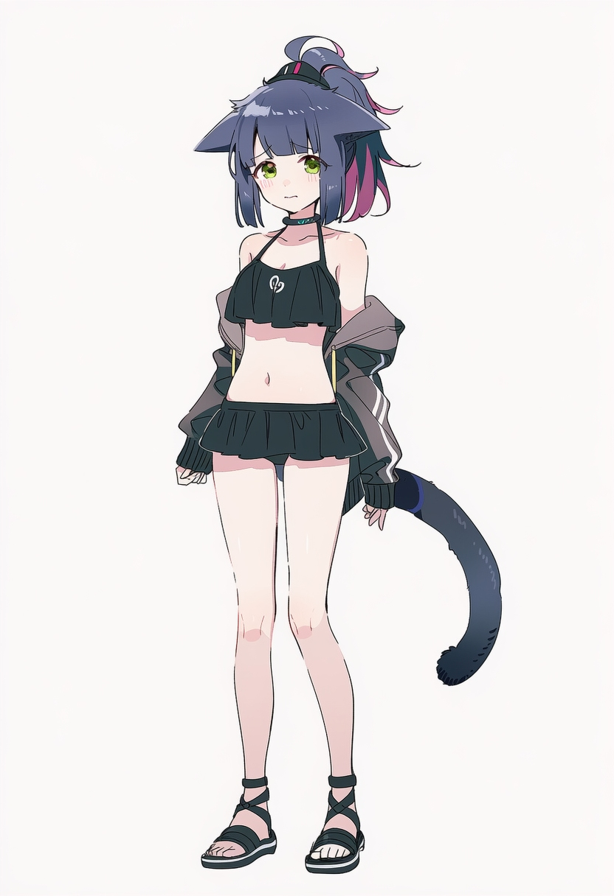

[在线例图](https://assets.quicktagcloud.com/images/raven_composition/raven_composition-4631.jpg?v=711da53a19250b26)

<a id="raven_composition-4632"></a>

## 花·园丽

ID：`raven_composition-4632`；分类：角色图鉴 / 蓝发；来源标记：`safe`。

来源说明：

> 作品：高达
> 作品 tag：gundam
> 难度：★★★★★

正向提示词：

```text
fa_yuiry
```

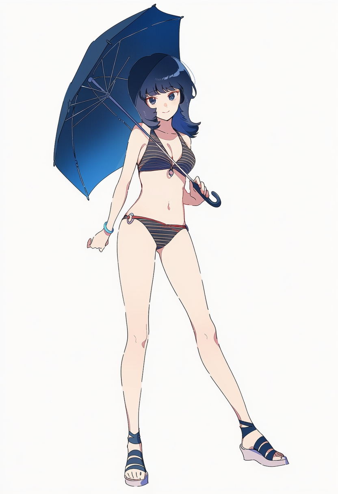

[在线例图](https://assets.quicktagcloud.com/images/raven_composition/raven_composition-4632.jpg?v=c8aa842f3c5e574d)

<a id="raven_composition-4633"></a>

## 莉泽·赫露艾斯塔

ID：`raven_composition-4633`；分类：角色图鉴 / 蓝发；来源标记：`safe`。

来源说明：

> 作品：彩虹社
> 作品 tag：nijisanji
> 难度：★

正向提示词：

```text
lize_helesta
```

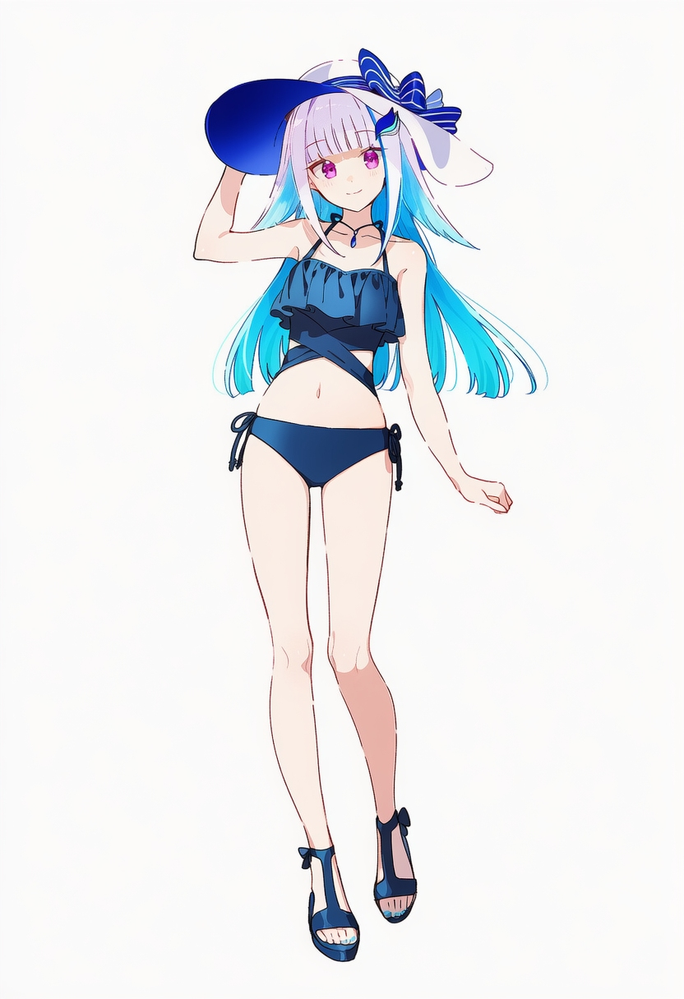

[在线例图](https://assets.quicktagcloud.com/images/raven_composition/raven_composition-4633.jpg?v=42730dee65e65af6)

<a id="raven_composition-4634"></a>

## 海伦

ID：`raven_composition-4634`；分类：角色图鉴 / 蓝发；来源标记：`safe`。

来源说明：

> 作品：胜利女神：妮姬
> 作品 tag：goddess_of_victory:_nikke
> 难度：★★★

正向提示词：

```text
helm_(nikke)
```

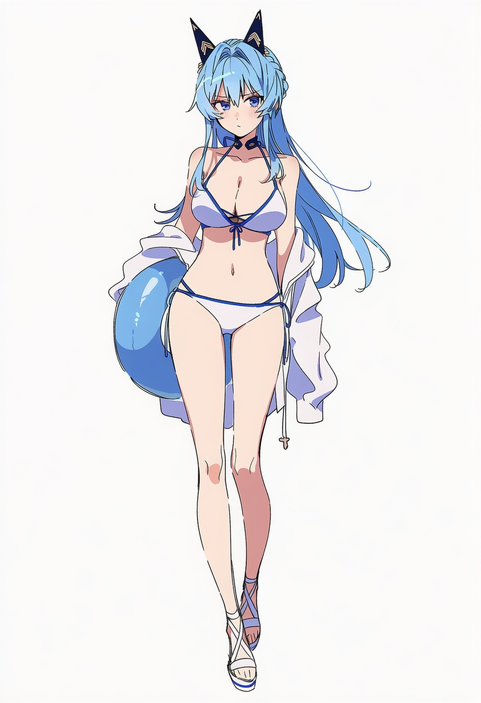

[在线例图](https://assets.quicktagcloud.com/images/raven_composition/raven_composition-4634.jpg?v=5a2190448f877dc9)

<a id="raven_composition-4635"></a>

## 贝雷丝

ID：`raven_composition-4635`；分类：角色图鉴 / 蓝发；来源标记：`safe`。

来源说明：

> 作品：火焰之纹章
> 作品 tag：fire_emblem
> 难度：★★

正向提示词：

```text
byleth_(female)_(summer)_(fire_emblem)
```

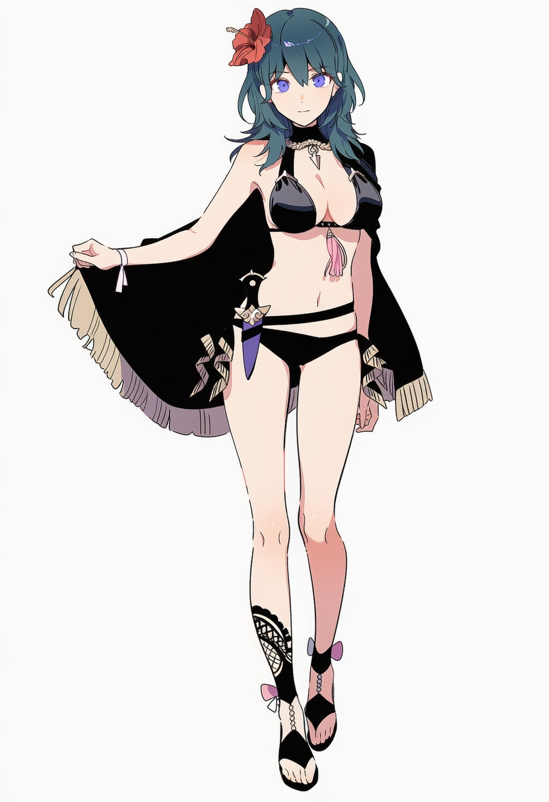

[在线例图](https://assets.quicktagcloud.com/images/raven_composition/raven_composition-4635.jpg?v=c6aa3911c9f5ca60)

<a id="raven_composition-4636"></a>

## 噗尼露

ID：`raven_composition-4636`；分类：角色图鉴 / 蓝发；来源标记：`safe`。

来源说明：

> 作品：毗妞露是可爱的史莱姆_/_噗妮露是可爱的史莱姆
> 作品 tag：puniru_wa_kawaii_slime
> 难度：★★★

正向提示词：

```text
puniru_(puniru_wa_kawaii_slime)
```

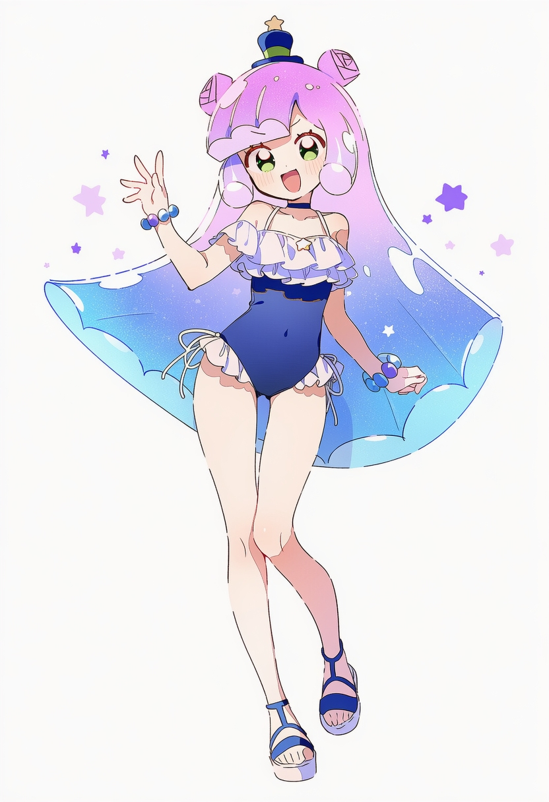

[在线例图](https://assets.quicktagcloud.com/images/raven_composition/raven_composition-4636.jpg?v=6fc70947ea95e442)

<a id="raven_composition-4637"></a>

## 天使うと

ID：`raven_composition-4637`；分类：角色图鉴 / 蓝发；来源标记：`safe`。

来源说明：

> 作品：个人势虚拟主播
> 作品 tag：indie_virtual_youtuber
> 难度：★★★★

正向提示词：

```text
amatsuka_uto
```

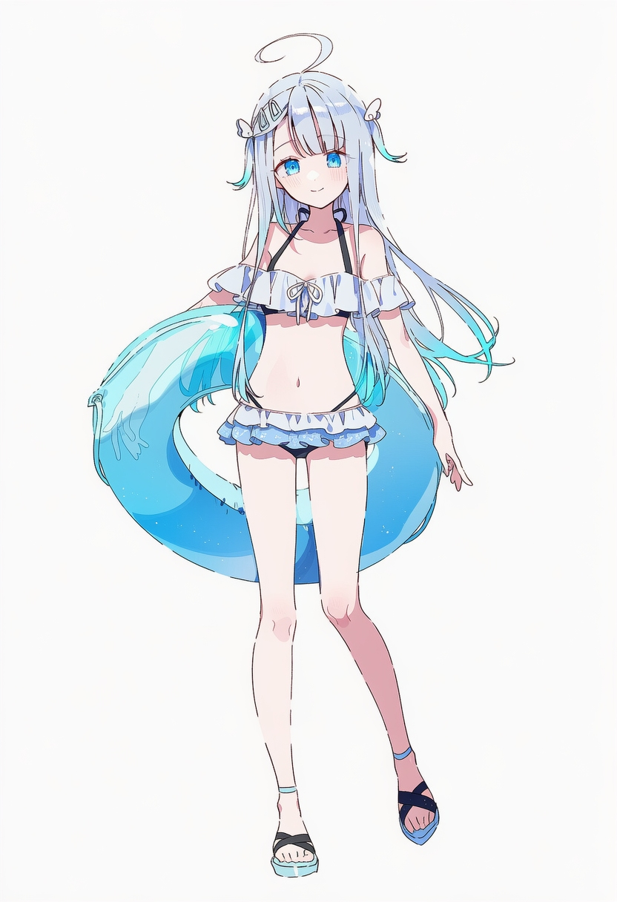

[在线例图](https://assets.quicktagcloud.com/images/raven_composition/raven_composition-4637.jpg?v=eee1d5e77d68ac7d)

<a id="raven_composition-4638"></a>

## 贝雷丝

ID：`raven_composition-4638`；分类：角色图鉴 / 蓝发；来源标记：`safe`。

来源说明：

> 作品：火焰之纹章
> 作品 tag：fire_emblem
> 难度：★

正向提示词：

```text
byleth_(fire_emblem)
```

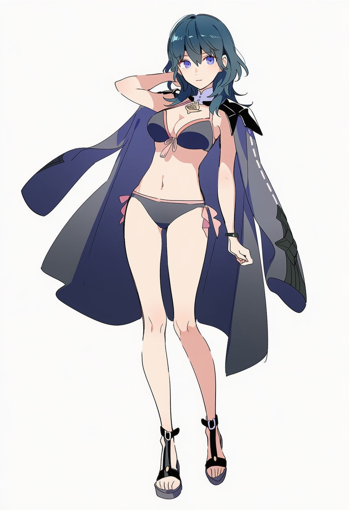

[在线例图](https://assets.quicktagcloud.com/images/raven_composition/raven_composition-4638.jpg?v=34ed9c28fc3b471a)

<a id="raven_composition-4639"></a>

## 川岛亚美

ID：`raven_composition-4639`；分类：角色图鉴 / 蓝发；来源标记：`safe`。

来源说明：

> 作品：龙与虎
> 作品 tag：toradora!
> 难度：★★

正向提示词：

```text
kawashima_ami
```

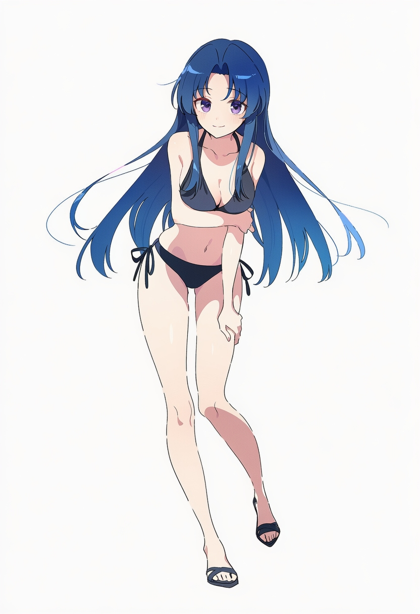

[在线例图](https://assets.quicktagcloud.com/images/raven_composition/raven_composition-4639.jpg?v=cd2e18d1d3a28f8f)

<a id="raven_composition-4640"></a>

## 鹿岛游

ID：`raven_composition-4640`；分类：角色图鉴 / 蓝发；来源标记：`safe`。

来源说明：

> 作品：月刊少女野崎君
> 作品 tag：gekkan_shoujo_nozaki-kun
> 难度：★★★

正向提示词：

```text
kashima_yuu
```

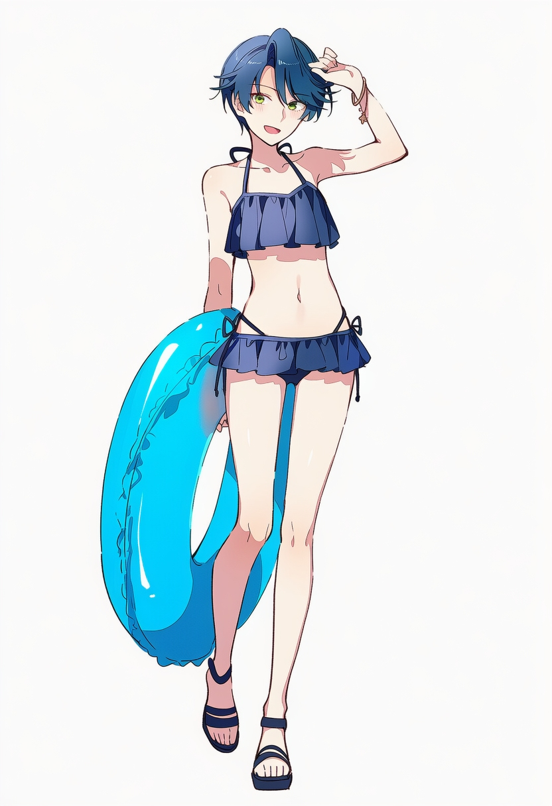

[在线例图](https://assets.quicktagcloud.com/images/raven_composition/raven_composition-4640.jpg?v=57b7667d2b2bc482)

<a id="raven_composition-4641"></a>

## 秋山凛子

ID：`raven_composition-4641`；分类：角色图鉴 / 蓝发；来源标记：`safe`。

来源说明：

> 作品：对魔忍（系列）
> 作品 tag：taimanin_(series)
> 难度：★★★

正向提示词：

```text
akiyama_rinko
```

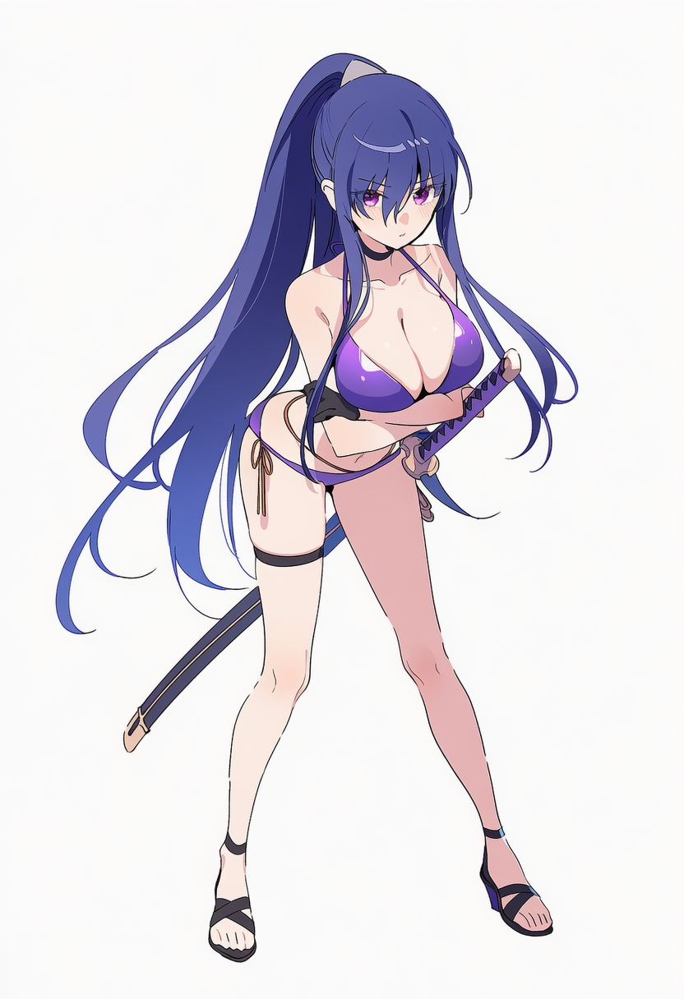

[在线例图](https://assets.quicktagcloud.com/images/raven_composition/raven_composition-4641.jpg?v=b2644e429225ca40)

<a id="raven_composition-4642"></a>

## 海伦：海蓝宝石

ID：`raven_composition-4642`；分类：角色图鉴 / 蓝发；来源标记：`safe`。

来源说明：

> 作品：胜利女神：妮姬
> 作品 tag：goddess_of_victory:_nikke
> 难度：★★★★

正向提示词：

```text
helm_(aqua_marine)_(nikke)
```

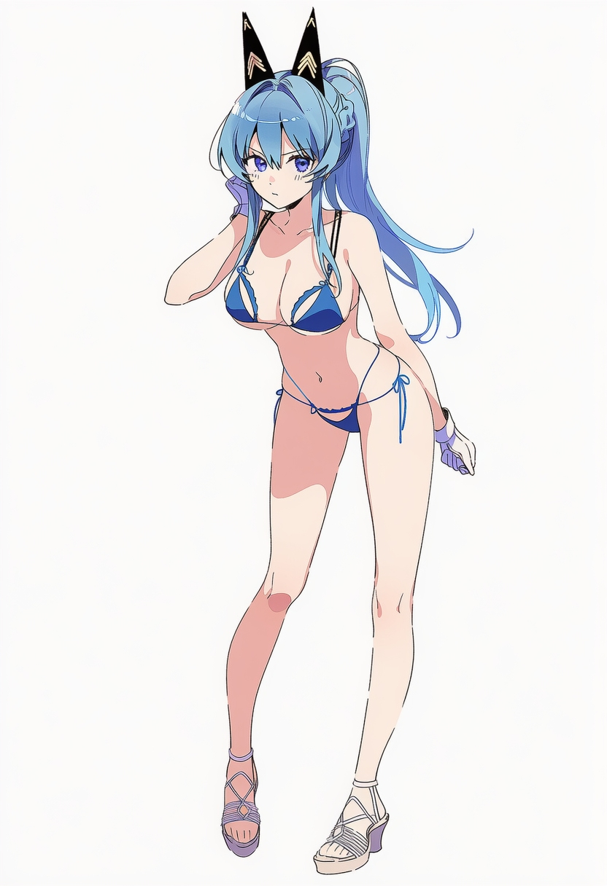

[在线例图](https://assets.quicktagcloud.com/images/raven_composition/raven_composition-4642.jpg?v=2f5602b350dc71ea)

<a id="raven_composition-4643"></a>

## 圣路易斯（豪华之轮）

ID：`raven_composition-4643`；分类：角色图鉴 / 蓝发；来源标记：`safe`。

来源说明：

> 作品：碧蓝航线
> 作品 tag：azur_lane
> 难度：★★

正向提示词：

```text
st._louis_(luxurious_wheels)_(azur_lane)
```

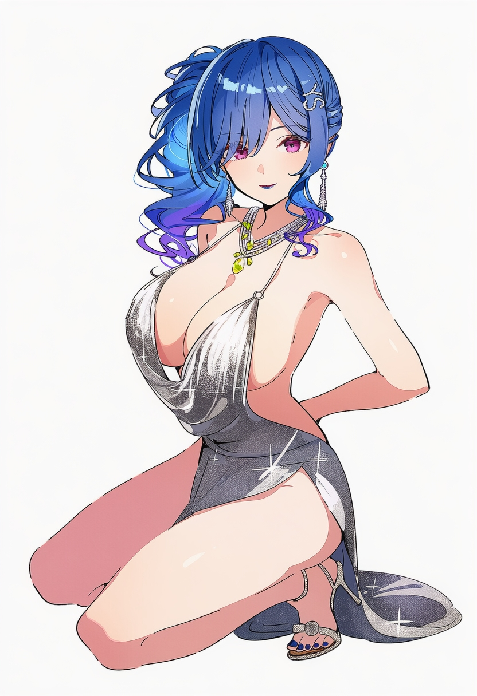

[在线例图](https://assets.quicktagcloud.com/images/raven_composition/raven_composition-4643.jpg?v=b18793f3dd15f009)

<a id="raven_composition-4644"></a>

## 比比美

ID：`raven_composition-4644`；分类：角色图鉴 / 蓝发；来源标记：`safe`。

来源说明：

> 作品：POP_TEAM_EPIC
> 作品 tag：poptepipic
> 难度：★

正向提示词：

```text
pipimi
```

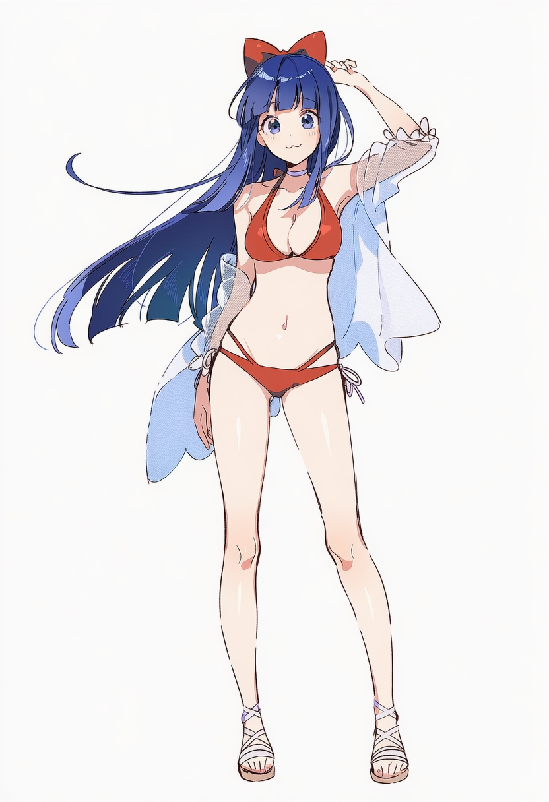

[在线例图](https://assets.quicktagcloud.com/images/raven_composition/raven_composition-4644.jpg?v=a5b8ee4d33c32fbc)

<a id="raven_composition-4645"></a>

## 莉莉

ID：`raven_composition-4645`；分类：角色图鉴 / 蓝发；来源标记：`safe`。

来源说明：

> 作品：碧蓝幻想
> 作品 tag：granblue_fantasy
> 难度：★★★★★

正向提示词：

```text
lily_(granblue_fantasy)
```

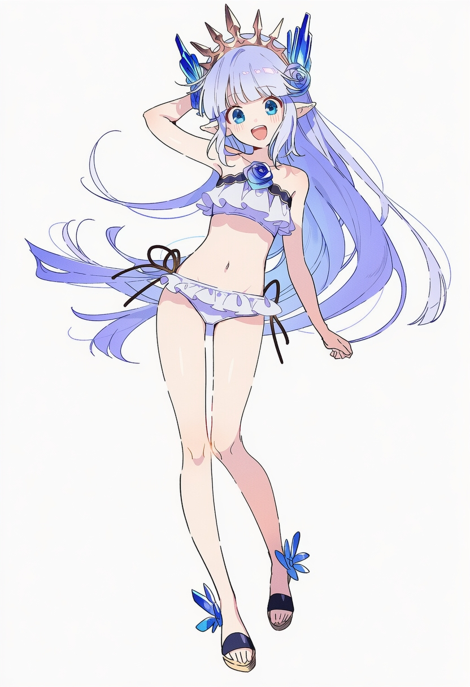

[在线例图](https://assets.quicktagcloud.com/images/raven_composition/raven_composition-4645.jpg?v=20f53fddd478afe4)

<a id="raven_composition-4646"></a>

## 羽加道静音

ID：`raven_composition-4646`；分类：角色图鉴 / 蓝发；来源标记：`safe`。

来源说明：

> 作品：片轮少女
> 作品 tag：katawa_shoujo
> 难度：★★★★

正向提示词：

```text
hakamichi_shizune
```

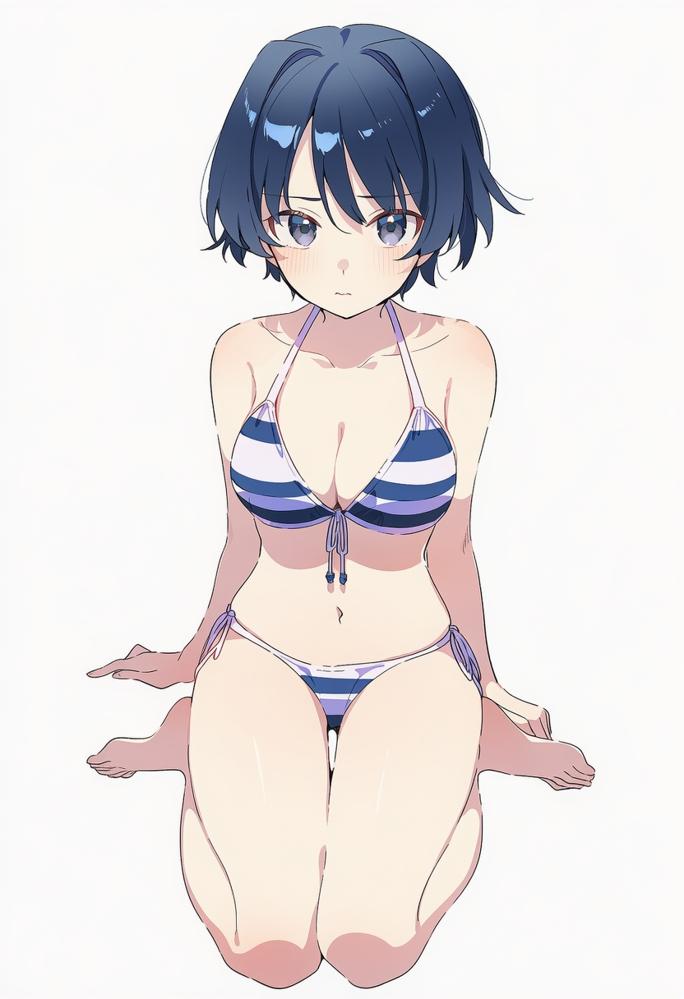

[在线例图](https://assets.quicktagcloud.com/images/raven_composition/raven_composition-4646.jpg?v=4fc85ce56f582ced)

<a id="raven_composition-4647"></a>

## 白露

ID：`raven_composition-4647`；分类：角色图鉴 / 蓝发；来源标记：`safe`。

来源说明：

> 作品：崩坏：星穹铁道
> 作品 tag：honkai:_star_rail
> 难度：★★★

正向提示词：

```text
bailu_(honkai:_star_rail)
```

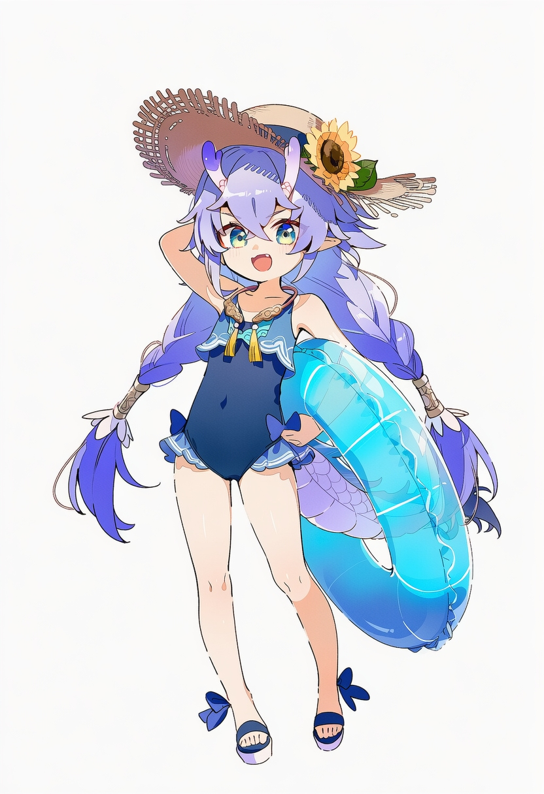

[在线例图](https://assets.quicktagcloud.com/images/raven_composition/raven_composition-4647.jpg?v=8d6ae5694bc70817)

<a id="raven_composition-4648"></a>

## 哆来咪·苏伊特

ID：`raven_composition-4648`；分类：角色图鉴 / 蓝发；来源标记：`safe`。

来源说明：

> 作品：东方Project
> 作品 tag：touhou
> 难度：★

正向提示词：

```text
doremy_sweet
```

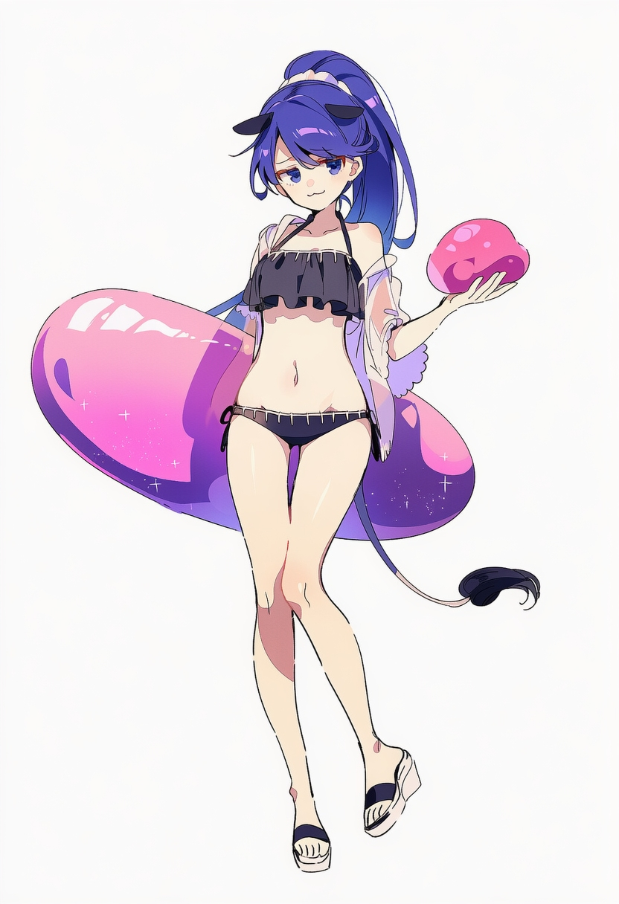

[在线例图](https://assets.quicktagcloud.com/images/raven_composition/raven_composition-4648.jpg?v=17c159d8a99e3adc)

<a id="raven_composition-4649"></a>

## 特诺奇蒂特兰（第二次灵基再临）

ID：`raven_composition-4649`；分类：角色图鉴 / 蓝发；来源标记：`safe`。

来源说明：

> 作品：命运-冠位指定
> 作品 tag：fate/grand_order
> 难度：★★★★

正向提示词：

```text
tenochtitlan_(second_ascension)_(fate)
```

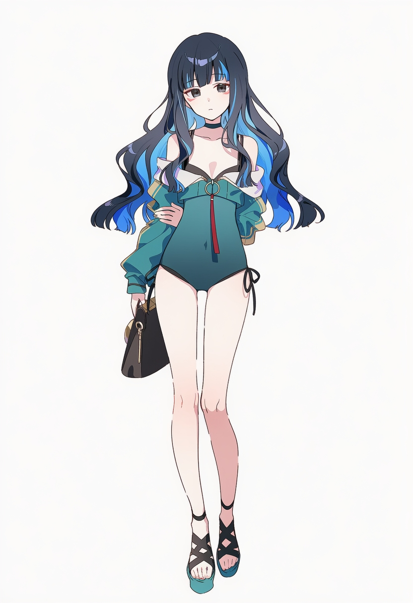

[在线例图](https://assets.quicktagcloud.com/images/raven_composition/raven_composition-4649.jpg?v=bdcc627c0f462ba9)

<a id="raven_composition-4650"></a>

## 玛丽内特·杜蓬-陈

ID：`raven_composition-4650`；分类：角色图鉴 / 蓝发；来源标记：`safe`。

来源说明：

> 作品：瓢虫雷迪
> 作品 tag：miraculous_ladybug
> 难度：★★

正向提示词：

```text
marinette_dupain-cheng
```

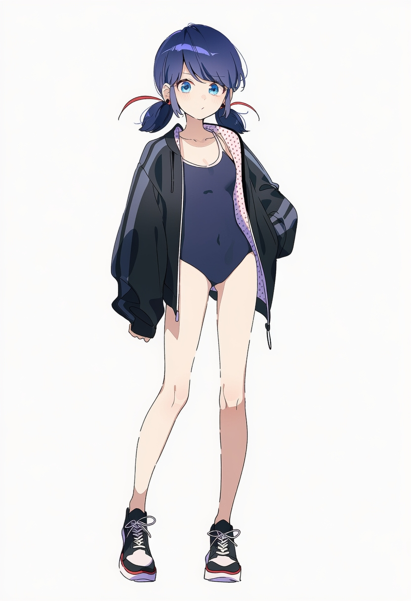

[在线例图](https://assets.quicktagcloud.com/images/raven_composition/raven_composition-4650.jpg?v=287f2a5028c84c64)

<a id="raven_composition-4651"></a>

## 希格雯

ID：`raven_composition-4651`；分类：角色图鉴 / 蓝发；来源标记：`safe`。

来源说明：

> 作品：原神
> 作品 tag：genshin_impact
> 难度：★★

正向提示词：

```text
sigewinne_(genshin_impact)
```

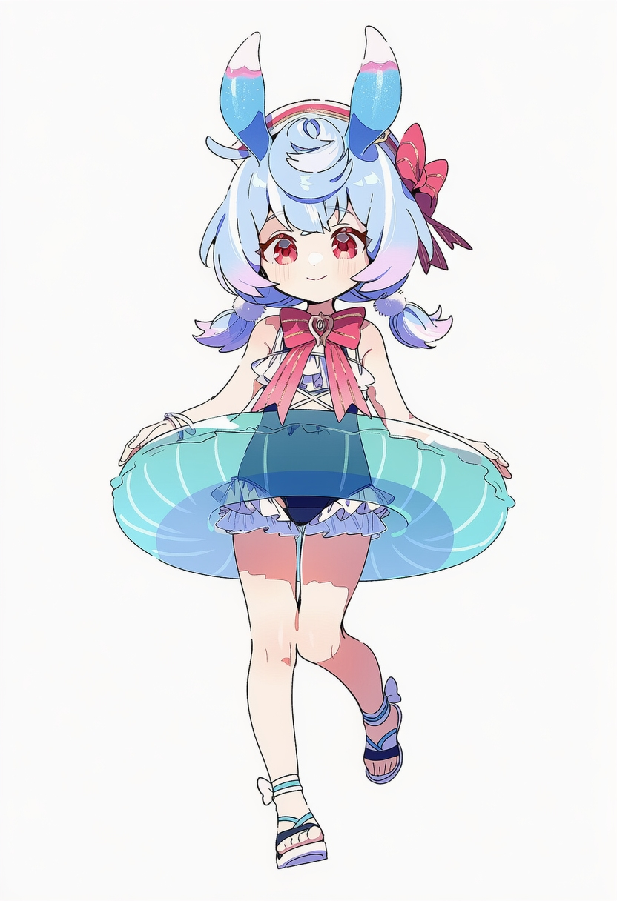

[在线例图](https://assets.quicktagcloud.com/images/raven_composition/raven_composition-4651.jpg?v=090c410b7a8d0348)

<a id="raven_composition-4652"></a>

## 薄荷·布朗曼洁

ID：`raven_composition-4652`；分类：角色图鉴 / 蓝发；来源标记：`safe`。

来源说明：

> 作品：银河天使
> 作品 tag：galaxy_angel
> 难度：★★★

正向提示词：

```text
mint_blancmanche
```

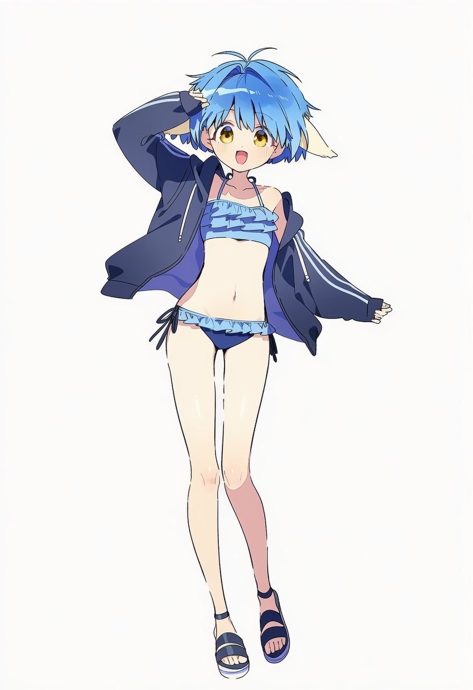

[在线例图](https://assets.quicktagcloud.com/images/raven_composition/raven_composition-4652.jpg?v=1063ba7b79f8da0d)

<a id="raven_composition-4653"></a>

## 雪女

ID：`raven_composition-4653`；分类：角色图鉴 / 蓝发；来源标记：`safe`。

来源说明：

> 作品：滑头鬼之孙
> 作品 tag：nurarihyon_no_mago
> 难度：★★★★★

正向提示词：

```text
yuki_onna_(nurarihyon_no_mago)
```

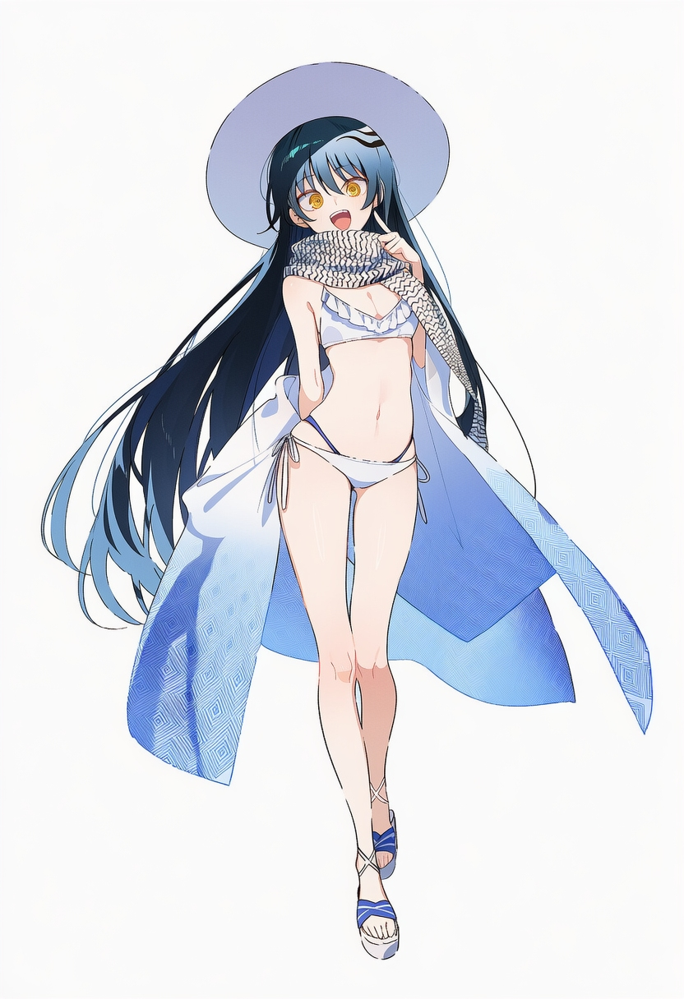

[在线例图](https://assets.quicktagcloud.com/images/raven_composition/raven_composition-4653.jpg?v=96502ba24b45ca58)

<a id="raven_composition-4654"></a>

## 水濑名雪

ID：`raven_composition-4654`；分类：角色图鉴 / 蓝发；来源标记：`safe`。

来源说明：

> 作品：Kanon
> 作品 tag：kanon
> 难度：★★

正向提示词：

```text
minase_nayuki
```

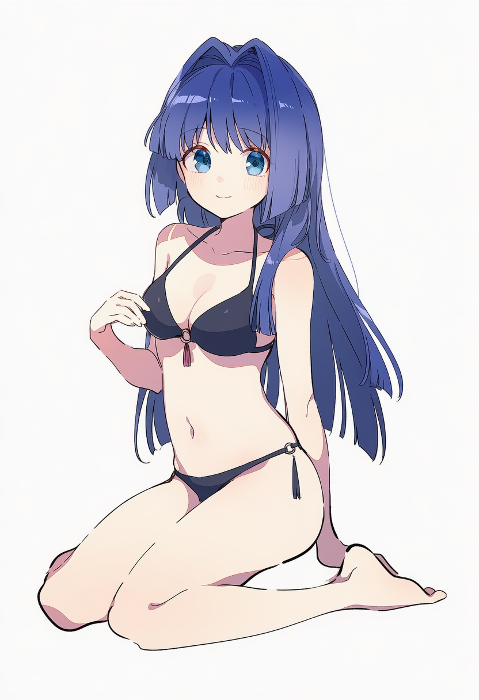

[在线例图](https://assets.quicktagcloud.com/images/raven_composition/raven_composition-4654.jpg?v=c0cd538847b77177)

<a id="raven_composition-4655"></a>

## 玛莉安奴·冯·埃德蒙

ID：`raven_composition-4655`；分类：角色图鉴 / 蓝发；来源标记：`safe`。

来源说明：

> 作品：火焰之纹章
> 作品 tag：fire_emblem
> 难度：★

正向提示词：

```text
marianne_von_edmund
```

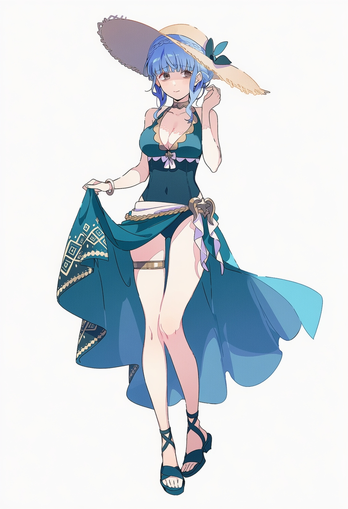

[在线例图](https://assets.quicktagcloud.com/images/raven_composition/raven_composition-4655.jpg?v=ea0e5f0dc1070cf4)

<a id="raven_composition-4656"></a>

## 饭纲丸龙

ID：`raven_composition-4656`；分类：角色图鉴 / 蓝发；来源标记：`safe`。

来源说明：

> 作品：东方Project
> 作品 tag：touhou
> 难度：★

正向提示词：

```text
iizunamaru_megumu
```

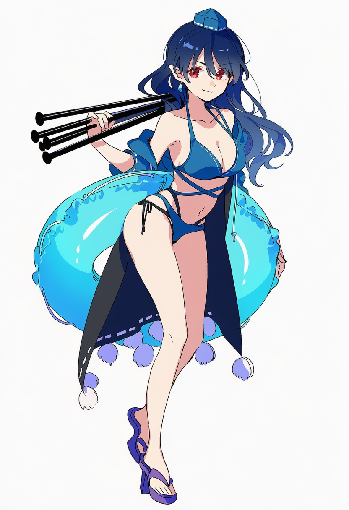

[在线例图](https://assets.quicktagcloud.com/images/raven_composition/raven_composition-4656.jpg?v=1836063cd42a122e)

<a id="raven_composition-4657"></a>

## 依露法

ID：`raven_composition-4657`；分类：角色图鉴 / 蓝发；来源标记：`safe`。

来源说明：

> 作品：ToHeart系列
> 作品 tag：to_heart_(series)
> 难度：★★★★

正向提示词：

```text
ilfa_(to_heart)
```

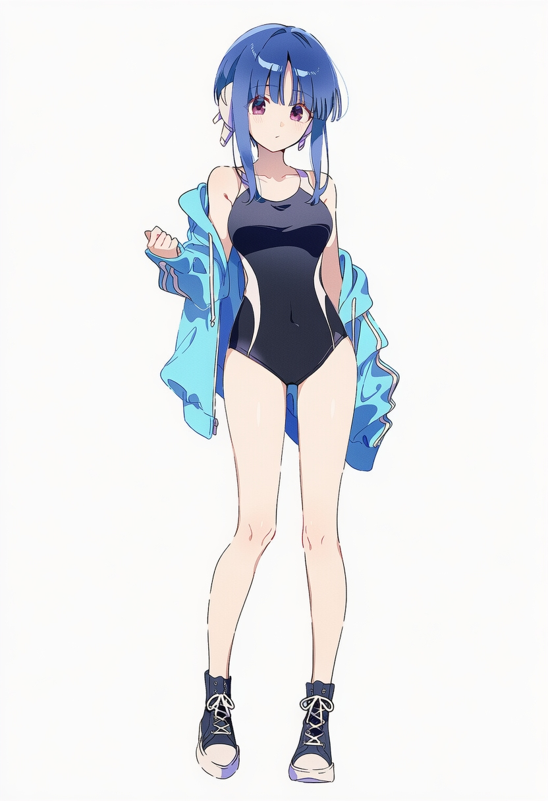

[在线例图](https://assets.quicktagcloud.com/images/raven_composition/raven_composition-4657.jpg?v=5984b8f5b703dc7b)

<a id="raven_composition-4658"></a>

## 雪初音

ID：`raven_composition-4658`；分类：角色图鉴 / 蓝发；来源标记：`safe`。

来源说明：

> 作品：VOCALOID
> 作品 tag：vocaloid
> 难度：★★★

正向提示词：

```text
yuki_miku_(2011)
```

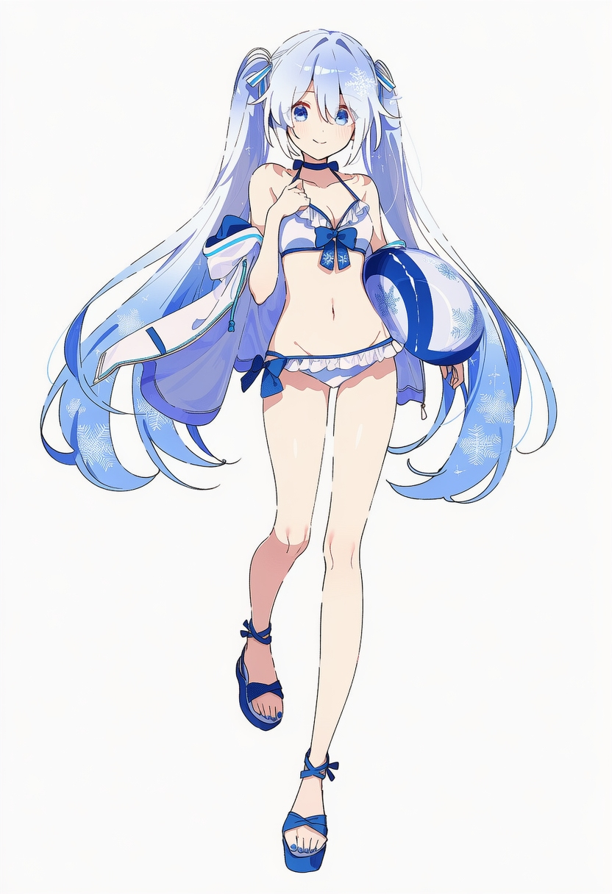

[在线例图](https://assets.quicktagcloud.com/images/raven_composition/raven_composition-4658.jpg?v=2305f174f52e2153)

<a id="raven_composition-4659"></a>

## 七尾百合子

ID：`raven_composition-4659`；分类：角色图鉴 / 蓝发；来源标记：`safe`。

来源说明：

> 作品：偶像大师
> 作品 tag：idolmaster
> 难度：★★

正向提示词：

```text
nanao_yuriko
```

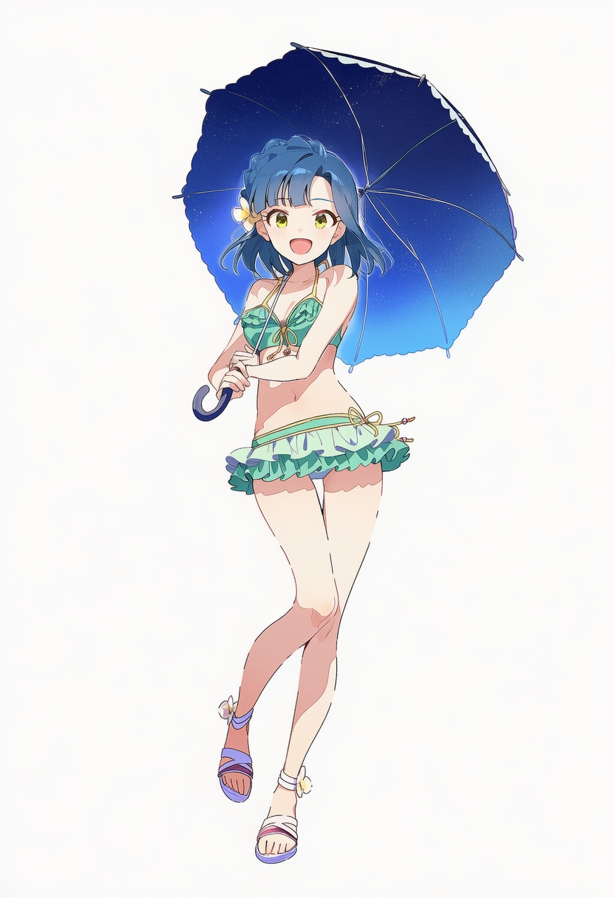

[在线例图](https://assets.quicktagcloud.com/images/raven_composition/raven_composition-4659.jpg?v=fbb7799427076d3f)

<a id="raven_composition-4660"></a>

## 水波玲奈

ID：`raven_composition-4660`；分类：角色图鉴 / 蓝发；来源标记：`safe`。

来源说明：

> 作品：魔法纪录_魔法少女小圆外传
> 作品 tag：magia_record:_mahou_shoujo_madoka_magica_gaiden
> 难度：★★★

正向提示词：

```text
minami_rena
```

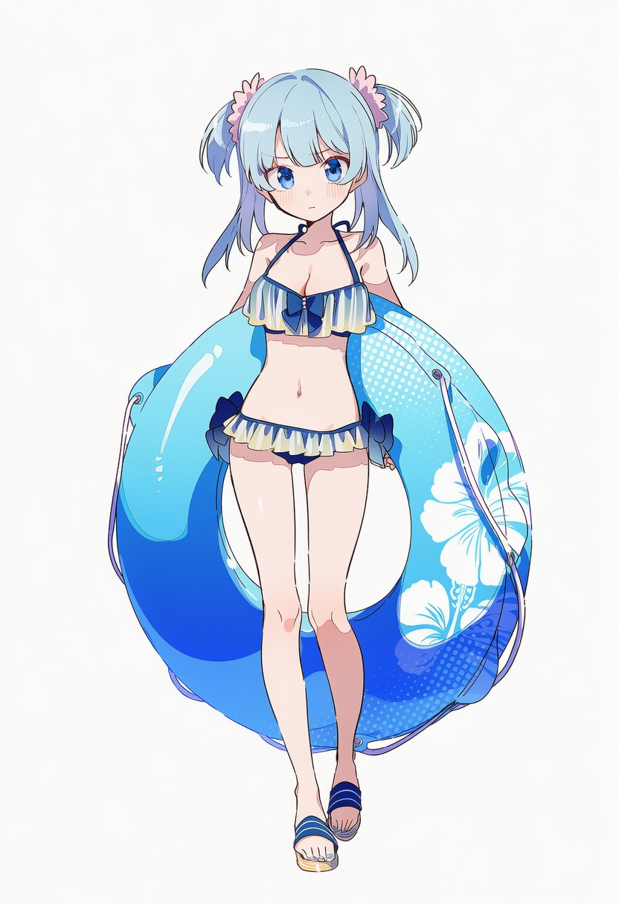

[在线例图](https://assets.quicktagcloud.com/images/raven_composition/raven_composition-4660.jpg?v=4aa8baff4b767ad6)

<a id="raven_composition-4661"></a>

## 宝生波音

ID：`raven_composition-4661`；分类：角色图鉴 / 蓝发；来源标记：`safe`。

来源说明：

> 作品：真珠美人鱼
> 作品 tag：mermaid_melody_pichi_pichi_pitch
> 难度：★★★★★

正向提示词：

```text
houshou_hanon
```

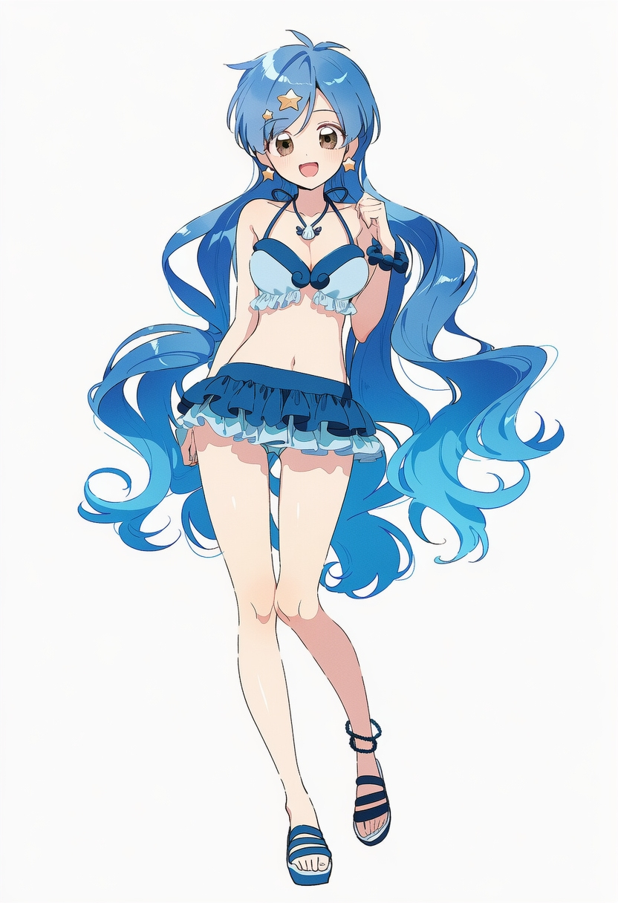

[在线例图](https://assets.quicktagcloud.com/images/raven_composition/raven_composition-4661.jpg?v=12feae2d5f08cf15)

<a id="raven_composition-4662"></a>

## 瓦伦丁

ID：`raven_composition-4662`；分类：角色图鉴 / 蓝发；来源标记：`safe`。

来源说明：

> 作品：骷髅女孩
> 作品 tag：skullgirls
> 难度：★★

正向提示词：

```text
valentine_(skullgirls)
```

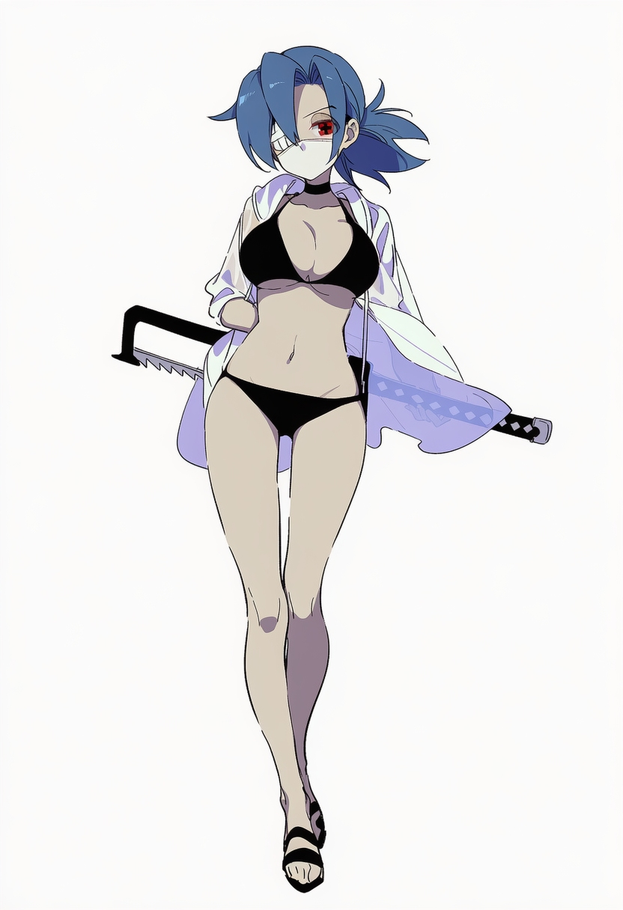

[在线例图](https://assets.quicktagcloud.com/images/raven_composition/raven_composition-4662.jpg?v=8d8c78bab21428cf)

<a id="raven_composition-4663"></a>

## 蓝华·S·格兰切斯塔

ID：`raven_composition-4663`；分类：角色图鉴 / 蓝发；来源标记：`safe`。

来源说明：

> 作品：水星领航员（漫画）
> 作品 tag：aria_(manga)
> 难度：★★

正向提示词：

```text
aika_granzchesta
```

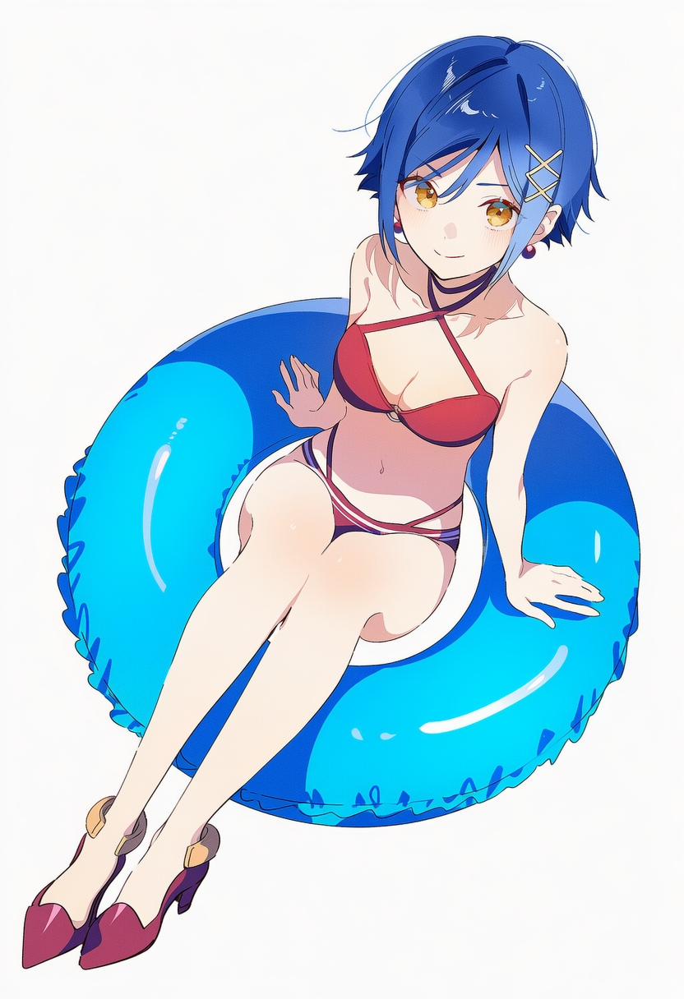

[在线例图](https://assets.quicktagcloud.com/images/raven_composition/raven_composition-4663.jpg?v=b4c3180faaeb9da1)

<a id="raven_composition-4664"></a>

## 西园千种

ID：`raven_composition-4664`；分类：角色图鉴 / 蓝发；来源标记：`safe`。

来源说明：

> 作品：彩虹社
> 作品 tag：nijisanji
> 难度：★★★★

正向提示词：

```text
nishizono_chigusa
```

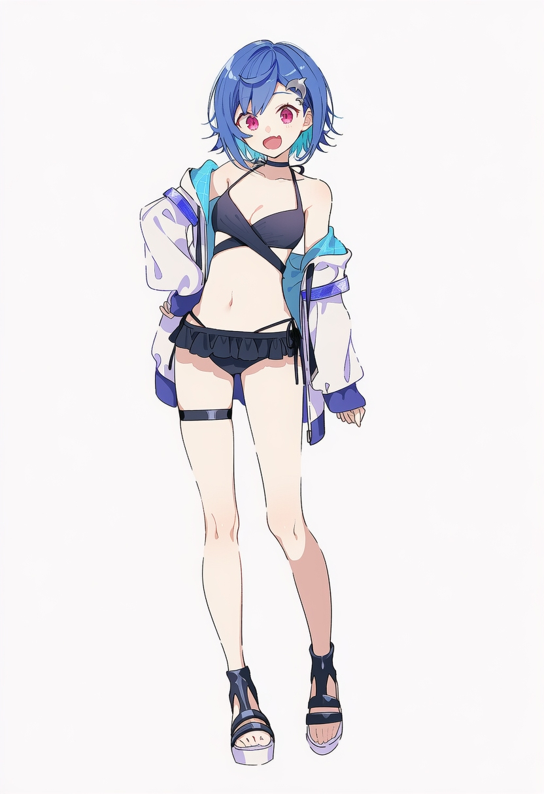

[在线例图](https://assets.quicktagcloud.com/images/raven_composition/raven_composition-4664.jpg?v=f702c23365066d60)

<a id="raven_composition-4665"></a>

## 铃

ID：`raven_composition-4665`；分类：角色图鉴 / 蓝发；来源标记：`safe`。

来源说明：

> 作品：绝区零
> 作品 tag：zenless_zone_zero
> 难度：★

正向提示词：

```text
belle_(zenless_zone_zero)
```

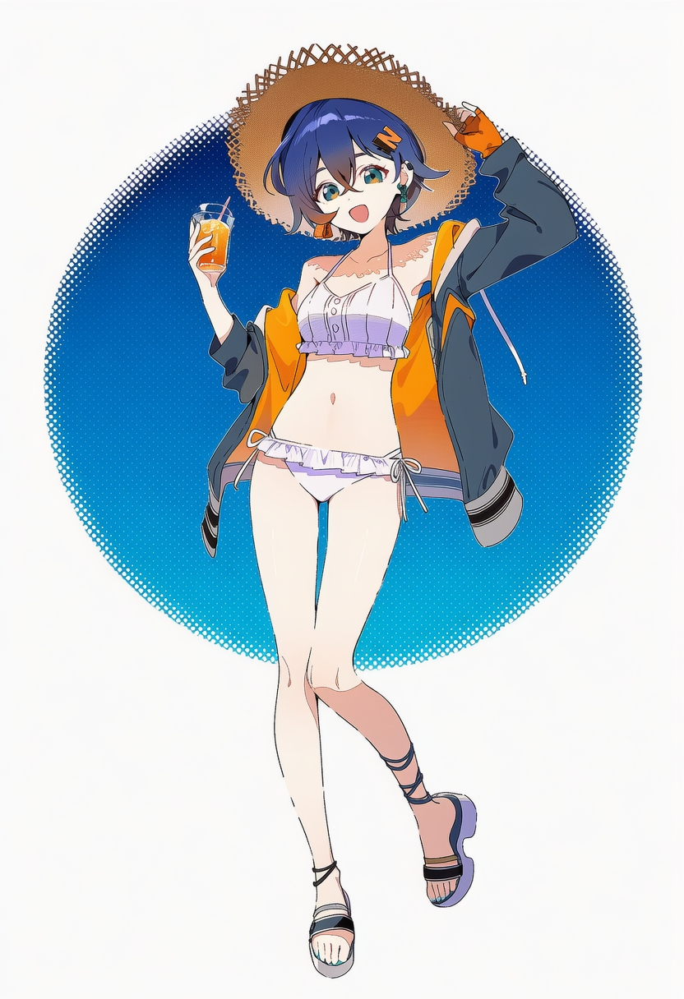

[在线例图](https://assets.quicktagcloud.com/images/raven_composition/raven_composition-4665.jpg?v=1b2a748d0845fdfd)

<a id="raven_composition-4666"></a>

## 枣麻衣

ID：`raven_composition-4666`；分类：角色图鉴 / 蓝发；来源标记：`safe`。

来源说明：

> 作品：苍翼默示录
> 作品 tag：blazblue
> 难度：★★

正向提示词：

```text
mai_natsume
```

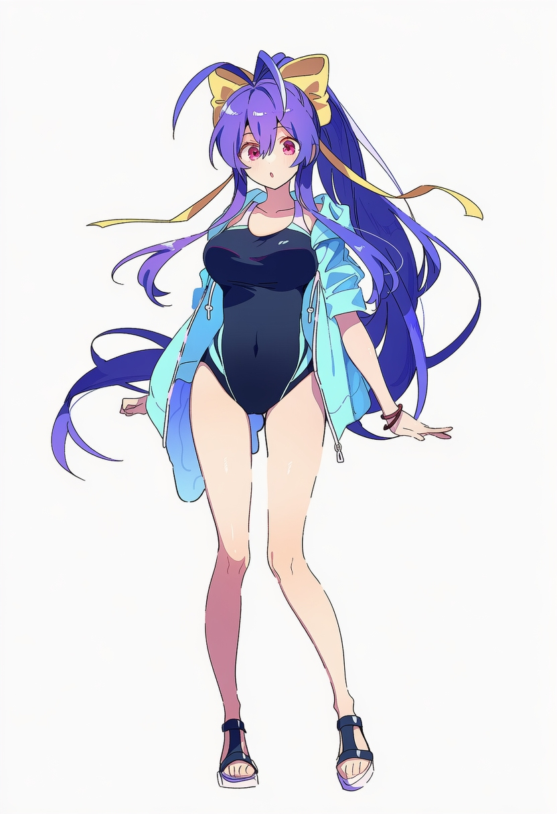

[在线例图](https://assets.quicktagcloud.com/images/raven_composition/raven_composition-4666.jpg?v=e15c3299687c5f95)

<a id="raven_composition-4667"></a>

## 瓢虫

ID：`raven_composition-4667`；分类：角色图鉴 / 蓝发；来源标记：`safe`。

来源说明：

> 作品：瓢虫雷迪
> 作品 tag：miraculous_ladybug
> 难度：★★★★★

正向提示词：

```text
ladybug_(character)
```

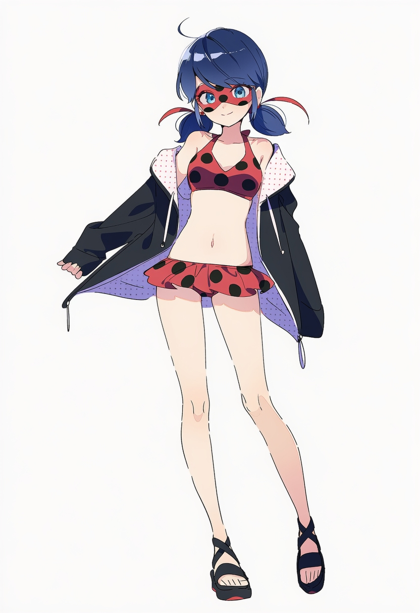

[在线例图](https://assets.quicktagcloud.com/images/raven_composition/raven_composition-4667.jpg?v=532fdceb7634cabd)

<a id="raven_composition-4668"></a>

## 千珏

ID：`raven_composition-4668`；分类：角色图鉴 / 蓝发；来源标记：`safe`。

来源说明：

> 作品：英雄联盟
> 作品 tag：league_of_legends
> 难度：★★

正向提示词：

```text
kindred_(league_of_legends)
```

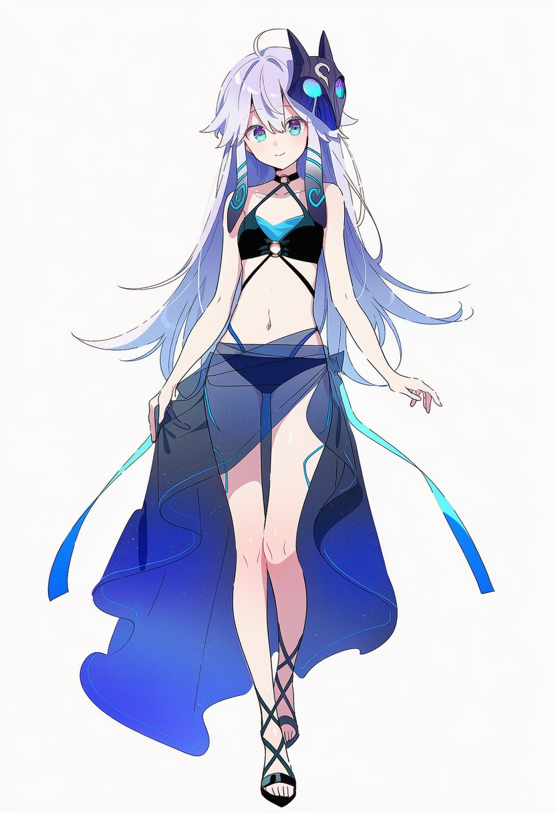

[在线例图](https://assets.quicktagcloud.com/images/raven_composition/raven_composition-4668.jpg?v=23d1ba81260edd35)

<a id="raven_composition-4669"></a>

## 心峰可可奈

ID：`raven_composition-4669`；分类：角色图鉴 / 蓝发；来源标记：`safe`。

来源说明：

> 作品：轻拍翻转小魔女
> 作品 tag：flip_flappers
> 难度：★★★

正向提示词：

```text
kokomine_cocona
```

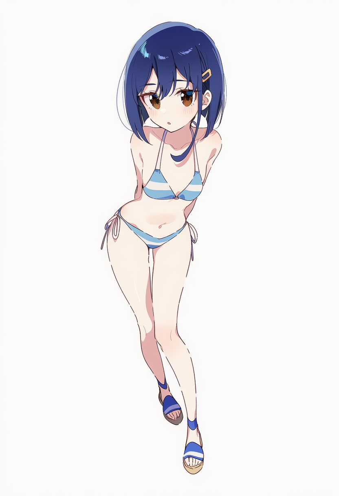

[在线例图](https://assets.quicktagcloud.com/images/raven_composition/raven_composition-4669.jpg?v=908ba106ce9a55c1)

<a id="raven_composition-4670"></a>

## 柴郡

ID：`raven_composition-4670`；分类：角色图鉴 / 蓝发；来源标记：`safe`。

来源说明：

> 作品：碧蓝航线
> 作品 tag：azur_lane
> 难度：★

正向提示词：

```text
cheshire_(azur_lane)
```

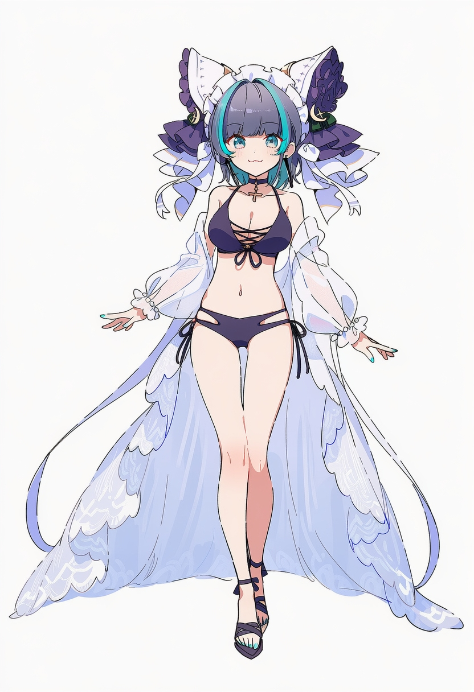

[在线例图](https://assets.quicktagcloud.com/images/raven_composition/raven_composition-4670.jpg?v=4535184e2955f0e6)

<a id="raven_composition-4671"></a>

## 伊尔玛

ID：`raven_composition-4671`；分类：角色图鉴 / 蓝发；来源标记：`safe`。

来源说明：

> 作品：女王之刃
> 作品 tag：queen's_blade
> 难度：★★★★★

正向提示词：

```text
irma_(queen's_blade)
```

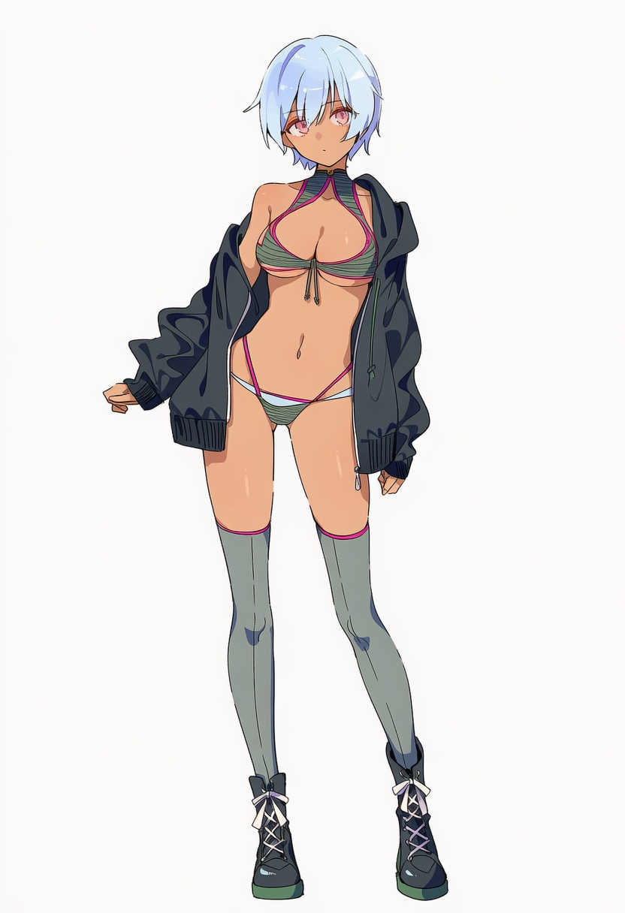

[在线例图](https://assets.quicktagcloud.com/images/raven_composition/raven_composition-4671.jpg?v=b8f4bcbb10c2bc64)

<a id="raven_composition-4672"></a>

## 煌

ID：`raven_composition-4672`；分类：角色图鉴 / 蓝发；来源标记：`safe`。

来源说明：

> 作品：明日方舟
> 作品 tag：arknights
> 难度：★

正向提示词：

```text
blaze_(arknights)
```

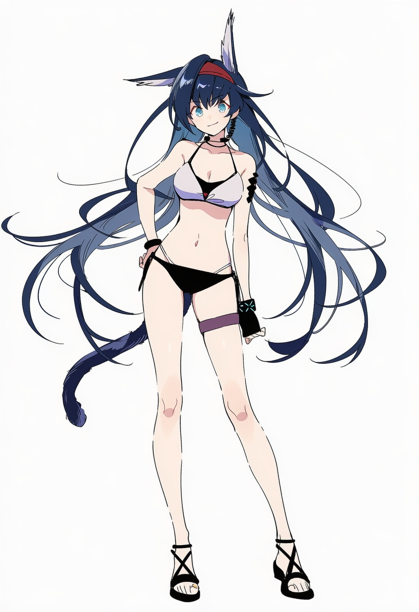

[在线例图](https://assets.quicktagcloud.com/images/raven_composition/raven_composition-4672.jpg?v=10c62a0d9079c3e6)

<a id="raven_composition-4673"></a>

## 布尔玛

ID：`raven_composition-4673`；分类：角色图鉴 / 蓝发；来源标记：`safe`。

来源说明：

> 作品：七龙珠
> 作品 tag：dragon_ball
> 难度：★

正向提示词：

```text
bulma
```

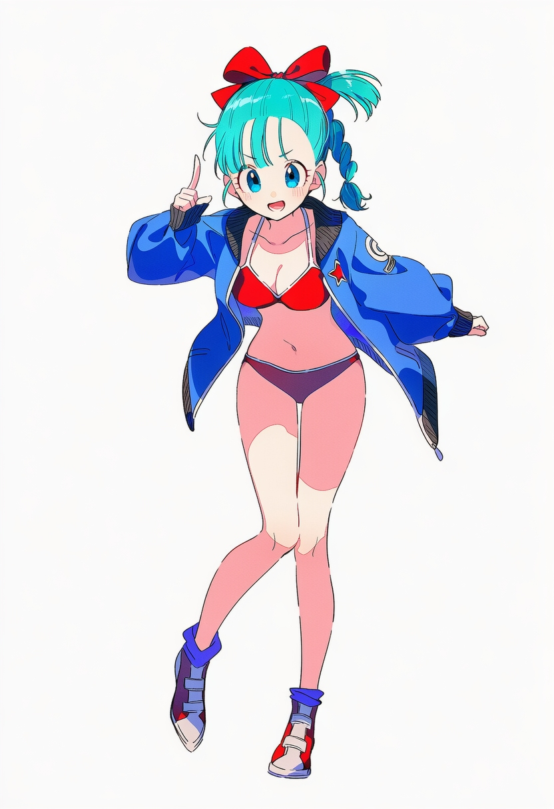

[在线例图](https://assets.quicktagcloud.com/images/raven_composition/raven_composition-4673.jpg?v=2c9254b60fa8a2a4)

<a id="raven_composition-4674"></a>

## 希耶尔

ID：`raven_composition-4674`；分类：角色图鉴 / 蓝发；来源标记：`safe`。

来源说明：

> 作品：月姬
> 作品 tag：tsukihime
> 难度：★

正向提示词：

```text
ciel_(tsukihime)
```


[在线例图](https://assets.quicktagcloud.com/images/raven_composition/raven_composition-4674.jpg?v=e0e8dec0b5911a57)

<a id="raven_composition-4675"></a>

## 拉比莉斯

ID：`raven_composition-4675`；分类：角色图鉴 / 蓝发；来源标记：`safe`。

来源说明：

> 作品：女神异闻录
> 作品 tag：persona
> 难度：★★★★

正向提示词：

```text
labrys_(persona)
```


[在线例图](https://assets.quicktagcloud.com/images/raven_composition/raven_composition-4675.jpg?v=39571545144259c1)

<a id="raven_composition-4676"></a>

## 牡丹

ID：`raven_composition-4676`；分类：角色图鉴 / 蓝发；来源标记：`safe`。

来源说明：

> 作品：幽游白书
> 作品 tag：yu_yu_hakusho
> 难度：★★★★

正向提示词：

```text
botan_(yu_yu_hakusho)
```


[在线例图](https://assets.quicktagcloud.com/images/raven_composition/raven_composition-4676.jpg?v=a4b0d3df9c140fa2)

<a id="raven_composition-4677"></a>

## TAR-21

ID：`raven_composition-4677`；分类：角色图鉴 / 蓝发；来源标记：`safe`。

来源说明：

> 作品：少女前线
> 作品 tag：girls'_frontline
> 难度：★★★★

正向提示词：

```text
tar-21_(girls'_frontline)
```


[在线例图](https://assets.quicktagcloud.com/images/raven_composition/raven_composition-4677.jpg?v=e428f4f6a88285d8)

<a id="raven_composition-4678"></a>

## 花子

ID：`raven_composition-4678`；分类：角色图鉴 / 蓝发；来源标记：`safe`。

来源说明：

> 作品：蔚蓝档案
> 作品 tag：blue_archive
> 难度：★

正向提示词：

```text
ako_(blue_archive)
```


[在线例图](https://assets.quicktagcloud.com/images/raven_composition/raven_composition-4678.jpg?v=93e9326a460d1b75)

<a id="raven_composition-4679"></a>

## 坎蒂丝

ID：`raven_composition-4679`；分类：角色图鉴 / 蓝发；来源标记：`safe`。

来源说明：

> 作品：原神
> 作品 tag：genshin_impact
> 难度：★★

正向提示词：

```text
candace_(genshin_impact)
```


[在线例图](https://assets.quicktagcloud.com/images/raven_composition/raven_composition-4679.jpg?v=625306e329bc3a75)

<a id="raven_composition-4680"></a>

## 蕾娜·兰福德

ID：`raven_composition-4680`；分类：角色图鉴 / 蓝发；来源标记：`safe`。

来源说明：

> 作品：星之海洋
> 作品 tag：star_ocean
> 难度：★★★

正向提示词：

```text
rena_lanford
```


[在线例图](https://assets.quicktagcloud.com/images/raven_composition/raven_composition-4680.jpg?v=ec868a358099bc47)

<a id="raven_composition-4681"></a>

## 诗乃

ID：`raven_composition-4681`；分类：角色图鉴 / 蓝发；来源标记：`safe`。

来源说明：

> 作品：刀剑神域
> 作品 tag：sword_art_online
> 难度：★★★

正向提示词：

```text
sinon_(sao-alo)
```


[在线例图](https://assets.quicktagcloud.com/images/raven_composition/raven_composition-4681.jpg?v=f21ce33c43273c9b)

<a id="raven_composition-4682"></a>

## 苍森美弥

ID：`raven_composition-4682`；分类：角色图鉴 / 蓝发；来源标记：`safe`。

来源说明：

> 作品：蔚蓝档案
> 作品 tag：blue_archive
> 难度：★★★

正向提示词：

```text
mine_(blue_archive)
```


[在线例图](https://assets.quicktagcloud.com/images/raven_composition/raven_composition-4682.jpg?v=6d7a1f448ad60a15)

<a id="raven_composition-4683"></a>

## 令

ID：`raven_composition-4683`；分类：角色图鉴 / 蓝发；来源标记：`safe`。

来源说明：

> 作品：明日方舟
> 作品 tag：arknights
> 难度：★

正向提示词：

```text
ling_(arknights)
```


[在线例图](https://assets.quicktagcloud.com/images/raven_composition/raven_composition-4683.jpg?v=5b8671b2971ca57a)

<a id="raven_composition-4684"></a>

## 超级水手水星

ID：`raven_composition-4684`；分类：角色图鉴 / 蓝发；来源标记：`safe`。

来源说明：

> 作品：美少女战士
> 作品 tag：bishoujo_senshi_sailor_moon
> 难度：★★★★

正向提示词：

```text
super_sailor_mercury
```


[在线例图](https://assets.quicktagcloud.com/images/raven_composition/raven_composition-4684.jpg?v=4e2d053f461876d5)

<a id="raven_composition-4685"></a>

## 圣路易斯

ID：`raven_composition-4685`；分类：角色图鉴 / 蓝发；来源标记：`safe`。

来源说明：

> 作品：碧蓝航线
> 作品 tag：azur_lane
> 难度：★

正向提示词：

```text
st._louis_(azur_lane)
```


[在线例图](https://assets.quicktagcloud.com/images/raven_composition/raven_composition-4685.jpg?v=2ddc83594b46bd35)

<a id="raven_composition-4686"></a>

## 诺艾尔

ID：`raven_composition-4686`；分类：角色图鉴 / 蓝发；来源标记：`safe`。

来源说明：

> 作品：天体的秩序
> 作品 tag：sora_no_method
> 难度：★★★★★

正向提示词：

```text
noel_(sora_no_method)
```


[在线例图](https://assets.quicktagcloud.com/images/raven_composition/raven_composition-4686.jpg?v=4cbf5d9dc4fe1ce6)

<a id="raven_composition-4687"></a>

## 爱丽丝

ID：`raven_composition-4687`；分类：角色图鉴 / 蓝发；来源标记：`safe`。

来源说明：

> 作品：死亡爱丽丝
> 作品 tag：sinoalice
> 难度：★★★★

正向提示词：

```text
alice_(sinoalice)
```


[在线例图](https://assets.quicktagcloud.com/images/raven_composition/raven_composition-4687.jpg?v=e5420a8b0e45bb42)

<a id="raven_composition-4688"></a>

## 安吉拉

ID：`raven_composition-4688`；分类：角色图鉴 / 蓝发；来源标记：`safe`。

来源说明：

> 作品：Project Moon
> 作品 tag：project_moon
> 难度：★

正向提示词：

```text
angela_(project_moon)
```


[在线例图](https://assets.quicktagcloud.com/images/raven_composition/raven_composition-4688.jpg?v=d6343161c7c82c31)

<a id="raven_composition-4689"></a>

## 莓

ID：`raven_composition-4689`；分类：角色图鉴 / 蓝发；来源标记：`safe`。

来源说明：

> 作品：DARLING in the FRANXX
> 作品 tag：darling_in_the_franxx
> 难度：★★

正向提示词：

```text
ichigo_(darling_in_the_franxx)
```


[在线例图](https://assets.quicktagcloud.com/images/raven_composition/raven_composition-4689.jpg?v=806e5a46bdf6c863)

<a id="raven_composition-4690"></a>

## 普丽瓦蒂（不友好的女仆）

ID：`raven_composition-4690`；分类：角色图鉴 / 蓝发；来源标记：`safe`。

来源说明：

> 作品：胜利女神：妮姬
> 作品 tag：goddess_of_victory:_nikke
> 难度：★★★★★

正向提示词：

```text
privaty_(unkind_maid)_(nikke)
```


[在线例图](https://assets.quicktagcloud.com/images/raven_composition/raven_composition-4690.jpg?v=6977890d2989017e)

<a id="raven_composition-4691"></a>

## 园田海未

ID：`raven_composition-4691`；分类：角色图鉴 / 蓝发；来源标记：`safe`。

来源说明：

> 作品：LoveLive!学园偶像计划
> 作品 tag：love_live!
> 难度：★

正向提示词：

```text
sonoda_umi
```


[在线例图](https://assets.quicktagcloud.com/images/raven_composition/raven_composition-4691.jpg?v=0347fe148c563a96)

<a id="raven_composition-4692"></a>

## 阿蒂涅

ID：`raven_composition-4692`；分类：角色图鉴 / 蓝发；来源标记：`safe`。

来源说明：

> 作品：天元突破红莲螺岩
> 作品 tag：tengen_toppa_gurren_lagann
> 难度：★★★★

正向提示词：

```text
adiane
```


[在线例图](https://assets.quicktagcloud.com/images/raven_composition/raven_composition-4692.jpg?v=7a328cf2309a9e4a)

<a id="raven_composition-4693"></a>

## 若菜四季

ID：`raven_composition-4693`；分类：角色图鉴 / 蓝发；来源标记：`safe`。

来源说明：

> 作品：LoveLive!学园偶像计划
> 作品 tag：love_live!
> 难度：★★★

正向提示词：

```text
wakana_shiki
```


[在线例图](https://assets.quicktagcloud.com/images/raven_composition/raven_composition-4693.jpg?v=e6f1d41c3342114f)

<a id="raven_composition-4694"></a>

## 神乐七奈

ID：`raven_composition-4694`；分类：角色图鉴 / 蓝发；来源标记：`safe`。

来源说明：

> 作品：个人势虚拟主播
> 作品 tag：indie_virtual_youtuber
> 难度：★★★★★

正向提示词：

```text
kagura_nana
```


[在线例图](https://assets.quicktagcloud.com/images/raven_composition/raven_composition-4694.jpg?v=2e94adb39433188a)

<a id="raven_composition-4695"></a>

## 舞

ID：`raven_composition-4695`；分类：角色图鉴 / 蓝发；来源标记：`safe`。

来源说明：

> 作品：东方Project
> 作品 tag：touhou
> 难度：★★★

正向提示词：

```text
mai_(touhou)
```


[在线例图](https://assets.quicktagcloud.com/images/raven_composition/raven_composition-4695.jpg?v=26f1fe2cec6cd9ed)

<a id="raven_composition-4696"></a>

## 丝奎莉

ID：`raven_composition-4696`；分类：角色图鉴 / 蓝发；来源标记：`safe`。

来源说明：

> 作品：骷髅女孩
> 作品 tag：skullgirls
> 难度：★★

正向提示词：

```text
squigly_(skullgirls)
```


[在线例图](https://assets.quicktagcloud.com/images/raven_composition/raven_composition-4696.jpg?v=4442cf12835b4c55)

<a id="raven_composition-4697"></a>

## 希安

ID：`raven_composition-4697`；分类：角色图鉴 / 蓝发；来源标记：`safe`。

来源说明：

> 作品：SHOW BY ROCK!!
> 作品 tag：show_by_rock!!
> 难度：★★

正向提示词：

```text
cyan_(show_by_rock!!)
```


[在线例图](https://assets.quicktagcloud.com/images/raven_composition/raven_composition-4697.jpg?v=25716a7d5c407afe)

<a id="raven_composition-4698"></a>

## 河城荷取

ID：`raven_composition-4698`；分类：角色图鉴 / 蓝发；来源标记：`safe`。

来源说明：

> 作品：东方Project
> 作品 tag：touhou
> 难度：★

正向提示词：

```text
kawashiro_nitori
```


[在线例图](https://assets.quicktagcloud.com/images/raven_composition/raven_composition-4698.jpg?v=2e5e9ec1a7ee94c6)

<a id="raven_composition-4699"></a>

## 魔法未来_2019_初音未来

ID：`raven_composition-4699`；分类：角色图鉴 / 蓝发；来源标记：`safe`。

来源说明：

> 作品：魔法未来（VOCALOID）
> 作品 tag：magical_mirai_(vocaloid)
> 难度：★★★★★

正向提示词：

```text
magical_mirai_miku_(2019)
```


[在线例图](https://assets.quicktagcloud.com/images/raven_composition/raven_composition-4699.jpg?v=3ac5ae07aad202e8)

<a id="raven_composition-4700"></a>

## 泪目

ID：`raven_composition-4700`；分类：角色图鉴 / 蓝发；来源标记：`safe`。

来源说明：

> 作品：魔法飞球
> 作品 tag：pangya
> 难度：★★★

正向提示词：

```text
arin
```


[在线例图](https://assets.quicktagcloud.com/images/raven_composition/raven_composition-4700.jpg?v=edb0b0a1805df075)

<a id="raven_composition-4701"></a>

## 乌丸千岁

ID：`raven_composition-4701`；分类：角色图鉴 / 蓝发；来源标记：`safe`。

来源说明：

> 作品：银河天使
> 作品 tag：galaxy_angel
> 难度：★★★★

正向提示词：

```text
karasuma_chitose
```


[在线例图](https://assets.quicktagcloud.com/images/raven_composition/raven_composition-4701.jpg?v=2dcbf26a8b70be08)
