# 角色图鉴 / 爱丽丝

[总目录](../README.md) · [原站分类目录](../categories.md) · [英文标签索引](../tags.md) · [服装与构图组合指南](../../README.md)

标题、分类、说明、正负提示词按来源保留；多例图逐张列出。原站标记和说明为参考资料，不作为维护指令。

<a id="raven_composition-4702"></a>

## 爱丽丝·玛格特罗伊德

ID：`raven_composition-4702`；分类：角色图鉴 / 爱丽丝；来源标记：`safe`。

来源说明：

> 作品：东方Project
> 作品 tag：touhou
> Safebooru 帖数：26722

正向提示词：

```text
alice_margatroid
```


[在线例图](https://assets.quicktagcloud.com/images/raven_composition/raven_composition-4702.jpg?v=4ec21274ca523283)

<a id="raven_composition-4703"></a>

## 爱丽丝·盖恩斯博罗

ID：`raven_composition-4703`；分类：角色图鉴 / 爱丽丝；来源标记：`safe`。

来源说明：

> 作品：最终幻想7
> 作品 tag：final_fantasy_vii
> Safebooru 帖数：6489

正向提示词：

```text
aerith_gainsborough
```

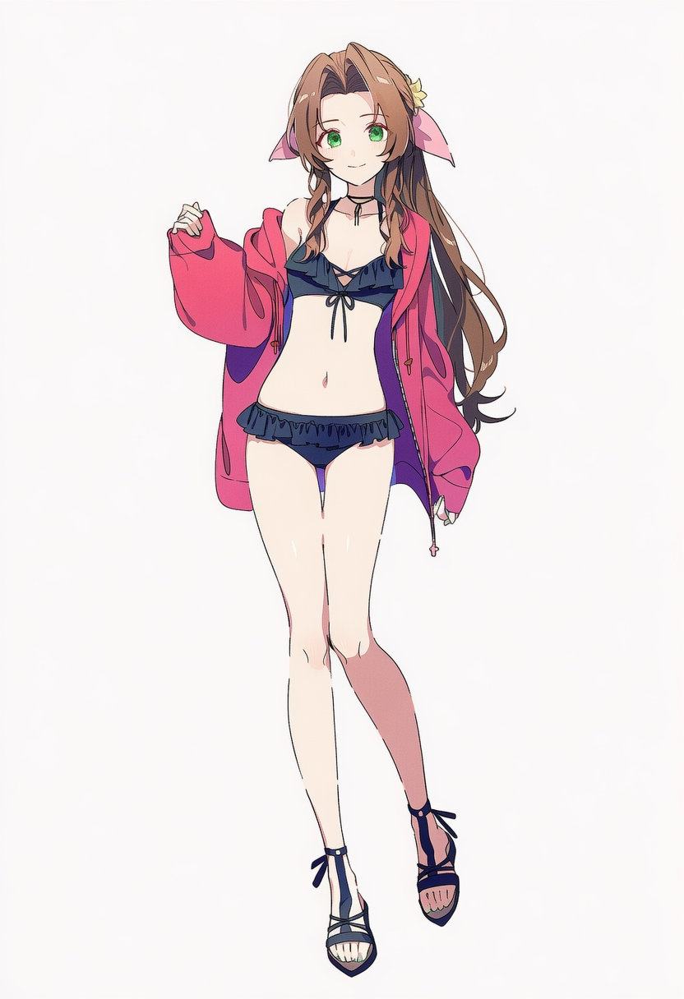

[在线例图](https://assets.quicktagcloud.com/images/raven_composition/raven_composition-4703.jpg?v=53888279893ffd8f)

<a id="raven_composition-4704"></a>

## 爱丽丝(碧蓝档案)

ID：`raven_composition-4704`；分类：角色图鉴 / 爱丽丝；来源标记：`safe`。

来源说明：

> 作品：碧蓝档案
> 作品 tag：blue_archive
> Safebooru 帖数：5353

正向提示词：

```text
aris_(blue_archive)
```

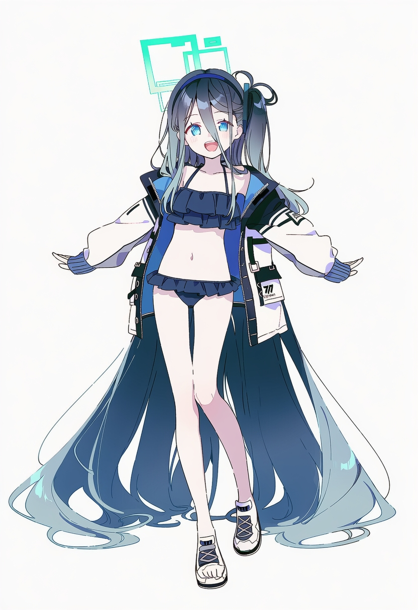

[在线例图](https://assets.quicktagcloud.com/images/raven_composition/raven_composition-4704.jpg?v=8a1893752b6b9cba)

<a id="raven_composition-4705"></a>

## 爱丽丝(梦游仙境)

ID：`raven_composition-4705`；分类：角色图鉴 / 爱丽丝；来源标记：`safe`。

来源说明：

> 作品：爱丽丝梦游仙境
> 作品 tag：alice_in_wonderland
> Safebooru 帖数：1796

正向提示词：

```text
alice (alice in wonderland)
```


[在线例图](https://assets.quicktagcloud.com/images/raven_composition/raven_composition-4705.jpg?v=4ecde37391459e17)

<a id="raven_composition-4706"></a>

## 爱丽丝·泰姆菲尔德

ID：`raven_composition-4706`；分类：角色图鉴 / 爱丽丝；来源标记：`safe`。

来源说明：

> 作品：爱丽丝梦游仙境
> 作品 tag：alice_(wonderland)
> Safebooru 帖数：1037

正向提示词：

```text
alice_thymefield
```


[在线例图](https://assets.quicktagcloud.com/images/raven_composition/raven_composition-4706.jpg?v=2dbc436ebfac406d)

<a id="raven_composition-4707"></a>

## 四叶咲爱丽丝

ID：`raven_composition-4707`；分类：角色图鉴 / 爱丽丝；来源标记：`safe`。

来源说明：

> 作品：光之美少女
> 作品 tag：precure
> Safebooru 帖数：812

正向提示词：

```text
yotsuba_alice
```

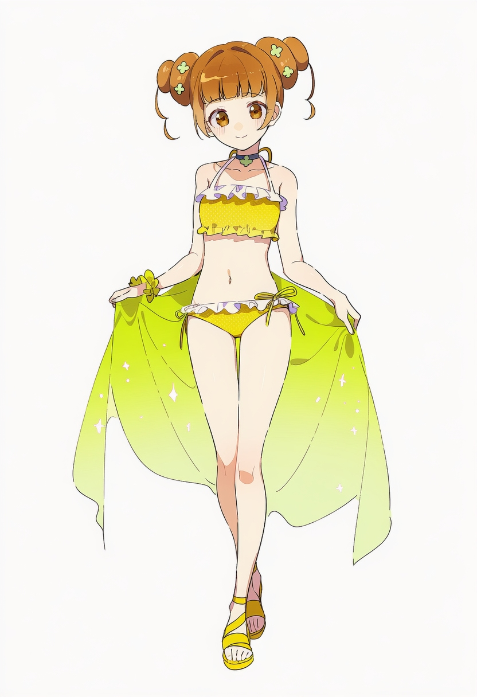

[在线例图](https://assets.quicktagcloud.com/images/raven_composition/raven_composition-4707.jpg?v=6b7cd9d78f058c97)

<a id="raven_composition-4708"></a>

## 久远寺有栖

ID：`raven_composition-4708`；分类：角色图鉴 / 爱丽丝；来源标记：`safe`。

来源说明：

> 作品：魔法使之夜
> 作品 tag：mahou_tsukai_no_yoru
> Safebooru 帖数：706

正向提示词：

```text
kuonji_alice
```

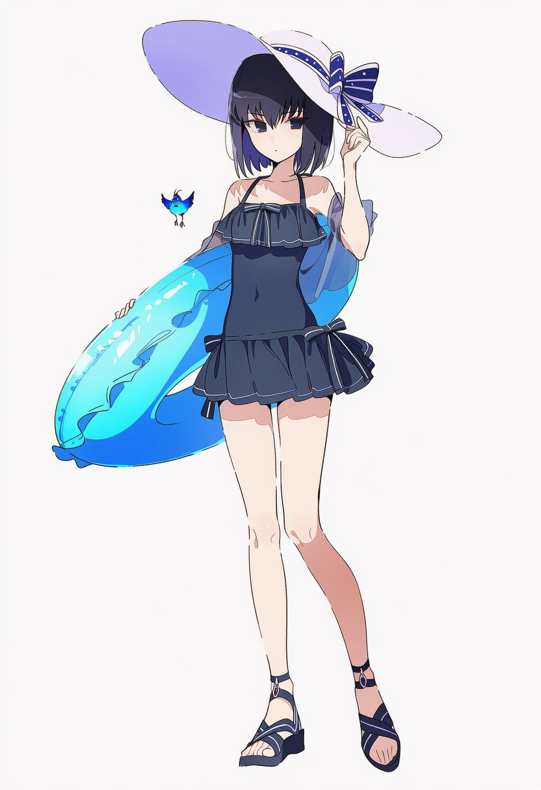

[在线例图](https://assets.quicktagcloud.com/images/raven_composition/raven_composition-4708.jpg?v=8d9565f0fc4aabab)

<a id="raven_composition-4709"></a>

## 爱丽丝·卡洛尔

ID：`raven_composition-4709`；分类：角色图鉴 / 爱丽丝；来源标记：`safe`。

来源说明：

> 作品：水星领航员
> 作品 tag：aria_(manga)
> Safebooru 帖数：589

正向提示词：

```text
alice_carroll
```

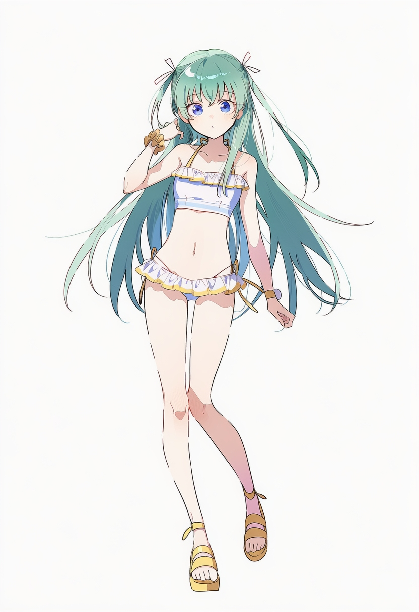

[在线例图](https://assets.quicktagcloud.com/images/raven_composition/raven_composition-4709.jpg?v=fb45aeb0ca7b9dee)

<a id="raven_composition-4710"></a>

## 爱丽丝·祖尔伯格

ID：`raven_composition-4710`；分类：角色图鉴 / 爱丽丝；来源标记：`safe`。

来源说明：

> 作品：刀剑神域
> 作品 tag：sword_art_online
> Safebooru 帖数：459

正向提示词：

```text
alice zuberg
```

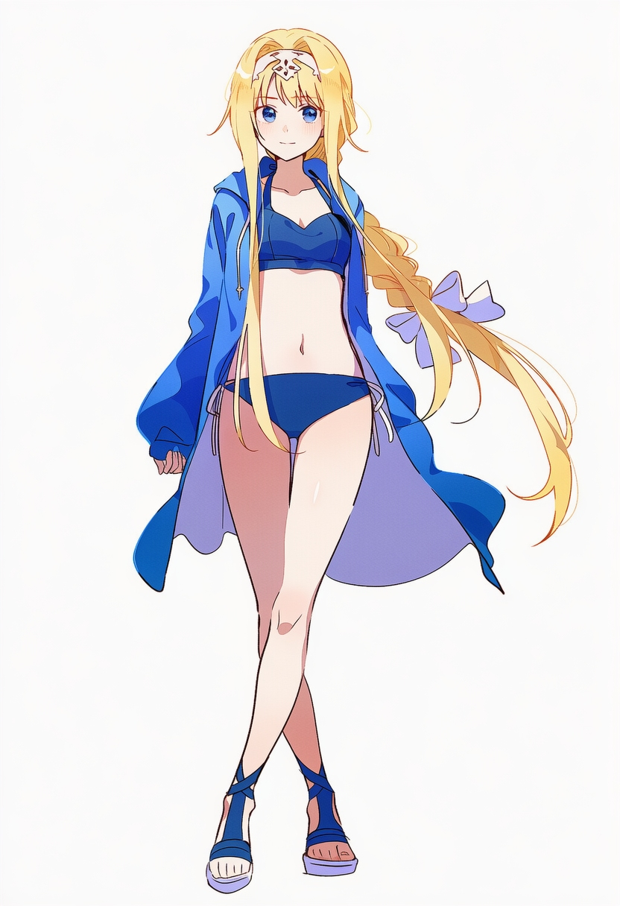

[在线例图](https://assets.quicktagcloud.com/images/raven_composition/raven_composition-4710.jpg?v=14e16b0c7b7610fc)

<a id="raven_composition-4711"></a>

## 物述有栖

ID：`raven_composition-4711`；分类：角色图鉴 / 爱丽丝；来源标记：`safe`。

来源说明：

> 作品：彩虹社
> 作品 tag：nijisanji
> Safebooru 帖数：440

正向提示词：

```text
mononobe_alice
```

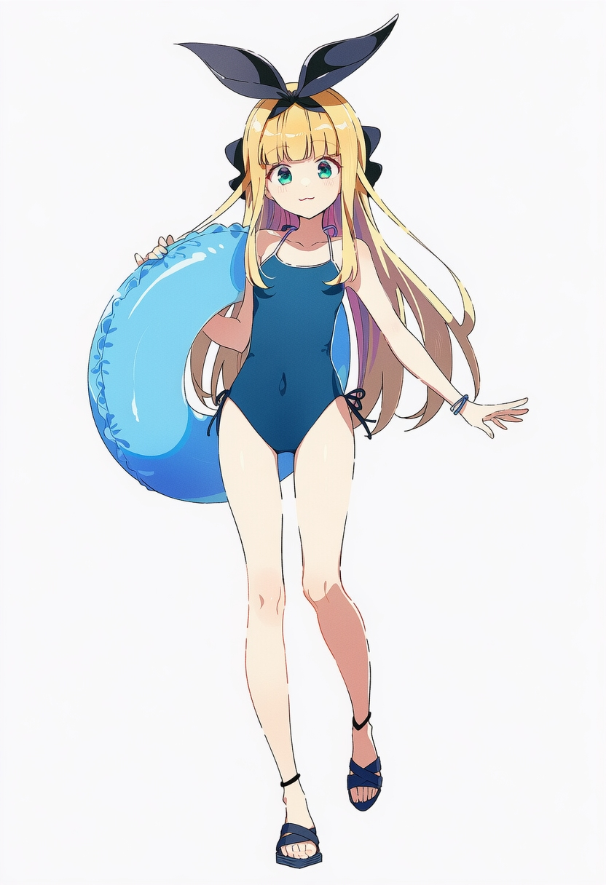

[在线例图](https://assets.quicktagcloud.com/images/raven_composition/raven_composition-4711.jpg?v=b190fe2fa0d3a562)

<a id="raven_composition-4712"></a>

## 爱丽丝·卡雷铁雷特

ID：`raven_composition-4712`；分类：角色图鉴 / 爱丽丝；来源标记：`safe`。

来源说明：

> 作品：黄金拼图
> 作品 tag：kin-iro_mosaic
> Safebooru 帖数：438

正向提示词：

```text
alice_cartelet
```

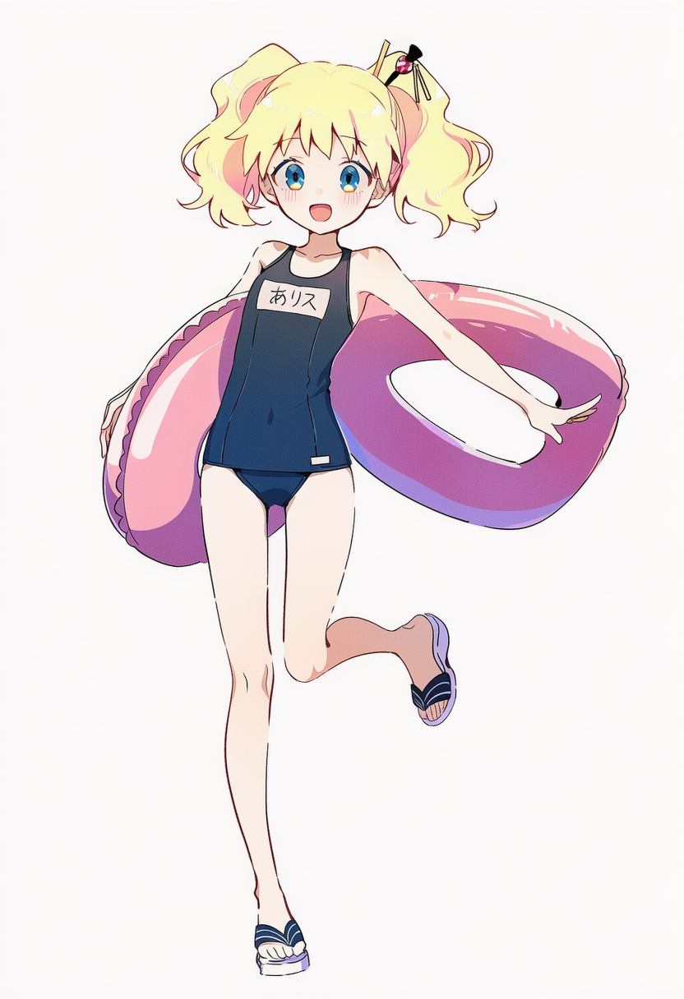

[在线例图](https://assets.quicktagcloud.com/images/raven_composition/raven_composition-4712.jpg?v=39b781ae6d0052bf)

<a id="raven_composition-4713"></a>

## 爱丽丝·威尔逊

ID：`raven_composition-4713`；分类：角色图鉴 / 爱丽丝；来源标记：`safe`。

来源说明：

> 作品：大逆转裁判
> 作品 tag：dai_gyakuten_saiban
> Safebooru 帖数：228

正向提示词：

```text
iris_wilson
```


[在线例图](https://assets.quicktagcloud.com/images/raven_composition/raven_composition-4713.jpg?v=e4fbefbc4625ae2a)

<a id="raven_composition-4714"></a>

## 爱丽丝

ID：`raven_composition-4714`；分类：角色图鉴 / 爱丽丝；来源标记：`safe`。

来源说明：

> 作品：真女神转生
> 作品 tag：shin_megami_tensei
> Safebooru 帖数：207

正向提示词：

```text
alice_(megami_tensei)
```


[在线例图](https://assets.quicktagcloud.com/images/raven_composition/raven_composition-4714.jpg?v=e89eba5ff4fbaf48)

<a id="raven_composition-4715"></a>

## 爱丽丝

ID：`raven_composition-4715`；分类：角色图鉴 / 爱丽丝；来源标记：`safe`。

来源说明：

> 作品：潘朵拉之心
> 作品 tag：pandora_hearts
> Safebooru 帖数：201

正向提示词：

```text
alice_(pandora_hearts)
```

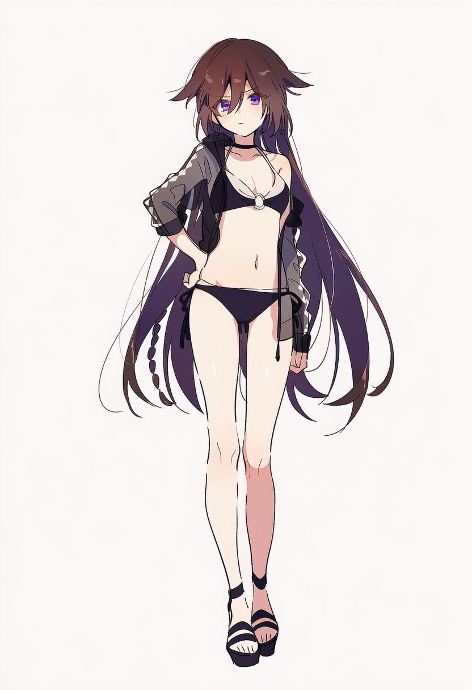

[在线例图](https://assets.quicktagcloud.com/images/raven_composition/raven_composition-4715.jpg?v=8abe9371fdf97bd0)

<a id="raven_composition-4716"></a>

## 爱丽丝

ID：`raven_composition-4716`；分类：角色图鉴 / 爱丽丝；来源标记：`safe`。

来源说明：

> 作品：死亡爱丽丝
> 作品 tag：sinoalice
> Safebooru 帖数：189

正向提示词：

```text
alice_(sinoalice)
```

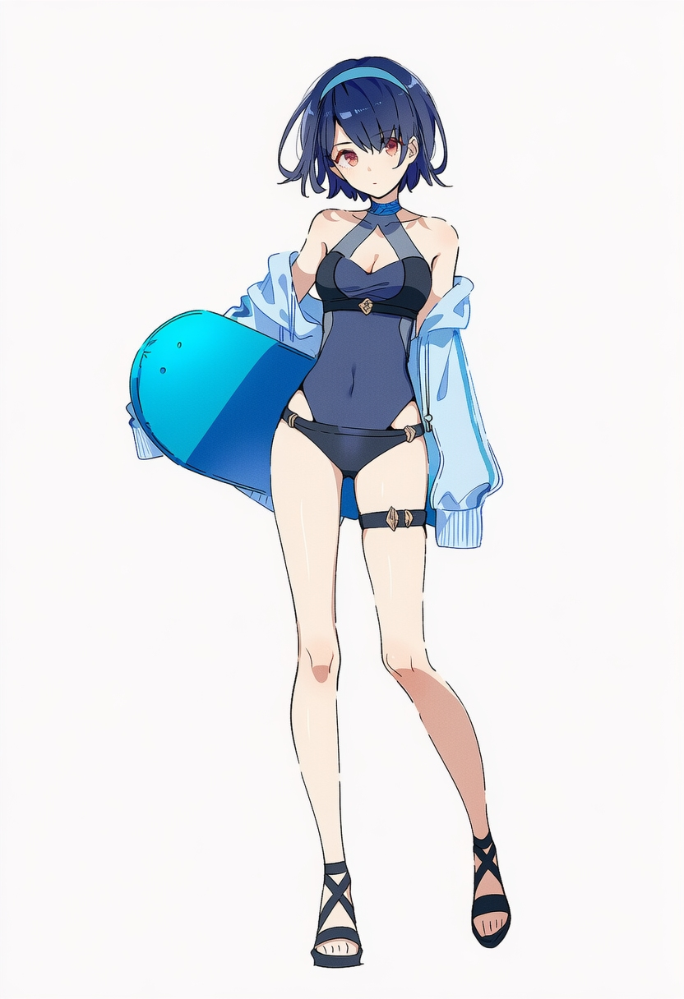

[在线例图](https://assets.quicktagcloud.com/images/raven_composition/raven_composition-4716.jpg?v=2c956c9dae51938c)

<a id="raven_composition-4717"></a>

## 爱丽丝

ID：`raven_composition-4717`；分类：角色图鉴 / 爱丽丝；来源标记：`safe`。

来源说明：

> 作品：为美好的世界献上祝福
> 作品 tag：konosuba
> Safebooru 帖数：148

正向提示词：

```text
iris_(konosuba)
```

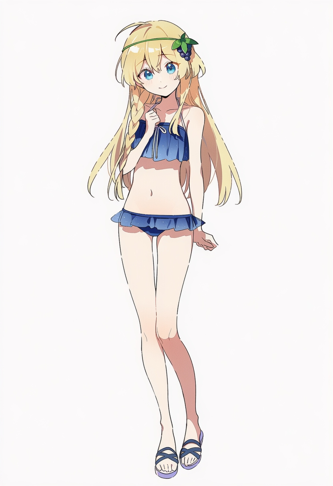

[在线例图](https://assets.quicktagcloud.com/images/raven_composition/raven_composition-4717.jpg?v=3810f34c06a80021)

<a id="raven_composition-4718"></a>

## 爱丽丝

ID：`raven_composition-4718`；分类：角色图鉴 / 爱丽丝；来源标记：`safe`。

来源说明：

> 作品：黑魂系列
> 作品 tag：black_souls
> Safebooru 帖数：139

正向提示词：

```text
alice_(black_souls)
```


[在线例图](https://assets.quicktagcloud.com/images/raven_composition/raven_composition-4718.jpg?v=de314ce190f28517)

<a id="raven_composition-4719"></a>

## 薙切爱丽丝

ID：`raven_composition-4719`；分类：角色图鉴 / 爱丽丝；来源标记：`safe`。

来源说明：

> 作品：食戟之灵
> 作品 tag：shokugeki_no_souma
> Safebooru 帖数：138

正向提示词：

```text
nakiri_alice
```


[在线例图](https://assets.quicktagcloud.com/images/raven_composition/raven_composition-4719.jpg?v=d61261f975019131)

<a id="raven_composition-4720"></a>

## 爱丽丝

ID：`raven_composition-4720`；分类：角色图鉴 / 爱丽丝；来源标记：`safe`。

来源说明：

> 作品：妮姬：胜利女神(NIKKE)
> 作品 tag：goddess_of_victory:_nikke
> Safebooru 帖数：115

正向提示词：

```text
alice_(nikke)
```


[在线例图](https://assets.quicktagcloud.com/images/raven_composition/raven_composition-4720.jpg?v=a6ea4e96ccc640a1)

<a id="raven_composition-4721"></a>

## 哈德格尔·爱丽丝

ID：`raven_composition-4721`；分类：角色图鉴 / 爱丽丝；来源标记：`safe`。

来源说明：

> 作品：魔法少女育成计划
> 作品 tag：mahou_shoujo_ikusei_keikaku
> Safebooru 帖数：93

正向提示词：

```text
hardgore_alice
```

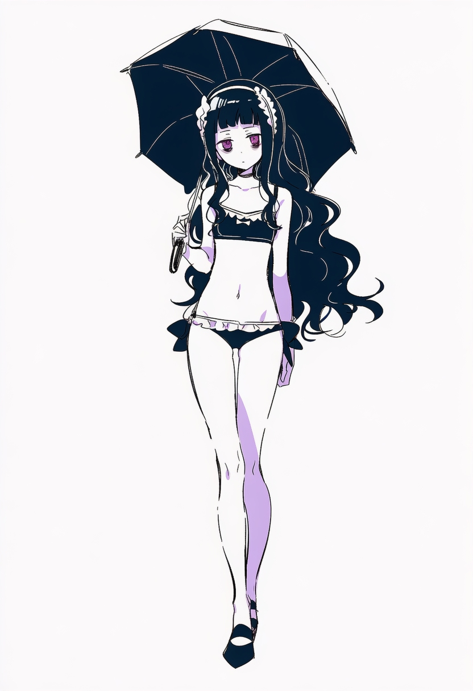

[在线例图](https://assets.quicktagcloud.com/images/raven_composition/raven_composition-4721.jpg?v=564915c437405df8)

<a id="raven_composition-4722"></a>

## 爱丽丝·德罗丝

ID：`raven_composition-4722`；分类：角色图鉴 / 爱丽丝；来源标记：`safe`。

来源说明：

> 作品：第五人格
> 作品 tag：identity_v
> Safebooru 帖数：91

正向提示词：

```text
alice_deross
```


[在线例图](https://assets.quicktagcloud.com/images/raven_composition/raven_composition-4722.jpg?v=369bab273399664e)

<a id="raven_composition-4723"></a>

## 爱丽丝

ID：`raven_composition-4723`；分类：角色图鉴 / 爱丽丝；来源标记：`safe`。

来源说明：

> 作品：格林笔记
> 作品 tag：grimms_notes
> Safebooru 帖数：88

正向提示词：

```text
alice_(grimms_notes)
```


[在线例图](https://assets.quicktagcloud.com/images/raven_composition/raven_composition-4723.jpg?v=3c10efe80d708346)

<a id="raven_composition-4724"></a>

## 爱丽丝·艾略特

ID：`raven_composition-4724`；分类：角色图鉴 / 爱丽丝；来源标记：`safe`。

来源说明：

> 作品：暗影之心
> 作品 tag：shadow_hearts
> Safebooru 帖数：81

正向提示词：

```text
alice_elliot
```

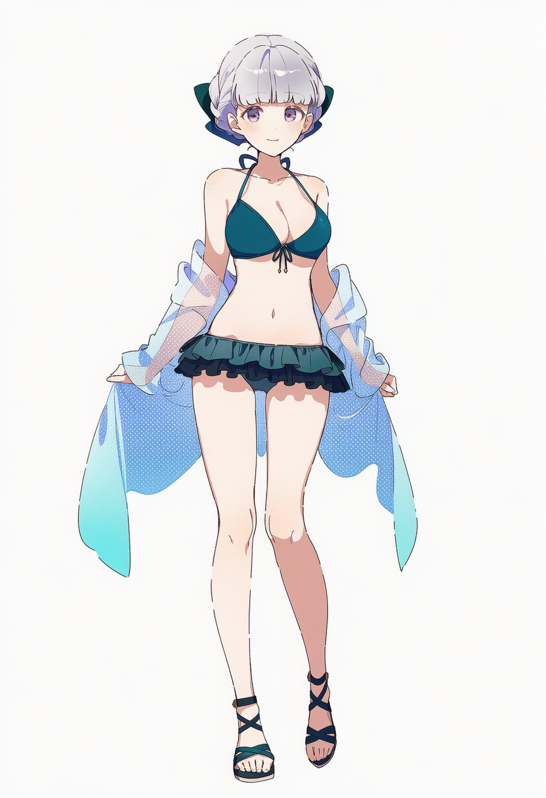

[在线例图](https://assets.quicktagcloud.com/images/raven_composition/raven_composition-4724.jpg?v=aab287b31f9a9941)

<a id="raven_composition-4725"></a>

## 尼禄·爱丽丝

ID：`raven_composition-4725`；分类：角色图鉴 / 爱丽丝；来源标记：`safe`。

来源说明：

> 作品：憧憬成为魔法少女
> 作品 tag：mahou_shoujo_ni_akogarete
> Safebooru 帖数：71

正向提示词：

```text
nero_alice
```


[在线例图](https://assets.quicktagcloud.com/images/raven_composition/raven_composition-4725.jpg?v=d9d0559b3e878318)

<a id="raven_composition-4726"></a>

## 爱丽丝

ID：`raven_composition-4726`；分类：角色图鉴 / 爱丽丝；来源标记：`safe`。

来源说明：

> 作品：Fate/EXTRA
> 作品 tag：fate/extra
> Safebooru 帖数：70

正向提示词：

```text
alice_(fate)
```


[在线例图](https://assets.quicktagcloud.com/images/raven_composition/raven_composition-4726.jpg?v=6acc149b590c238e)

<a id="raven_composition-4727"></a>

## 爱丽丝

ID：`raven_composition-4727`；分类：角色图鉴 / 爱丽丝；来源标记：`safe`。

来源说明：

> 作品：仙境传说
> 作品 tag：ragnarok_online
> Safebooru 帖数：65

正向提示词：

```text
alice_(ragnarok_online)
```

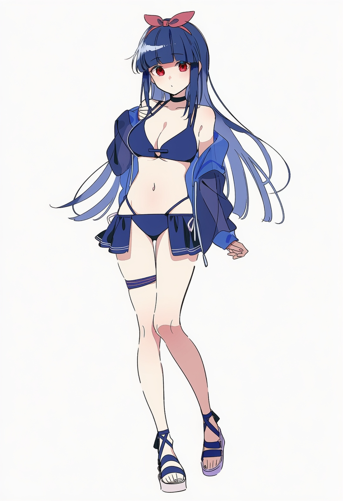

[在线例图](https://assets.quicktagcloud.com/images/raven_composition/raven_composition-4727.jpg?v=063690c2c4ee9432)

<a id="raven_composition-4728"></a>

## 爱丽丝

ID：`raven_composition-4728`；分类：角色图鉴 / 爱丽丝；来源标记：`safe`。

来源说明：

> 作品：明日方舟
> 作品 tag：arknights
> Safebooru 帖数：63

正向提示词：

```text
iris_(arknights)
```

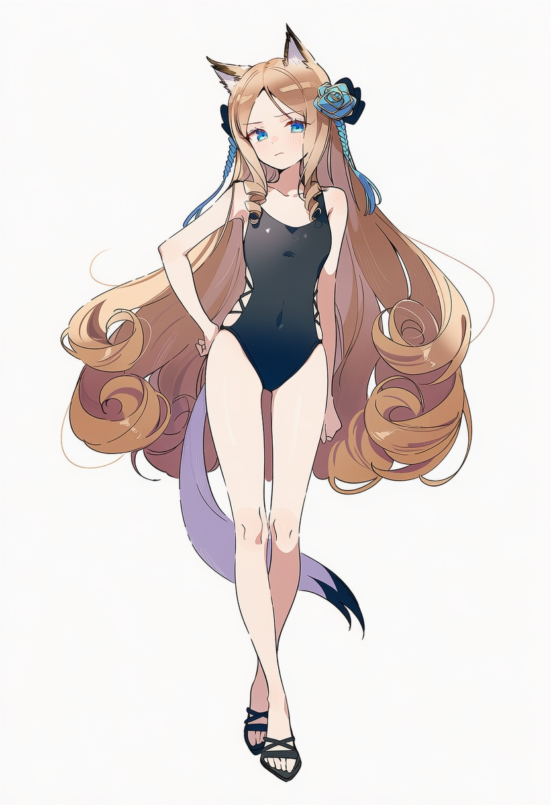

[在线例图](https://assets.quicktagcloud.com/images/raven_composition/raven_composition-4728.jpg?v=2852b7d3349c54bd)

<a id="raven_composition-4729"></a>

## 米娅·爱丽丝

ID：`raven_composition-4729`；分类：角色图鉴 / 爱丽丝；来源标记：`safe`。

来源说明：

> 作品：破邪巨星G弹劾凰
> 作品 tag：dangaiou
> Safebooru 帖数：62

正向提示词：

```text
mia_alice
```


[在线例图](https://assets.quicktagcloud.com/images/raven_composition/raven_composition-4729.jpg?v=3b3a4b85edf6c22b)

<a id="raven_composition-4730"></a>

## 小坂爱丽丝

ID：`raven_composition-4730`；分类：角色图鉴 / 爱丽丝；来源标记：`safe`。

来源说明：

> 作品：水月
> 作品 tag：suigetsu
> Safebooru 帖数：59

正向提示词：

```text
kousaka_alice
```


[在线例图](https://assets.quicktagcloud.com/images/raven_composition/raven_composition-4730.jpg?v=639276383fa527c1)

<a id="raven_composition-4731"></a>

## 爱丽丝·利德尔

ID：`raven_composition-4731`；分类：角色图鉴 / 爱丽丝；来源标记：`safe`。

来源说明：

> 作品：美国麦基的爱丽丝
> 作品 tag：american_mcgee's_alice
> Safebooru 帖数：57

正向提示词：

```text
alice_liddell_(american_mcgee's_alice)
```

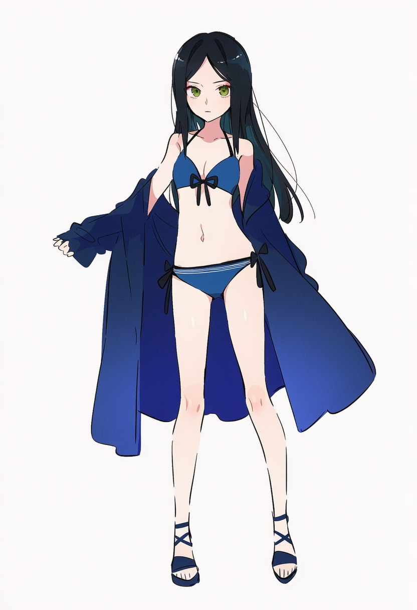

[在线例图](https://assets.quicktagcloud.com/images/raven_composition/raven_composition-4731.jpg?v=99df8cf1f6c29d83)

<a id="raven_composition-4732"></a>

## 爱丽丝

ID：`raven_composition-4732`；分类：角色图鉴 / 爱丽丝；来源标记：`safe`。

来源说明：

> 作品：永恒之塔手游(Grimlight)
> 作品 tag：grimlight
> Safebooru 帖数：53

正向提示词：

```text
alice_(grimlight)
```

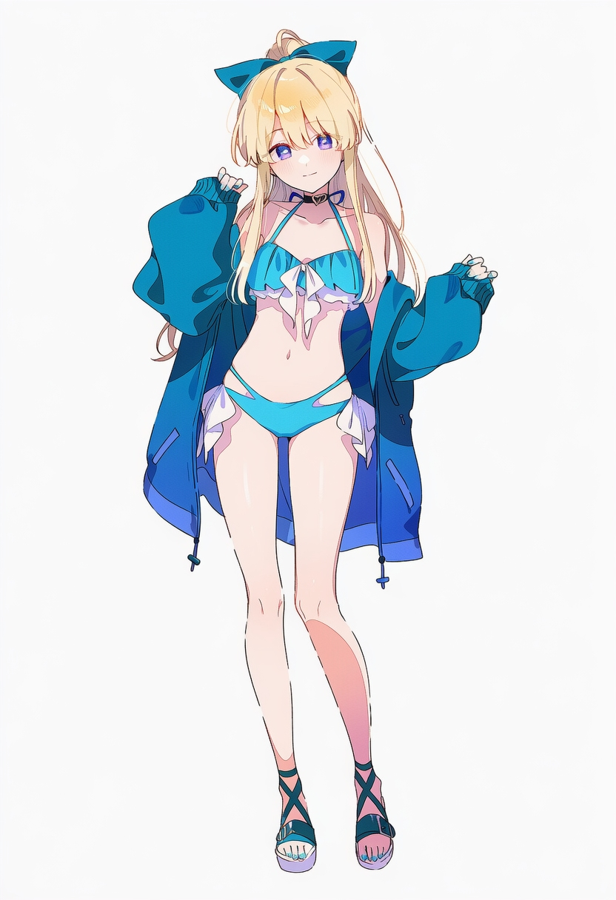

[在线例图](https://assets.quicktagcloud.com/images/raven_composition/raven_composition-4732.jpg?v=00bea2ab3c6648e3)

<a id="raven_composition-4733"></a>

## 爱丽丝

ID：`raven_composition-4733`；分类：角色图鉴 / 爱丽丝；来源标记：`safe`。

来源说明：

> 作品：Arcaea
> 作品 tag：arcaea
> Safebooru 帖数：51

正向提示词：

```text
alice_(arcaea)
```

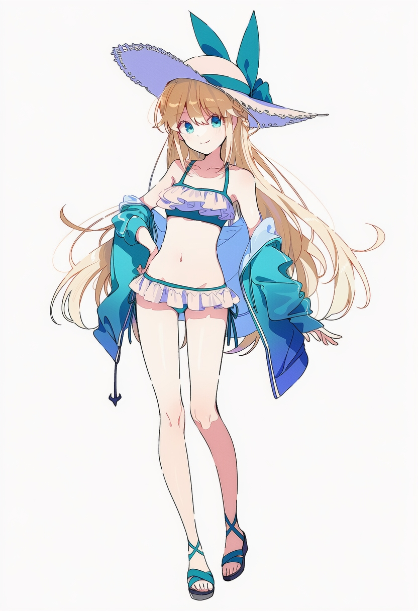

[在线例图](https://assets.quicktagcloud.com/images/raven_composition/raven_composition-4733.jpg?v=0352533e5fcf16e3)

<a id="raven_composition-4734"></a>

## 爱丽丝·玛娜

ID：`raven_composition-4734`；分类：角色图鉴 / 爱丽丝；来源标记：`safe`。

来源说明：

> 作品：独立虚拟主播
> 作品 tag：indie_virtual_youtuber
> Safebooru 帖数：51

正向提示词：

```text
alice_mana
```

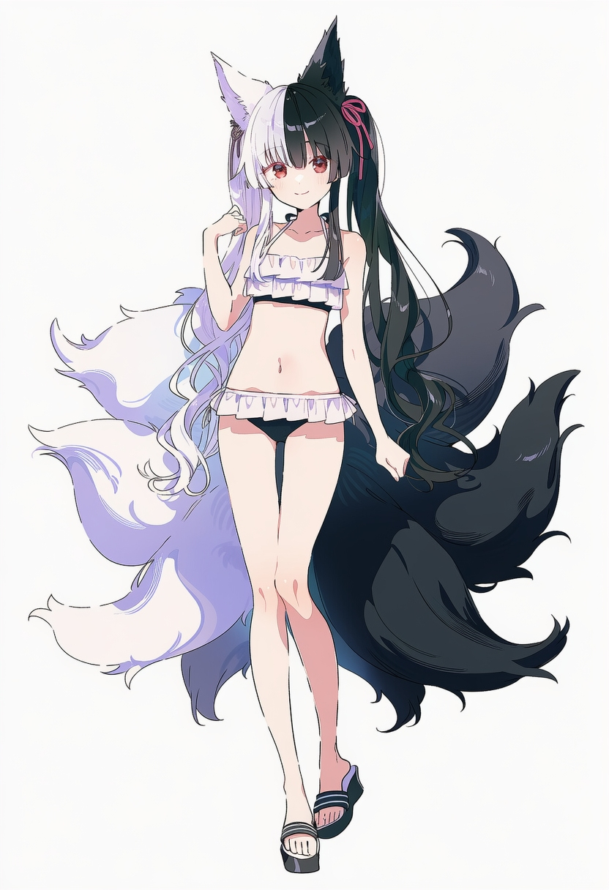

[在线例图](https://assets.quicktagcloud.com/images/raven_composition/raven_composition-4734.jpg?v=09277692b63c7dee)

<a id="raven_composition-4735"></a>

## 爱丽丝·心愿之心

ID：`raven_composition-4735`；分类：角色图鉴 / 爱丽丝；来源标记：`safe`。

来源说明：

> 作品：魔法万圣节
> 作品 tag：magical_halloween
> Safebooru 帖数：50

正向提示词：

```text
alice_wishheart
```

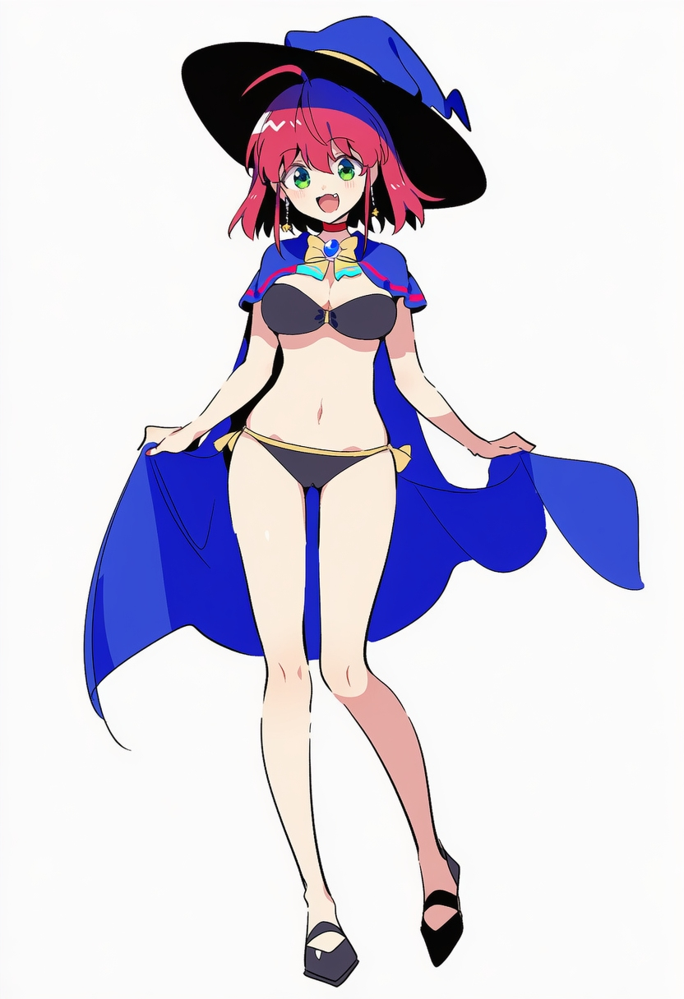

[在线例图](https://assets.quicktagcloud.com/images/raven_composition/raven_composition-4735.jpg?v=fa8b3190d590334e)

<a id="raven_composition-4736"></a>

## 爱丽丝·马宾

ID：`raven_composition-4736`；分类：角色图鉴 / 爱丽丝；来源标记：`safe`。

来源说明：

> 作品：南瓜剪刀
> 作品 tag：pumpkin_scissors
> Safebooru 帖数：38

正向提示词：

```text
alice_l._malvin
```

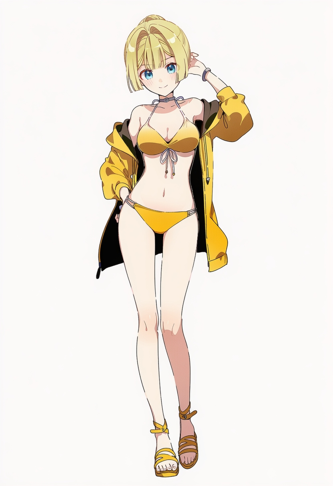

[在线例图](https://assets.quicktagcloud.com/images/raven_composition/raven_composition-4736.jpg?v=af7a6c86e86f9798)

<a id="raven_composition-4737"></a>

## 爱丽丝·伦德罗特

ID：`raven_composition-4737`；分类：角色图鉴 / 爱丽丝；来源标记：`safe`。

来源说明：

> 作品：死神少爷与黑女仆
> 作品 tag：shinigami_bocchan_to_kuro_maid
> Safebooru 帖数：36

正向提示词：

```text
alice_lendrott
```


[在线例图](https://assets.quicktagcloud.com/images/raven_composition/raven_composition-4737.jpg?v=235a15ee51c03f56)

<a id="raven_composition-4738"></a>

## 绘梦爱丽丝

ID：`raven_composition-4738`；分类：角色图鉴 / 爱丽丝；来源标记：`safe`。

来源说明：

> 作品：Liver City
> 作品 tag：liver_city
> Safebooru 帖数：36

正向提示词：

```text
emu_alice
```


[在线例图](https://assets.quicktagcloud.com/images/raven_composition/raven_composition-4738.jpg?v=acfb9fbbe10cc372)

<a id="raven_composition-4739"></a>

## 爱丽丝·布朗什

ID：`raven_composition-4739`；分类：角色图鉴 / 爱丽丝；来源标记：`safe`。

来源说明：

> 作品：异国迷宫的十字路口
> 作品 tag：ikoku_meiro_no_croisee
> Safebooru 帖数：32

正向提示词：

```text
alice_blanche
```


[在线例图](https://assets.quicktagcloud.com/images/raven_composition/raven_composition-4739.jpg?v=d09b7b5966d179e9)

<a id="raven_composition-4740"></a>

## 有岛爱丽丝

ID：`raven_composition-4740`；分类：角色图鉴 / 爱丽丝；来源标记：`safe`。

来源说明：

> 作品：茂伸奇谈
> 作品 tag：monobeno
> Safebooru 帖数：32

正向提示词：

```text
arishima_alice
```

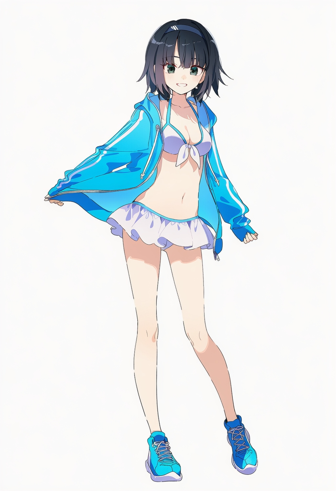

[在线例图](https://assets.quicktagcloud.com/images/raven_composition/raven_composition-4740.jpg?v=894a28a3bbe92990)

<a id="raven_composition-4741"></a>

## 爱丽丝

ID：`raven_composition-4741`；分类：角色图鉴 / 爱丽丝；来源标记：`safe`。

来源说明：

> 作品：Deemo(音游)
> 作品 tag：deemo
> Safebooru 帖数：30

正向提示词：

```text
alice_(deemo)
```


[在线例图](https://assets.quicktagcloud.com/images/raven_composition/raven_composition-4741.jpg?v=57321910cd64f8d9)

<a id="raven_composition-4742"></a>

## 爱丽丝

ID：`raven_composition-4742`；分类：角色图鉴 / 爱丽丝；来源标记：`safe`。

来源说明：

> 作品：传说系列
> 作品 tag：tales_of_(series)
> Safebooru 帖数：24

正向提示词：

```text
alice_(tales)
```

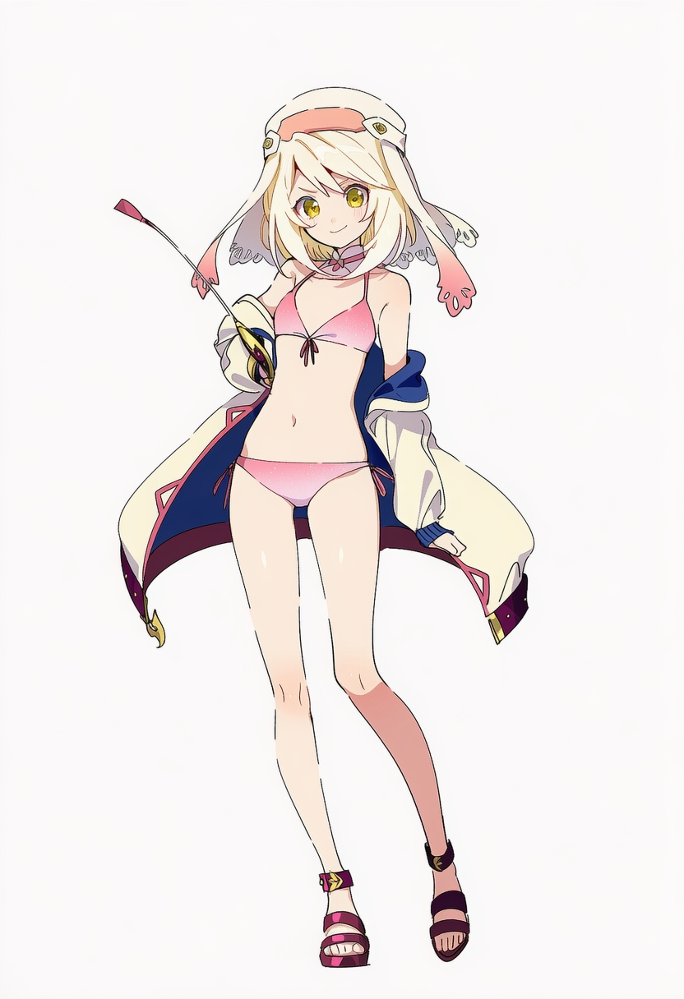

[在线例图](https://assets.quicktagcloud.com/images/raven_composition/raven_composition-4742.jpg?v=4822f24791ee4198)

<a id="raven_composition-4743"></a>

## 爱丽丝

ID：`raven_composition-4743`；分类：角色图鉴 / 爱丽丝；来源标记：`safe`。

来源说明：

> 作品：AliceSoft
> 作品 tag：alicesoft
> Safebooru 帖数：24

正向提示词：

```text
alice_(alicesoft)
```

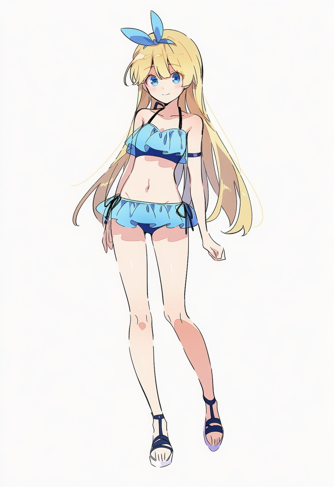

[在线例图](https://assets.quicktagcloud.com/images/raven_composition/raven_composition-4743.jpg?v=fa04e0db4b2ebcc5)

<a id="raven_composition-4744"></a>

## 爱丽丝

ID：`raven_composition-4744`；分类：角色图鉴 / 爱丽丝；来源标记：`safe`。

来源说明：

> 作品：符文工厂
> 作品 tag：rune_factory
> Safebooru 帖数：24

正向提示词：

```text
alice_(rune_factory)
```

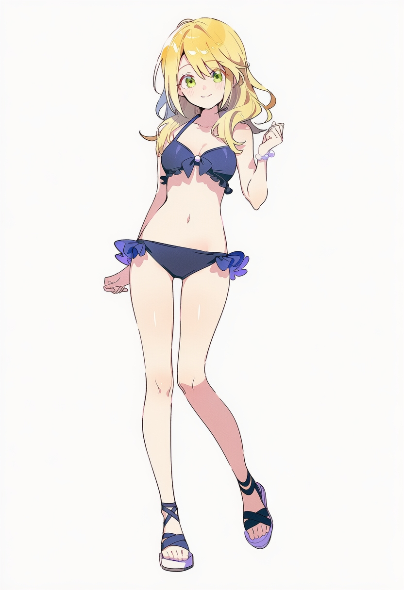

[在线例图](https://assets.quicktagcloud.com/images/raven_composition/raven_composition-4744.jpg?v=4a7f55f5c48b9158)

<a id="raven_composition-4745"></a>

## 爱丽丝

ID：`raven_composition-4745`；分类：角色图鉴 / 爱丽丝；来源标记：`safe`。

来源说明：

> 作品：女皇之刃
> 作品 tag：queen's_blade
> Safebooru 帖数：22

正向提示词：

```text
alice_(queen's_gate)
```

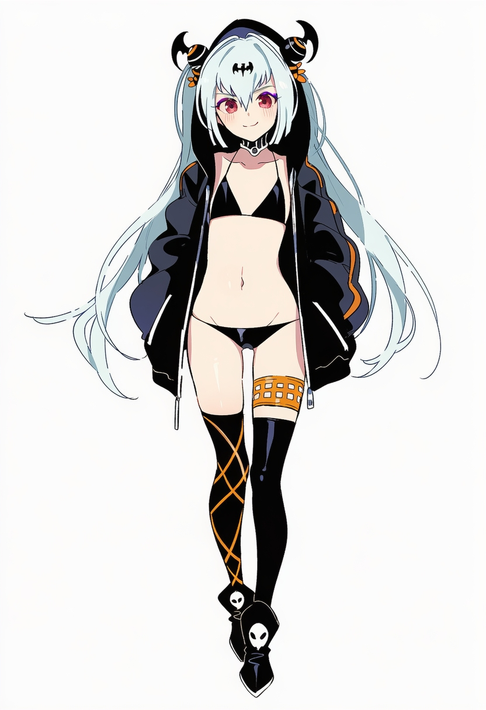

[在线例图](https://assets.quicktagcloud.com/images/raven_composition/raven_composition-4745.jpg?v=876a2405f1bbb919)

<a id="raven_composition-4746"></a>

## 爱丽丝

ID：`raven_composition-4746`；分类：角色图鉴 / 爱丽丝；来源标记：`safe`。

来源说明：

> 作品：奥丁领域
> 作品 tag：odin_sphere
> Safebooru 帖数：21

正向提示词：

```text
alice_(odin_sphere)
```

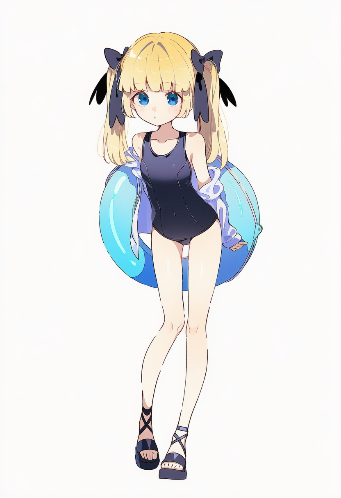

[在线例图](https://assets.quicktagcloud.com/images/raven_composition/raven_composition-4746.jpg?v=bf62eb510e1dcd5d)

<a id="raven_composition-4747"></a>

## 黑羽爱丽丝

ID：`raven_composition-4747`；分类：角色图鉴 / 爱丽丝；来源标记：`safe`。

来源说明：

> 作品：影之诗
> 作品 tag：shadowverse
> Safebooru 帖数：21

正向提示词：

```text
kurobane_alice
```


[在线例图](https://assets.quicktagcloud.com/images/raven_composition/raven_composition-4747.jpg?v=cfe3cc08c76691e4)

<a id="raven_composition-4748"></a>

## 爱丽丝·萨德·梅西

ID：`raven_composition-4748`；分类：角色图鉴 / 爱丽丝；来源标记：`safe`。

来源说明：

> 作品：恋爱的她笨拙舞台
> 作品 tag：koi_suru_kanojo_no_bukiyou_na_butai
> Safebooru 帖数：19

正向提示词：

```text
alice_third_macy
```


[在线例图](https://assets.quicktagcloud.com/images/raven_composition/raven_composition-4748.jpg?v=ab322367a746a3ed)

<a id="raven_composition-4749"></a>

## 爱丽丝·加内特·中田

ID：`raven_composition-4749`；分类：角色图鉴 / 爱丽丝；来源标记：`safe`。

来源说明：

> 作品：拳皇(KOF)
> 作品 tag：the_king_of_fighters
> Safebooru 帖数：19

正向提示词：

```text
alice_garnet_nakata
```


[在线例图](https://assets.quicktagcloud.com/images/raven_composition/raven_composition-4749.jpg?v=4008dece49025a7b)

<a id="raven_composition-4750"></a>

## 爱丽丝

ID：`raven_composition-4750`；分类：角色图鉴 / 爱丽丝；来源标记：`safe`。

来源说明：

> 作品：玛丽哀歌雀之箱
> 作品 tag：mary_skelter
> Safebooru 帖数：18

正向提示词：

```text
alice_(mary_skelter)
```

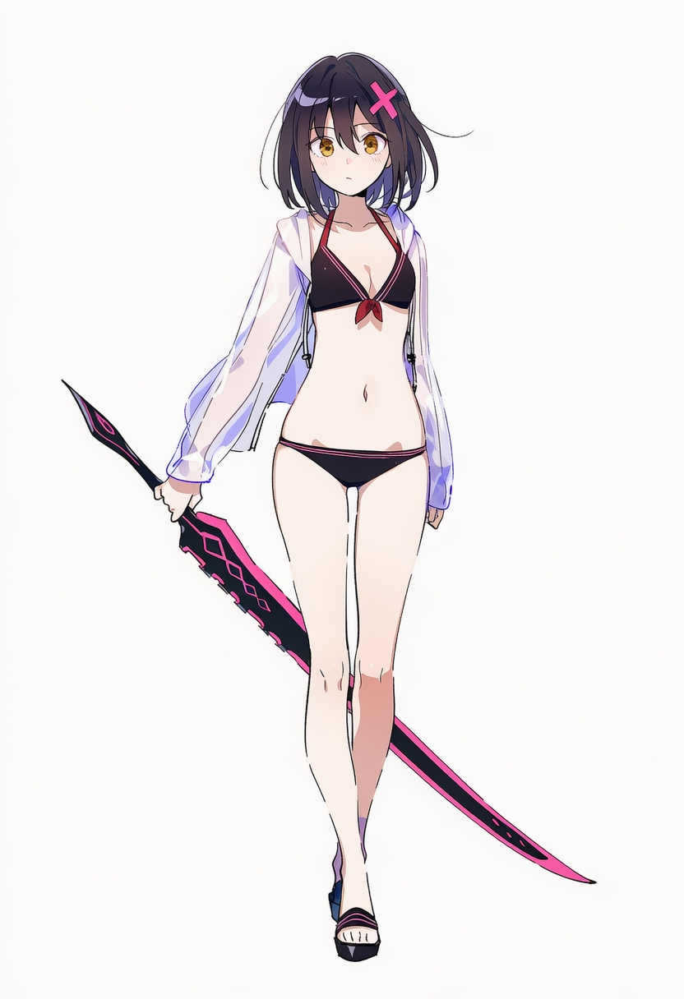

[在线例图](https://assets.quicktagcloud.com/images/raven_composition/raven_composition-4750.jpg?v=b9834a5678b92194)

<a id="raven_composition-4751"></a>

## 爱丽丝

ID：`raven_composition-4751`；分类：角色图鉴 / 爱丽丝；来源标记：`safe`。

来源说明：

> 作品：罪少女
> 作品 tag：criminal_girls
> Safebooru 帖数：16

正向提示词：

```text
alice_(criminal_girls)
```


[在线例图](https://assets.quicktagcloud.com/images/raven_composition/raven_composition-4751.jpg?v=9d68869146bf0ebc)

<a id="raven_composition-4752"></a>

## 爱丽丝·弗雷娅

ID：`raven_composition-4752`；分类：角色图鉴 / 爱丽丝；来源标记：`safe`。

来源说明：

> 作品：铳皇无尽的法夫纳
> 作品 tag：juuoumujin_no_fafnir
> Safebooru 帖数：14

正向提示词：

```text
iris_freyja
```


[在线例图](https://assets.quicktagcloud.com/images/raven_composition/raven_composition-4752.jpg?v=644a8898eaea7c0b)

<a id="raven_composition-4753"></a>

## 南野爱丽丝

ID：`raven_composition-4753`；分类：角色图鉴 / 爱丽丝；来源标记：`safe`。

来源说明：

> 作品：魔女恋日记
> 作品 tag：majo_koi_nikki
> Safebooru 帖数：14

正向提示词：

```text
nanno_alice
```


[在线例图](https://assets.quicktagcloud.com/images/raven_composition/raven_composition-4753.jpg?v=36f734d4d6f7aa66)

<a id="raven_composition-4754"></a>

## 爱丽丝

ID：`raven_composition-4754`；分类：角色图鉴 / 爱丽丝；来源标记：`safe`。

来源说明：

> 作品：东京放学后召唤师
> 作品 tag：tokyo_afterschool_summoners
> Safebooru 帖数：13

正向提示词：

```text
alice_(housamo)
```


[在线例图](https://assets.quicktagcloud.com/images/raven_composition/raven_composition-4754.jpg?v=2f0ac05bfdf6ef2f)

<a id="raven_composition-4755"></a>

## 爱丽丝

ID：`raven_composition-4755`；分类：角色图鉴 / 爱丽丝；来源标记：`safe`。

来源说明：

> 作品：格林回声
> 作品 tag：grimms_echoes
> Safebooru 帖数：13

正向提示词：

```text
alice_(grimms_echoes)
```


[在线例图](https://assets.quicktagcloud.com/images/raven_composition/raven_composition-4755.jpg?v=843687e2d1b02154)

<a id="raven_composition-4756"></a>

## 辉爱丽丝

ID：`raven_composition-4756`；分类：角色图鉴 / 爱丽丝；来源标记：`safe`。

来源说明：

> 作品：闪耀祭小偶像
> 作品 tag：kiratto_pri_chan
> Safebooru 帖数：12

正向提示词：

```text
kagayaki_alice
```

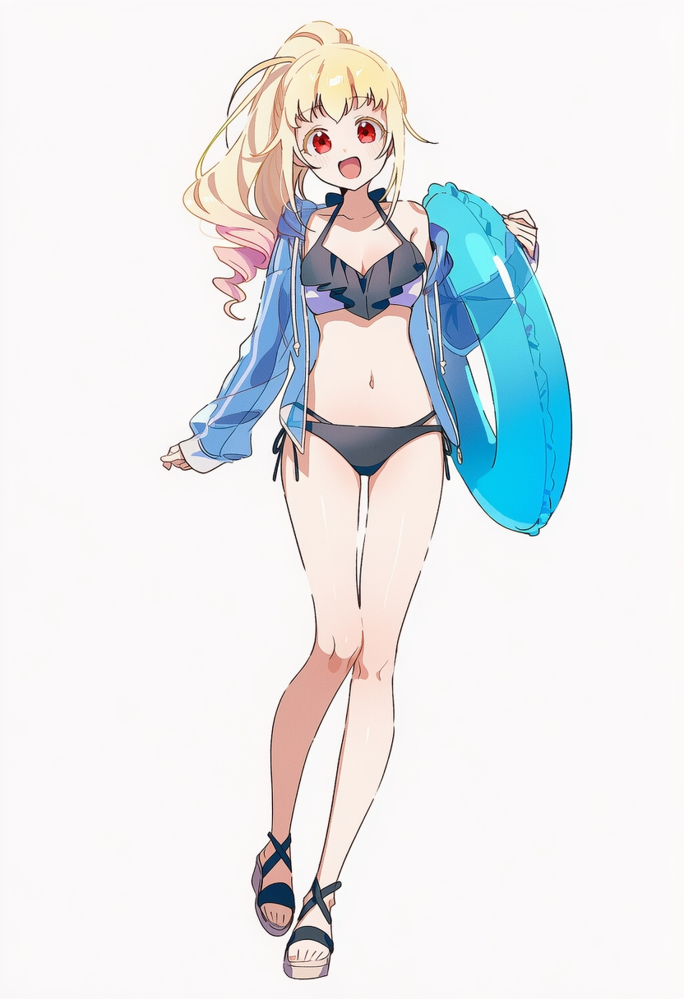

[在线例图](https://assets.quicktagcloud.com/images/raven_composition/raven_composition-4756.jpg?v=6e803d8d9739b98a)

<a id="raven_composition-4757"></a>

## 爱丽丝·格比奇

ID：`raven_composition-4757`；分类：角色图鉴 / 爱丽丝；来源标记：`safe`。

来源说明：

> 作品：爆丸
> 作品 tag：bakugan
> Safebooru 帖数：11

正向提示词：

```text
alice_gehabich
```

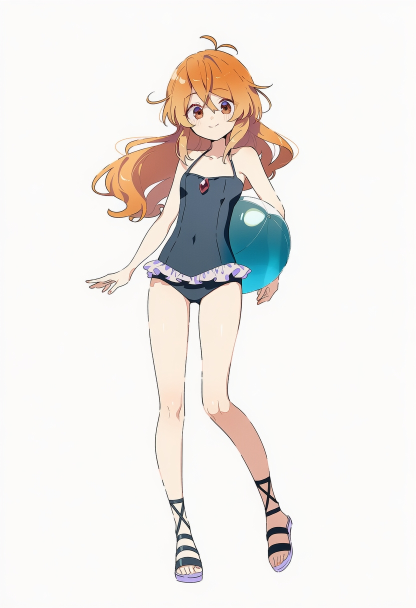

[在线例图](https://assets.quicktagcloud.com/images/raven_composition/raven_composition-4757.jpg?v=222bcea0887fd219)

<a id="raven_composition-4758"></a>

## AL-3爱丽丝

ID：`raven_composition-4758`；分类：角色图鉴 / 爱丽丝；来源标记：`safe`。

来源说明：

> 作品：超级机器人大战
> 作品 tag：super_robot_wars
> Safebooru 帖数：11

正向提示词：

```text
al-3_alice
```


[在线例图](https://assets.quicktagcloud.com/images/raven_composition/raven_composition-4758.jpg?v=cb90e2028abf5e81)

<a id="raven_composition-4759"></a>

## 如月爱丽丝

ID：`raven_composition-4759`；分类：角色图鉴 / 爱丽丝；来源标记：`safe`。

来源说明：

> 作品：战斗员派遣中！
> 作品 tag：sentouin_hakenshimasu!
> Safebooru 帖数：11

正向提示词：

```text
kisaragi_alice
```

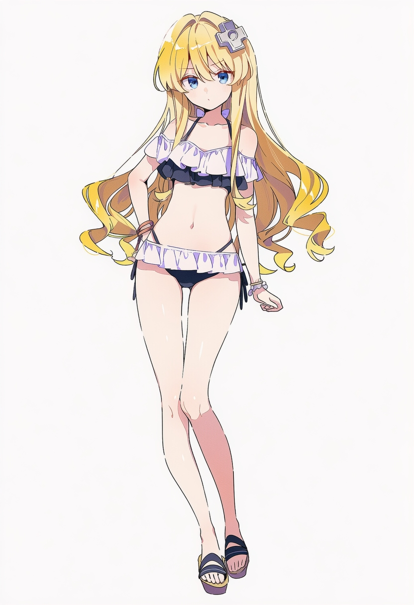

[在线例图](https://assets.quicktagcloud.com/images/raven_composition/raven_composition-4759.jpg?v=e591e242695e0a1f)

<a id="raven_composition-4760"></a>

## 九资爱丽丝

ID：`raven_composition-4760`；分类：角色图鉴 / 爱丽丝；来源标记：`safe`。

来源说明：

> 作品：铁道少女
> 作品 tag：tetsudou_musume
> Safebooru 帖数：10

正向提示词：

```text
kuji_alice
```

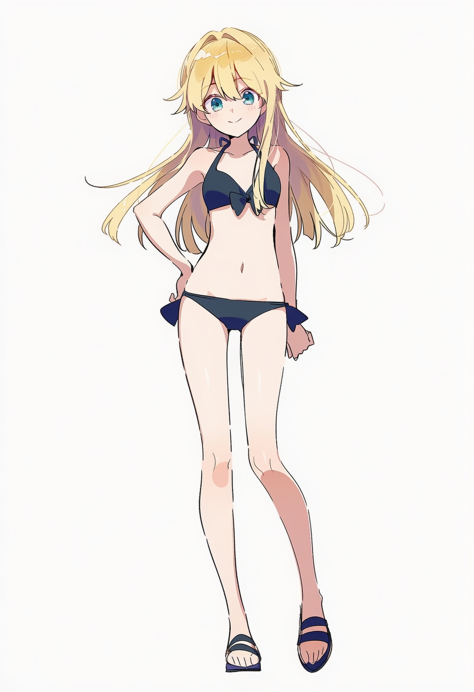

[在线例图](https://assets.quicktagcloud.com/images/raven_composition/raven_composition-4760.jpg?v=26df51f47c0c8082)

<a id="raven_composition-4761"></a>

## 爱丽丝

ID：`raven_composition-4761`；分类：角色图鉴 / 爱丽丝；来源标记：`safe`。

来源说明：

> 作品：美少女万华镜
> 作品 tag：bishoujo_mangekyou
> Safebooru 帖数：9

正向提示词：

```text
alice_(bishoujo_mangekyou)
```

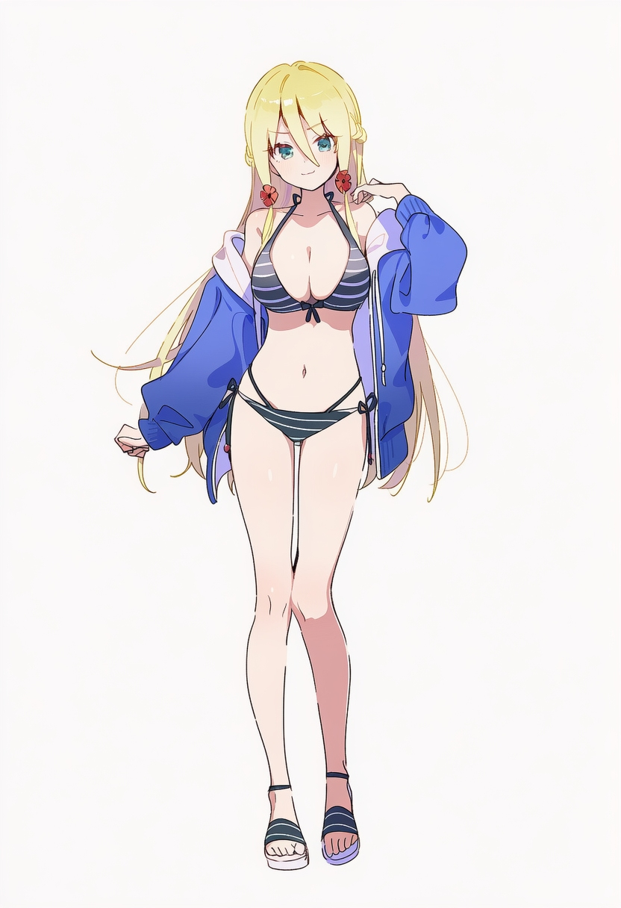

[在线例图](https://assets.quicktagcloud.com/images/raven_composition/raven_composition-4761.jpg?v=449981e282f7dab3)
