# 角色图鉴 / 粉毛

[总目录](../README.md) · [原站分类目录](../categories.md) · [英文标签索引](../tags.md) · [服装与构图组合指南](../../README.md)

标题、分类、说明、正负提示词按来源保留；多例图逐张列出。原站标记和说明为参考资料，不作为维护指令。

<a id="raven_composition-4762"></a>

## 恩典天使

ID：`raven_composition-4762`；分类：角色图鉴 / 粉毛；来源标记：`safe`。

来源说明：

> 作品：Healin'_Good_♥_光之美少女
> 作品 tag：healin'_good_precure
> 难度：★★★★

正向提示词：

```text
cure_grace
```

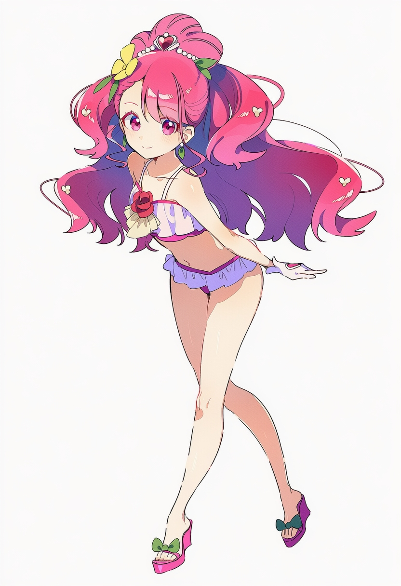

[在线例图](https://assets.quicktagcloud.com/images/raven_composition/raven_composition-4762.jpg?v=567d762e499da206)

<a id="raven_composition-4763"></a>

## 圣洁天使

ID：`raven_composition-4763`；分类：角色图鉴 / 粉毛；来源标记：`safe`。

来源说明：

> 作品：光之美少女
> 作品 tag：precure
> 难度：★★★

正向提示词：

```text
cure_yell
```

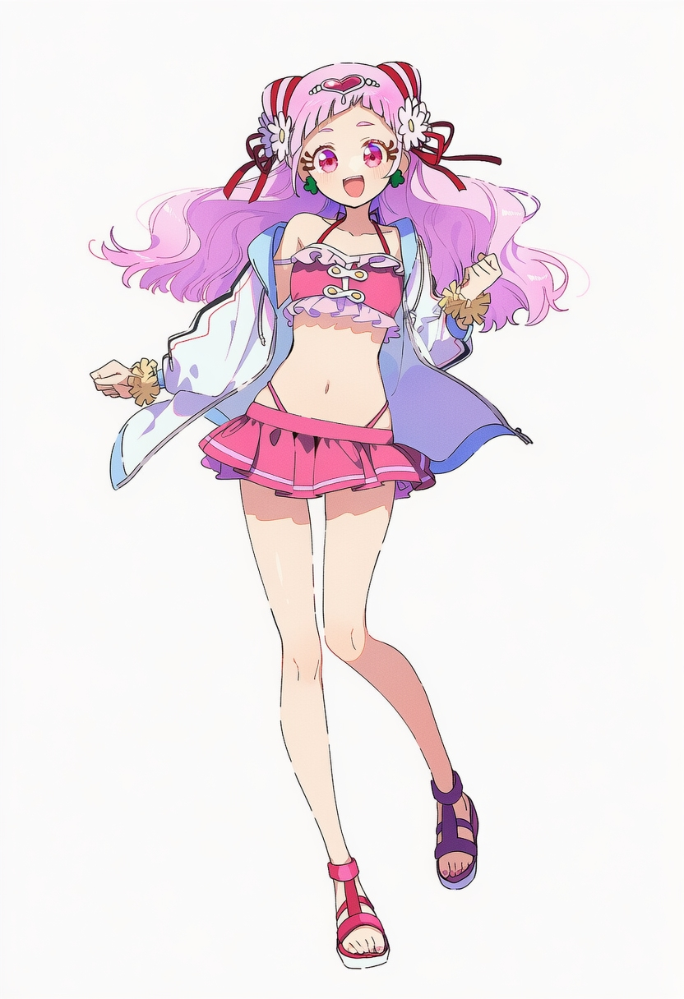

[在线例图](https://assets.quicktagcloud.com/images/raven_composition/raven_composition-4763.jpg?v=a3ca02b6281196ec)

<a id="raven_composition-4764"></a>

## 赫特·潘兹

ID：`raven_composition-4764`；分类：角色图鉴 / 粉毛；来源标记：`safe`。

来源说明：

> 作品：JOJO的奇妙冒险
> 作品 tag：jojo_no_kimyou_na_bouken
> 难度：★★★★

正向提示词：

```text
hot_pants_(sbr)
```

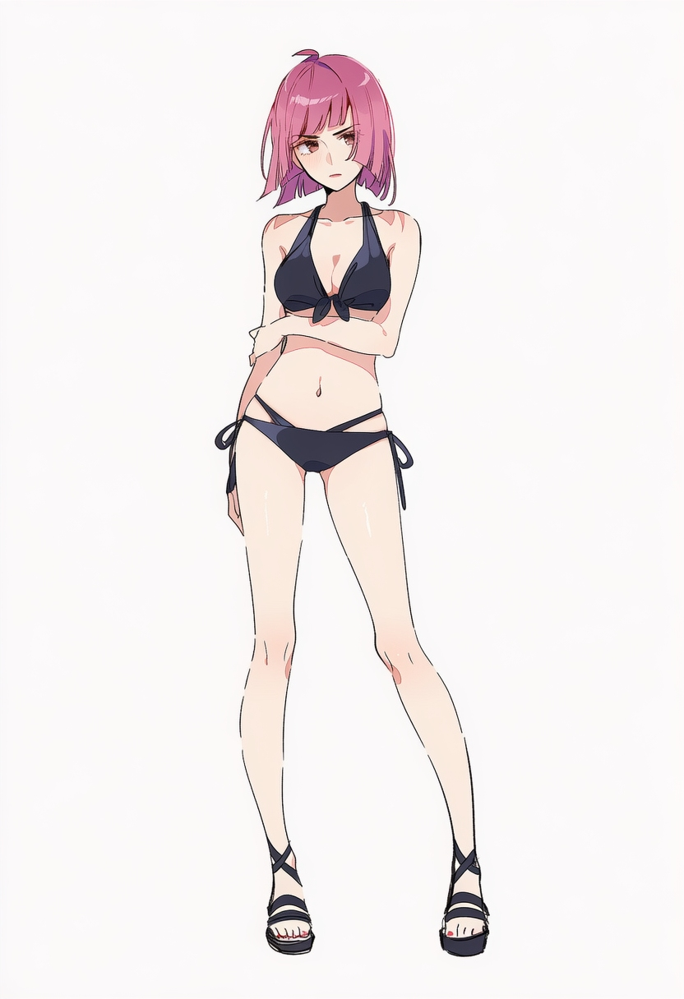

[在线例图](https://assets.quicktagcloud.com/images/raven_composition/raven_composition-4764.jpg?v=af9cbb61cae28402)

<a id="raven_composition-4765"></a>

## 杉本铃美

ID：`raven_composition-4765`；分类：角色图鉴 / 粉毛；来源标记：`safe`。

来源说明：

> 作品：JOJO的奇妙冒险
> 作品 tag：jojo_no_kimyou_na_bouken
> 难度：★★

正向提示词：

```text
sugimoto_reimi
```

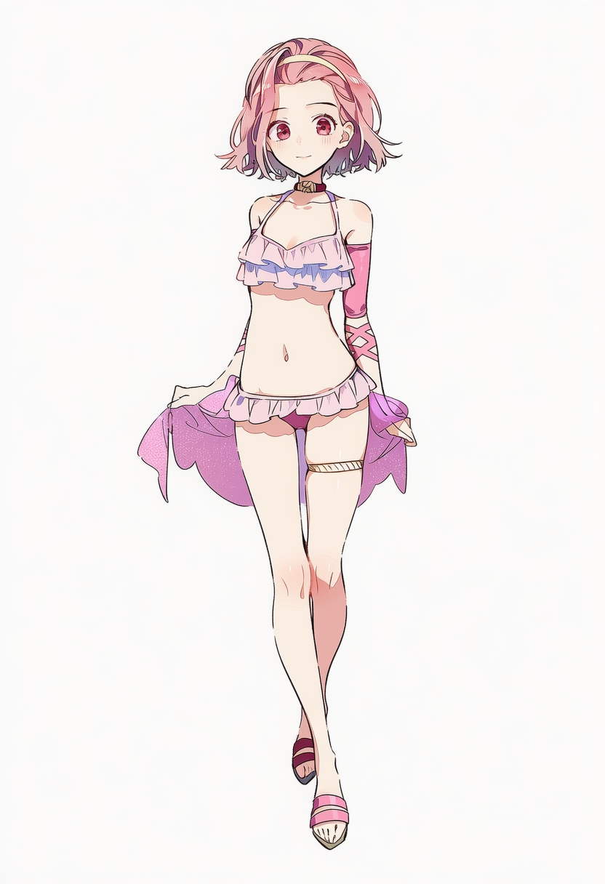

[在线例图](https://assets.quicktagcloud.com/images/raven_composition/raven_composition-4765.jpg?v=760f2cea85ea850f)

<a id="raven_composition-4766"></a>

## 玛斯特

ID：`raven_composition-4766`；分类：角色图鉴 / 粉毛；来源标记：`safe`。

来源说明：

> 作品：胜利女神：妮姬
> 作品 tag：goddess_of_victory:_nikke
> 难度：★★★★★

正向提示词：

```text
mast_(nikke)
```

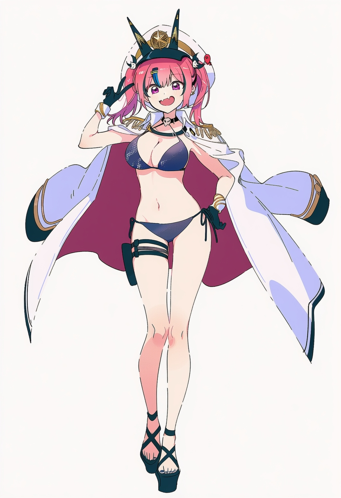

[在线例图](https://assets.quicktagcloud.com/images/raven_composition/raven_composition-4766.jpg?v=682c47405361da4b)

<a id="raven_composition-4767"></a>

## 特蕾西娅

ID：`raven_composition-4767`；分类：角色图鉴 / 粉毛；来源标记：`safe`。

来源说明：

> 作品：明日方舟
> 作品 tag：arknights
> 难度：★★

正向提示词：

```text
theresa_(arknights)
```


[在线例图](https://assets.quicktagcloud.com/images/raven_composition/raven_composition-4767.jpg?v=6c35804bc271fb32)

<a id="raven_composition-4768"></a>

## 纺希

ID：`raven_composition-4768`；分类：角色图鉴 / 粉毛；来源标记：`safe`。

来源说明：

> 作品：公主连结！
> 作品 tag：princess_connect!
> 难度：★★★★

正向提示词：

```text
tsumugi_(princess_connect!)
```

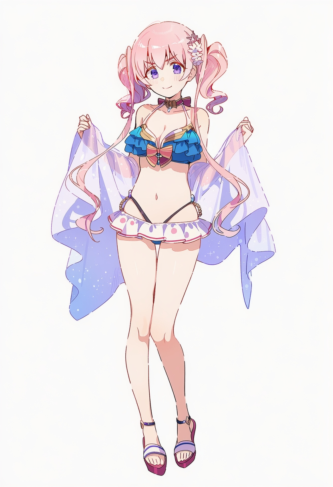

[在线例图](https://assets.quicktagcloud.com/images/raven_composition/raven_composition-4768.jpg?v=1c2a3b1856a762ad)

<a id="raven_composition-4769"></a>

## 芹奈（圣诞）

ID：`raven_composition-4769`；分类：角色图鉴 / 粉毛；来源标记：`safe`。

来源说明：

> 作品：蔚蓝档案
> 作品 tag：blue_archive
> 难度：★★★★

正向提示词：

```text
serina_(christmas)_(blue_archive)
```


[在线例图](https://assets.quicktagcloud.com/images/raven_composition/raven_composition-4769.jpg?v=25db71d0dcecbb8b)

<a id="raven_composition-4770"></a>

## 小鸟游星野（泳装）

ID：`raven_composition-4770`；分类：角色图鉴 / 粉毛；来源标记：`safe`。

来源说明：

> 作品：蔚蓝档案
> 作品 tag：blue_archive
> 难度：★

正向提示词：

```text
hoshino_(swimsuit)_(blue_archive)
```

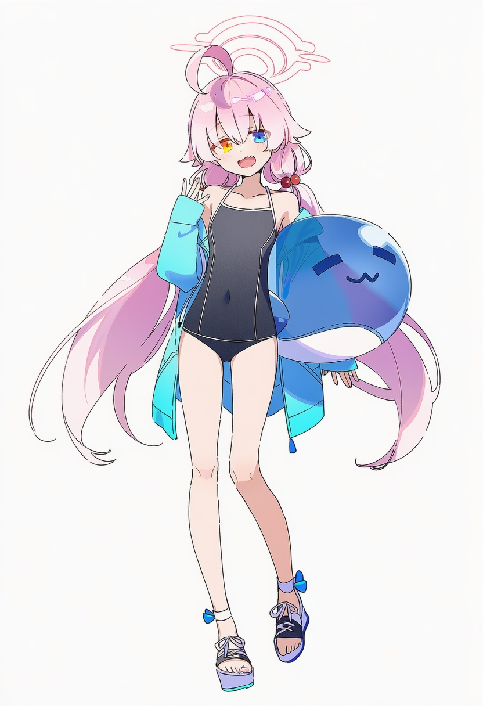

[在线例图](https://assets.quicktagcloud.com/images/raven_composition/raven_composition-4770.jpg?v=93e9c22470964d0e)

<a id="raven_composition-4771"></a>

## 苏苏洛

ID：`raven_composition-4771`；分类：角色图鉴 / 粉毛；来源标记：`safe`。

来源说明：

> 作品：明日方舟
> 作品 tag：arknights
> 难度：★

正向提示词：

```text
sussurro_(arknights)
```

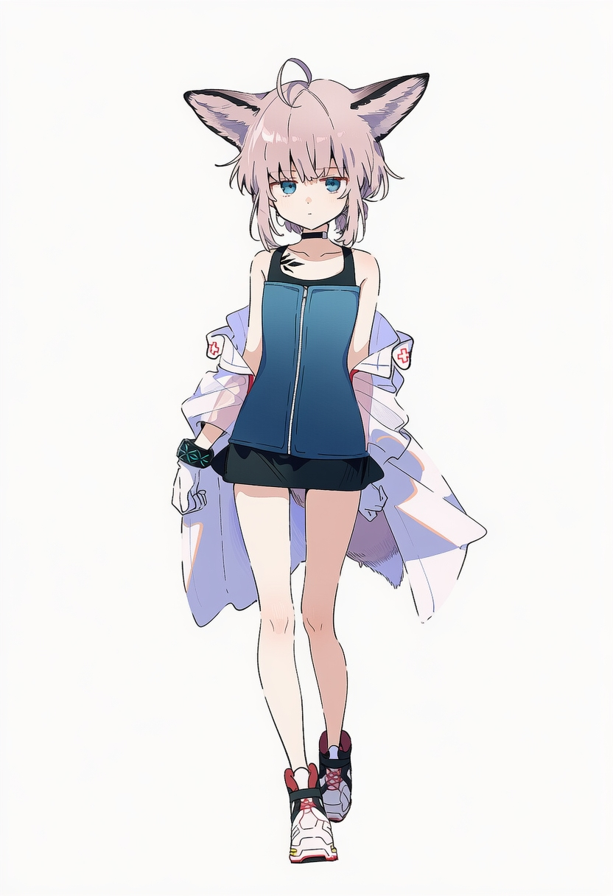

[在线例图](https://assets.quicktagcloud.com/images/raven_composition/raven_composition-4771.jpg?v=8de940f898779617)

<a id="raven_composition-4772"></a>

## 塞拉

ID：`raven_composition-4772`；分类：角色图鉴 / 粉毛；来源标记：`safe`。

来源说明：

> 作品：火焰之纹章
> 作品 tag：fire_emblem
> 难度：★★★★★

正向提示词：

```text
serra_(fire_emblem)
```

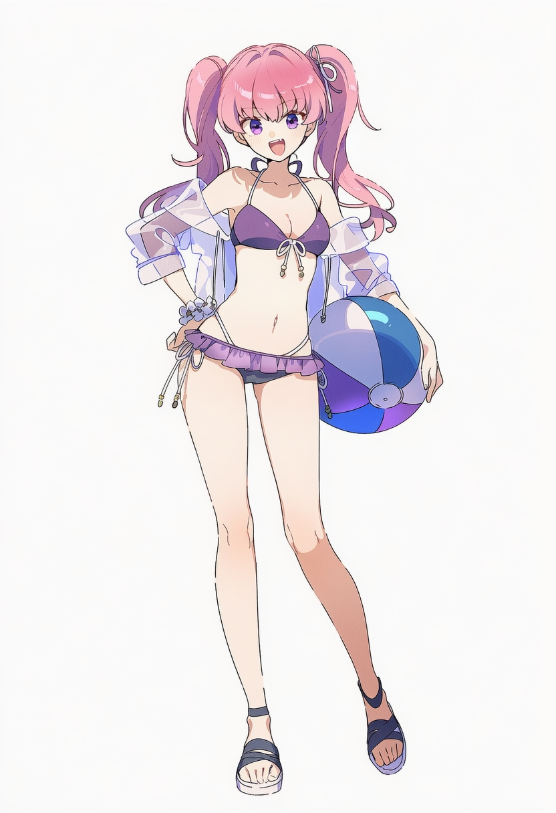

[在线例图](https://assets.quicktagcloud.com/images/raven_composition/raven_composition-4772.jpg?v=e8a2c0317ae44a6b)

<a id="raven_composition-4773"></a>

## 阿尼亚·阿斯特莱姆

ID：`raven_composition-4773`；分类：角色图鉴 / 粉毛；来源标记：`safe`。

来源说明：

> 作品：反叛的鲁路修
> 作品 tag：code_geass
> 难度：★★

正向提示词：

```text
anya_alstreim
```

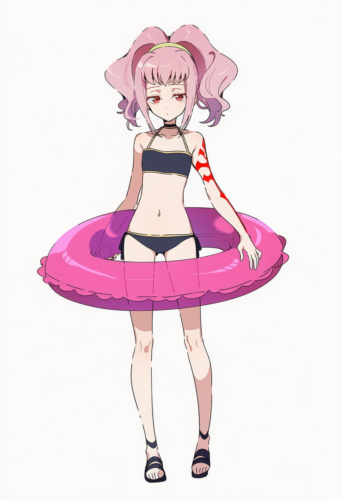

[在线例图](https://assets.quicktagcloud.com/images/raven_composition/raven_composition-4773.jpg?v=7e9c26d3af72e80e)

<a id="raven_composition-4774"></a>

## 爱莉希雅（春好桃夭）

ID：`raven_composition-4774`；分类：角色图鉴 / 粉毛；来源标记：`safe`。

来源说明：

> 作品：崩坏系列
> 作品 tag：honkai_(series)
> 难度：★★★★★

正向提示词：

```text
elysia_(peachy_spring)_(honkai_impact)
```

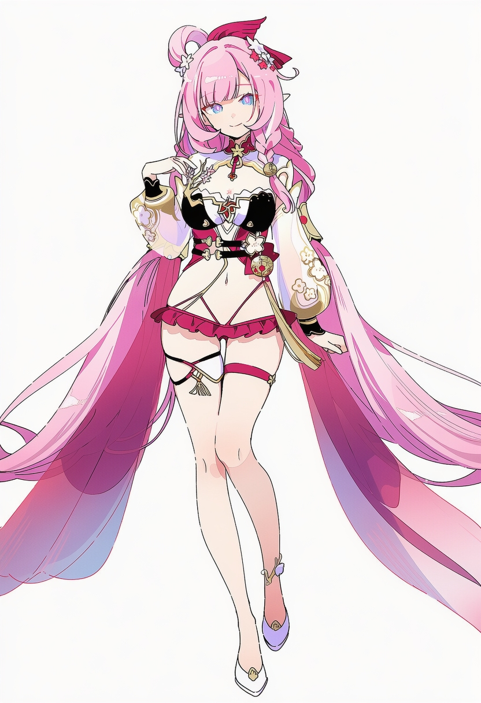

[在线例图](https://assets.quicktagcloud.com/images/raven_composition/raven_composition-4774.jpg?v=f309ab86d624c877)

<a id="raven_composition-4775"></a>

## 苏西

ID：`raven_composition-4775`；分类：角色图鉴 / 粉毛；来源标记：`safe`。

来源说明：

> 作品：星之卡比系列
> 作品 tag：kirby_(series)
> 难度：★★★★

正向提示词：

```text
susie_(kirby)
```

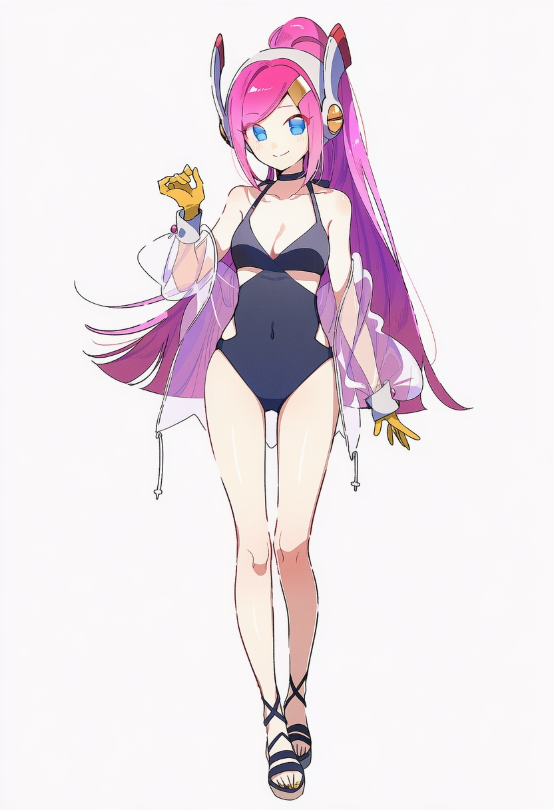

[在线例图](https://assets.quicktagcloud.com/images/raven_composition/raven_composition-4775.jpg?v=8a27d33ad0ca9367)

<a id="raven_composition-4776"></a>

## 凑智花

ID：`raven_composition-4776`；分类：角色图鉴 / 粉毛；来源标记：`safe`。

来源说明：

> 作品：萝球社！
> 作品 tag：rou-kyuu-bu!
> 难度：★★★

正向提示词：

```text
minato_tomoka
```

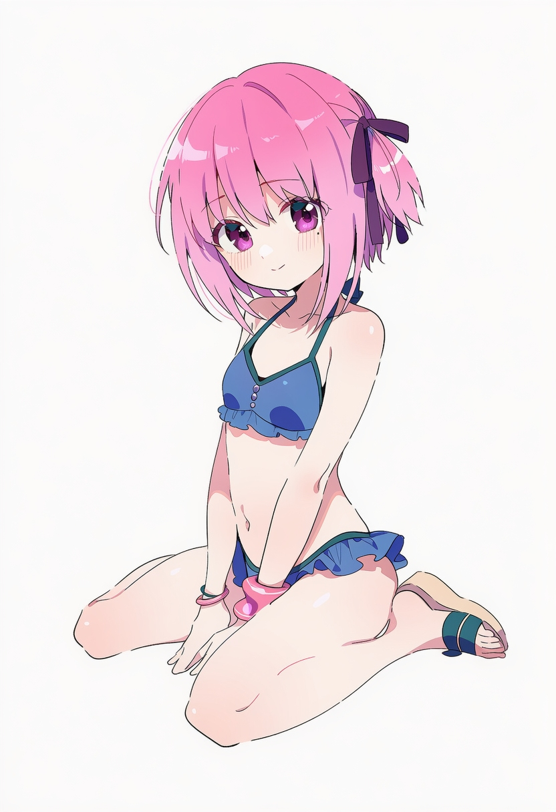

[在线例图](https://assets.quicktagcloud.com/images/raven_composition/raven_composition-4776.jpg?v=e2230e6e864c4589)

<a id="raven_composition-4777"></a>

## 死神

ID：`raven_composition-4777`；分类：角色图鉴 / 粉毛；来源标记：`safe`。

来源说明：

> 作品：超侦探事件簿：雾雨谜宫
> 作品 tag：master_detective_archives:_rain_code
> 难度：★★★

正向提示词：

```text
shinigami_(rain_code)
```

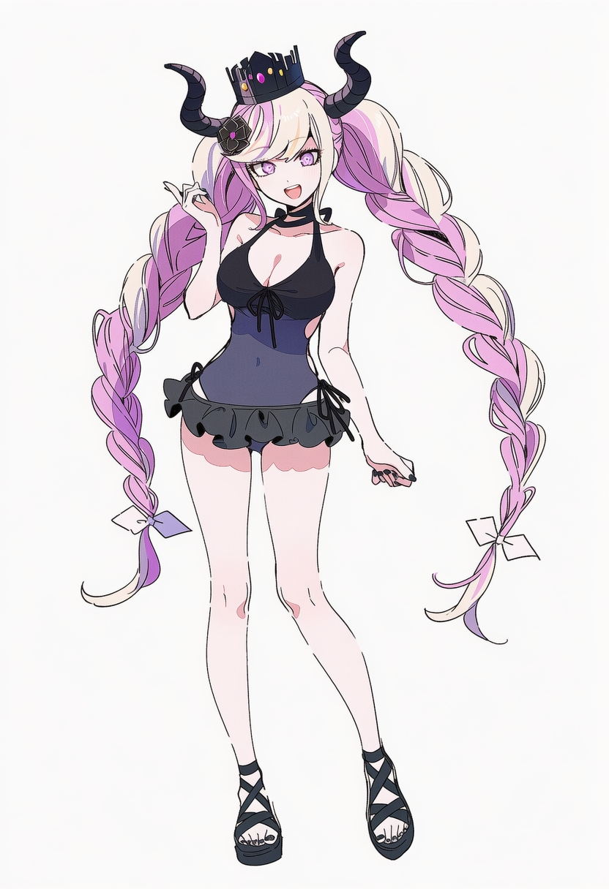

[在线例图](https://assets.quicktagcloud.com/images/raven_composition/raven_composition-4777.jpg?v=5606b0c5049cb404)

<a id="raven_composition-4778"></a>

## 野乃花

ID：`raven_composition-4778`；分类：角色图鉴 / 粉毛；来源标记：`safe`。

来源说明：

> 作品：光之美少女
> 作品 tag：precure
> 难度：★★

正向提示词：

```text
nono_hana
```

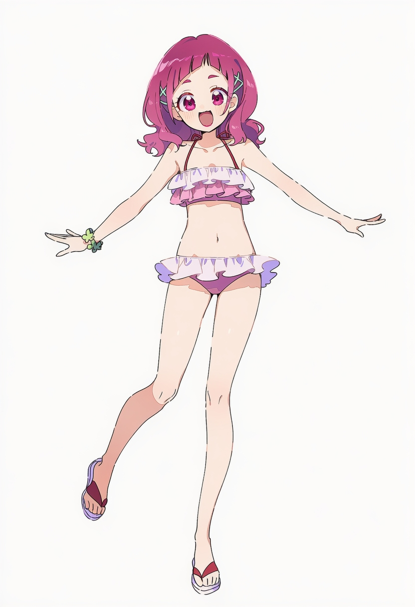

[在线例图](https://assets.quicktagcloud.com/images/raven_composition/raven_composition-4778.jpg?v=a7a7abb426404d6f)

<a id="raven_composition-4779"></a>

## 冰雷_Gunnthrá

ID：`raven_composition-4779`；分类：角色图鉴 / 粉毛；来源标记：`safe`。

来源说明：

> 作品：火焰之纹章
> 作品 tag：fire_emblem
> 难度：★★★★★

正向提示词：

```text
gunnthra_(fire_emblem)
```

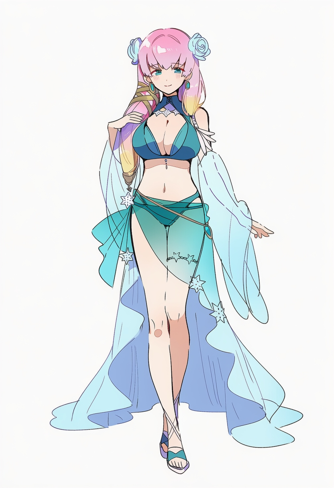

[在线例图](https://assets.quicktagcloud.com/images/raven_composition/raven_composition-4779.jpg?v=b55d001919dfc678)

<a id="raven_composition-4780"></a>

## 萨拉

ID：`raven_composition-4780`；分类：角色图鉴 / 粉毛；来源标记：`safe`。

来源说明：

> 作品：东方Project
> 作品 tag：touhou
> 难度：★★★★

正向提示词：

```text
sara_(touhou)
```

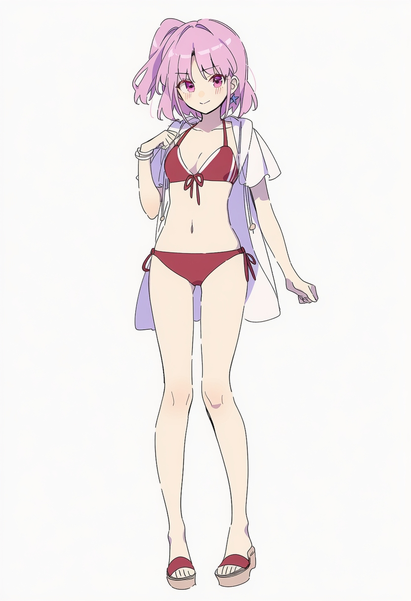

[在线例图](https://assets.quicktagcloud.com/images/raven_composition/raven_composition-4780.jpg?v=a2c2a88772323228)

<a id="raven_composition-4781"></a>

## 蔚

ID：`raven_composition-4781`；分类：角色图鉴 / 粉毛；来源标记：`safe`。

来源说明：

> 作品：英雄联盟
> 作品 tag：league_of_legends
> 难度：★★

正向提示词：

```text
vi_(league_of_legends)
```

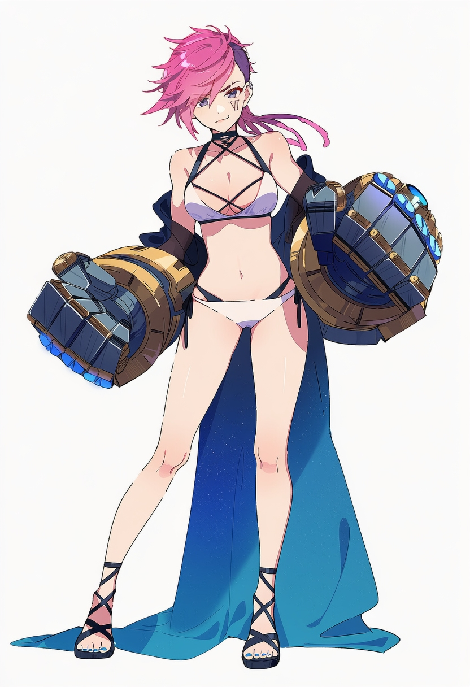

[在线例图](https://assets.quicktagcloud.com/images/raven_composition/raven_composition-4781.jpg?v=1c14f5f2313ce8fe)

<a id="raven_composition-4782"></a>

## 梦见璃亚梦

ID：`raven_composition-4782`；分类：角色图鉴 / 粉毛；来源标记：`safe`。

来源说明：

> 作品：偶像大师
> 作品 tag：idolmaster
> 难度：★

正向提示词：

```text
yumemi_riamu
```

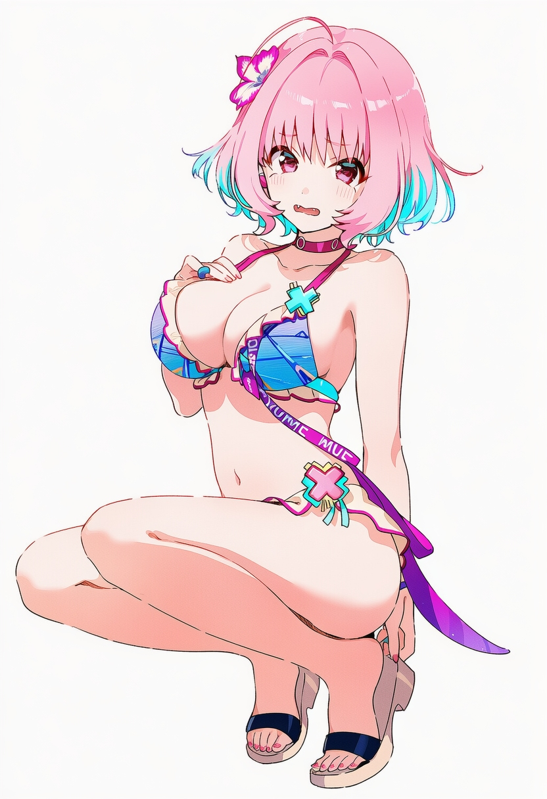

[在线例图](https://assets.quicktagcloud.com/images/raven_composition/raven_composition-4782.jpg?v=addb2927f6f82c99)

<a id="raven_composition-4783"></a>

## 玛修·基列莱特（奥尔坦西亚）

ID：`raven_composition-4783`；分类：角色图鉴 / 粉毛；来源标记：`safe`。

来源说明：

> 作品：命运-冠位指定
> 作品 tag：fate/grand_order
> 难度：★★★★

正向提示词：

```text
mash_kyrielight_(ortenaus)
```

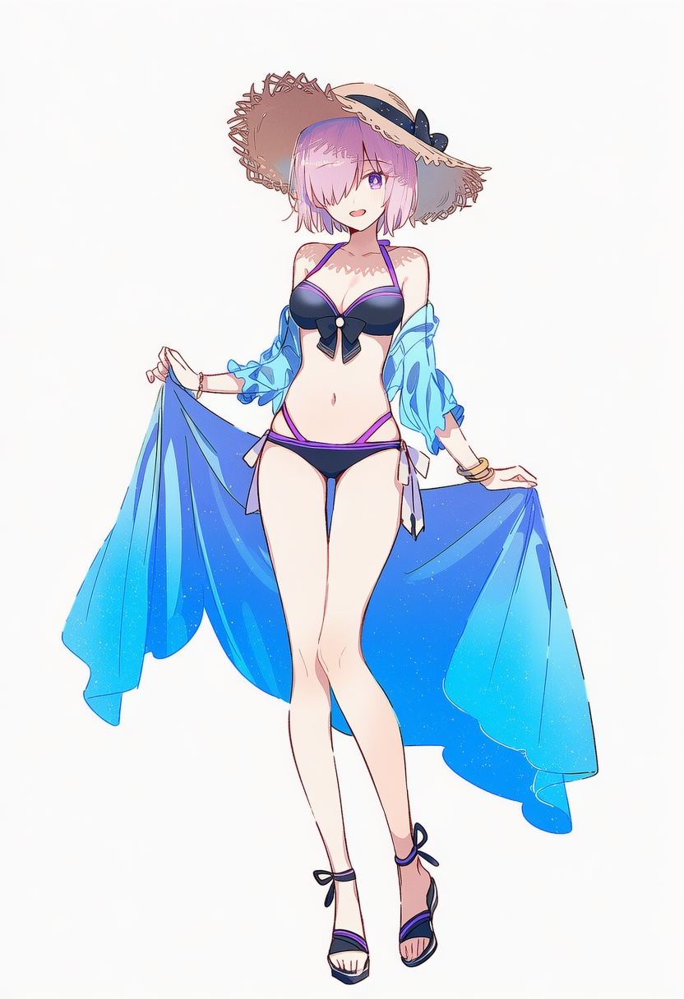

[在线例图](https://assets.quicktagcloud.com/images/raven_composition/raven_composition-4783.jpg?v=cde70a4d5a4aa50b)

<a id="raven_composition-4784"></a>

## 神乐七奈

ID：`raven_composition-4784`；分类：角色图鉴 / 粉毛；来源标记：`safe`。

来源说明：

> 作品：个人势虚拟主播
> 作品 tag：indie_virtual_youtuber
> 难度：★★★★★

正向提示词：

```text
kagura_nana
```

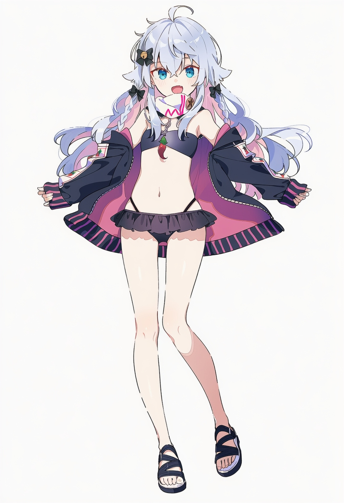

[在线例图](https://assets.quicktagcloud.com/images/raven_composition/raven_composition-4784.jpg?v=207994ba5e0ce079)

<a id="raven_composition-4785"></a>

## 春原晴子

ID：`raven_composition-4785`；分类：角色图鉴 / 粉毛；来源标记：`safe`。

来源说明：

> 作品：FLCL
> 作品 tag：flcl
> 难度：★★★

正向提示词：

```text
haruhara_haruko
```

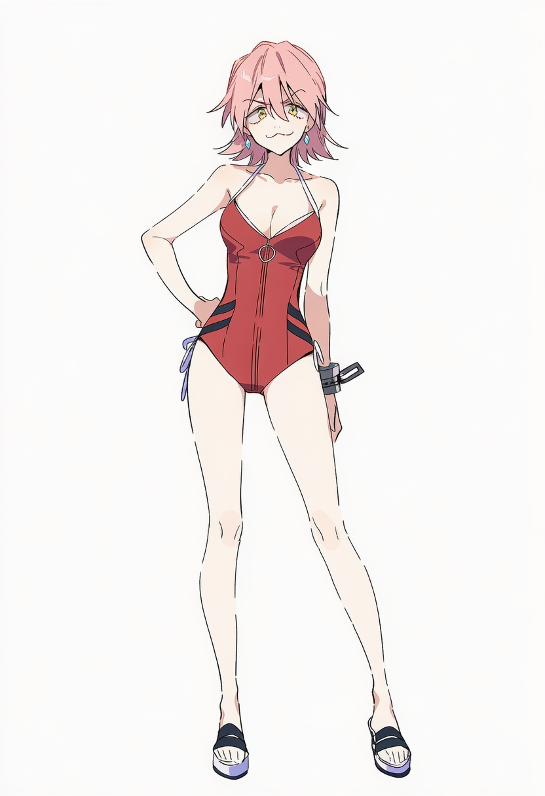

[在线例图](https://assets.quicktagcloud.com/images/raven_composition/raven_composition-4785.jpg?v=9e5731ea66db67ba)

<a id="raven_composition-4786"></a>

## 茜特菈莉

ID：`raven_composition-4786`；分类：角色图鉴 / 粉毛；来源标记：`safe`。

来源说明：

> 作品：原神
> 作品 tag：genshin_impact
> 难度：★★★★

正向提示词：

```text
citlali_(genshin_impact)
```

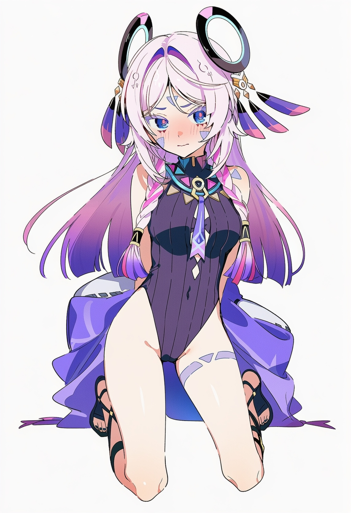

[在线例图](https://assets.quicktagcloud.com/images/raven_composition/raven_composition-4786.jpg?v=fbf9cab7a5ffb7af)

<a id="raven_composition-4787"></a>

## 花咲蕾

ID：`raven_composition-4787`；分类：角色图鉴 / 粉毛；来源标记：`safe`。

来源说明：

> 作品：光之美少女
> 作品 tag：precure
> 难度：★

正向提示词：

```text
hanasaki_tsubomi
```

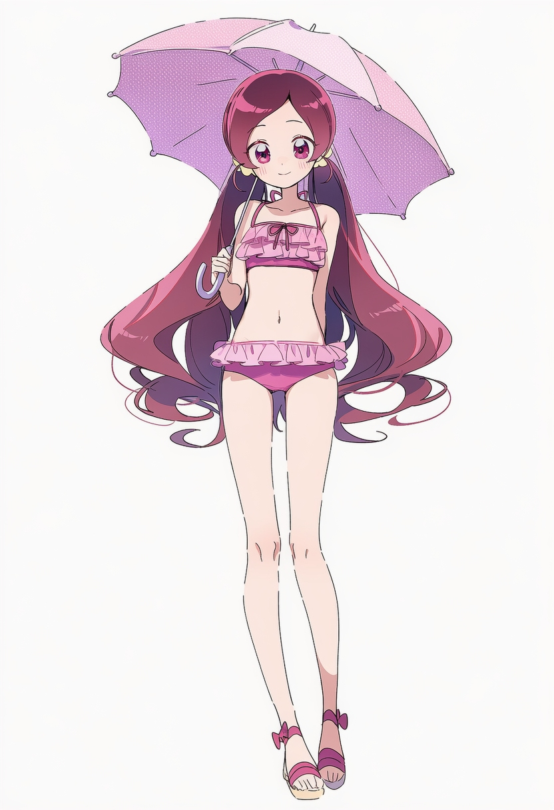

[在线例图](https://assets.quicktagcloud.com/images/raven_composition/raven_composition-4787.jpg?v=fc0a5b545fc5ad1d)

<a id="raven_composition-4788"></a>

## 罗赛米·洛芙洛克

ID：`raven_composition-4788`；分类：角色图鉴 / 粉毛；来源标记：`safe`。

来源说明：

> 作品：彩虹社
> 作品 tag：nijisanji
> 难度：★★★★

正向提示词：

```text
rosemi_lovelock_(1st_costume)
```

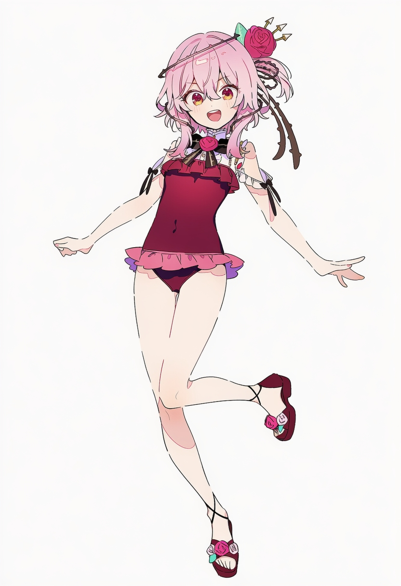

[在线例图](https://assets.quicktagcloud.com/images/raven_composition/raven_composition-4788.jpg?v=20b3ad866b932ac6)

<a id="raven_composition-4789"></a>

## 碧琪

ID：`raven_composition-4789`；分类：角色图鉴 / 粉毛；来源标记：`safe`。

来源说明：

> 作品：小马宝莉
> 作品 tag：my_little_pony
> 难度：★★★

正向提示词：

```text
pinkie_pie
```

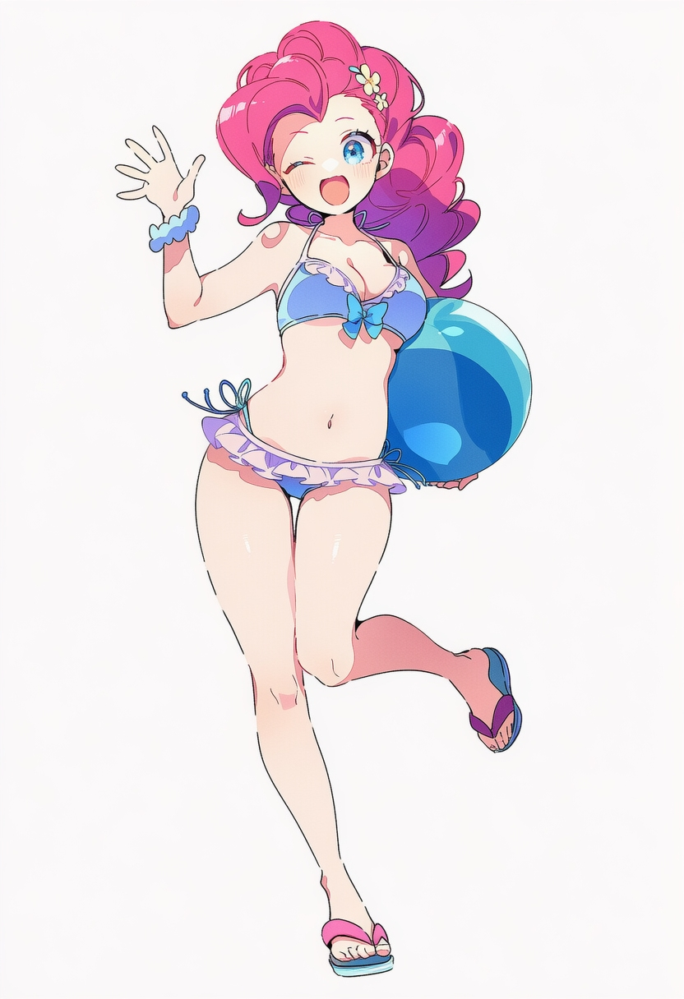

[在线例图](https://assets.quicktagcloud.com/images/raven_composition/raven_composition-4789.jpg?v=e9b77614c867ccef)

<a id="raven_composition-4790"></a>

## 紫色之心

ID：`raven_composition-4790`；分类：角色图鉴 / 粉毛；来源标记：`safe`。

来源说明：

> 作品：海王星系列
> 作品 tag：neptune_(series)
> 难度：★★★

正向提示词：

```text
purple_sister
```

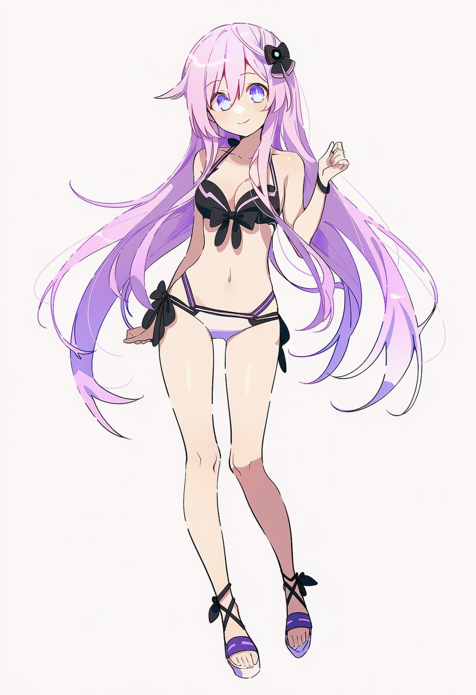

[在线例图](https://assets.quicktagcloud.com/images/raven_composition/raven_composition-4790.jpg?v=4745b9d71322e4a9)

<a id="raven_composition-4791"></a>

## 孙尚香

ID：`raven_composition-4791`；分类：角色图鉴 / 粉毛；来源标记：`safe`。

来源说明：

> 作品：恋姬†无双
> 作品 tag：koihime_musou
> 难度：★★★★★

正向提示词：

```text
sonshoukou
```

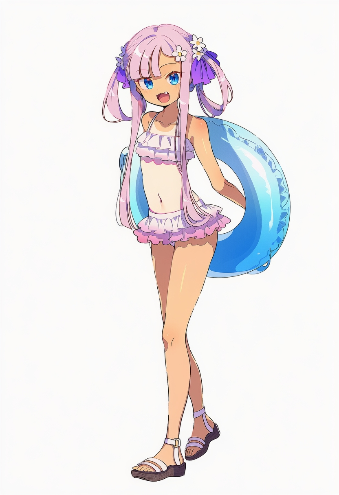

[在线例图](https://assets.quicktagcloud.com/images/raven_composition/raven_composition-4791.jpg?v=b76903537783447e)

<a id="raven_composition-4792"></a>

## 蕾娜·夏洛特·泰空

ID：`raven_composition-4792`；分类：角色图鉴 / 粉毛；来源标记：`safe`。

来源说明：

> 作品：最终幻想
> 作品 tag：final_fantasy
> 难度：★★

正向提示词：

```text
lenna_charlotte_tycoon
```

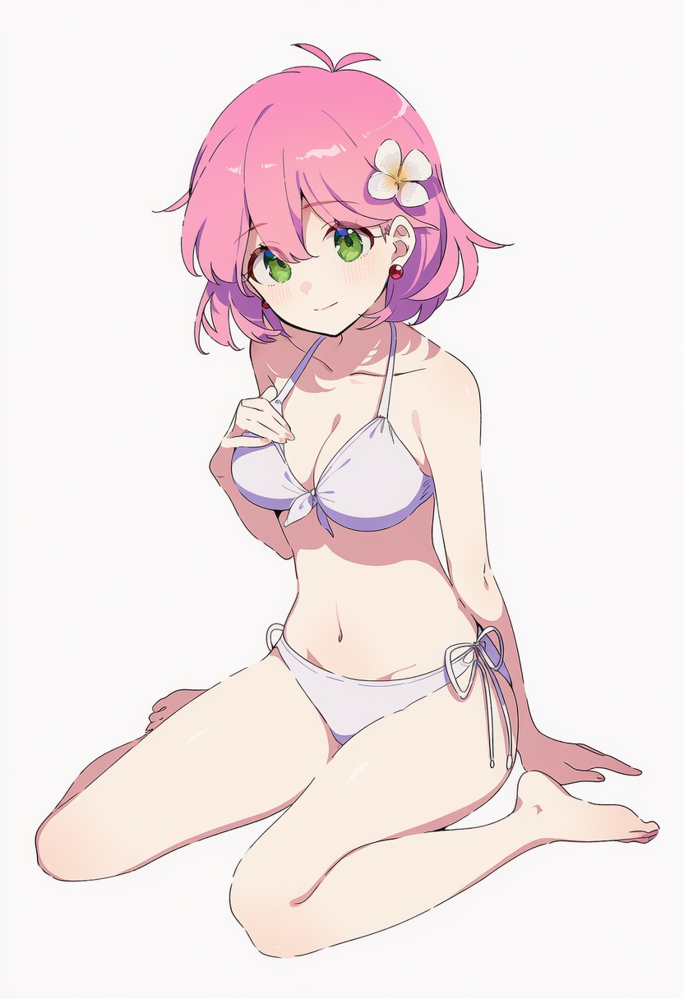

[在线例图](https://assets.quicktagcloud.com/images/raven_composition/raven_composition-4792.jpg?v=d19eda6431bcf275)

<a id="raven_composition-4793"></a>

## 宫本武藏（泳装Berserker）

ID：`raven_composition-4793`；分类：角色图鉴 / 粉毛；来源标记：`safe`。

来源说明：

> 作品：命运-冠位指定
> 作品 tag：fate/grand_order
> 难度：★

正向提示词：

```text
miyamoto_musashi_(swimsuit_berserker)_(fate)
```

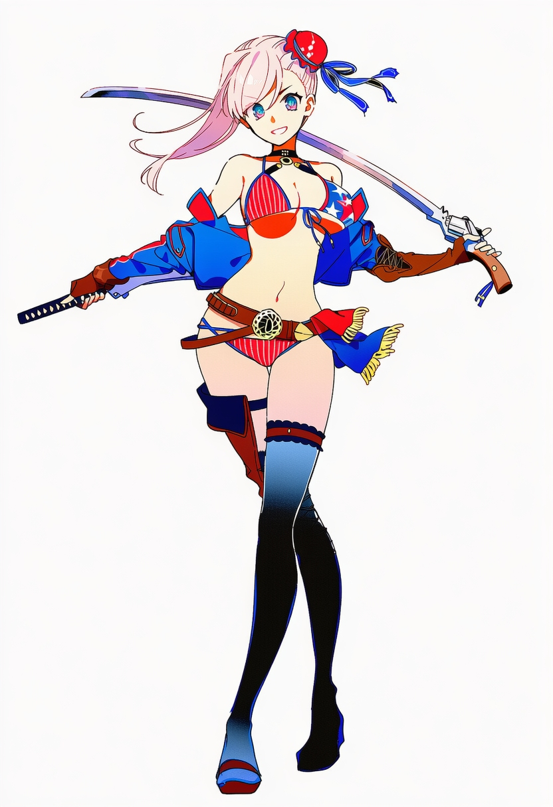

[在线例图](https://assets.quicktagcloud.com/images/raven_composition/raven_composition-4793.jpg?v=f633d39c08240e3f)

<a id="raven_composition-4794"></a>

## 星空天使

ID：`raven_composition-4794`；分类：角色图鉴 / 粉毛；来源标记：`safe`。

来源说明：

> 作品：光之美少女
> 作品 tag：precure
> 难度：★★★★

正向提示词：

```text
cure_star
```

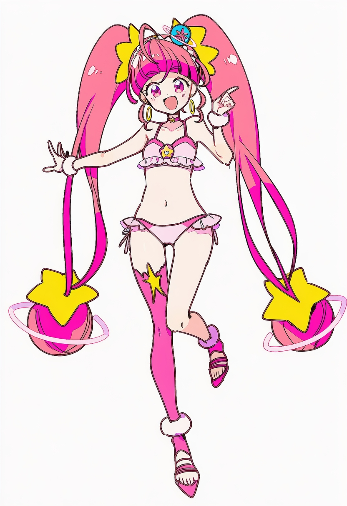

[在线例图](https://assets.quicktagcloud.com/images/raven_composition/raven_composition-4794.jpg?v=617e6bf95c4b49b6)

<a id="raven_composition-4795"></a>

## 清澄晃

ID：`raven_composition-4795`；分类：角色图鉴 / 粉毛；来源标记：`safe`。

来源说明：

> 作品：蔚蓝档案
> 作品 tag：blue_archive
> 难度：★★

正向提示词：

```text
akira_(blue_archive)
```

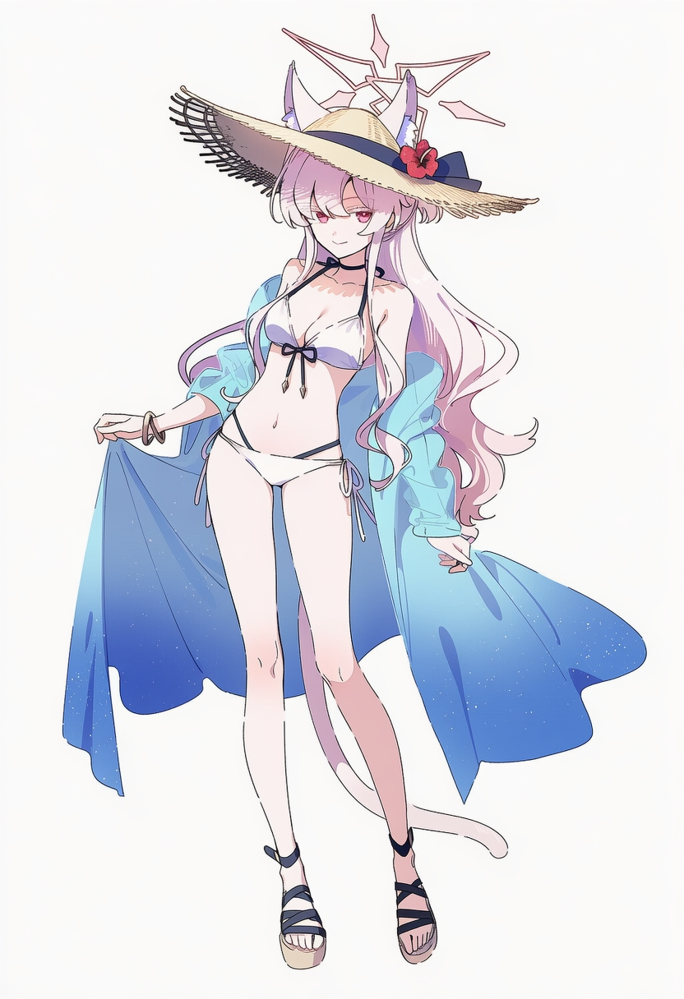

[在线例图](https://assets.quicktagcloud.com/images/raven_composition/raven_composition-4795.jpg?v=267600c5e1b5c691)

<a id="raven_composition-4796"></a>

## 奈维莉尔

ID：`raven_composition-4796`；分类：角色图鉴 / 粉毛；来源标记：`safe`。

来源说明：

> 作品：西蒙
> 作品 tag：simoun
> 难度：★★★★★

正向提示词：

```text
neviril_(simoun)
```

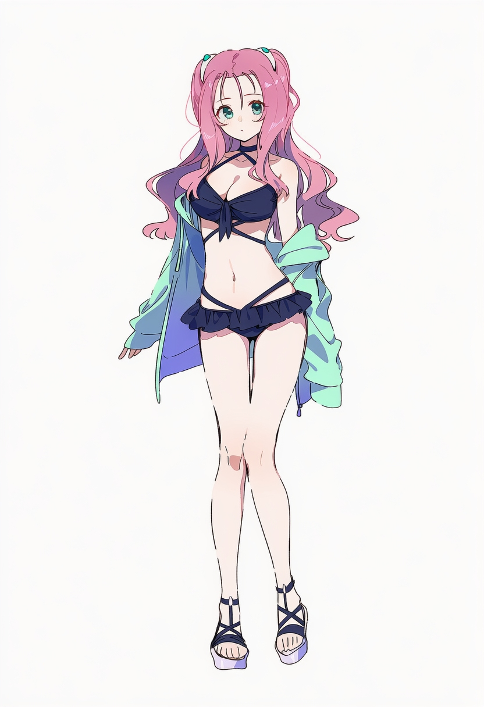

[在线例图](https://assets.quicktagcloud.com/images/raven_composition/raven_composition-4796.jpg?v=410c882b5e87f078)

<a id="raven_composition-4797"></a>

## 日渡奈津奈

ID：`raven_composition-4797`；分类：角色图鉴 / 粉毛；来源标记：`safe`。

来源说明：

> 作品：动物新世代
> 作品 tag：brand_new_animal
> 难度：★★★★

正向提示词：

```text
hiwatashi_nazuna
```

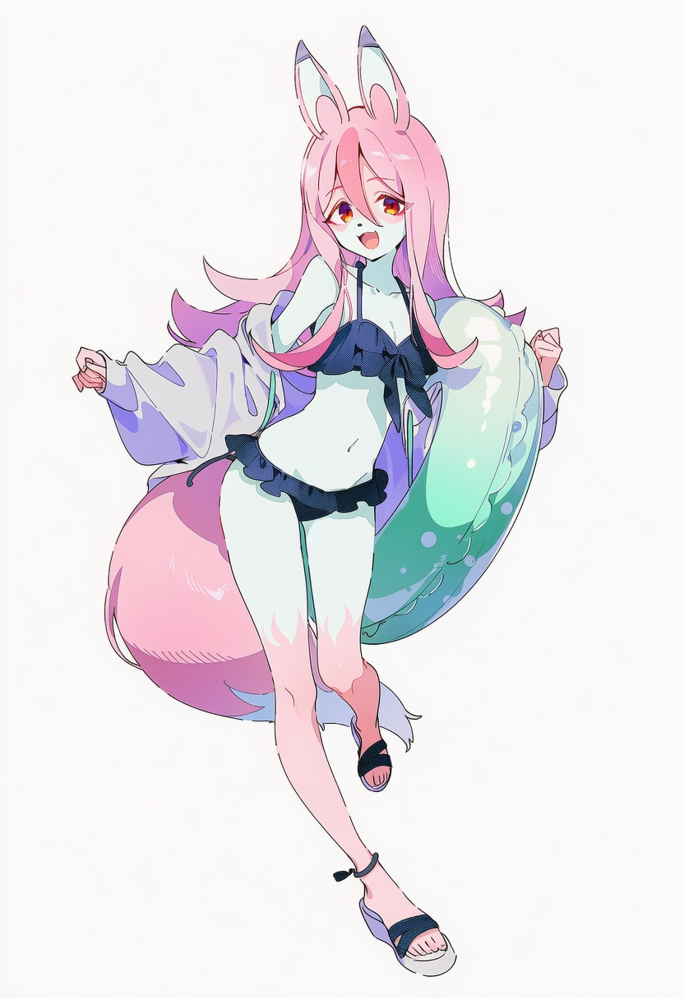

[在线例图](https://assets.quicktagcloud.com/images/raven_composition/raven_composition-4797.jpg?v=e4b44d825680b157)

<a id="raven_composition-4798"></a>

## 三毛猫

ID：`raven_composition-4798`；分类：角色图鉴 / 粉毛；来源标记：`safe`。

来源说明：

> 作品：个人势虚拟主播
> 作品 tag：indie_virtual_youtuber
> 难度：★★★★

正向提示词：

```text
mikeneko_(vtuber)
```

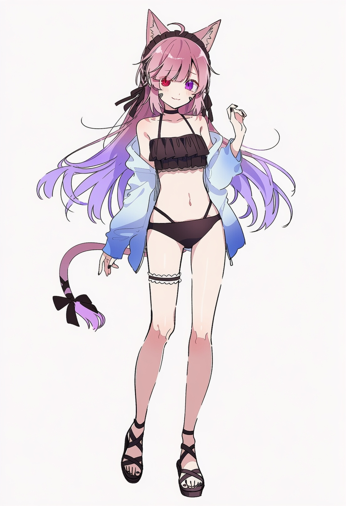

[在线例图](https://assets.quicktagcloud.com/images/raven_composition/raven_composition-4798.jpg?v=3f403649451e3354)

<a id="raven_composition-4799"></a>

## 双马尾

ID：`raven_composition-4799`；分类：角色图鉴 / 粉毛；来源标记：`safe`。

来源说明：

> 作品：神臂斗士（游戏）
> 作品 tag：arms_(game)
> 难度：★★★★

正向提示词：

```text
twintelle_(arms)
```

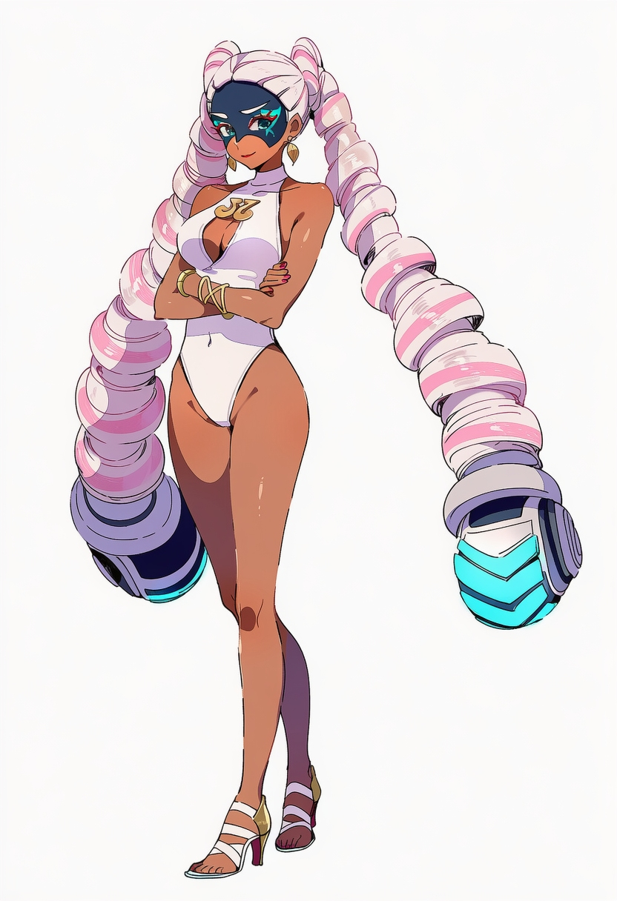

[在线例图](https://assets.quicktagcloud.com/images/raven_composition/raven_composition-4799.jpg?v=420768982ef71e4b)

<a id="raven_composition-4800"></a>

## 皮耶莉

ID：`raven_composition-4800`；分类：角色图鉴 / 粉毛；来源标记：`safe`。

来源说明：

> 作品：火焰之纹章
> 作品 tag：fire_emblem
> 难度：★★★★★

正向提示词：

```text
peri_(fire_emblem)
```

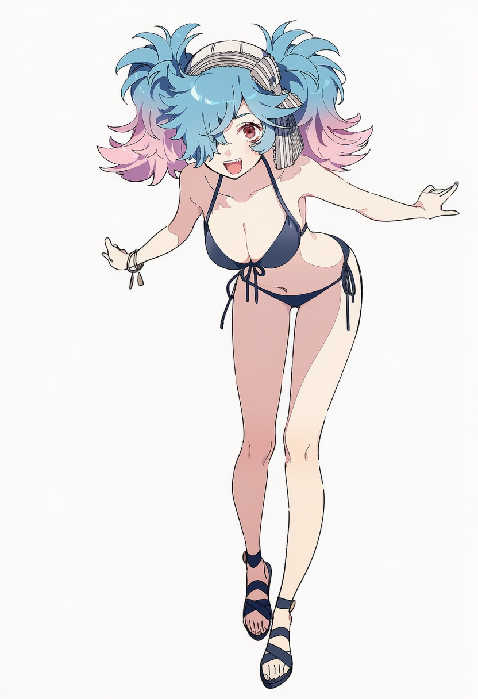

[在线例图](https://assets.quicktagcloud.com/images/raven_composition/raven_composition-4800.jpg?v=b0e317984176cf21)

<a id="raven_composition-4801"></a>

## 猫村伊吕波

ID：`raven_composition-4801`；分类：角色图鉴 / 粉毛；来源标记：`safe`。

来源说明：

> 作品：VOCALOID
> 作品 tag：vocaloid
> 难度：★★★★

正向提示词：

```text
nekomura_iroha
```

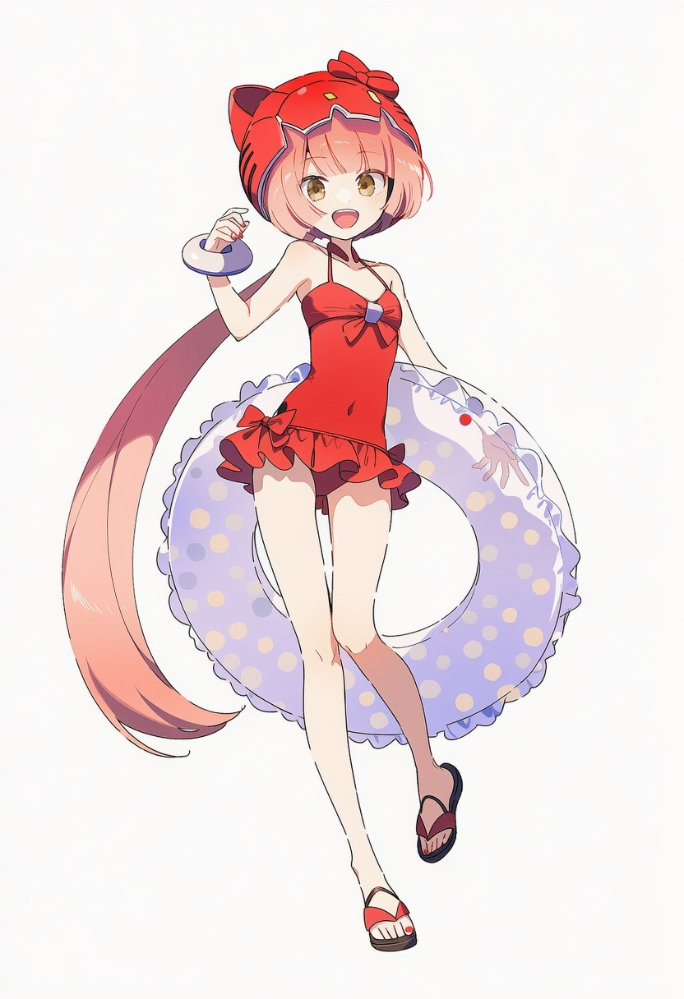

[在线例图](https://assets.quicktagcloud.com/images/raven_composition/raven_composition-4801.jpg?v=75b124341c52867b)

<a id="raven_composition-4802"></a>

## 奥野田美宵

ID：`raven_composition-4802`；分类：角色图鉴 / 粉毛；来源标记：`safe`。

来源说明：

> 作品：东方Project
> 作品 tag：touhou
> 难度：★★

正向提示词：

```text
okunoda_miyoi
```


[在线例图](https://assets.quicktagcloud.com/images/raven_composition/raven_composition-4802.jpg?v=cdebd04ab105c96f)

<a id="raven_composition-4803"></a>

## 宫本武藏（泳装狂战士）（第一再临）

ID：`raven_composition-4803`；分类：角色图鉴 / 粉毛；来源标记：`safe`。

来源说明：

> 作品：命运-冠位指定
> 作品 tag：fate/grand_order
> 难度：★★★★★

正向提示词：

```text
miyamoto_musashi_(swimsuit_berserker)_(first_ascension)_(fate)
```

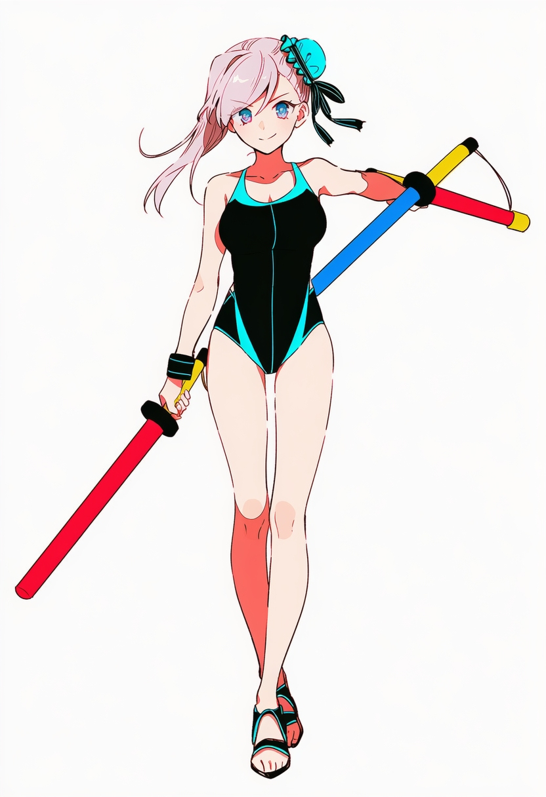

[在线例图](https://assets.quicktagcloud.com/images/raven_composition/raven_composition-4803.jpg?v=43dd3ab32ca41b3f)

<a id="raven_composition-4804"></a>

## 爱丽丝·威尔逊

ID：`raven_composition-4804`；分类：角色图鉴 / 粉毛；来源标记：`safe`。

来源说明：

> 作品：逆转裁判
> 作品 tag：ace_attorney
> 难度：★★★★

正向提示词：

```text
iris_wilson
```

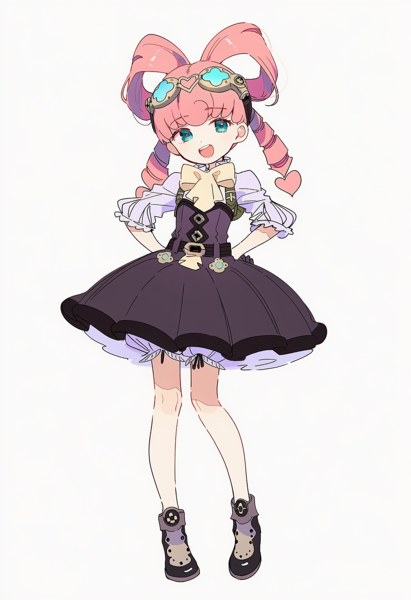

[在线例图](https://assets.quicktagcloud.com/images/raven_composition/raven_composition-4804.jpg?v=0c23036f4d383777)

<a id="raven_composition-4805"></a>

## 陆八魔爱露

ID：`raven_composition-4805`；分类：角色图鉴 / 粉毛；来源标记：`safe`。

来源说明：

> 作品：蔚蓝档案
> 作品 tag：blue_archive
> 难度：★

正向提示词：

```text
aru_(blue_archive)
```

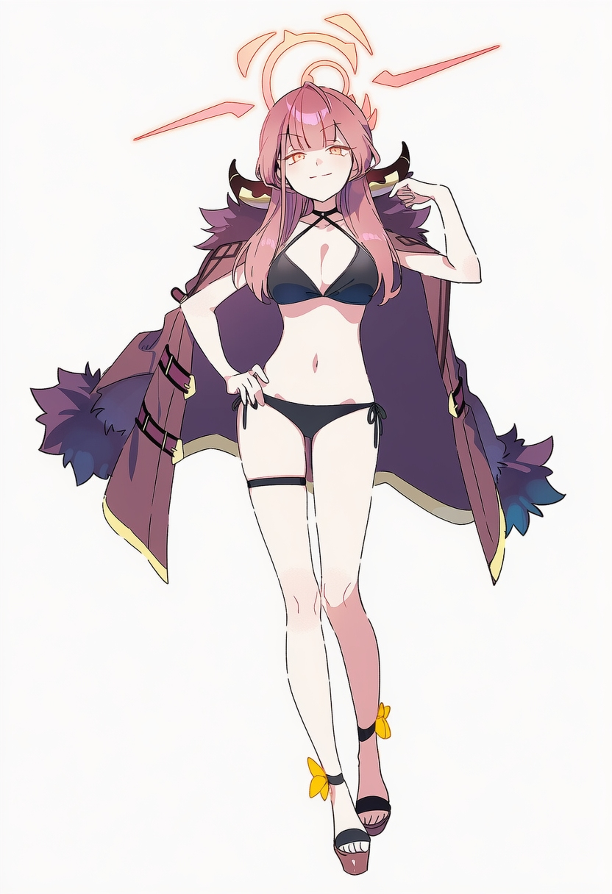

[在线例图](https://assets.quicktagcloud.com/images/raven_composition/raven_composition-4805.jpg?v=4a6d9aae357104c2)

<a id="raven_composition-4806"></a>

## 普蕾塞雅·康巴提尔

ID：`raven_composition-4806`；分类：角色图鉴 / 粉毛；来源标记：`safe`。

来源说明：

> 作品：传说系列
> 作品 tag：tales_of_(series)
> 难度：★★★★

正向提示词：

```text
presea_combatir
```

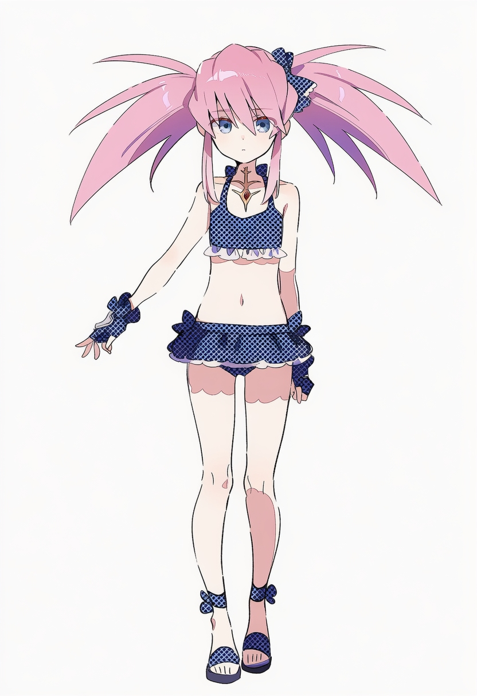

[在线例图](https://assets.quicktagcloud.com/images/raven_composition/raven_composition-4806.jpg?v=3d9c9a2d306e974c)

<a id="raven_composition-4807"></a>

## 石动双叶

ID：`raven_composition-4807`；分类：角色图鉴 / 粉毛；来源标记：`safe`。

来源说明：

> 作品：少女☆歌剧_Revue_Starlight
> 作品 tag：shoujo_kageki_revue_starlight
> 难度：★★★★★

正向提示词：

```text
isurugi_futaba
```

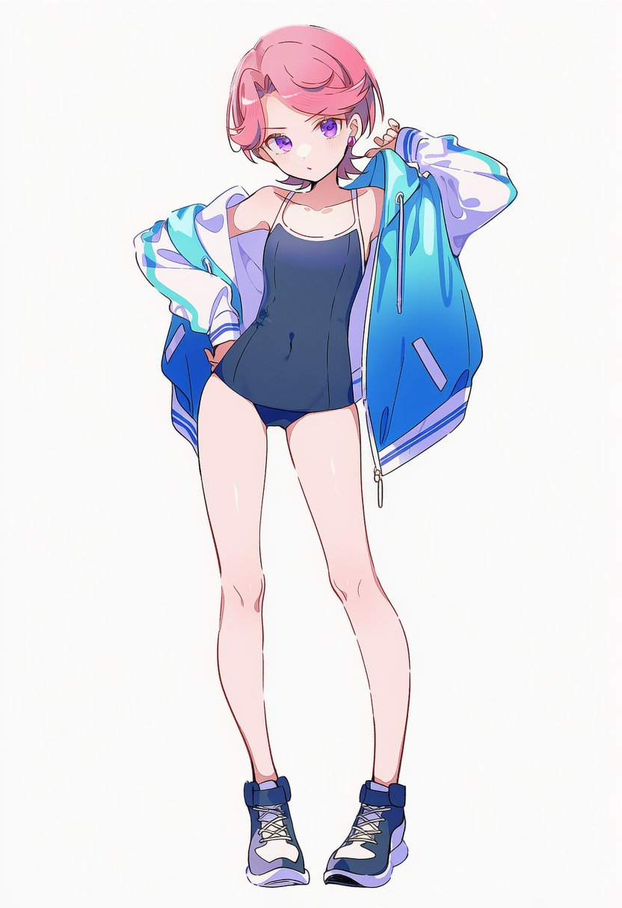

[在线例图](https://assets.quicktagcloud.com/images/raven_composition/raven_composition-4807.jpg?v=6ef074d8a854d122)

<a id="raven_composition-4808"></a>

## 音街鳗

ID：`raven_composition-4808`；分类：角色图鉴 / 粉毛；来源标记：`safe`。

来源说明：

> 作品：TalkEX
> 作品 tag：talkex
> 难度：★★★★

正向提示词：

```text
otomachi_una_(talkex)
```

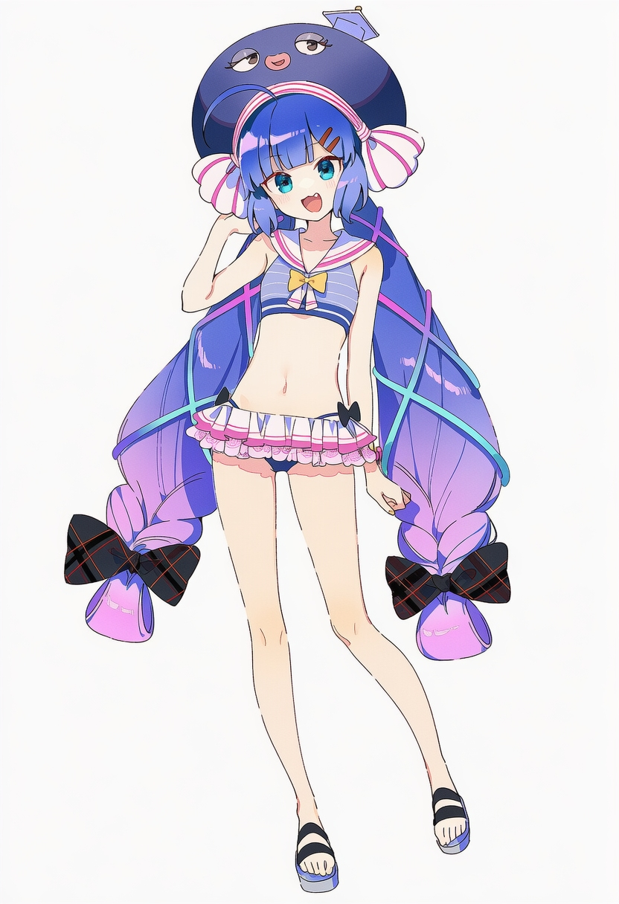

[在线例图](https://assets.quicktagcloud.com/images/raven_composition/raven_composition-4808.jpg?v=04cd2849c2d655ed)

<a id="raven_composition-4809"></a>

## 三月七（巡猎）

ID：`raven_composition-4809`；分类：角色图鉴 / 粉毛；来源标记：`safe`。

来源说明：

> 作品：崩坏：星穹铁道
> 作品 tag：honkai:_star_rail
> 难度：★★★

正向提示词：

```text
march_7th_(hunt)_(honkai:_star_rail)
```

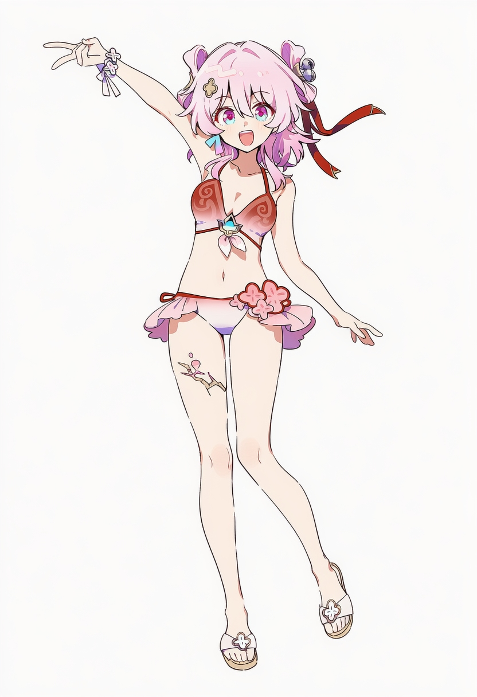

[在线例图](https://assets.quicktagcloud.com/images/raven_composition/raven_composition-4809.jpg?v=940352838148e4e5)

<a id="raven_composition-4810"></a>

## 芹奈（护士）

ID：`raven_composition-4810`；分类：角色图鉴 / 粉毛；来源标记：`safe`。

来源说明：

> 作品：蔚蓝档案
> 作品 tag：blue_archive
> 难度：★★★★★

正向提示词：

```text
serina_(nurse)_(blue_archive)
```

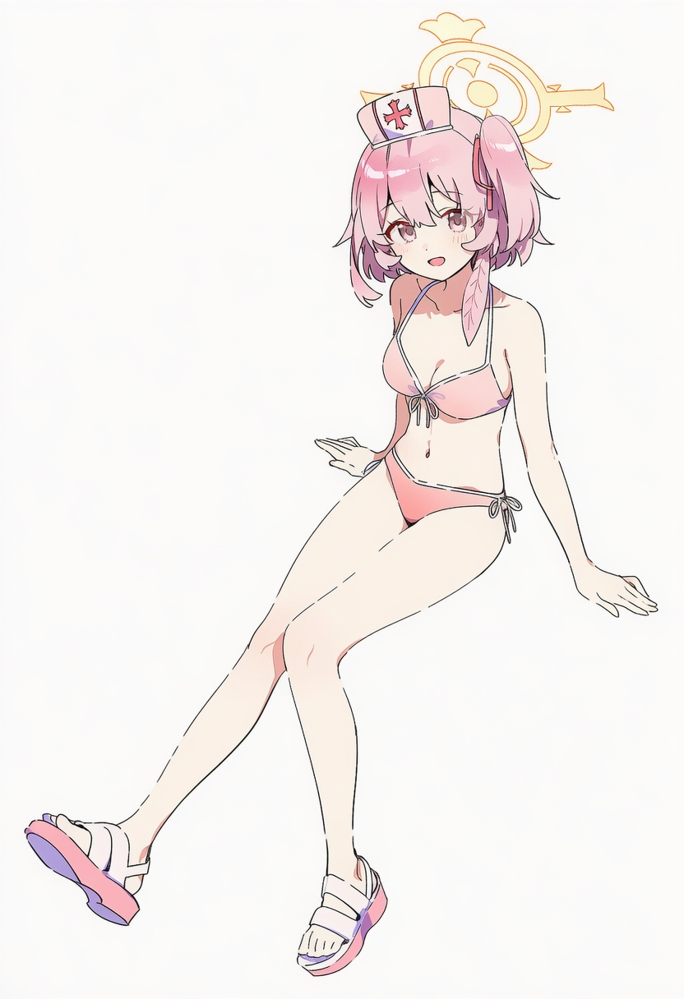

[在线例图](https://assets.quicktagcloud.com/images/raven_composition/raven_composition-4810.jpg?v=3290b7b759172a1b)

<a id="raven_composition-4811"></a>

## tanba_akari

ID：`raven_composition-4811`；分类：角色图鉴 / 粉毛；来源标记：`safe`。

来源说明：

> 作品：突击莉莉
> 作品 tag：assault_lily
> 难度：★★★

正向提示词：

```text
tanba_akari
```


[在线例图](https://assets.quicktagcloud.com/images/raven_composition/raven_composition-4811.jpg?v=325e8419cde64d49)

<a id="raven_composition-4812"></a>

## 梅洛努·洛蕾莱

ID：`raven_composition-4812`；分类：角色图鉴 / 粉毛；来源标记：`safe`。

来源说明：

> 作品：魔物娘的相伴日常
> 作品 tag：monster_musume_no_iru_nichijou
> 难度：★★★★★

正向提示词：

```text
meroune_lorelei
```

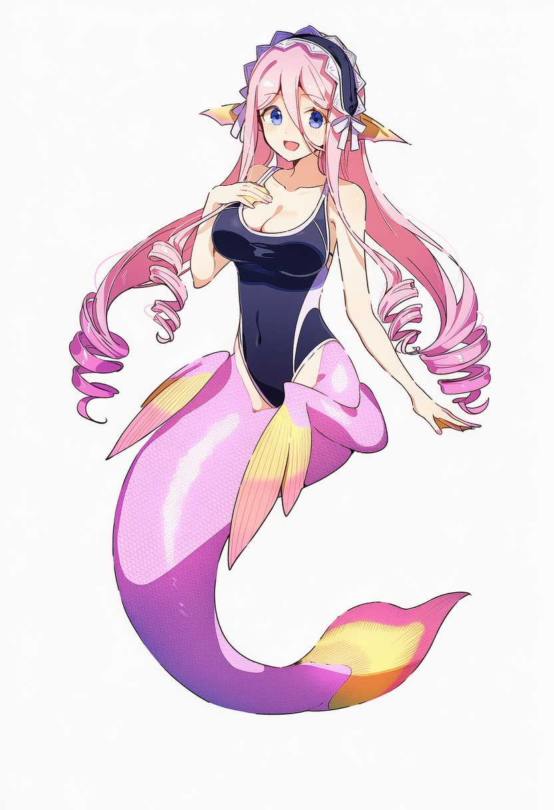

[在线例图](https://assets.quicktagcloud.com/images/raven_composition/raven_composition-4812.jpg?v=95a5b4a69b4b99f4)

<a id="raven_composition-4813"></a>

## 蕾贝卡

ID：`raven_composition-4813`；分类：角色图鉴 / 粉毛；来源标记：`safe`。

来源说明：

> 作品：航海王
> 作品 tag：one_piece
> 难度：★★★★★

正向提示词：

```text
rebecca_(one_piece)
```

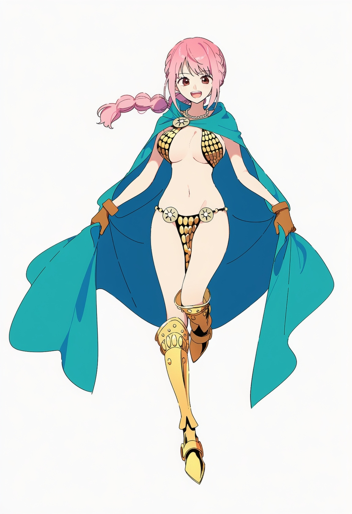

[在线例图](https://assets.quicktagcloud.com/images/raven_composition/raven_composition-4813.jpg?v=803e83fb8280e672)

<a id="raven_composition-4814"></a>

## 椎名唯华（初始服装）

ID：`raven_composition-4814`；分类：角色图鉴 / 粉毛；来源标记：`safe`。

来源说明：

> 作品：彩虹社
> 作品 tag：nijisanji
> 难度：★★

正向提示词：

```text
shiina_yuika_(1st_costume)
```

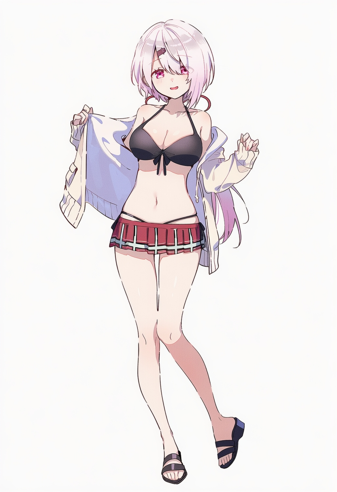

[在线例图](https://assets.quicktagcloud.com/images/raven_composition/raven_composition-4814.jpg?v=b1535939f04419f8)

<a id="raven_composition-4815"></a>

## 铃鹿御前（泳装Rider）

ID：`raven_composition-4815`；分类：角色图鉴 / 粉毛；来源标记：`safe`。

来源说明：

> 作品：命运-冠位指定
> 作品 tag：fate/grand_order
> 难度：★★★★★

正向提示词：

```text
suzuka_gozen_(swimsuit_rider)_(fate)
```

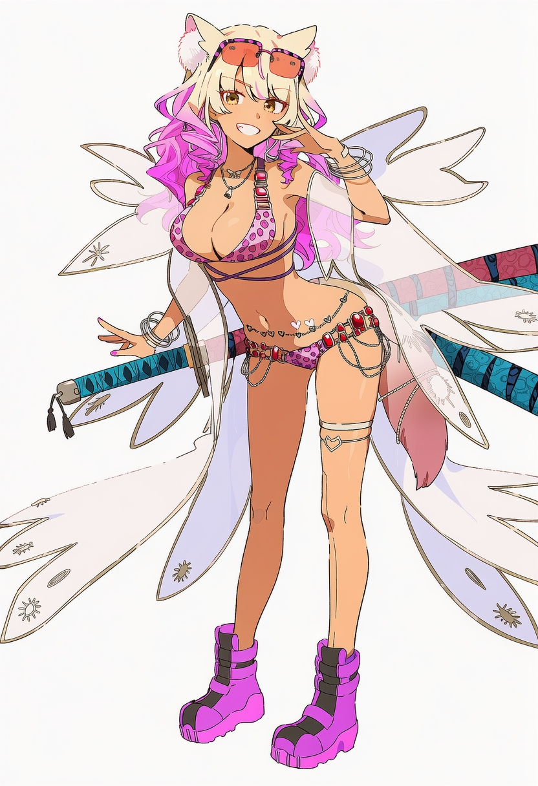

[在线例图](https://assets.quicktagcloud.com/images/raven_composition/raven_composition-4815.jpg?v=f865eb2e6384b741)

<a id="raven_composition-4816"></a>

## 安养寺姬芽

ID：`raven_composition-4816`；分类：角色图鉴 / 粉毛；来源标记：`safe`。

来源说明：

> 作品：Link! Like! LoveLive!
> 作品 tag：link!_like!_love_live!
> 难度：★

正向提示词：

```text
anyoji_hime
```


[在线例图](https://assets.quicktagcloud.com/images/raven_composition/raven_composition-4816.jpg?v=4a323b4cbbfb21a5)

<a id="raven_composition-4817"></a>

## 后藤一里

ID：`raven_composition-4817`；分类：角色图鉴 / 粉毛；来源标记：`safe`。

来源说明：

> 作品：孤独摇滚！
> 作品 tag：bocchi_the_rock!
> 难度：★

正向提示词：

```text
gotoh_hitori
```


[在线例图](https://assets.quicktagcloud.com/images/raven_composition/raven_composition-4817.jpg?v=8167b158fc12f7d9)

<a id="raven_composition-4818"></a>

## 日奈森亚梦

ID：`raven_composition-4818`；分类：角色图鉴 / 粉毛；来源标记：`safe`。

来源说明：

> 作品：守护甜心！
> 作品 tag：shugo_chara!
> 难度：★★

正向提示词：

```text
hinamori_amu
```


[在线例图](https://assets.quicktagcloud.com/images/raven_composition/raven_composition-4818.jpg?v=72e497d14357b096)

<a id="raven_composition-4819"></a>

## 相田爱

ID：`raven_composition-4819`；分类：角色图鉴 / 粉毛；来源标记：`safe`。

来源说明：

> 作品：心跳！光之美少女
> 作品 tag：dokidoki!_precure
> 难度：★

正向提示词：

```text
aida_mana
```


[在线例图](https://assets.quicktagcloud.com/images/raven_composition/raven_composition-4819.jpg?v=061fdb3ffb2f34ea)

<a id="raven_composition-4820"></a>

## 玉藻前（第三再临）

ID：`raven_composition-4820`；分类：角色图鉴 / 粉毛；来源标记：`safe`。

来源说明：

> 作品：Fate系列
> 作品 tag：fate_(series)
> 难度：★★★★

正向提示词：

```text
tamamo_no_mae_(third_ascension)_(fate)
```


[在线例图](https://assets.quicktagcloud.com/images/raven_composition/raven_composition-4820.jpg?v=b5d03e81bb93eee1)

<a id="raven_composition-4821"></a>

## 特莉休·乌纳

ID：`raven_composition-4821`；分类：角色图鉴 / 粉毛；来源标记：`safe`。

来源说明：

> 作品：JOJO的奇妙冒险
> 作品 tag：jojo_no_kimyou_na_bouken
> 难度：★★

正向提示词：

```text
trish_una
```


[在线例图](https://assets.quicktagcloud.com/images/raven_composition/raven_composition-4821.jpg?v=3d55ac492b7dc1f3)

<a id="raven_composition-4822"></a>

## 米娅·坎贝尔

ID：`raven_composition-4822`；分类：角色图鉴 / 粉毛；来源标记：`safe`。

来源说明：

> 作品：高达
> 作品 tag：gundam
> 难度：★★

正向提示词：

```text
meer_campbell
```


[在线例图](https://assets.quicktagcloud.com/images/raven_composition/raven_composition-4822.jpg?v=9f6ffb0dcc06bf5f)

<a id="raven_composition-4823"></a>

## 风见瑞穗

ID：`raven_composition-4823`；分类：角色图鉴 / 粉毛；来源标记：`safe`。

来源说明：

> 作品：拜托了，老师
> 作品 tag：onegai_teacher
> 难度：★★★

正向提示词：

```text
kazami_mizuho
```


[在线例图](https://assets.quicktagcloud.com/images/raven_composition/raven_composition-4823.jpg?v=0285eefb9cf6367d)

<a id="raven_composition-4824"></a>

## 艾丝卡·梅莉耶

ID：`raven_composition-4824`；分类：角色图鉴 / 粉毛；来源标记：`safe`。

来源说明：

> 作品：炼金工房系列
> 作品 tag：atelier_(series)
> 难度：★★★★

正向提示词：

```text
escha_malier
```


[在线例图](https://assets.quicktagcloud.com/images/raven_composition/raven_composition-4824.jpg?v=f178171c933e5c94)

<a id="raven_composition-4825"></a>

## 拉蒙娜·弗劳尔斯

ID：`raven_composition-4825`；分类：角色图鉴 / 粉毛；来源标记：`safe`。

来源说明：

> 作品：歪小子斯科特
> 作品 tag：scott_pilgrim_(series)
> 难度：★★★★

正向提示词：

```text
ramona_flowers
```


[在线例图](https://assets.quicktagcloud.com/images/raven_composition/raven_composition-4825.jpg?v=a1a3c412dc8c749a)

<a id="raven_composition-4826"></a>

## 新波利

ID：`raven_composition-4826`；分类：角色图鉴 / 粉毛；来源标记：`safe`。

来源说明：

> 作品：RWBY
> 作品 tag：rwby
> 难度：★★

正向提示词：

```text
neo_politan
```


[在线例图](https://assets.quicktagcloud.com/images/raven_composition/raven_composition-4826.jpg?v=32b13409befa8ec3)

<a id="raven_composition-4827"></a>

## 菈菈·萨塔琳·戴比路克

ID：`raven_composition-4827`；分类：角色图鉴 / 粉毛；来源标记：`safe`。

来源说明：

> 作品：出包王女
> 作品 tag：to_love-ru
> 难度：★★

正向提示词：

```text
lala_satalin_deviluke
```


[在线例图](https://assets.quicktagcloud.com/images/raven_composition/raven_composition-4827.jpg?v=d788cc3323eb1f01)

<a id="raven_composition-4828"></a>

## 夕阳莉莉

ID：`raven_composition-4828`；分类：角色图鉴 / 粉毛；来源标记：`safe`。

来源说明：

> 作品：彩虹社
> 作品 tag：nijisanji
> 难度：★★★★

正向提示词：

```text
yuuhi_riri
```


[在线例图](https://assets.quicktagcloud.com/images/raven_composition/raven_composition-4828.jpg?v=c2064e6c5c6538a8)

<a id="raven_composition-4829"></a>

## 澄闪

ID：`raven_composition-4829`；分类：角色图鉴 / 粉毛；来源标记：`safe`。

来源说明：

> 作品：明日方舟
> 作品 tag：arknights
> 难度：★

正向提示词：

```text
goldenglow_(arknights)
```


[在线例图](https://assets.quicktagcloud.com/images/raven_composition/raven_composition-4829.jpg?v=45bd7d1836c074f8)

<a id="raven_composition-4830"></a>

## IA

ID：`raven_composition-4830`；分类：角色图鉴 / 粉毛；来源标记：`safe`。

来源说明：

> 作品：VOCALOID
> 作品 tag：vocaloid
> 难度：★

正向提示词：

```text
ia_(vocaloid)
```


[在线例图](https://assets.quicktagcloud.com/images/raven_composition/raven_composition-4830.jpg?v=9ae9c1fabc3cdba8)

<a id="raven_composition-4831"></a>

## 中原小麦

ID：`raven_composition-4831`；分类：角色图鉴 / 粉毛；来源标记：`safe`。

来源说明：

> 作品：魔法护士小麦
> 作品 tag：nurse_witch_komugi-chan
> 难度：★★★★

正向提示词：

```text
nakahara_komugi
```


[在线例图](https://assets.quicktagcloud.com/images/raven_composition/raven_composition-4831.jpg?v=0326484ec9fcbe65)

<a id="raven_composition-4832"></a>

## 战士

ID：`raven_composition-4832`；分类：角色图鉴 / 粉毛；来源标记：`safe`。

来源说明：

> 作品：第七龙神（系列）
> 作品 tag：7th_dragon
> 难度：★★★

正向提示词：

```text
fighter_(7th_dragon)
```


[在线例图](https://assets.quicktagcloud.com/images/raven_composition/raven_composition-4832.jpg?v=c754fc2e11b6e8e9)

<a id="raven_composition-4833"></a>

## 星空幸

ID：`raven_composition-4833`；分类：角色图鉴 / 粉毛；来源标记：`safe`。

来源说明：

> 作品：光之美少女
> 作品 tag：precure
> 难度：★

正向提示词：

```text
hoshizora_miyuki
```


[在线例图](https://assets.quicktagcloud.com/images/raven_composition/raven_composition-4833.jpg?v=22ee2f5e48aeb1c5)

<a id="raven_composition-4834"></a>

## 梅露露琳丝·蕾蒂·阿鲁兹

ID：`raven_composition-4834`；分类：角色图鉴 / 粉毛；来源标记：`safe`。

来源说明：

> 作品：炼金工房系列
> 作品 tag：atelier_(series)
> 难度：★★★★

正向提示词：

```text
merurulince_rede_arls
```


[在线例图](https://assets.quicktagcloud.com/images/raven_composition/raven_composition-4834.jpg?v=732aca9919f1ea3b)

<a id="raven_composition-4835"></a>

## 希尔妲·瓦伦丁·哥纳利

ID：`raven_composition-4835`；分类：角色图鉴 / 粉毛；来源标记：`safe`。

来源说明：

> 作品：火焰之纹章
> 作品 tag：fire_emblem
> 难度：★

正向提示词：

```text
hilda_valentine_goneril
```


[在线例图](https://assets.quicktagcloud.com/images/raven_composition/raven_composition-4835.jpg?v=d06cc26683e1a308)

<a id="raven_composition-4836"></a>

## 娜薇

ID：`raven_composition-4836`；分类：角色图鉴 / 粉毛；来源标记：`safe`。

来源说明：

> 作品：艾尔之光
> 作品 tag：elsword
> 难度：★★★★

正向提示词：

```text
laby_(elsword)
```


[在线例图](https://assets.quicktagcloud.com/images/raven_composition/raven_composition-4836.jpg?v=137e563f0e810199)

<a id="raven_composition-4837"></a>

## 米斯蒂娅·萝蕾拉

ID：`raven_composition-4837`；分类：角色图鉴 / 粉毛；来源标记：`safe`。

来源说明：

> 作品：东方Project
> 作品 tag：touhou
> 难度：★★★★

正向提示词：

```text
mystia_lorelei_(bird)
```


[在线例图](https://assets.quicktagcloud.com/images/raven_composition/raven_composition-4837.jpg?v=e5e4b740617e0b2c)

<a id="raven_composition-4838"></a>

## 文斯莫克·蕾玖

ID：`raven_composition-4838`；分类：角色图鉴 / 粉毛；来源标记：`safe`。

来源说明：

> 作品：航海王
> 作品 tag：one_piece
> 难度：★★★★

正向提示词：

```text
vinsmoke_reiju
```


[在线例图](https://assets.quicktagcloud.com/images/raven_composition/raven_composition-4838.jpg?v=955846690231acae)

<a id="raven_composition-4839"></a>

## 椎名唯华

ID：`raven_composition-4839`；分类：角色图鉴 / 粉毛；来源标记：`safe`。

来源说明：

> 作品：彩虹社
> 作品 tag：nijisanji
> 难度：★

正向提示词：

```text
shiina_yuika
```


[在线例图](https://assets.quicktagcloud.com/images/raven_composition/raven_composition-4839.jpg?v=15a22f3f8c67dca5)
