# 角色图鉴 / 明日方舟

[总目录](../README.md) · [原站分类目录](../categories.md) · [英文标签索引](../tags.md) · [服装与构图组合指南](../../README.md)

标题、分类、说明、正负提示词按来源保留；多例图逐张列出。原站标记和说明为参考资料，不作为维护指令。

<a id="raven_composition-4840"></a>

## 阿米娅

ID：`raven_composition-4840`；分类：角色图鉴 / 明日方舟；来源标记：`safe`。

来源说明：

> 作品：明日方舟
> 性别：女
> 首次出现时间：2019-04-30 10:00

正向提示词：

```text
amiya_(arknights)
```

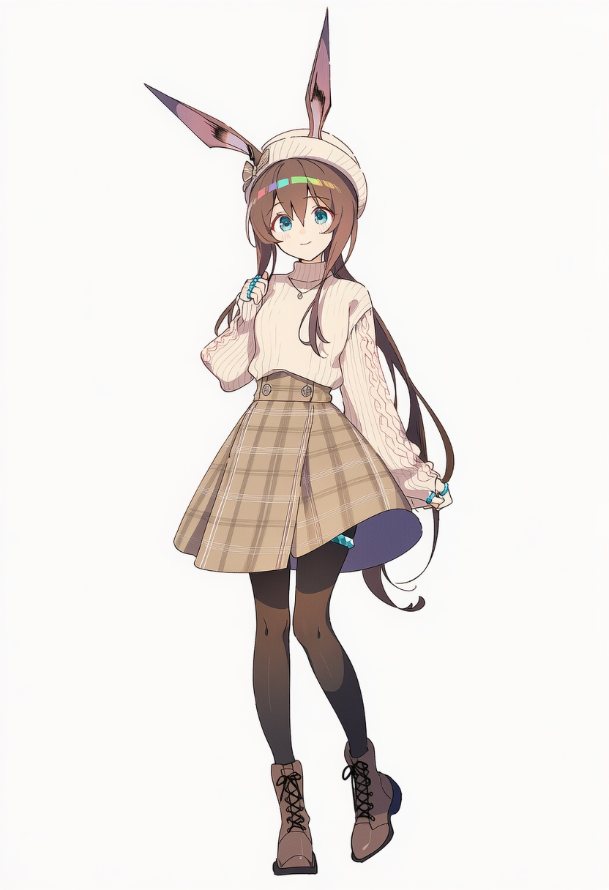

[在线例图](https://assets.quicktagcloud.com/images/raven_composition/raven_composition-4840.jpg?v=bda055be99bc0079)

<a id="raven_composition-4841"></a>

## 杜宾

ID：`raven_composition-4841`；分类：角色图鉴 / 明日方舟；来源标记：`safe`。

来源说明：

> 作品：明日方舟
> 性别：女
> 首次出现时间：2019-04-30 10:00

正向提示词：

```text
dobermann_(arknights)
```


[在线例图](https://assets.quicktagcloud.com/images/raven_composition/raven_composition-4841.jpg?v=e330d77e5164aab2)

<a id="raven_composition-4842"></a>

## 守林人

ID：`raven_composition-4842`；分类：角色图鉴 / 明日方舟；来源标记：`safe`。

来源说明：

> 作品：明日方舟
> 性别：女
> 首次出现时间：2019-04-30 10:00

正向提示词：

```text
firewatch_(arknights)
```


[在线例图](https://assets.quicktagcloud.com/images/raven_composition/raven_composition-4842.jpg?v=279956ad2191b8a5)

<a id="raven_composition-4843"></a>

## 霜叶

ID：`raven_composition-4843`；分类：角色图鉴 / 明日方舟；来源标记：`safe`。

来源说明：

> 作品：明日方舟
> 性别：女
> 首次出现时间：2019-04-30 10:00

正向提示词：

```text
frostleaf_(arknights)
```

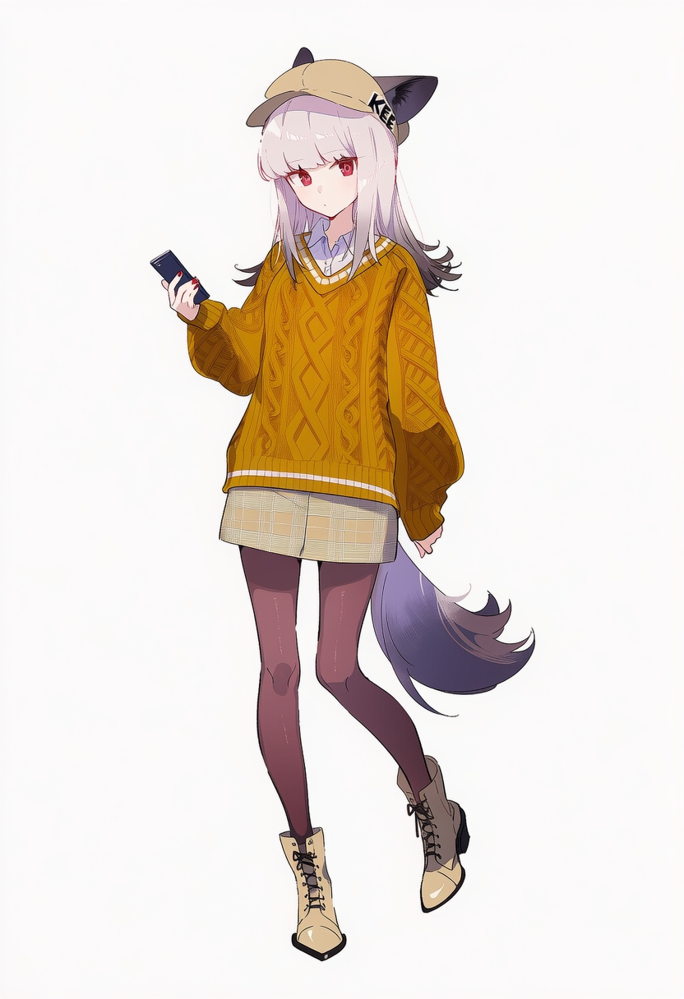

[在线例图](https://assets.quicktagcloud.com/images/raven_composition/raven_composition-4843.jpg?v=7fd76f738e69fe11)

<a id="raven_composition-4844"></a>

## 嘉维尔

ID：`raven_composition-4844`；分类：角色图鉴 / 明日方舟；来源标记：`safe`。

来源说明：

> 作品：明日方舟
> 性别：女
> 首次出现时间：2019-04-30 10:00

正向提示词：

```text
gavial_(arknights)
```

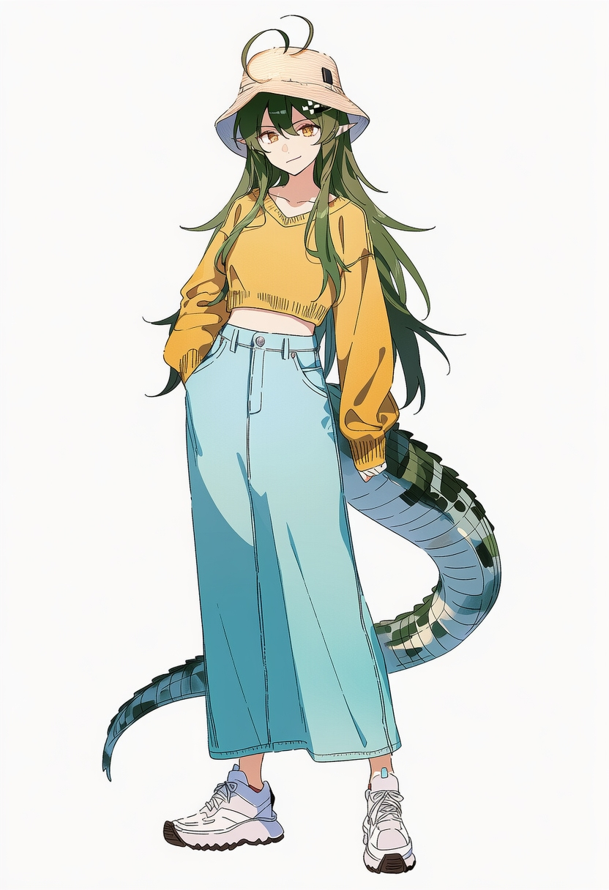

[在线例图](https://assets.quicktagcloud.com/images/raven_composition/raven_composition-4844.jpg?v=a8d3aa7891c2781e)

<a id="raven_composition-4845"></a>

## 陨星

ID：`raven_composition-4845`；分类：角色图鉴 / 明日方舟；来源标记：`safe`。

来源说明：

> 作品：明日方舟
> 性别：女
> 首次出现时间：2019-04-30 10:00

正向提示词：

```text
meteorite_(arknights)
```

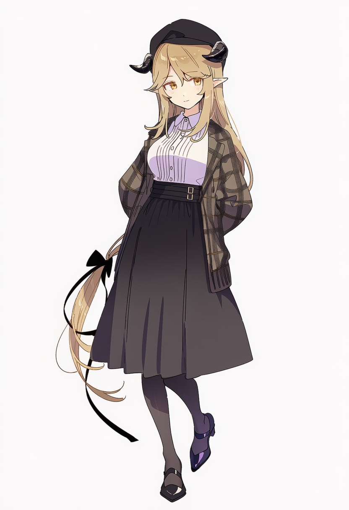

[在线例图](https://assets.quicktagcloud.com/images/raven_composition/raven_composition-4845.jpg?v=c0571dc2727c9e10)

<a id="raven_composition-4846"></a>

## 末药

ID：`raven_composition-4846`；分类：角色图鉴 / 明日方舟；来源标记：`safe`。

来源说明：

> 作品：明日方舟
> 性别：女
> 首次出现时间：2019-04-30 10:00

正向提示词：

```text
myrrh_(arknights)
```

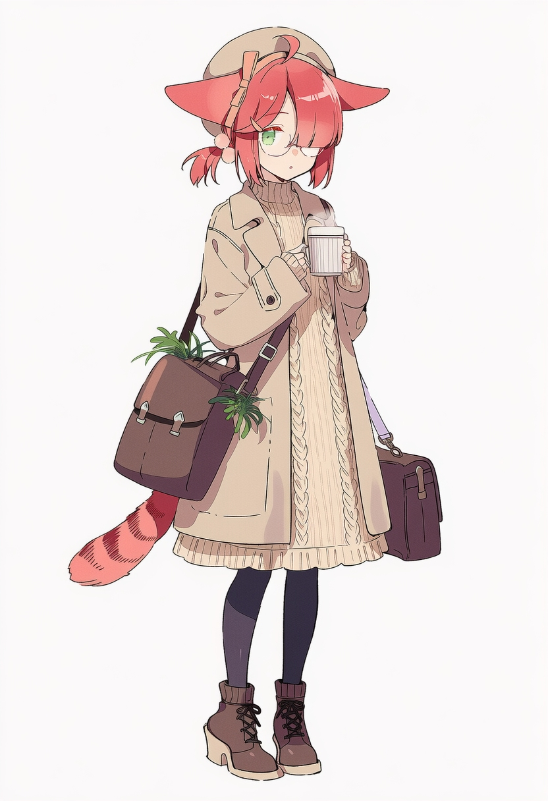

[在线例图](https://assets.quicktagcloud.com/images/raven_composition/raven_composition-4846.jpg?v=c2a48c3fcba72c90)

<a id="raven_composition-4847"></a>

## 调香师

ID：`raven_composition-4847`；分类：角色图鉴 / 明日方舟；来源标记：`safe`。

来源说明：

> 作品：明日方舟
> 性别：女
> 首次出现时间：2019-04-30 10:00

正向提示词：

```text
perfumer_(arknights)
```

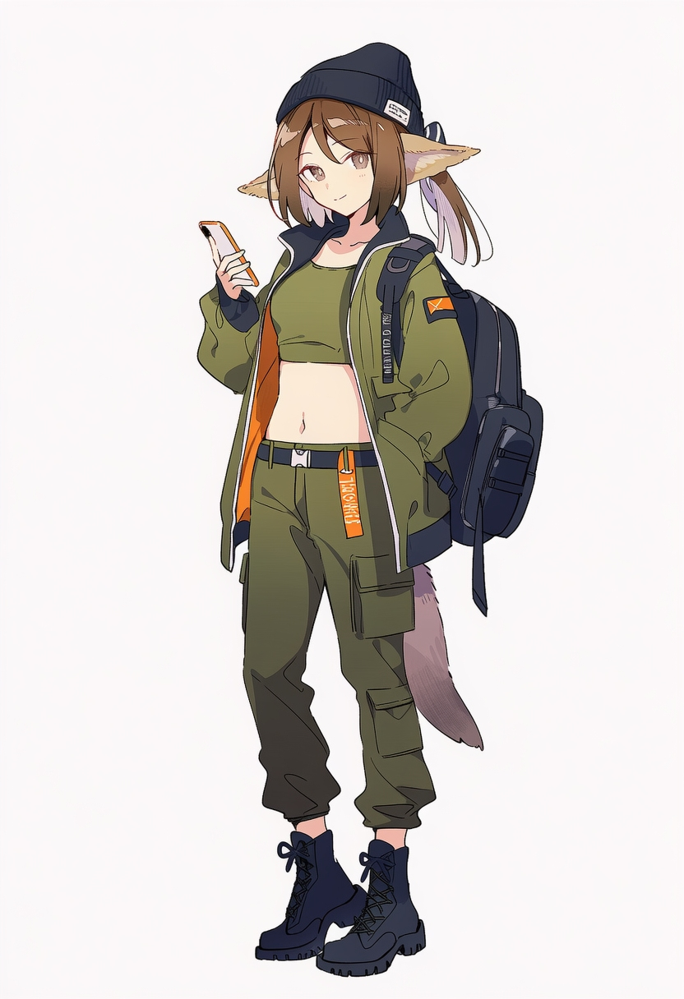

[在线例图](https://assets.quicktagcloud.com/images/raven_composition/raven_composition-4847.jpg?v=2a45837644562694)

<a id="raven_composition-4848"></a>

## 华法琳

ID：`raven_composition-4848`；分类：角色图鉴 / 明日方舟；来源标记：`safe`。

来源说明：

> 作品：明日方舟
> 性别：女
> 首次出现时间：2019-04-30 10:00

正向提示词：

```text
warfarin_(arknights)
```


[在线例图](https://assets.quicktagcloud.com/images/raven_composition/raven_composition-4848.jpg?v=8ffb85e7e3503069)

<a id="raven_composition-4849"></a>

## 杜林

ID：`raven_composition-4849`；分类：角色图鉴 / 明日方舟；来源标记：`safe`。

来源说明：

> 作品：明日方舟
> 性别：女
> 首次出现时间：2019-04-30 10:00

正向提示词：

```text
durin_(arknights)
```

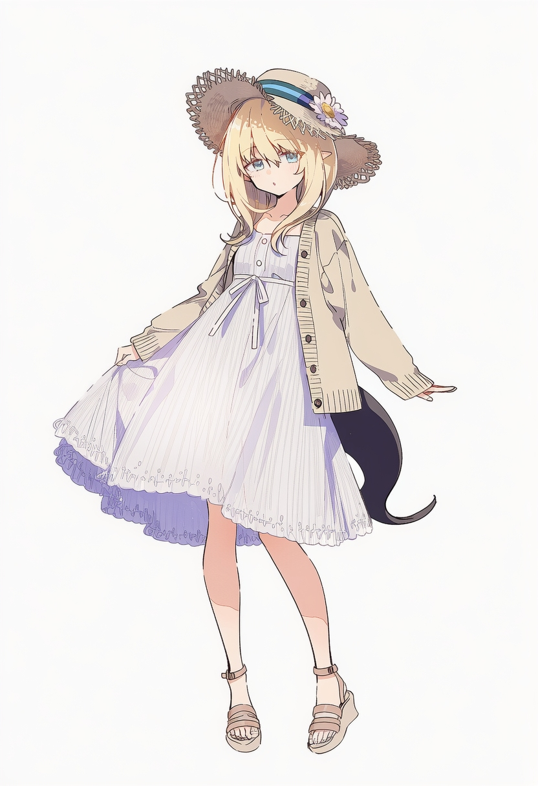

[在线例图](https://assets.quicktagcloud.com/images/raven_composition/raven_composition-4849.jpg?v=9955e4ee8018d95c)

<a id="raven_composition-4850"></a>

## 夜刀

ID：`raven_composition-4850`；分类：角色图鉴 / 明日方舟；来源标记：`safe`。

来源说明：

> 作品：明日方舟
> 性别：女
> 首次出现时间：2019-04-30 10:00

正向提示词：

```text
yato_(arknights)
```


[在线例图](https://assets.quicktagcloud.com/images/raven_composition/raven_composition-4850.jpg?v=0e0cb4c161ae2e83)

<a id="raven_composition-4851"></a>

## 米格鲁

ID：`raven_composition-4851`；分类：角色图鉴 / 明日方舟；来源标记：`safe`。

来源说明：

> 作品：明日方舟
> 性别：女
> 首次出现时间：2019-04-30 10:00

正向提示词：

```text
beagle_(arknights)
```


[在线例图](https://assets.quicktagcloud.com/images/raven_composition/raven_composition-4851.jpg?v=575d247e0e788ec8)

<a id="raven_composition-4852"></a>

## 芬

ID：`raven_composition-4852`；分类：角色图鉴 / 明日方舟；来源标记：`safe`。

来源说明：

> 作品：明日方舟
> 性别：女
> 首次出现时间：2019-04-30 10:00

正向提示词：

```text
fang_(arknights)
```

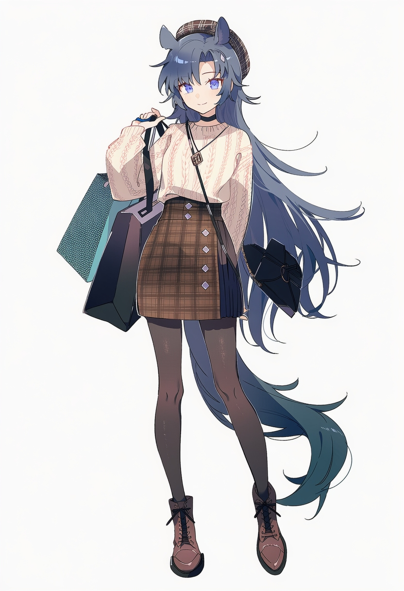

[在线例图](https://assets.quicktagcloud.com/images/raven_composition/raven_composition-4852.jpg?v=6b26d1c60aef819f)

<a id="raven_composition-4853"></a>

## 芙蓉

ID：`raven_composition-4853`；分类：角色图鉴 / 明日方舟；来源标记：`safe`。

来源说明：

> 作品：明日方舟
> 性别：女
> 首次出现时间：2019-04-30 10:00

正向提示词：

```text
hibiscus_(arknights)
```

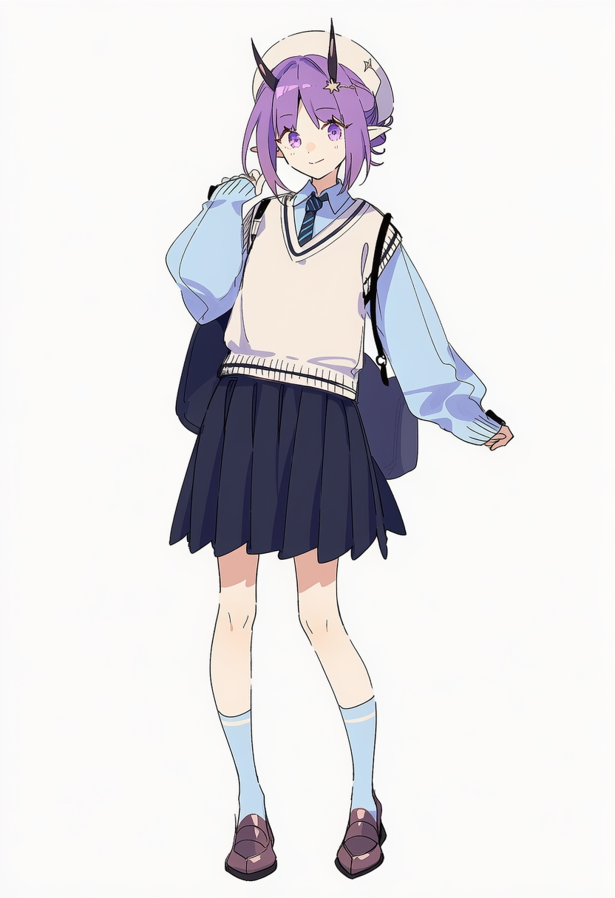

[在线例图](https://assets.quicktagcloud.com/images/raven_composition/raven_composition-4853.jpg?v=bdcffa7b095ad2cf)

<a id="raven_composition-4854"></a>

## 克洛丝

ID：`raven_composition-4854`；分类：角色图鉴 / 明日方舟；来源标记：`safe`。

来源说明：

> 作品：明日方舟
> 性别：女
> 首次出现时间：2019-04-30 10:00

正向提示词：

```text
kroos_(arknights)
```


[在线例图](https://assets.quicktagcloud.com/images/raven_composition/raven_composition-4854.jpg?v=624a96f1f9a7b1db)

<a id="raven_composition-4855"></a>

## 炎熔

ID：`raven_composition-4855`；分类：角色图鉴 / 明日方舟；来源标记：`safe`。

来源说明：

> 作品：明日方舟
> 性别：女
> 首次出现时间：2019-04-30 10:00

正向提示词：

```text
lava_(arknights)
```

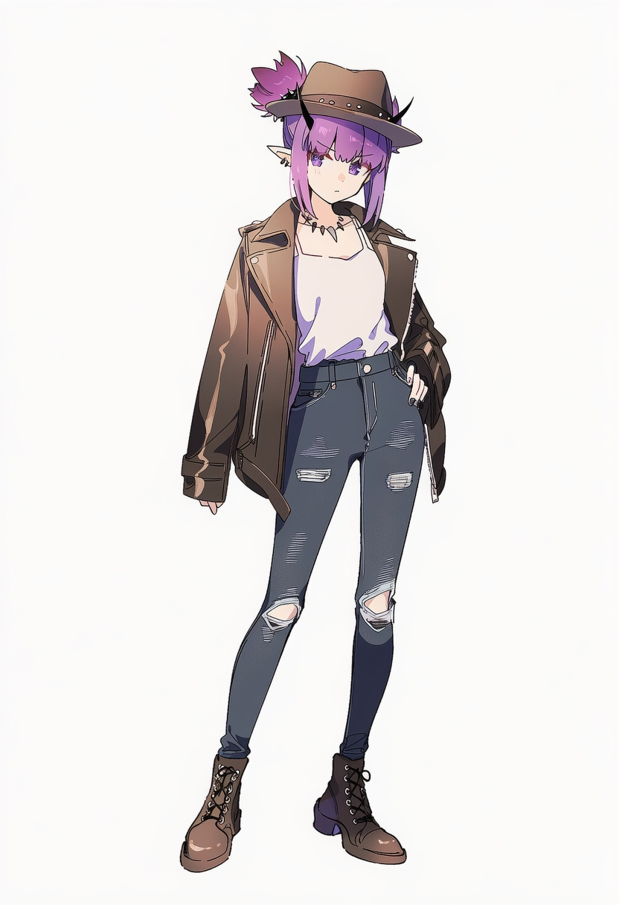

[在线例图](https://assets.quicktagcloud.com/images/raven_composition/raven_composition-4855.jpg?v=51722b64b1cb509d)

<a id="raven_composition-4856"></a>

## 卡缇

ID：`raven_composition-4856`；分类：角色图鉴 / 明日方舟；来源标记：`safe`。

来源说明：

> 作品：明日方舟
> 性别：女
> 首次出现时间：2019-04-30 10:00

正向提示词：

```text
cardigan_(arknights)
```


[在线例图](https://assets.quicktagcloud.com/images/raven_composition/raven_composition-4856.jpg?v=1a282c4b90070eb0)

<a id="raven_composition-4857"></a>

## 玫兰莎

ID：`raven_composition-4857`；分类：角色图鉴 / 明日方舟；来源标记：`safe`。

来源说明：

> 作品：明日方舟
> 性别：女
> 首次出现时间：2019-04-30 10:00

正向提示词：

```text
melantha_(arknights)
```


[在线例图](https://assets.quicktagcloud.com/images/raven_composition/raven_composition-4857.jpg?v=998d0f6a5b8b4ca2)

<a id="raven_composition-4858"></a>

## 梓兰

ID：`raven_composition-4858`；分类：角色图鉴 / 明日方舟；来源标记：`safe`。

来源说明：

> 作品：明日方舟
> 性别：女
> 首次出现时间：2019-04-30 10:00

正向提示词：

```text
orchid_(arknights)
```

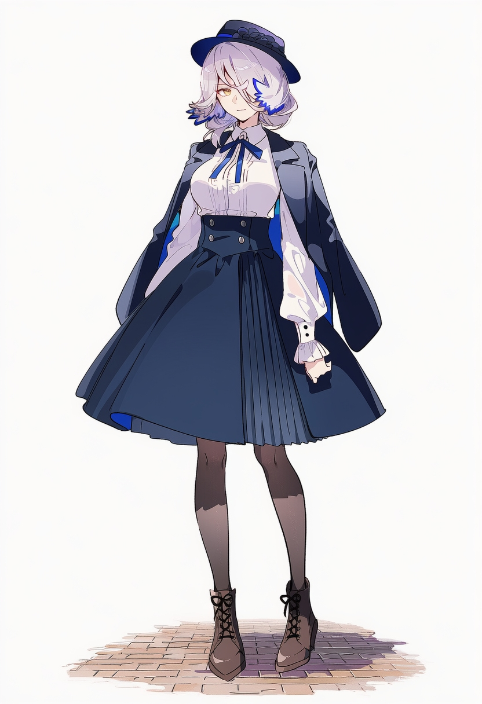

[在线例图](https://assets.quicktagcloud.com/images/raven_composition/raven_composition-4858.jpg?v=bcaef50c1b8804b0)

<a id="raven_composition-4859"></a>

## 红

ID：`raven_composition-4859`；分类：角色图鉴 / 明日方舟；来源标记：`safe`。

来源说明：

> 作品：明日方舟
> 性别：女
> 首次出现时间：2019-04-30 10:00

正向提示词：

```text
projekt_red_(arknights)
```

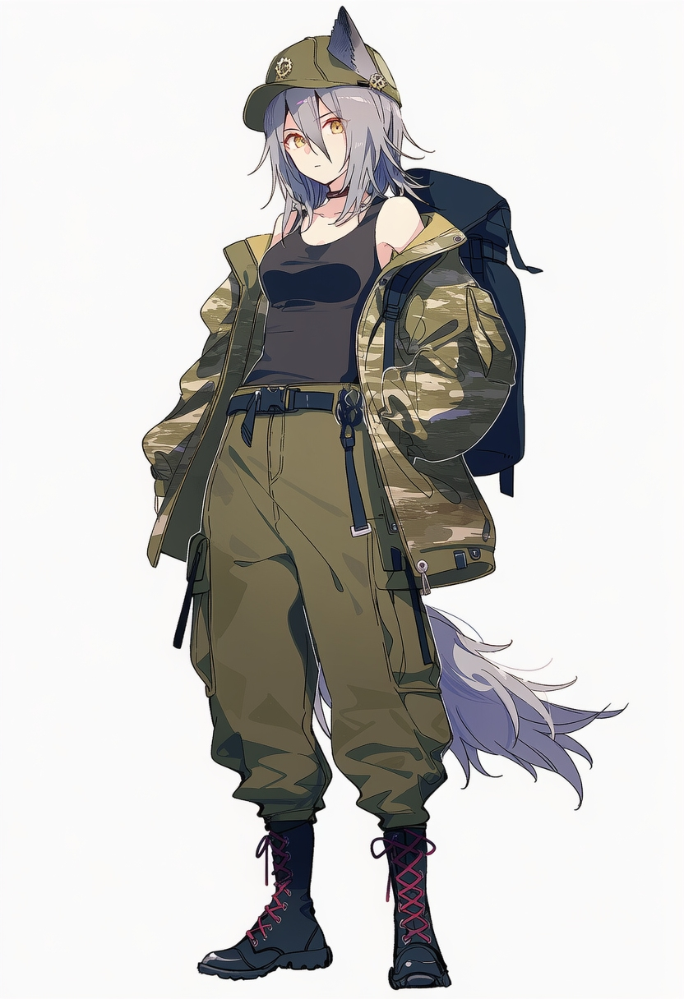

[在线例图](https://assets.quicktagcloud.com/images/raven_composition/raven_composition-4859.jpg?v=c04e06401a270f29)

<a id="raven_composition-4860"></a>

## 清道夫

ID：`raven_composition-4860`；分类：角色图鉴 / 明日方舟；来源标记：`safe`。

来源说明：

> 作品：明日方舟
> 性别：女
> 首次出现时间：2019-04-30 10:00

正向提示词：

```text
scavenger_(arknights)
```

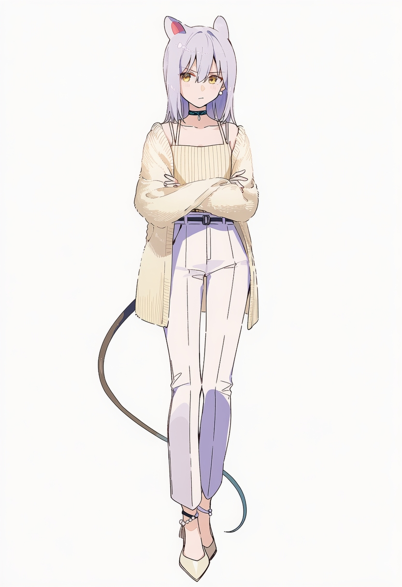

[在线例图](https://assets.quicktagcloud.com/images/raven_composition/raven_composition-4860.jpg?v=42a95bd41c85f90b)

<a id="raven_composition-4861"></a>

## 深海色

ID：`raven_composition-4861`；分类：角色图鉴 / 明日方舟；来源标记：`safe`。

来源说明：

> 作品：明日方舟
> 性别：女
> 首次出现时间：2019-04-30 10:00

正向提示词：

```text
deepcolor_(arknights)
```

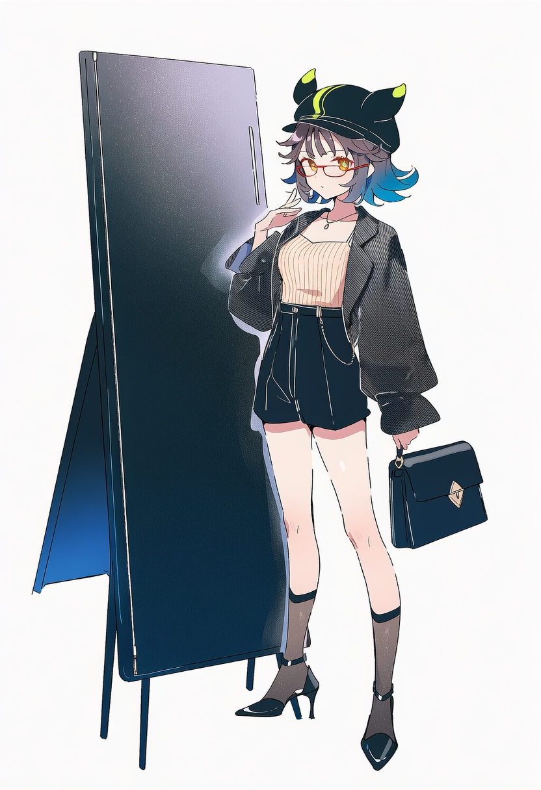

[在线例图](https://assets.quicktagcloud.com/images/raven_composition/raven_composition-4861.jpg?v=d9a0346042bb1a49)

<a id="raven_composition-4862"></a>

## 幽灵鲨

ID：`raven_composition-4862`；分类：角色图鉴 / 明日方舟；来源标记：`safe`。

来源说明：

> 作品：明日方舟
> 性别：女
> 首次出现时间：2019-04-30 10:00

正向提示词：

```text
specter_(arknights)
```

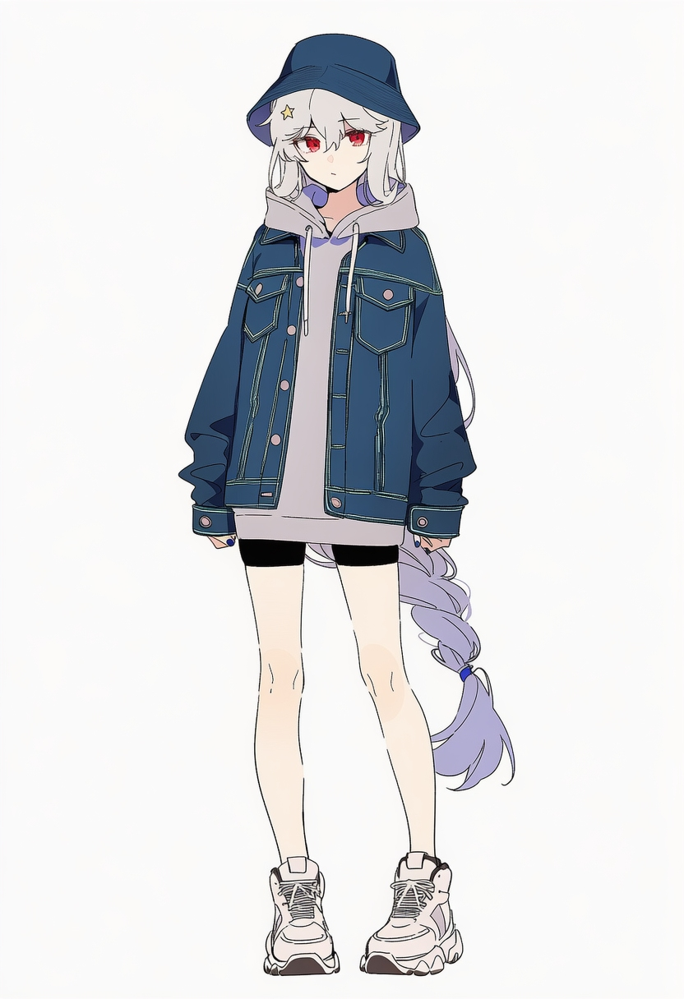

[在线例图](https://assets.quicktagcloud.com/images/raven_composition/raven_composition-4862.jpg?v=8db573cd2333246b)

<a id="raven_composition-4863"></a>

## 蛇屠箱

ID：`raven_composition-4863`；分类：角色图鉴 / 明日方舟；来源标记：`safe`。

来源说明：

> 作品：明日方舟
> 性别：女
> 首次出现时间：2019-04-30 10:00

正向提示词：

```text
cuora_(arknights)
```


[在线例图](https://assets.quicktagcloud.com/images/raven_composition/raven_composition-4863.jpg?v=f708adf1a738f69d)

<a id="raven_composition-4864"></a>

## 红豆

ID：`raven_composition-4864`；分类：角色图鉴 / 明日方舟；来源标记：`safe`。

来源说明：

> 作品：明日方舟
> 性别：女
> 首次出现时间：2019-04-30 10:00

正向提示词：

```text
vigna_(arknights)
```


[在线例图](https://assets.quicktagcloud.com/images/raven_composition/raven_composition-4864.jpg?v=2eb14ef1b3d52ce0)

<a id="raven_composition-4865"></a>

## 芙兰卡

ID：`raven_composition-4865`；分类：角色图鉴 / 明日方舟；来源标记：`safe`。

来源说明：

> 作品：明日方舟
> 性别：女
> 首次出现时间：2019-04-30 10:00

正向提示词：

```text
franka_(arknights)
```

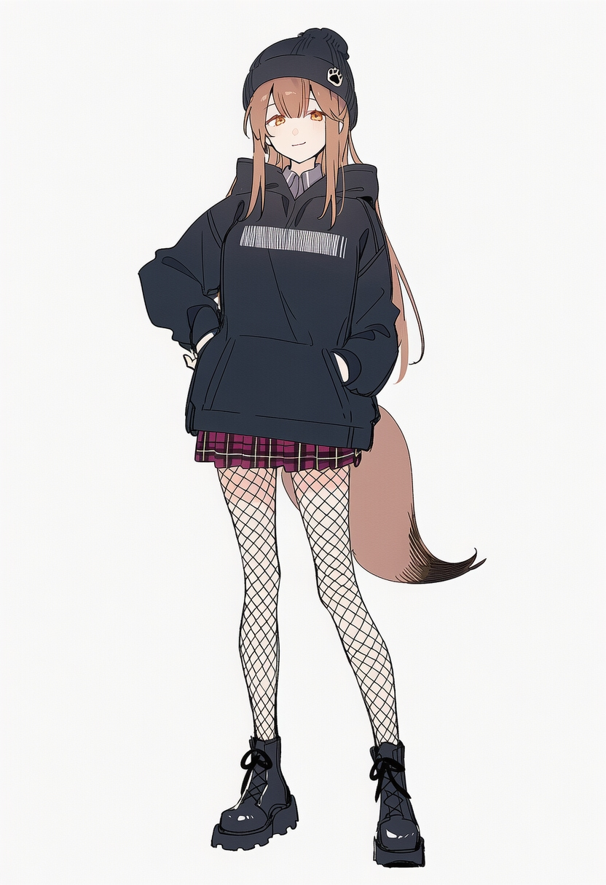

[在线例图](https://assets.quicktagcloud.com/images/raven_composition/raven_composition-4865.jpg?v=fb3053ea0c56fbab)

<a id="raven_composition-4866"></a>

## 杰西卡

ID：`raven_composition-4866`；分类：角色图鉴 / 明日方舟；来源标记：`safe`。

来源说明：

> 作品：明日方舟
> 性别：女
> 首次出现时间：2019-04-30 10:00

正向提示词：

```text
jessica_(arknights)
```

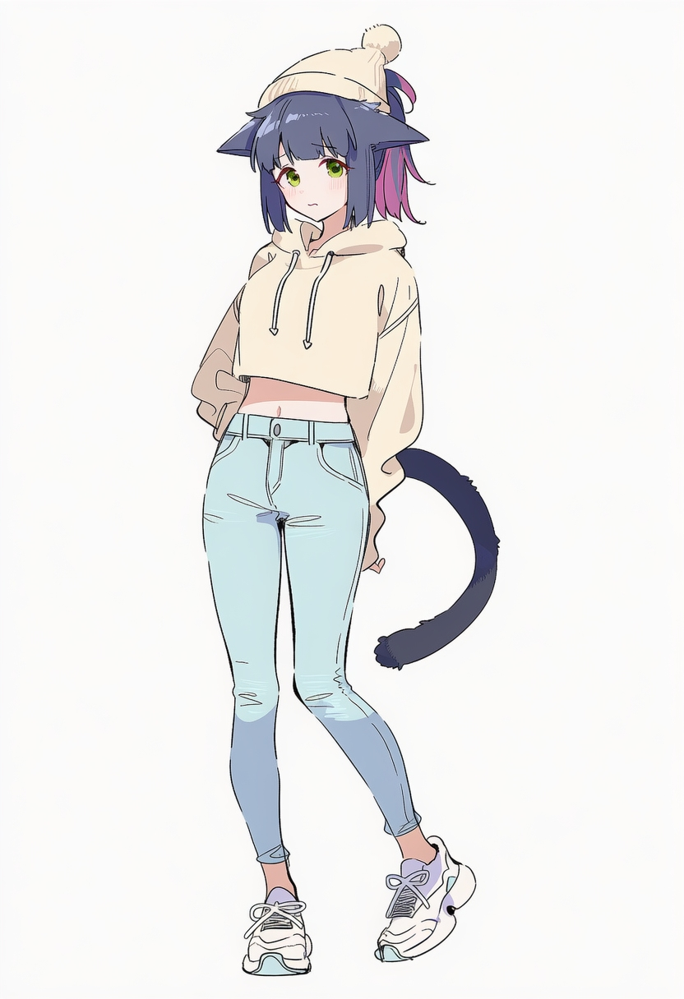

[在线例图](https://assets.quicktagcloud.com/images/raven_composition/raven_composition-4866.jpg?v=de2e0792d5d95d53)

<a id="raven_composition-4867"></a>

## 雷蛇

ID：`raven_composition-4867`；分类：角色图鉴 / 明日方舟；来源标记：`safe`。

来源说明：

> 作品：明日方舟
> 性别：女
> 首次出现时间：2019-04-30 10:00

正向提示词：

```text
liskarm_(arknights)
```

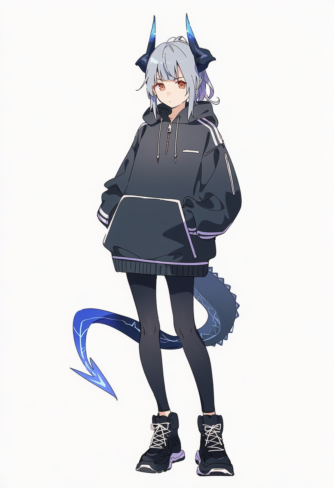

[在线例图](https://assets.quicktagcloud.com/images/raven_composition/raven_composition-4867.jpg?v=1573658195b04ac3)

<a id="raven_composition-4868"></a>

## 香草

ID：`raven_composition-4868`；分类：角色图鉴 / 明日方舟；来源标记：`safe`。

来源说明：

> 作品：明日方舟
> 性别：女
> 首次出现时间：2019-04-30 10:00

正向提示词：

```text
vanilla_(arknights)
```

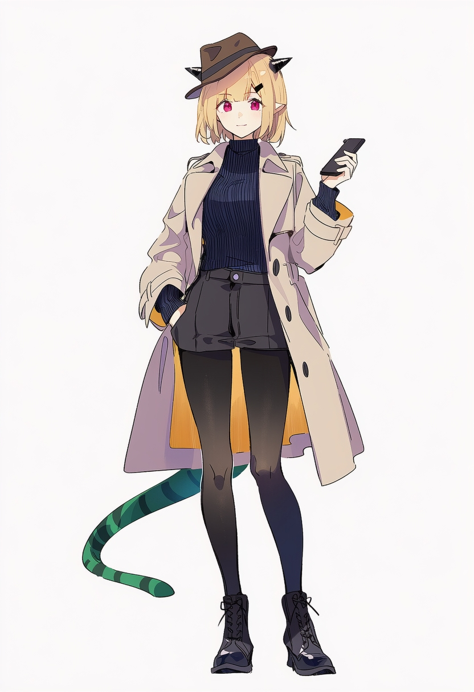

[在线例图](https://assets.quicktagcloud.com/images/raven_composition/raven_composition-4868.jpg?v=6f0f3a0f01b91615)

<a id="raven_composition-4869"></a>

## 伊芙利特

ID：`raven_composition-4869`；分类：角色图鉴 / 明日方舟；来源标记：`safe`。

来源说明：

> 作品：明日方舟
> 性别：女
> 首次出现时间：2019-04-30 10:00

正向提示词：

```text
ifrit_(arknights)
```

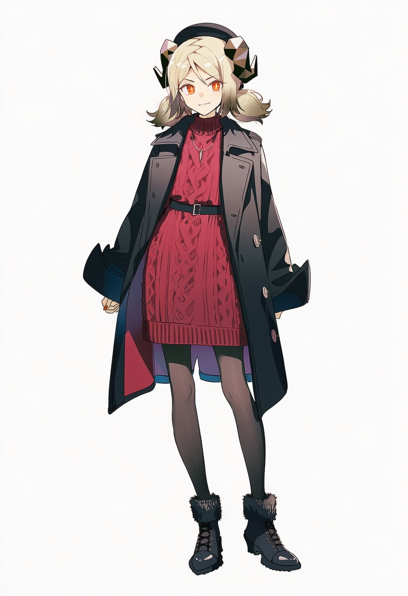

[在线例图](https://assets.quicktagcloud.com/images/raven_composition/raven_composition-4869.jpg?v=a9e88cc4cbd995fd)

<a id="raven_composition-4870"></a>

## 梅尔

ID：`raven_composition-4870`；分类：角色图鉴 / 明日方舟；来源标记：`safe`。

来源说明：

> 作品：明日方舟
> 性别：女
> 首次出现时间：2019-04-30 10:00

正向提示词：

```text
mayer_(arknights)
```

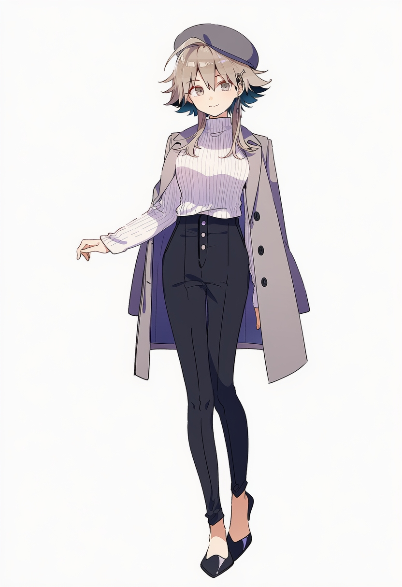

[在线例图](https://assets.quicktagcloud.com/images/raven_composition/raven_composition-4870.jpg?v=db2c740bb37bfad6)

<a id="raven_composition-4871"></a>

## 白面鸮

ID：`raven_composition-4871`；分类：角色图鉴 / 明日方舟；来源标记：`safe`。

来源说明：

> 作品：明日方舟
> 性别：女
> 首次出现时间：2019-04-30 10:00

正向提示词：

```text
ptilopsis_(arknights)
```

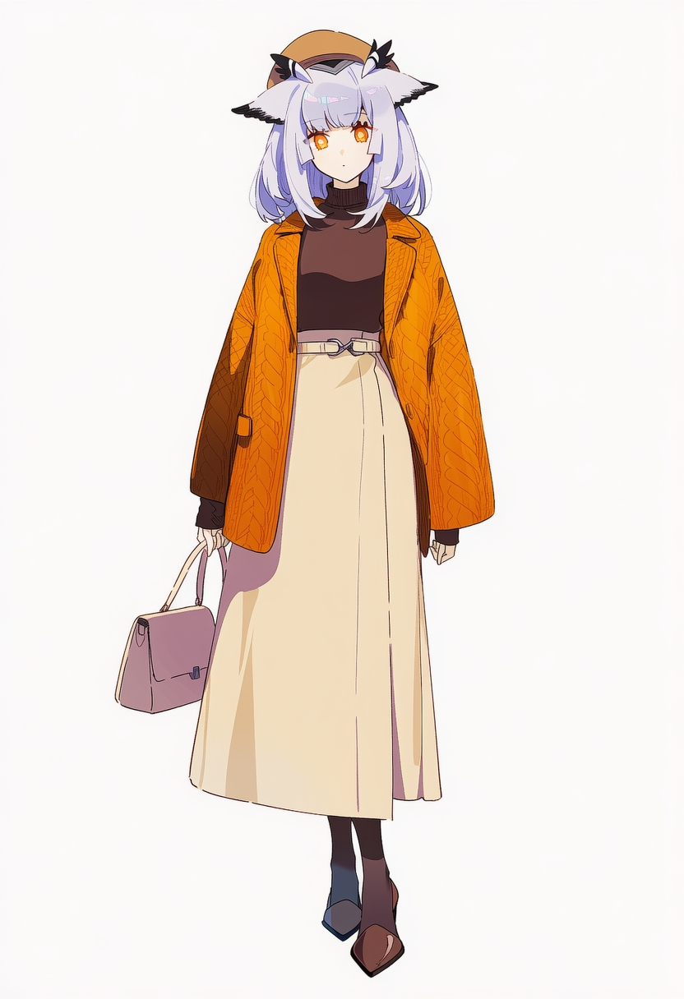

[在线例图](https://assets.quicktagcloud.com/images/raven_composition/raven_composition-4871.jpg?v=870d73e42ca78170)

<a id="raven_composition-4872"></a>

## 塞雷娅

ID：`raven_composition-4872`；分类：角色图鉴 / 明日方舟；来源标记：`safe`。

来源说明：

> 作品：明日方舟
> 性别：女
> 首次出现时间：2019-04-30 10:00

正向提示词：

```text
saria_(arknights)
```

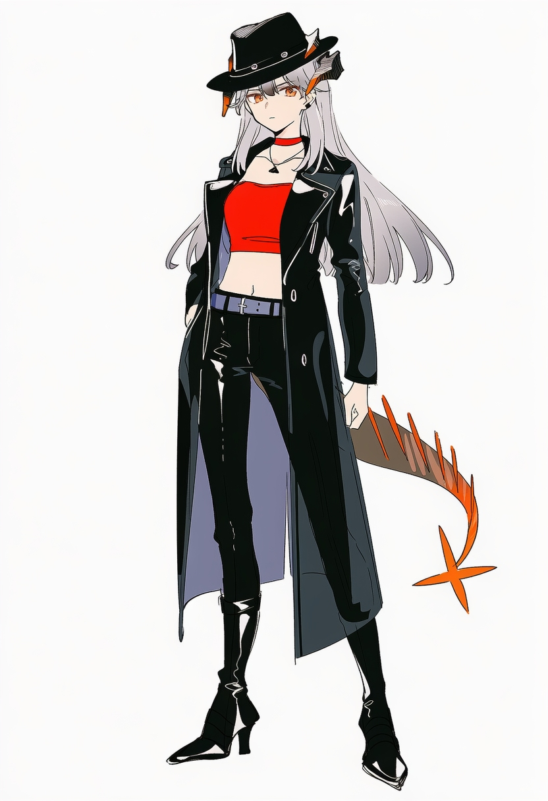

[在线例图](https://assets.quicktagcloud.com/images/raven_composition/raven_composition-4872.jpg?v=300d282e19f530b7)

<a id="raven_composition-4873"></a>

## 赫默

ID：`raven_composition-4873`；分类：角色图鉴 / 明日方舟；来源标记：`safe`。

来源说明：

> 作品：明日方舟
> 性别：女
> 首次出现时间：2019-04-30 10:00

正向提示词：

```text
silence_(arknights)
```


[在线例图](https://assets.quicktagcloud.com/images/raven_composition/raven_composition-4873.jpg?v=1e3c17403eb72f25)

<a id="raven_composition-4874"></a>

## 临光

ID：`raven_composition-4874`；分类：角色图鉴 / 明日方舟；来源标记：`safe`。

来源说明：

> 作品：明日方舟
> 性别：女
> 首次出现时间：2019-04-30 10:00

正向提示词：

```text
nearl_(arknights)
```

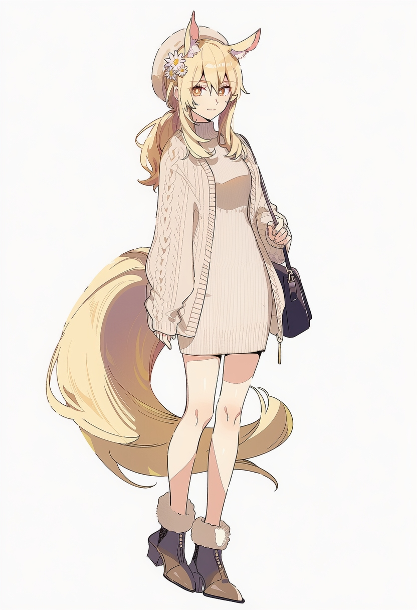

[在线例图](https://assets.quicktagcloud.com/images/raven_composition/raven_composition-4874.jpg?v=7e61f1119663c6f9)

<a id="raven_composition-4875"></a>

## 夜莺

ID：`raven_composition-4875`；分类：角色图鉴 / 明日方舟；来源标记：`safe`。

来源说明：

> 作品：明日方舟
> 性别：女
> 首次出现时间：2019-04-30 10:00

正向提示词：

```text
nightingale_(arknights)
```


[在线例图](https://assets.quicktagcloud.com/images/raven_composition/raven_composition-4875.jpg?v=440cb666c0275b88)

<a id="raven_composition-4876"></a>

## 闪灵

ID：`raven_composition-4876`；分类：角色图鉴 / 明日方舟；来源标记：`safe`。

来源说明：

> 作品：明日方舟
> 性别：女
> 首次出现时间：2019-04-30 10:00

正向提示词：

```text
shining_(arknights)
```


[在线例图](https://assets.quicktagcloud.com/images/raven_composition/raven_composition-4876.jpg?v=58499c6727990252)

<a id="raven_composition-4877"></a>

## 缠丸

ID：`raven_composition-4877`；分类：角色图鉴 / 明日方舟；来源标记：`safe`。

来源说明：

> 作品：明日方舟
> 性别：女
> 首次出现时间：2019-04-30 10:00

正向提示词：

```text
matoimaru_(arknights)
```

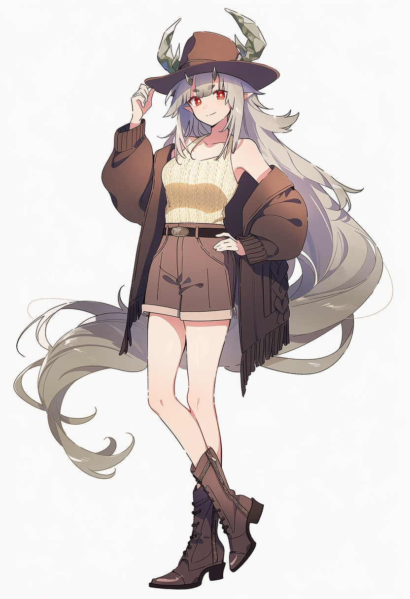

[在线例图](https://assets.quicktagcloud.com/images/raven_composition/raven_composition-4877.jpg?v=4f84816c665dca86)

<a id="raven_composition-4878"></a>

## 白雪

ID：`raven_composition-4878`；分类：角色图鉴 / 明日方舟；来源标记：`safe`。

来源说明：

> 作品：明日方舟
> 性别：女
> 首次出现时间：2019-04-30 10:00

正向提示词：

```text
shirayuki_(arknights)
```

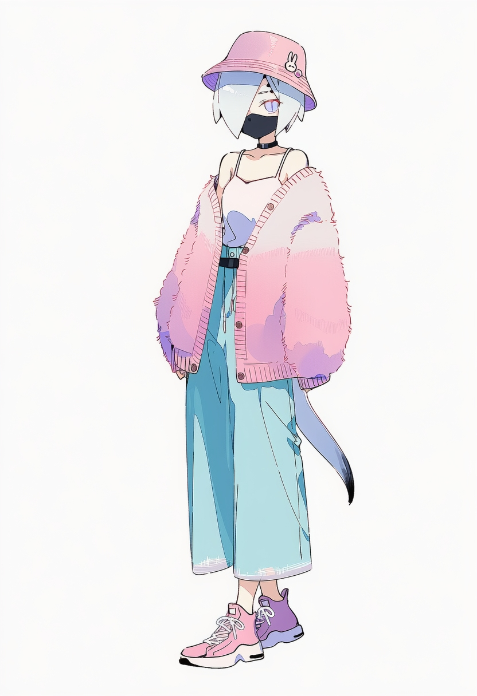

[在线例图](https://assets.quicktagcloud.com/images/raven_composition/raven_composition-4878.jpg?v=b4c9baff7ee0d612)

<a id="raven_composition-4879"></a>

## 蓝毒

ID：`raven_composition-4879`；分类：角色图鉴 / 明日方舟；来源标记：`safe`。

来源说明：

> 作品：明日方舟
> 性别：女
> 首次出现时间：2019-04-30 10:00

正向提示词：

```text
blue_poison_(arknights)
```

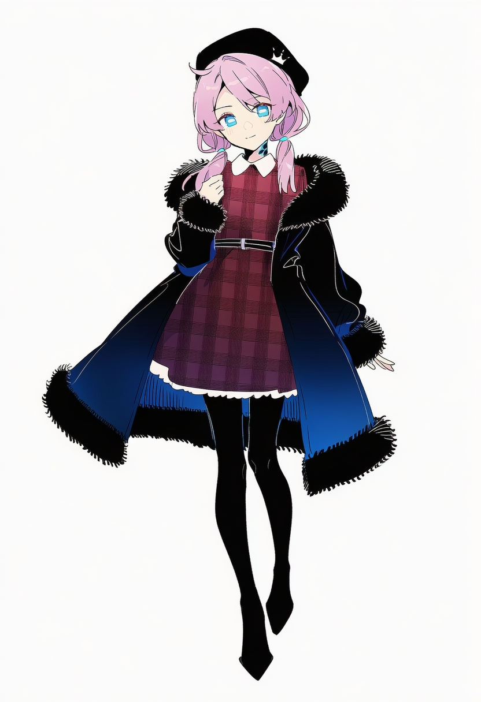

[在线例图](https://assets.quicktagcloud.com/images/raven_composition/raven_composition-4879.jpg?v=2b39b1081c66bb18)

<a id="raven_composition-4880"></a>

## 砾

ID：`raven_composition-4880`；分类：角色图鉴 / 明日方舟；来源标记：`safe`。

来源说明：

> 作品：明日方舟
> 性别：女
> 首次出现时间：2019-04-30 10:00

正向提示词：

```text
gravel_(arknights)
```

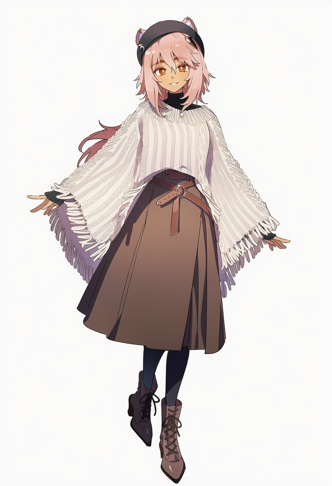

[在线例图](https://assets.quicktagcloud.com/images/raven_composition/raven_composition-4880.jpg?v=118f503869cfb8ea)

<a id="raven_composition-4881"></a>

## 流星

ID：`raven_composition-4881`；分类：角色图鉴 / 明日方舟；来源标记：`safe`。

来源说明：

> 作品：明日方舟
> 性别：女
> 首次出现时间：2019-04-30 10:00

正向提示词：

```text
meteor_(arknights)
```

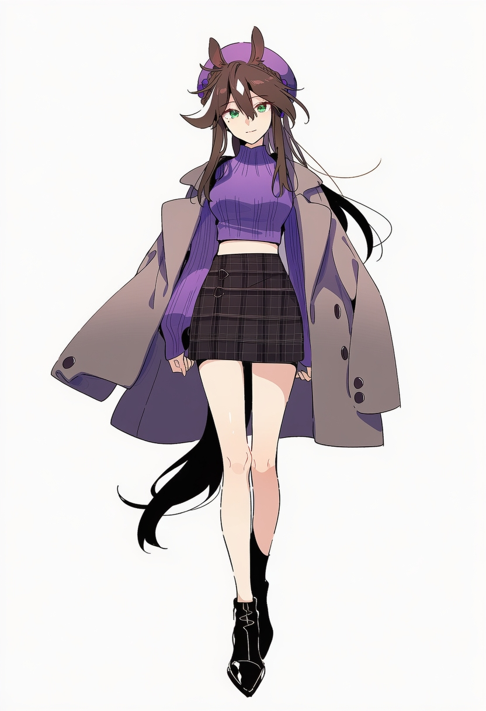

[在线例图](https://assets.quicktagcloud.com/images/raven_composition/raven_composition-4881.jpg?v=eb29f015e9d3da3f)

<a id="raven_composition-4882"></a>

## 白金

ID：`raven_composition-4882`；分类：角色图鉴 / 明日方舟；来源标记：`safe`。

来源说明：

> 作品：明日方舟
> 性别：女
> 首次出现时间：2019-04-30 10:00

正向提示词：

```text
platinum_(arknights)
```

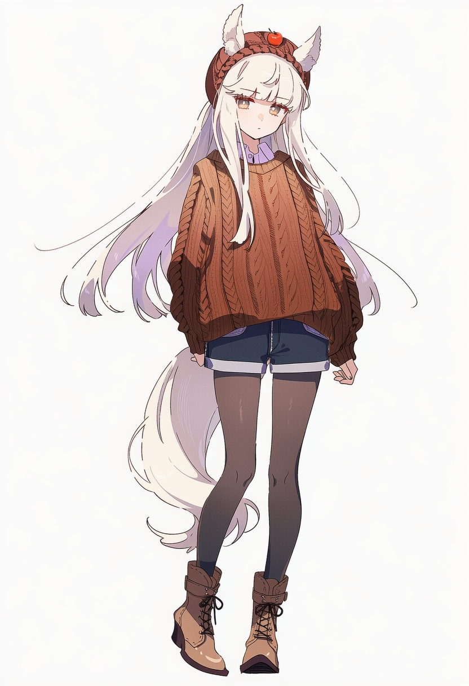

[在线例图](https://assets.quicktagcloud.com/images/raven_composition/raven_composition-4882.jpg?v=2c3e27d7f52c65a9)

<a id="raven_composition-4883"></a>

## 崖心

ID：`raven_composition-4883`；分类：角色图鉴 / 明日方舟；来源标记：`safe`。

来源说明：

> 作品：明日方舟
> 性别：女
> 首次出现时间：2019-04-30 10:00

正向提示词：

```text
cliffheart_(arknights)
```


[在线例图](https://assets.quicktagcloud.com/images/raven_composition/raven_composition-4883.jpg?v=6cf9172a14129aaa)

<a id="raven_composition-4884"></a>

## 初雪

ID：`raven_composition-4884`；分类：角色图鉴 / 明日方舟；来源标记：`safe`。

来源说明：

> 作品：明日方舟
> 性别：女
> 首次出现时间：2019-04-30 10:00

正向提示词：

```text
pramanix_(arknights)
```

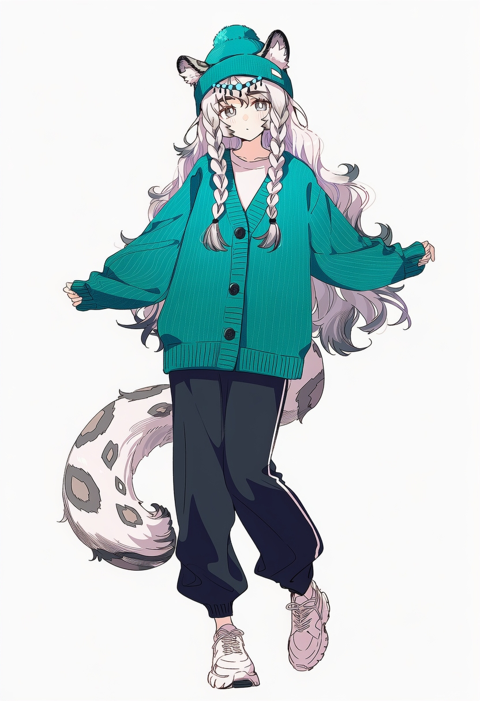

[在线例图](https://assets.quicktagcloud.com/images/raven_composition/raven_composition-4884.jpg?v=17eb0a3c6695c8dd)

<a id="raven_composition-4885"></a>

## 翎羽

ID：`raven_composition-4885`；分类：角色图鉴 / 明日方舟；来源标记：`safe`。

来源说明：

> 作品：明日方舟
> 性别：女
> 首次出现时间：2019-04-30 10:00

正向提示词：

```text
plume_(arknights)
```

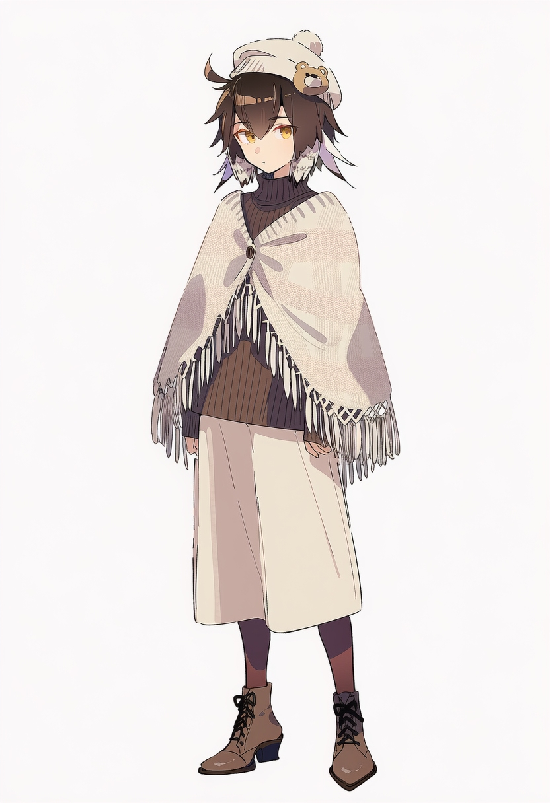

[在线例图](https://assets.quicktagcloud.com/images/raven_composition/raven_composition-4885.jpg?v=25cae25d7cfc3c1b)

<a id="raven_composition-4886"></a>

## 地灵

ID：`raven_composition-4886`；分类：角色图鉴 / 明日方舟；来源标记：`safe`。

来源说明：

> 作品：明日方舟
> 性别：女
> 首次出现时间：2019-04-30 10:00

正向提示词：

```text
earthspirit_(arknights)
```

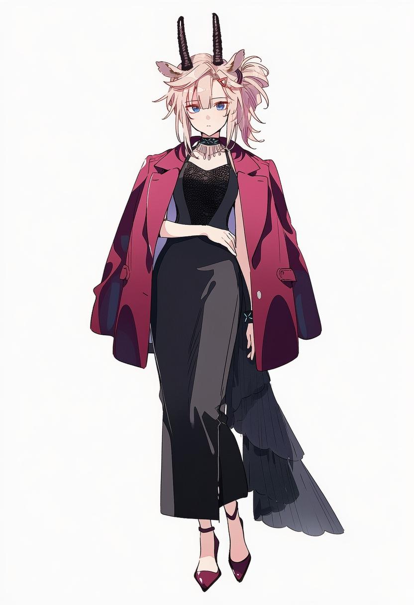

[在线例图](https://assets.quicktagcloud.com/images/raven_composition/raven_composition-4886.jpg?v=7b8d0d34e0fe27f6)

<a id="raven_composition-4887"></a>

## 艾雅法拉

ID：`raven_composition-4887`；分类：角色图鉴 / 明日方舟；来源标记：`safe`。

来源说明：

> 作品：明日方舟
> 性别：女
> 首次出现时间：2019-04-30 10:00

正向提示词：

```text
eyjafjalla_(arknights)
```


[在线例图](https://assets.quicktagcloud.com/images/raven_composition/raven_composition-4887.jpg?v=da157e75328eb152)

<a id="raven_composition-4888"></a>

## 火神

ID：`raven_composition-4888`；分类：角色图鉴 / 明日方舟；来源标记：`safe`。

来源说明：

> 作品：明日方舟
> 性别：女
> 首次出现时间：2019-04-30 10:00

正向提示词：

```text
vulcan_(arknights)
```

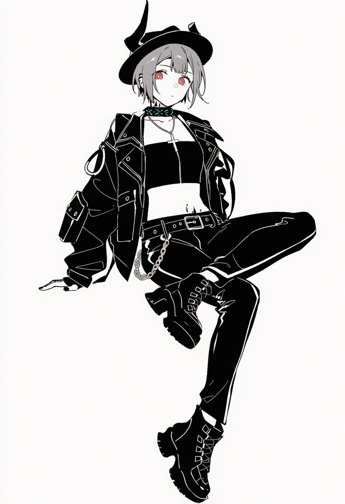

[在线例图](https://assets.quicktagcloud.com/images/raven_composition/raven_composition-4888.jpg?v=1fc4851d56176288)

<a id="raven_composition-4889"></a>

## 暴行

ID：`raven_composition-4889`；分类：角色图鉴 / 明日方舟；来源标记：`safe`。

来源说明：

> 作品：明日方舟
> 性别：女
> 首次出现时间：2019-04-30 10:00

正向提示词：

```text
savage_(arknights)
```

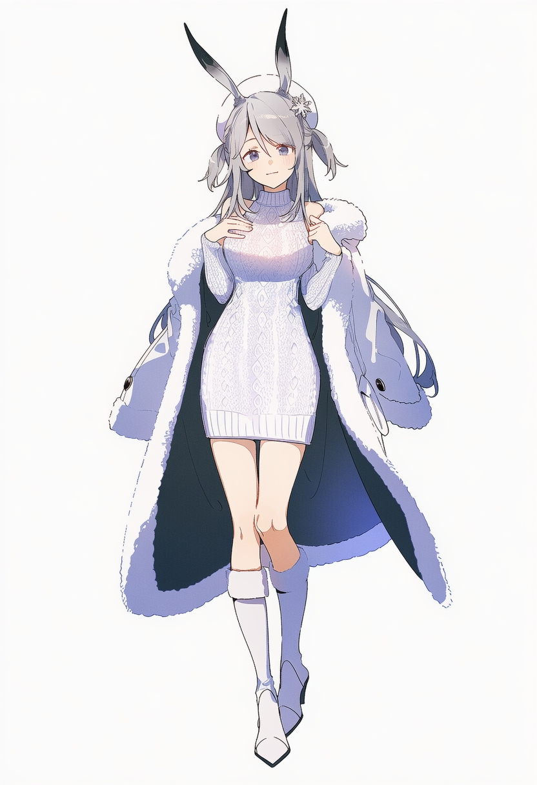

[在线例图](https://assets.quicktagcloud.com/images/raven_composition/raven_composition-4889.jpg?v=3ab19d600389ca58)

<a id="raven_composition-4890"></a>

## 远山

ID：`raven_composition-4890`；分类：角色图鉴 / 明日方舟；来源标记：`safe`。

来源说明：

> 作品：明日方舟
> 性别：女
> 首次出现时间：2019-04-30 10:00

正向提示词：

```text
gitano_(arknights)
```

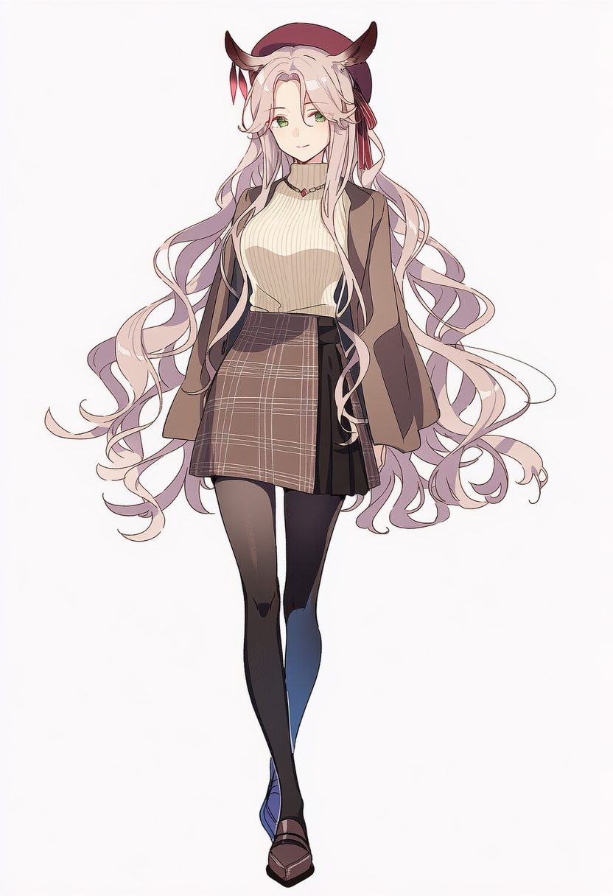

[在线例图](https://assets.quicktagcloud.com/images/raven_composition/raven_composition-4890.jpg?v=21e4c9a663c9b896)

<a id="raven_composition-4891"></a>

## 艾丝黛尔

ID：`raven_composition-4891`；分类：角色图鉴 / 明日方舟；来源标记：`safe`。

来源说明：

> 作品：明日方舟
> 性别：女
> 首次出现时间：2019-04-30 10:00

正向提示词：

```text
estelle_(arknights)
```

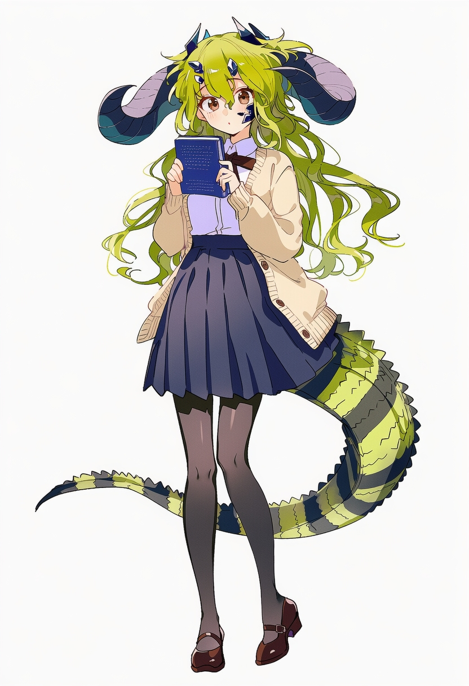

[在线例图](https://assets.quicktagcloud.com/images/raven_composition/raven_composition-4891.jpg?v=4576784f698089c3)

<a id="raven_composition-4892"></a>

## 狮蝎

ID：`raven_composition-4892`；分类：角色图鉴 / 明日方舟；来源标记：`safe`。

来源说明：

> 作品：明日方舟
> 性别：女
> 首次出现时间：2019-04-30 10:00

正向提示词：

```text
manticore_(arknights)
```

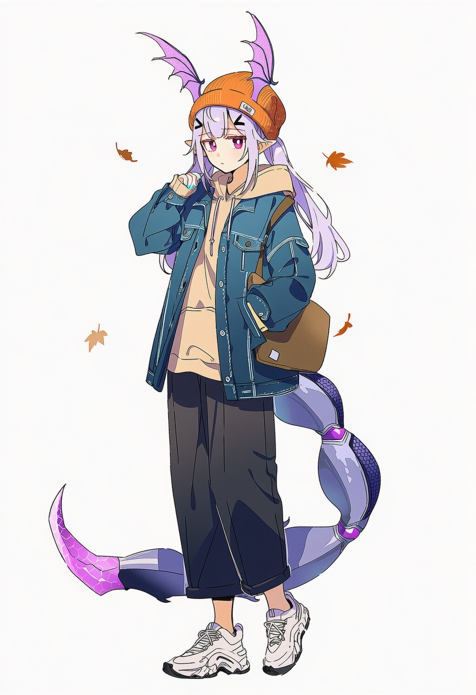

[在线例图](https://assets.quicktagcloud.com/images/raven_composition/raven_composition-4892.jpg?v=2efb8e4da48ec639)

<a id="raven_composition-4893"></a>

## 安洁莉娜

ID：`raven_composition-4893`；分类：角色图鉴 / 明日方舟；来源标记：`safe`。

来源说明：

> 作品：明日方舟
> 性别：女
> 首次出现时间：2019-04-30 10:00

正向提示词：

```text
angelina_(arknights)
```

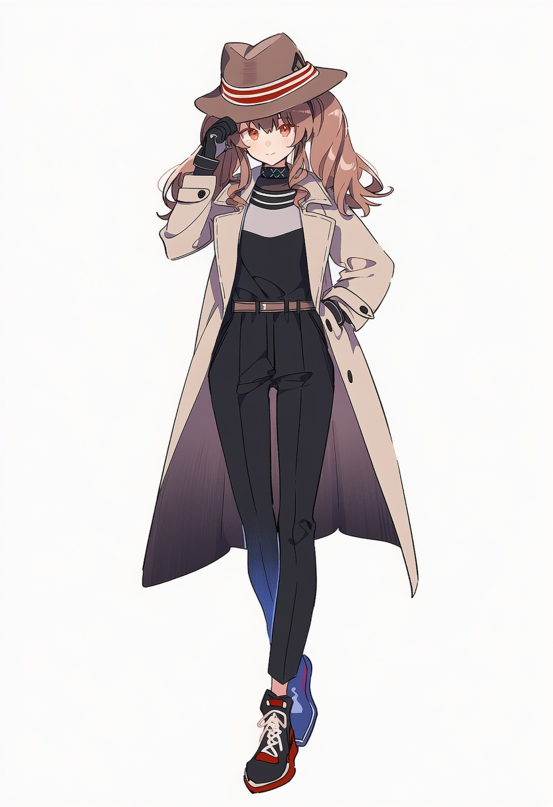

[在线例图](https://assets.quicktagcloud.com/images/raven_composition/raven_composition-4893.jpg?v=98cd4f19848ba8e3)

<a id="raven_composition-4894"></a>

## 拉普兰德

ID：`raven_composition-4894`；分类：角色图鉴 / 明日方舟；来源标记：`safe`。

来源说明：

> 作品：明日方舟
> 性别：女
> 首次出现时间：2019-04-30 10:00

正向提示词：

```text
lappland_(arknights)
```

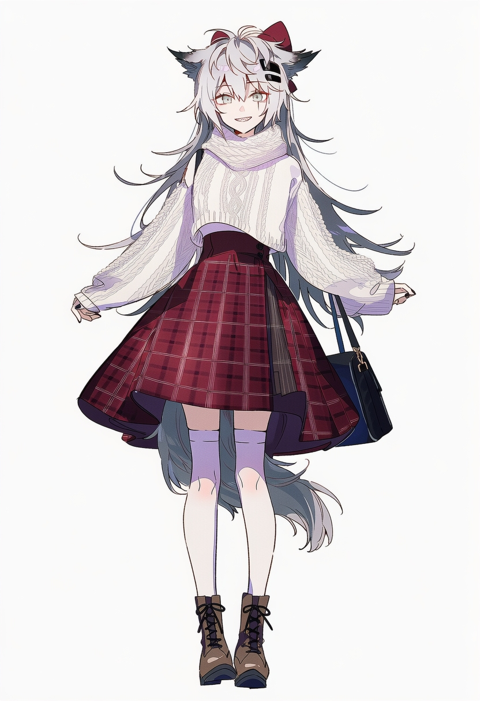

[在线例图](https://assets.quicktagcloud.com/images/raven_composition/raven_composition-4894.jpg?v=33954091466f0192)

<a id="raven_composition-4895"></a>

## 普罗旺斯

ID：`raven_composition-4895`；分类：角色图鉴 / 明日方舟；来源标记：`safe`。

来源说明：

> 作品：明日方舟
> 性别：女
> 首次出现时间：2019-04-30 10:00

正向提示词：

```text
provence_(arknights)
```

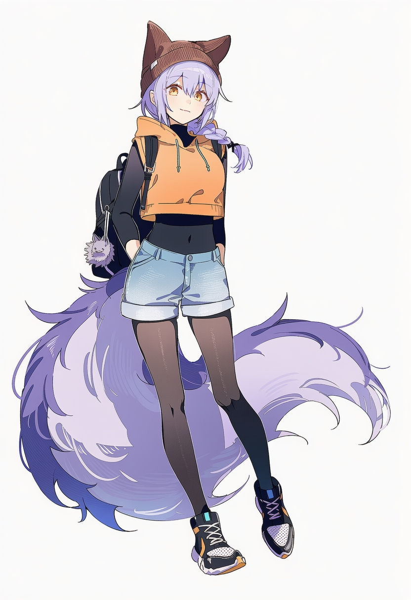

[在线例图](https://assets.quicktagcloud.com/images/raven_composition/raven_composition-4895.jpg?v=cf22402b8c41ae9f)

<a id="raven_composition-4896"></a>

## 古米

ID：`raven_composition-4896`；分类：角色图鉴 / 明日方舟；来源标记：`safe`。

来源说明：

> 作品：明日方舟
> 性别：女
> 首次出现时间：2019-04-30 10:00

正向提示词：

```text
gummy_(arknights)
```


[在线例图](https://assets.quicktagcloud.com/images/raven_composition/raven_composition-4896.jpg?v=1ac75b856d656cd9)

<a id="raven_composition-4897"></a>

## 真理

ID：`raven_composition-4897`；分类：角色图鉴 / 明日方舟；来源标记：`safe`。

来源说明：

> 作品：明日方舟
> 性别：女
> 首次出现时间：2019-04-30 10:00

正向提示词：

```text
istina_(arknights)
```

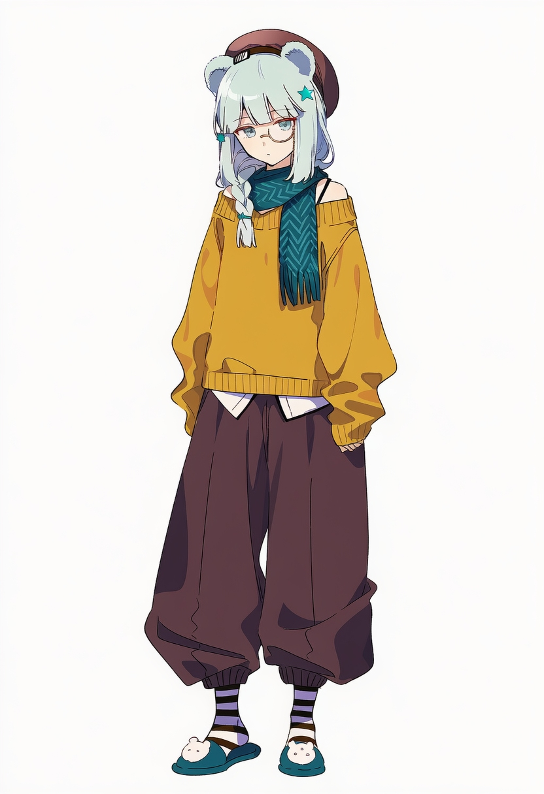

[在线例图](https://assets.quicktagcloud.com/images/raven_composition/raven_composition-4897.jpg?v=e0e85e146384f1f6)

<a id="raven_composition-4898"></a>

## 凛冬

ID：`raven_composition-4898`；分类：角色图鉴 / 明日方舟；来源标记：`safe`。

来源说明：

> 作品：明日方舟
> 性别：女
> 首次出现时间：2019-04-30 10:00

正向提示词：

```text
zima_(arknights)
```

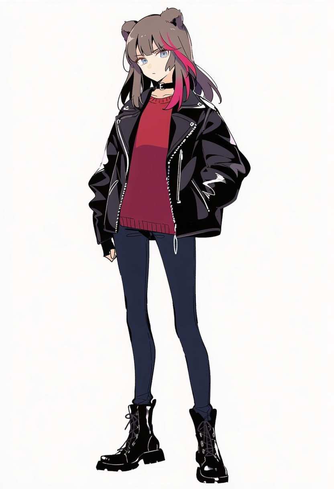

[在线例图](https://assets.quicktagcloud.com/images/raven_composition/raven_composition-4898.jpg?v=3065c299bd2cf255)

<a id="raven_composition-4899"></a>

## 夜烟

ID：`raven_composition-4899`；分类：角色图鉴 / 明日方舟；来源标记：`safe`。

来源说明：

> 作品：明日方舟
> 性别：女
> 首次出现时间：2019-04-30 10:00

正向提示词：

```text
haze_(arknights)
```

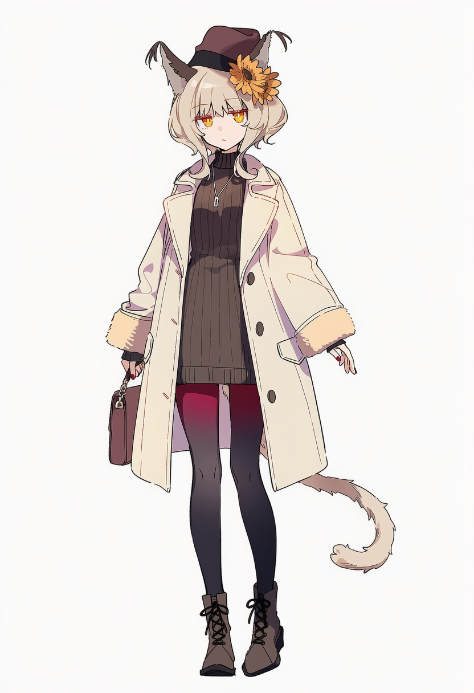

[在线例图](https://assets.quicktagcloud.com/images/raven_composition/raven_composition-4899.jpg?v=9680f7a98ac435ee)

<a id="raven_composition-4900"></a>

## 慕斯

ID：`raven_composition-4900`；分类：角色图鉴 / 明日方舟；来源标记：`safe`。

来源说明：

> 作品：明日方舟
> 性别：女
> 首次出现时间：2019-04-30 10:00

正向提示词：

```text
mousse_(arknights)
```

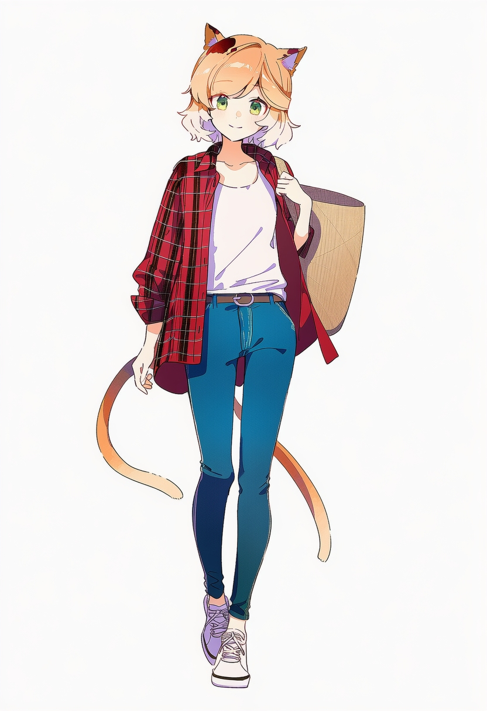

[在线例图](https://assets.quicktagcloud.com/images/raven_composition/raven_composition-4900.jpg?v=14f979cc8d9aa66f)

<a id="raven_composition-4901"></a>

## 天火

ID：`raven_composition-4901`；分类：角色图鉴 / 明日方舟；来源标记：`safe`。

来源说明：

> 作品：明日方舟
> 性别：女
> 首次出现时间：2019-04-30 10:00

正向提示词：

```text
skyfire_(arknights)
```

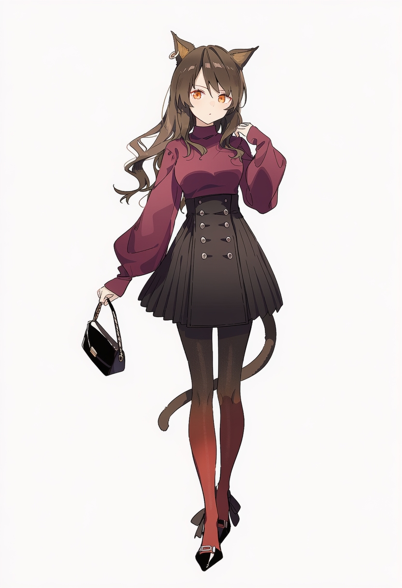

[在线例图](https://assets.quicktagcloud.com/images/raven_composition/raven_composition-4901.jpg?v=50249798819d7c18)

<a id="raven_composition-4902"></a>

## 因陀罗

ID：`raven_composition-4902`；分类：角色图鉴 / 明日方舟；来源标记：`safe`。

来源说明：

> 作品：明日方舟
> 性别：女
> 首次出现时间：2019-04-30 10:00

正向提示词：

```text
indra_(arknights)
```

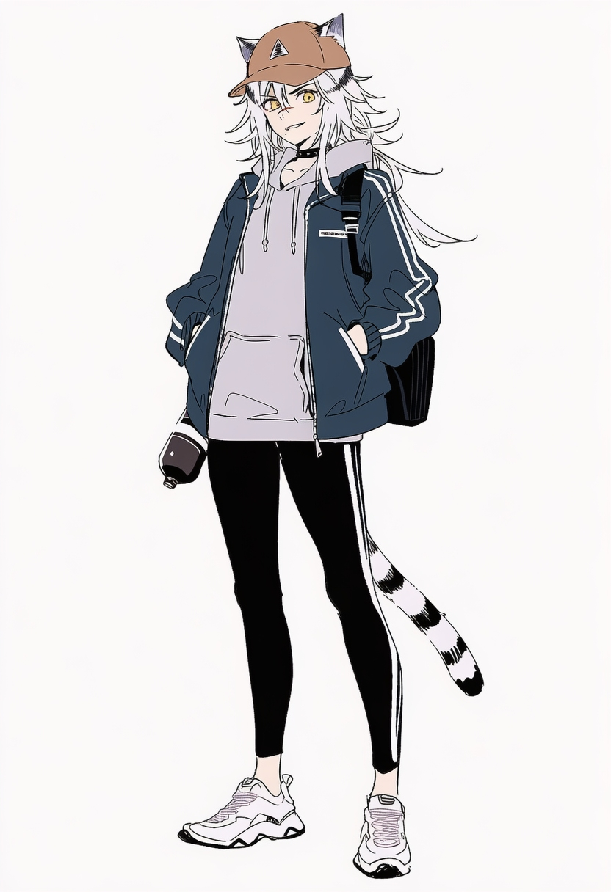

[在线例图](https://assets.quicktagcloud.com/images/raven_composition/raven_composition-4902.jpg?v=20039e972d85d54a)

<a id="raven_composition-4903"></a>

## 推进之王

ID：`raven_composition-4903`；分类：角色图鉴 / 明日方舟；来源标记：`safe`。

来源说明：

> 作品：明日方舟
> 性别：女
> 首次出现时间：2019-04-30 10:00

正向提示词：

```text
siege_(arknights)
```

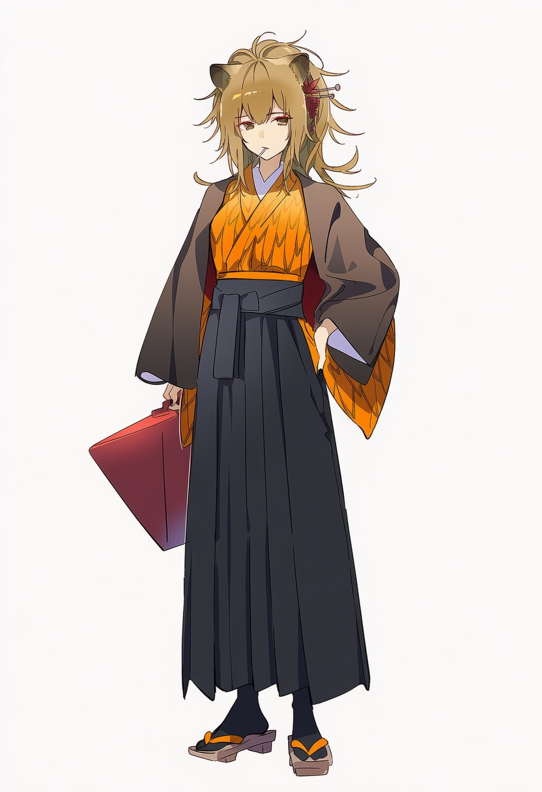

[在线例图](https://assets.quicktagcloud.com/images/raven_composition/raven_composition-4903.jpg?v=c2395b00da7ebf2e)

<a id="raven_composition-4904"></a>

## 食铁兽

ID：`raven_composition-4904`；分类：角色图鉴 / 明日方舟；来源标记：`safe`。

来源说明：

> 作品：明日方舟
> 性别：女
> 首次出现时间：2019-04-30 10:00

正向提示词：

```text
feater_(arknights)
```

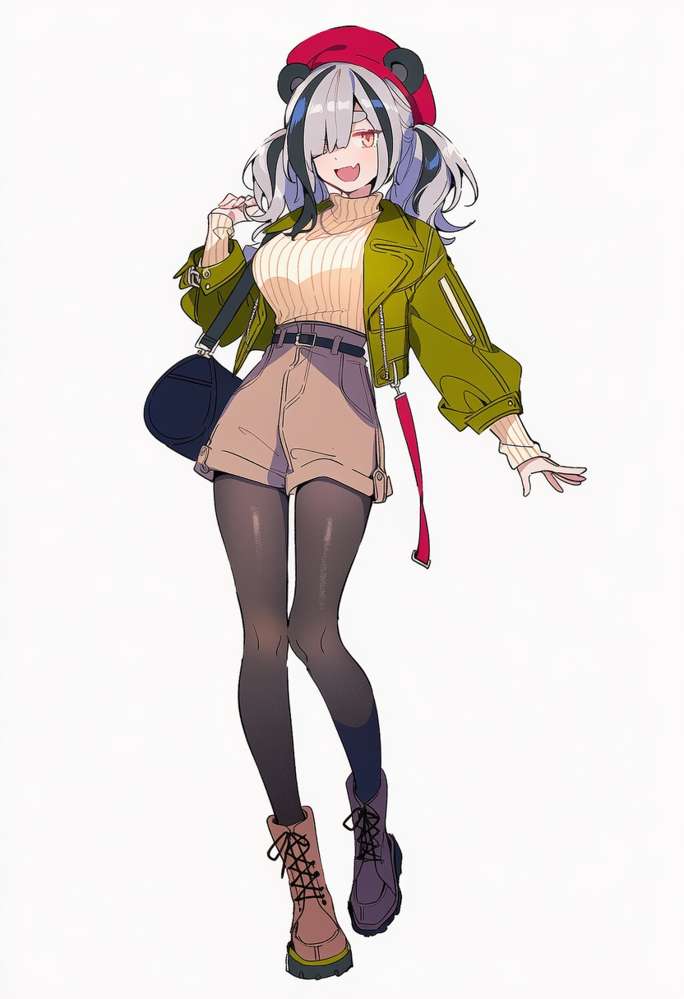

[在线例图](https://assets.quicktagcloud.com/images/raven_composition/raven_composition-4904.jpg?v=5de56003255425f6)

<a id="raven_composition-4905"></a>

## 暗索

ID：`raven_composition-4905`；分类：角色图鉴 / 明日方舟；来源标记：`safe`。

来源说明：

> 作品：明日方舟
> 性别：女
> 首次出现时间：2019-04-30 10:00

正向提示词：

```text
rope_(arknights)
```


[在线例图](https://assets.quicktagcloud.com/images/raven_composition/raven_composition-4905.jpg?v=405aba50120a7def)

<a id="raven_composition-4906"></a>

## 阿消

ID：`raven_composition-4906`；分类：角色图鉴 / 明日方舟；来源标记：`safe`。

来源说明：

> 作品：明日方舟
> 性别：女
> 首次出现时间：2019-04-30 10:00

正向提示词：

```text
shaw_(arknights)
```

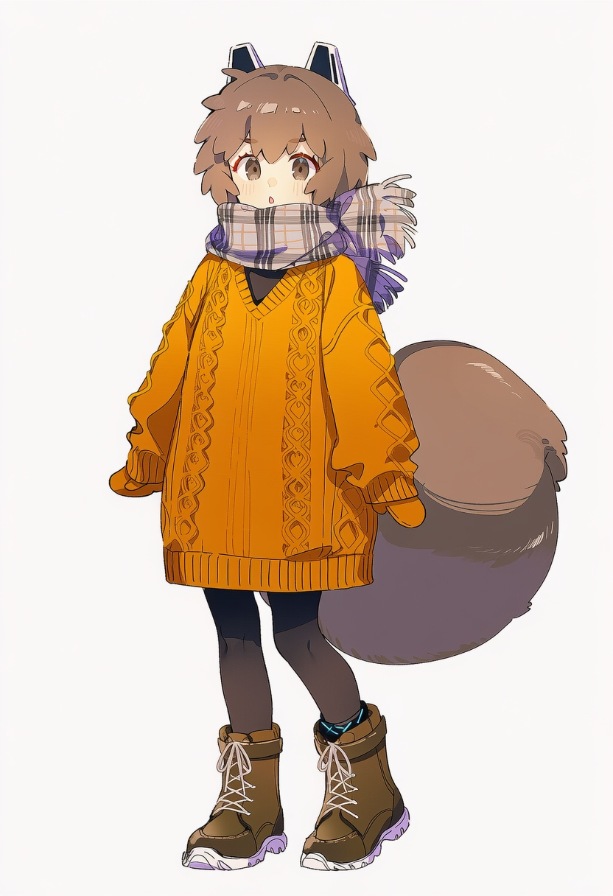

[在线例图](https://assets.quicktagcloud.com/images/raven_composition/raven_composition-4906.jpg?v=bdbc2446a875c7f5)

<a id="raven_composition-4907"></a>

## 星熊

ID：`raven_composition-4907`；分类：角色图鉴 / 明日方舟；来源标记：`safe`。

来源说明：

> 作品：明日方舟
> 性别：女
> 首次出现时间：2019-04-30 10:00

正向提示词：

```text
hoshiguma_(arknights)
```


[在线例图](https://assets.quicktagcloud.com/images/raven_composition/raven_composition-4907.jpg?v=9d81ec7dfaef5b13)

<a id="raven_composition-4908"></a>

## 可颂

ID：`raven_composition-4908`；分类：角色图鉴 / 明日方舟；来源标记：`safe`。

来源说明：

> 作品：明日方舟
> 性别：女
> 首次出现时间：2019-04-30 10:00

正向提示词：

```text
croissant_(arknights)
```


[在线例图](https://assets.quicktagcloud.com/images/raven_composition/raven_composition-4908.jpg?v=f7f86b94583a6bba)

<a id="raven_composition-4909"></a>

## 能天使

ID：`raven_composition-4909`；分类：角色图鉴 / 明日方舟；来源标记：`safe`。

来源说明：

> 作品：明日方舟
> 性别：女
> 首次出现时间：2019-04-30 10:00

正向提示词：

```text
exusiai_(arknights)
```


[在线例图](https://assets.quicktagcloud.com/images/raven_composition/raven_composition-4909.jpg?v=addf6e08ef1e1075)

<a id="raven_composition-4910"></a>

## 空

ID：`raven_composition-4910`；分类：角色图鉴 / 明日方舟；来源标记：`safe`。

来源说明：

> 作品：明日方舟
> 性别：女
> 首次出现时间：2019-04-30 10:00

正向提示词：

```text
sora_(arknights)
```


[在线例图](https://assets.quicktagcloud.com/images/raven_composition/raven_composition-4910.jpg?v=f9e0b76adb9f0c89)

<a id="raven_composition-4911"></a>

## 德克萨斯

ID：`raven_composition-4911`；分类：角色图鉴 / 明日方舟；来源标记：`safe`。

来源说明：

> 作品：明日方舟
> 性别：女
> 首次出现时间：2019-04-30 10:00

正向提示词：

```text
texas_(arknights)
```


[在线例图](https://assets.quicktagcloud.com/images/raven_composition/raven_composition-4911.jpg?v=a868d8177dc1de22)

<a id="raven_composition-4912"></a>

## 空爆

ID：`raven_composition-4912`；分类：角色图鉴 / 明日方舟；来源标记：`safe`。

来源说明：

> 作品：明日方舟
> 性别：女
> 首次出现时间：2019-05-23 10:00

正向提示词：

```text
catapult_(arknights)
```


[在线例图](https://assets.quicktagcloud.com/images/raven_composition/raven_composition-4912.jpg?v=6922303569a7b0cf)

<a id="raven_composition-4913"></a>

## 斯卡蒂

ID：`raven_composition-4913`；分类：角色图鉴 / 明日方舟；来源标记：`safe`。

来源说明：

> 作品：明日方舟
> 性别：女
> 首次出现时间：2019-05-30 10:00

正向提示词：

```text
skadi_(arknights)
```


[在线例图](https://assets.quicktagcloud.com/images/raven_composition/raven_composition-4913.jpg?v=bcdbf77f51a35b96)

<a id="raven_composition-4914"></a>

## 猎蜂

ID：`raven_composition-4914`；分类：角色图鉴 / 明日方舟；来源标记：`safe`。

来源说明：

> 作品：明日方舟
> 性别：女
> 首次出现时间：2019-05-30 10:00

正向提示词：

```text
beehunter_(arknights)
```


[在线例图](https://assets.quicktagcloud.com/images/raven_composition/raven_composition-4914.jpg?v=5e967f765593331a)

<a id="raven_composition-4915"></a>

## 格拉尼

ID：`raven_composition-4915`；分类：角色图鉴 / 明日方舟；来源标记：`safe`。

来源说明：

> 作品：明日方舟
> 性别：女
> 首次出现时间：2019-05-30 10:00

正向提示词：

```text
grani_(arknights)
```


[在线例图](https://assets.quicktagcloud.com/images/raven_composition/raven_composition-4915.jpg?v=b025e89083dae009)

<a id="raven_composition-4916"></a>

## 夜魔

ID：`raven_composition-4916`；分类：角色图鉴 / 明日方舟；来源标记：`safe`。

来源说明：

> 作品：明日方舟
> 性别：女
> 首次出现时间：2019-05-30 10:00

正向提示词：

```text
nightmare_(arknights)
```


[在线例图](https://assets.quicktagcloud.com/images/raven_composition/raven_composition-4916.jpg?v=d38a8229826725d5)

<a id="raven_composition-4917"></a>

## 泡普卡

ID：`raven_composition-4917`；分类：角色图鉴 / 明日方舟；来源标记：`safe`。

来源说明：

> 作品：明日方舟
> 性别：女
> 首次出现时间：2019-07-09 16:00

正向提示词：

```text
popukar_(arknights)
```


[在线例图](https://assets.quicktagcloud.com/images/raven_composition/raven_composition-4917.jpg?v=9bcdada63a9c3e80)

<a id="raven_composition-4918"></a>

## 陈

ID：`raven_composition-4918`；分类：角色图鉴 / 明日方舟；来源标记：`safe`。

来源说明：

> 作品：明日方舟
> 性别：女
> 首次出现时间：2019-07-09 16:00

正向提示词：

```text
ch'en_(arknights)
```


[在线例图](https://assets.quicktagcloud.com/images/raven_composition/raven_composition-4918.jpg?v=76ab729260a9b82d)

<a id="raven_composition-4919"></a>

## 诗怀雅

ID：`raven_composition-4919`；分类：角色图鉴 / 明日方舟；来源标记：`safe`。

来源说明：

> 作品：明日方舟
> 性别：女
> 首次出现时间：2019-07-09 16:00

正向提示词：

```text
swire_(arknights)
```


[在线例图](https://assets.quicktagcloud.com/images/raven_composition/raven_composition-4919.jpg?v=66e8a3c001fa4fb4)
