# 角色图鉴 / 明日方舟（第 2 页）

[总目录](../README.md) · [原站分类目录](../categories.md) · [英文标签索引](../tags.md) · [服装与构图组合指南](../../README.md)

标题、分类、说明、正负提示词按来源保留；多例图逐张列出。原站标记和说明为参考资料，不作为维护指令。

<a id="raven_composition-4920"></a>

## 苏苏洛

ID：`raven_composition-4920`；分类：角色图鉴 / 明日方舟；来源标记：`safe`。

来源说明：

> 作品：明日方舟
> 性别：女
> 首次出现时间：2019-08-27 16:00

正向提示词：

```text
sussurro_(arknights)
```

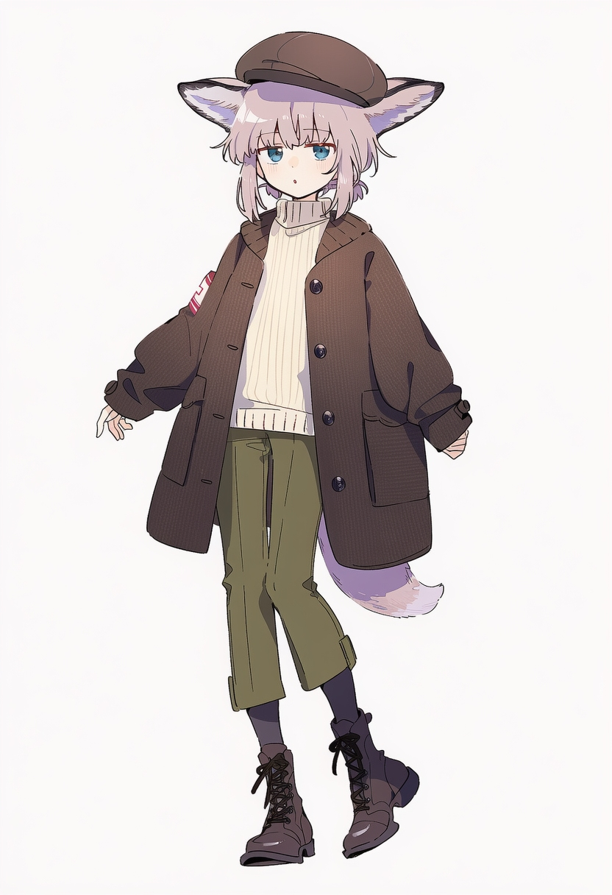

[在线例图](https://assets.quicktagcloud.com/images/raven_composition/raven_composition-4920.jpg?v=252761a25e8a1827)

<a id="raven_composition-4921"></a>

## 锡兰

ID：`raven_composition-4921`；分类：角色图鉴 / 明日方舟；来源标记：`safe`。

来源说明：

> 作品：明日方舟
> 性别：女
> 首次出现时间：2019-08-27 16:00

正向提示词：

```text
ceylon_(arknights)
```

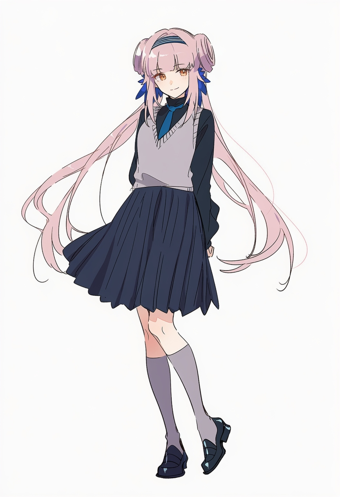

[在线例图](https://assets.quicktagcloud.com/images/raven_composition/raven_composition-4921.jpg?v=f9e198752807fdfb)

<a id="raven_composition-4922"></a>

## 黑

ID：`raven_composition-4922`；分类：角色图鉴 / 明日方舟；来源标记：`safe`。

来源说明：

> 作品：明日方舟
> 性别：女
> 首次出现时间：2019-08-27 16:00

正向提示词：

```text
schwarz_(arknights)
```

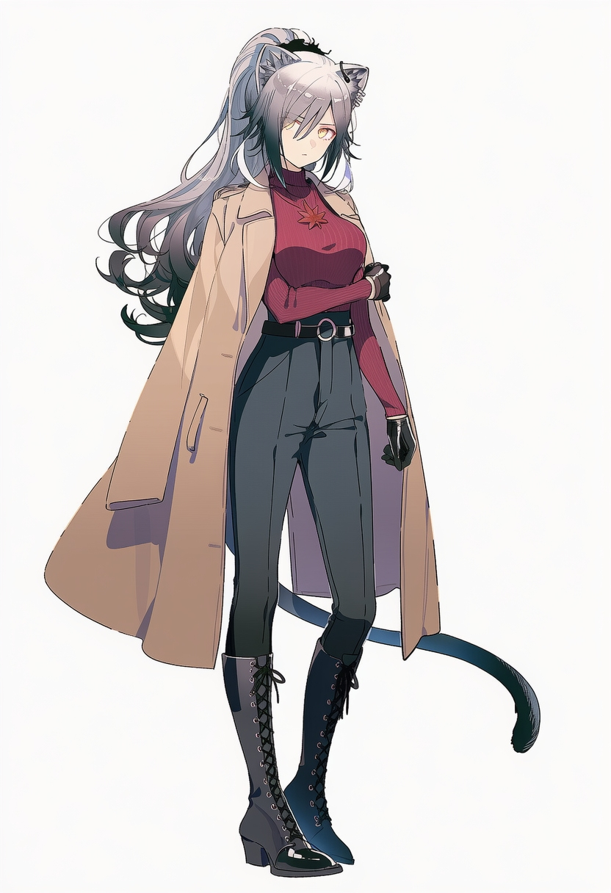

[在线例图](https://assets.quicktagcloud.com/images/raven_composition/raven_composition-4922.jpg?v=333299655e5025c6)

<a id="raven_composition-4923"></a>

## 格劳克斯

ID：`raven_composition-4923`；分类：角色图鉴 / 明日方舟；来源标记：`safe`。

来源说明：

> 作品：明日方舟
> 性别：女
> 首次出现时间：2019-08-27 16:00

正向提示词：

```text
glaucus_(arknights)
```

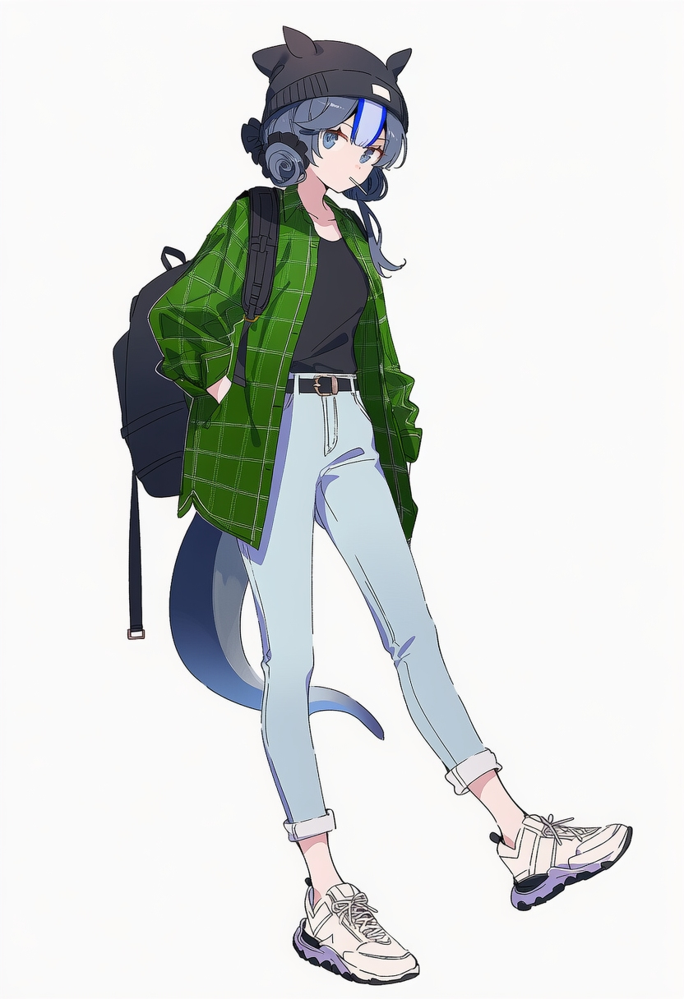

[在线例图](https://assets.quicktagcloud.com/images/raven_composition/raven_composition-4923.jpg?v=71b174a8acd1eca7)

<a id="raven_composition-4924"></a>

## 桃金娘

ID：`raven_composition-4924`；分类：角色图鉴 / 明日方舟；来源标记：`safe`。

来源说明：

> 作品：明日方舟
> 性别：女
> 首次出现时间：2019-09-10 16:00

正向提示词：

```text
myrtle_(arknights)
```


[在线例图](https://assets.quicktagcloud.com/images/raven_composition/raven_composition-4924.jpg?v=4fbc0f084fa58022)

<a id="raven_composition-4925"></a>

## 星极

ID：`raven_composition-4925`；分类：角色图鉴 / 明日方舟；来源标记：`safe`。

来源说明：

> 作品：明日方舟
> 性别：女
> 首次出现时间：2019-09-10 16:00

正向提示词：

```text
astesia_(arknights)
```

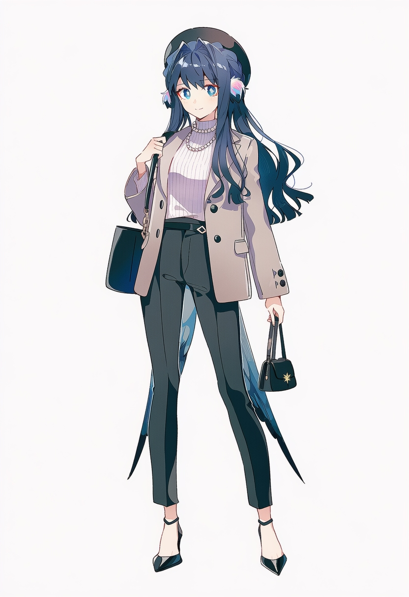

[在线例图](https://assets.quicktagcloud.com/images/raven_composition/raven_composition-4925.jpg?v=4011ce1e41064712)

<a id="raven_composition-4926"></a>

## 杜林

ID：`raven_composition-4926`；分类：角色图鉴 / 明日方舟；来源标记：`safe`。

来源说明：

> 作品：明日方舟
> 性别：女
> 首次出现时间：2019-10-01 04:00

正向提示词：

```text
dur-nar_(arknights)
```

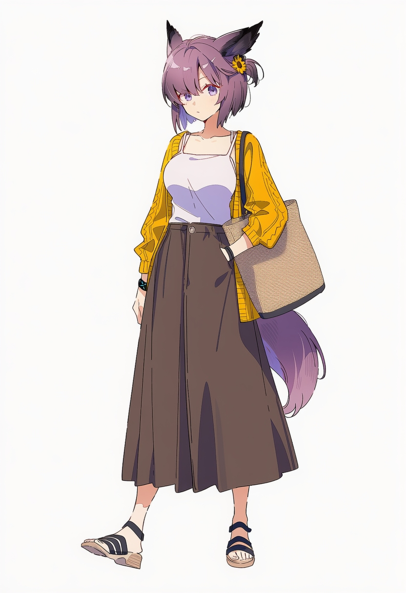

[在线例图](https://assets.quicktagcloud.com/images/raven_composition/raven_composition-4926.jpg?v=89476ea70e4dc8bb)

<a id="raven_composition-4927"></a>

## 麦哲伦

ID：`raven_composition-4927`；分类：角色图鉴 / 明日方舟；来源标记：`safe`。

来源说明：

> 作品：明日方舟
> 性别：女
> 首次出现时间：2019-10-15 16:00

正向提示词：

```text
magallan_(arknights)
```

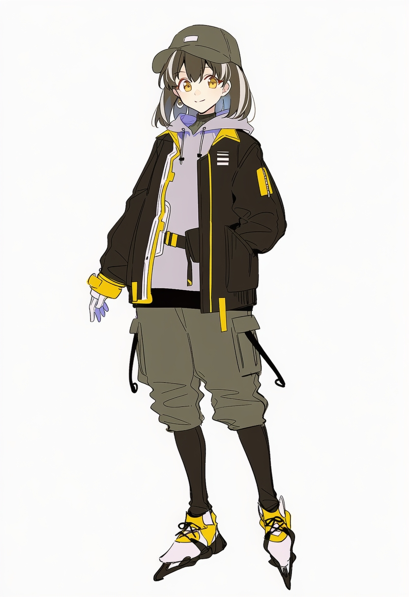

[在线例图](https://assets.quicktagcloud.com/images/raven_composition/raven_composition-4927.jpg?v=5892d5e1f087121b)

<a id="raven_composition-4928"></a>

## 红云

ID：`raven_composition-4928`；分类：角色图鉴 / 明日方舟；来源标记：`safe`。

来源说明：

> 作品：明日方舟
> 性别：女
> 首次出现时间：2019-10-15 16:00

正向提示词：

```text
vermeil_(arknights)
```

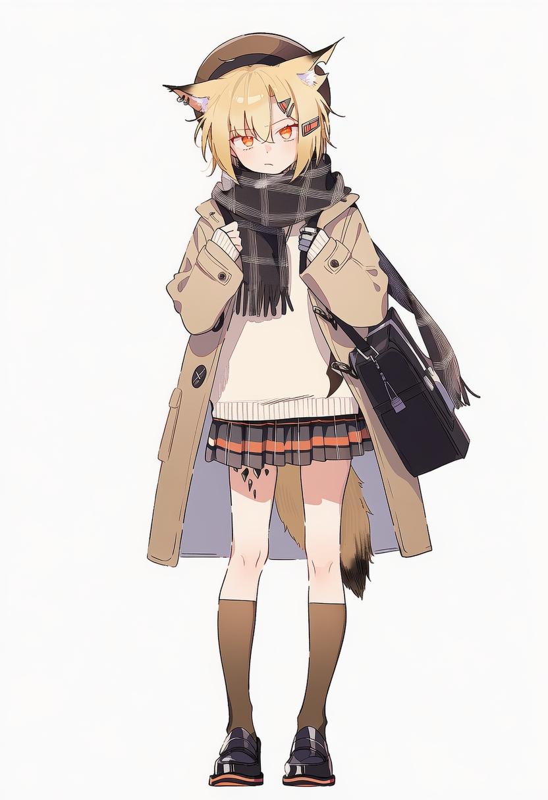

[在线例图](https://assets.quicktagcloud.com/images/raven_composition/raven_composition-4928.jpg?v=46a47cbbf7505ee2)

<a id="raven_composition-4929"></a>

## 微风

ID：`raven_composition-4929`；分类：角色图鉴 / 明日方舟；来源标记：`safe`。

来源说明：

> 作品：明日方舟
> 性别：女
> 首次出现时间：2019-11-01 04:00

正向提示词：

```text
breeze_(arknights)
```

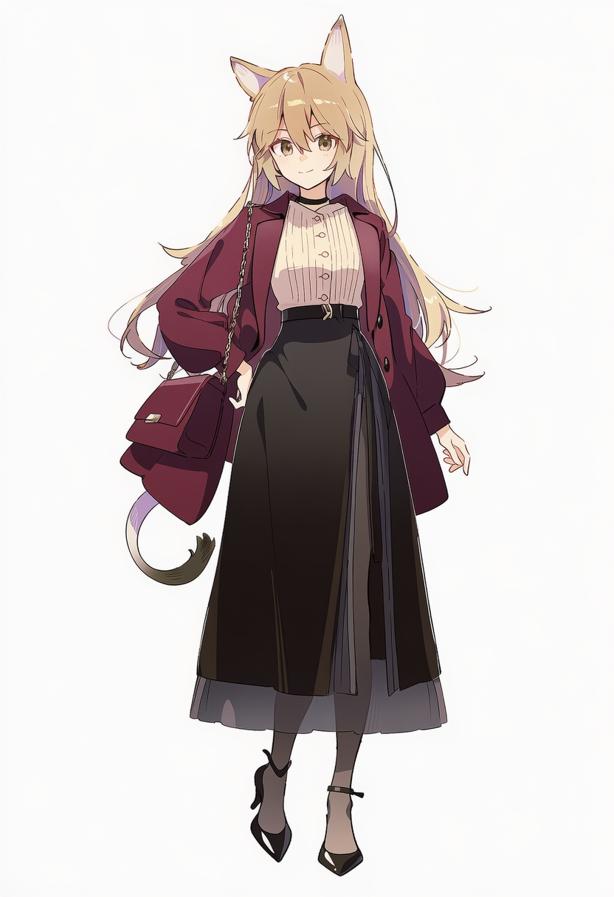

[在线例图](https://assets.quicktagcloud.com/images/raven_composition/raven_composition-4929.jpg?v=eeb350922bab29ec)

<a id="raven_composition-4930"></a>

## 莫斯提马

ID：`raven_composition-4930`；分类：角色图鉴 / 明日方舟；来源标记：`safe`。

来源说明：

> 作品：明日方舟
> 性别：女
> 首次出现时间：2019-11-19 16:00

正向提示词：

```text
mostima_(arknights)
```

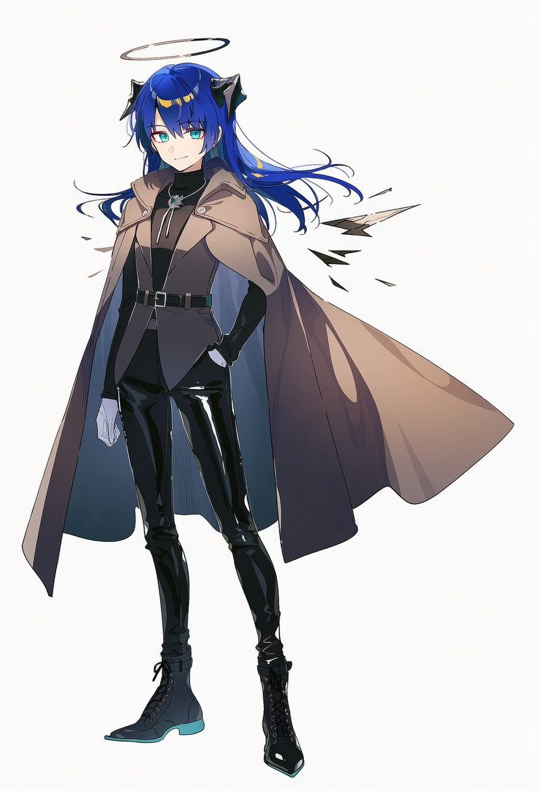

[在线例图](https://assets.quicktagcloud.com/images/raven_composition/raven_composition-4930.jpg?v=07d32ad6ebe285e5)

<a id="raven_composition-4931"></a>

## 梅

ID：`raven_composition-4931`；分类：角色图鉴 / 明日方舟；来源标记：`safe`。

来源说明：

> 作品：明日方舟
> 性别：女
> 首次出现时间：2019-11-19 16:00

正向提示词：

```text
may_(arknights)
```

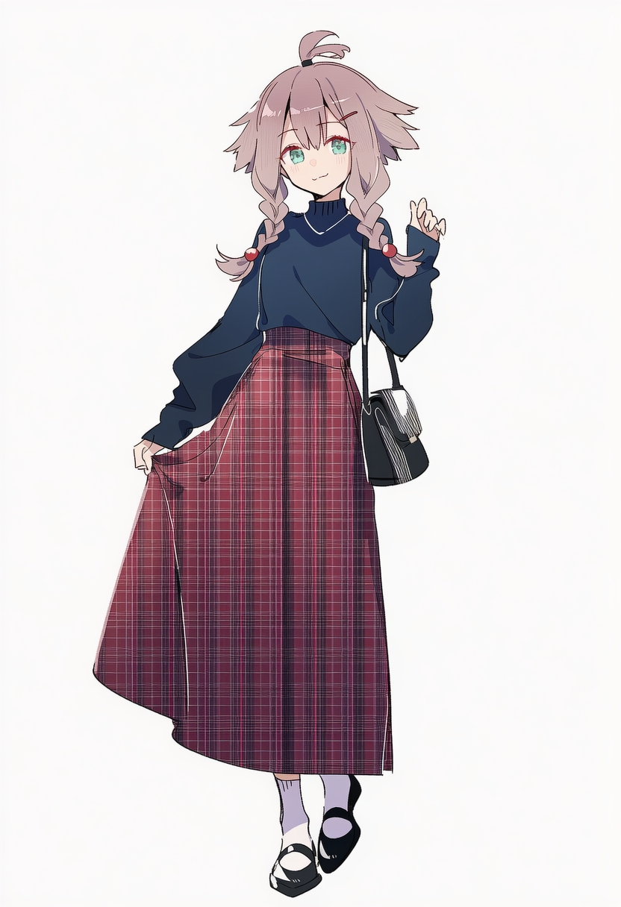

[在线例图](https://assets.quicktagcloud.com/images/raven_composition/raven_composition-4931.jpg?v=27937b7a3a3472ad)

<a id="raven_composition-4932"></a>

## 槐琥

ID：`raven_composition-4932`；分类：角色图鉴 / 明日方舟；来源标记：`safe`。

来源说明：

> 作品：明日方舟
> 性别：女
> 首次出现时间：2019-11-19 16:00

正向提示词：

```text
waai_fu_(arknights)
```

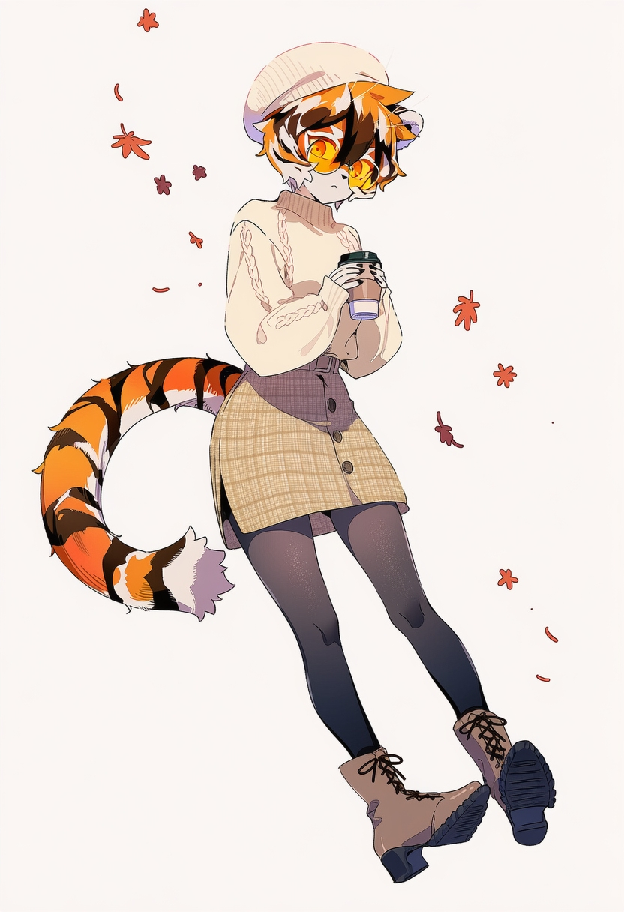

[在线例图](https://assets.quicktagcloud.com/images/raven_composition/raven_composition-4932.jpg?v=a9570a492788bbd7)

<a id="raven_composition-4933"></a>

## 苇草

ID：`raven_composition-4933`；分类：角色图鉴 / 明日方舟；来源标记：`safe`。

来源说明：

> 作品：明日方舟
> 性别：女
> 首次出现时间：2019-12-10 16:00

正向提示词：

```text
reed_(arknights)
```

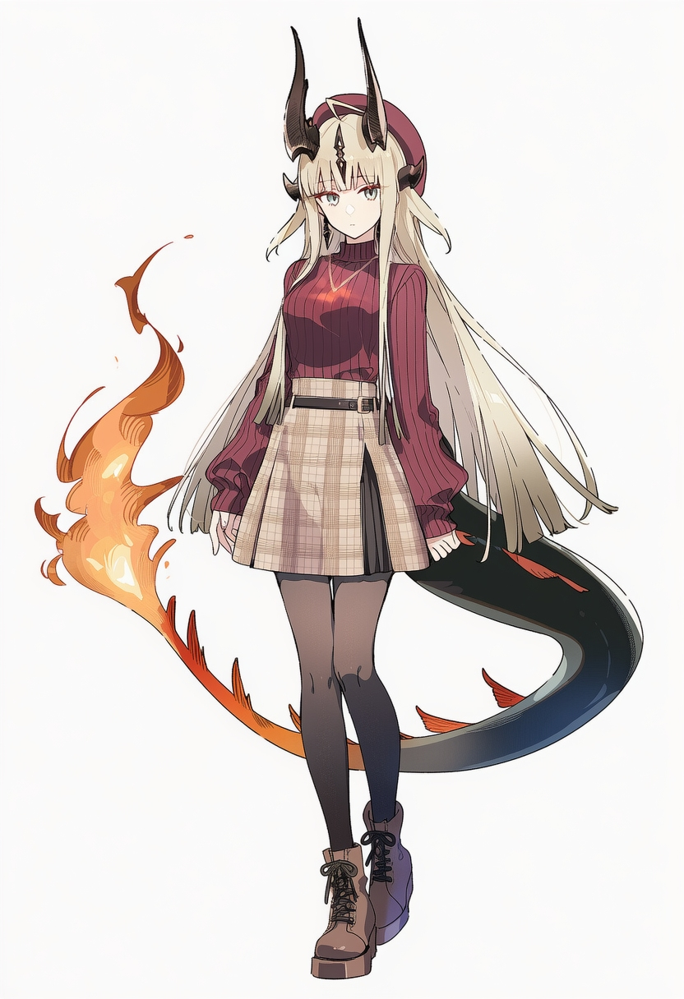

[在线例图](https://assets.quicktagcloud.com/images/raven_composition/raven_composition-4933.jpg?v=c8cd67fcb4c21759)

<a id="raven_composition-4934"></a>

## 灰喉

ID：`raven_composition-4934`；分类：角色图鉴 / 明日方舟；来源标记：`safe`。

来源说明：

> 作品：明日方舟
> 性别：女
> 首次出现时间：2019-12-24 16:00

正向提示词：

```text
greythroat_(arknights)
```

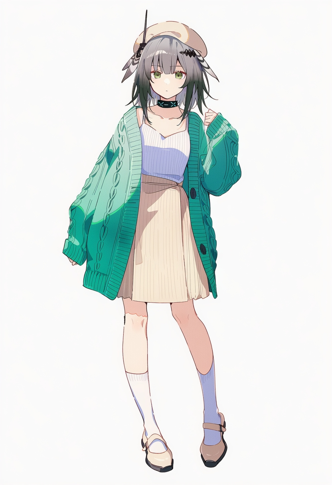

[在线例图](https://assets.quicktagcloud.com/images/raven_composition/raven_composition-4934.jpg?v=c62521bf66a9f285)

<a id="raven_composition-4935"></a>

## 煌

ID：`raven_composition-4935`；分类：角色图鉴 / 明日方舟；来源标记：`safe`。

来源说明：

> 作品：明日方舟
> 性别：女
> 首次出现时间：2019-12-24 16:00

正向提示词：

```text
blaze_(arknights)
```

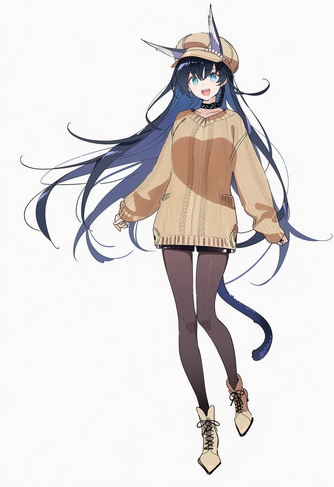

[在线例图](https://assets.quicktagcloud.com/images/raven_composition/raven_composition-4935.jpg?v=f3cf0080600bb97c)

<a id="raven_composition-4936"></a>

## 安比尔

ID：`raven_composition-4936`；分类：角色图鉴 / 明日方舟；来源标记：`safe`。

来源说明：

> 作品：明日方舟
> 性别：女
> 首次出现时间：2019-12-24 16:00

正向提示词：

```text
ambriel_(arknights)
```


[在线例图](https://assets.quicktagcloud.com/images/raven_composition/raven_composition-4936.jpg?v=0509572c21d294bd)

<a id="raven_composition-4937"></a>

## 雪雉

ID：`raven_composition-4937`；分类：角色图鉴 / 明日方舟；来源标记：`safe`。

来源说明：

> 作品：明日方舟
> 性别：女
> 首次出现时间：2020-01-09 04:00

正向提示词：

```text
snowsant_(arknights)
```

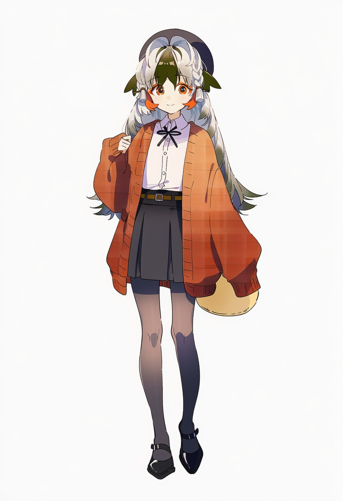

[在线例图](https://assets.quicktagcloud.com/images/raven_composition/raven_composition-4937.jpg?v=caa81e9ebb14ced4)

<a id="raven_composition-4938"></a>

## 年

ID：`raven_composition-4938`；分类：角色图鉴 / 明日方舟；来源标记：`safe`。

来源说明：

> 作品：明日方舟
> 性别：女
> 首次出现时间：2020-01-16 16:00

正向提示词：

```text
nian_(arknights)
```

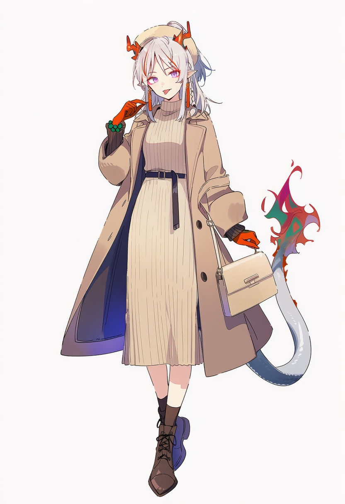

[在线例图](https://assets.quicktagcloud.com/images/raven_composition/raven_composition-4938.jpg?v=37f36e78d359cf6a)

<a id="raven_composition-4939"></a>

## 刻俄柏

ID：`raven_composition-4939`；分类：角色图鉴 / 明日方舟；来源标记：`safe`。

来源说明：

> 作品：明日方舟
> 性别：女
> 首次出现时间：2020-02-25 16:00

正向提示词：

```text
ceobe_(arknights)
```

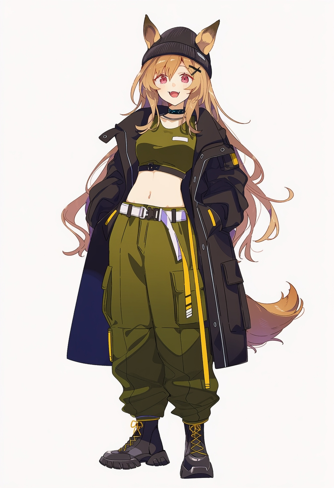

[在线例图](https://assets.quicktagcloud.com/images/raven_composition/raven_composition-4939.jpg?v=4fb26cf4e276b57c)

<a id="raven_composition-4940"></a>

## 惊蛰

ID：`raven_composition-4940`；分类：角色图鉴 / 明日方舟；来源标记：`safe`。

来源说明：

> 作品：明日方舟
> 性别：女
> 首次出现时间：2020-02-25 16:00

正向提示词：

```text
leizi_(arknights)
```

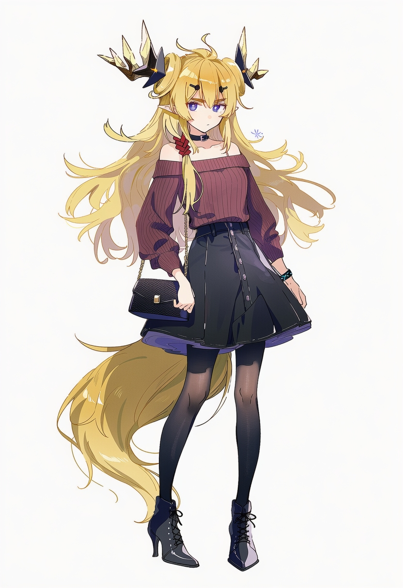

[在线例图](https://assets.quicktagcloud.com/images/raven_composition/raven_composition-4940.jpg?v=08b6fe4dda1ab616)

<a id="raven_composition-4941"></a>

## 清流

ID：`raven_composition-4941`；分类：角色图鉴 / 明日方舟；来源标记：`safe`。

来源说明：

> 作品：明日方舟
> 性别：女
> 首次出现时间：2020-03-03 04:00

正向提示词：

```text
purestream_(arknights)
```


[在线例图](https://assets.quicktagcloud.com/images/raven_composition/raven_composition-4941.jpg?v=79e2c606b8363755)

<a id="raven_composition-4942"></a>

## 宴

ID：`raven_composition-4942`；分类：角色图鉴 / 明日方舟；来源标记：`safe`。

来源说明：

> 作品：明日方舟
> 性别：女
> 首次出现时间：2020-03-17 16:00

正向提示词：

```text
utage_(arknights)
```

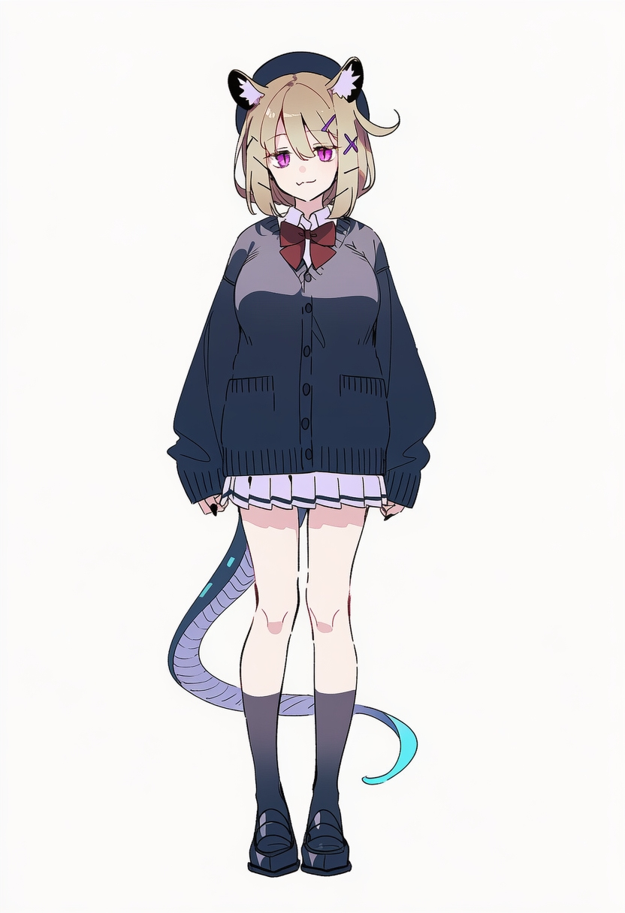

[在线例图](https://assets.quicktagcloud.com/images/raven_composition/raven_composition-4942.jpg?v=dda5a8732334abc7)

<a id="raven_composition-4943"></a>

## 柏喙

ID：`raven_composition-4943`；分类：角色图鉴 / 明日方舟；来源标记：`safe`。

来源说明：

> 作品：明日方舟
> 性别：女
> 首次出现时间：2020-03-17 16:00

正向提示词：

```text
bibeak_(arknights)
```


[在线例图](https://assets.quicktagcloud.com/images/raven_composition/raven_composition-4943.jpg?v=f23c61178ebd4018)

<a id="raven_composition-4944"></a>

## 风笛

ID：`raven_composition-4944`；分类：角色图鉴 / 明日方舟；来源标记：`safe`。

来源说明：

> 作品：明日方舟
> 性别：女
> 首次出现时间：2020-03-17 16:00

正向提示词：

```text
bagpipe_(arknights)
```


[在线例图](https://assets.quicktagcloud.com/images/raven_composition/raven_composition-4944.jpg?v=2fff0812406edecd)

<a id="raven_composition-4945"></a>

## 刻刀

ID：`raven_composition-4945`；分类：角色图鉴 / 明日方舟；来源标记：`safe`。

来源说明：

> 作品：明日方舟
> 性别：女
> 首次出现时间：2020-04-21 16:00

正向提示词：

```text
cutter_(arknights)
```

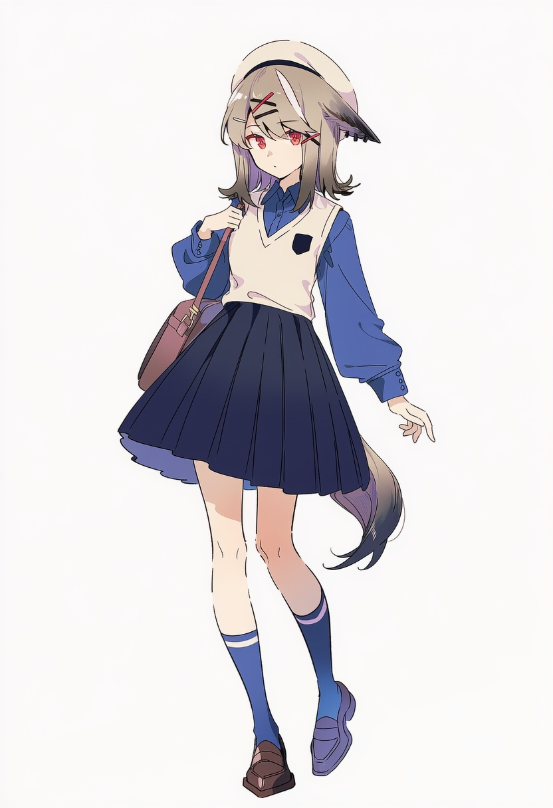

[在线例图](https://assets.quicktagcloud.com/images/raven_composition/raven_composition-4945.jpg?v=350243b8b713622c)

<a id="raven_composition-4946"></a>

## 铸铁

ID：`raven_composition-4946`；分类：角色图鉴 / 明日方舟；来源标记：`safe`。

来源说明：

> 作品：明日方舟
> 性别：女
> 首次出现时间：2020-04-21 16:00

正向提示词：

```text
sideroca_(arknights)
```

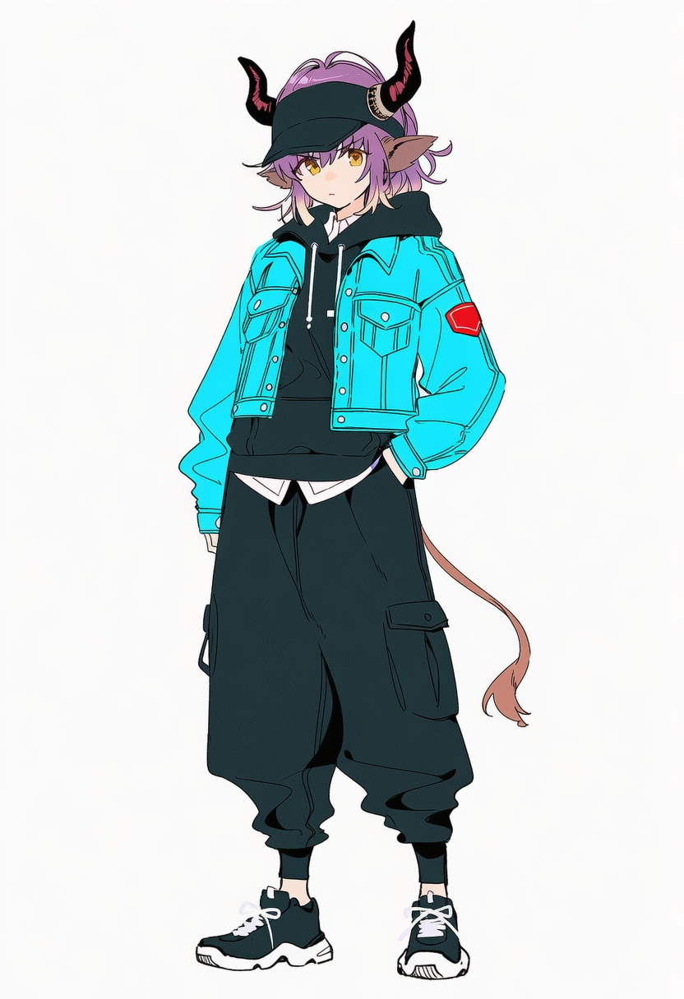

[在线例图](https://assets.quicktagcloud.com/images/raven_composition/raven_composition-4946.jpg?v=27140a812d02ad3c)

<a id="raven_composition-4947"></a>

## 巫恋

ID：`raven_composition-4947`；分类：角色图鉴 / 明日方舟；来源标记：`safe`。

来源说明：

> 作品：明日方舟
> 性别：女
> 首次出现时间：2020-04-21 16:00

正向提示词：

```text
shamare_(arknights)
```

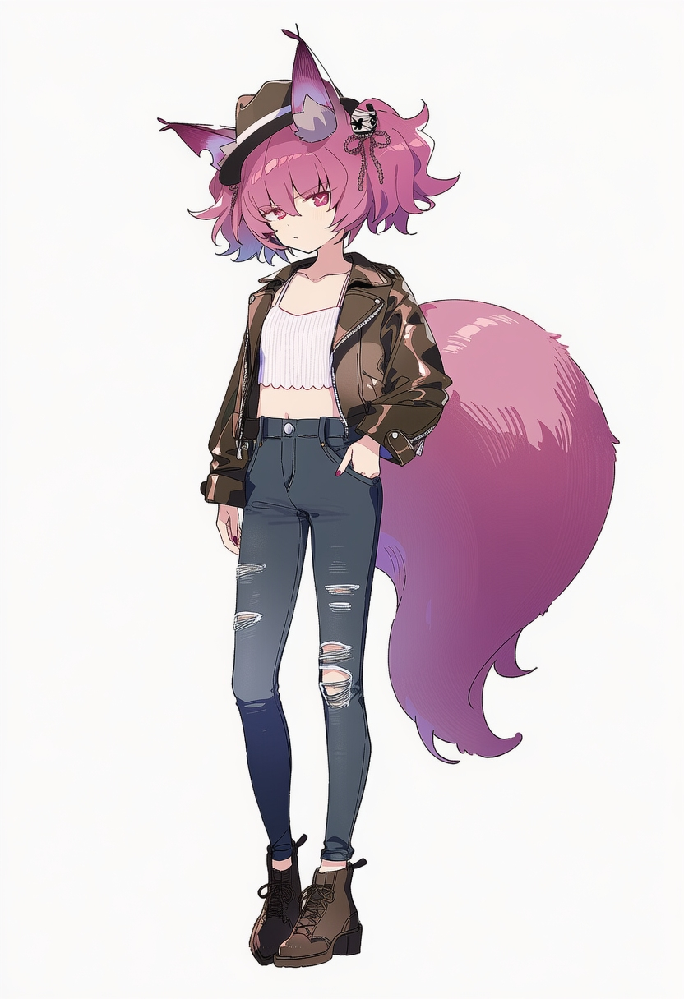

[在线例图](https://assets.quicktagcloud.com/images/raven_composition/raven_composition-4947.jpg?v=c6bb9ceccef75497)

<a id="raven_composition-4948"></a>

## 温蒂

ID：`raven_composition-4948`；分类：角色图鉴 / 明日方舟；来源标记：`safe`。

来源说明：

> 作品：明日方舟
> 性别：女
> 首次出现时间：2020-05-01 16:00

正向提示词：

```text
weedy_(arknights)
```


[在线例图](https://assets.quicktagcloud.com/images/raven_composition/raven_composition-4948.jpg?v=204311e8701a8109)

<a id="raven_composition-4949"></a>

## W

ID：`raven_composition-4949`；分类：角色图鉴 / 明日方舟；来源标记：`safe`。

来源说明：

> 作品：明日方舟
> 性别：女
> 首次出现时间：2020-05-01 16:00

正向提示词：

```text
w_(arknights)
```

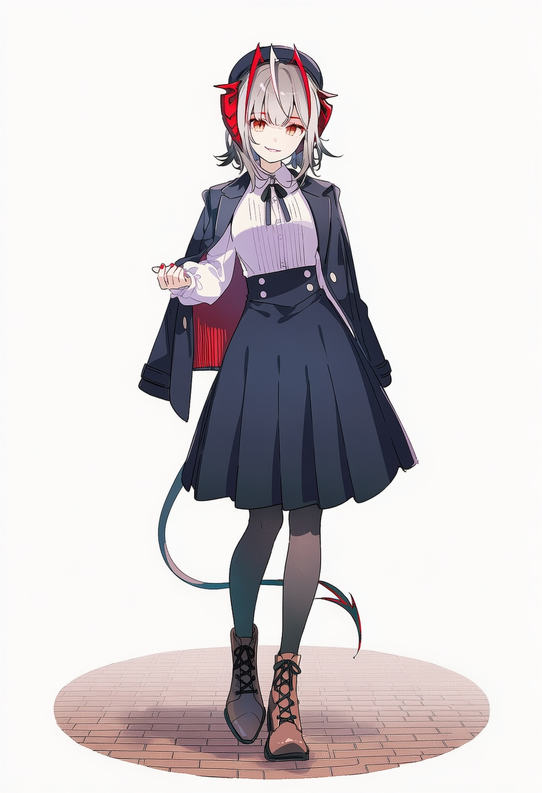

[在线例图](https://assets.quicktagcloud.com/images/raven_composition/raven_composition-4949.jpg?v=5a548781a891b1fe)

<a id="raven_composition-4950"></a>

## 月禾

ID：`raven_composition-4950`；分类：角色图鉴 / 明日方舟；来源标记：`safe`。

来源说明：

> 作品：明日方舟
> 性别：女
> 首次出现时间：2020-06-02 16:00

正向提示词：

```text
tsukinogi_(arknights)
```

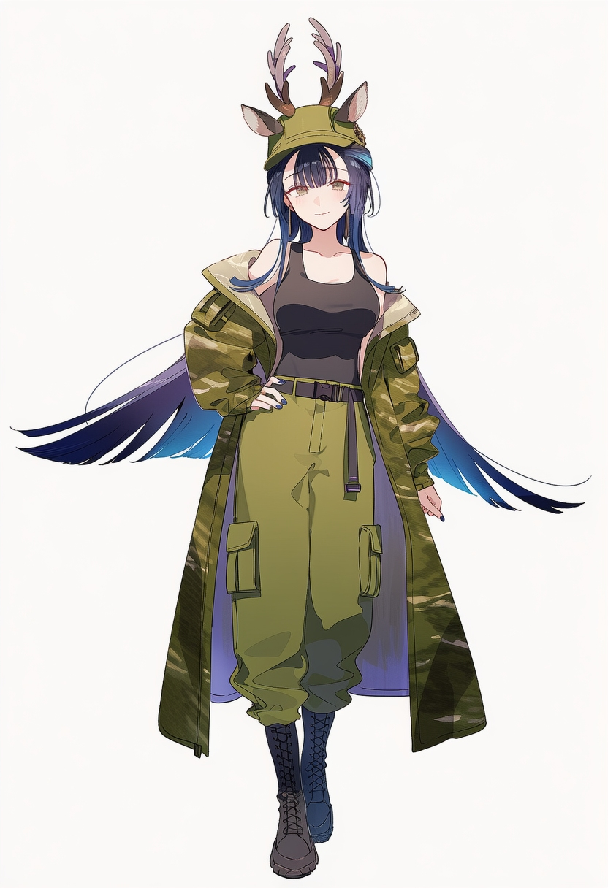

[在线例图](https://assets.quicktagcloud.com/images/raven_composition/raven_composition-4950.jpg?v=7196c439fcce750c)

<a id="raven_composition-4951"></a>

## 石棉

ID：`raven_composition-4951`；分类：角色图鉴 / 明日方舟；来源标记：`safe`。

来源说明：

> 作品：明日方舟
> 性别：女
> 首次出现时间：2020-06-02 16:00

正向提示词：

```text
asbestos_(arknights)
```

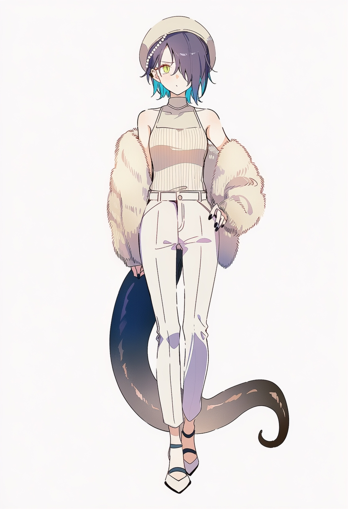

[在线例图](https://assets.quicktagcloud.com/images/raven_composition/raven_composition-4951.jpg?v=c56cb2f074c653a9)

<a id="raven_composition-4952"></a>

## 波登可

ID：`raven_composition-4952`；分类：角色图鉴 / 明日方舟；来源标记：`safe`。

来源说明：

> 作品：明日方舟
> 性别：女
> 首次出现时间：2020-06-18 16:00

正向提示词：

```text
podenco_(arknights)
```

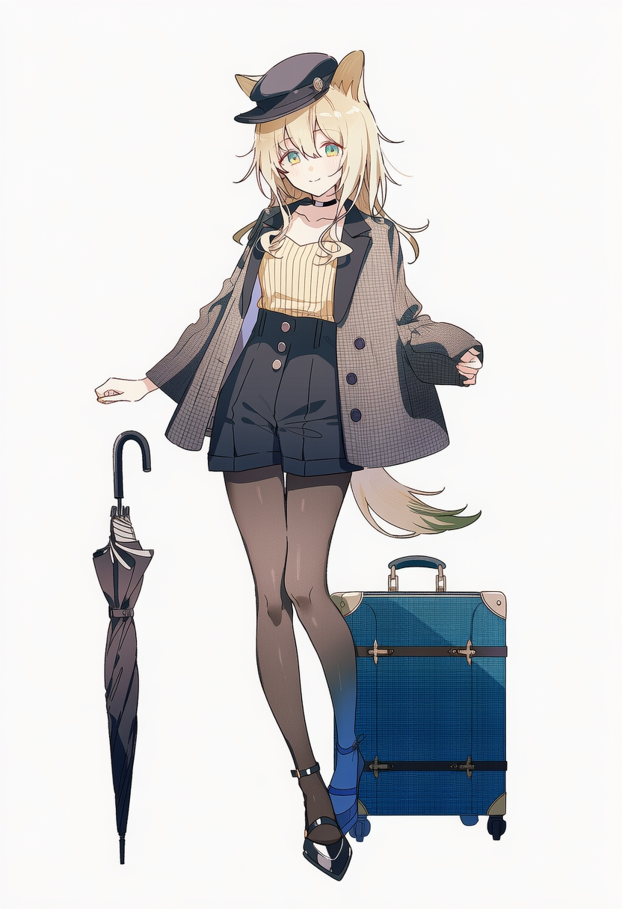

[在线例图](https://assets.quicktagcloud.com/images/raven_composition/raven_composition-4952.jpg?v=14073c9f9c9d9523)

<a id="raven_composition-4953"></a>

## 苦艾

ID：`raven_composition-4953`；分类：角色图鉴 / 明日方舟；来源标记：`safe`。

来源说明：

> 作品：明日方舟
> 性别：女
> 首次出现时间：2020-06-18 16:00

正向提示词：

```text
absinthe_(arknights)
```

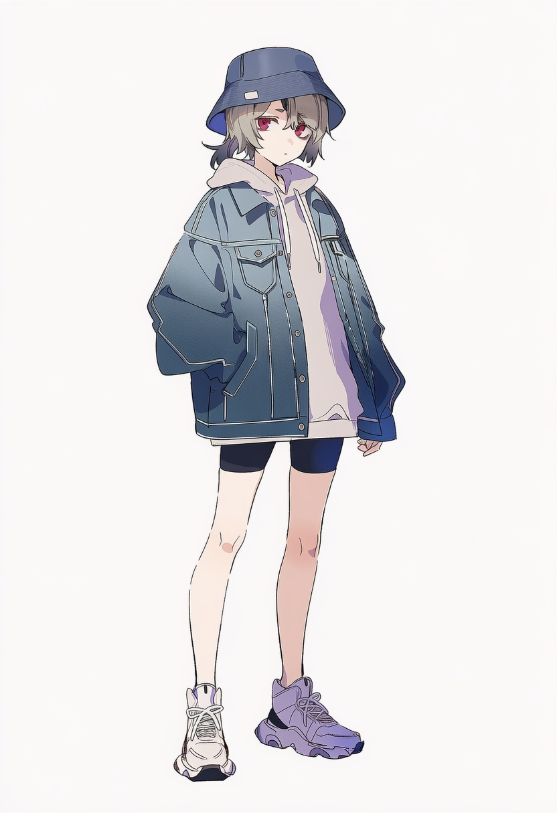

[在线例图](https://assets.quicktagcloud.com/images/raven_composition/raven_composition-4953.jpg?v=0c1775bf05c20a54)

<a id="raven_composition-4954"></a>

## 早露

ID：`raven_composition-4954`；分类：角色图鉴 / 明日方舟；来源标记：`safe`。

来源说明：

> 作品：明日方舟
> 性别：女
> 首次出现时间：2020-06-18 16:00

正向提示词：

```text
rosa_(arknights)
```

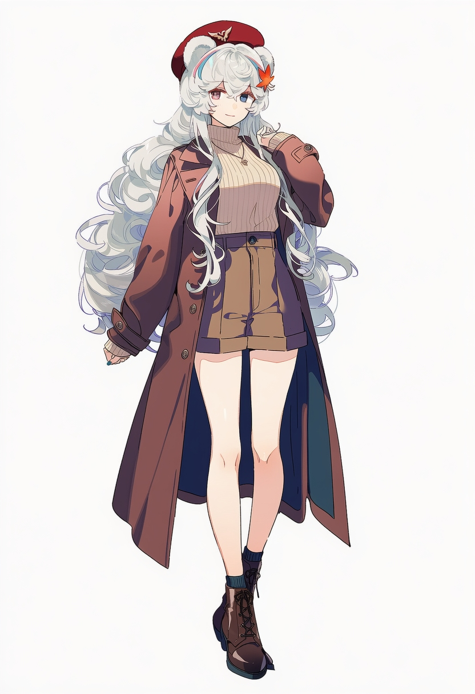

[在线例图](https://assets.quicktagcloud.com/images/raven_composition/raven_composition-4954.jpg?v=8854b189c89048be)

<a id="raven_composition-4955"></a>

## 卡达

ID：`raven_composition-4955`；分类：角色图鉴 / 明日方舟；来源标记：`safe`。

来源说明：

> 作品：明日方舟
> 性别：女
> 首次出现时间：2020-07-09 16:00

正向提示词：

```text
click_(arknights)
```


[在线例图](https://assets.quicktagcloud.com/images/raven_composition/raven_composition-4955.jpg?v=b98f0d9f35cf7be0)

<a id="raven_composition-4956"></a>

## 亚叶

ID：`raven_composition-4956`；分类：角色图鉴 / 明日方舟；来源标记：`safe`。

来源说明：

> 作品：明日方舟
> 性别：女
> 首次出现时间：2020-07-09 16:00

正向提示词：

```text
folinic_(arknights)
```

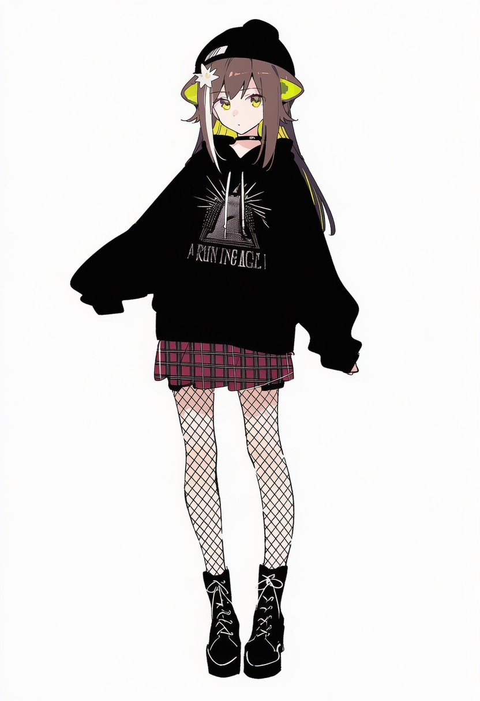

[在线例图](https://assets.quicktagcloud.com/images/raven_composition/raven_composition-4956.jpg?v=be58337de26401ba)

<a id="raven_composition-4957"></a>

## 铃兰

ID：`raven_composition-4957`；分类：角色图鉴 / 明日方舟；来源标记：`safe`。

来源说明：

> 作品：明日方舟
> 性别：女
> 首次出现时间：2020-07-09 16:00

正向提示词：

```text
suzuran_(arknights)
```

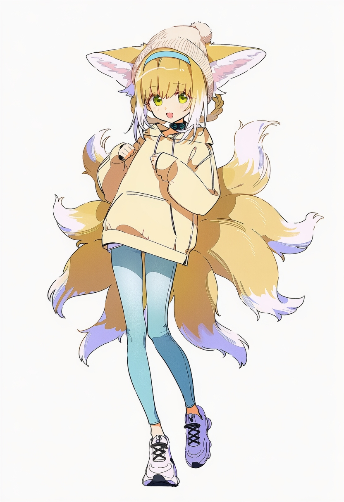

[在线例图](https://assets.quicktagcloud.com/images/raven_composition/raven_composition-4957.jpg?v=36167e84e7c58b30)

<a id="raven_composition-4958"></a>

## 蜜蜡

ID：`raven_composition-4958`；分类：角色图鉴 / 明日方舟；来源标记：`safe`。

来源说明：

> 作品：明日方舟
> 性别：女
> 首次出现时间：2020-07-28 16:00

正向提示词：

```text
beeswax_(arknights)
```

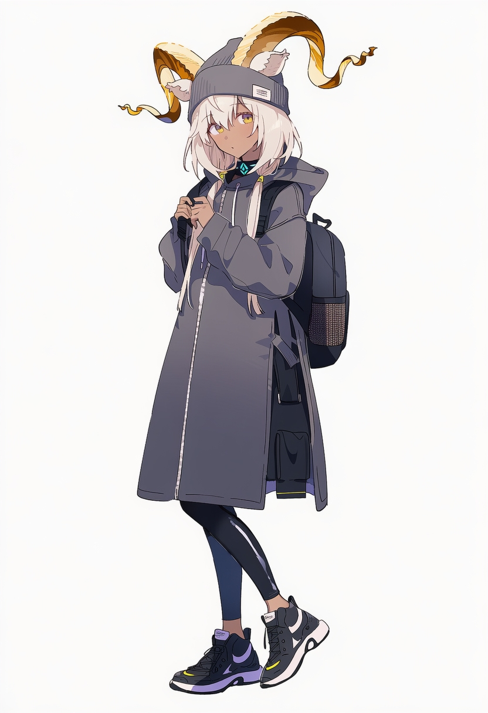

[在线例图](https://assets.quicktagcloud.com/images/raven_composition/raven_composition-4958.jpg?v=137ef8a0915c68c4)

<a id="raven_composition-4959"></a>

## 稀音

ID：`raven_composition-4959`；分类：角色图鉴 / 明日方舟；来源标记：`safe`。

来源说明：

> 作品：明日方舟
> 性别：女
> 首次出现时间：2020-07-28 16:00

正向提示词：

```text
scene_(arknights)
```

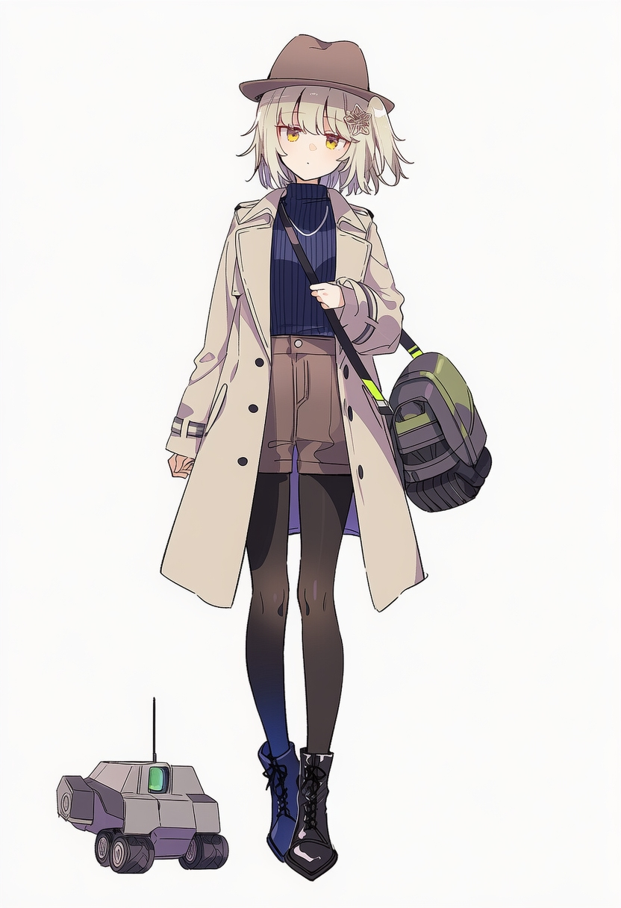

[在线例图](https://assets.quicktagcloud.com/images/raven_composition/raven_composition-4959.jpg?v=4db2cd1de56e8977)

<a id="raven_composition-4960"></a>

## 安哲拉

ID：`raven_composition-4960`；分类：角色图鉴 / 明日方舟；来源标记：`safe`。

来源说明：

> 作品：明日方舟
> 性别：女
> 首次出现时间：2020-08-11 16:00

正向提示词：

```text
andreana_(arknights)
```

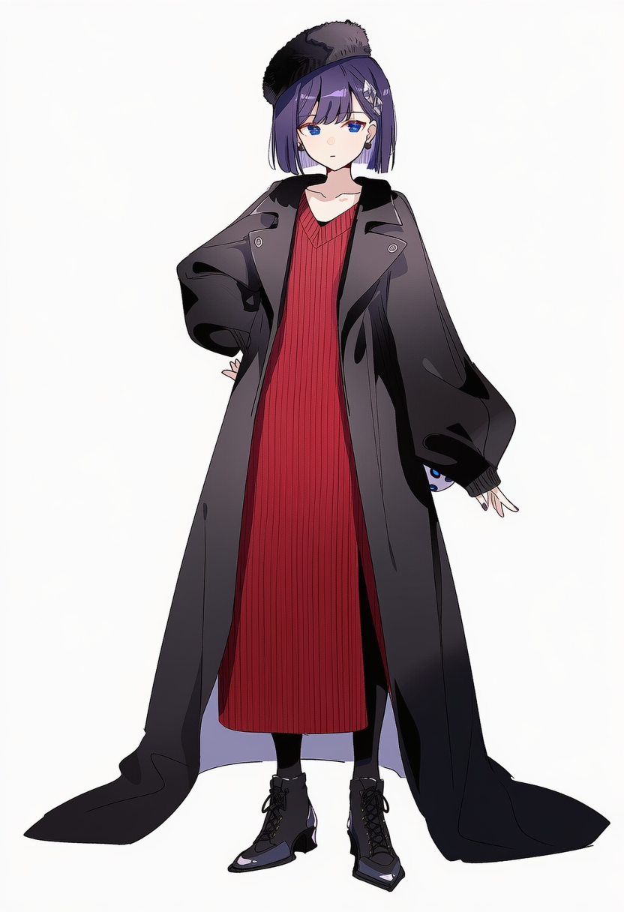

[在线例图](https://assets.quicktagcloud.com/images/raven_composition/raven_composition-4960.jpg?v=2c4a886a3fbdd5da)

<a id="raven_composition-4961"></a>

## 酸糖

ID：`raven_composition-4961`；分类：角色图鉴 / 明日方舟；来源标记：`safe`。

来源说明：

> 作品：明日方舟
> 性别：女
> 首次出现时间：2020-08-25 16:00

正向提示词：

```text
aciddrop_(arknights)
```


[在线例图](https://assets.quicktagcloud.com/images/raven_composition/raven_composition-4961.jpg?v=d6ea93ef86faa0fd)

<a id="raven_composition-4962"></a>

## 森蚺

ID：`raven_composition-4962`；分类：角色图鉴 / 明日方舟；来源标记：`safe`。

来源说明：

> 作品：明日方舟
> 性别：女
> 首次出现时间：2020-08-25 16:00

正向提示词：

```text
eunectes_(arknights)
```

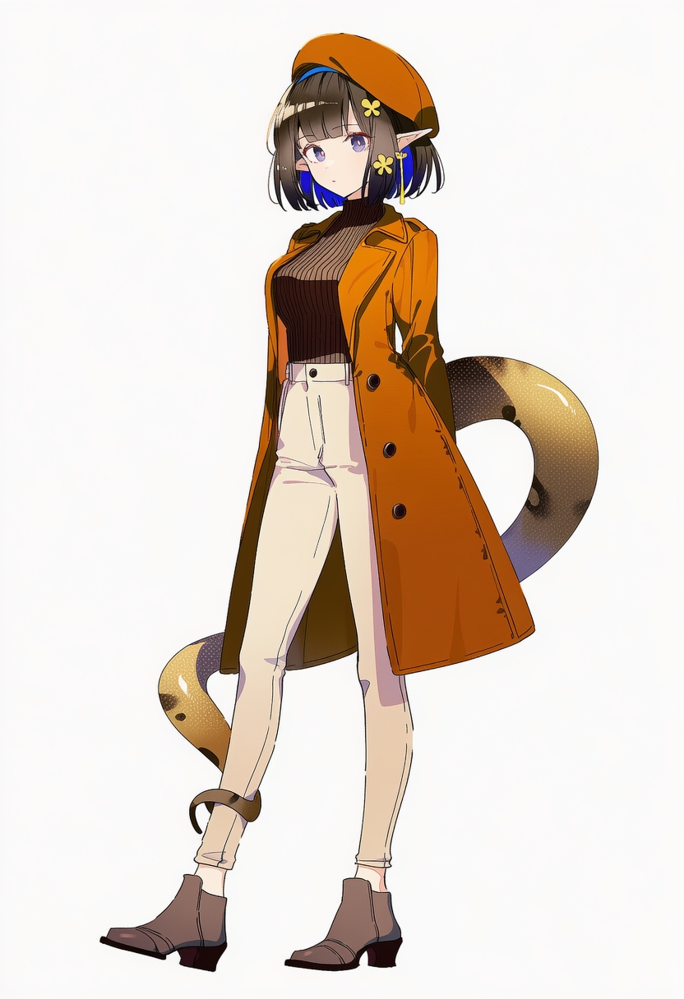

[在线例图](https://assets.quicktagcloud.com/images/raven_composition/raven_composition-4962.jpg?v=fe44eed15a65dc2d)

<a id="raven_composition-4963"></a>

## 燧石

ID：`raven_composition-4963`；分类：角色图鉴 / 明日方舟；来源标记：`safe`。

来源说明：

> 作品：明日方舟
> 性别：女
> 首次出现时间：2020-08-25 16:00

正向提示词：

```text
flint_(arknights)
```

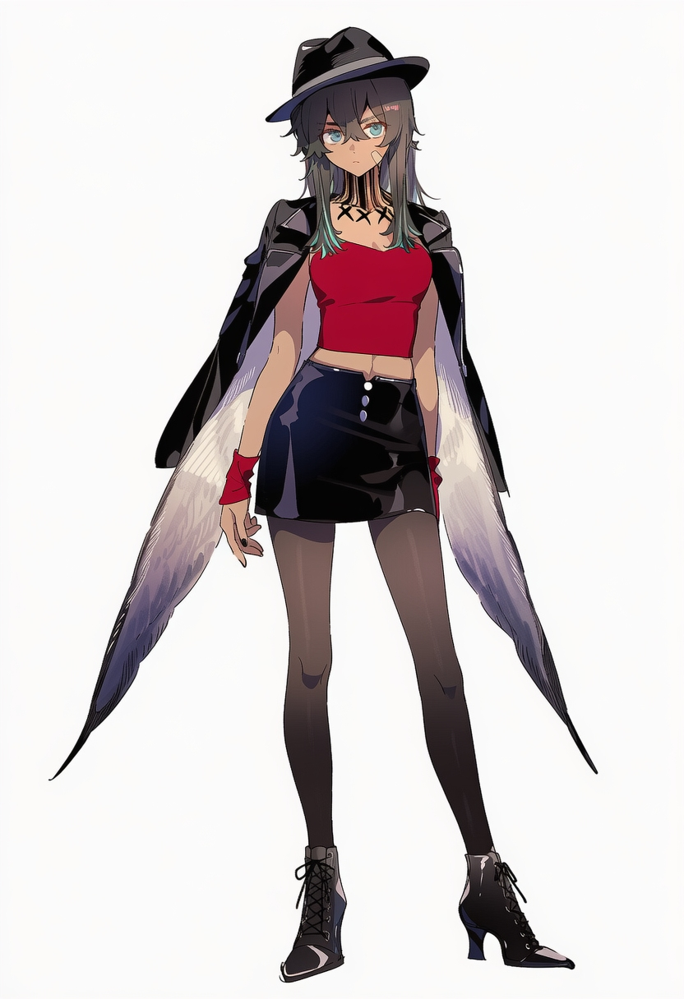

[在线例图](https://assets.quicktagcloud.com/images/raven_composition/raven_composition-4963.jpg?v=e338ce7a739bafbe)

<a id="raven_composition-4964"></a>

## 特米米

ID：`raven_composition-4964`；分类：角色图鉴 / 明日方舟；来源标记：`safe`。

来源说明：

> 作品：明日方舟
> 性别：女
> 首次出现时间：2020-08-25 16:00

正向提示词：

```text
tomimi_(arknights)
```

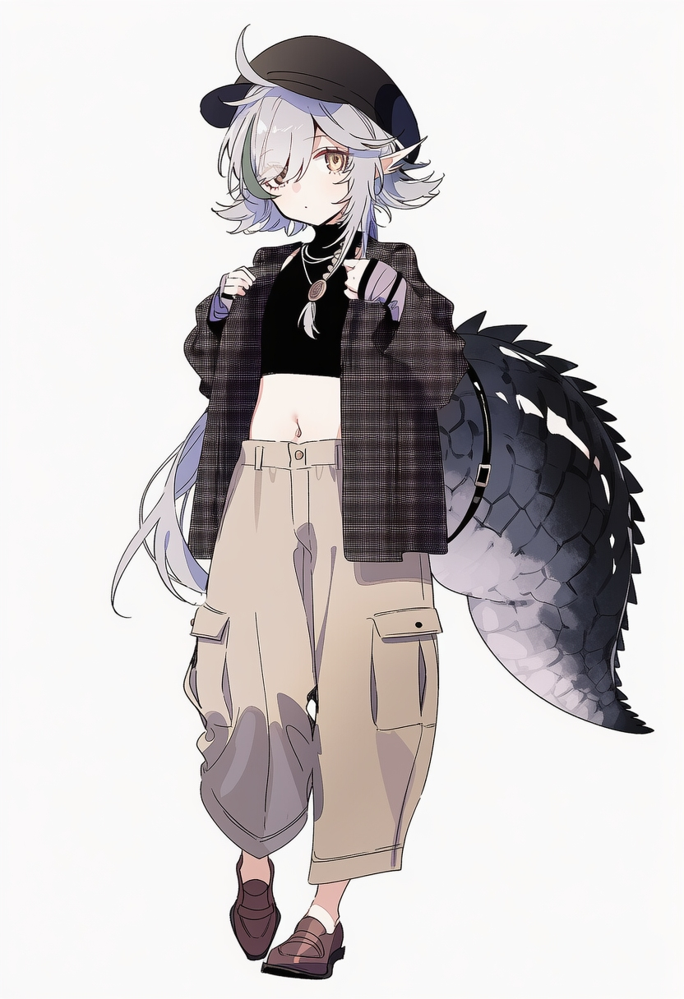

[在线例图](https://assets.quicktagcloud.com/images/raven_composition/raven_composition-4964.jpg?v=16c998a17dc57a14)

<a id="raven_composition-4965"></a>

## 史尔特尔

ID：`raven_composition-4965`；分类：角色图鉴 / 明日方舟；来源标记：`safe`。

来源说明：

> 作品：明日方舟
> 性别：女
> 首次出现时间：2020-09-24 16:00

正向提示词：

```text
surtr_(arknights)
```


[在线例图](https://assets.quicktagcloud.com/images/raven_composition/raven_composition-4965.jpg?v=69d4d8c18a3be0dd)

<a id="raven_composition-4966"></a>

## 四月

ID：`raven_composition-4966`；分类：角色图鉴 / 明日方舟；来源标记：`safe`。

来源说明：

> 作品：明日方舟
> 性别：女
> 首次出现时间：2020-09-24 16:00

正向提示词：

```text
april_(arknights)
```

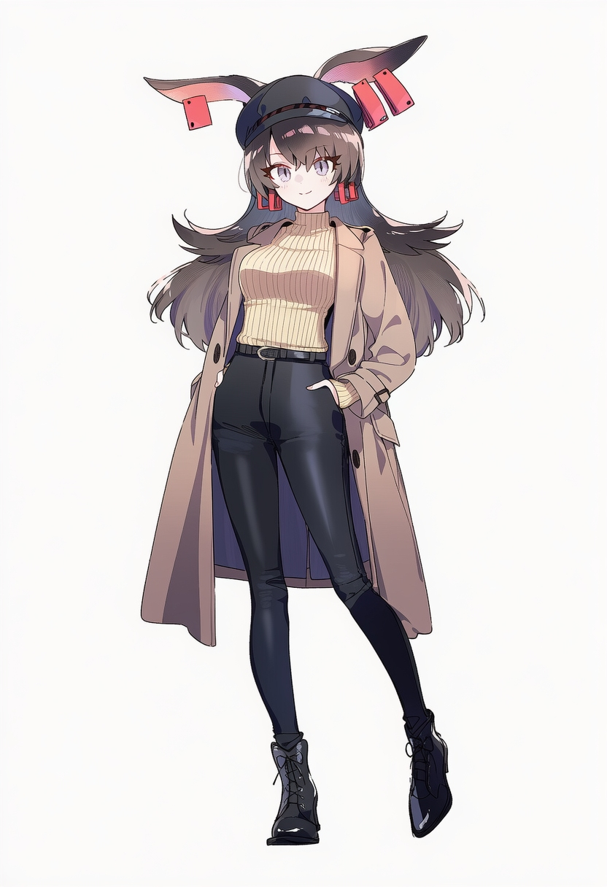

[在线例图](https://assets.quicktagcloud.com/images/raven_composition/raven_composition-4966.jpg?v=e8c1431acb8a6483)

<a id="raven_composition-4967"></a>

## 薄绿

ID：`raven_composition-4967`；分类：角色图鉴 / 明日方舟；来源标记：`safe`。

来源说明：

> 作品：明日方舟
> 性别：女
> 首次出现时间：2020-09-24 16:00

正向提示词：

```text
mint_(arknights)
```

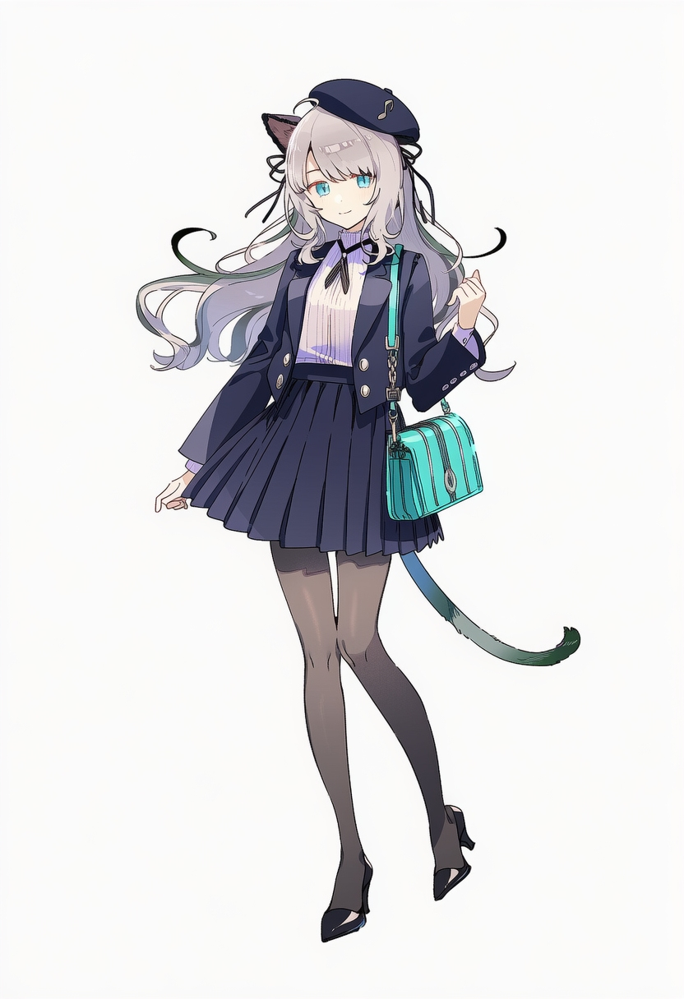

[在线例图](https://assets.quicktagcloud.com/images/raven_composition/raven_composition-4967.jpg?v=ed63f04550779f70)

<a id="raven_composition-4968"></a>

## 瑕光

ID：`raven_composition-4968`；分类：角色图鉴 / 明日方舟；来源标记：`safe`。

来源说明：

> 作品：明日方舟
> 性别：女
> 首次出现时间：2020-10-15 16:00

正向提示词：

```text
blemishine_(arknights)
```


[在线例图](https://assets.quicktagcloud.com/images/raven_composition/raven_composition-4968.jpg?v=b405f590571f5414)

<a id="raven_composition-4969"></a>

## 鞭刃

ID：`raven_composition-4969`；分类：角色图鉴 / 明日方舟；来源标记：`safe`。

来源说明：

> 作品：明日方舟
> 性别：女
> 首次出现时间：2020-10-15 16:00

正向提示词：

```text
whislash_(arknights)
```

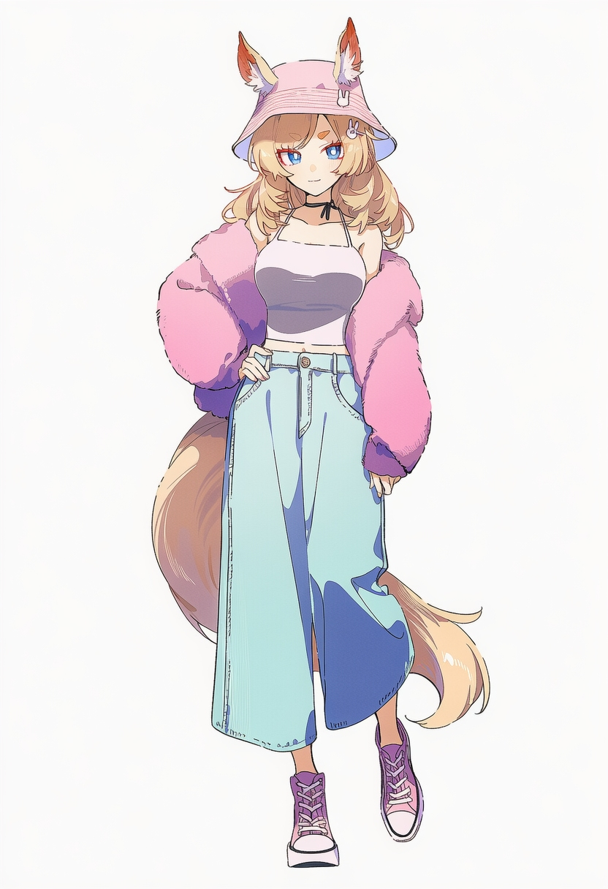

[在线例图](https://assets.quicktagcloud.com/images/raven_composition/raven_composition-4969.jpg?v=599f1945e4874b30)

<a id="raven_composition-4970"></a>

## 泡泡

ID：`raven_composition-4970`；分类：角色图鉴 / 明日方舟；来源标记：`safe`。

来源说明：

> 作品：明日方舟
> 性别：女
> 首次出现时间：2020-10-15 16:00

正向提示词：

```text
bubble_(arknights)
```


[在线例图](https://assets.quicktagcloud.com/images/raven_composition/raven_composition-4970.jpg?v=38bf8bd06d8ab64b)

<a id="raven_composition-4971"></a>

## 泥岩

ID：`raven_composition-4971`；分类：角色图鉴 / 明日方舟；来源标记：`safe`。

来源说明：

> 作品：明日方舟
> 性别：女
> 首次出现时间：2020-11-01 16:00

正向提示词：

```text
mudrock_(arknights)
```

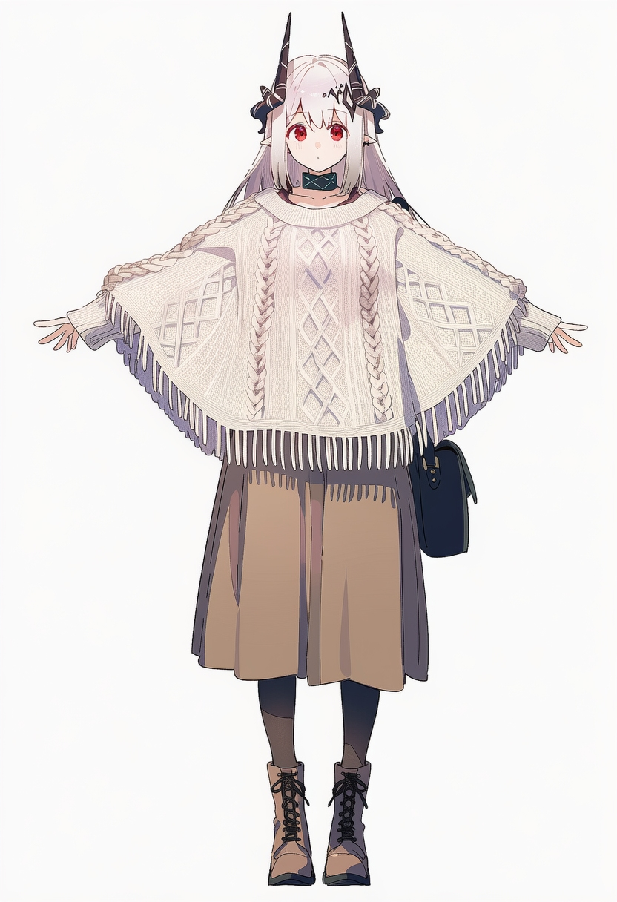

[在线例图](https://assets.quicktagcloud.com/images/raven_composition/raven_composition-4971.jpg?v=9f9e829122224538)

<a id="raven_composition-4972"></a>

## 迷迭香

ID：`raven_composition-4972`；分类：角色图鉴 / 明日方舟；来源标记：`safe`。

来源说明：

> 作品：明日方舟
> 性别：女
> 首次出现时间：2020-11-01 16:00

正向提示词：

```text
rosmontis_(arknights)
```


[在线例图](https://assets.quicktagcloud.com/images/raven_composition/raven_composition-4972.jpg?v=9ce4b79852ee6124)

<a id="raven_composition-4973"></a>

## 絮雨

ID：`raven_composition-4973`；分类：角色图鉴 / 明日方舟；来源标记：`safe`。

来源说明：

> 作品：明日方舟
> 性别：女
> 首次出现时间：2020-11-01 16:00

正向提示词：

```text
whisperain_(arknights)
```


[在线例图](https://assets.quicktagcloud.com/images/raven_composition/raven_composition-4973.jpg?v=f619ad068dea61d1)

<a id="raven_composition-4974"></a>

## 卡夫卡

ID：`raven_composition-4974`；分类：角色图鉴 / 明日方舟；来源标记：`safe`。

来源说明：

> 作品：明日方舟
> 性别：女
> 首次出现时间：2020-12-17 16:00

正向提示词：

```text
kafka_(arknights)
```

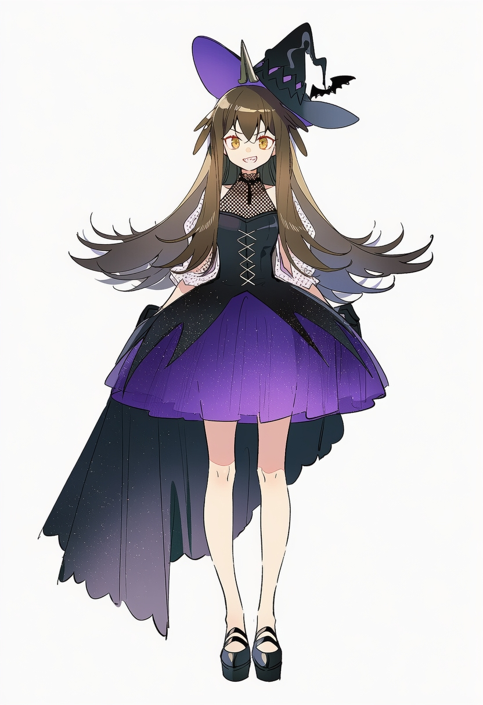

[在线例图](https://assets.quicktagcloud.com/images/raven_composition/raven_composition-4974.jpg?v=edca339b124b1e75)

<a id="raven_composition-4975"></a>

## 松果

ID：`raven_composition-4975`；分类：角色图鉴 / 明日方舟；来源标记：`safe`。

来源说明：

> 作品：明日方舟
> 性别：女
> 首次出现时间：2020-12-17 16:00

正向提示词：

```text
pinecone_(arknights)
```

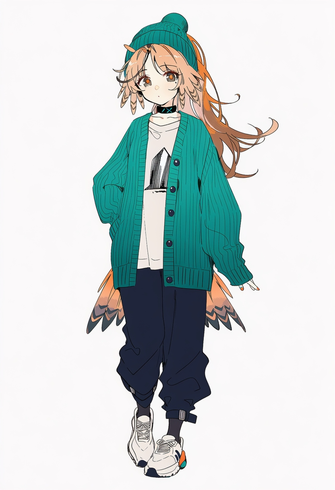

[在线例图](https://assets.quicktagcloud.com/images/raven_composition/raven_composition-4975.jpg?v=2bc9644c4038ce7e)

<a id="raven_composition-4976"></a>

## 罗宾

ID：`raven_composition-4976`；分类：角色图鉴 / 明日方舟；来源标记：`safe`。

来源说明：

> 作品：明日方舟
> 性别：女
> 首次出现时间：2020-12-17 16:00

正向提示词：

```text
robin_(arknights)
```

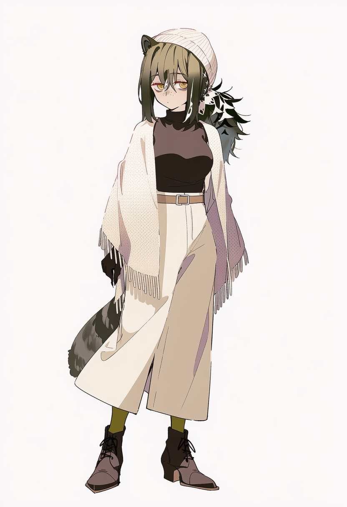

[在线例图](https://assets.quicktagcloud.com/images/raven_composition/raven_composition-4976.jpg?v=eee310157a5ee0fd)

<a id="raven_composition-4977"></a>

## 豆苗

ID：`raven_composition-4977`；分类：角色图鉴 / 明日方舟；来源标记：`safe`。

来源说明：

> 作品：明日方舟
> 性别：女
> 首次出现时间：2021-01-05 16:00

正向提示词：

```text
beanstalk_(arknights)
```

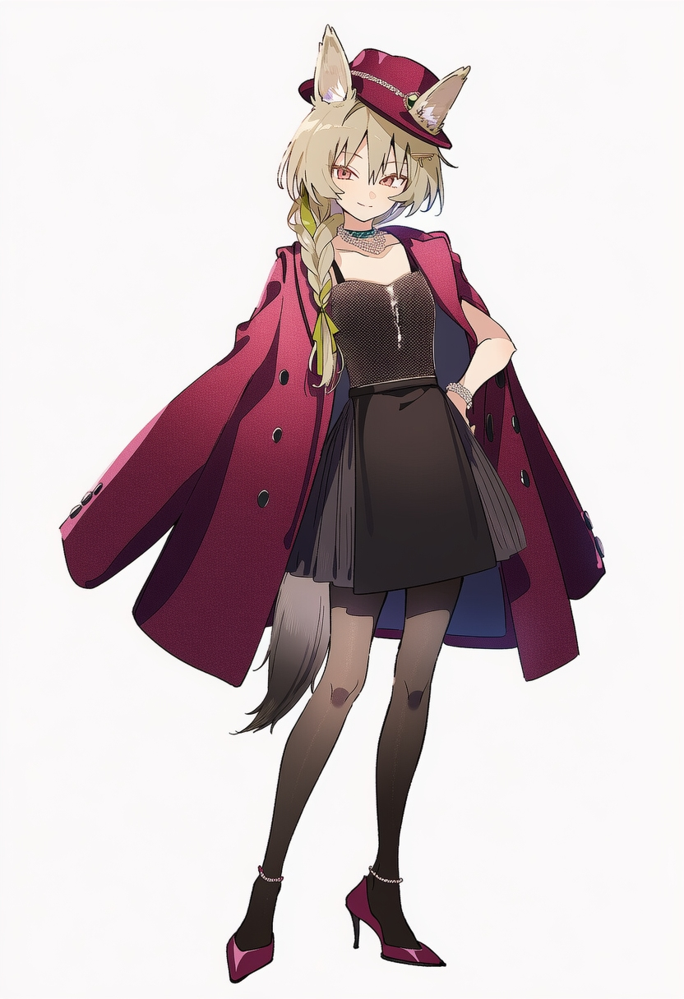

[在线例图](https://assets.quicktagcloud.com/images/raven_composition/raven_composition-4977.jpg?v=760bc6d2de7acd8c)

<a id="raven_composition-4978"></a>

## 空弦

ID：`raven_composition-4978`；分类：角色图鉴 / 明日方舟；来源标记：`safe`。

来源说明：

> 作品：明日方舟
> 性别：女
> 首次出现时间：2021-01-05 16:00

正向提示词：

```text
archetto_(arknights)
```

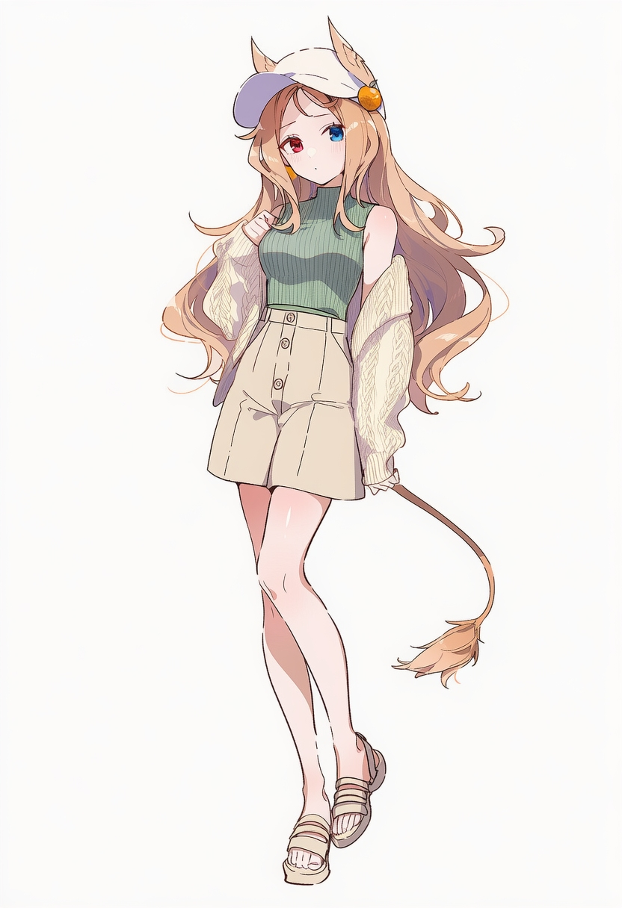

[在线例图](https://assets.quicktagcloud.com/images/raven_composition/raven_composition-4978.jpg?v=187d6c1796d96e10)

<a id="raven_composition-4979"></a>

## 爱丽丝

ID：`raven_composition-4979`；分类：角色图鉴 / 明日方舟；来源标记：`safe`。

来源说明：

> 作品：明日方舟
> 性别：女
> 首次出现时间：2021-01-05 16:00

正向提示词：

```text
iris_(arknights)
```

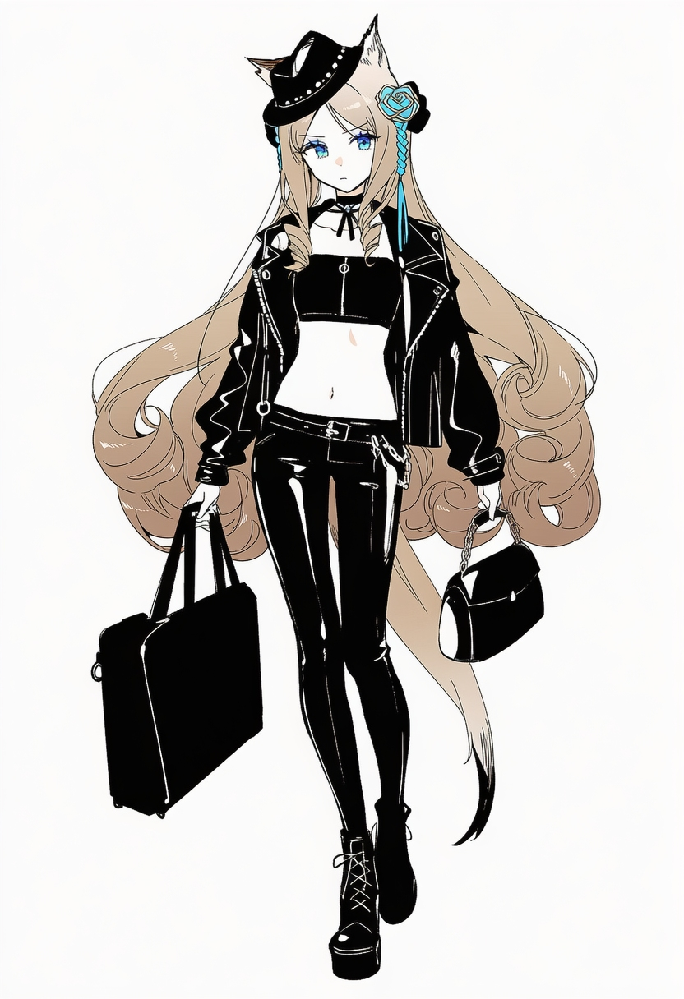

[在线例图](https://assets.quicktagcloud.com/images/raven_composition/raven_composition-4979.jpg?v=f9cce740c66af98f)

<a id="raven_composition-4980"></a>

## 图耶

ID：`raven_composition-4980`；分类：角色图鉴 / 明日方舟；来源标记：`safe`。

来源说明：

> 作品：明日方舟
> 性别：女
> 首次出现时间：2021-01-19 16:00

正向提示词：

```text
tuye_(arknights)
```

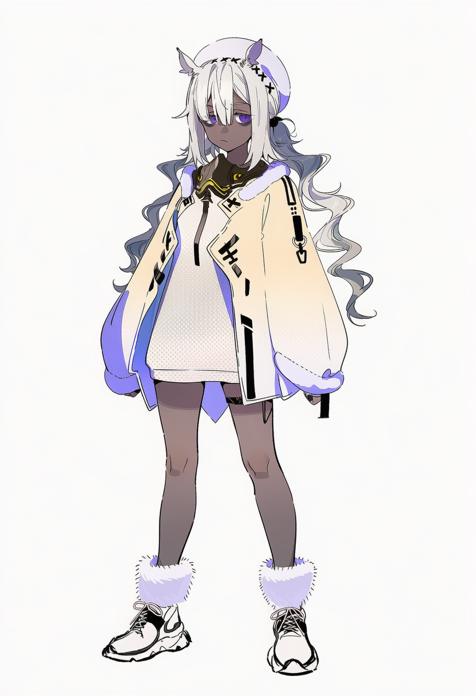

[在线例图](https://assets.quicktagcloud.com/images/raven_composition/raven_composition-4980.jpg?v=62f5059a2c110b60)

<a id="raven_composition-4981"></a>

## 嵯峨

ID：`raven_composition-4981`；分类：角色图鉴 / 明日方舟；来源标记：`safe`。

来源说明：

> 作品：明日方舟
> 性别：女
> 首次出现时间：2021-02-05 16:00

正向提示词：

```text
saga_(arknights)
```

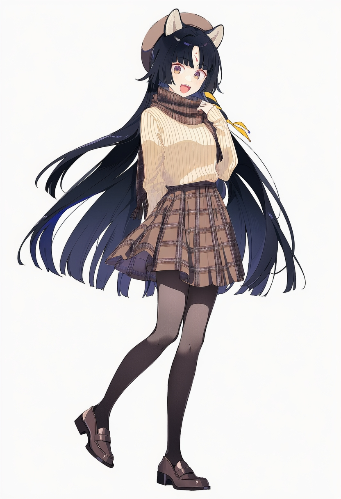

[在线例图](https://assets.quicktagcloud.com/images/raven_composition/raven_composition-4981.jpg?v=bdce0f84d2332d35)

<a id="raven_composition-4982"></a>

## 夕

ID：`raven_composition-4982`；分类：角色图鉴 / 明日方舟；来源标记：`safe`。

来源说明：

> 作品：明日方舟
> 性别：女
> 首次出现时间：2021-02-05 16:00

正向提示词：

```text
dusk_(arknights)
```

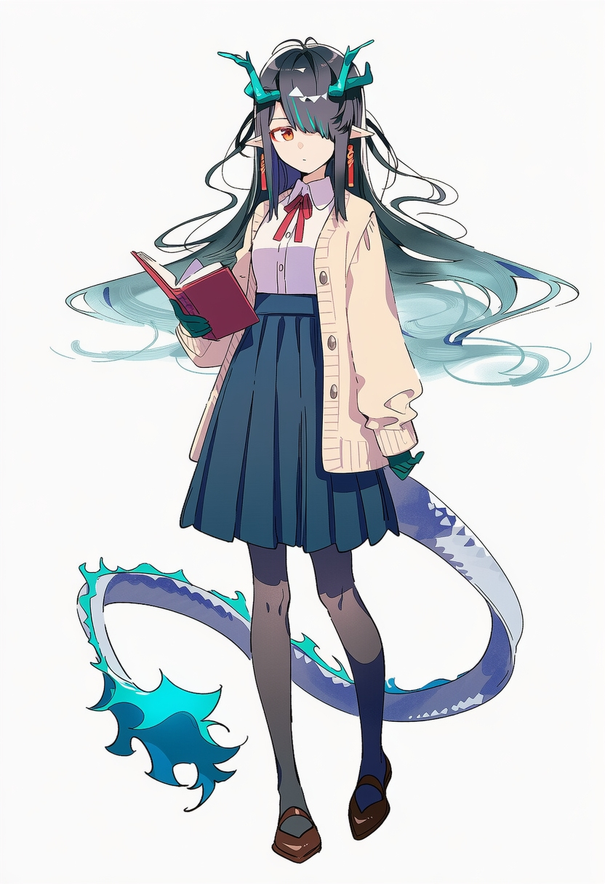

[在线例图](https://assets.quicktagcloud.com/images/raven_composition/raven_composition-4982.jpg?v=8571caf31ee07522)

<a id="raven_composition-4983"></a>

## 暴雨

ID：`raven_composition-4983`；分类：角色图鉴 / 明日方舟；来源标记：`safe`。

来源说明：

> 作品：明日方舟
> 性别：女
> 首次出现时间：2021-04-15 16:00

正向提示词：

```text
heavyrain_(arknights)
```


[在线例图](https://assets.quicktagcloud.com/images/raven_composition/raven_composition-4983.jpg?v=96af30d217bf16db)

<a id="raven_composition-4984"></a>

## 熔泉

ID：`raven_composition-4984`；分类：角色图鉴 / 明日方舟；来源标记：`safe`。

来源说明：

> 作品：明日方舟
> 性别：女
> 首次出现时间：2021-04-15 16:00

正向提示词：

```text
toddifons_(arknights)
```


[在线例图](https://assets.quicktagcloud.com/images/raven_composition/raven_composition-4984.jpg?v=7a623593e820dcb7)

<a id="raven_composition-4985"></a>

## 凯尔希

ID：`raven_composition-4985`；分类：角色图鉴 / 明日方舟；来源标记：`safe`。

来源说明：

> 作品：明日方舟
> 性别：女
> 首次出现时间：2021-05-01 16:00

正向提示词：

```text
kal'tsit_(arknights)
```


[在线例图](https://assets.quicktagcloud.com/images/raven_composition/raven_composition-4985.jpg?v=0282486d0bf7c3d6)

<a id="raven_composition-4986"></a>

## 歌蕾蒂娅

ID：`raven_composition-4986`；分类：角色图鉴 / 明日方舟；来源标记：`safe`。

来源说明：

> 作品：明日方舟
> 性别：女
> 首次出现时间：2021-05-01 16:00

正向提示词：

```text
gladiia_(arknights)
```


[在线例图](https://assets.quicktagcloud.com/images/raven_composition/raven_composition-4986.jpg?v=56702fb148b5a6ee)

<a id="raven_composition-4987"></a>

## 赤冬

ID：`raven_composition-4987`；分类：角色图鉴 / 明日方舟；来源标记：`safe`。

来源说明：

> 作品：明日方舟
> 性别：女
> 首次出现时间：2021-05-01 16:00

正向提示词：

```text
akafuyu_(arknights)
```


[在线例图](https://assets.quicktagcloud.com/images/raven_composition/raven_composition-4987.jpg?v=d82582d86383e954)

<a id="raven_composition-4988"></a>

## 绮良

ID：`raven_composition-4988`；分类：角色图鉴 / 明日方舟；来源标记：`safe`。

来源说明：

> 作品：明日方舟
> 性别：女
> 首次出现时间：2021-06-01 16:00

正向提示词：

```text
kirara_(arknights)
```


[在线例图](https://assets.quicktagcloud.com/images/raven_composition/raven_composition-4988.jpg?v=c033f228777eb973)

<a id="raven_composition-4989"></a>

## 深靛

ID：`raven_composition-4989`；分类：角色图鉴 / 明日方舟；来源标记：`safe`。

来源说明：

> 作品：明日方舟
> 性别：女
> 首次出现时间：2021-06-01 16:00

正向提示词：

```text
indigo_(arknights)
```


[在线例图](https://assets.quicktagcloud.com/images/raven_composition/raven_composition-4989.jpg?v=29631a80bb401530)

<a id="raven_composition-4990"></a>

## 卡涅利安

ID：`raven_composition-4990`；分类：角色图鉴 / 明日方舟；来源标记：`safe`。

来源说明：

> 作品：明日方舟
> 性别：女
> 首次出现时间：2021-06-01 16:00

正向提示词：

```text
carnelian_(arknights)
```


[在线例图](https://assets.quicktagcloud.com/images/raven_composition/raven_composition-4990.jpg?v=9510b7b17c2c8722)

<a id="raven_composition-4991"></a>

## 贝娜

ID：`raven_composition-4991`；分类：角色图鉴 / 明日方舟；来源标记：`safe`。

来源说明：

> 作品：明日方舟
> 性别：女
> 首次出现时间：2021-06-01 16:00

正向提示词：

```text
bena_(arknights)
```


[在线例图](https://assets.quicktagcloud.com/images/raven_composition/raven_composition-4991.jpg?v=a38f3ff8056e2cf2)

<a id="raven_composition-4992"></a>

## 帕拉斯

ID：`raven_composition-4992`；分类：角色图鉴 / 明日方舟；来源标记：`safe`。

来源说明：

> 作品：明日方舟
> 性别：女
> 首次出现时间：2021-07-02 16:00

正向提示词：

```text
pallas_(arknights)
```


[在线例图](https://assets.quicktagcloud.com/images/raven_composition/raven_composition-4992.jpg?v=8f18d5a66026ede9)

<a id="raven_composition-4993"></a>

## 羽毛笔

ID：`raven_composition-4993`；分类：角色图鉴 / 明日方舟；来源标记：`safe`。

来源说明：

> 作品：明日方舟
> 性别：女
> 首次出现时间：2021-08-03 16:00

正向提示词：

```text
la_pluma_(arknights)
```


[在线例图](https://assets.quicktagcloud.com/images/raven_composition/raven_composition-4993.jpg?v=ff73a5778e66d294)

<a id="raven_composition-4994"></a>

## 罗比菈塔

ID：`raven_composition-4994`；分类：角色图鉴 / 明日方舟；来源标记：`safe`。

来源说明：

> 作品：明日方舟
> 性别：女
> 首次出现时间：2021-09-17 16:00

正向提示词：

```text
roberta_(arknights)
```


[在线例图](https://assets.quicktagcloud.com/images/raven_composition/raven_composition-4994.jpg?v=82bd41ade5f75663)

<a id="raven_composition-4995"></a>

## 琴柳

ID：`raven_composition-4995`；分类：角色图鉴 / 明日方舟；来源标记：`safe`。

来源说明：

> 作品：明日方舟
> 性别：女
> 首次出现时间：2021-09-17 16:00

正向提示词：

```text
saileach_(arknights)
```


[在线例图](https://assets.quicktagcloud.com/images/raven_composition/raven_composition-4995.jpg?v=f77371b74c36fc40)

<a id="raven_composition-4996"></a>

## 桑葚

ID：`raven_composition-4996`；分类：角色图鉴 / 明日方舟；来源标记：`safe`。

来源说明：

> 作品：明日方舟
> 性别：女
> 首次出现时间：2021-09-17 16:00

正向提示词：

```text
mulberry_(arknights)
```


[在线例图](https://assets.quicktagcloud.com/images/raven_composition/raven_composition-4996.jpg?v=3363fb23a6162700)

<a id="raven_composition-4997"></a>

## 灰毫

ID：`raven_composition-4997`；分类：角色图鉴 / 明日方舟；来源标记：`safe`。

来源说明：

> 作品：明日方舟
> 性别：女
> 首次出现时间：2021-10-15 16:00

正向提示词：

```text
ashlock_(arknights)
```


[在线例图](https://assets.quicktagcloud.com/images/raven_composition/raven_composition-4997.jpg?v=99c145a9b8cc49d9)

<a id="raven_composition-4998"></a>

## 远牙

ID：`raven_composition-4998`；分类：角色图鉴 / 明日方舟；来源标记：`safe`。

来源说明：

> 作品：明日方舟
> 性别：女
> 首次出现时间：2021-10-15 16:00

正向提示词：

```text
fartooth_(arknights)
```


[在线例图](https://assets.quicktagcloud.com/images/raven_composition/raven_composition-4998.jpg?v=e8f55a348fe2600a)

<a id="raven_composition-4999"></a>

## 布丁

ID：`raven_composition-4999`；分类：角色图鉴 / 明日方舟；来源标记：`safe`。

来源说明：

> 作品：明日方舟
> 性别：女
> 首次出现时间：2021-11-01 16:00

正向提示词：

```text
pudding_(arknights)
```


[在线例图](https://assets.quicktagcloud.com/images/raven_composition/raven_composition-4999.jpg?v=7f735cce628d6b18)
