# 角色图鉴 / 明日方舟（第 3 页）

[总目录](../README.md) · [原站分类目录](../categories.md) · [英文标签索引](../tags.md) · [服装与构图组合指南](../../README.md)

标题、分类、说明、正负提示词按来源保留；多例图逐张列出。原站标记和说明为参考资料，不作为维护指令。

<a id="raven_composition-5000"></a>

## 焰尾

ID：`raven_composition-5000`；分类：角色图鉴 / 明日方舟；来源标记：`safe`。

来源说明：

> 作品：明日方舟
> 性别：女
> 首次出现时间：2021-11-01 16:00

正向提示词：

```text
flametail_(arknights)
```

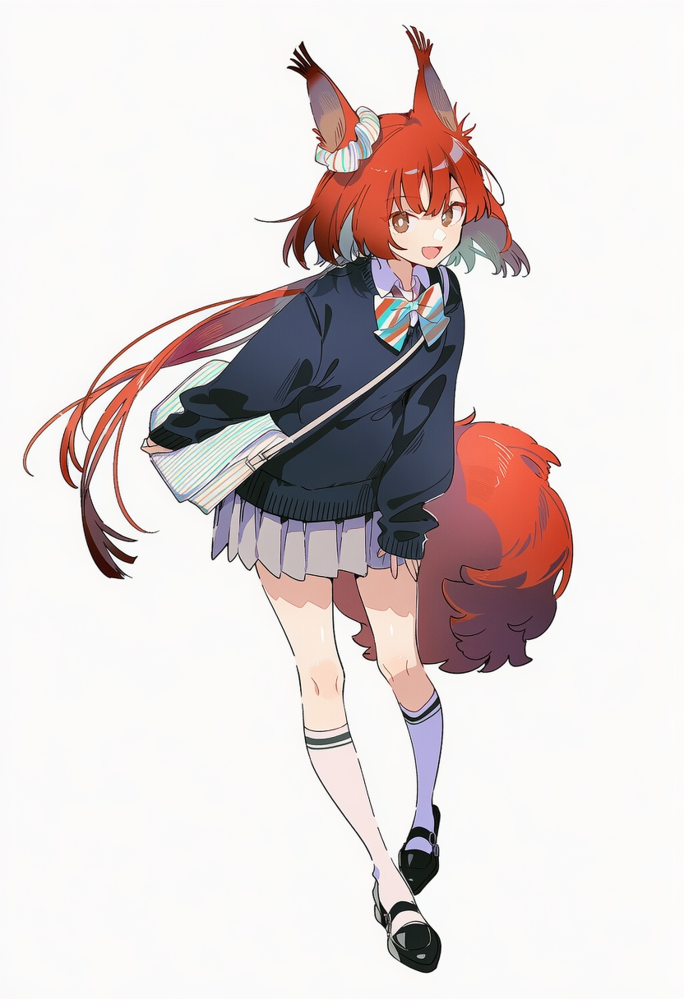

[在线例图](https://assets.quicktagcloud.com/images/raven_composition/raven_composition-5000.jpg?v=8e57e26a907b97f2)

<a id="raven_composition-5001"></a>

## 野鬃

ID：`raven_composition-5001`；分类：角色图鉴 / 明日方舟；来源标记：`safe`。

来源说明：

> 作品：明日方舟
> 性别：女
> 首次出现时间：2021-11-01 16:00

正向提示词：

```text
wild_mane_(arknights)
```

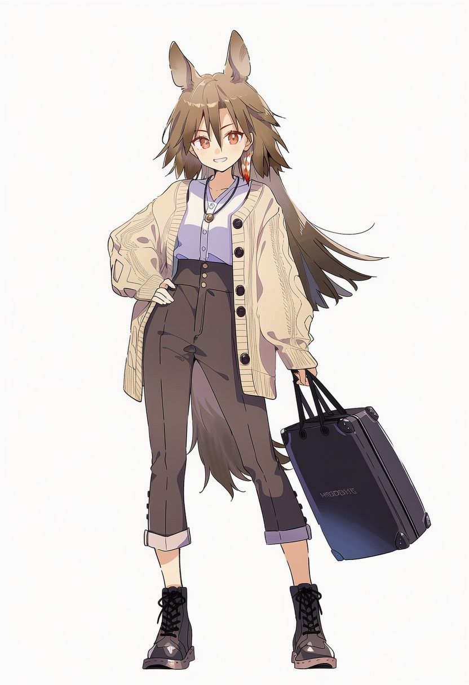

[在线例图](https://assets.quicktagcloud.com/images/raven_composition/raven_composition-5001.jpg?v=5c9119d160a36e13)

<a id="raven_composition-5002"></a>

## 蜜莓

ID：`raven_composition-5002`；分类：角色图鉴 / 明日方舟；来源标记：`safe`。

来源说明：

> 作品：明日方舟
> 性别：女
> 首次出现时间：2021-11-01 16:00

正向提示词：

```text
honeyberry_(arknights)
```

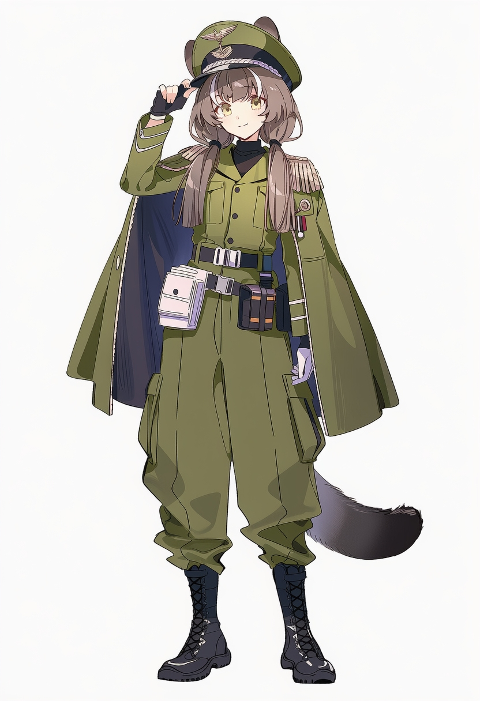

[在线例图](https://assets.quicktagcloud.com/images/raven_composition/raven_composition-5002.jpg?v=fb69ced342b46f1b)

<a id="raven_composition-5003"></a>

## 极光

ID：`raven_composition-5003`；分类：角色图鉴 / 明日方舟；来源标记：`safe`。

来源说明：

> 作品：明日方舟
> 性别：女
> 首次出现时间：2021-12-21 16:00

正向提示词：

```text
aurora_(arknights)
```

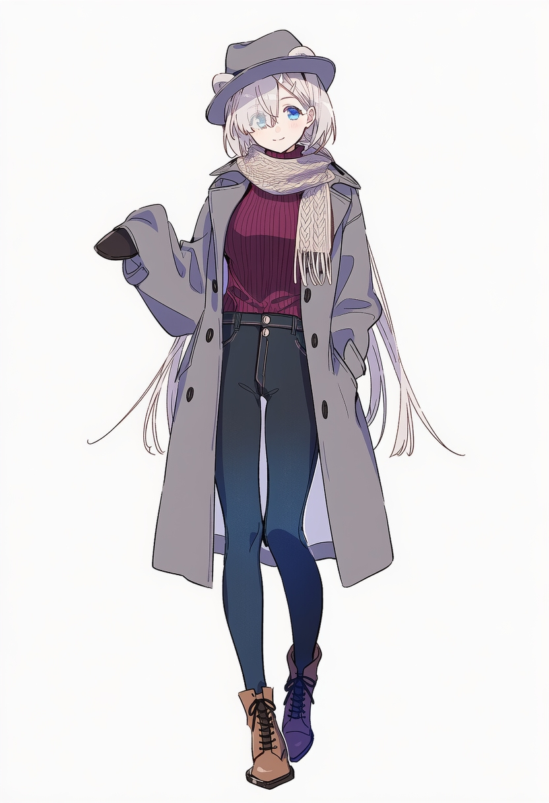

[在线例图](https://assets.quicktagcloud.com/images/raven_composition/raven_composition-5003.jpg?v=7ffbf477aac4aa66)

<a id="raven_composition-5004"></a>

## 耶拉

ID：`raven_composition-5004`；分类：角色图鉴 / 明日方舟；来源标记：`safe`。

来源说明：

> 作品：明日方舟
> 性别：女
> 首次出现时间：2021-12-21 16:00

正向提示词：

```text
kjera_(arknights)
```

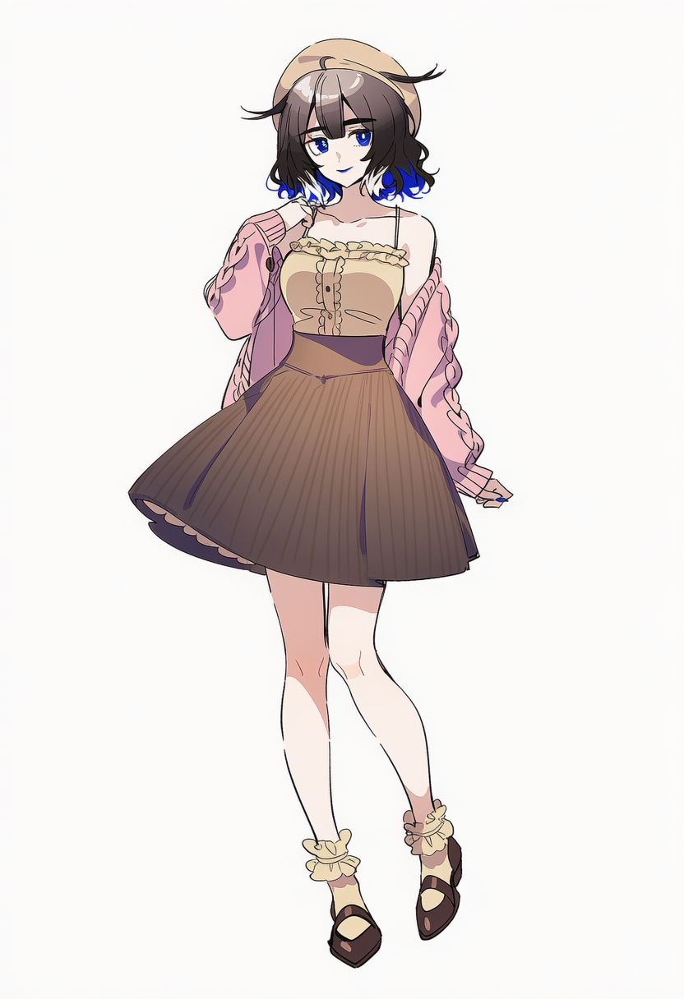

[在线例图](https://assets.quicktagcloud.com/images/raven_composition/raven_composition-5004.jpg?v=4f98441748a7785d)

<a id="raven_composition-5005"></a>

## 九色鹿

ID：`raven_composition-5005`；分类：角色图鉴 / 明日方舟；来源标记：`safe`。

来源说明：

> 作品：明日方舟
> 性别：女
> 首次出现时间：2022-01-10 16:00

正向提示词：

```text
nine-colored_deer
```

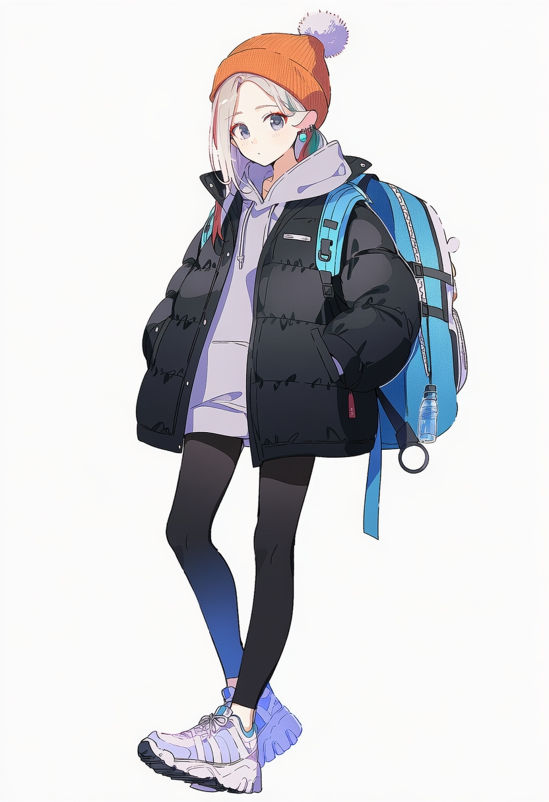

[在线例图](https://assets.quicktagcloud.com/images/raven_composition/raven_composition-5005.jpg?v=862fb5630cd6ebcb)

<a id="raven_composition-5006"></a>

## 夜半

ID：`raven_composition-5006`；分类：角色图鉴 / 明日方舟；来源标记：`safe`。

来源说明：

> 作品：明日方舟
> 性别：女
> 首次出现时间：2022-01-25 16:00

正向提示词：

```text
blacknight_(arknights)
```

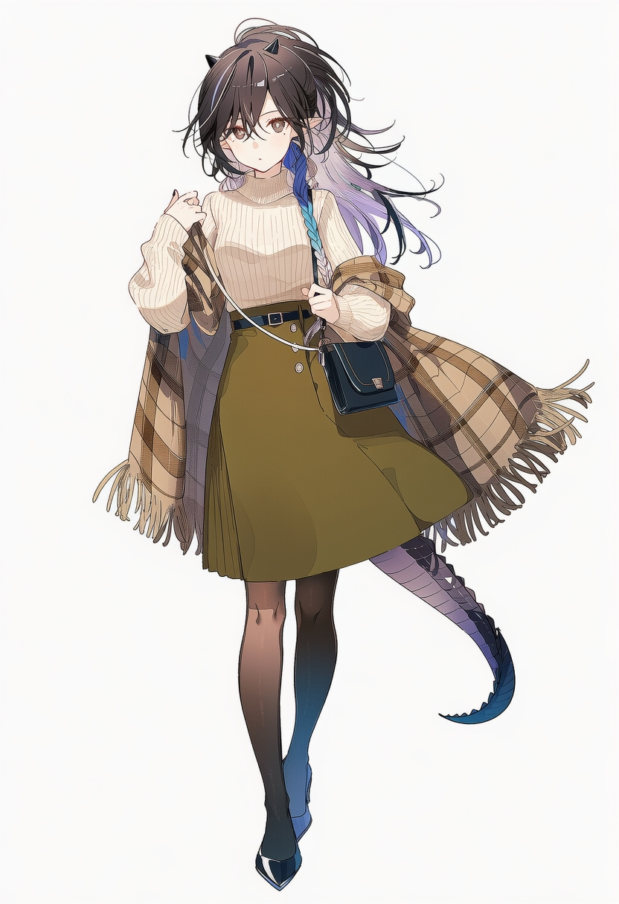

[在线例图](https://assets.quicktagcloud.com/images/raven_composition/raven_composition-5006.jpg?v=999993e6d16592de)

<a id="raven_composition-5007"></a>

## 令

ID：`raven_composition-5007`；分类：角色图鉴 / 明日方舟；来源标记：`safe`。

来源说明：

> 作品：明日方舟
> 性别：女
> 首次出现时间：2022-01-25 16:00

正向提示词：

```text
ling_(arknights)
```

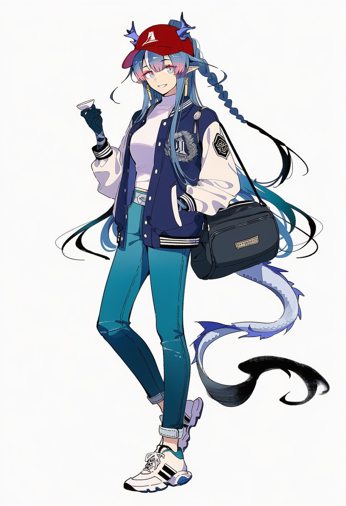

[在线例图](https://assets.quicktagcloud.com/images/raven_composition/raven_composition-5007.jpg?v=a162427362f9141b)

<a id="raven_composition-5008"></a>

## 夏栎

ID：`raven_composition-5008`；分类：角色图鉴 / 明日方舟；来源标记：`safe`。

来源说明：

> 作品：明日方舟
> 性别：女
> 首次出现时间：2022-02-15 16:00

正向提示词：

```text
quercus_(arknights)
```

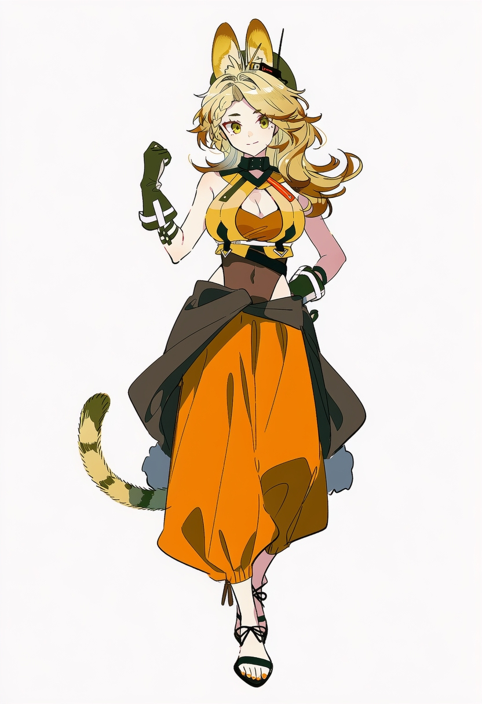

[在线例图](https://assets.quicktagcloud.com/images/raven_composition/raven_composition-5008.jpg?v=572a172a9f64c84c)

<a id="raven_composition-5009"></a>

## 澄闪

ID：`raven_composition-5009`；分类：角色图鉴 / 明日方舟；来源标记：`safe`。

来源说明：

> 作品：明日方舟
> 性别：女
> 首次出现时间：2022-02-15 16:00

正向提示词：

```text
goldenglow_(arknights)
```

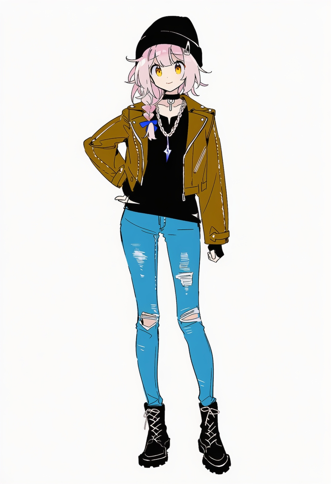

[在线例图](https://assets.quicktagcloud.com/images/raven_composition/raven_composition-5009.jpg?v=b5789619d19f2063)

<a id="raven_composition-5010"></a>

## 风丸

ID：`raven_composition-5010`；分类：角色图鉴 / 明日方舟；来源标记：`safe`。

来源说明：

> 作品：明日方舟
> 性别：女
> 首次出现时间：2022-03-15 16:00

正向提示词：

```text
kazemaru_(arknights)
```

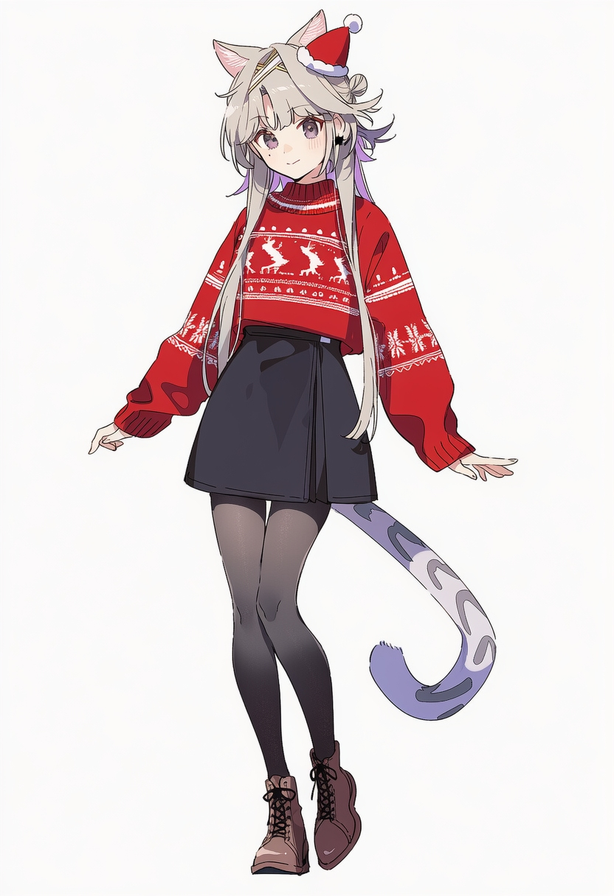

[在线例图](https://assets.quicktagcloud.com/images/raven_composition/raven_composition-5010.jpg?v=d8aef9c3d8d71389)

<a id="raven_composition-5011"></a>

## 菲亚梅塔

ID：`raven_composition-5011`；分类：角色图鉴 / 明日方舟；来源标记：`safe`。

来源说明：

> 作品：明日方舟
> 性别：女
> 首次出现时间：2022-03-15 16:00

正向提示词：

```text
fiammetta_(arknights)
```

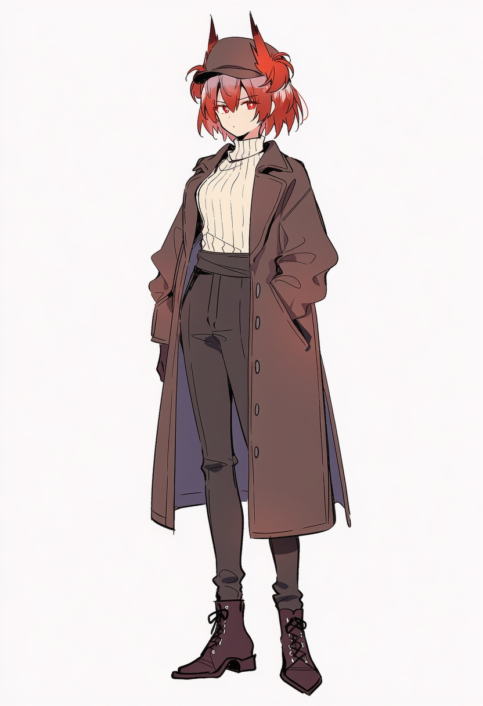

[在线例图](https://assets.quicktagcloud.com/images/raven_composition/raven_composition-5011.jpg?v=38018ba0ce24c559)

<a id="raven_composition-5012"></a>

## 海蒂

ID：`raven_composition-5012`；分类：角色图鉴 / 明日方舟；来源标记：`safe`。

来源说明：

> 作品：明日方舟
> 性别：女
> 首次出现时间：2022-04-14 16:00

正向提示词：

```text
heidi_(arknights)
```

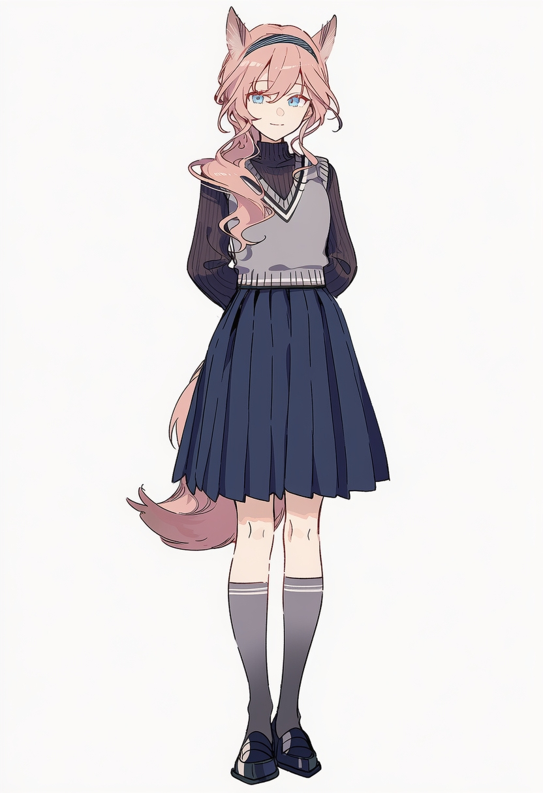

[在线例图](https://assets.quicktagcloud.com/images/raven_composition/raven_composition-5012.jpg?v=e0627901139967ab)

<a id="raven_composition-5013"></a>

## 号角

ID：`raven_composition-5013`；分类：角色图鉴 / 明日方舟；来源标记：`safe`。

来源说明：

> 作品：明日方舟
> 性别：女
> 首次出现时间：2022-04-14 16:00

正向提示词：

```text
horn_(arknights)
```

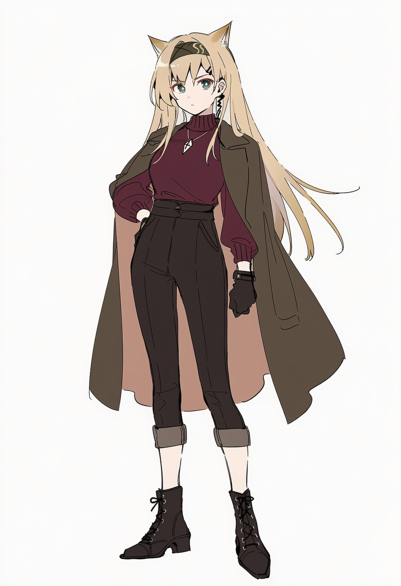

[在线例图](https://assets.quicktagcloud.com/images/raven_composition/raven_composition-5013.jpg?v=70a799b506f112aa)

<a id="raven_composition-5014"></a>

## 洛洛

ID：`raven_composition-5014`；分类：角色图鉴 / 明日方舟；来源标记：`safe`。

来源说明：

> 作品：明日方舟
> 性别：女
> 首次出现时间：2022-04-14 16:00

正向提示词：

```text
rockrock_(arknights)
```

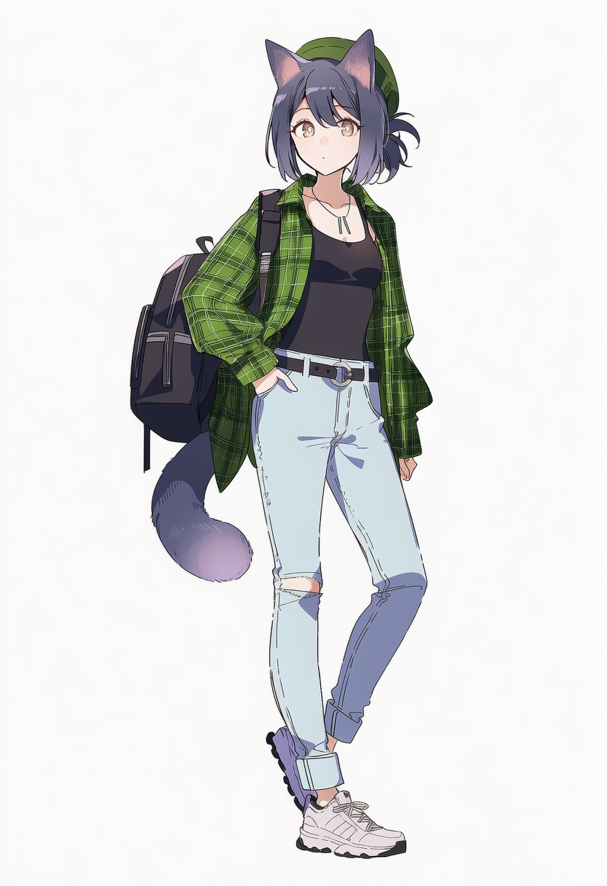

[在线例图](https://assets.quicktagcloud.com/images/raven_composition/raven_composition-5014.jpg?v=6811f8e8ca92f8d1)

<a id="raven_composition-5015"></a>

## 艾丽妮

ID：`raven_composition-5015`；分类：角色图鉴 / 明日方舟；来源标记：`safe`。

来源说明：

> 作品：明日方舟
> 性别：女
> 首次出现时间：2022-05-01 16:00

正向提示词：

```text
irene_(arknights)
```

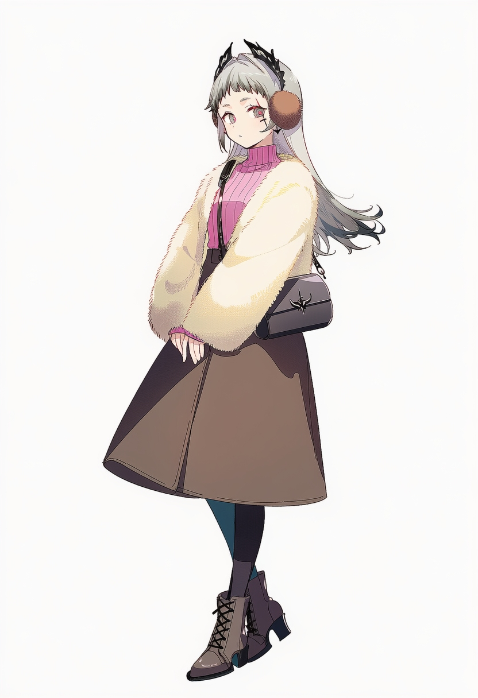

[在线例图](https://assets.quicktagcloud.com/images/raven_composition/raven_composition-5015.jpg?v=d3ef03d53ca53757)

<a id="raven_composition-5016"></a>

## 埃拉托

ID：`raven_composition-5016`；分类：角色图鉴 / 明日方舟；来源标记：`safe`。

来源说明：

> 作品：明日方舟
> 性别：女
> 首次出现时间：2022-05-19 16:00

正向提示词：

```text
erato_(arknights)
```


[在线例图](https://assets.quicktagcloud.com/images/raven_composition/raven_composition-5016.jpg?v=5c3fe2c72b5fc8f8)

<a id="raven_composition-5017"></a>

## 星源

ID：`raven_composition-5017`；分类：角色图鉴 / 明日方舟；来源标记：`safe`。

来源说明：

> 作品：明日方舟
> 性别：女
> 首次出现时间：2022-07-05 16:00

正向提示词：

```text
astgenne_(arknights)
```

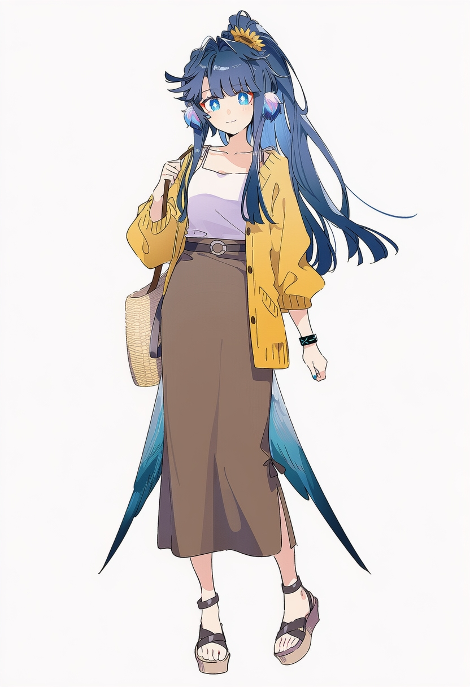

[在线例图](https://assets.quicktagcloud.com/images/raven_composition/raven_composition-5017.jpg?v=a4eaf415f432acd5)

<a id="raven_composition-5018"></a>

## 多萝西

ID：`raven_composition-5018`；分类：角色图鉴 / 明日方舟；来源标记：`safe`。

来源说明：

> 作品：明日方舟
> 性别：女
> 首次出现时间：2022-07-05 16:00

正向提示词：

```text
dorothy_(arknights)
```

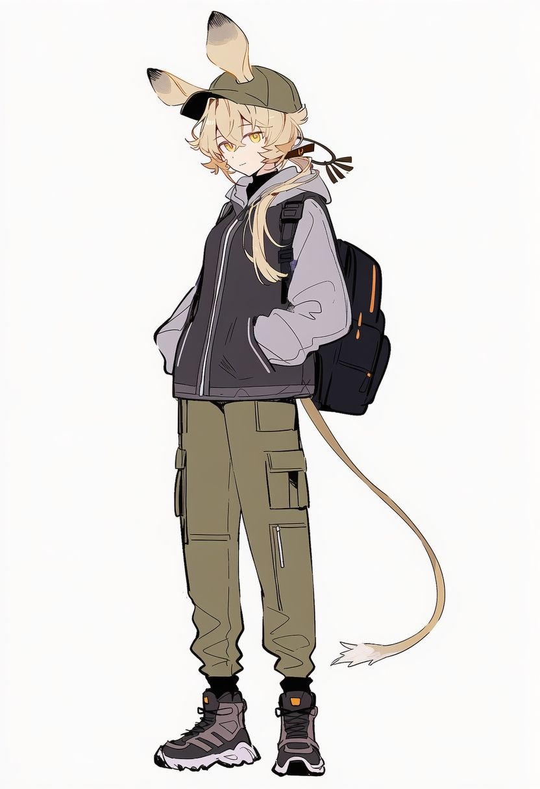

[在线例图](https://assets.quicktagcloud.com/images/raven_composition/raven_composition-5018.jpg?v=62daf9a539c9589f)

<a id="raven_composition-5019"></a>

## 晓歌

ID：`raven_composition-5019`；分类：角色图鉴 / 明日方舟；来源标记：`safe`。

来源说明：

> 作品：明日方舟
> 性别：女
> 首次出现时间：2022-08-11 16:00

正向提示词：

```text
cantabile_(arknights)
```

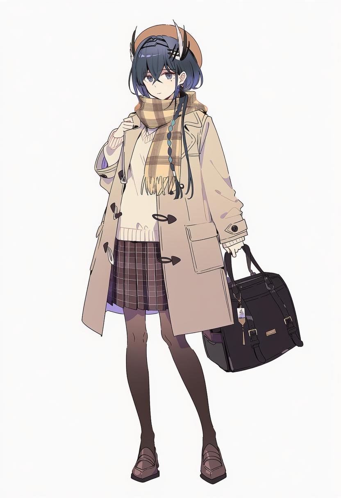

[在线例图](https://assets.quicktagcloud.com/images/raven_composition/raven_composition-5019.jpg?v=496ca4ba5fcd6abb)

<a id="raven_composition-5020"></a>

## 鸿雪

ID：`raven_composition-5020`；分类：角色图鉴 / 明日方舟；来源标记：`safe`。

来源说明：

> 作品：明日方舟
> 性别：女
> 首次出现时间：2022-08-11 16:00

正向提示词：

```text
pozyomka_(arknights)
```

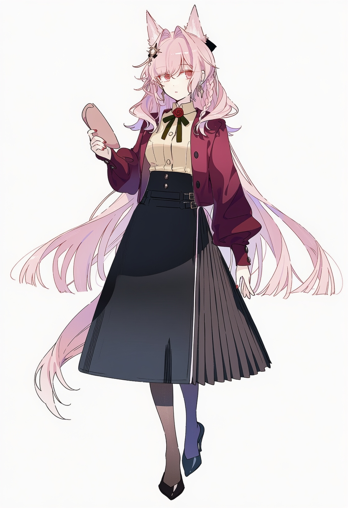

[在线例图](https://assets.quicktagcloud.com/images/raven_composition/raven_composition-5020.jpg?v=37f51fca6532e655)

<a id="raven_composition-5021"></a>

## 但书

ID：`raven_composition-5021`；分类：角色图鉴 / 明日方舟；来源标记：`safe`。

来源说明：

> 作品：明日方舟
> 性别：女
> 首次出现时间：2022-09-08 16:00

正向提示词：

```text
proviso_(arknights)
```

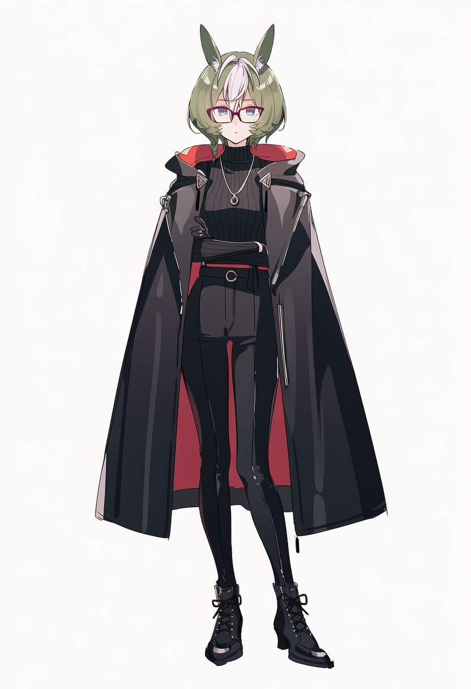

[在线例图](https://assets.quicktagcloud.com/images/raven_composition/raven_composition-5021.jpg?v=2f27fa937e682fa2)

<a id="raven_composition-5022"></a>

## 海沫

ID：`raven_composition-5022`；分类：角色图鉴 / 明日方舟；来源标记：`safe`。

来源说明：

> 作品：明日方舟
> 性别：女
> 首次出现时间：2022-09-27 16:00

正向提示词：

```text
highmore_(arknights)
```

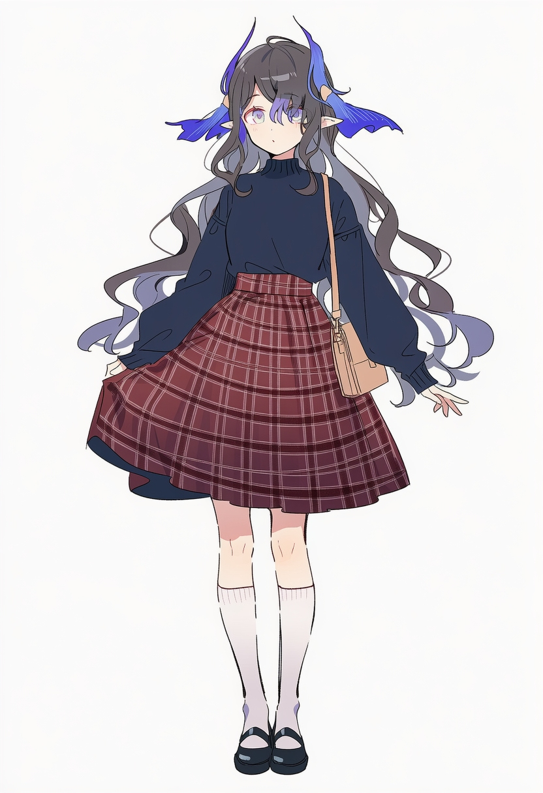

[在线例图](https://assets.quicktagcloud.com/images/raven_composition/raven_composition-5022.jpg?v=7b8a22d4d6e9a675)

<a id="raven_composition-5023"></a>

## 明椒

ID：`raven_composition-5023`；分类：角色图鉴 / 明日方舟；来源标记：`safe`。

来源说明：

> 作品：明日方舟
> 性别：女
> 首次出现时间：2022-10-11 16:00

正向提示词：

```text
paprika_(arknights)
```

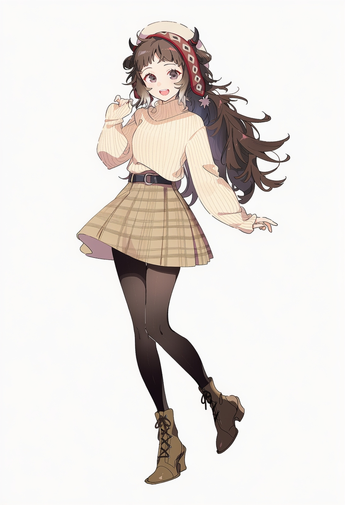

[在线例图](https://assets.quicktagcloud.com/images/raven_composition/raven_composition-5023.jpg?v=d947dad445294cfa)

<a id="raven_composition-5024"></a>

## 达格达

ID：`raven_composition-5024`；分类：角色图鉴 / 明日方舟；来源标记：`safe`。

来源说明：

> 作品：明日方舟
> 性别：女
> 首次出现时间：2022-10-11 16:00

正向提示词：

```text
dagda_(arknights)
```

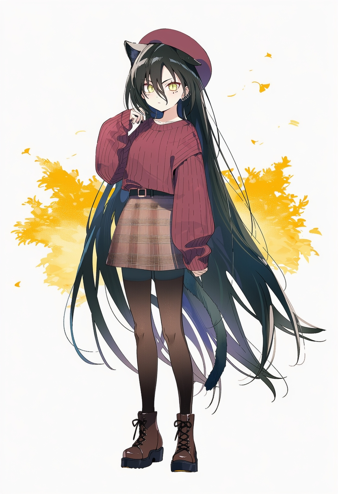

[在线例图](https://assets.quicktagcloud.com/images/raven_composition/raven_composition-5024.jpg?v=3e3e3598664cfe5a)

<a id="raven_composition-5025"></a>

## 石英

ID：`raven_composition-5025`；分类：角色图鉴 / 明日方舟；来源标记：`safe`。

来源说明：

> 作品：明日方舟
> 性别：女
> 首次出现时间：2022-11-01 16:00

正向提示词：

```text
quartz_(arknights)
```

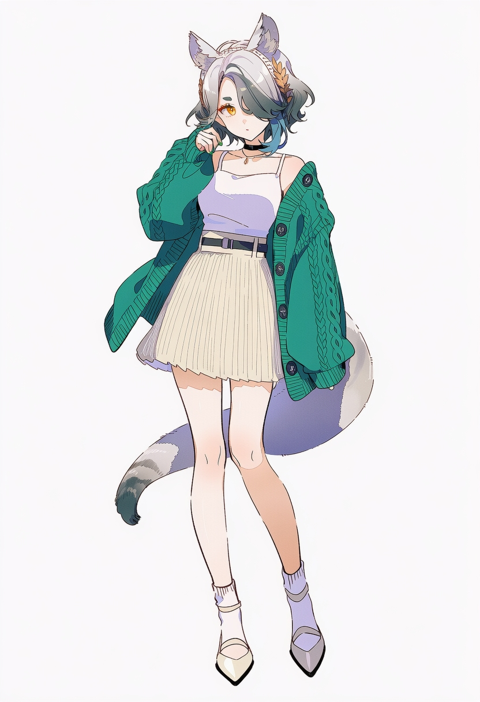

[在线例图](https://assets.quicktagcloud.com/images/raven_composition/raven_composition-5025.jpg?v=2c765f43693ae5c5)

<a id="raven_composition-5026"></a>

## 子月

ID：`raven_composition-5026`；分类：角色图鉴 / 明日方舟；来源标记：`safe`。

来源说明：

> 作品：明日方舟
> 性别：女
> 首次出现时间：2022-11-01 16:00

正向提示词：

```text
lunacub_(arknights)
```

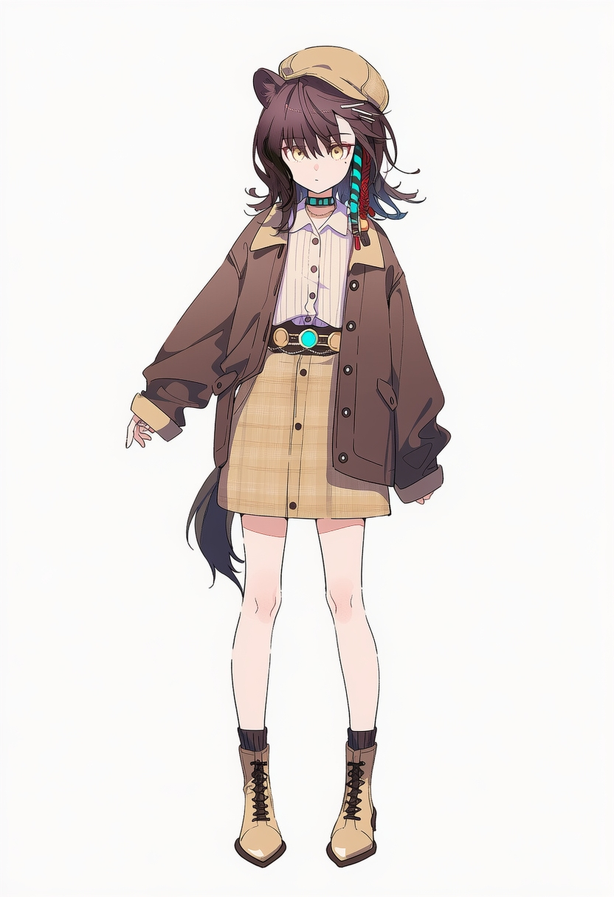

[在线例图](https://assets.quicktagcloud.com/images/raven_composition/raven_composition-5026.jpg?v=056cff4919e68057)

<a id="raven_composition-5027"></a>

## 斥罪

ID：`raven_composition-5027`；分类：角色图鉴 / 明日方舟；来源标记：`safe`。

来源说明：

> 作品：明日方舟
> 性别：女
> 首次出现时间：2022-11-01 16:00

正向提示词：

```text
penance_(arknights)
```

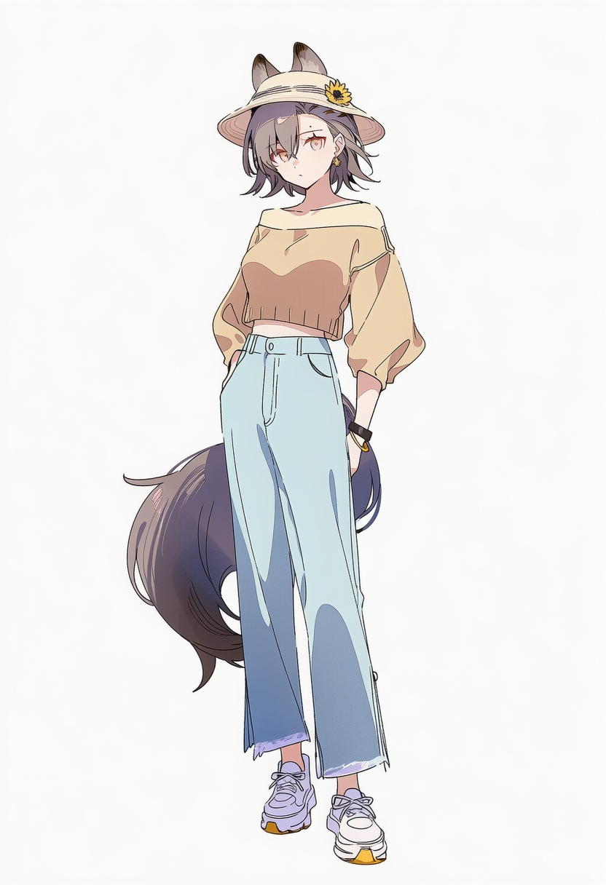

[在线例图](https://assets.quicktagcloud.com/images/raven_composition/raven_composition-5027.jpg?v=94a606926be68238)

<a id="raven_composition-5028"></a>

## 和弦

ID：`raven_composition-5028`；分类：角色图鉴 / 明日方舟；来源标记：`safe`。

来源说明：

> 作品：明日方舟
> 性别：女
> 首次出现时间：2022-12-15 16:00

正向提示词：

```text
harmonie_(arknights)
```

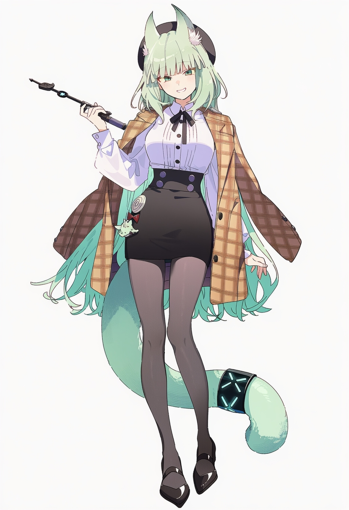

[在线例图](https://assets.quicktagcloud.com/images/raven_composition/raven_composition-5028.jpg?v=ea71d4cab7dcfbc9)

<a id="raven_composition-5029"></a>

## 火哨

ID：`raven_composition-5029`；分类：角色图鉴 / 明日方舟；来源标记：`safe`。

来源说明：

> 作品：明日方舟
> 性别：女
> 首次出现时间：2023-01-17 16:00

正向提示词：

```text
firewhistle_(arknights)
```


[在线例图](https://assets.quicktagcloud.com/images/raven_composition/raven_composition-5029.jpg?v=c48f0af89cfc5e43)

<a id="raven_composition-5030"></a>

## 截云

ID：`raven_composition-5030`；分类：角色图鉴 / 明日方舟；来源标记：`safe`。

来源说明：

> 作品：明日方舟
> 性别：女
> 首次出现时间：2023-01-17 16:00

正向提示词：

```text
jieyun_(arknights)
```

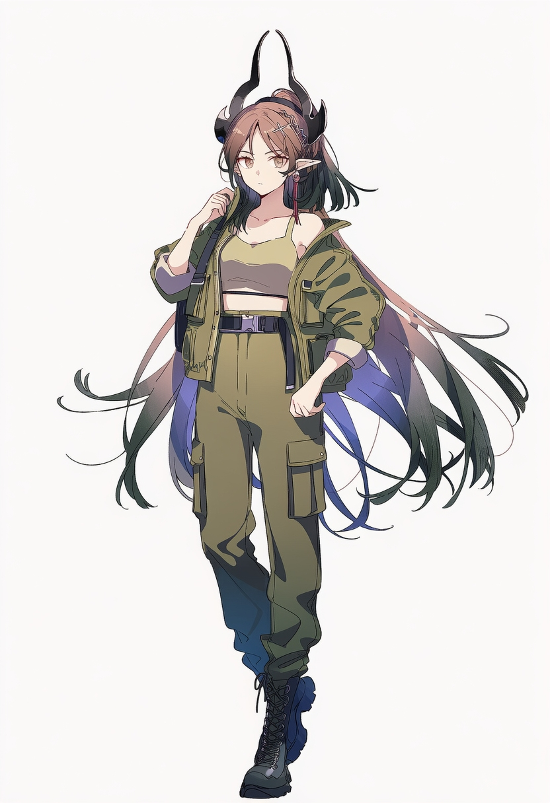

[在线例图](https://assets.quicktagcloud.com/images/raven_composition/raven_composition-5030.jpg?v=4202764b69e98649)

<a id="raven_composition-5031"></a>

## 林

ID：`raven_composition-5031`；分类：角色图鉴 / 明日方舟；来源标记：`safe`。

来源说明：

> 作品：明日方舟
> 性别：女
> 首次出现时间：2023-01-17 16:00

正向提示词：

```text
lin_(arknights)
```


[在线例图](https://assets.quicktagcloud.com/images/raven_composition/raven_composition-5031.jpg?v=9e1acfac2dddb3af)

<a id="raven_composition-5032"></a>

## 仇白

ID：`raven_composition-5032`；分类：角色图鉴 / 明日方舟；来源标记：`safe`。

来源说明：

> 作品：明日方舟
> 性别：女
> 首次出现时间：2023-02-14 16:00

正向提示词：

```text
qiubai_(arknights)
```

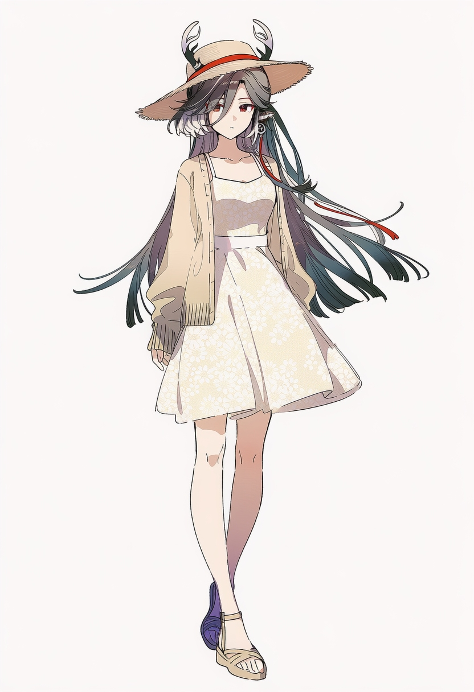

[在线例图](https://assets.quicktagcloud.com/images/raven_composition/raven_composition-5032.jpg?v=4ef9df6fa2939c2d)

<a id="raven_composition-5033"></a>

## 铎铃

ID：`raven_composition-5033`；分类：角色图鉴 / 明日方舟；来源标记：`safe`。

来源说明：

> 作品：明日方舟
> 性别：女
> 首次出现时间：2023-02-14 16:00

正向提示词：

```text
wind_chimes_(arknights)
```

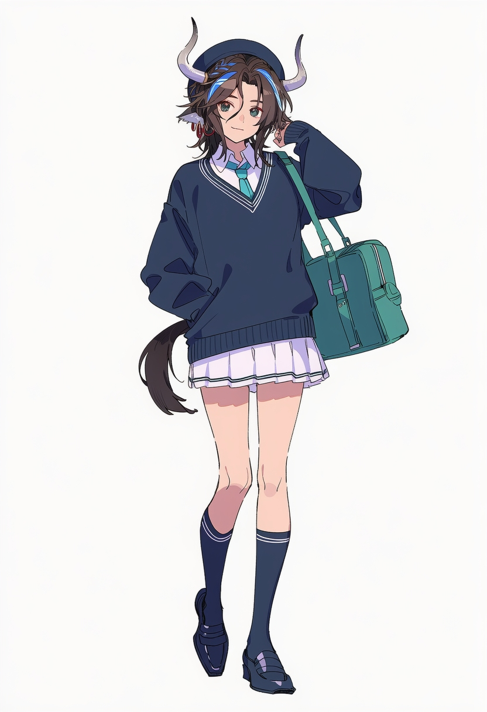

[在线例图](https://assets.quicktagcloud.com/images/raven_composition/raven_composition-5033.jpg?v=483313c15f0341a1)

<a id="raven_composition-5034"></a>

## 伊内丝

ID：`raven_composition-5034`；分类：角色图鉴 / 明日方舟；来源标记：`safe`。

来源说明：

> 作品：明日方舟
> 性别：女
> 首次出现时间：2023-04-06 16:00

正向提示词：

```text
ines_(arknights)
```

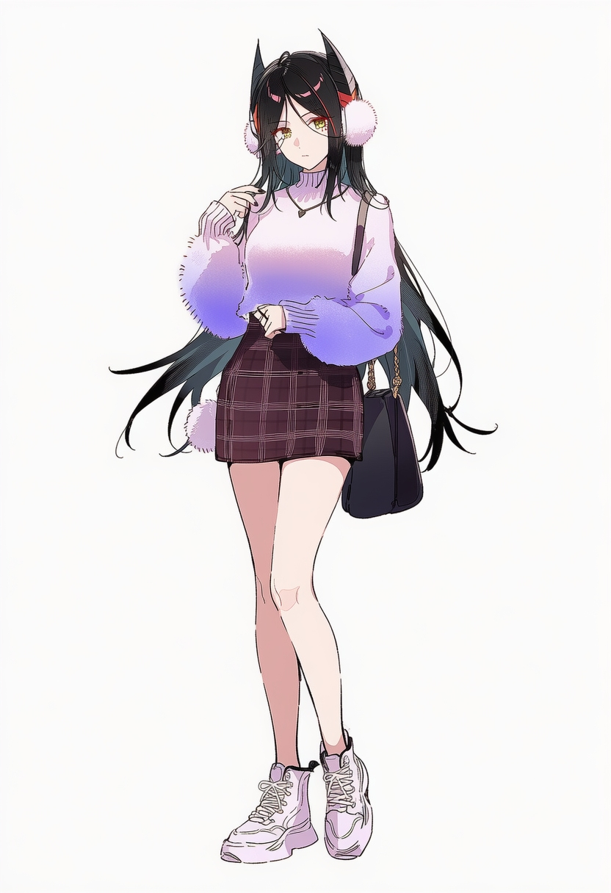

[在线例图](https://assets.quicktagcloud.com/images/raven_composition/raven_composition-5034.jpg?v=9fd809706cf5345b)

<a id="raven_composition-5035"></a>

## 洋灰

ID：`raven_composition-5035`；分类：角色图鉴 / 明日方舟；来源标记：`safe`。

来源说明：

> 作品：明日方舟
> 性别：女
> 首次出现时间：2023-04-06 16:00

正向提示词：

```text
cement_(arknights)
```


[在线例图](https://assets.quicktagcloud.com/images/raven_composition/raven_composition-5035.jpg?v=19964552b2806307)

<a id="raven_composition-5036"></a>

## 摩根

ID：`raven_composition-5036`；分类：角色图鉴 / 明日方舟；来源标记：`safe`。

来源说明：

> 作品：明日方舟
> 性别：女
> 首次出现时间：2023-04-06 16:00

正向提示词：

```text
morgan_(arknights)
```

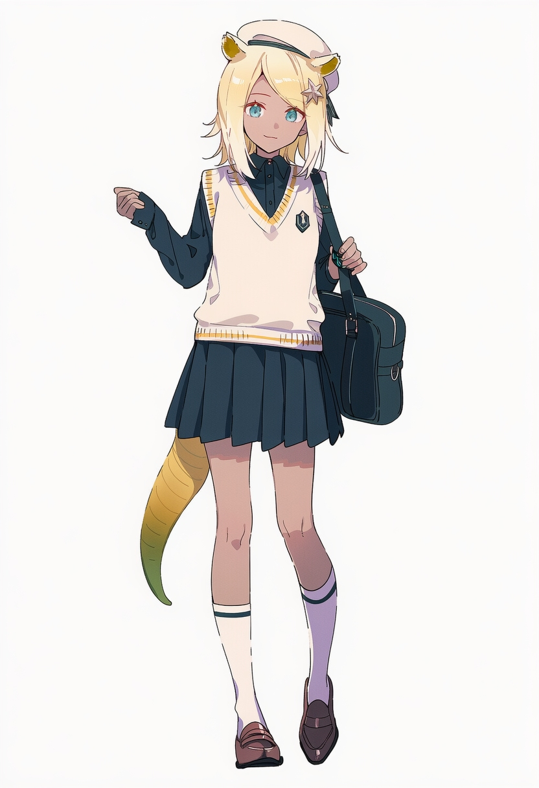

[在线例图](https://assets.quicktagcloud.com/images/raven_composition/raven_composition-5036.jpg?v=2c681cdee2836e72)

<a id="raven_composition-5037"></a>

## 霍尔海雅

ID：`raven_composition-5037`；分类：角色图鉴 / 明日方舟；来源标记：`safe`。

来源说明：

> 作品：明日方舟
> 性别：女
> 首次出现时间：2023-05-01 16:00

正向提示词：

```text
ho'olheyak_(arknights)
```

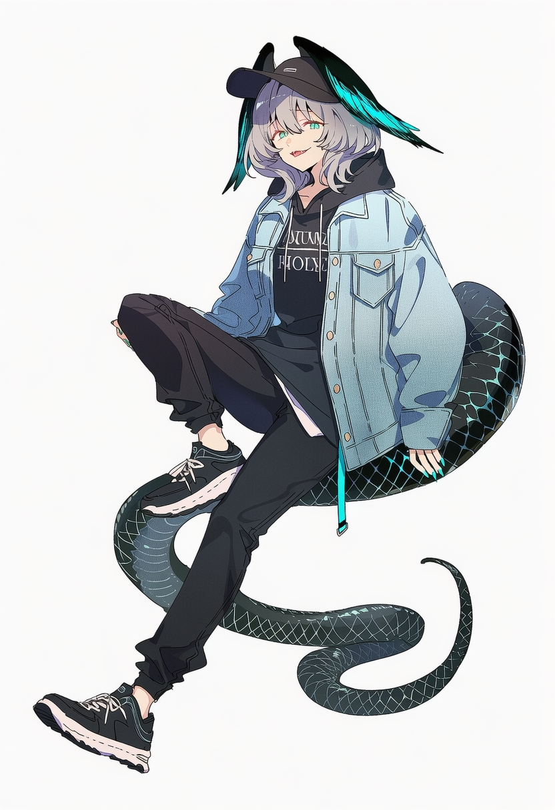

[在线例图](https://assets.quicktagcloud.com/images/raven_composition/raven_composition-5037.jpg?v=b1e2b637bb031a9d)

<a id="raven_composition-5038"></a>

## 玫拉

ID：`raven_composition-5038`；分类：角色图鉴 / 明日方舟；来源标记：`safe`。

来源说明：

> 作品：明日方舟
> 性别：女
> 首次出现时间：2023-05-01 16:00

正向提示词：

```text
melanite_(arknights)
```

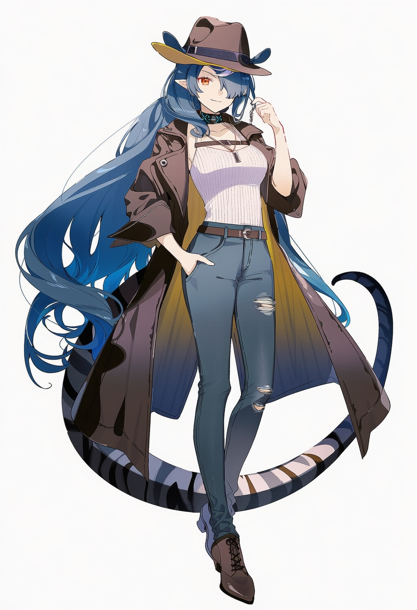

[在线例图](https://assets.quicktagcloud.com/images/raven_composition/raven_composition-5038.jpg?v=f630ecbac16a7320)

<a id="raven_composition-5039"></a>

## 缪尔赛思

ID：`raven_composition-5039`；分类：角色图鉴 / 明日方舟；来源标记：`safe`。

来源说明：

> 作品：明日方舟
> 性别：女
> 首次出现时间：2023-05-01 16:00

正向提示词：

```text
muelsyse_(arknights)
```

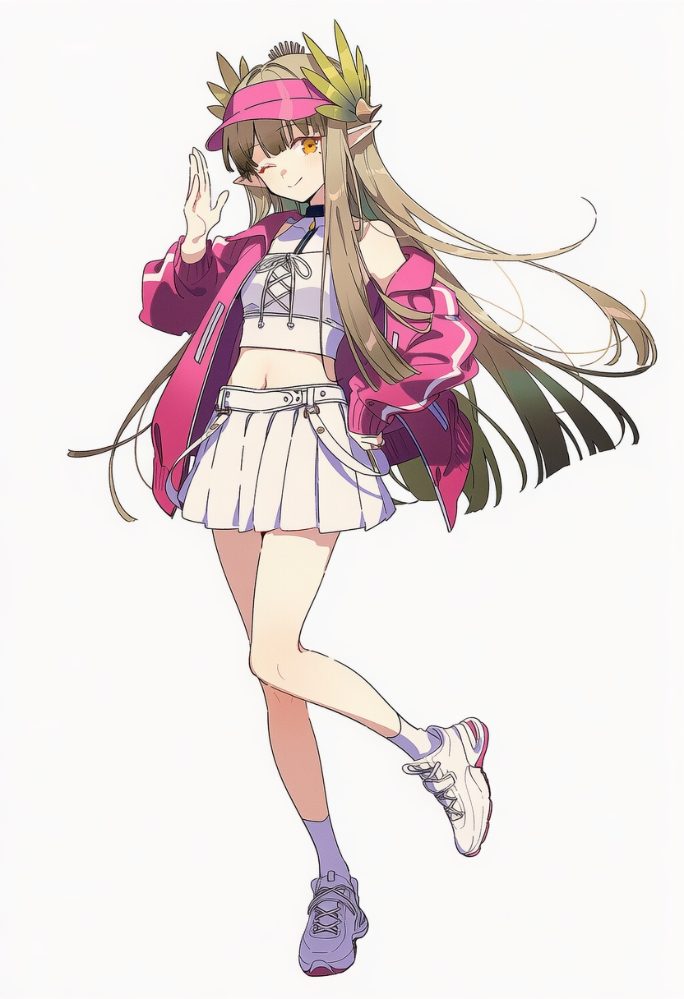

[在线例图](https://assets.quicktagcloud.com/images/raven_composition/raven_composition-5039.jpg?v=04a2e26839a48761)

<a id="raven_composition-5040"></a>

## 空构

ID：`raven_composition-5040`；分类：角色图鉴 / 明日方舟；来源标记：`safe`。

来源说明：

> 作品：明日方舟
> 性别：女
> 首次出现时间：2023-06-08 16:00

正向提示词：

```text
spuria_(arknights)
```

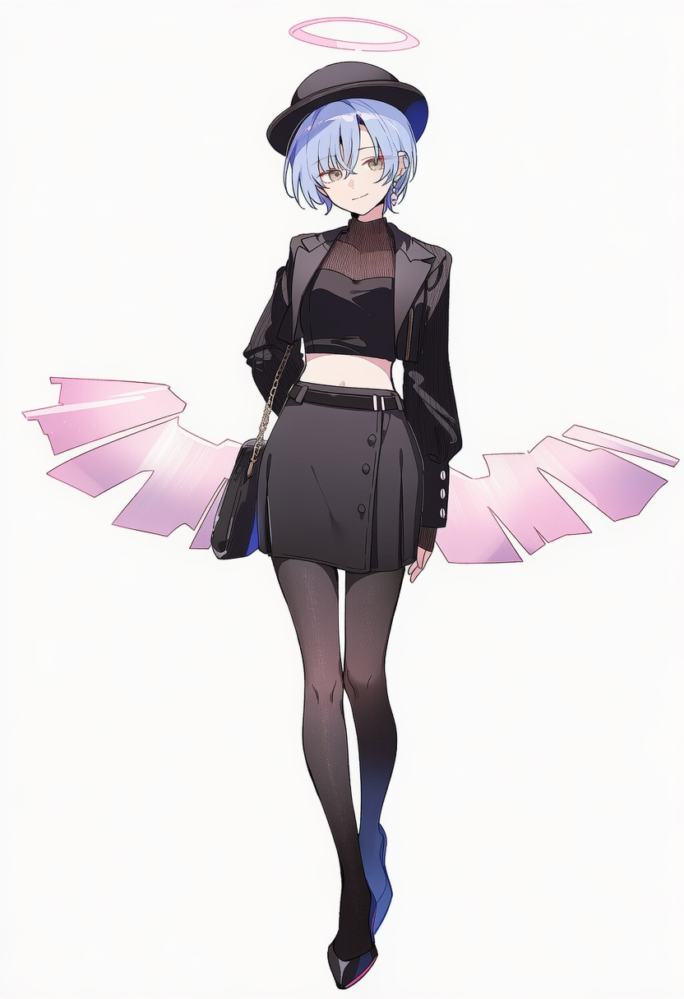

[在线例图](https://assets.quicktagcloud.com/images/raven_composition/raven_composition-5040.jpg?v=59775210f22a668a)

<a id="raven_composition-5041"></a>

## 寒檀

ID：`raven_composition-5041`；分类：角色图鉴 / 明日方舟；来源标记：`safe`。

来源说明：

> 作品：明日方舟
> 性别：女
> 首次出现时间：2023-07-06 16:00

正向提示词：

```text
santalla_(arknights)
```

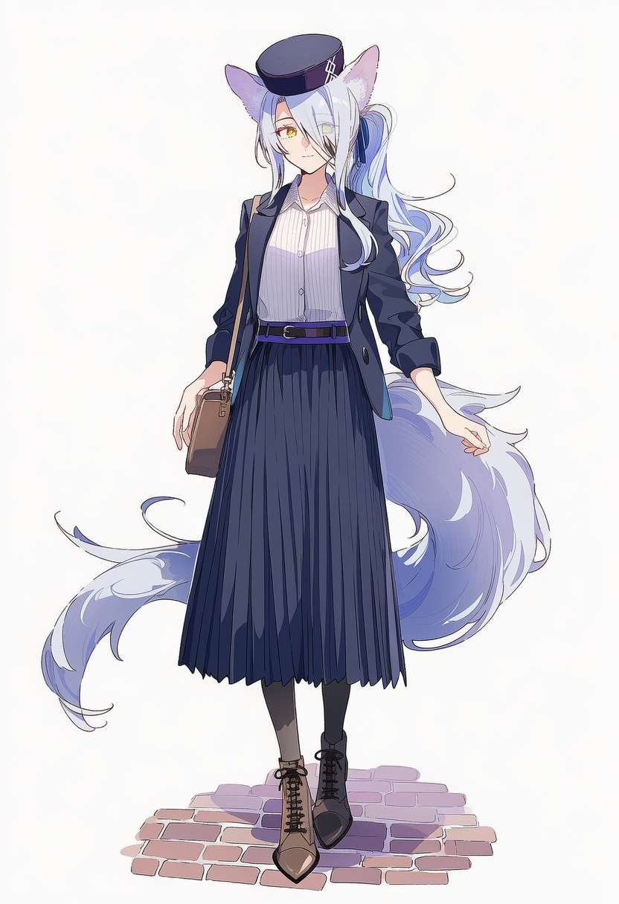

[在线例图](https://assets.quicktagcloud.com/images/raven_composition/raven_composition-5041.jpg?v=8ac4468ee215a8f5)

<a id="raven_composition-5042"></a>

## 提丰

ID：`raven_composition-5042`；分类：角色图鉴 / 明日方舟；来源标记：`safe`。

来源说明：

> 作品：明日方舟
> 性别：女
> 首次出现时间：2023-07-06 16:00

正向提示词：

```text
typhon_(arknights)
```

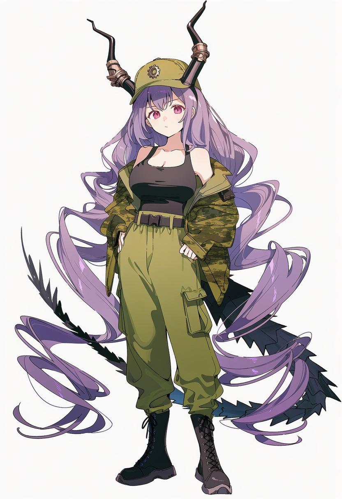

[在线例图](https://assets.quicktagcloud.com/images/raven_composition/raven_composition-5042.jpg?v=10ab8d1e9c8a1cd9)

<a id="raven_composition-5043"></a>

## 凛视

ID：`raven_composition-5043`；分类：角色图鉴 / 明日方舟；来源标记：`safe`。

来源说明：

> 作品：明日方舟
> 性别：女
> 首次出现时间：2023-07-13 16:00

正向提示词：

```text
valarqvin_(arknights)
```

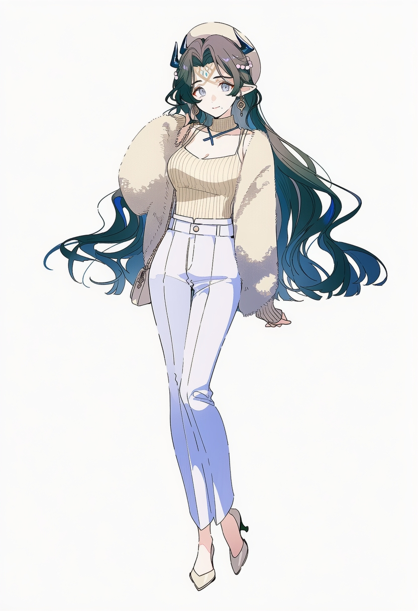

[在线例图](https://assets.quicktagcloud.com/images/raven_composition/raven_composition-5043.jpg?v=7acf8c4abfdd2bce)

<a id="raven_composition-5044"></a>

## 青枳

ID：`raven_composition-5044`；分类：角色图鉴 / 明日方舟；来源标记：`safe`。

来源说明：

> 作品：明日方舟
> 性别：女
> 首次出现时间：2023-08-01 16:00

正向提示词：

```text
poncirus_(arknights)
```

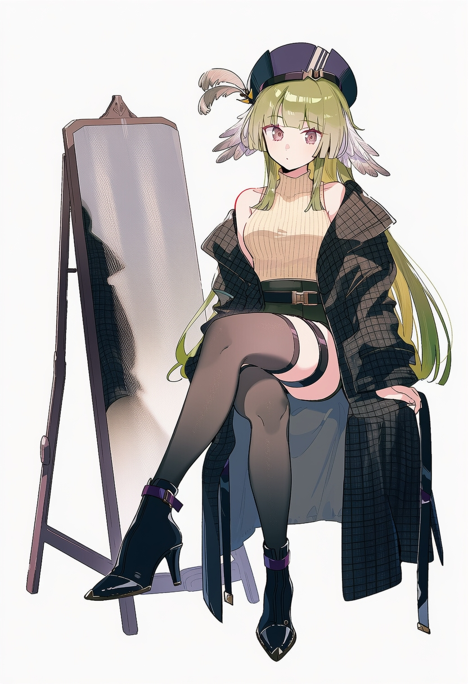

[在线例图](https://assets.quicktagcloud.com/images/raven_composition/raven_composition-5044.jpg?v=e701f75fe05a3fd8)

<a id="raven_composition-5045"></a>

## 冰酿

ID：`raven_composition-5045`；分类：角色图鉴 / 明日方舟；来源标记：`safe`。

来源说明：

> 作品：明日方舟
> 性别：女
> 首次出现时间：2023-09-05 16:00

正向提示词：

```text
coldshot_(arknights)
```

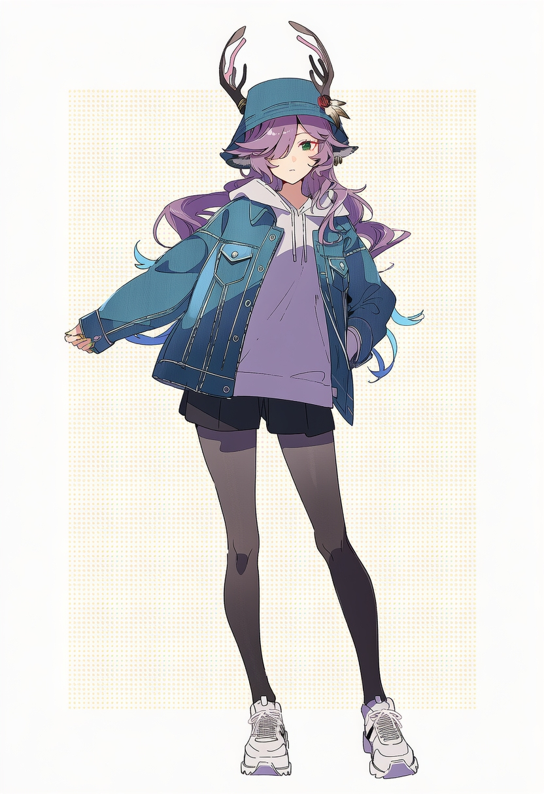

[在线例图](https://assets.quicktagcloud.com/images/raven_composition/raven_composition-5045.jpg?v=67560062bc0f437b)

<a id="raven_composition-5046"></a>

## 杏仁

ID：`raven_composition-5046`；分类：角色图鉴 / 明日方舟；来源标记：`safe`。

来源说明：

> 作品：明日方舟
> 性别：女
> 首次出现时间：2023-09-05 16:00

正向提示词：

```text
almond_(arknights)
```

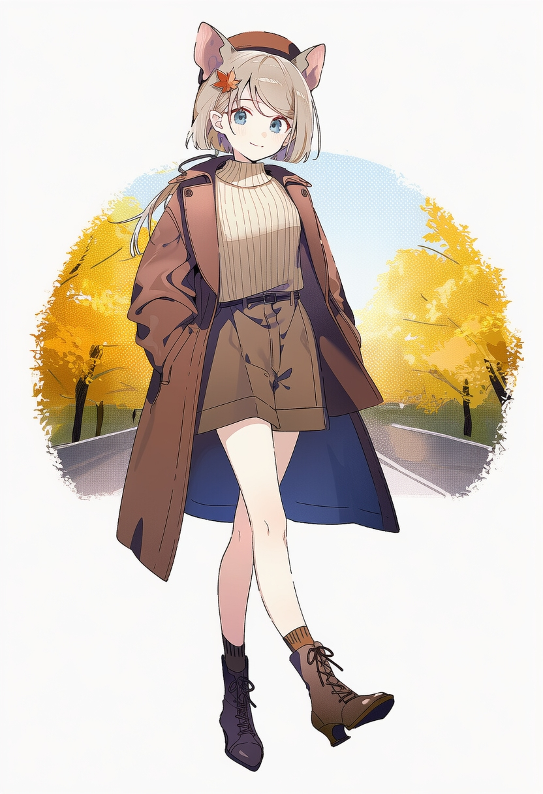

[在线例图](https://assets.quicktagcloud.com/images/raven_composition/raven_composition-5046.jpg?v=3edca734f8d5159b)

<a id="raven_composition-5047"></a>

## 戴菲恩

ID：`raven_composition-5047`；分类：角色图鉴 / 明日方舟；来源标记：`safe`。

来源说明：

> 作品：明日方舟
> 性别：女
> 首次出现时间：2023-10-08 16:00

正向提示词：

```text
delphine_(arknights)
```

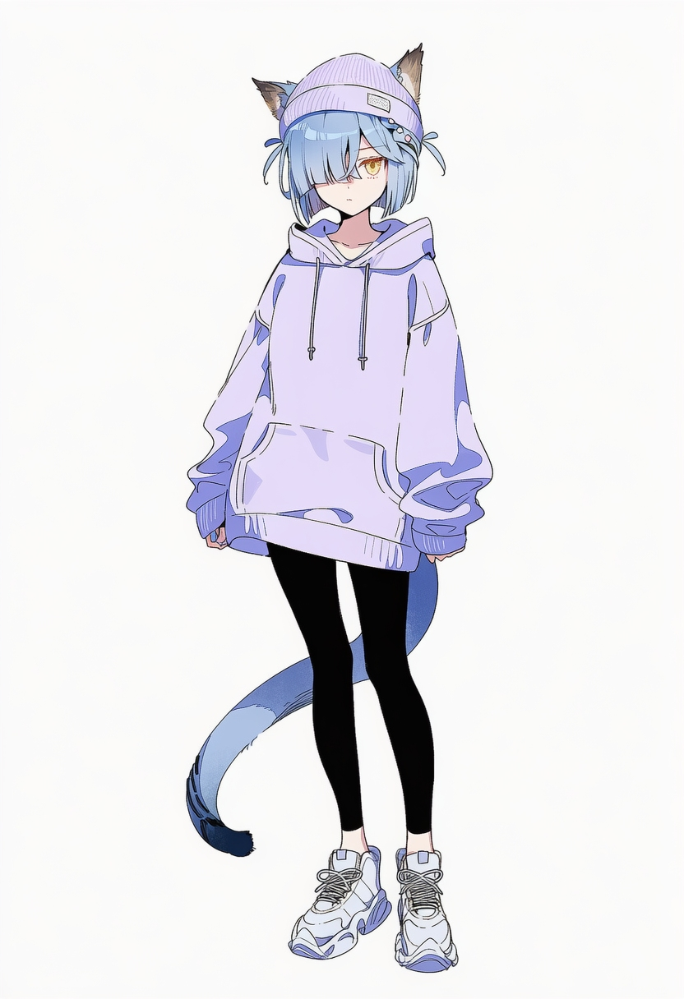

[在线例图](https://assets.quicktagcloud.com/images/raven_composition/raven_composition-5047.jpg?v=7a94cdbcd2a2b775)

<a id="raven_composition-5048"></a>

## 刺玫

ID：`raven_composition-5048`；分类：角色图鉴 / 明日方舟；来源标记：`safe`。

来源说明：

> 作品：明日方舟
> 性别：女
> 首次出现时间：2023-10-08 16:00

正向提示词：

```text
vendela_(arknights)
```

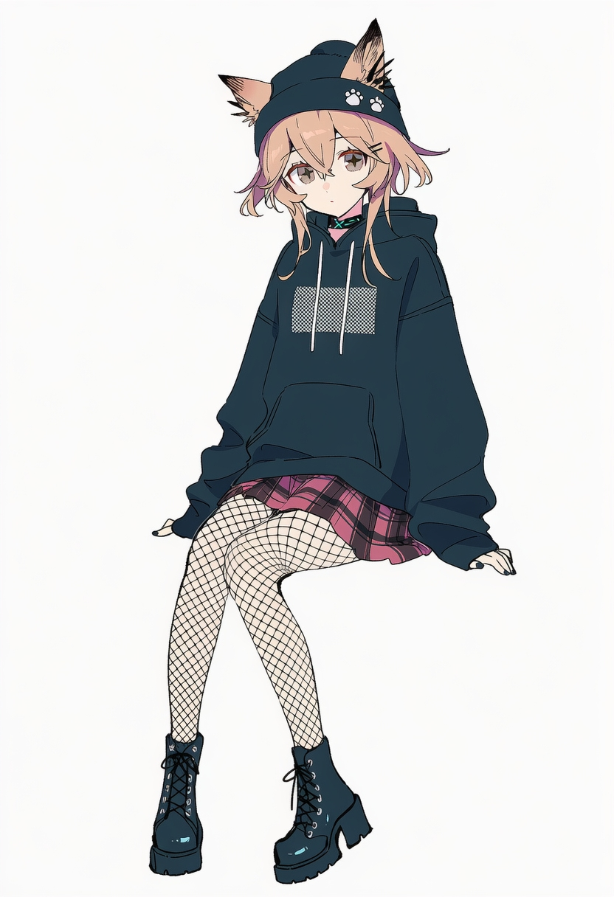

[在线例图](https://assets.quicktagcloud.com/images/raven_composition/raven_composition-5048.jpg?v=a5c354337e70b8fb)

<a id="raven_composition-5049"></a>

## 跃跃

ID：`raven_composition-5049`；分类：角色图鉴 / 明日方舟；来源标记：`safe`。

来源说明：

> 作品：明日方舟
> 性别：女
> 首次出现时间：2023-11-01 16:00

正向提示词：

```text
caper_(arknights)
```

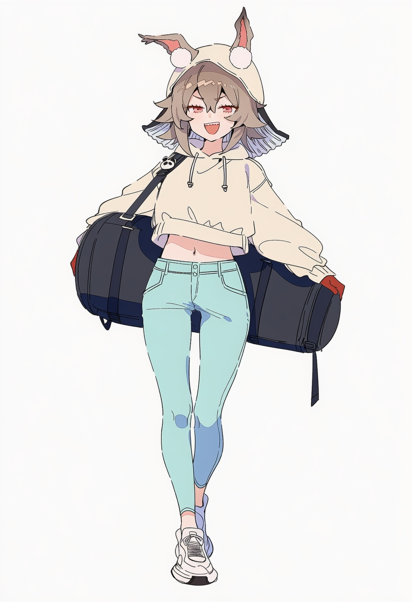

[在线例图](https://assets.quicktagcloud.com/images/raven_composition/raven_composition-5049.jpg?v=cd27ea4e59878745)

<a id="raven_composition-5050"></a>

## 塑心

ID：`raven_composition-5050`；分类：角色图鉴 / 明日方舟；来源标记：`safe`。

来源说明：

> 作品：明日方舟
> 性别：女
> 首次出现时间：2023-11-01 16:00

正向提示词：

```text
virtuosa_(arknights)
```

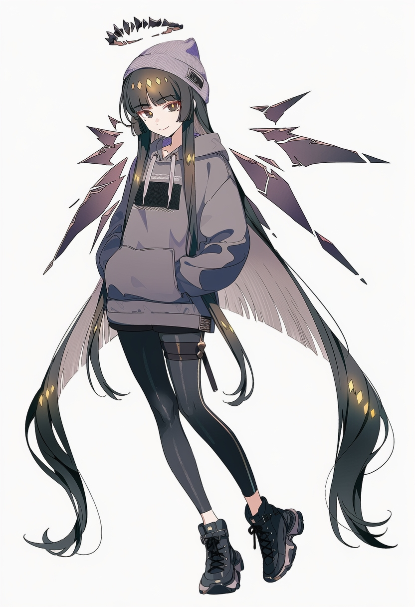

[在线例图](https://assets.quicktagcloud.com/images/raven_composition/raven_composition-5050.jpg?v=606b9bae9d402d86)

<a id="raven_composition-5051"></a>

## 薇薇安娜

ID：`raven_composition-5051`；分类：角色图鉴 / 明日方舟；来源标记：`safe`。

来源说明：

> 作品：明日方舟
> 性别：女
> 首次出现时间：2023-11-01 16:00

正向提示词：

```text
viviana_(arknights)
```

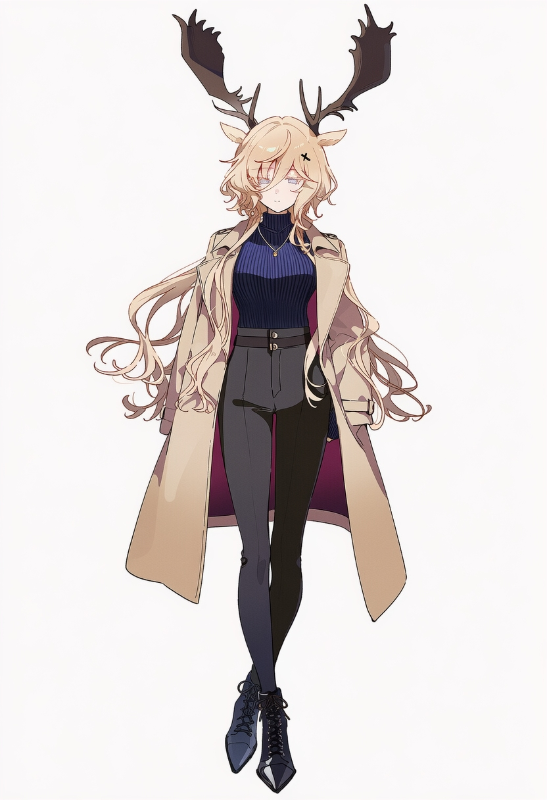

[在线例图](https://assets.quicktagcloud.com/images/raven_composition/raven_composition-5051.jpg?v=eb638a6225586d90)

<a id="raven_composition-5052"></a>

## 锏

ID：`raven_composition-5052`；分类：角色图鉴 / 明日方舟；来源标记：`safe`。

来源说明：

> 作品：明日方舟
> 性别：女
> 首次出现时间：2023-12-05 16:00

正向提示词：

```text
degenbrecher_(arknights)
```

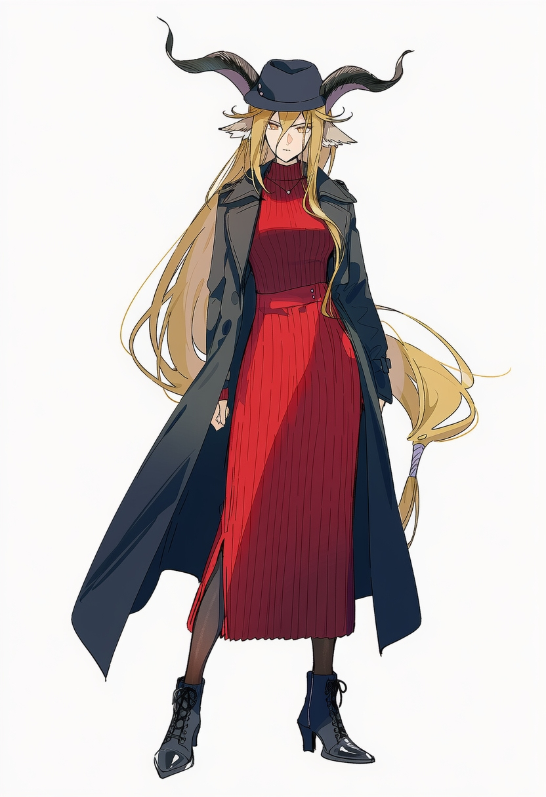

[在线例图](https://assets.quicktagcloud.com/images/raven_composition/raven_composition-5052.jpg?v=7b459f2bab3f33d4)

<a id="raven_composition-5053"></a>

## 烈夏

ID：`raven_composition-5053`；分类：角色图鉴 / 明日方舟；来源标记：`safe`。

来源说明：

> 作品：明日方舟
> 性别：女
> 首次出现时间：2023-12-05 16:00

正向提示词：

```text
leto_(arknights)
```

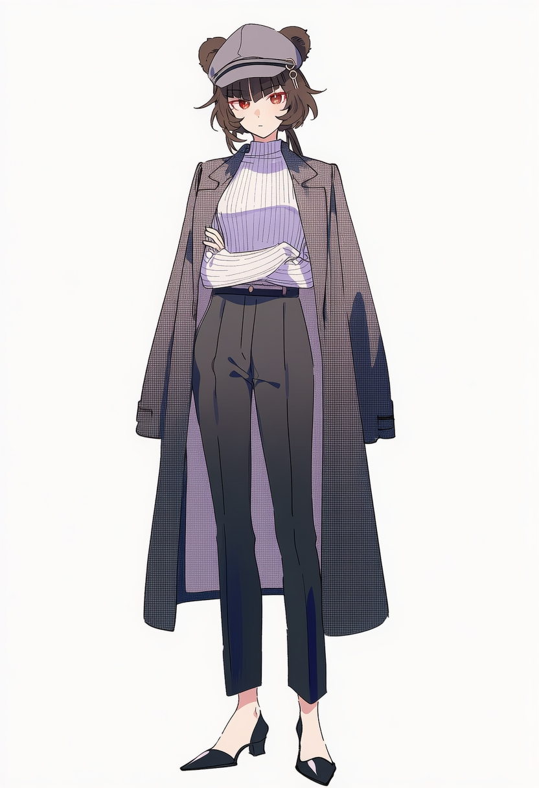

[在线例图](https://assets.quicktagcloud.com/images/raven_composition/raven_composition-5053.jpg?v=79775400051d1ca6)

<a id="raven_composition-5054"></a>

## 莱伊

ID：`raven_composition-5054`；分类：角色图鉴 / 明日方舟；来源标记：`safe`。

来源说明：

> 作品：明日方舟
> 性别：女
> 首次出现时间：2024-01-09 16:00

正向提示词：

```text
ray_(arknights)
```


[在线例图](https://assets.quicktagcloud.com/images/raven_composition/raven_composition-5054.jpg?v=d98b032b9ec94552)

<a id="raven_composition-5055"></a>

## 温米

ID：`raven_composition-5055`；分类：角色图鉴 / 明日方舟；来源标记：`safe`。

来源说明：

> 作品：明日方舟
> 性别：女
> 首次出现时间：2024-01-09 16:00

正向提示词：

```text
warmy_(arknights)
```


[在线例图](https://assets.quicktagcloud.com/images/raven_composition/raven_composition-5055.jpg?v=fe3a143072485675)

<a id="raven_composition-5056"></a>

## 小满

ID：`raven_composition-5056`；分类：角色图鉴 / 明日方舟；来源标记：`safe`。

来源说明：

> 作品：明日方舟
> 性别：女
> 首次出现时间：2024-02-01 16:00

正向提示词：

```text
grain_buds_(arknights)
```


[在线例图](https://assets.quicktagcloud.com/images/raven_composition/raven_composition-5056.jpg?v=4191bd54e3741248)

<a id="raven_composition-5057"></a>

## 黍

ID：`raven_composition-5057`；分类：角色图鉴 / 明日方舟；来源标记：`safe`。

来源说明：

> 作品：明日方舟
> 性别：女
> 首次出现时间：2024-02-01 16:00

正向提示词：

```text
shu_(arknights)
```


[在线例图](https://assets.quicktagcloud.com/images/raven_composition/raven_composition-5057.jpg?v=d51bdee9da8fae4d)

<a id="raven_composition-5058"></a>

## 红隼

ID：`raven_composition-5058`；分类：角色图鉴 / 明日方舟；来源标记：`safe`。

来源说明：

> 作品：明日方舟
> 性别：女
> 首次出现时间：2024-02-03 16:00

正向提示词：

```text
kestrel_(arknights)
```


[在线例图](https://assets.quicktagcloud.com/images/raven_composition/raven_composition-5058.jpg?v=a2224a35ab8e90cb)

<a id="raven_composition-5059"></a>

## 阿斯卡纶

ID：`raven_composition-5059`；分类：角色图鉴 / 明日方舟；来源标记：`safe`。

来源说明：

> 作品：明日方舟
> 性别：女
> 首次出现时间：2024-04-11 16:00

正向提示词：

```text
ascalon_(arknights)
```


[在线例图](https://assets.quicktagcloud.com/images/raven_composition/raven_composition-5059.jpg?v=b8c57a95401f27a6)

<a id="raven_composition-5060"></a>

## 露托

ID：`raven_composition-5060`；分类：角色图鉴 / 明日方舟；来源标记：`safe`。

来源说明：

> 作品：明日方舟
> 性别：女
> 首次出现时间：2024-04-11 16:00

正向提示词：

```text
lutonada_(arknights)
```


[在线例图](https://assets.quicktagcloud.com/images/raven_composition/raven_composition-5060.jpg?v=26fb6f25da506546)

<a id="raven_composition-5061"></a>

## 阿罗玛

ID：`raven_composition-5061`；分类：角色图鉴 / 明日方舟；来源标记：`safe`。

来源说明：

> 作品：明日方舟
> 性别：女
> 首次出现时间：2024-04-11 16:00

正向提示词：

```text
aroma_(arknights)
```


[在线例图](https://assets.quicktagcloud.com/images/raven_composition/raven_composition-5061.jpg?v=bbc5f5bb1e749d3f)

<a id="raven_composition-5062"></a>

## 魔王

ID：`raven_composition-5062`；分类：角色图鉴 / 明日方舟；来源标记：`safe`。

来源说明：

> 作品：明日方舟
> 性别：女
> 首次出现时间：2024-05-01 16:00

正向提示词：

```text
theresa_(arknights)
```


[在线例图](https://assets.quicktagcloud.com/images/raven_composition/raven_composition-5062.jpg?v=c4b9f031ce7e7c18)

<a id="raven_composition-5063"></a>

## 维什戴尔

ID：`raven_composition-5063`；分类：角色图鉴 / 明日方舟；来源标记：`safe`。

来源说明：

> 作品：明日方舟
> 性别：女
> 首次出现时间：2024-05-01 16:00

正向提示词：

```text
wis'adel_(arknights)
```


[在线例图](https://assets.quicktagcloud.com/images/raven_composition/raven_composition-5063.jpg?v=8ffc5fd55d3bcd5b)

<a id="raven_composition-5064"></a>

## 露西拉

ID：`raven_composition-5064`；分类：角色图鉴 / 明日方舟；来源标记：`safe`。

来源说明：

> 作品：明日方舟
> 性别：女
> 首次出现时间：2024-06-05 16:00

正向提示词：

```text
lucilla_(arknights)
```


[在线例图](https://assets.quicktagcloud.com/images/raven_composition/raven_composition-5064.jpg?v=99b888303382956c)

<a id="raven_composition-5065"></a>

## 深巡

ID：`raven_composition-5065`；分类：角色图鉴 / 明日方舟；来源标记：`safe`。

来源说明：

> 作品：明日方舟
> 性别：女
> 首次出现时间：2024-06-05 16:00

正向提示词：

```text
underflow_(arknights)
```


[在线例图](https://assets.quicktagcloud.com/images/raven_composition/raven_composition-5065.jpg?v=40a8c28c4938302e)

<a id="raven_composition-5066"></a>

## 妮芙

ID：`raven_composition-5066`；分类：角色图鉴 / 明日方舟；来源标记：`safe`。

来源说明：

> 作品：明日方舟
> 性别：女
> 首次出现时间：2024-07-09 16:00

正向提示词：

```text
nymph_(arknights)
```


[在线例图](https://assets.quicktagcloud.com/images/raven_composition/raven_composition-5066.jpg?v=a0708b2efde9d6c6)

<a id="raven_composition-5067"></a>

## 娜仁图亚

ID：`raven_composition-5067`；分类：角色图鉴 / 明日方舟；来源标记：`safe`。

来源说明：

> 作品：明日方舟
> 性别：女
> 首次出现时间：2024-08-01 16:00

正向提示词：

```text
narantuya_(arknights)
```


[在线例图](https://assets.quicktagcloud.com/images/raven_composition/raven_composition-5067.jpg?v=68b9fcbb27c413a7)

<a id="raven_composition-5068"></a>

## 莎草

ID：`raven_composition-5068`；分类：角色图鉴 / 明日方舟；来源标记：`safe`。

来源说明：

> 作品：明日方舟
> 性别：女
> 首次出现时间：2024-08-01 16:00

正向提示词：

```text
papyrus_(arknights)
```


[在线例图](https://assets.quicktagcloud.com/images/raven_composition/raven_composition-5068.jpg?v=51ac5cff8679d141)

<a id="raven_composition-5069"></a>

## 佩佩

ID：`raven_composition-5069`；分类：角色图鉴 / 明日方舟；来源标记：`safe`。

来源说明：

> 作品：明日方舟
> 性别：女
> 首次出现时间：2024-08-01 16:00

正向提示词：

```text
pepe_(arknights)
```


[在线例图](https://assets.quicktagcloud.com/images/raven_composition/raven_composition-5069.jpg?v=f9748341af0fe3a1)

<a id="raven_composition-5070"></a>

## 玛露西尔

ID：`raven_composition-5070`；分类：角色图鉴 / 明日方舟；来源标记：`safe`。

来源说明：

> 作品：明日方舟
> 性别：女
> 首次出现时间：2024-09-02 16:00

正向提示词：

```text
marcille_donato
```


[在线例图](https://assets.quicktagcloud.com/images/raven_composition/raven_composition-5070.jpg?v=184dd140f4affe6c)

<a id="raven_composition-5071"></a>

## 凯瑟琳

ID：`raven_composition-5071`；分类：角色图鉴 / 明日方舟；来源标记：`safe`。

来源说明：

> 作品：明日方舟
> 性别：女
> 首次出现时间：2024-10-09 16:00

正向提示词：

```text
catherine_(arknights)
```


[在线例图](https://assets.quicktagcloud.com/images/raven_composition/raven_composition-5071.jpg?v=11428ccb43a4ea8f)

<a id="raven_composition-5072"></a>

## 弑君者

ID：`raven_composition-5072`；分类：角色图鉴 / 明日方舟；来源标记：`safe`。

来源说明：

> 作品：明日方舟
> 性别：女
> 首次出现时间：2024-11-01 16:00

正向提示词：

```text
crownslayer_(arknights)
```


[在线例图](https://assets.quicktagcloud.com/images/raven_composition/raven_composition-5072.jpg?v=98b46f3b44700d8e)

<a id="raven_composition-5073"></a>

## 云迹

ID：`raven_composition-5073`；分类：角色图鉴 / 明日方舟；来源标记：`safe`。

来源说明：

> 作品：明日方舟
> 性别：女
> 首次出现时间：2024-11-01 16:00

正向提示词：

```text
contrail_(arknights)
```


[在线例图](https://assets.quicktagcloud.com/images/raven_composition/raven_composition-5073.jpg?v=e9086c71195f6bee)

<a id="raven_composition-5074"></a>

## 菲莱

ID：`raven_composition-5074`；分类：角色图鉴 / 明日方舟；来源标记：`safe`。

来源说明：

> 作品：明日方舟
> 性别：女
> 首次出现时间：2024-11-01 16:00

正向提示词：

```text
philae_(arknights)
```


[在线例图](https://assets.quicktagcloud.com/images/raven_composition/raven_composition-5074.jpg?v=0d4bafb67089feb7)

<a id="raven_composition-5075"></a>

## 忍冬

ID：`raven_composition-5075`；分类：角色图鉴 / 明日方舟；来源标记：`safe`。

来源说明：

> 作品：明日方舟
> 性别：女
> 首次出现时间：2024-11-01 16:00

正向提示词：

```text
vulpisfoglia_(arknights)
```


[在线例图](https://assets.quicktagcloud.com/images/raven_composition/raven_composition-5075.jpg?v=55f73563a1d8de23)

<a id="raven_composition-5076"></a>

## 特克诺

ID：`raven_composition-5076`；分类：角色图鉴 / 明日方舟；来源标记：`safe`。

来源说明：

> 作品：明日方舟
> 性别：女
> 首次出现时间：2024-12-05 16:00

正向提示词：

```text
tecno_(arknights)
```


[在线例图](https://assets.quicktagcloud.com/images/raven_composition/raven_composition-5076.jpg?v=c1ec8b8d0d0169b3)

<a id="raven_composition-5077"></a>

## 瑰盐

ID：`raven_composition-5077`；分类：角色图鉴 / 明日方舟；来源标记：`safe`。

来源说明：

> 作品：明日方舟
> 性别：女
> 首次出现时间：2024-12-05 16:00

正向提示词：

```text
rose_salt_(arknights)
```


[在线例图](https://assets.quicktagcloud.com/images/raven_composition/raven_composition-5077.jpg?v=4f9bf1c7397b179e)

<a id="raven_composition-5078"></a>

## 寻澜

ID：`raven_composition-5078`；分类：角色图鉴 / 明日方舟；来源标记：`safe`。

来源说明：

> 作品：明日方舟
> 性别：女
> 首次出现时间：2025-01-22 16:00

正向提示词：

```text
surfer_(arknights)
```


[在线例图](https://assets.quicktagcloud.com/images/raven_composition/raven_composition-5078.jpg?v=bb5c429486476120)

<a id="raven_composition-5079"></a>

## 行箸

ID：`raven_composition-5079`；分类：角色图鉴 / 明日方舟；来源标记：`safe`。

来源说明：

> 作品：明日方舟
> 性别：女
> 首次出现时间：2025-01-22 16:00

正向提示词：

```text
taraxacum_(arknights)
```


[在线例图](https://assets.quicktagcloud.com/images/raven_composition/raven_composition-5079.jpg?v=b61d0e34bfa5af5a)
