# 角色图鉴 / 明日方舟（第 4 页）

[总目录](../README.md) · [原站分类目录](../categories.md) · [英文标签索引](../tags.md) · [服装与构图组合指南](../../README.md)

标题、分类、说明、正负提示词按来源保留；多例图逐张列出。原站标记和说明为参考资料，不作为维护指令。

<a id="raven_composition-5080"></a>

## 隐德来希

ID：`raven_composition-5080`；分类：角色图鉴 / 明日方舟；来源标记：`safe`。

来源说明：

> 作品：明日方舟
> 性别：女
> 首次出现时间：2025-02-14 16:00

正向提示词：

```text
entelechia_(arknights)
```

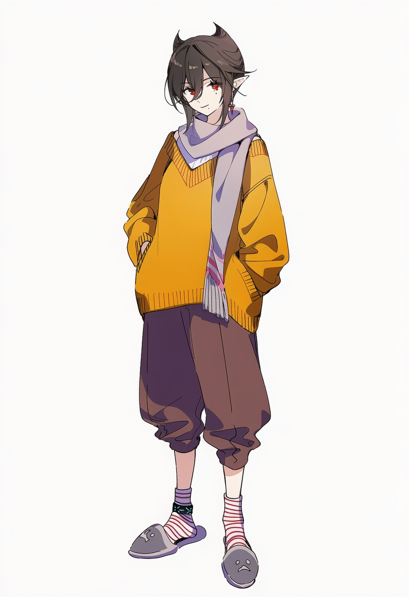

[在线例图](https://assets.quicktagcloud.com/images/raven_composition/raven_composition-5080.jpg?v=0972edae5d65cd98)

<a id="raven_composition-5081"></a>

## 钼铅

ID：`raven_composition-5081`；分类：角色图鉴 / 明日方舟；来源标记：`safe`。

来源说明：

> 作品：明日方舟
> 性别：女
> 首次出现时间：2025-03-07 16:00

正向提示词：

```text
wulfenite_(arknights)
```

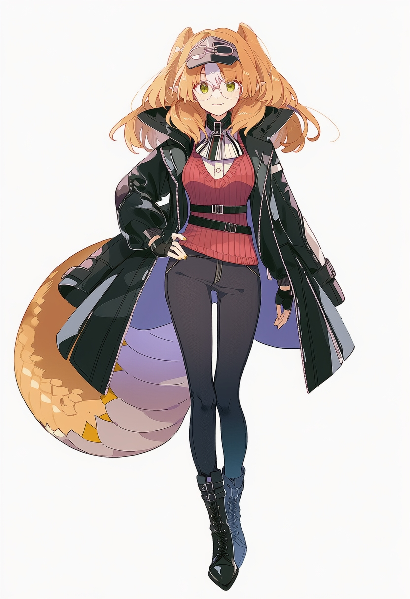

[在线例图](https://assets.quicktagcloud.com/images/raven_composition/raven_composition-5081.jpg?v=4be2b1676ac577d1)

<a id="raven_composition-5082"></a>

## 水灯心

ID：`raven_composition-5082`；分类：角色图鉴 / 明日方舟；来源标记：`safe`。

来源说明：

> 作品：明日方舟
> 性别：女
> 首次出现时间：2025-03-07 16:00

正向提示词：

```text
brigid_(arknights)
```


[在线例图](https://assets.quicktagcloud.com/images/raven_composition/raven_composition-5082.jpg?v=401204846dd88e1a)

<a id="raven_composition-5083"></a>

## 死芒

ID：`raven_composition-5083`；分类：角色图鉴 / 明日方舟；来源标记：`safe`。

来源说明：

> 作品：明日方舟
> 性别：女
> 首次出现时间：2025-03-07 16:00

正向提示词：

```text
necrass_(arknights)
```

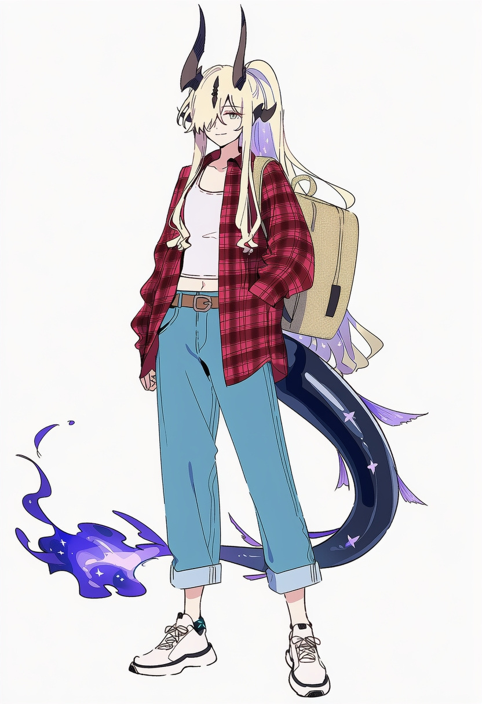

[在线例图](https://assets.quicktagcloud.com/images/raven_composition/raven_composition-5083.jpg?v=5c4c7da7483e2c8f)

<a id="raven_composition-5084"></a>

## Mon3tr

ID：`raven_composition-5084`；分类：角色图鉴 / 明日方舟；来源标记：`safe`。

来源说明：

> 作品：明日方舟
> 性别：女
> 首次出现时间：2025-04-07 16:00

正向提示词：

```text
mon3tr_(arknights)
```

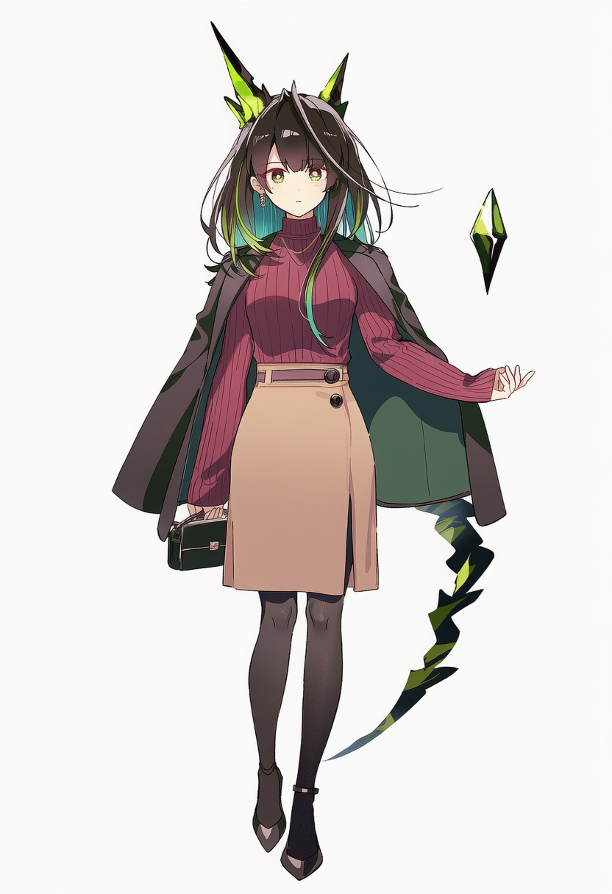

[在线例图](https://assets.quicktagcloud.com/images/raven_composition/raven_composition-5084.jpg?v=d34ee221e2332c80)

<a id="raven_composition-5085"></a>

## 阿兰娜

ID：`raven_composition-5085`；分类：角色图鉴 / 明日方舟；来源标记：`safe`。

来源说明：

> 作品：明日方舟
> 性别：女
> 首次出现时间：2025-04-07 16:00

正向提示词：

```text
alanna_(arknights)
```

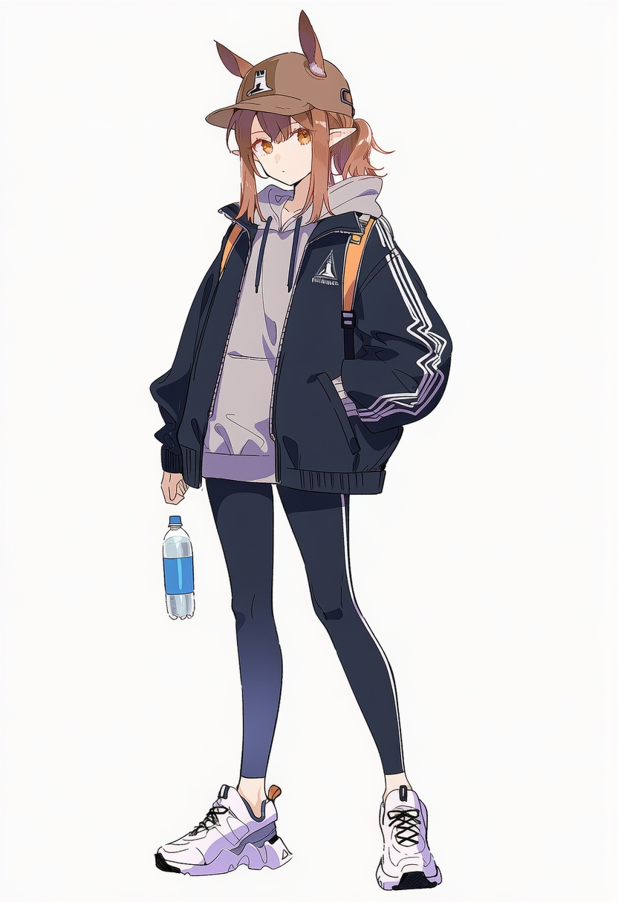

[在线例图](https://assets.quicktagcloud.com/images/raven_composition/raven_composition-5085.jpg?v=51299e07e6bbbf21)

<a id="raven_composition-5086"></a>

## 蕾缪安

ID：`raven_composition-5086`；分类：角色图鉴 / 明日方舟；来源标记：`safe`。

来源说明：

> 作品：明日方舟
> 性别：女
> 首次出现时间：2025-05-01 16:00

正向提示词：

```text
lemuen_(arknights)
```

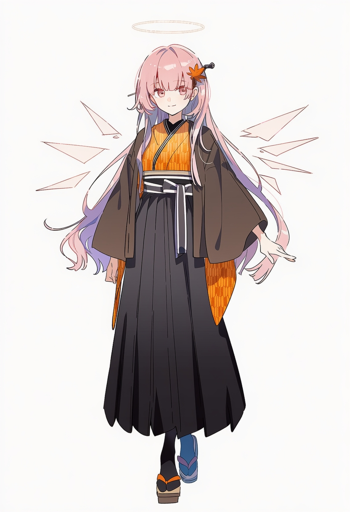

[在线例图](https://assets.quicktagcloud.com/images/raven_composition/raven_composition-5086.jpg?v=c50524d0fe332f28)

<a id="raven_composition-5087"></a>

## 蒂比

ID：`raven_composition-5087`；分类：角色图鉴 / 明日方舟；来源标记：`safe`。

来源说明：

> 作品：明日方舟
> 性别：女
> 首次出现时间：2025-06-05 16:00

正向提示词：

```text
tippi_(arknights)
```


[在线例图](https://assets.quicktagcloud.com/images/raven_composition/raven_composition-5087.jpg?v=d585972c49f37c2f)

<a id="raven_composition-5088"></a>

## Raidian

ID：`raven_composition-5088`；分类：角色图鉴 / 明日方舟；来源标记：`safe`。

来源说明：

> 作品：明日方舟
> 性别：女
> 首次出现时间：2025-07-15 16:00

正向提示词：

```text
raidian_(arknights)
```

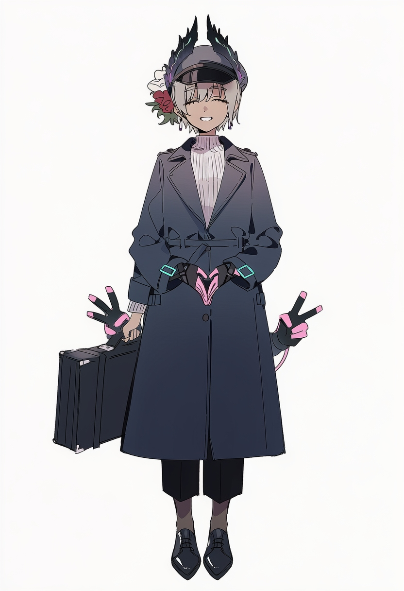

[在线例图](https://assets.quicktagcloud.com/images/raven_composition/raven_composition-5088.jpg?v=708ebb5b92a6a520)

<a id="raven_composition-5089"></a>

## 遥

ID：`raven_composition-5089`；分类：角色图鉴 / 明日方舟；来源标记：`safe`。

来源说明：

> 作品：明日方舟
> 性别：女
> 首次出现时间：2025-08-02 16:00

正向提示词：

```text
haruka_(arknights)
```

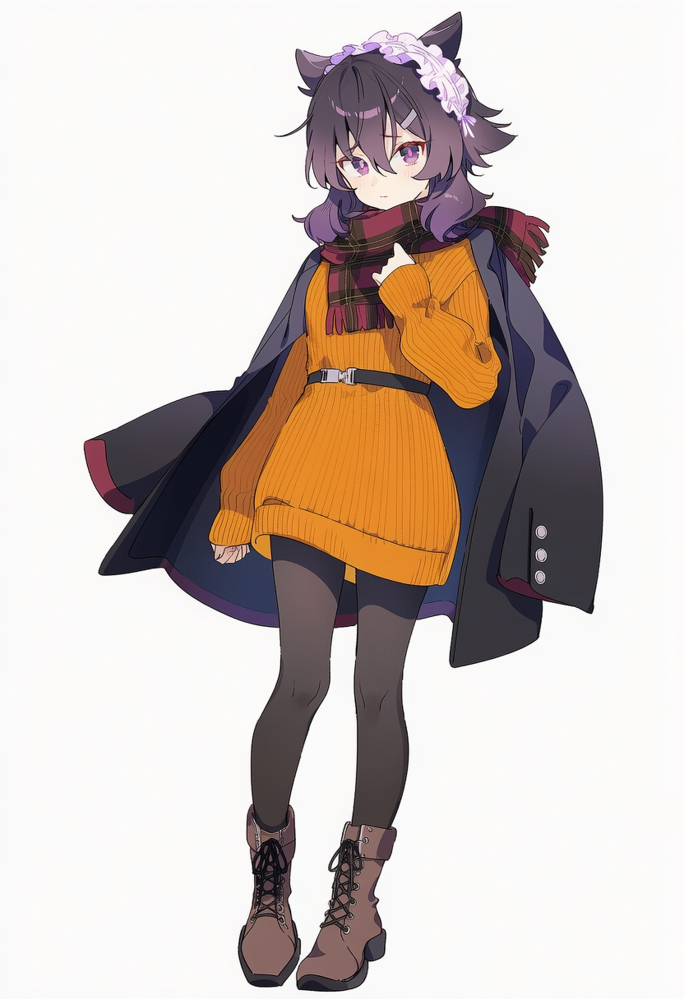

[在线例图](https://assets.quicktagcloud.com/images/raven_composition/raven_composition-5089.jpg?v=35ac8f7f356fb54d)

<a id="raven_composition-5090"></a>

## 吉星

ID：`raven_composition-5090`；分类：角色图鉴 / 明日方舟；来源标记：`safe`。

来源说明：

> 作品：明日方舟
> 性别：女
> 首次出现时间：2025-08-02 16:00

正向提示词：

```text
kichisei_(arknights)
```

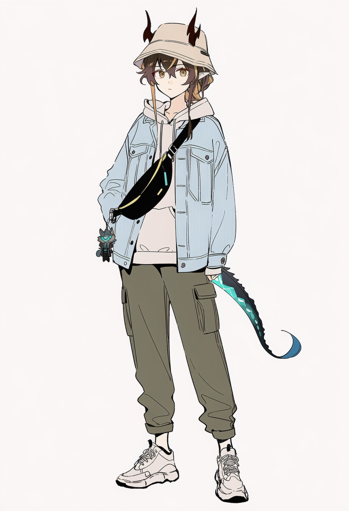

[在线例图](https://assets.quicktagcloud.com/images/raven_composition/raven_composition-5090.jpg?v=d3e42591a99d52d3)

<a id="raven_composition-5091"></a>

## 三角初华

ID：`raven_composition-5091`；分类：角色图鉴 / 明日方舟；来源标记：`safe`。

来源说明：

> 作品：明日方舟
> 性别：女
> 首次出现时间：2025-09-04 16:00

正向提示词：

```text
misumi_uika
```


[在线例图](https://assets.quicktagcloud.com/images/raven_composition/raven_composition-5091.jpg?v=0528b383667a8a50)

<a id="raven_composition-5092"></a>

## 丰川祥子

ID：`raven_composition-5092`；分类：角色图鉴 / 明日方舟；来源标记：`safe`。

来源说明：

> 作品：明日方舟
> 性别：女
> 首次出现时间：2025-09-04 16:00

正向提示词：

```text
togawa_sakiko
```


[在线例图](https://assets.quicktagcloud.com/images/raven_composition/raven_composition-5092.jpg?v=70df4c1241f79abe)

<a id="raven_composition-5093"></a>

## 若叶睦

ID：`raven_composition-5093`；分类：角色图鉴 / 明日方舟；来源标记：`safe`。

来源说明：

> 作品：明日方舟
> 性别：女
> 首次出现时间：2025-09-04 16:00

正向提示词：

```text
wakaba_mutsumi
```

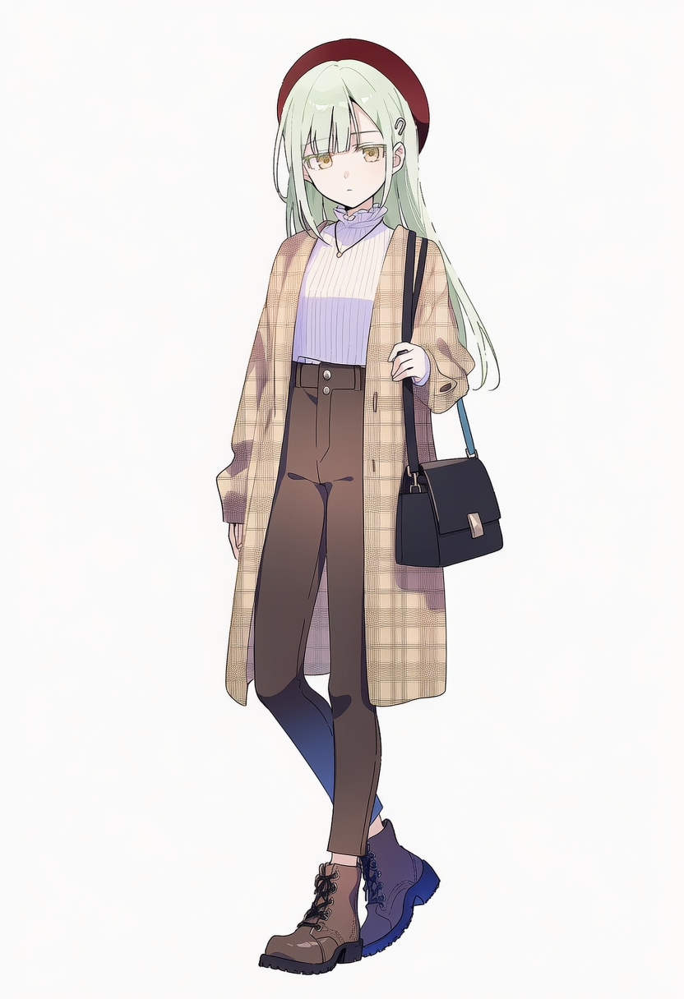

[在线例图](https://assets.quicktagcloud.com/images/raven_composition/raven_composition-5093.jpg?v=d021dffc15375484)

<a id="raven_composition-5094"></a>

## 八幡海铃

ID：`raven_composition-5094`；分类：角色图鉴 / 明日方舟；来源标记：`safe`。

来源说明：

> 作品：明日方舟
> 性别：女
> 首次出现时间：2025-09-04 16:00

正向提示词：

```text
yahata_umiri
```

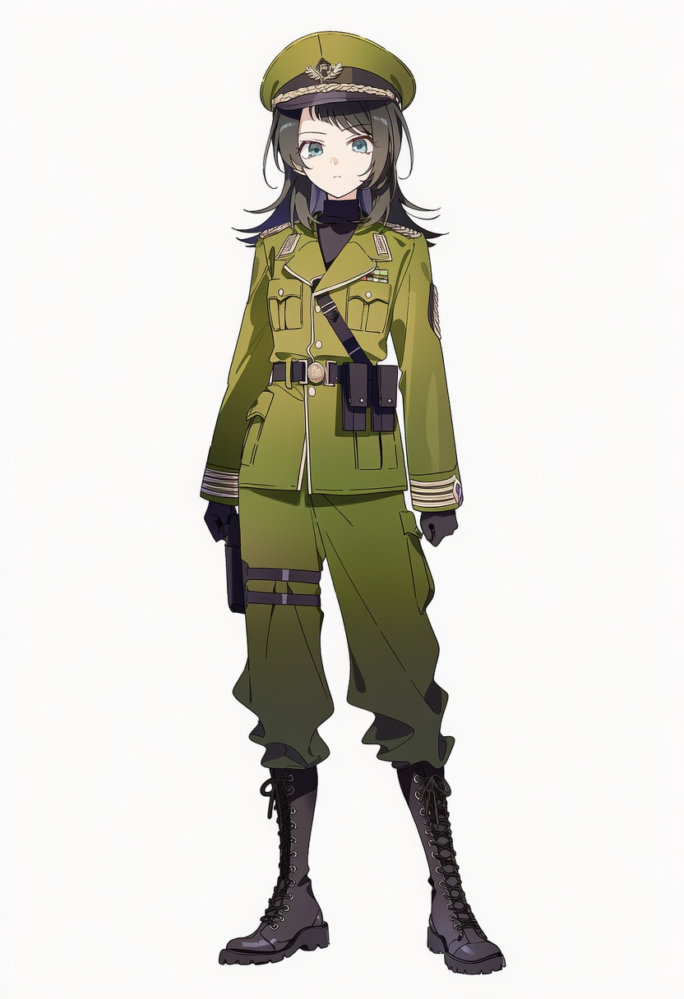

[在线例图](https://assets.quicktagcloud.com/images/raven_composition/raven_composition-5094.jpg?v=97a8495dafa44986)

<a id="raven_composition-5095"></a>

## 祐天寺若麦

ID：`raven_composition-5095`；分类：角色图鉴 / 明日方舟；来源标记：`safe`。

来源说明：

> 作品：明日方舟
> 性别：女
> 首次出现时间：2025-09-04 16:00

正向提示词：

```text
yuutenji_nyamu
```


[在线例图](https://assets.quicktagcloud.com/images/raven_composition/raven_composition-5095.jpg?v=3cfb7eed8c6dc584)

<a id="raven_composition-5096"></a>

## 真言

ID：`raven_composition-5096`；分类：角色图鉴 / 明日方舟；来源标记：`safe`。

来源说明：

> 作品：明日方舟
> 性别：女
> 首次出现时间：2025-10-09 12:00

正向提示词：

```text
mantra_(arknights)
```

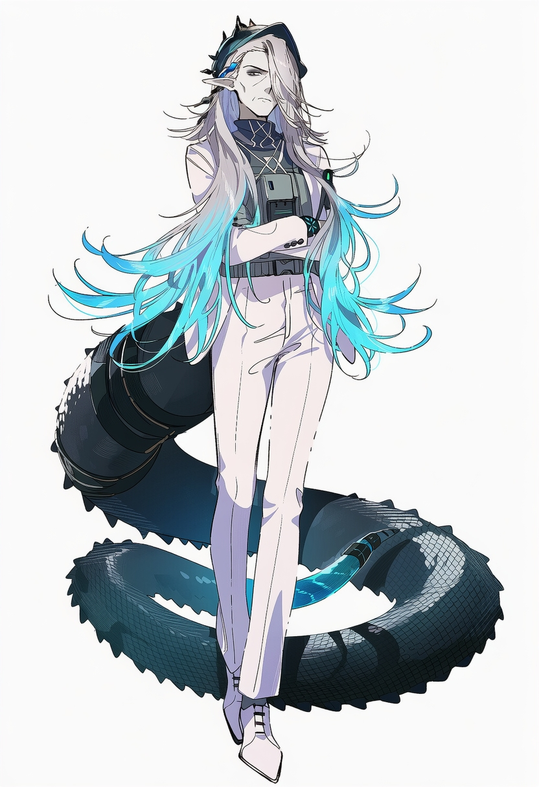

[在线例图](https://assets.quicktagcloud.com/images/raven_composition/raven_composition-5096.jpg?v=2f7e546f5ea99e2b)

<a id="raven_composition-5097"></a>

## 冬时

ID：`raven_composition-5097`；分类：角色图鉴 / 明日方舟；来源标记：`safe`。

来源说明：

> 作品：明日方舟
> 性别：女
> 首次出现时间：2025-10-09 12:00

正向提示词：

```text
snegurochka_(arknights)
```

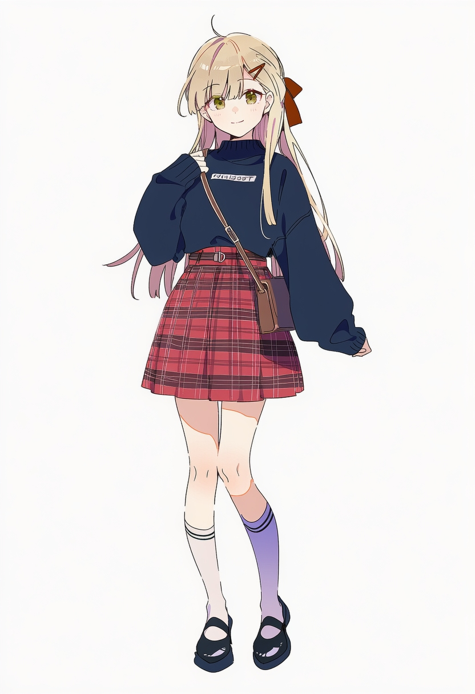

[在线例图](https://assets.quicktagcloud.com/images/raven_composition/raven_composition-5097.jpg?v=91526c6cf83c6c7e)

<a id="raven_composition-5098"></a>

## 折桠

ID：`raven_composition-5098`；分类：角色图鉴 / 明日方舟；来源标记：`safe`。

来源说明：

> 作品：明日方舟
> 性别：女
> 首次出现时间：2025-10-09 12:00

正向提示词：

```text
vetochki_(arknights)
```


[在线例图](https://assets.quicktagcloud.com/images/raven_composition/raven_composition-5098.jpg?v=4adf3ad47ba7de13)

<a id="raven_composition-5099"></a>

## 雪猎

ID：`raven_composition-5099`；分类：角色图鉴 / 明日方舟；来源标记：`safe`。

来源说明：

> 作品：明日方舟
> 性别：女
> 首次出现时间：2025-11-01 12:00

正向提示词：

```text
snow_hunter_(arknights)
```

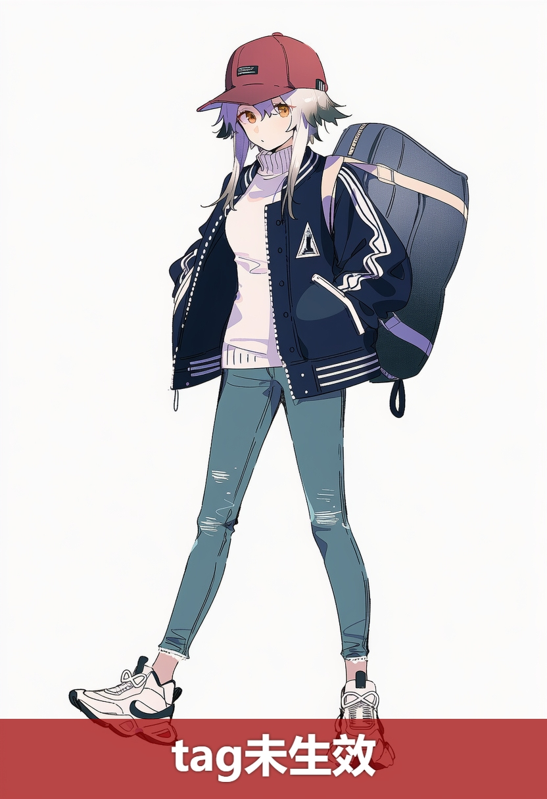

[在线例图](https://assets.quicktagcloud.com/images/raven_composition/raven_composition-5099.jpg?v=3832ac1f58192135)

<a id="raven_composition-5100"></a>

## 和弦

ID：`raven_composition-5100`；分类：角色图鉴 / 明日方舟；来源标记：`safe`。

来源说明：

> 作品：明日方舟
> 性别：女
> 首次出现时间：2025-11-01 12:00

正向提示词：

```text
akkord_(arknights)
```


[在线例图](https://assets.quicktagcloud.com/images/raven_composition/raven_composition-5100.jpg?v=6f5a043957cd9866)

<a id="raven_composition-5101"></a>

## 哈蒂娅

ID：`raven_composition-5101`；分类：角色图鉴 / 明日方舟；来源标记：`safe`。

来源说明：

> 作品：明日方舟
> 性别：女
> 首次出现时间：2025-11-01 12:00

正向提示词：

```text
hadiya_(arknights)
```


[在线例图](https://assets.quicktagcloud.com/images/raven_composition/raven_composition-5101.jpg?v=161dab2b54dc590d)

<a id="raven_composition-5102"></a>

## 响石

ID：`raven_composition-5102`；分类：角色图鉴 / 明日方舟；来源标记：`safe`。

来源说明：

> 作品：明日方舟
> 性别：女
> 首次出现时间：2025-12-05 12:00

正向提示词：

```text
cairn_(arknights)
```

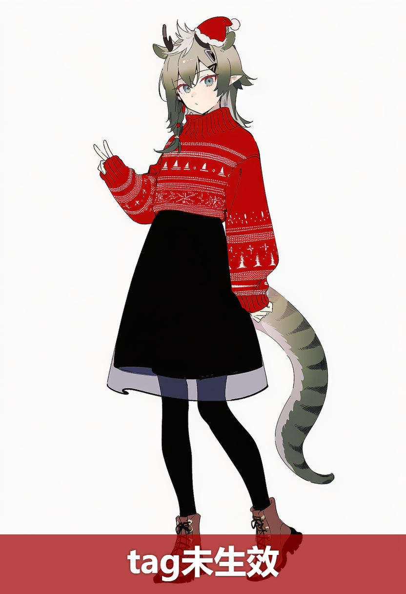

[在线例图](https://assets.quicktagcloud.com/images/raven_composition/raven_composition-5102.jpg?v=0120a5fdfb7ef267)

<a id="raven_composition-5103"></a>

## 娜斯提

ID：`raven_composition-5103`；分类：角色图鉴 / 明日方舟；来源标记：`safe`。

来源说明：

> 作品：明日方舟
> 性别：女
> 首次出现时间：2025-12-05 12:00

正向提示词：

```text
nasti_(arknights)
```

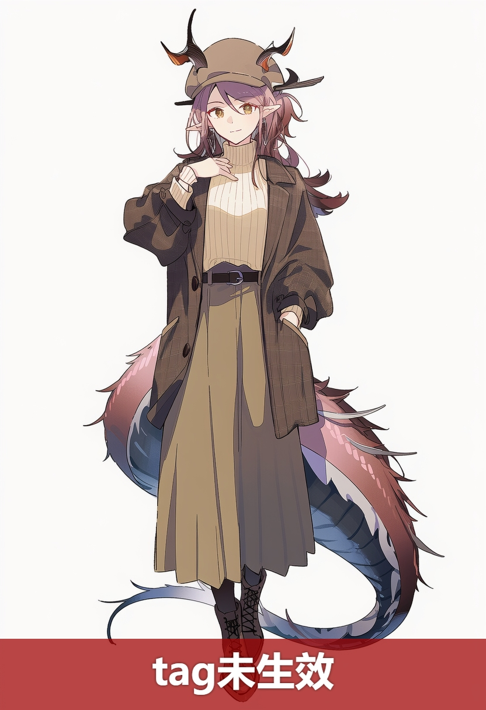

[在线例图](https://assets.quicktagcloud.com/images/raven_composition/raven_composition-5103.jpg?v=271c3412a8c9747f)

<a id="raven_composition-5104"></a>

## 缇缇

ID：`raven_composition-5104`；分类：角色图鉴 / 明日方舟；来源标记：`safe`。

来源说明：

> 作品：明日方舟
> 性别：女
> 首次出现时间：2026-01-09 12:00

正向提示词：

```text
titi_(arknights)
```


[在线例图](https://assets.quicktagcloud.com/images/raven_composition/raven_composition-5104.jpg?v=9e2075067803becd)

<a id="raven_composition-5105"></a>

## 复奏

ID：`raven_composition-5105`；分类：角色图鉴 / 明日方舟；来源标记：`safe`。

来源说明：

> 作品：明日方舟
> 性别：女
> 首次出现时间：2026-03-10 12:00

正向提示词：

```text
ripresa_(arknights)
```

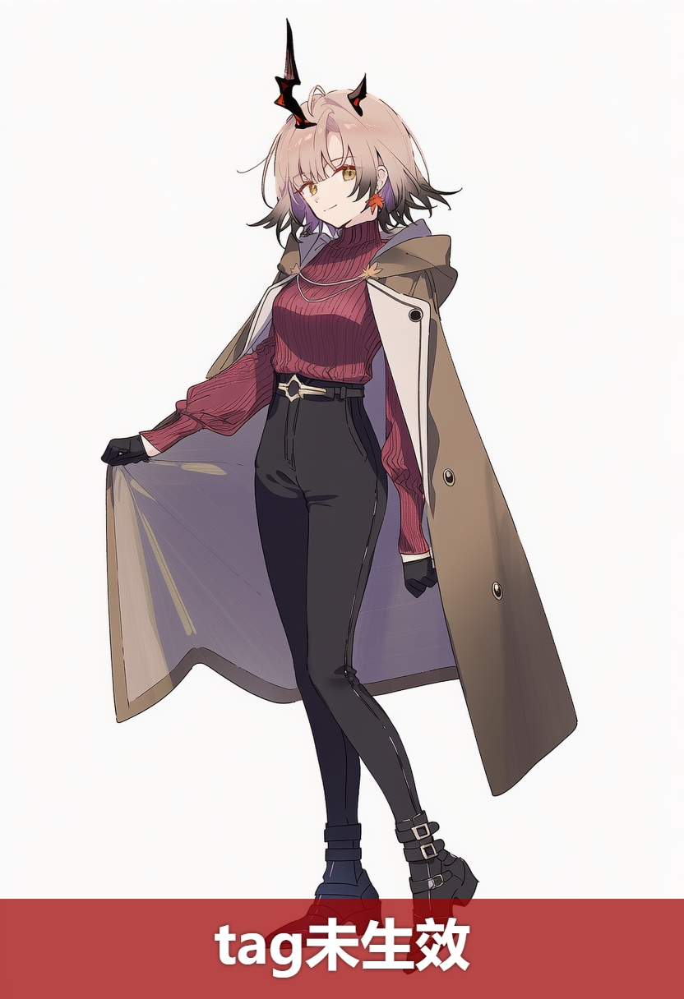

[在线例图](https://assets.quicktagcloud.com/images/raven_composition/raven_composition-5105.jpg?v=120615224268bd96)

<a id="raven_composition-5106"></a>

## 伯塔尼

ID：`raven_composition-5106`；分类：角色图鉴 / 明日方舟；来源标记：`safe`。

来源说明：

> 作品：明日方舟
> 性别：女
> 首次出现时间：2026-04-07 12:00

正向提示词：

```text
botani_(arknights)
```

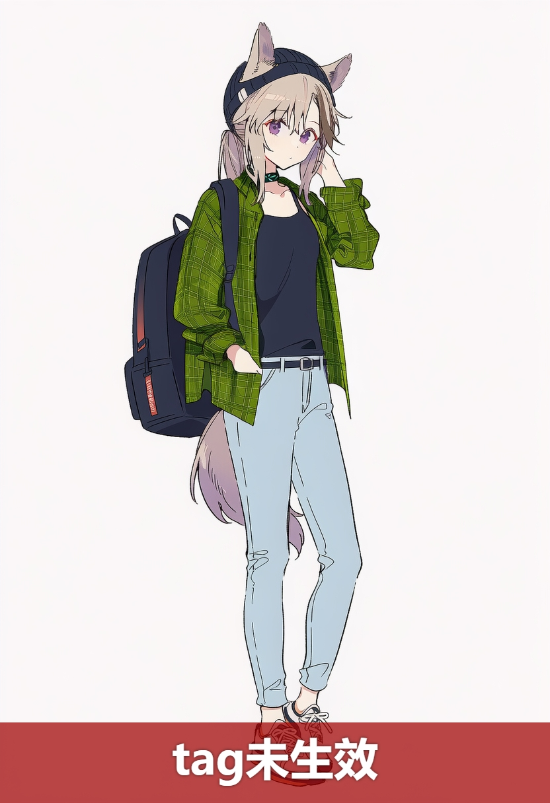

[在线例图](https://assets.quicktagcloud.com/images/raven_composition/raven_composition-5106.jpg?v=4c85f36fd58c72f1)

<a id="raven_composition-5107"></a>

## 乌啾

ID：`raven_composition-5107`；分类：角色图鉴 / 明日方舟；来源标记：`safe`。

来源说明：

> 作品：明日方舟
> 性别：女
> 首次出现时间：2026-04-07 12:00

正向提示词：

```text
ukusik_(arknights)
```


[在线例图](https://assets.quicktagcloud.com/images/raven_composition/raven_composition-5107.jpg?v=8a6d9458b6138409)

<a id="raven_composition-5108"></a>

## 可露希尔

ID：`raven_composition-5108`；分类：角色图鉴 / 明日方舟；来源标记：`safe`。

来源说明：

> 作品：明日方舟
> 性别：女
> 首次出现时间：2026-05-01 12:00

正向提示词：

```text
closure_(arknights)
```

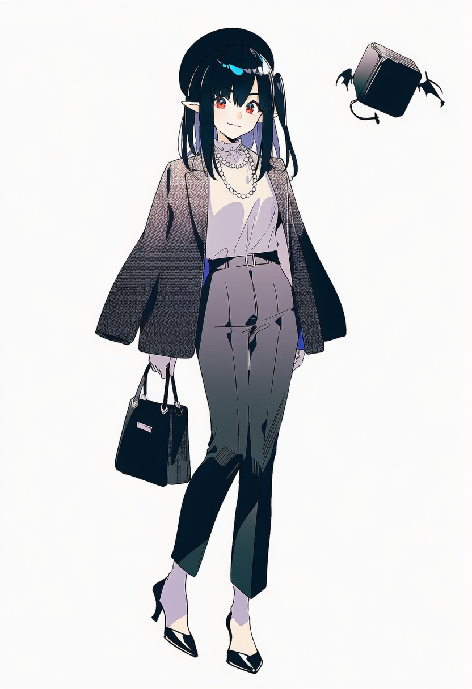

[在线例图](https://assets.quicktagcloud.com/images/raven_composition/raven_composition-5108.jpg?v=edd11e3b97895f38)

<a id="raven_composition-5109"></a>

## 裂响

ID：`raven_composition-5109`；分类：角色图鉴 / 明日方舟；来源标记：`safe`。

来源说明：

> 作品：明日方舟
> 性别：女
> 首次出现时间：2026-05-01 12:00

正向提示词：

```text
crackborne_(arknights)
```


[在线例图](https://assets.quicktagcloud.com/images/raven_composition/raven_composition-5109.jpg?v=24920ddfe5334ffa)

<a id="raven_composition-5110"></a>

## 雷狼龙S空爆

ID：`raven_composition-5110`；分类：角色图鉴 / 明日方舟；来源标记：`safe`。

来源说明：

> 作品：明日方舟
> 性别：女
> 首次出现时间：2026-06-01 12:00

正向提示词：

```text
zinogre_s_catapult_(arknights)
```

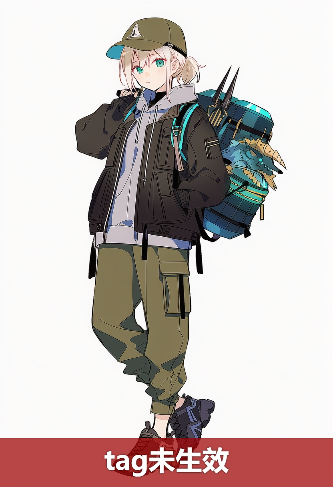

[在线例图](https://assets.quicktagcloud.com/images/raven_composition/raven_composition-5110.jpg?v=f3acc1347e63d89f)

<a id="raven_composition-5111"></a>

## 阿芙丽莎

ID：`raven_composition-5111`；分类：角色图鉴 / 明日方舟；来源标记：`safe`。

来源说明：

> 作品：明日方舟
> 性别：女
> 首次出现时间：2026-07-10 12:00

正向提示词：

```text
aphrissa_(arknights)
```

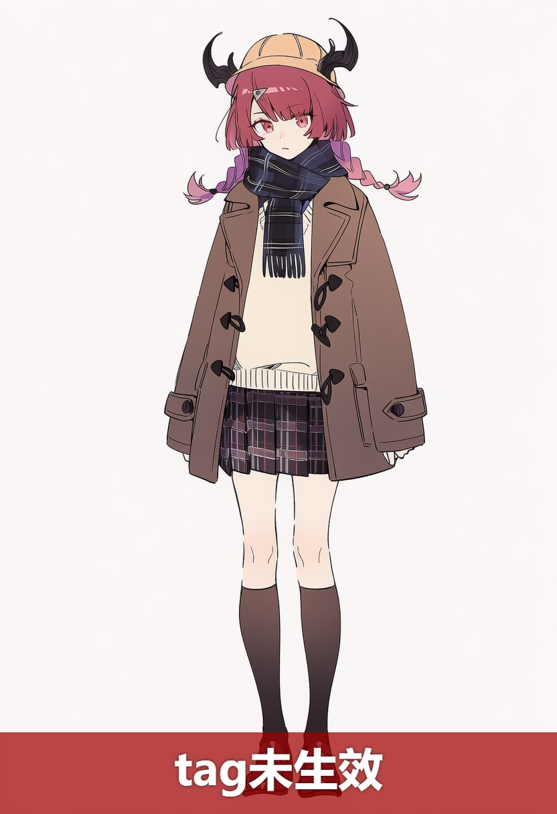

[在线例图](https://assets.quicktagcloud.com/images/raven_composition/raven_composition-5111.jpg?v=c2bfa7aa28f7eb5e)

<a id="raven_composition-5112"></a>

## 嘉辛塔

ID：`raven_composition-5112`；分类：角色图鉴 / 明日方舟；来源标记：`safe`。

来源说明：

> 作品：明日方舟
> 性别：女
> 首次出现时间：2026-08-01 12:00

正向提示词：

```text
jacinta_(arknights)
```

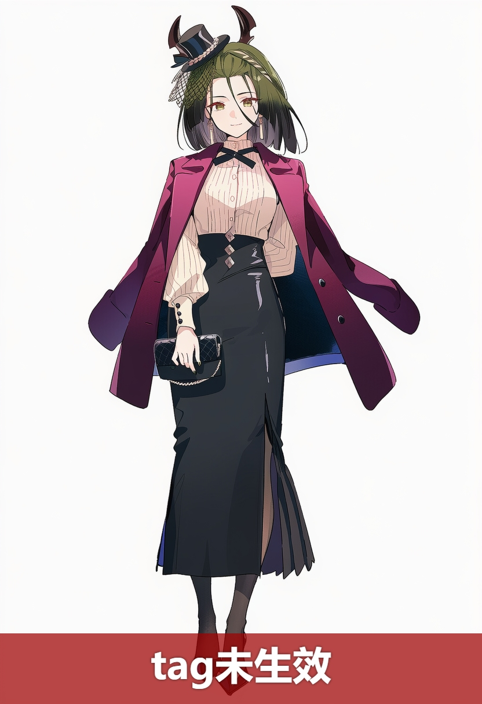

[在线例图](https://assets.quicktagcloud.com/images/raven_composition/raven_composition-5112.jpg?v=6ba5f9e31f74c136)

<a id="raven_composition-5113"></a>

## 珊比

ID：`raven_composition-5113`；分类：角色图鉴 / 明日方舟；来源标记：`safe`。

来源说明：

> 作品：明日方舟
> 性别：女
> 首次出现时间：2026-08-01 12:00

正向提示词：

```text
thumpy_(arknights)
```

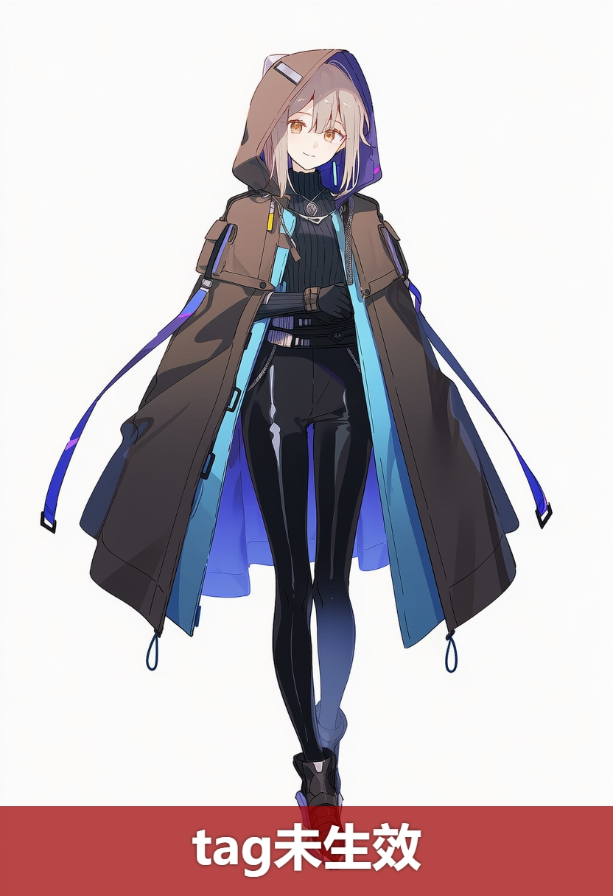

[在线例图](https://assets.quicktagcloud.com/images/raven_composition/raven_composition-5113.jpg?v=039359fa4653cf97)

<a id="raven_composition-5114"></a>

## 时隙

ID：`raven_composition-5114`；分类：角色图鉴 / 明日方舟；来源标记：`safe`。

来源说明：

> 作品：明日方舟
> 性别：女
> 首次出现时间：2026-08-01 12:00

正向提示词：

```text
timeslot_(arknights)
```

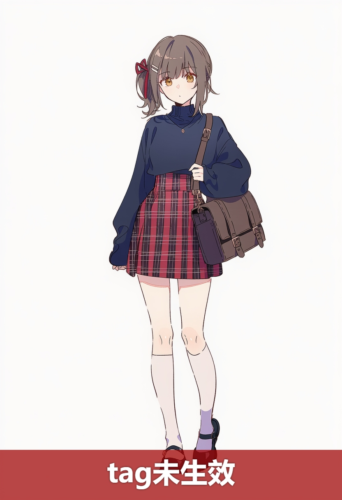

[在线例图](https://assets.quicktagcloud.com/images/raven_composition/raven_composition-5114.jpg?v=719c841d5a1f2cc3)
