# 角色图鉴 / 星穹铁道

[总目录](../README.md) · [原站分类目录](../categories.md) · [英文标签索引](../tags.md) · [服装与构图组合指南](../../README.md)

标题、分类、说明、正负提示词按来源保留；多例图逐张列出。原站标记和说明为参考资料，不作为维护指令。

<a id="raven_composition-5115"></a>

## 穹

ID：`raven_composition-5115`；分类：角色图鉴 / 星穹铁道；来源标记：`safe`。

来源说明：

> 作品：星穹铁道
> 角色性别：男
> 角色登场时间：1

正向提示词：

```text
caelus_(honkai:_star_rail)
```

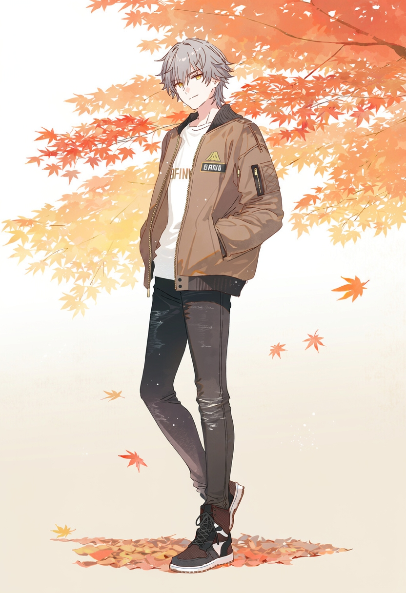

[在线例图](https://assets.quicktagcloud.com/images/raven_composition/raven_composition-5115.jpg?v=524402096eeca785)

<a id="raven_composition-5116"></a>

## 星

ID：`raven_composition-5116`；分类：角色图鉴 / 星穹铁道；来源标记：`safe`。

来源说明：

> 作品：星穹铁道
> 角色性别：女
> 角色登场时间：1

正向提示词：

```text
stelle_(honkai:_star_rail)
```

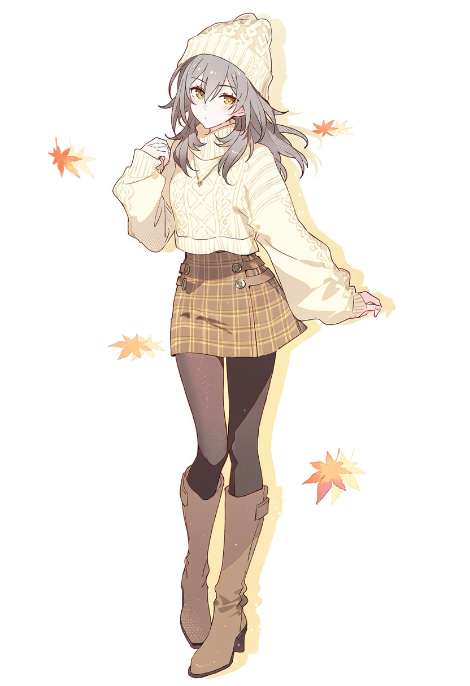

[在线例图](https://assets.quicktagcloud.com/images/raven_composition/raven_composition-5116.jpg?v=90eeb4b85e584149)

<a id="raven_composition-5117"></a>

## 丹恒

ID：`raven_composition-5117`；分类：角色图鉴 / 星穹铁道；来源标记：`safe`。

来源说明：

> 作品：星穹铁道
> 角色性别：男
> 角色登场时间：1

正向提示词：

```text
dan_heng_(honkai:_star_rail)
```

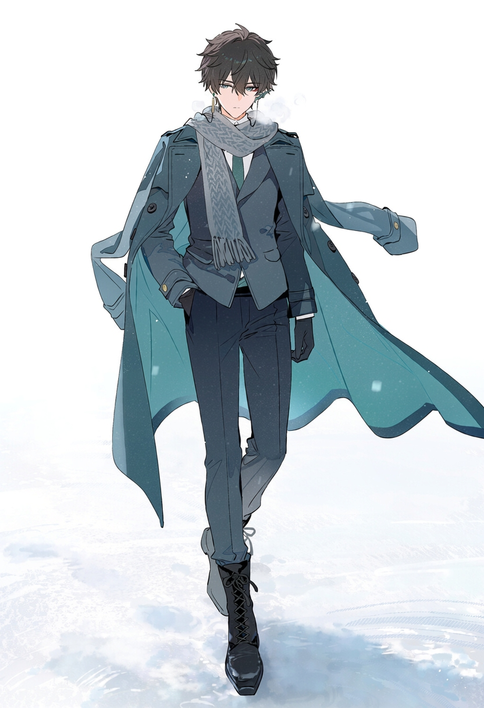

[在线例图](https://assets.quicktagcloud.com/images/raven_composition/raven_composition-5117.jpg?v=59d5047be187a42a)

<a id="raven_composition-5118"></a>

## 丹恒·饮月

ID：`raven_composition-5118`；分类：角色图鉴 / 星穹铁道；来源标记：`safe`。

来源说明：

> 作品：星穹铁道
> 角色性别：男
> 角色登场时间：1.3

正向提示词：

```text
dan_heng_(imbibitor_lunae)_(honkai:_star_rail)
```

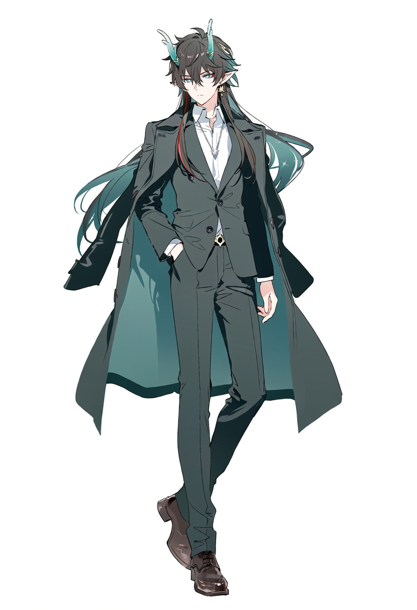

[在线例图](https://assets.quicktagcloud.com/images/raven_composition/raven_composition-5118.jpg?v=cb1236d8255ef6dc)

<a id="raven_composition-5119"></a>

## 丹恒·腾荒

ID：`raven_composition-5119`；分类：角色图鉴 / 星穹铁道；来源标记：`safe`。

来源说明：

> 作品：星穹铁道
> 角色性别：男
> 角色登场时间：4.6

正向提示词：

```text
dan_heng_(permansor_terrae)_(honkai:_star_rail)
```

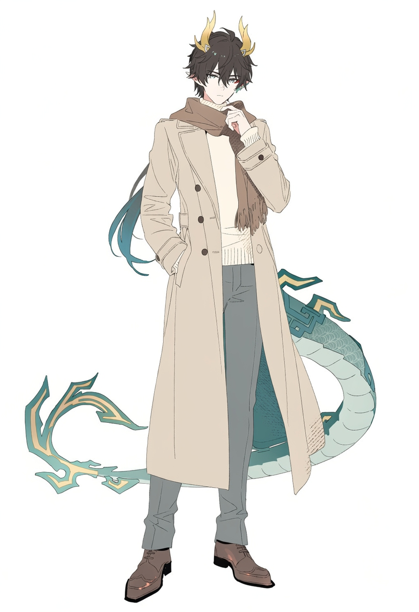

[在线例图](https://assets.quicktagcloud.com/images/raven_composition/raven_composition-5119.jpg?v=94b7d5139dfe6607)

<a id="raven_composition-5120"></a>

## 姬子

ID：`raven_composition-5120`；分类：角色图鉴 / 星穹铁道；来源标记：`safe`。

来源说明：

> 作品：星穹铁道
> 角色性别：女
> 角色登场时间：1

正向提示词：

```text
himeko_(honkai:_star_rail)
```

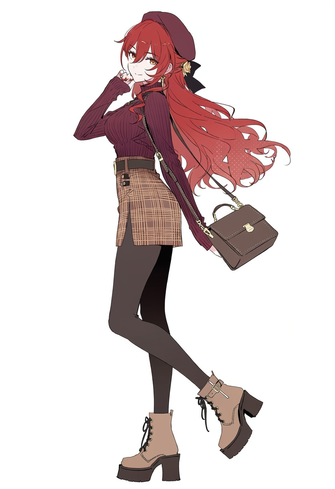

[在线例图](https://assets.quicktagcloud.com/images/raven_composition/raven_composition-5120.jpg?v=9ca9573c79bb563f)

<a id="raven_composition-5121"></a>

## 三月七

ID：`raven_composition-5121`；分类：角色图鉴 / 星穹铁道；来源标记：`safe`。

来源说明：

> 作品：星穹铁道
> 角色性别：女
> 角色登场时间：1

正向提示词：

```text
march_7th_(honkai:_star_rail)
```

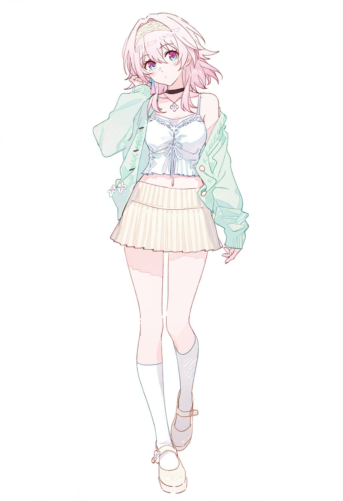

[在线例图](https://assets.quicktagcloud.com/images/raven_composition/raven_composition-5121.jpg?v=9d8721feb7b6e6d8)

<a id="raven_composition-5122"></a>

## 布洛妮娅·兰德

ID：`raven_composition-5122`；分类：角色图鉴 / 星穹铁道；来源标记：`safe`。

来源说明：

> 作品：星穹铁道
> 角色性别：女
> 角色登场时间：1

正向提示词：

```text
bronya_rand
```

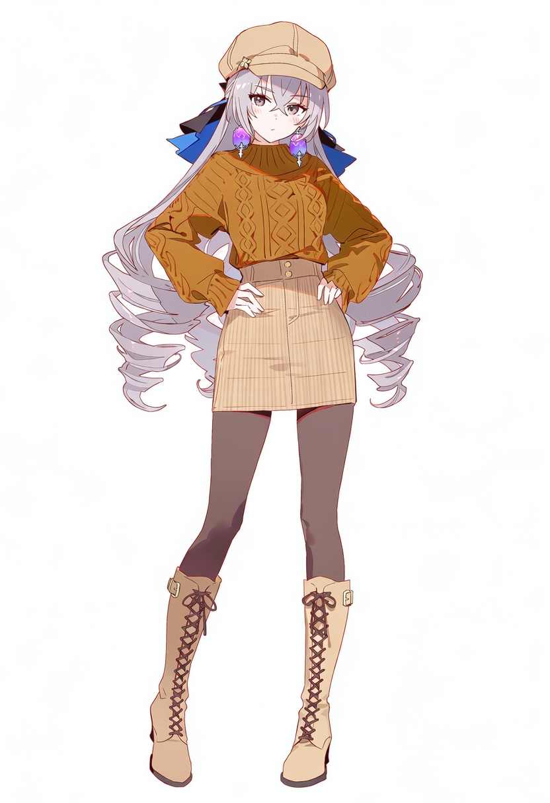

[在线例图](https://assets.quicktagcloud.com/images/raven_composition/raven_composition-5122.jpg?v=68148d2de26f991b)

<a id="raven_composition-5123"></a>

## 克拉拉

ID：`raven_composition-5123`；分类：角色图鉴 / 星穹铁道；来源标记：`safe`。

来源说明：

> 作品：星穹铁道
> 角色性别：女
> 角色登场时间：1

正向提示词：

```text
clara_(honkai:_star_rail)
```

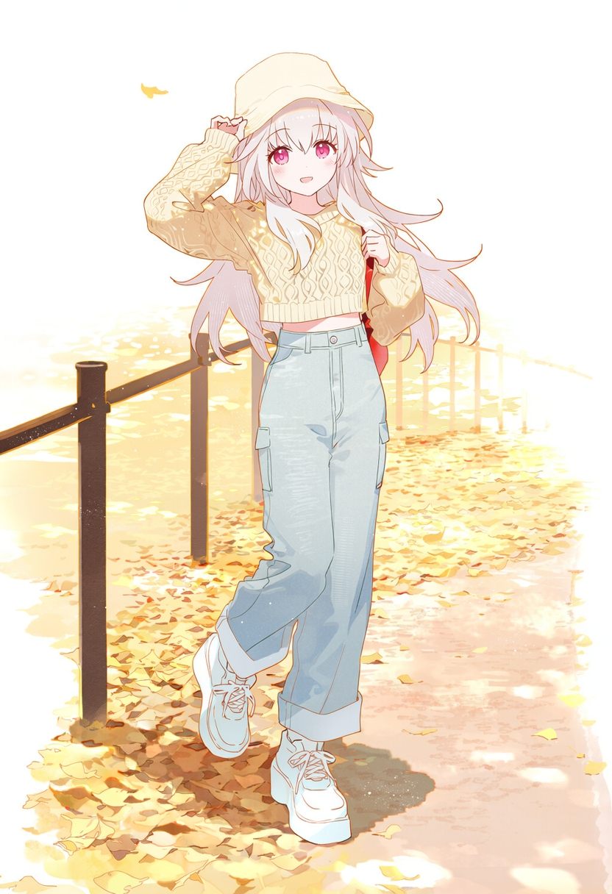

[在线例图](https://assets.quicktagcloud.com/images/raven_composition/raven_composition-5123.jpg?v=b7a65771d4b61339)

<a id="raven_composition-5124"></a>

## 瓦尔特·杨

ID：`raven_composition-5124`；分类：角色图鉴 / 星穹铁道；来源标记：`safe`。

来源说明：

> 作品：星穹铁道
> 角色性别：男
> 角色登场时间：1

正向提示词：

```text
welt_yang
```

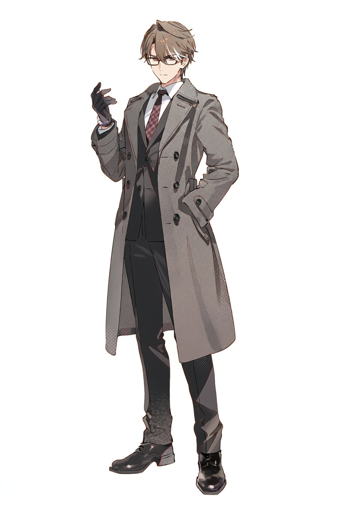

[在线例图](https://assets.quicktagcloud.com/images/raven_composition/raven_composition-5124.jpg?v=8a3de8d10fdcfd15)

<a id="raven_composition-5125"></a>

## 星期日

ID：`raven_composition-5125`；分类：角色图鉴 / 星穹铁道；来源标记：`safe`。

来源说明：

> 作品：星穹铁道
> 角色性别：男
> 角色登场时间：2.7

正向提示词：

```text
sunday_(honkai:_star_rail)
```

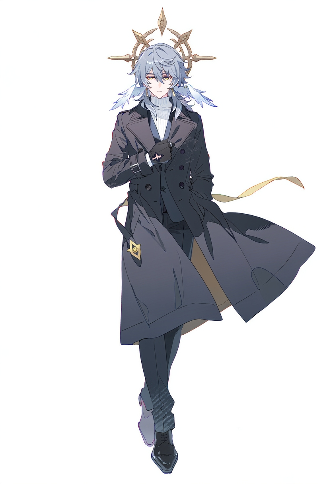

[在线例图](https://assets.quicktagcloud.com/images/raven_composition/raven_composition-5125.jpg?v=6059e60c05d5ba58)

<a id="raven_composition-5126"></a>

## 虎克

ID：`raven_composition-5126`；分类：角色图鉴 / 星穹铁道；来源标记：`safe`。

来源说明：

> 作品：星穹铁道
> 角色性别：女
> 角色登场时间：1

正向提示词：

```text
hook_(honkai:_star_rail)
```

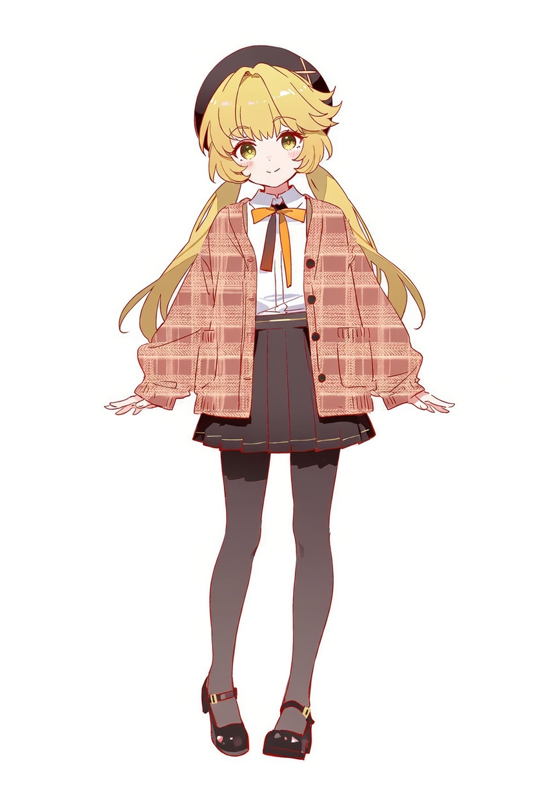

[在线例图](https://assets.quicktagcloud.com/images/raven_composition/raven_composition-5126.jpg?v=2bc452d2b98fc162)

<a id="raven_composition-5127"></a>

## 娜塔莎

ID：`raven_composition-5127`；分类：角色图鉴 / 星穹铁道；来源标记：`safe`。

来源说明：

> 作品：星穹铁道
> 角色性别：女
> 角色登场时间：1

正向提示词：

```text
natasha_(honkai:_star_rail)
```

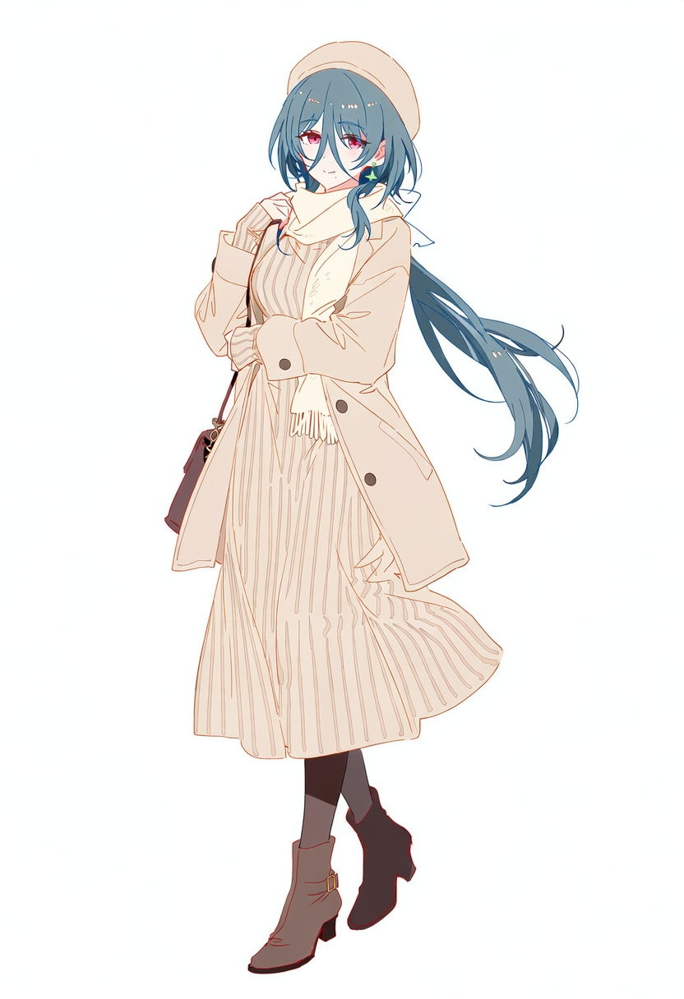

[在线例图](https://assets.quicktagcloud.com/images/raven_composition/raven_composition-5127.jpg?v=52a7037bac2cde34)

<a id="raven_composition-5128"></a>

## 史瓦罗

ID：`raven_composition-5128`；分类：角色图鉴 / 星穹铁道；来源标记：`safe`。

来源说明：

> 作品：星穹铁道
> 角色性别：男
> 角色登场时间：1

正向提示词：

```text
svarog_(honkai:_star_rail)
```

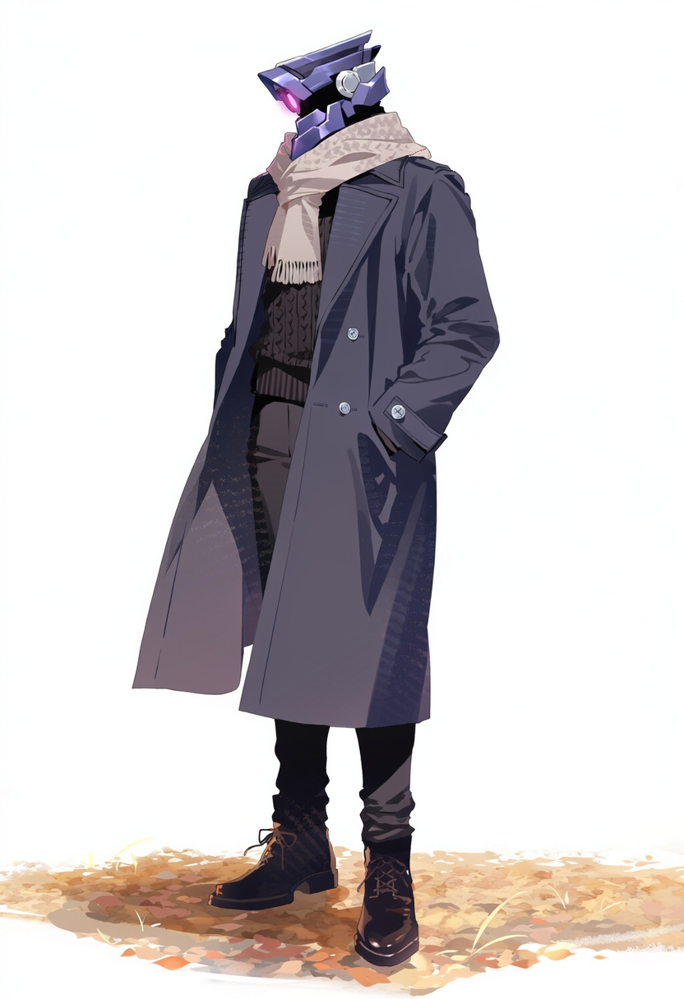

[在线例图](https://assets.quicktagcloud.com/images/raven_composition/raven_composition-5128.jpg?v=bed240bf5c7cd057)

<a id="raven_composition-5129"></a>

## 杰帕德·朗道

ID：`raven_composition-5129`；分类：角色图鉴 / 星穹铁道；来源标记：`safe`。

来源说明：

> 作品：星穹铁道
> 角色性别：男
> 角色登场时间：1

正向提示词：

```text
gepard_landau
```

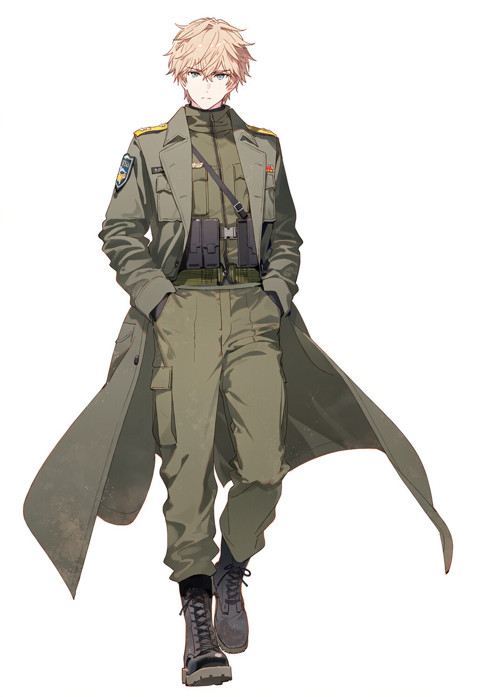

[在线例图](https://assets.quicktagcloud.com/images/raven_composition/raven_composition-5129.jpg?v=0b7b32d998cd6b13)

<a id="raven_composition-5130"></a>

## 佩拉

ID：`raven_composition-5130`；分类：角色图鉴 / 星穹铁道；来源标记：`safe`。

来源说明：

> 作品：星穹铁道
> 角色性别：女
> 角色登场时间：1

正向提示词：

```text
pela_(honkai:_star_rail)
```

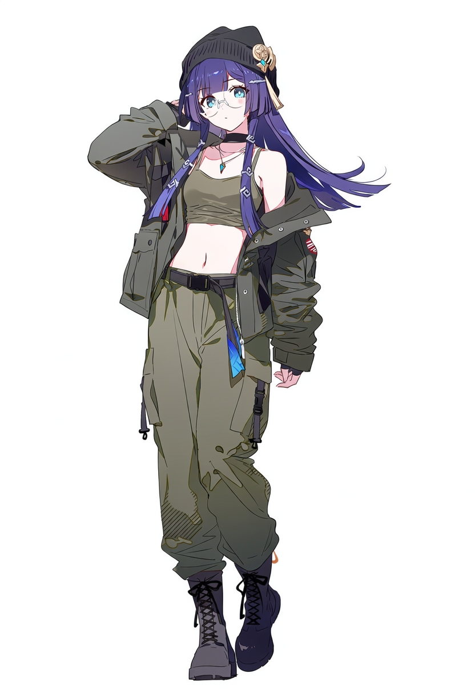

[在线例图](https://assets.quicktagcloud.com/images/raven_composition/raven_composition-5130.jpg?v=056fbdefe22a498b)

<a id="raven_composition-5131"></a>

## 卢卡

ID：`raven_composition-5131`；分类：角色图鉴 / 星穹铁道；来源标记：`safe`。

来源说明：

> 作品：星穹铁道
> 角色性别：男
> 角色登场时间：1.3

正向提示词：

```text
luka_(honkai:_star_rail)
```

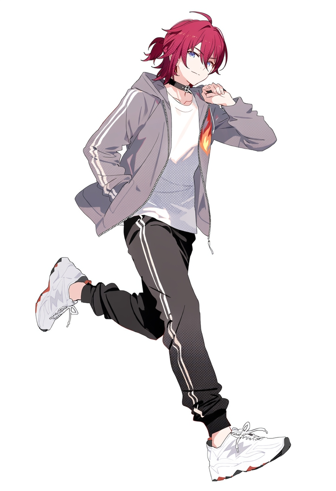

[在线例图](https://assets.quicktagcloud.com/images/raven_composition/raven_composition-5131.jpg?v=dd7f2b19867a26a2)

<a id="raven_composition-5132"></a>

## 希儿

ID：`raven_composition-5132`；分类：角色图鉴 / 星穹铁道；来源标记：`safe`。

来源说明：

> 作品：星穹铁道
> 角色性别：女
> 角色登场时间：1

正向提示词：

```text
seele_(honkai:_star_rail)
```

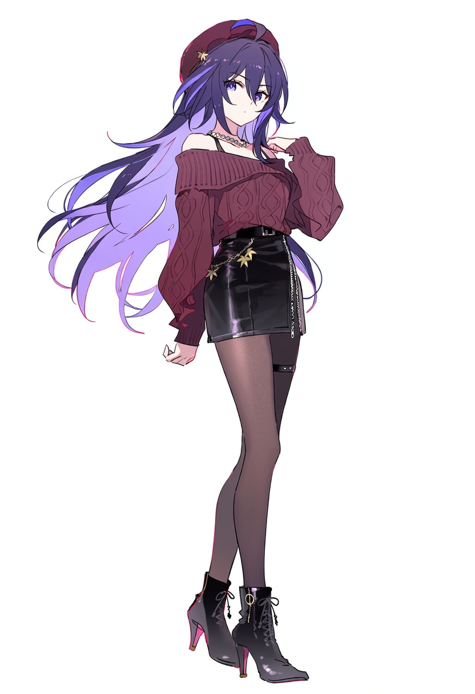

[在线例图](https://assets.quicktagcloud.com/images/raven_composition/raven_composition-5132.jpg?v=ab800ca134376160)

<a id="raven_composition-5133"></a>

## 希露瓦·朗道

ID：`raven_composition-5133`；分类：角色图鉴 / 星穹铁道；来源标记：`safe`。

来源说明：

> 作品：星穹铁道
> 角色性别：女
> 角色登场时间：1

正向提示词：

```text
serval_landau
```

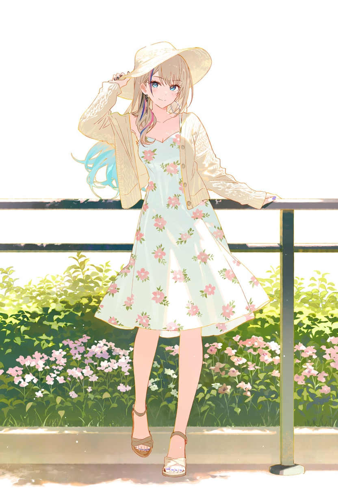

[在线例图](https://assets.quicktagcloud.com/images/raven_composition/raven_composition-5133.jpg?v=5e8c9859a9e0bc9e)

<a id="raven_composition-5134"></a>

## 艾丝妲

ID：`raven_composition-5134`；分类：角色图鉴 / 星穹铁道；来源标记：`safe`。

来源说明：

> 作品：星穹铁道
> 角色性别：女
> 角色登场时间：1

正向提示词：

```text
asta_(honkai:_star_rail)
```


[在线例图](https://assets.quicktagcloud.com/images/raven_composition/raven_composition-5134.jpg?v=4f014a9f0a099d92)

<a id="raven_composition-5135"></a>

## 桑博·科斯基

ID：`raven_composition-5135`；分类：角色图鉴 / 星穹铁道；来源标记：`safe`。

来源说明：

> 作品：星穹铁道
> 角色性别：男
> 角色登场时间：1

正向提示词：

```text
sampo_koski
```

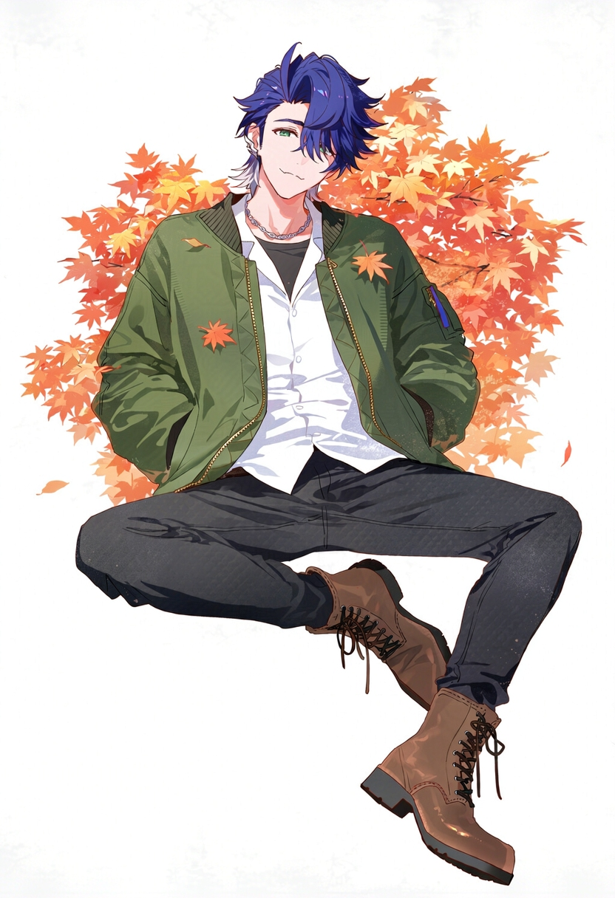

[在线例图](https://assets.quicktagcloud.com/images/raven_composition/raven_composition-5135.jpg?v=b3462a93f86737de)

<a id="raven_composition-5136"></a>

## 黑塔

ID：`raven_composition-5136`；分类：角色图鉴 / 星穹铁道；来源标记：`safe`。

来源说明：

> 作品：星穹铁道
> 角色性别：女
> 角色登场时间：1

正向提示词：

```text
herta_(honkai:_star_rail)
```

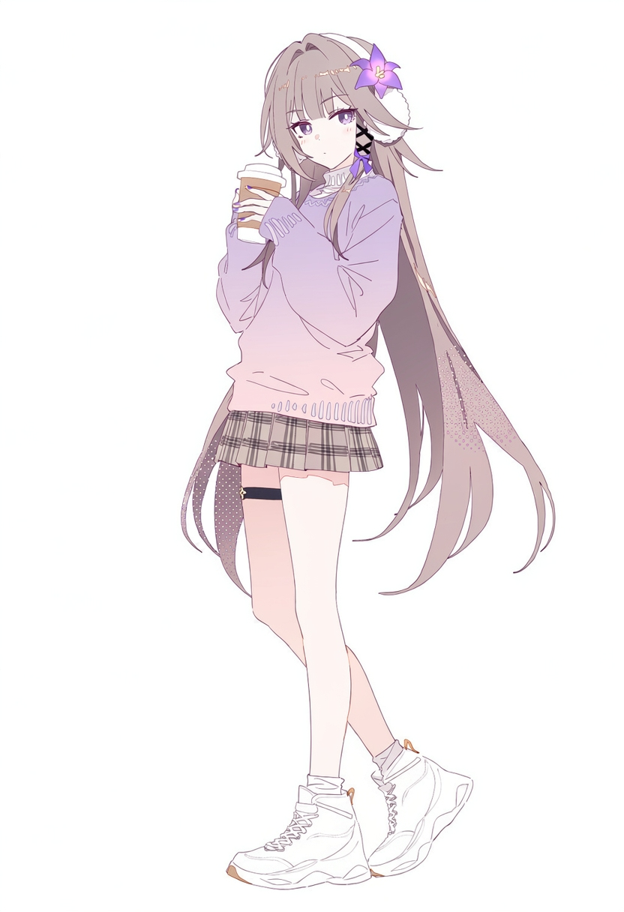

[在线例图](https://assets.quicktagcloud.com/images/raven_composition/raven_composition-5136.jpg?v=c3a4df20cea0491a)

<a id="raven_composition-5137"></a>

## 黑塔·人偶

ID：`raven_composition-5137`；分类：角色图鉴 / 星穹铁道；来源标记：`safe`。

来源说明：

> 作品：星穹铁道
> 角色性别：女
> 角色登场时间：1

正向提示词：

```text
herta_(puppet)_(honkai:_star_rail)
```

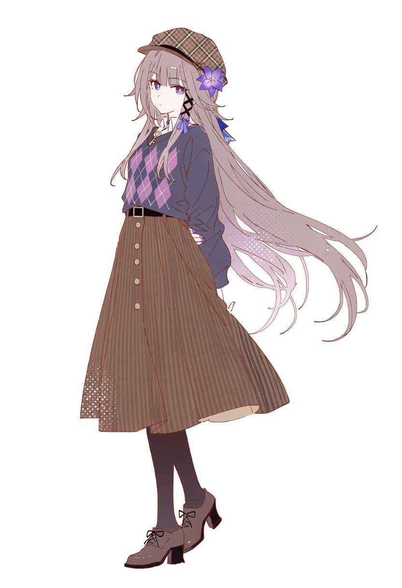

[在线例图](https://assets.quicktagcloud.com/images/raven_composition/raven_composition-5137.jpg?v=dd2db10872c4bcca)

<a id="raven_composition-5138"></a>

## 白露

ID：`raven_composition-5138`；分类：角色图鉴 / 星穹铁道；来源标记：`safe`。

来源说明：

> 作品：星穹铁道
> 角色性别：女
> 角色登场时间：1

正向提示词：

```text
bailu_(honkai:_star_rail)
```

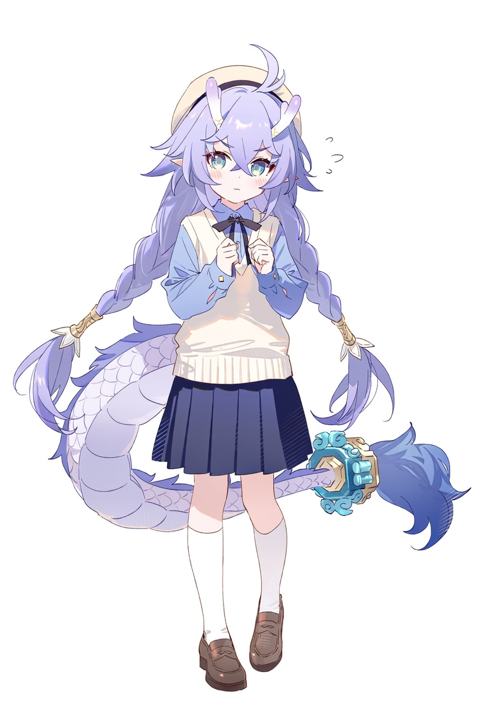

[在线例图](https://assets.quicktagcloud.com/images/raven_composition/raven_composition-5138.jpg?v=8c85781b636f3973)

<a id="raven_composition-5139"></a>

## 那刻夏

ID：`raven_composition-5139`；分类：角色图鉴 / 星穹铁道；来源标记：`safe`。

来源说明：

> 作品：星穹铁道
> 角色性别：男
> 角色登场时间：3.1

正向提示词：

```text
anaxa_(honkai:_star_rail)
```

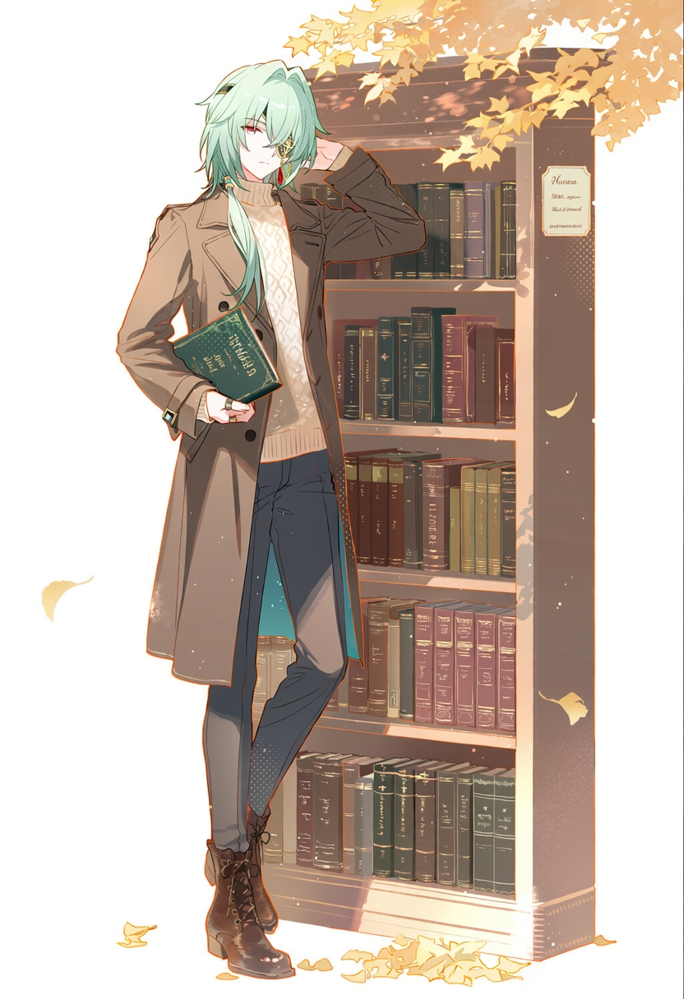

[在线例图](https://assets.quicktagcloud.com/images/raven_composition/raven_composition-5139.jpg?v=5fcca0b04e2b965e)

<a id="raven_composition-5140"></a>

## 青雀

ID：`raven_composition-5140`；分类：角色图鉴 / 星穹铁道；来源标记：`safe`。

来源说明：

> 作品：星穹铁道
> 角色性别：女
> 角色登场时间：1

正向提示词：

```text
qingque_(honkai:_star_rail)
```

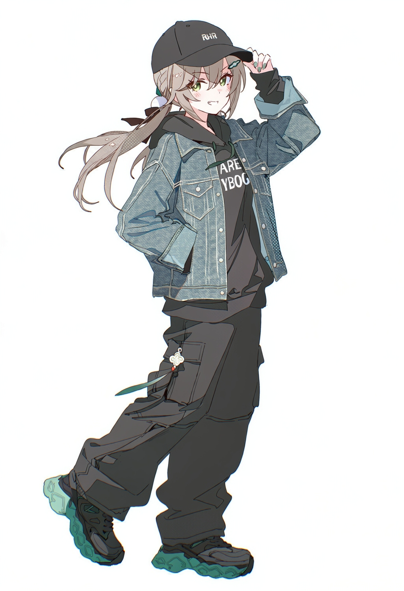

[在线例图](https://assets.quicktagcloud.com/images/raven_composition/raven_composition-5140.jpg?v=e3f9089c660fd703)

<a id="raven_composition-5141"></a>

## 素裳

ID：`raven_composition-5141`；分类：角色图鉴 / 星穹铁道；来源标记：`safe`。

来源说明：

> 作品：星穹铁道
> 角色性别：女
> 角色登场时间：1

正向提示词：

```text
sushang_(honkai:_star_rail)
```

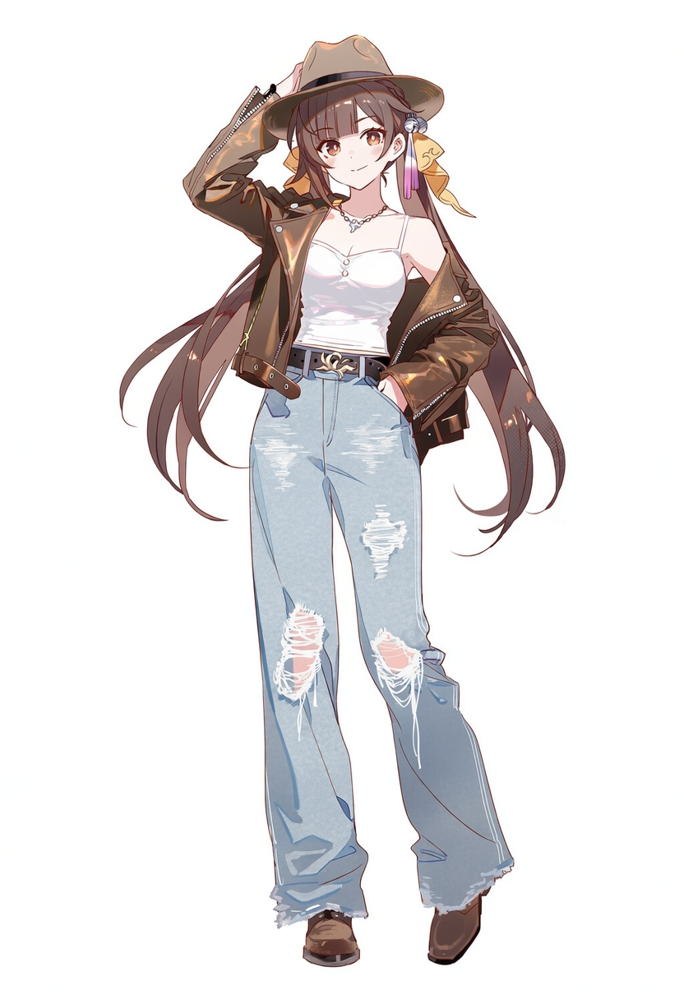

[在线例图](https://assets.quicktagcloud.com/images/raven_composition/raven_composition-5141.jpg?v=c264d8bc0e84c8a1)

<a id="raven_composition-5142"></a>

## 停云

ID：`raven_composition-5142`；分类：角色图鉴 / 星穹铁道；来源标记：`safe`。

来源说明：

> 作品：星穹铁道
> 角色性别：女
> 角色登场时间：1

正向提示词：

```text
tingyun_(honkai:_star_rail)
```

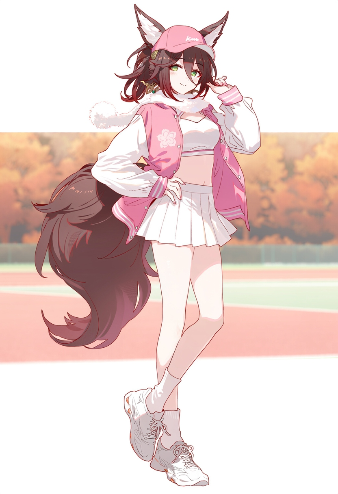

[在线例图](https://assets.quicktagcloud.com/images/raven_composition/raven_composition-5142.jpg?v=7f93cf6b9c49446a)

<a id="raven_composition-5143"></a>

## 银狼

ID：`raven_composition-5143`；分类：角色图鉴 / 星穹铁道；来源标记：`safe`。

来源说明：

> 作品：星穹铁道
> 角色性别：女
> 角色登场时间：1.1

正向提示词：

```text
silver_wolf_(honkai:_star_rail)
```

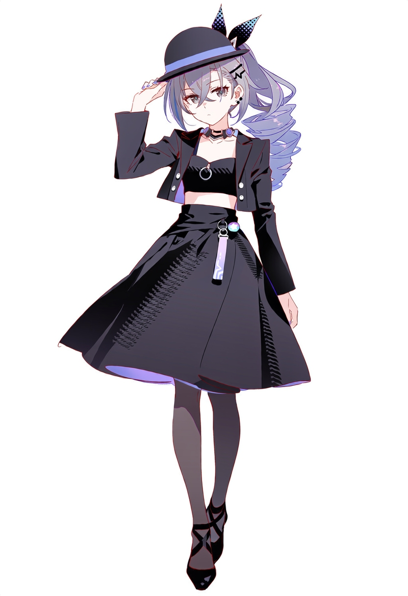

[在线例图](https://assets.quicktagcloud.com/images/raven_composition/raven_composition-5143.jpg?v=2cf33c97d72097ee)

<a id="raven_composition-5144"></a>

## 驭空

ID：`raven_composition-5144`；分类：角色图鉴 / 星穹铁道；来源标记：`safe`。

来源说明：

> 作品：星穹铁道
> 角色性别：女
> 角色登场时间：1.1

正向提示词：

```text
yukong_(honkai:_star_rail)
```

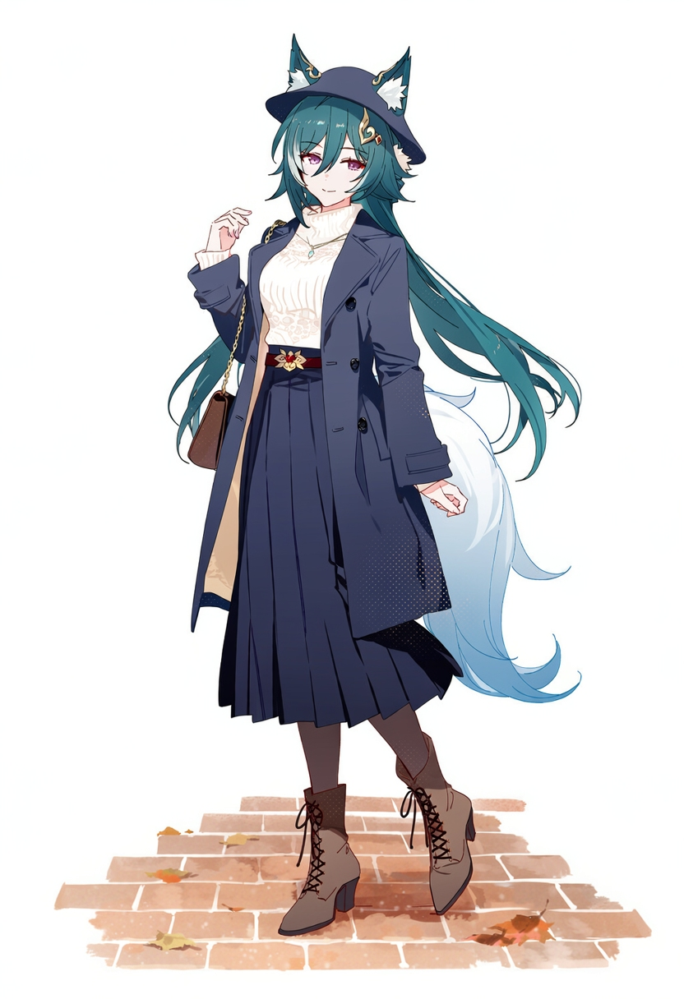

[在线例图](https://assets.quicktagcloud.com/images/raven_composition/raven_composition-5144.jpg?v=c4fb6679e808d7a2)

<a id="raven_composition-5145"></a>

## 卡芙卡

ID：`raven_composition-5145`；分类：角色图鉴 / 星穹铁道；来源标记：`safe`。

来源说明：

> 作品：星穹铁道
> 角色性别：女
> 角色登场时间：1.2

正向提示词：

```text
kafka_(honkai:_star_rail)
```

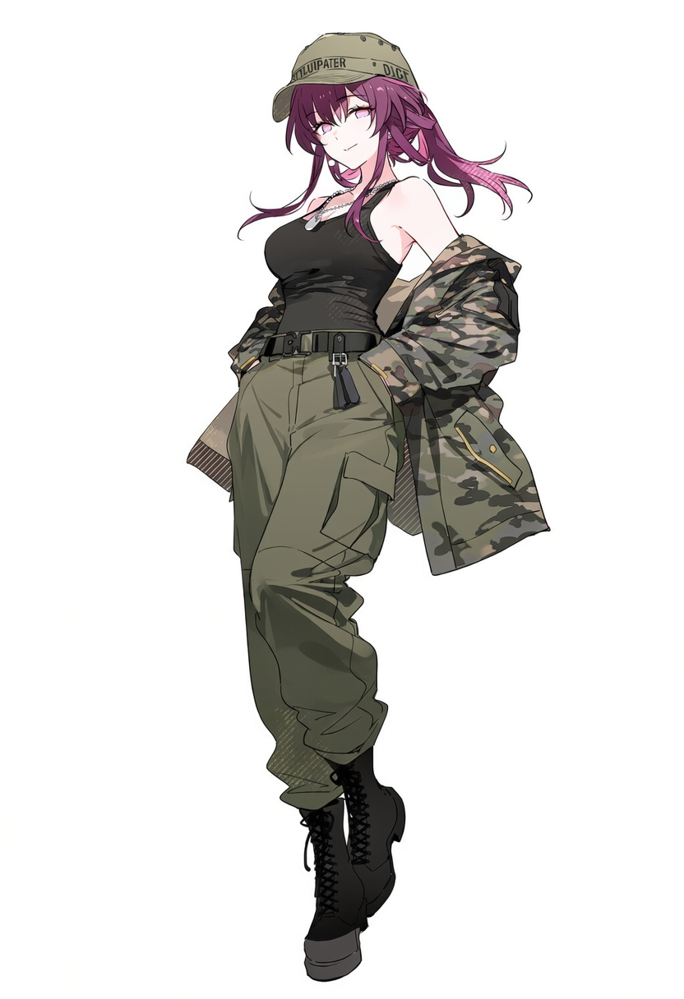

[在线例图](https://assets.quicktagcloud.com/images/raven_composition/raven_composition-5145.jpg?v=6cca889f9eb7186f)

<a id="raven_composition-5146"></a>

## 符玄

ID：`raven_composition-5146`；分类：角色图鉴 / 星穹铁道；来源标记：`safe`。

来源说明：

> 作品：星穹铁道
> 角色性别：女
> 角色登场时间：1.3

正向提示词：

```text
fu_xuan_(honkai:_star_rail)
```

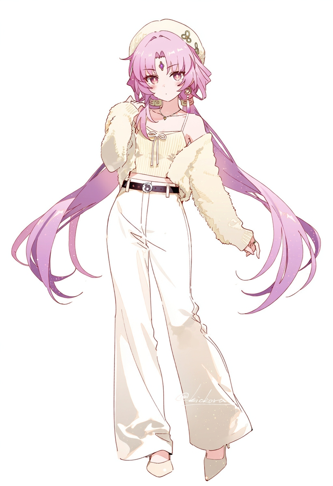

[在线例图](https://assets.quicktagcloud.com/images/raven_composition/raven_composition-5146.jpg?v=fa8241ade09817b0)

<a id="raven_composition-5147"></a>

## 玲可·朗道

ID：`raven_composition-5147`；分类：角色图鉴 / 星穹铁道；来源标记：`safe`。

来源说明：

> 作品：星穹铁道
> 角色性别：女
> 角色登场时间：1.4

正向提示词：

```text
lynx_landau
```

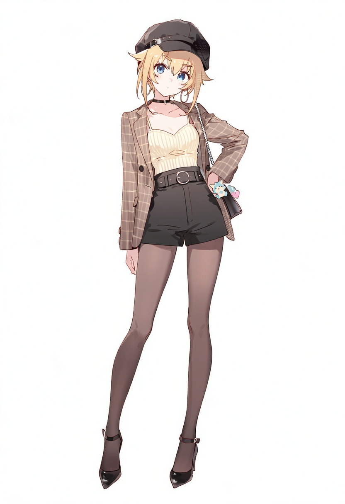

[在线例图](https://assets.quicktagcloud.com/images/raven_composition/raven_composition-5147.jpg?v=00eaa7581b5fac9d)

<a id="raven_composition-5148"></a>

## 万敌

ID：`raven_composition-5148`；分类：角色图鉴 / 星穹铁道；来源标记：`safe`。

来源说明：

> 作品：星穹铁道
> 角色性别：男
> 角色登场时间：3.2

正向提示词：

```text
mydei_(honkai:_star_rail)
```

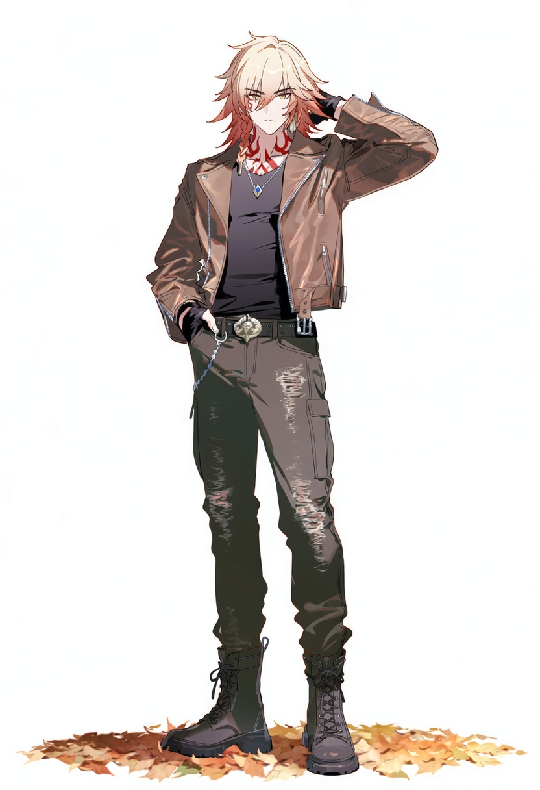

[在线例图](https://assets.quicktagcloud.com/images/raven_composition/raven_composition-5148.jpg?v=2de87a47ed9a87b1)

<a id="raven_composition-5149"></a>

## 白厄

ID：`raven_composition-5149`；分类：角色图鉴 / 星穹铁道；来源标记：`safe`。

来源说明：

> 作品：星穹铁道
> 角色性别：男
> 角色登场时间：3.4

正向提示词：

```text
phainon_(honkai:_star_rail)
```

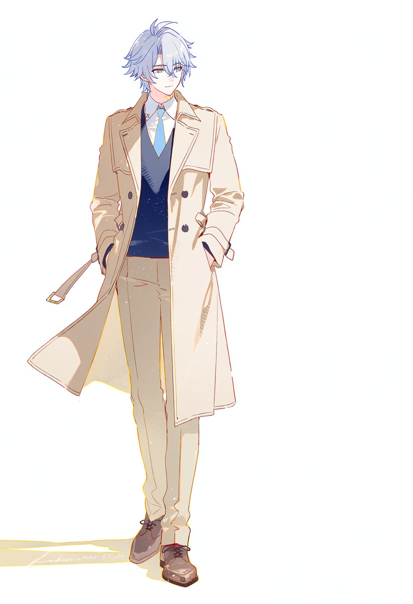

[在线例图](https://assets.quicktagcloud.com/images/raven_composition/raven_composition-5149.jpg?v=127c10433685e69b)

<a id="raven_composition-5150"></a>

## 托帕

ID：`raven_composition-5150`；分类：角色图鉴 / 星穹铁道；来源标记：`safe`。

来源说明：

> 作品：星穹铁道
> 角色性别：女
> 角色登场时间：1.4

正向提示词：

```text
topaz_(honkai:_star_rail)
```

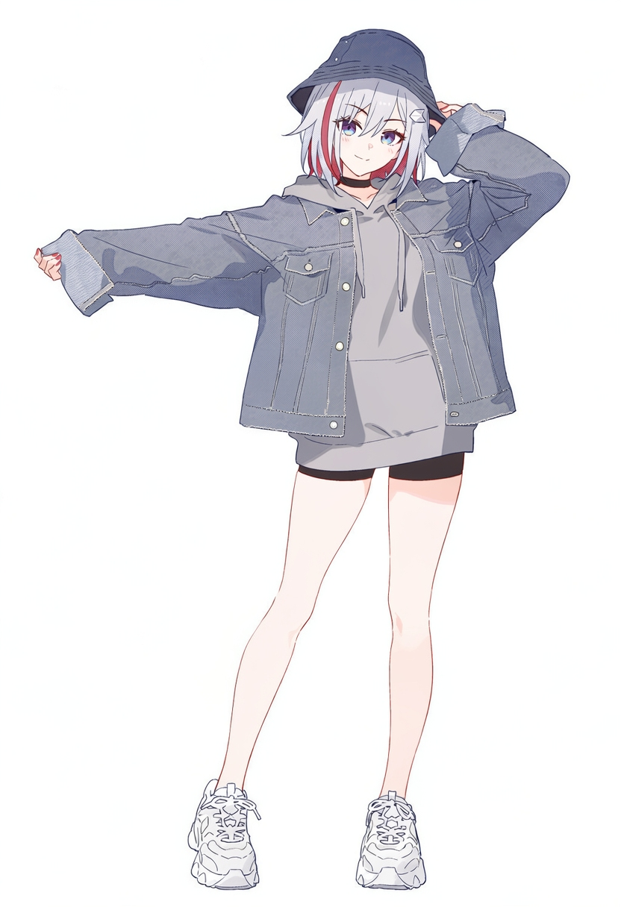

[在线例图](https://assets.quicktagcloud.com/images/raven_composition/raven_composition-5150.jpg?v=e7edab5c51bf0ce8)

<a id="raven_composition-5151"></a>

## 桂乃芬

ID：`raven_composition-5151`；分类：角色图鉴 / 星穹铁道；来源标记：`safe`。

来源说明：

> 作品：星穹铁道
> 角色性别：女
> 角色登场时间：1.4

正向提示词：

```text
guinaifen_(honkai:_star_rail)
```

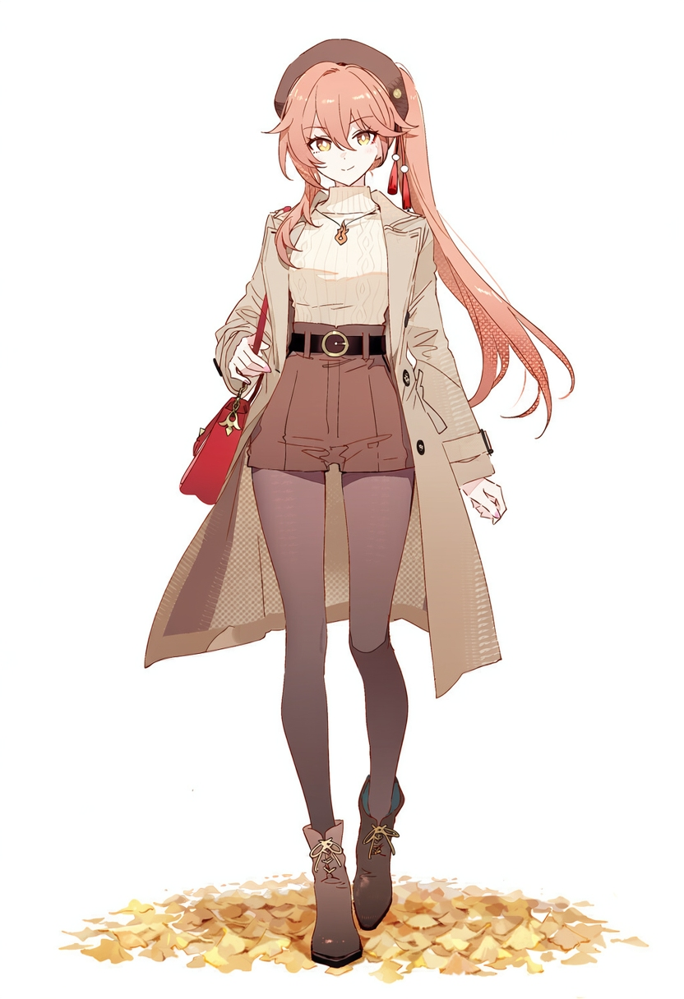

[在线例图](https://assets.quicktagcloud.com/images/raven_composition/raven_composition-5151.jpg?v=de644e305c123771)

<a id="raven_composition-5152"></a>

## 镜流

ID：`raven_composition-5152`；分类：角色图鉴 / 星穹铁道；来源标记：`safe`。

来源说明：

> 作品：星穹铁道
> 角色性别：女
> 角色登场时间：1.4

正向提示词：

```text
jingliu_(honkai:_star_rail)
```

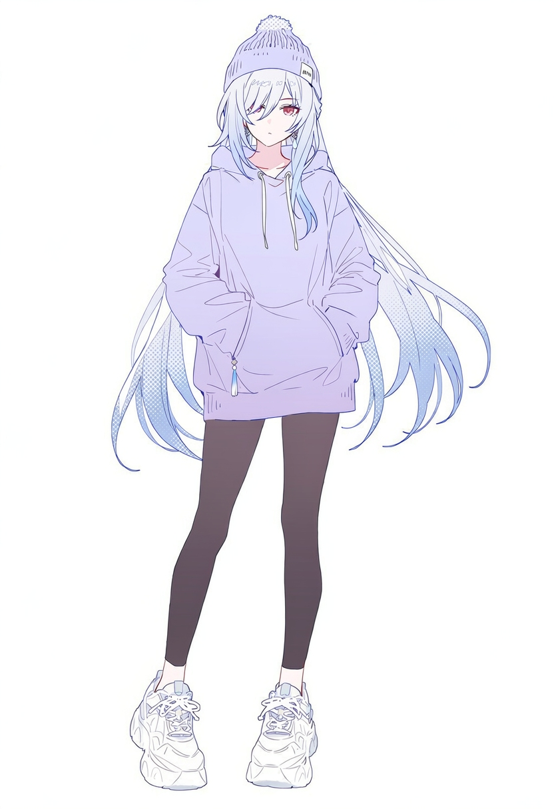

[在线例图](https://assets.quicktagcloud.com/images/raven_composition/raven_composition-5152.jpg?v=81c98b6514eff574)

<a id="raven_composition-5153"></a>

## 寒鸦

ID：`raven_composition-5153`；分类：角色图鉴 / 星穹铁道；来源标记：`safe`。

来源说明：

> 作品：星穹铁道
> 角色性别：女
> 角色登场时间：1.5

正向提示词：

```text
hanya_(honkai:_star_rail)
```

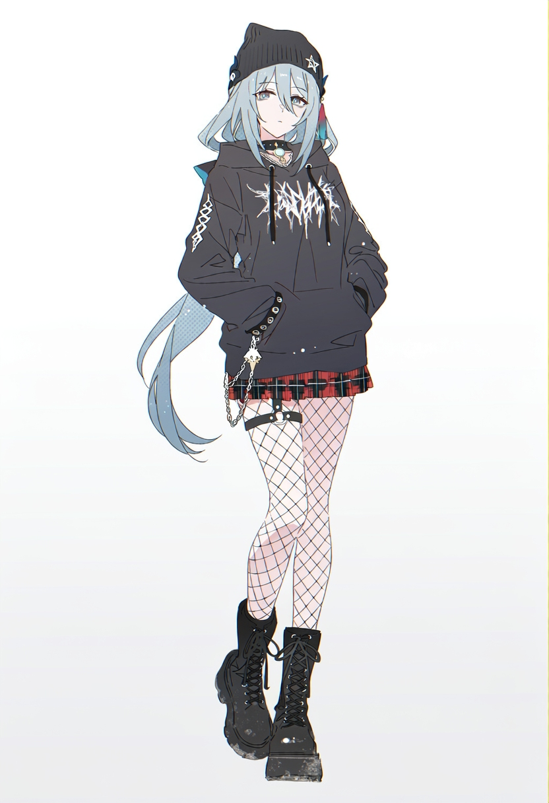

[在线例图](https://assets.quicktagcloud.com/images/raven_composition/raven_composition-5153.jpg?v=47383a6cecea4854)

<a id="raven_composition-5154"></a>

## 藿藿

ID：`raven_composition-5154`；分类：角色图鉴 / 星穹铁道；来源标记：`safe`。

来源说明：

> 作品：星穹铁道
> 角色性别：女
> 角色登场时间：1.5

正向提示词：

```text
huohuo_(honkai:_star_rail)
```

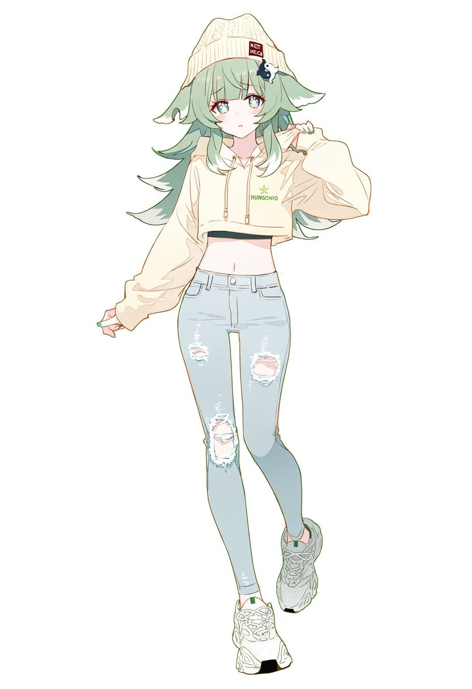

[在线例图](https://assets.quicktagcloud.com/images/raven_composition/raven_composition-5154.jpg?v=629d336ecfdb1c25)

<a id="raven_composition-5155"></a>

## 红A(Archer)

ID：`raven_composition-5155`；分类：角色图鉴 / 星穹铁道；来源标记：`safe`。

来源说明：

> 作品：星穹铁道
> 角色性别：男
> 角色登场时间：3.8

正向提示词：

```text
archer_(honkai:_star_rail)_(fate)
```

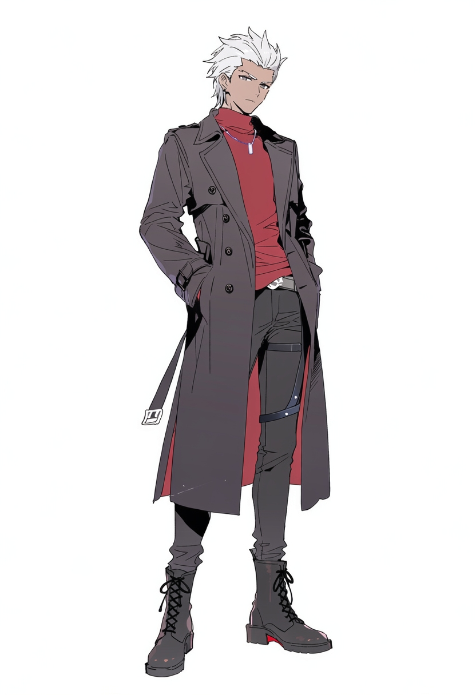

[在线例图](https://assets.quicktagcloud.com/images/raven_composition/raven_composition-5155.jpg?v=a1aa60a6d2d8afb3)

<a id="raven_composition-5156"></a>

## 吉尔伽美什

ID：`raven_composition-5156`；分类：角色图鉴 / 星穹铁道；来源标记：`safe`。

来源说明：

> 作品：星穹铁道
> 角色性别：男
> 角色登场时间：3.8

正向提示词：

```text
gilgamesh_(honkai:_star_rail)_(fate)
```

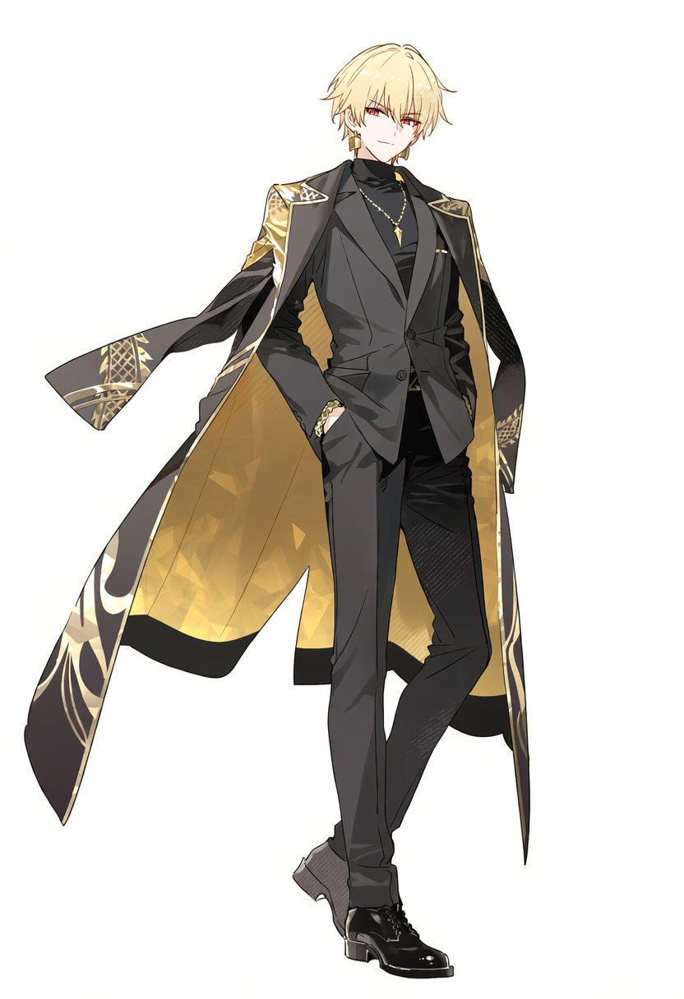

[在线例图](https://assets.quicktagcloud.com/images/raven_composition/raven_composition-5156.jpg?v=863e3fb8270e152f)

<a id="raven_composition-5157"></a>

## 阮·梅

ID：`raven_composition-5157`；分类：角色图鉴 / 星穹铁道；来源标记：`safe`。

来源说明：

> 作品：星穹铁道
> 角色性别：女
> 角色登场时间：1.6

正向提示词：

```text
ruan_mei_(honkai:_star_rail)
```

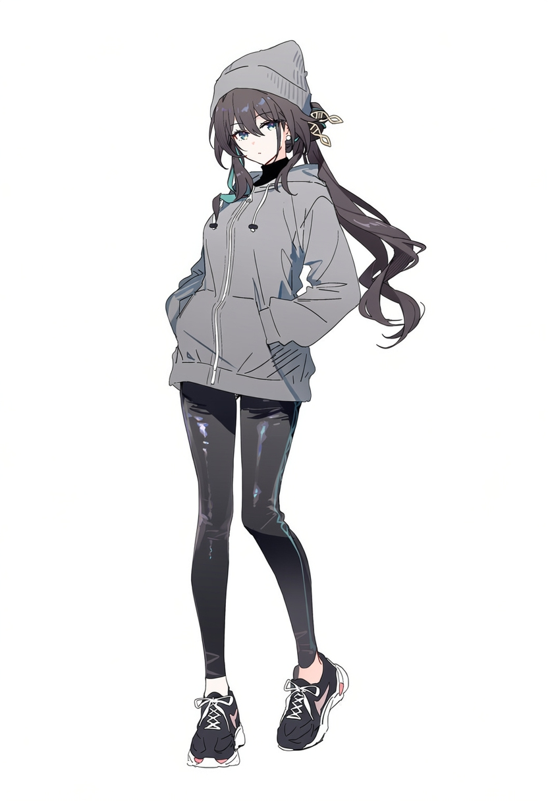

[在线例图](https://assets.quicktagcloud.com/images/raven_composition/raven_composition-5157.jpg?v=dc047c8ae237c8e4)

<a id="raven_composition-5158"></a>

## 雪衣

ID：`raven_composition-5158`；分类：角色图鉴 / 星穹铁道；来源标记：`safe`。

来源说明：

> 作品：星穹铁道
> 角色性别：女
> 角色登场时间：1.6

正向提示词：

```text
xueyi_(honkai:_star_rail)
```

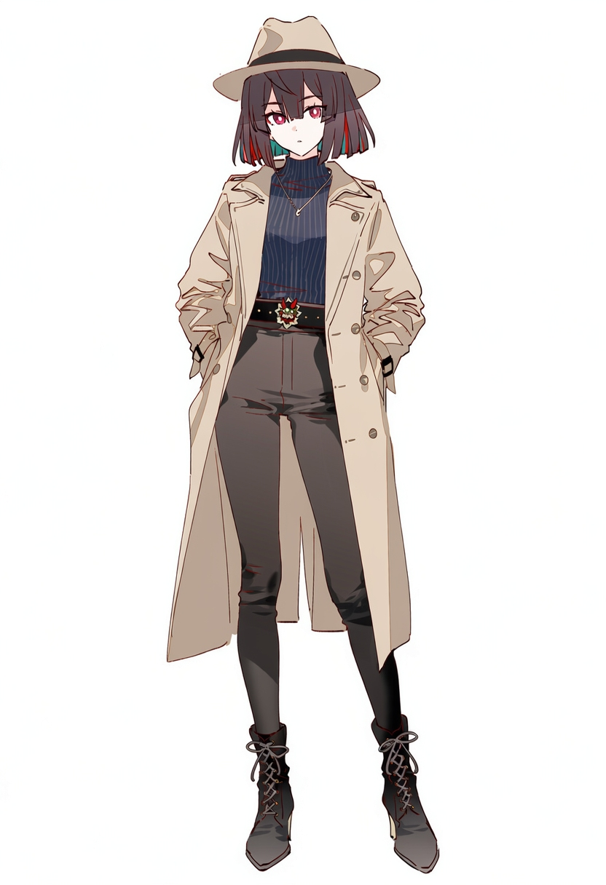

[在线例图](https://assets.quicktagcloud.com/images/raven_composition/raven_composition-5158.jpg?v=40bef6d73e1ffc63)

<a id="raven_composition-5159"></a>

## 不死途

ID：`raven_composition-5159`；分类：角色图鉴 / 星穹铁道；来源标记：`safe`。

来源说明：

> 作品：星穹铁道
> 角色性别：男
> 角色登场时间：4.3

正向提示词：

```text
ashveil_(honkai:_star_rail)
```

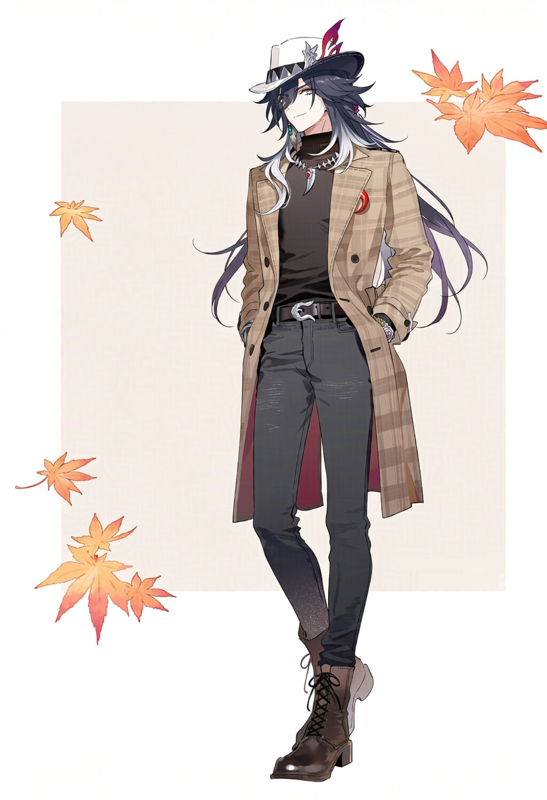

[在线例图](https://assets.quicktagcloud.com/images/raven_composition/raven_composition-5159.jpg?v=5017f72e2100fa53)

<a id="raven_composition-5160"></a>

## 波提欧

ID：`raven_composition-5160`；分类：角色图鉴 / 星穹铁道；来源标记：`safe`。

来源说明：

> 作品：星穹铁道
> 角色性别：男
> 角色登场时间：2.3

正向提示词：

```text
boothill_(honkai:_star_rail)
```

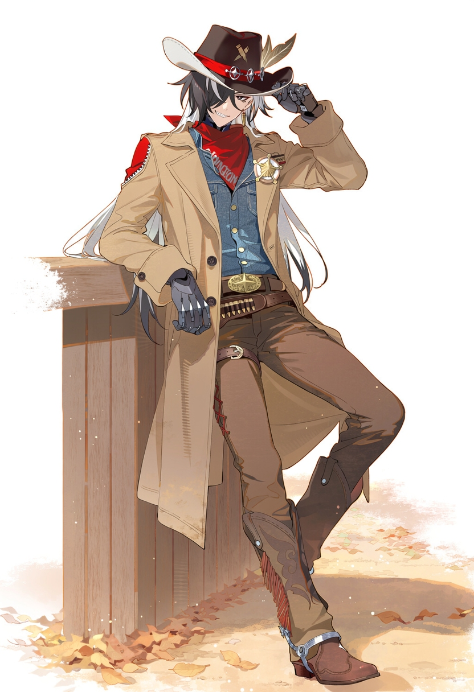

[在线例图](https://assets.quicktagcloud.com/images/raven_composition/raven_composition-5160.jpg?v=8b7987cb42aac400)

<a id="raven_composition-5161"></a>

## 黑天鹅

ID：`raven_composition-5161`；分类：角色图鉴 / 星穹铁道；来源标记：`safe`。

来源说明：

> 作品：星穹铁道
> 角色性别：女
> 角色登场时间：2

正向提示词：

```text
black_swan_(honkai:_star_rail)
```

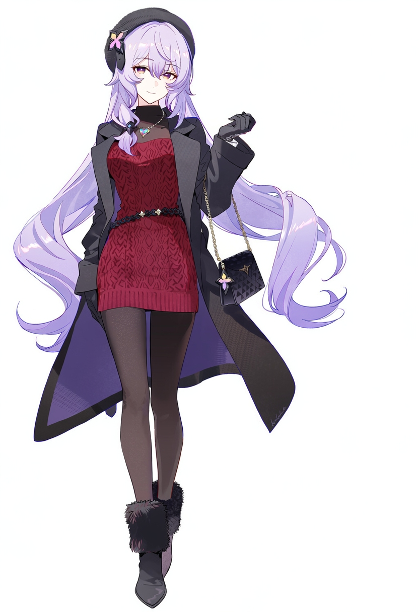

[在线例图](https://assets.quicktagcloud.com/images/raven_composition/raven_composition-5161.jpg?v=1b6f014700c1c7ef)

<a id="raven_composition-5162"></a>

## 花火

ID：`raven_composition-5162`；分类：角色图鉴 / 星穹铁道；来源标记：`safe`。

来源说明：

> 作品：星穹铁道
> 角色性别：女
> 角色登场时间：2

正向提示词：

```text
sparkle_(honkai:_star_rail)
```

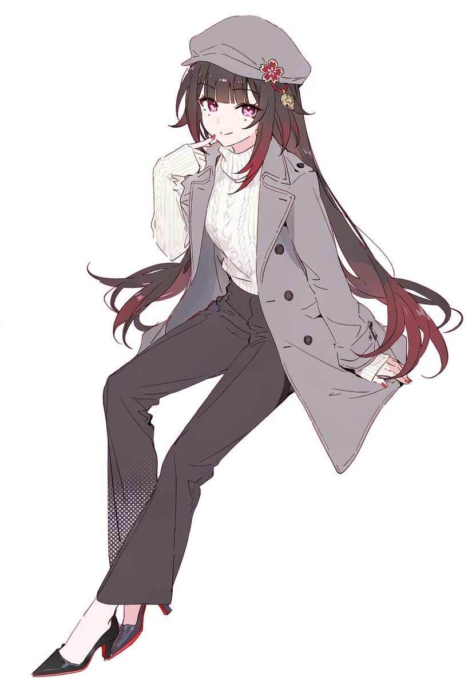

[在线例图](https://assets.quicktagcloud.com/images/raven_composition/raven_composition-5162.jpg?v=e5487c432a64249e)

<a id="raven_composition-5163"></a>

## 黄泉

ID：`raven_composition-5163`；分类：角色图鉴 / 星穹铁道；来源标记：`safe`。

来源说明：

> 作品：星穹铁道
> 角色性别：女
> 角色登场时间：2.1

正向提示词：

```text
acheron_(honkai:_star_rail)
```

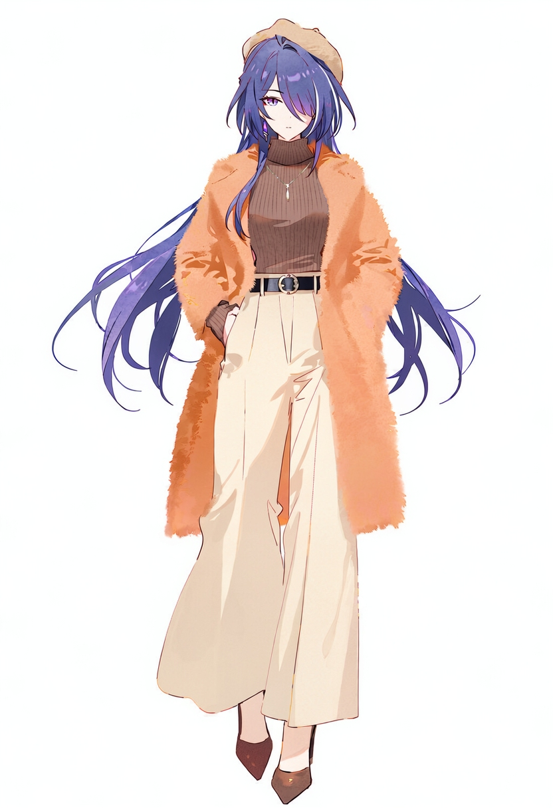

[在线例图](https://assets.quicktagcloud.com/images/raven_composition/raven_composition-5163.jpg?v=456bb52aed66efa4)

<a id="raven_composition-5164"></a>

## 阿兰

ID：`raven_composition-5164`；分类：角色图鉴 / 星穹铁道；来源标记：`safe`。

来源说明：

> 作品：星穹铁道
> 角色性别：男
> 角色登场时间：1

正向提示词：

```text
arlan_(honkai:_star_rail)
```

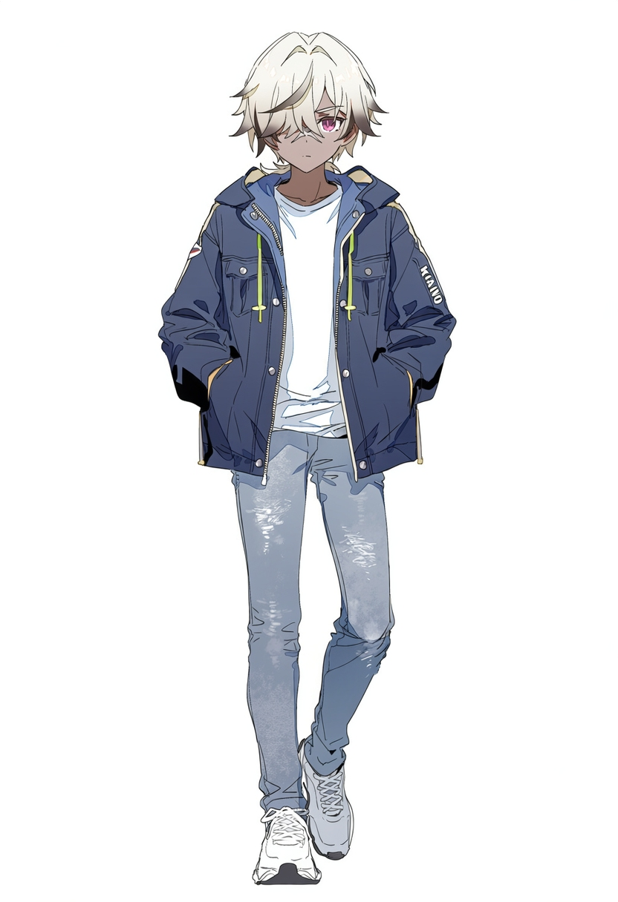

[在线例图](https://assets.quicktagcloud.com/images/raven_composition/raven_composition-5164.jpg?v=c6bd51184c4335e1)

<a id="raven_composition-5165"></a>

## 佩佩

ID：`raven_composition-5165`；分类：角色图鉴 / 星穹铁道；来源标记：`safe`。

来源说明：

> 作品：星穹铁道
> 角色性别：男
> 角色登场时间：1

正向提示词：

```text
peppy_(honkai:_star_rail)
```

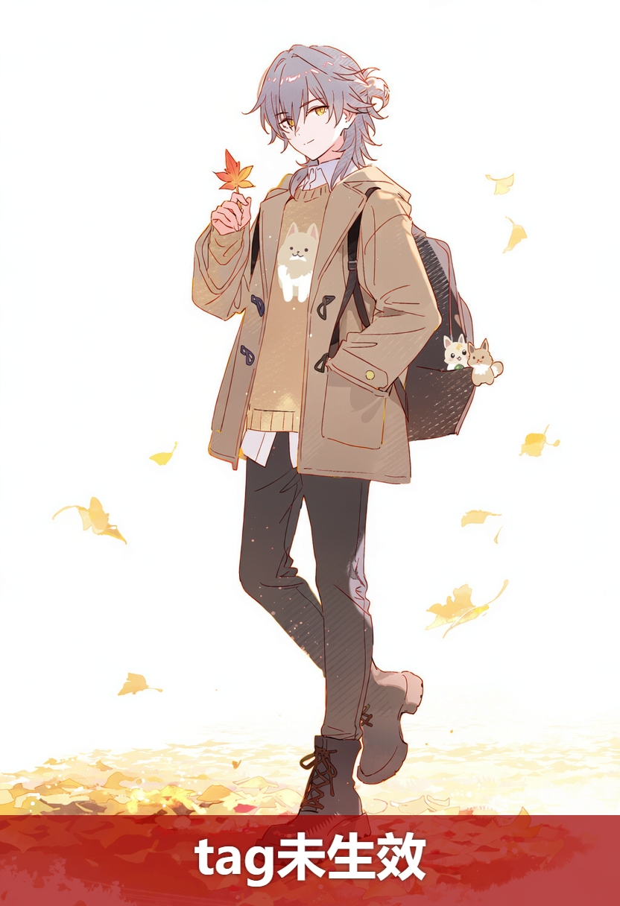

[在线例图](https://assets.quicktagcloud.com/images/raven_composition/raven_composition-5165.jpg?v=24d51027a8fcb995)

<a id="raven_composition-5166"></a>

## 知更鸟

ID：`raven_composition-5166`；分类：角色图鉴 / 星穹铁道；来源标记：`safe`。

来源说明：

> 作品：星穹铁道
> 角色性别：女
> 角色登场时间：2.2

正向提示词：

```text
robin_(honkai:_star_rail)
```


[在线例图](https://assets.quicktagcloud.com/images/raven_composition/raven_composition-5166.jpg?v=49e60464342e2e92)

<a id="raven_composition-5167"></a>

## 流萤

ID：`raven_composition-5167`；分类：角色图鉴 / 星穹铁道；来源标记：`safe`。

来源说明：

> 作品：星穹铁道
> 角色性别：女
> 角色登场时间：2.3

正向提示词：

```text
firefly_(honkai:_star_rail)
```


[在线例图](https://assets.quicktagcloud.com/images/raven_composition/raven_composition-5167.jpg?v=b88bd6996901af76)

<a id="raven_composition-5168"></a>

## 翡翠

ID：`raven_composition-5168`；分类：角色图鉴 / 星穹铁道；来源标记：`safe`。

来源说明：

> 作品：星穹铁道
> 角色性别：女
> 角色登场时间：2.4

正向提示词：

```text
jade_(honkai:_star_rail)
```


[在线例图](https://assets.quicktagcloud.com/images/raven_composition/raven_composition-5168.jpg?v=06550536deb06402)

<a id="raven_composition-5169"></a>

## 灵砂

ID：`raven_composition-5169`；分类：角色图鉴 / 星穹铁道；来源标记：`safe`。

来源说明：

> 作品：星穹铁道
> 角色性别：女
> 角色登场时间：2.4

正向提示词：

```text
lingsha_(honkai:_star_rail)
```


[在线例图](https://assets.quicktagcloud.com/images/raven_composition/raven_composition-5169.jpg?v=08ed9e26a90b7497)

<a id="raven_composition-5170"></a>

## 真理医生

ID：`raven_composition-5170`；分类：角色图鉴 / 星穹铁道；来源标记：`safe`。

来源说明：

> 作品：星穹铁道
> 角色性别：男
> 角色登场时间：1.6

正向提示词：

```text
dr._ratio_(honkai:_star_rail)
```


[在线例图](https://assets.quicktagcloud.com/images/raven_composition/raven_composition-5170.jpg?v=a1db4fb5b2cb0f7c)

<a id="raven_composition-5171"></a>

## 砂金

ID：`raven_composition-5171`；分类：角色图鉴 / 星穹铁道；来源标记：`safe`。

来源说明：

> 作品：星穹铁道
> 角色性别：男
> 角色登场时间：2.1

正向提示词：

```text
aventurine_(honkai:_star_rail)
```


[在线例图](https://assets.quicktagcloud.com/images/raven_composition/raven_composition-5171.jpg?v=4cc3ae8f2d903310)

<a id="raven_composition-5172"></a>

## 砂金·戏浪

ID：`raven_composition-5172`；分类：角色图鉴 / 星穹铁道；来源标记：`safe`。

来源说明：

> 作品：星穹铁道
> 角色性别：男
> 角色登场时间：4.2

正向提示词：

```text
aventurine_(waveflair)_(honkai:_star_rail)
```


[在线例图](https://assets.quicktagcloud.com/images/raven_composition/raven_composition-5172.jpg?v=ba850f701574b136)

<a id="raven_composition-5173"></a>

## 卡卡瓦夏

ID：`raven_composition-5173`；分类：角色图鉴 / 星穹铁道；来源标记：`safe`。

来源说明：

> 作品：星穹铁道
> 角色性别：男
> 角色登场时间：2.1

正向提示词：

```text
kakavasha_(honkai:_star_rail)
```


[在线例图](https://assets.quicktagcloud.com/images/raven_composition/raven_composition-5173.jpg?v=1f9cb965f844ee93)

<a id="raven_composition-5174"></a>

## 云璃

ID：`raven_composition-5174`；分类：角色图鉴 / 星穹铁道；来源标记：`safe`。

来源说明：

> 作品：星穹铁道
> 角色性别：女
> 角色登场时间：2.4

正向提示词：

```text
yunli_(honkai:_star_rail)
```


[在线例图](https://assets.quicktagcloud.com/images/raven_composition/raven_composition-5174.jpg?v=31597ca54079d1db)

<a id="raven_composition-5175"></a>

## 飞霄

ID：`raven_composition-5175`；分类：角色图鉴 / 星穹铁道；来源标记：`safe`。

来源说明：

> 作品：星穹铁道
> 角色性别：女
> 角色登场时间：2.5

正向提示词：

```text
feixiao_(honkai:_star_rail)
```


[在线例图](https://assets.quicktagcloud.com/images/raven_composition/raven_composition-5175.jpg?v=873f7c0106be9a8f)

<a id="raven_composition-5176"></a>

## 乱破

ID：`raven_composition-5176`；分类：角色图鉴 / 星穹铁道；来源标记：`safe`。

来源说明：

> 作品：星穹铁道
> 角色性别：女
> 角色登场时间：2.6

正向提示词：

```text
rappa_(honkai:_star_rail)
```


[在线例图](https://assets.quicktagcloud.com/images/raven_composition/raven_composition-5176.jpg?v=d41f0800bc0c29ed)

<a id="raven_composition-5177"></a>

## 罗刹

ID：`raven_composition-5177`；分类：角色图鉴 / 星穹铁道；来源标记：`safe`。

来源说明：

> 作品：星穹铁道
> 角色性别：男
> 角色登场时间：1.1

正向提示词：

```text
luocha_(honkai:_star_rail)
```


[在线例图](https://assets.quicktagcloud.com/images/raven_composition/raven_composition-5177.jpg?v=07d5a9475a75a990)

<a id="raven_composition-5178"></a>

## 银枝

ID：`raven_composition-5178`；分类：角色图鉴 / 星穹铁道；来源标记：`safe`。

来源说明：

> 作品：星穹铁道
> 角色性别：男
> 角色登场时间：1.5

正向提示词：

```text
argenti_(honkai:_star_rail)
```


[在线例图](https://assets.quicktagcloud.com/images/raven_composition/raven_composition-5178.jpg?v=893c685d1bba4847)

<a id="raven_composition-5179"></a>

## 忘归人

ID：`raven_composition-5179`；分类：角色图鉴 / 星穹铁道；来源标记：`safe`。

来源说明：

> 作品：星穹铁道
> 角色性别：女
> 角色登场时间：2.7

正向提示词：

```text
fugue_(honkai:_star_rail)
```


[在线例图](https://assets.quicktagcloud.com/images/raven_composition/raven_composition-5179.jpg?v=ac68eb98167dbc06)

<a id="raven_composition-5180"></a>

## 阿格莱雅

ID：`raven_composition-5180`；分类：角色图鉴 / 星穹铁道；来源标记：`safe`。

来源说明：

> 作品：星穹铁道
> 角色性别：女
> 角色登场时间：3

正向提示词：

```text
aglaea_(honkai:_star_rail)
```


[在线例图](https://assets.quicktagcloud.com/images/raven_composition/raven_composition-5180.jpg?v=8d95ded07f2fc75a)

<a id="raven_composition-5181"></a>

## 加拉赫

ID：`raven_composition-5181`；分类：角色图鉴 / 星穹铁道；来源标记：`safe`。

来源说明：

> 作品：星穹铁道
> 角色性别：男
> 角色登场时间：2.1

正向提示词：

```text
gallagher_(honkai:_star_rail)
```


[在线例图](https://assets.quicktagcloud.com/images/raven_composition/raven_composition-5181.jpg?v=b0fc633c154f44c0)

<a id="raven_composition-5182"></a>

## 米沙

ID：`raven_composition-5182`；分类：角色图鉴 / 星穹铁道；来源标记：`safe`。

来源说明：

> 作品：星穹铁道
> 角色性别：男
> 角色登场时间：2.5

正向提示词：

```text
misha_(honkai:_star_rail)
```


[在线例图](https://assets.quicktagcloud.com/images/raven_composition/raven_composition-5182.jpg?v=5f119ee4916b890e)

<a id="raven_composition-5183"></a>

## 缇里西庇俄丝

ID：`raven_composition-5183`；分类：角色图鉴 / 星穹铁道；来源标记：`safe`。

来源说明：

> 作品：星穹铁道
> 角色性别：女
> 角色登场时间：3

正向提示词：

```text
tribios_(honkai:_star_rail)
```


[在线例图](https://assets.quicktagcloud.com/images/raven_composition/raven_composition-5183.jpg?v=0fdfb6586564ad32)

<a id="raven_composition-5184"></a>

## 缇安

ID：`raven_composition-5184`；分类：角色图鉴 / 星穹铁道；来源标记：`safe`。

来源说明：

> 作品：星穹铁道
> 角色性别：女
> 角色登场时间：3

正向提示词：

```text
trianne_(honkai:_star_rail)
```


[在线例图](https://assets.quicktagcloud.com/images/raven_composition/raven_composition-5184.jpg?v=bbfa3484f3c8f260)

<a id="raven_composition-5185"></a>

## 缇宝

ID：`raven_composition-5185`；分类：角色图鉴 / 星穹铁道；来源标记：`safe`。

来源说明：

> 作品：星穹铁道
> 角色性别：女
> 角色登场时间：3

正向提示词：

```text
tribbie_(honkai:_star_rail)
```


[在线例图](https://assets.quicktagcloud.com/images/raven_composition/raven_composition-5185.jpg?v=ae02e5b5f69ac44e)

<a id="raven_composition-5186"></a>

## 缇宁

ID：`raven_composition-5186`；分类：角色图鉴 / 星穹铁道；来源标记：`safe`。

来源说明：

> 作品：星穹铁道
> 角色性别：女
> 角色登场时间：3

正向提示词：

```text
trinnon_(honkai:_star_rail)
```


[在线例图](https://assets.quicktagcloud.com/images/raven_composition/raven_composition-5186.jpg?v=ac7d7d9c0f334cdc)

<a id="raven_composition-5187"></a>

## 刃

ID：`raven_composition-5187`；分类：角色图鉴 / 星穹铁道；来源标记：`safe`。

来源说明：

> 作品：星穹铁道
> 角色性别：男
> 角色登场时间：1.2

正向提示词：

```text
blade_(honkai:_star_rail)
```


[在线例图](https://assets.quicktagcloud.com/images/raven_composition/raven_composition-5187.jpg?v=90105b6223e4be49)

<a id="raven_composition-5188"></a>

## 千冶·刃

ID：`raven_composition-5188`；分类：角色图鉴 / 星穹铁道；来源标记：`safe`。

来源说明：

> 作品：星穹铁道
> 角色性别：男
> 角色登场时间：4.6

正向提示词：

```text
mortenax_blade_(honkai:_star_rail)
```


[在线例图](https://assets.quicktagcloud.com/images/raven_composition/raven_composition-5188.jpg?v=a3f7102778bb0447)

<a id="raven_composition-5189"></a>

## 刃·应星

ID：`raven_composition-5189`；分类：角色图鉴 / 星穹铁道；来源标记：`safe`。

来源说明：

> 作品：星穹铁道
> 角色性别：男
> 角色登场时间：4.6

正向提示词：

```text
yingxing_(honkai:_star_rail)
```


[在线例图](https://assets.quicktagcloud.com/images/raven_composition/raven_composition-5189.jpg?v=688bbad1c6710423)

<a id="raven_composition-5190"></a>

## 大黑塔

ID：`raven_composition-5190`；分类：角色图鉴 / 星穹铁道；来源标记：`safe`。

来源说明：

> 作品：星穹铁道
> 角色性别：女
> 角色登场时间：3

正向提示词：

```text
the_herta_(honkai:_star_rail)
```


[在线例图](https://assets.quicktagcloud.com/images/raven_composition/raven_composition-5190.jpg?v=ae6ac5ec58d16059)

<a id="raven_composition-5191"></a>

## 流萤·萨姆

ID：`raven_composition-5191`；分类：角色图鉴 / 星穹铁道；来源标记：`safe`。

来源说明：

> 作品：星穹铁道
> 角色性别：机甲
> 角色登场时间：2.3

正向提示词：

```text
sam_(honkai:_star_rail)
```


[在线例图](https://assets.quicktagcloud.com/images/raven_composition/raven_composition-5191.jpg?v=9d6bff744b8d3b0b)

<a id="raven_composition-5192"></a>

## 遐蝶

ID：`raven_composition-5192`；分类：角色图鉴 / 星穹铁道；来源标记：`safe`。

来源说明：

> 作品：星穹铁道
> 角色性别：女
> 角色登场时间：3.2

正向提示词：

```text
castorice_(honkai:_star_rail)
```


[在线例图](https://assets.quicktagcloud.com/images/raven_composition/raven_composition-5192.jpg?v=7216c3b94c5c6de5)

<a id="raven_composition-5193"></a>

## 风堇

ID：`raven_composition-5193`；分类：角色图鉴 / 星穹铁道；来源标记：`safe`。

来源说明：

> 作品：星穹铁道
> 角色性别：女
> 角色登场时间：3.3

正向提示词：

```text
hyacine_(honkai:_star_rail)
```


[在线例图](https://assets.quicktagcloud.com/images/raven_composition/raven_composition-5193.jpg?v=5c8ccdfa18449a42)

<a id="raven_composition-5194"></a>

## 刻律德菈

ID：`raven_composition-5194`；分类：角色图鉴 / 星穹铁道；来源标记：`safe`。

来源说明：

> 作品：星穹铁道
> 角色性别：女
> 角色登场时间：3.4

正向提示词：

```text
cerydra_(honkai:_star_rail)
```


[在线例图](https://assets.quicktagcloud.com/images/raven_composition/raven_composition-5194.jpg?v=39db2247c07ca10d)
