# 角色图鉴 / 星穹铁道（第 2 页）

[总目录](../README.md) · [原站分类目录](../categories.md) · [英文标签索引](../tags.md) · [服装与构图组合指南](../../README.md)

标题、分类、说明、正负提示词按来源保留；多例图逐张列出。原站标记和说明为参考资料，不作为维护指令。

<a id="raven_composition-5195"></a>

## 大丽花

ID：`raven_composition-5195`；分类：角色图鉴 / 星穹铁道；来源标记：`safe`。

来源说明：

> 作品：星穹铁道
> 角色性别：女
> 角色登场时间：3.5

正向提示词：

```text
the_dahlia_(honkai:_star_rail)
```

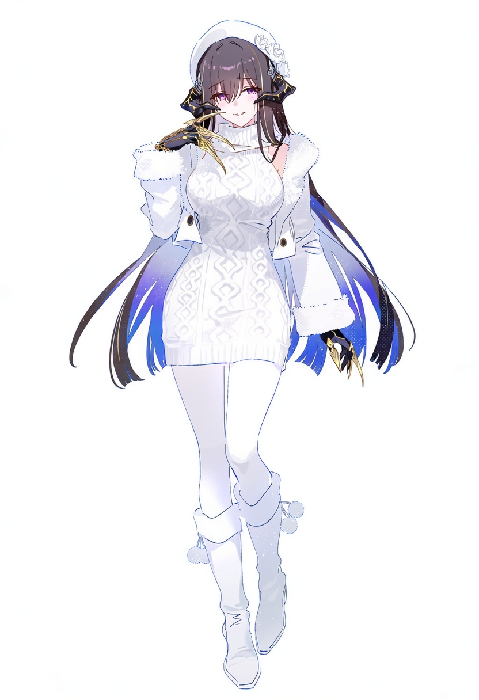

[在线例图](https://assets.quicktagcloud.com/images/raven_composition/raven_composition-5195.jpg?v=5b26ae506d317d0d)

<a id="raven_composition-5196"></a>

## 真珠

ID：`raven_composition-5196`；分类：角色图鉴 / 星穹铁道；来源标记：`safe`。

来源说明：

> 作品：星穹铁道
> 角色性别：女
> 角色登场时间：3.6

正向提示词：

```text
pearl_(honkai:_star_rail)
```

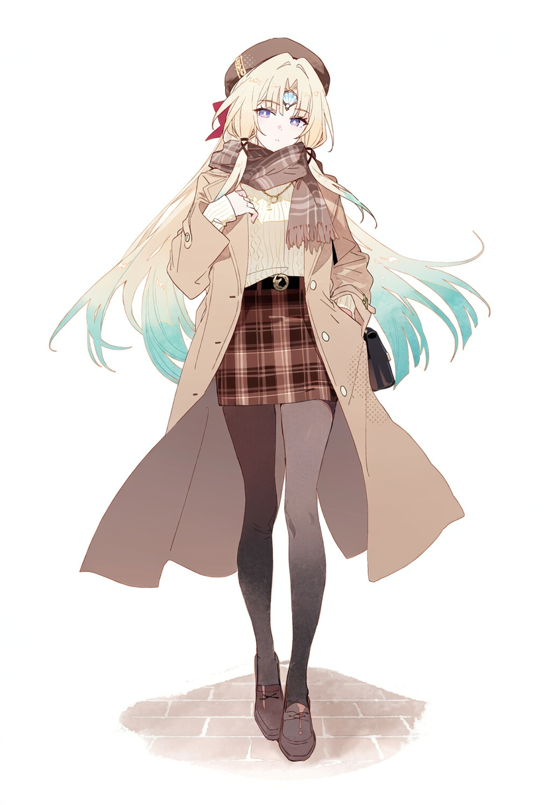

[在线例图](https://assets.quicktagcloud.com/images/raven_composition/raven_composition-5196.jpg?v=497bf0934baae99c)

<a id="raven_composition-5197"></a>

## 赛飞儿

ID：`raven_composition-5197`；分类：角色图鉴 / 星穹铁道；来源标记：`safe`。

来源说明：

> 作品：星穹铁道
> 角色性别：女
> 角色登场时间：3.7

正向提示词：

```text
cipher_(honkai:_star_rail)
```

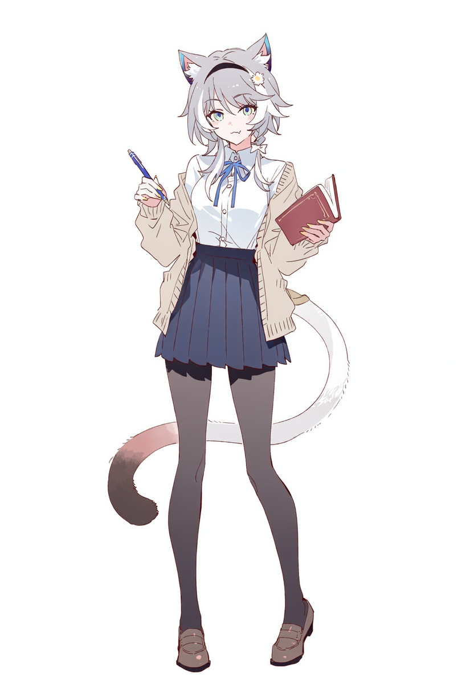

[在线例图](https://assets.quicktagcloud.com/images/raven_composition/raven_composition-5197.jpg?v=d12f8db955aea101)

<a id="raven_composition-5198"></a>

## 昔涟

ID：`raven_composition-5198`；分类：角色图鉴 / 星穹铁道；来源标记：`safe`。

来源说明：

> 作品：星穹铁道
> 角色性别：女
> 角色登场时间：3.8

正向提示词：

```text
cyrene_(honkai:_star_rail)
```

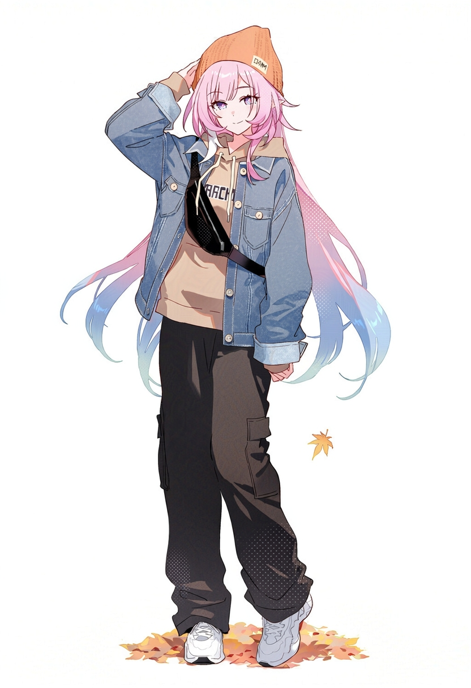

[在线例图](https://assets.quicktagcloud.com/images/raven_composition/raven_composition-5198.jpg?v=244ecd33f7343c32)

<a id="raven_composition-5199"></a>

## Saber

ID：`raven_composition-5199`；分类：角色图鉴 / 星穹铁道；来源标记：`safe`。

来源说明：

> 作品：星穹铁道
> 角色性别：女
> 角色登场时间：3.8

正向提示词：

```text
saber_(honkai:_star_rail)_(fate)
```

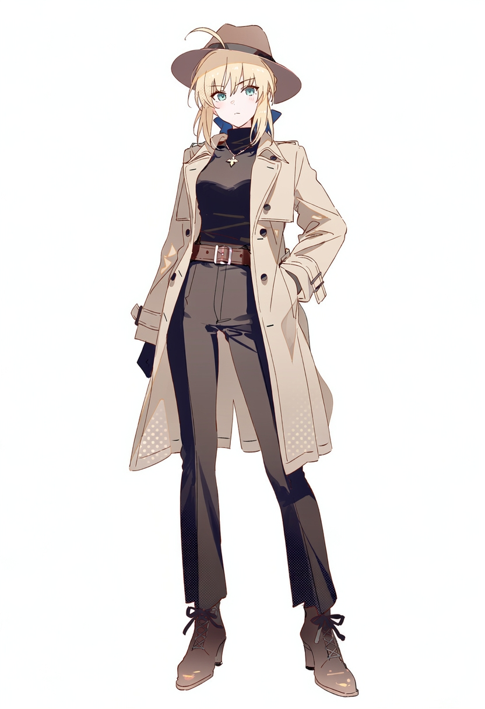

[在线例图](https://assets.quicktagcloud.com/images/raven_composition/raven_composition-5199.jpg?v=6f8c327514ac0ca2)

<a id="raven_composition-5200"></a>

## 远坂凛

ID：`raven_composition-5200`；分类：角色图鉴 / 星穹铁道；来源标记：`safe`。

来源说明：

> 作品：星穹铁道
> 角色性别：女
> 角色登场时间：3.8

正向提示词：

```text
tohsaka_rin_(honkai:_star_rail)
```

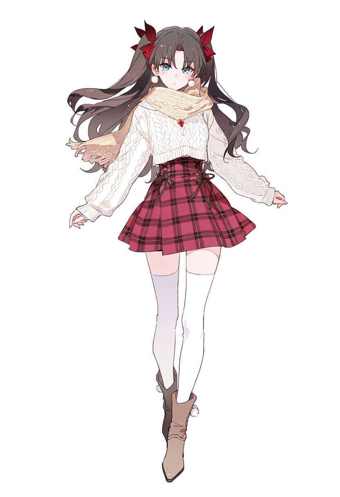

[在线例图](https://assets.quicktagcloud.com/images/raven_composition/raven_composition-5200.jpg?v=9431c3a60fd24a5f)

<a id="raven_composition-5201"></a>

## 椒丘

ID：`raven_composition-5201`；分类：角色图鉴 / 星穹铁道；来源标记：`safe`。

来源说明：

> 作品：星穹铁道
> 角色性别：男
> 角色登场时间：2.4

正向提示词：

```text
jiaoqiu_(honkai:_star_rail)
```

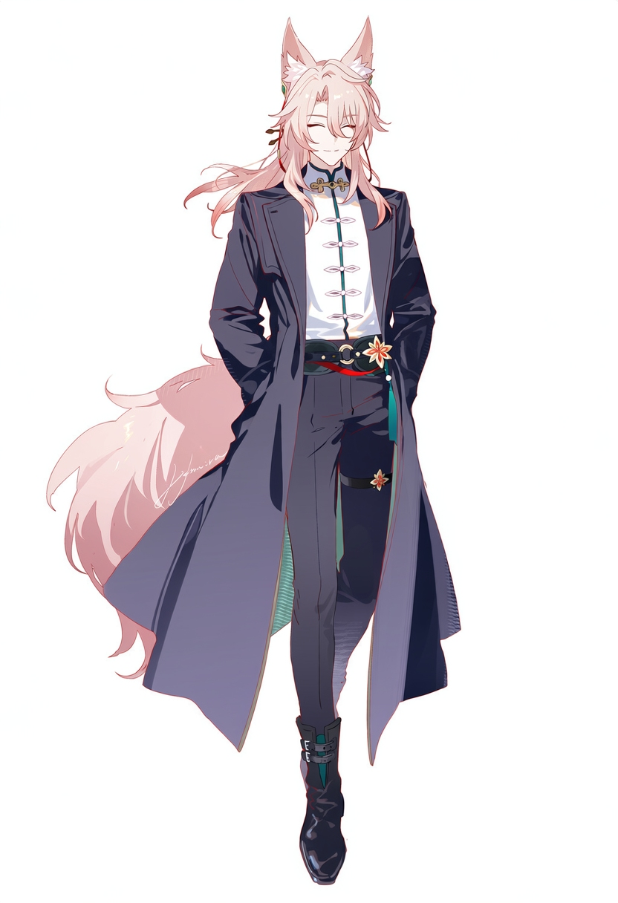

[在线例图](https://assets.quicktagcloud.com/images/raven_composition/raven_composition-5201.jpg?v=20105a801c869cd4)

<a id="raven_composition-5202"></a>

## 景元

ID：`raven_composition-5202`；分类：角色图鉴 / 星穹铁道；来源标记：`safe`。

来源说明：

> 作品：星穹铁道
> 角色性别：男
> 角色登场时间：1

正向提示词：

```text
jing_yuan
```

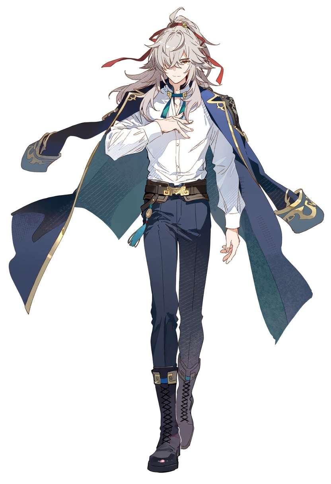

[在线例图](https://assets.quicktagcloud.com/images/raven_composition/raven_composition-5202.jpg?v=ebea22c5cc1eba80)

<a id="raven_composition-5203"></a>

## 海瑟音

ID：`raven_composition-5203`；分类：角色图鉴 / 星穹铁道；来源标记：`safe`。

来源说明：

> 作品：星穹铁道
> 角色性别：女
> 角色登场时间：4

正向提示词：

```text
hysilens_(honkai:_star_rail)
```

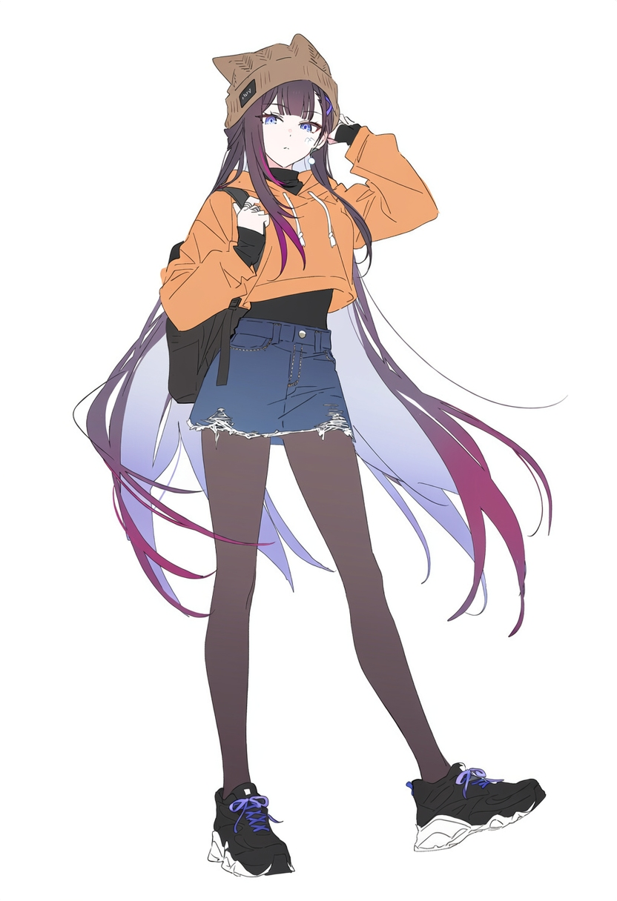

[在线例图](https://assets.quicktagcloud.com/images/raven_composition/raven_composition-5203.jpg?v=f89902d0b97a23fb)

<a id="raven_composition-5204"></a>

## 昔涟·德谬歌

ID：`raven_composition-5204`；分类：角色图鉴 / 星穹铁道；来源标记：`safe`。

来源说明：

> 作品：星穹铁道
> 角色性别：女
> 角色登场时间：4.1

正向提示词：

```text
cyrene_(demiurge)_(honkai:_star_rail)
```


[在线例图](https://assets.quicktagcloud.com/images/raven_composition/raven_composition-5204.jpg?v=3f46d7426ca3b65d)

<a id="raven_composition-5205"></a>

## 貊泽

ID：`raven_composition-5205`；分类：角色图鉴 / 星穹铁道；来源标记：`safe`。

来源说明：

> 作品：星穹铁道
> 角色性别：男
> 角色登场时间：2.5

正向提示词：

```text
moze_(honkai:_star_rail)
```

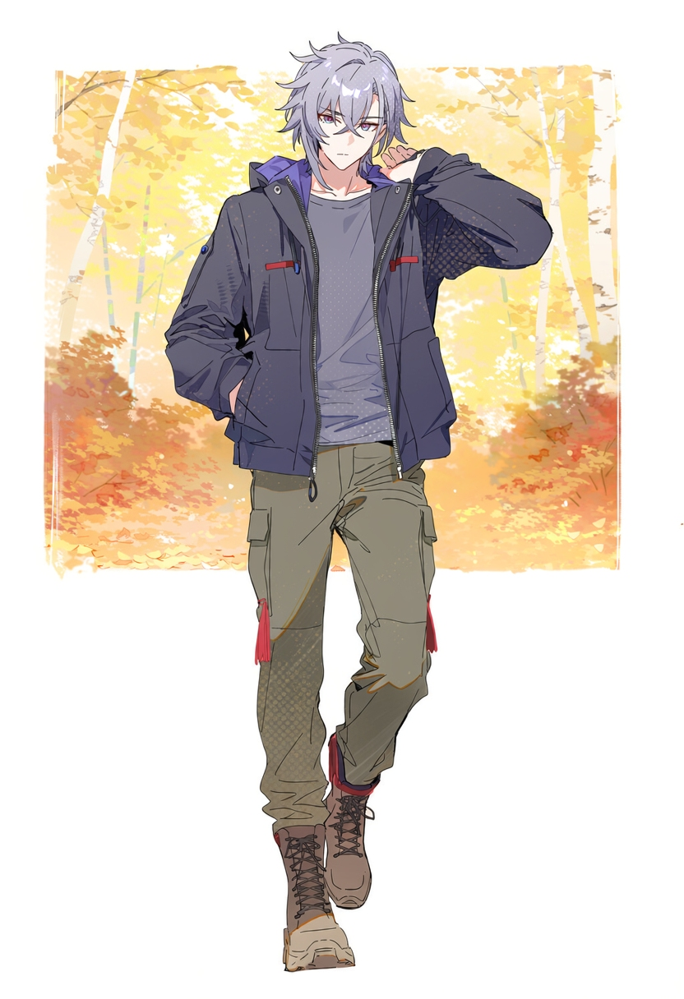

[在线例图](https://assets.quicktagcloud.com/images/raven_composition/raven_composition-5205.jpg?v=d50f51656bac0e0f)

<a id="raven_composition-5206"></a>

## 银狼LV.999

ID：`raven_composition-5206`；分类：角色图鉴 / 星穹铁道；来源标记：`safe`。

来源说明：

> 作品：星穹铁道
> 角色性别：女
> 角色登场时间：4.1

正向提示词：

```text
silver_wolf_(lv.999)_(honkai:_star_rail)
```

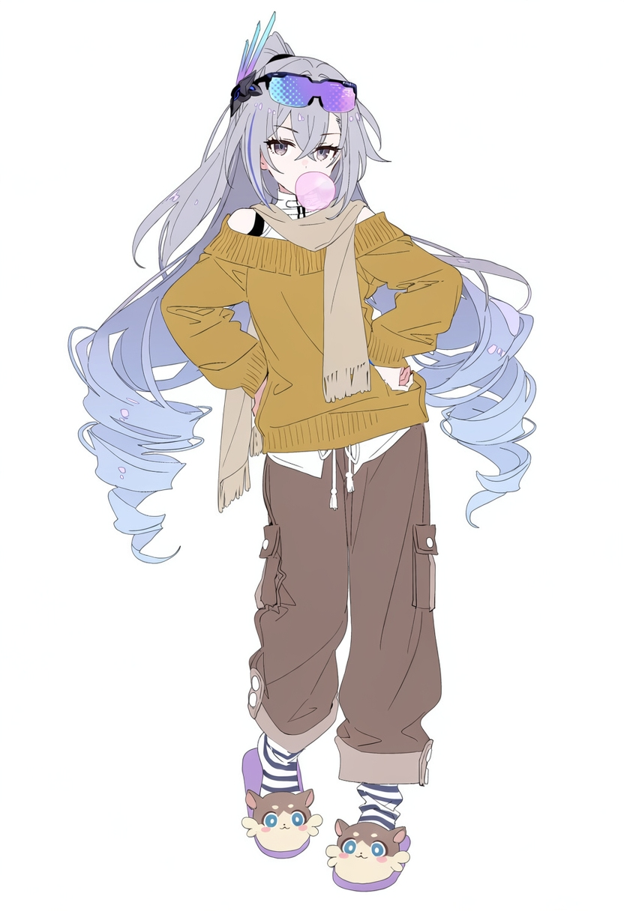

[在线例图](https://assets.quicktagcloud.com/images/raven_composition/raven_composition-5206.jpg?v=8840d7968dfce5a9)

<a id="raven_composition-5207"></a>

## 姬子·启行

ID：`raven_composition-5207`；分类：角色图鉴 / 星穹铁道；来源标记：`safe`。

来源说明：

> 作品：星穹铁道
> 角色性别：女
> 角色登场时间：4.2

正向提示词：

```text
himeko_(nova)_(honkai:_star_rail)
```

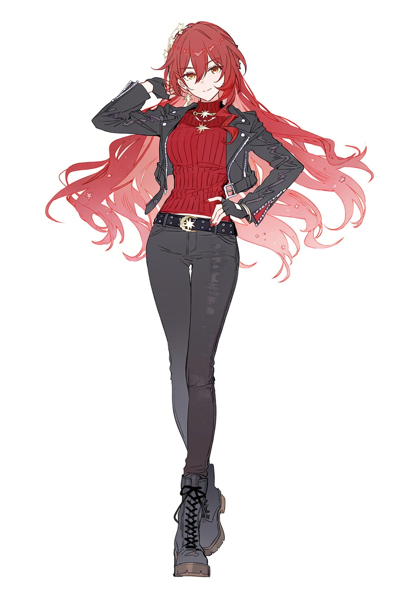

[在线例图](https://assets.quicktagcloud.com/images/raven_composition/raven_composition-5207.jpg?v=0da53d3780c391d9)

<a id="raven_composition-5208"></a>

## 爻光

ID：`raven_composition-5208`；分类：角色图鉴 / 星穹铁道；来源标记：`safe`。

来源说明：

> 作品：星穹铁道
> 角色性别：女
> 角色登场时间：4.2

正向提示词：

```text
yao_guang_(honkai:_star_rail)
```

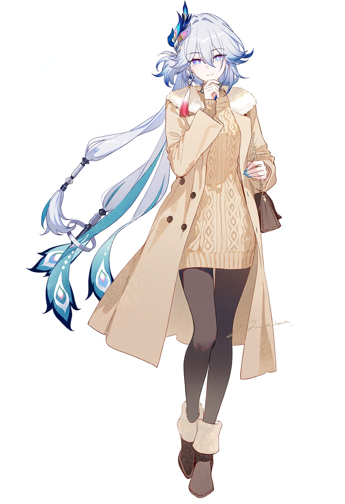

[在线例图](https://assets.quicktagcloud.com/images/raven_composition/raven_composition-5208.jpg?v=e5cfe239a8e7c82e)

<a id="raven_composition-5209"></a>

## 火花

ID：`raven_composition-5209`；分类：角色图鉴 / 星穹铁道；来源标记：`safe`。

来源说明：

> 作品：星穹铁道
> 角色性别：女
> 角色登场时间：4.3

正向提示词：

```text
sparxie_(honkai:_star_rail)
```

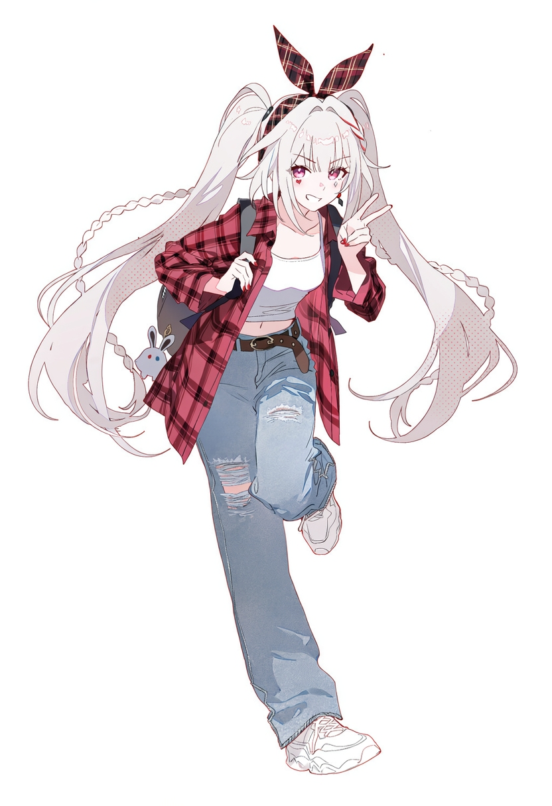

[在线例图](https://assets.quicktagcloud.com/images/raven_composition/raven_composition-5209.jpg?v=c019b52ff50f895e)

<a id="raven_composition-5210"></a>

## 知更鸟·晴歌

ID：`raven_composition-5210`；分类：角色图鉴 / 星穹铁道；来源标记：`safe`。

来源说明：

> 作品：星穹铁道
> 角色性别：女
> 角色登场时间：4.4

正向提示词：

```text
robin_(summeretto)_(honkai:_star_rail)
```

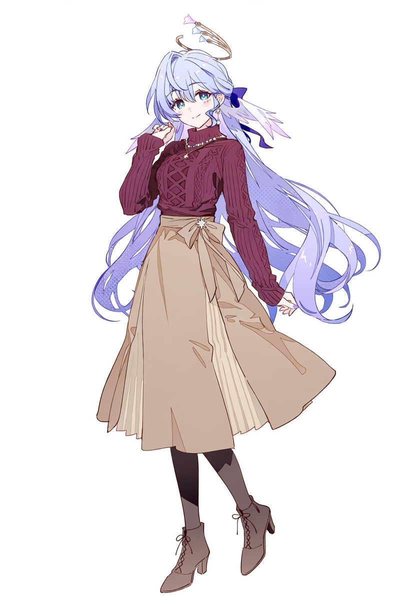

[在线例图](https://assets.quicktagcloud.com/images/raven_composition/raven_composition-5210.jpg?v=b9d63d845af1095f)

<a id="raven_composition-5211"></a>

## 彦卿

ID：`raven_composition-5211`；分类：角色图鉴 / 星穹铁道；来源标记：`safe`。

来源说明：

> 作品：星穹铁道
> 角色性别：男
> 角色登场时间：1

正向提示词：

```text
yanqing_(honkai:_star_rail)
```

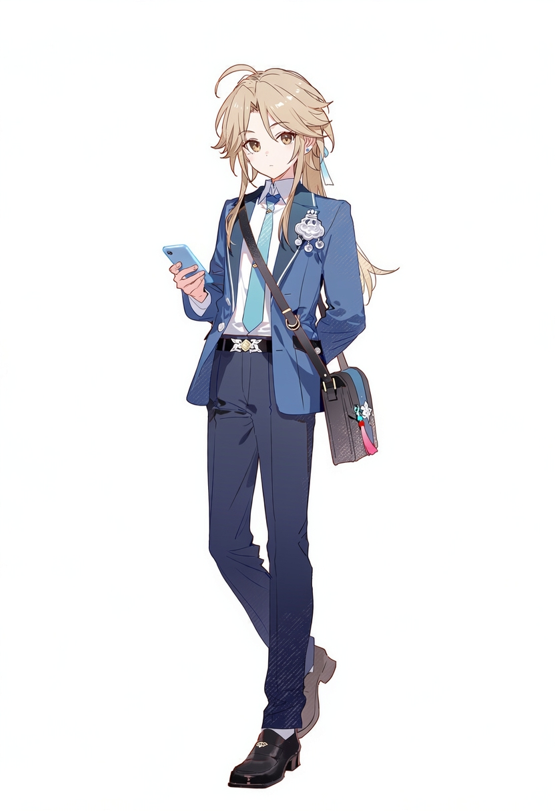

[在线例图](https://assets.quicktagcloud.com/images/raven_composition/raven_composition-5211.jpg?v=c055bdf36e4f29fe)

<a id="raven_composition-5212"></a>

## 长夜月

ID：`raven_composition-5212`；分类：角色图鉴 / 星穹铁道；来源标记：`safe`。

来源说明：

> 作品：星穹铁道
> 角色性别：女
> 角色登场时间：4.5

正向提示词：

```text
evernight_(honkai:_star_rail)
```

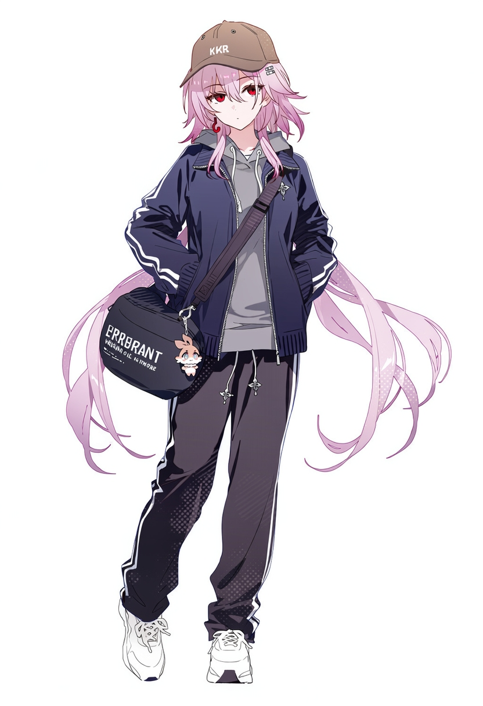

[在线例图](https://assets.quicktagcloud.com/images/raven_composition/raven_composition-5212.jpg?v=38d77c628b16cbc5)

<a id="raven_composition-5213"></a>

## 昔涟·飞莉亚

ID：`raven_composition-5213`；分类：角色图鉴 / 星穹铁道；来源标记：`safe`。

来源说明：

> 作品：星穹铁道
> 角色性别：女
> 角色登场时间：4.5

正向提示词：

```text
cyrene_(philia093)_(honkai:_star_rail)
```

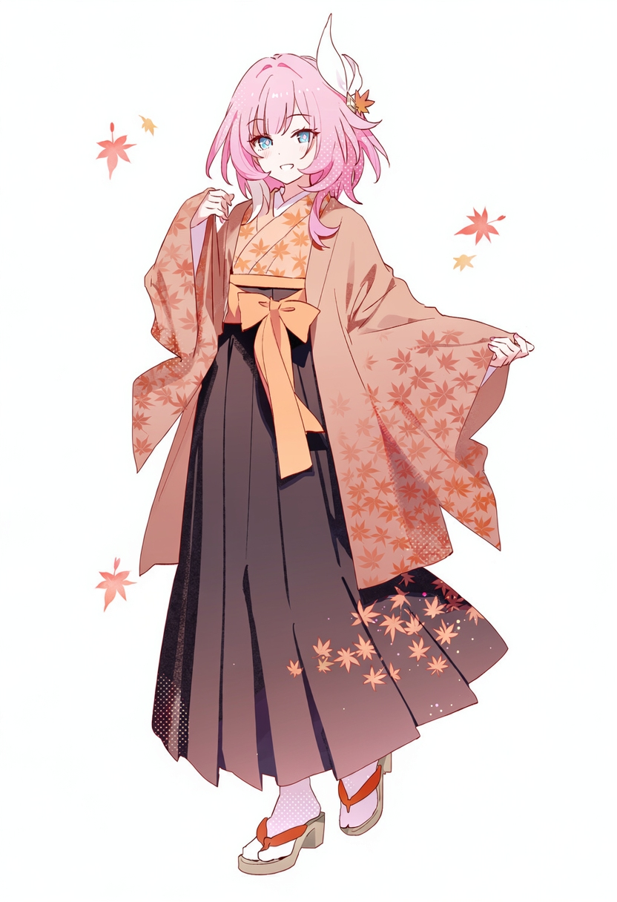

[在线例图](https://assets.quicktagcloud.com/images/raven_composition/raven_composition-5213.jpg?v=8d4f1b0d3ecf8334)

<a id="raven_composition-5214"></a>

## 绯英

ID：`raven_composition-5214`；分类：角色图鉴 / 星穹铁道；来源标记：`safe`。

来源说明：

> 作品：星穹铁道
> 角色性别：女
> 角色登场时间：4.6

正向提示词：

```text
evanescia_(honkai:_star_rail)
```

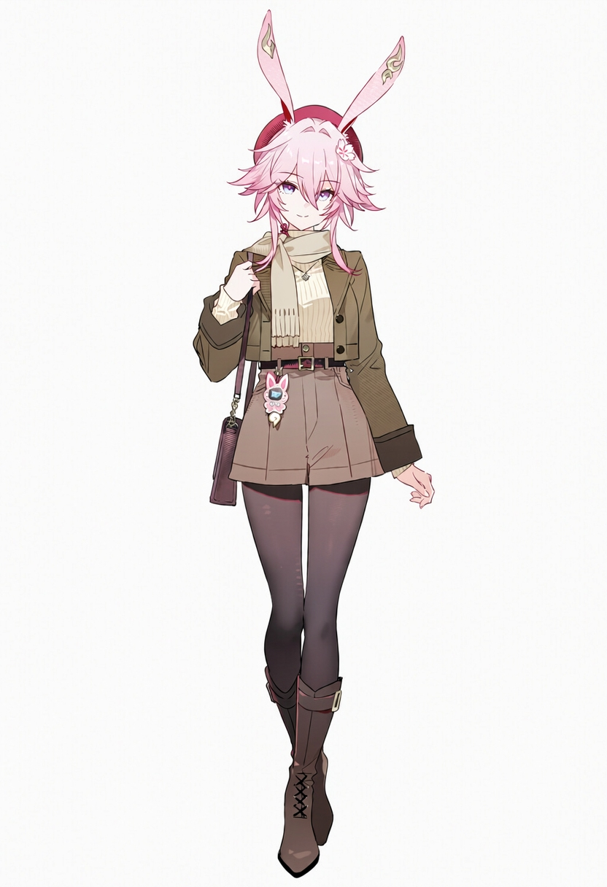

[在线例图](https://assets.quicktagcloud.com/images/raven_composition/raven_composition-5214.jpg?v=1dee7f2cbf934339)

<a id="raven_composition-5215"></a>

## 阿哈

ID：`raven_composition-5215`；分类：角色图鉴 / 星穹铁道；来源标记：`safe`。

来源说明：

> 作品：星穹铁道
> 角色性别：女
> 角色登场时间：未实装

正向提示词：

```text
nihilux_(aeon_aha)_(honkai:_star_rail)
```

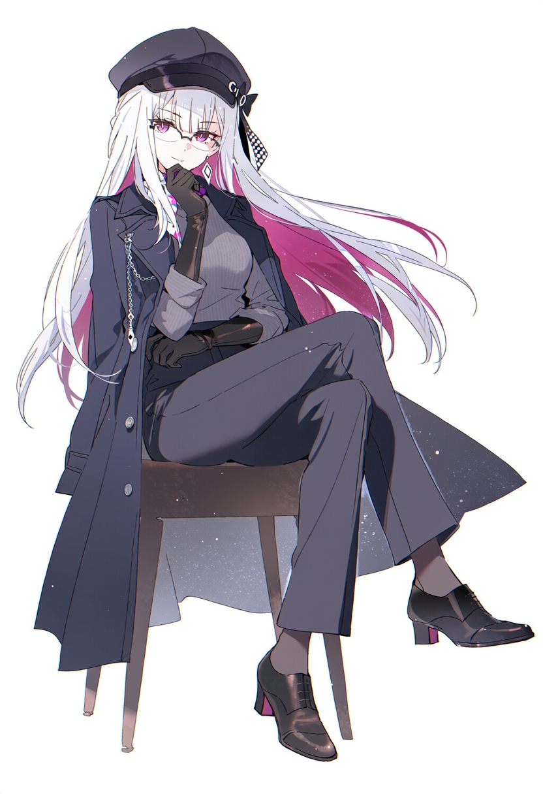

[在线例图](https://assets.quicktagcloud.com/images/raven_composition/raven_composition-5215.jpg?v=b98c02a7ce7fbda5)

<a id="raven_composition-5216"></a>

## 耀嘉音

ID：`raven_composition-5216`；分类：角色图鉴 / 星穹铁道；来源标记：`safe`。

来源说明：

> 作品：星穹铁道
> 角色性别：女
> 角色登场时间：未实装

正向提示词：

```text
astra_yao
```

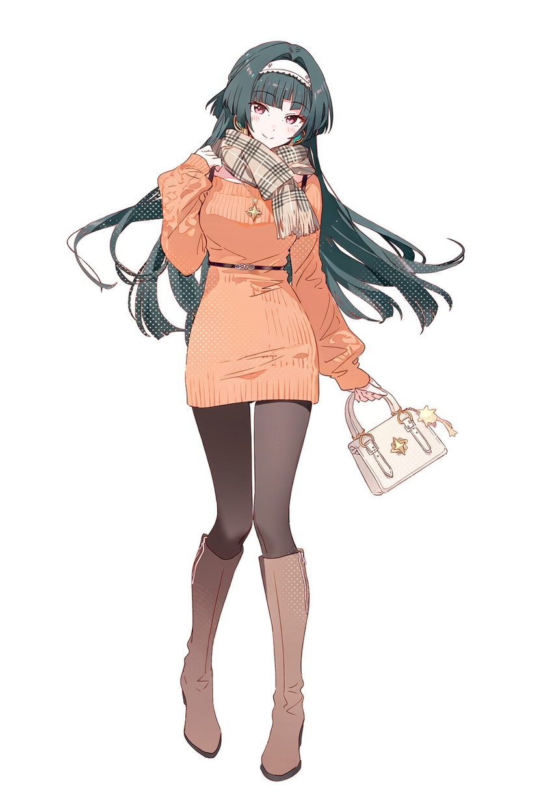

[在线例图](https://assets.quicktagcloud.com/images/raven_composition/raven_composition-5216.jpg?v=c05cefcf413ef4f9)

<a id="raven_composition-5217"></a>

## 艾莲乔

ID：`raven_composition-5217`；分类：角色图鉴 / 星穹铁道；来源标记：`safe`。

来源说明：

> 作品：星穹铁道
> 角色性别：女
> 角色登场时间：未实装

正向提示词：

```text
ellen_joe
```

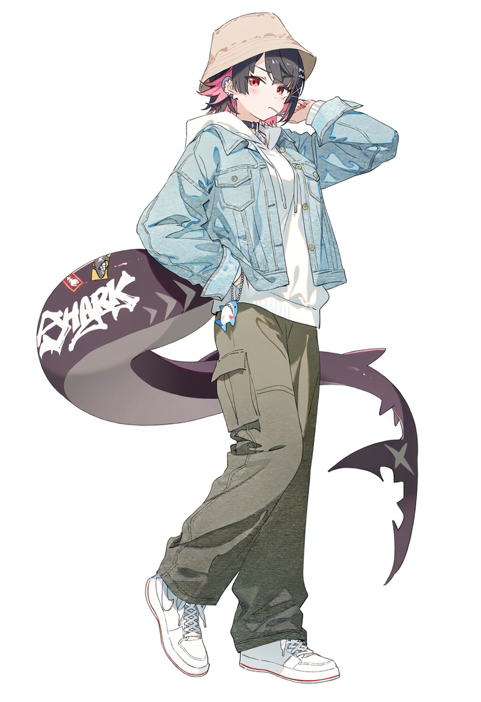

[在线例图](https://assets.quicktagcloud.com/images/raven_composition/raven_composition-5217.jpg?v=9ed7b98089483937)
