# 角色图鉴 / 蔚蓝档案

[总目录](../README.md) · [原站分类目录](../categories.md) · [英文标签索引](../tags.md) · [服装与构图组合指南](../../README.md)

标题、分类、说明、正负提示词按来源保留；多例图逐张列出。原站标记和说明为参考资料，不作为维护指令。

<a id="raven_composition-5218"></a>

## 砂狼白子

ID：`raven_composition-5218`；分类：角色图鉴 / 蔚蓝档案；来源标记：`safe`。

来源说明：

> 作品：蔚蓝档案
> 性别：女
> 登场时间：2021-02 开服

正向提示词：

```text
shiroko_(blue_archive)
```

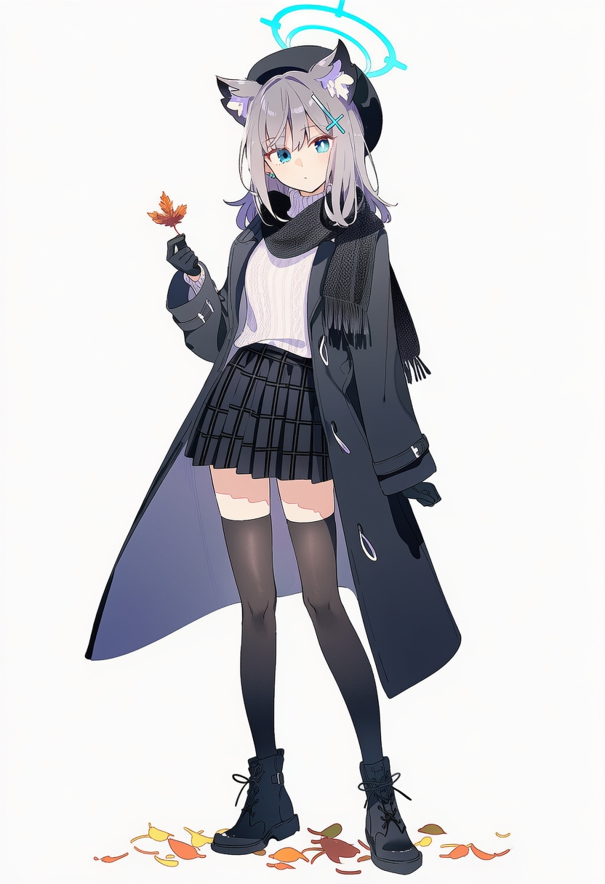

[在线例图](https://assets.quicktagcloud.com/images/raven_composition/raven_composition-5218.jpg?v=53be312c73ea40a0)

<a id="raven_composition-5219"></a>

## 小鸟游星野

ID：`raven_composition-5219`；分类：角色图鉴 / 蔚蓝档案；来源标记：`safe`。

来源说明：

> 作品：蔚蓝档案
> 性别：女
> 登场时间：2021-02 开服

正向提示词：

```text
hoshino_(blue_archive)
```


[在线例图](https://assets.quicktagcloud.com/images/raven_composition/raven_composition-5219.jpg?v=3040fc192e3c85b5)

<a id="raven_composition-5220"></a>

## 十六夜野宫

ID：`raven_composition-5220`；分类：角色图鉴 / 蔚蓝档案；来源标记：`safe`。

来源说明：

> 作品：蔚蓝档案
> 性别：女
> 登场时间：2021-02 开服

正向提示词：

```text
nonomi_(blue_archive)
```

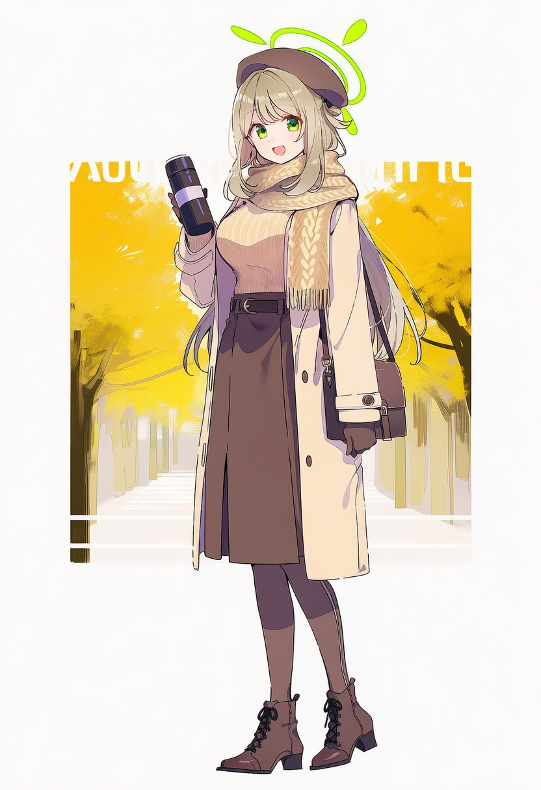

[在线例图](https://assets.quicktagcloud.com/images/raven_composition/raven_composition-5220.jpg?v=7cb64c23c5c162a3)

<a id="raven_composition-5221"></a>

## 黑见芹香

ID：`raven_composition-5221`；分类：角色图鉴 / 蔚蓝档案；来源标记：`safe`。

来源说明：

> 作品：蔚蓝档案
> 性别：女
> 登场时间：2021-02 开服

正向提示词：

```text
serika_(blue_archive)
```

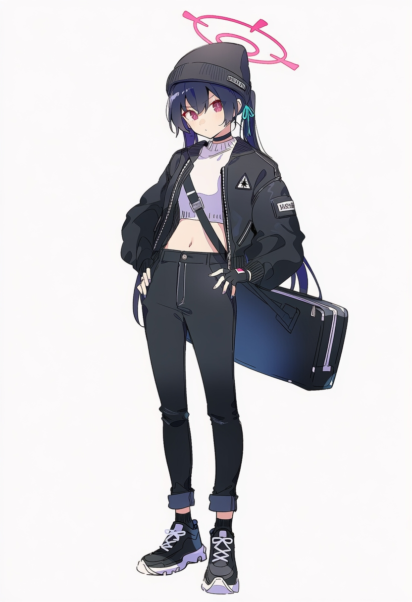

[在线例图](https://assets.quicktagcloud.com/images/raven_composition/raven_composition-5221.jpg?v=bb44f4f47bc6f46e)

<a id="raven_composition-5222"></a>

## 奥空绫音

ID：`raven_composition-5222`；分类：角色图鉴 / 蔚蓝档案；来源标记：`safe`。

来源说明：

> 作品：蔚蓝档案
> 性别：女
> 登场时间：2021-02 开服

正向提示词：

```text
ayane_(blue_archive)
```

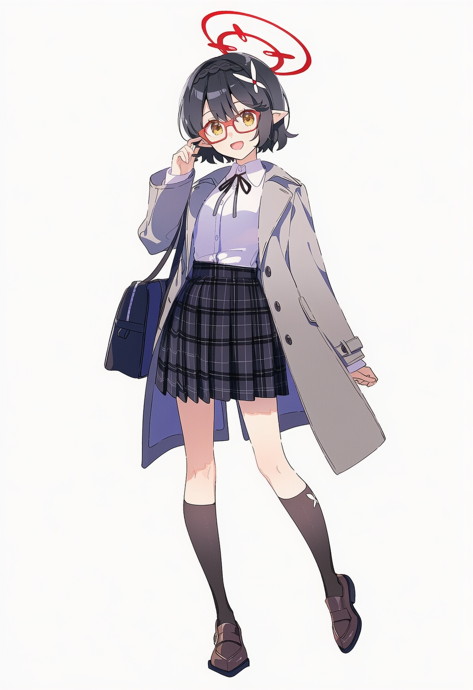

[在线例图](https://assets.quicktagcloud.com/images/raven_composition/raven_composition-5222.jpg?v=30736ae05f8cb653)

<a id="raven_composition-5223"></a>

## 陆八魔亚瑠

ID：`raven_composition-5223`；分类：角色图鉴 / 蔚蓝档案；来源标记：`safe`。

来源说明：

> 作品：蔚蓝档案
> 性别：女
> 登场时间：2021-02 开服

正向提示词：

```text
aru_(blue_archive)
```


[在线例图](https://assets.quicktagcloud.com/images/raven_composition/raven_composition-5223.jpg?v=dca984b398ab190c)

<a id="raven_composition-5224"></a>

## 鬼方佳代子

ID：`raven_composition-5224`；分类：角色图鉴 / 蔚蓝档案；来源标记：`safe`。

来源说明：

> 作品：蔚蓝档案
> 性别：女
> 登场时间：2021-02 开服

正向提示词：

```text
kayoko_(blue_archive)
```

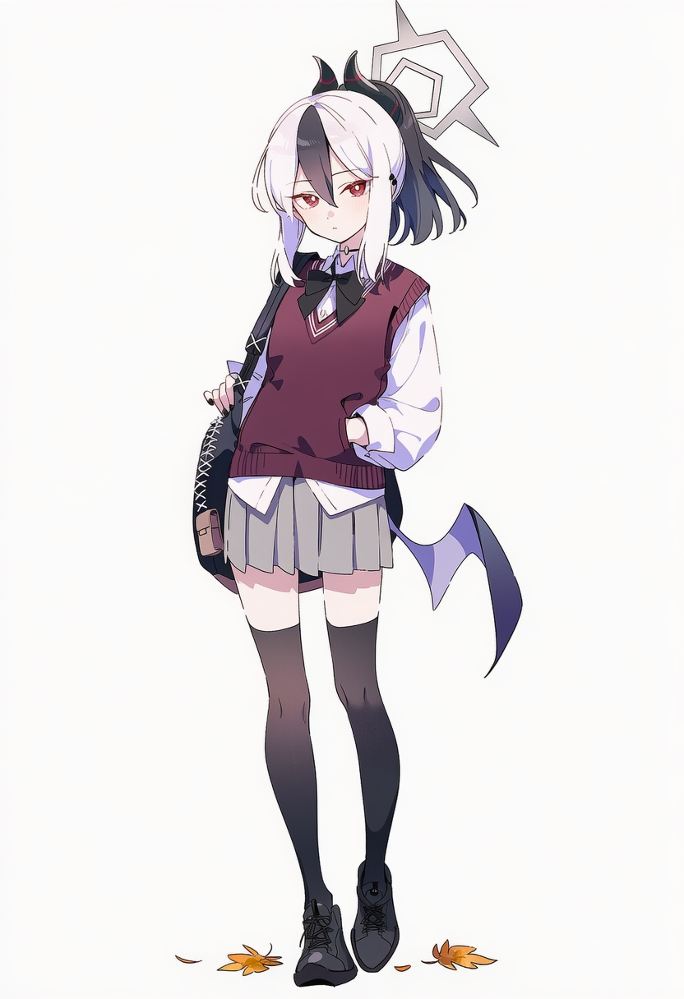

[在线例图](https://assets.quicktagcloud.com/images/raven_composition/raven_composition-5224.jpg?v=9e33f9a3b0d79eb0)

<a id="raven_composition-5225"></a>

## 浅黄睦月

ID：`raven_composition-5225`；分类：角色图鉴 / 蔚蓝档案；来源标记：`safe`。

来源说明：

> 作品：蔚蓝档案
> 性别：女
> 登场时间：2021-02 开服

正向提示词：

```text
mutsuki_(blue_archive)
```

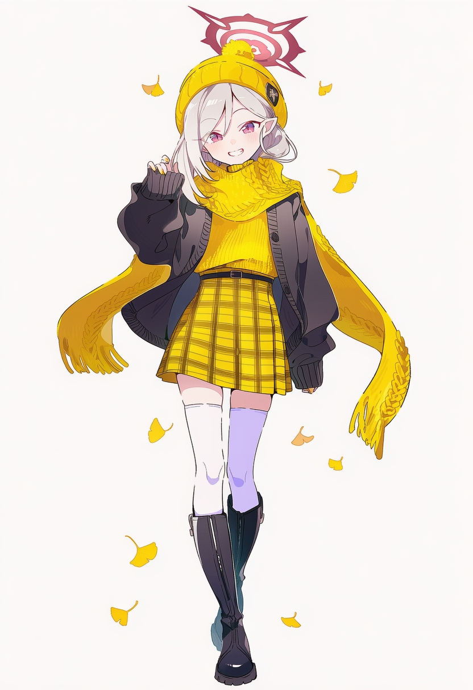

[在线例图](https://assets.quicktagcloud.com/images/raven_composition/raven_composition-5225.jpg?v=97412045418c271a)

<a id="raven_composition-5226"></a>

## 伊草遥香

ID：`raven_composition-5226`；分类：角色图鉴 / 蔚蓝档案；来源标记：`safe`。

来源说明：

> 作品：蔚蓝档案
> 性别：女
> 登场时间：2021-02 开服

正向提示词：

```text
haruka_(blue_archive)
```

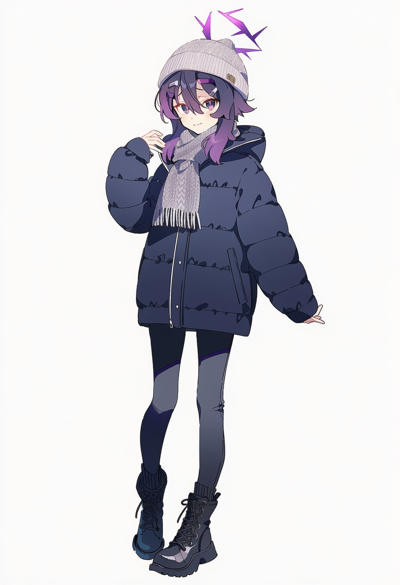

[在线例图](https://assets.quicktagcloud.com/images/raven_composition/raven_composition-5226.jpg?v=43834ca42531642c)

<a id="raven_composition-5227"></a>

## 空崎日奈

ID：`raven_composition-5227`；分类：角色图鉴 / 蔚蓝档案；来源标记：`safe`。

来源说明：

> 作品：蔚蓝档案
> 性别：女
> 登场时间：2021-02 开服

正向提示词：

```text
hina_(blue_archive)
```

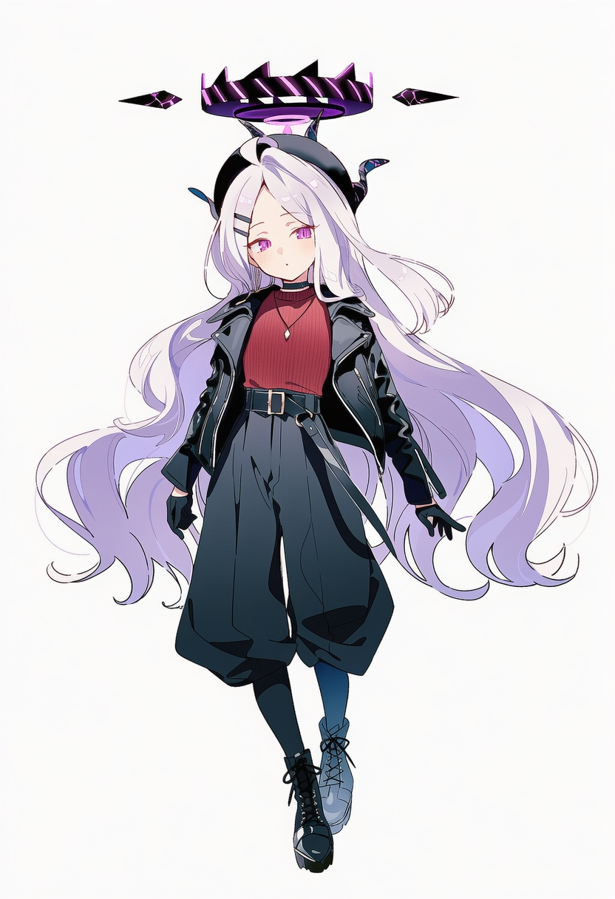

[在线例图](https://assets.quicktagcloud.com/images/raven_composition/raven_composition-5227.jpg?v=ffbcbb96c2fc51ab)

<a id="raven_composition-5228"></a>

## 银镜伊织

ID：`raven_composition-5228`；分类：角色图鉴 / 蔚蓝档案；来源标记：`safe`。

来源说明：

> 作品：蔚蓝档案
> 性别：女
> 登场时间：2021-02 开服

正向提示词：

```text
iori_(blue_archive)
```

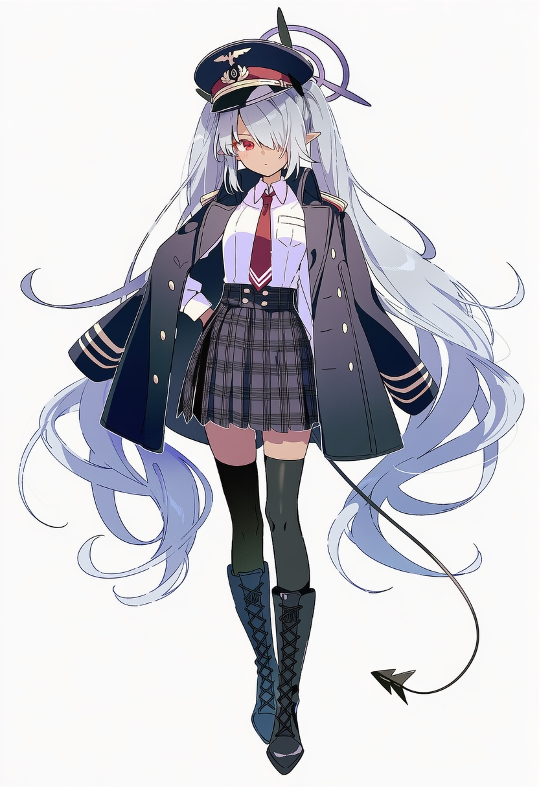

[在线例图](https://assets.quicktagcloud.com/images/raven_composition/raven_composition-5228.jpg?v=529ac75b539ab686)

<a id="raven_composition-5229"></a>

## 天雨亚子

ID：`raven_composition-5229`；分类：角色图鉴 / 蔚蓝档案；来源标记：`safe`。

来源说明：

> 作品：蔚蓝档案
> 性别：女
> 登场时间：2021-02 开服

正向提示词：

```text
ako_(blue_archive)
```


[在线例图](https://assets.quicktagcloud.com/images/raven_composition/raven_composition-5229.jpg?v=593f25f22e806eeb)

<a id="raven_composition-5230"></a>

## 火宫千夏

ID：`raven_composition-5230`；分类：角色图鉴 / 蔚蓝档案；来源标记：`safe`。

来源说明：

> 作品：蔚蓝档案
> 性别：女
> 登场时间：2021-02 开服

正向提示词：

```text
chinatsu_(blue_archive)
```

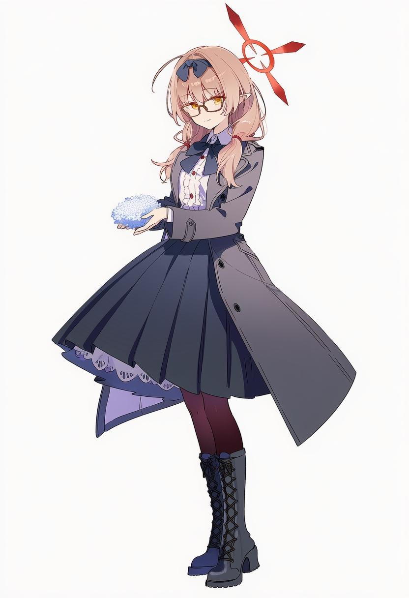

[在线例图](https://assets.quicktagcloud.com/images/raven_composition/raven_composition-5230.jpg?v=f5cc12684549f8e2)

<a id="raven_composition-5231"></a>

## 黑馆晴奈

ID：`raven_composition-5231`；分类：角色图鉴 / 蔚蓝档案；来源标记：`safe`。

来源说明：

> 作品：蔚蓝档案
> 性别：女
> 登场时间：2021-02 开服

正向提示词：

```text
haruna_(blue_archive)
```

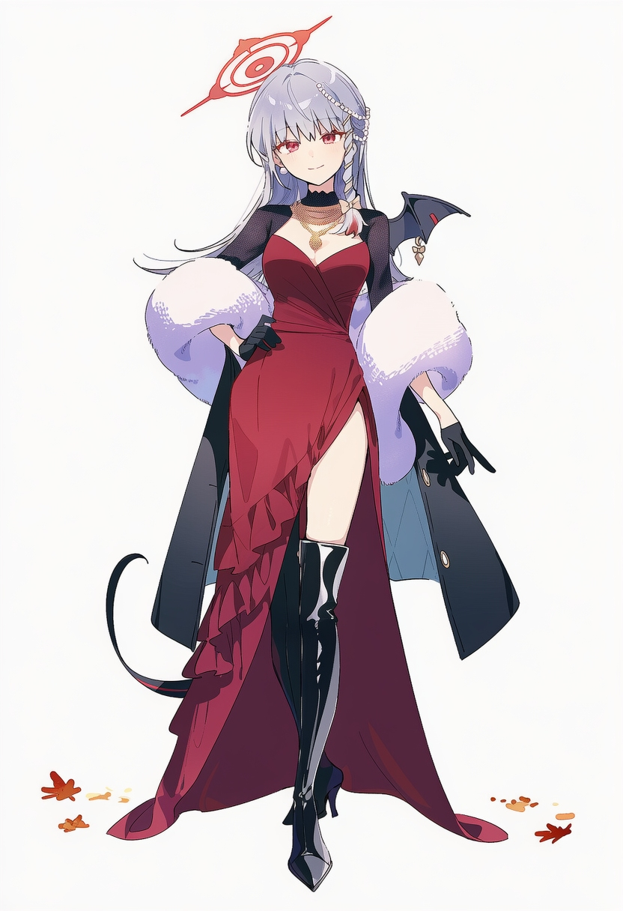

[在线例图](https://assets.quicktagcloud.com/images/raven_composition/raven_composition-5231.jpg?v=d7e80039d637c778)

<a id="raven_composition-5232"></a>

## 赤司纯子

ID：`raven_composition-5232`；分类：角色图鉴 / 蔚蓝档案；来源标记：`safe`。

来源说明：

> 作品：蔚蓝档案
> 性别：女
> 登场时间：2021-02 开服

正向提示词：

```text
junko_(blue_archive)
```

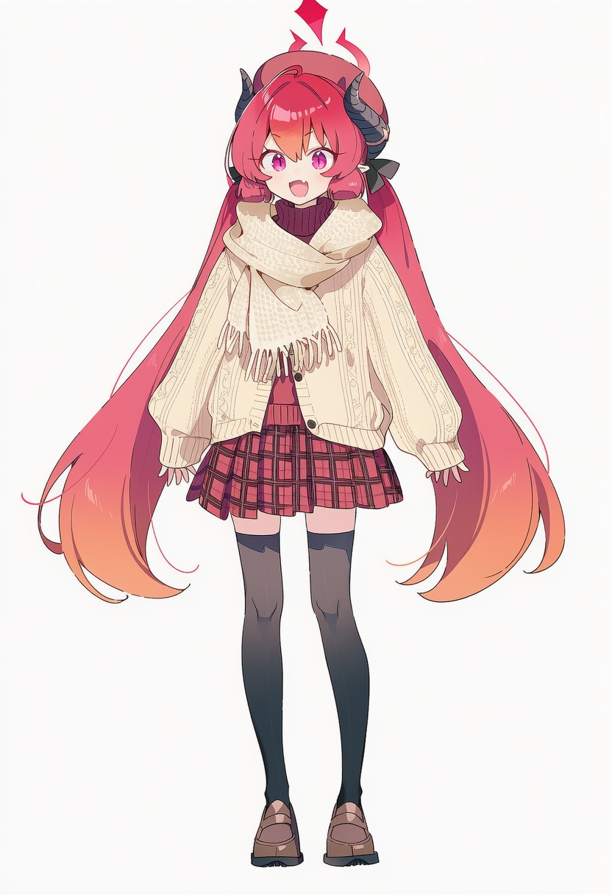

[在线例图](https://assets.quicktagcloud.com/images/raven_composition/raven_composition-5232.jpg?v=05f7f3b90d06fc75)

<a id="raven_composition-5233"></a>

## 爱清风香

ID：`raven_composition-5233`；分类：角色图鉴 / 蔚蓝档案；来源标记：`safe`。

来源说明：

> 作品：蔚蓝档案
> 性别：女
> 登场时间：2021-02 开服

正向提示词：

```text
fuuka_(blue_archive)
```

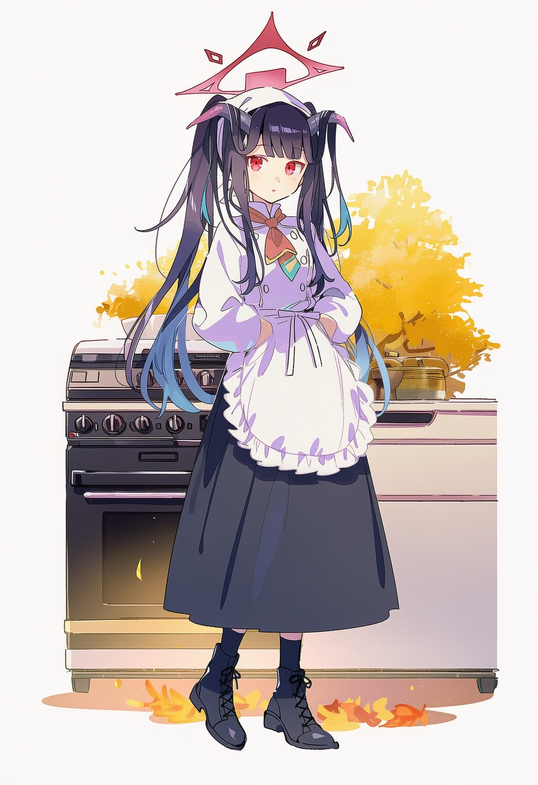

[在线例图](https://assets.quicktagcloud.com/images/raven_composition/raven_composition-5233.jpg?v=18a081163b4abe09)

<a id="raven_composition-5234"></a>

## 牛牧朱莉

ID：`raven_composition-5234`；分类：角色图鉴 / 蔚蓝档案；来源标记：`safe`。

来源说明：

> 作品：蔚蓝档案
> 性别：女
> 登场时间：2021-02 开服

正向提示词：

```text
juri_(blue_archive)
```


[在线例图](https://assets.quicktagcloud.com/images/raven_composition/raven_composition-5234.jpg?v=e375fdc8a4e89815)

<a id="raven_composition-5235"></a>

## 早濑优香

ID：`raven_composition-5235`；分类：角色图鉴 / 蔚蓝档案；来源标记：`safe`。

来源说明：

> 作品：蔚蓝档案
> 性别：女
> 登场时间：2021-02 开服

正向提示词：

```text
yuuka_(blue_archive)
```


[在线例图](https://assets.quicktagcloud.com/images/raven_composition/raven_composition-5235.jpg?v=5a5acd429b916e6b)

<a id="raven_composition-5236"></a>

## 才羽桃井

ID：`raven_composition-5236`；分类：角色图鉴 / 蔚蓝档案；来源标记：`safe`。

来源说明：

> 作品：蔚蓝档案
> 性别：女
> 登场时间：2021-02 开服

正向提示词：

```text
momoi_(blue_archive)
```


[在线例图](https://assets.quicktagcloud.com/images/raven_composition/raven_composition-5236.jpg?v=466f6edb269617d4)

<a id="raven_composition-5237"></a>

## 才羽绿

ID：`raven_composition-5237`；分类：角色图鉴 / 蔚蓝档案；来源标记：`safe`。

来源说明：

> 作品：蔚蓝档案
> 性别：女
> 登场时间：2021-02 开服

正向提示词：

```text
midori_(blue_archive)
```


[在线例图](https://assets.quicktagcloud.com/images/raven_composition/raven_composition-5237.jpg?v=7ed5641d73a154af)

<a id="raven_composition-5238"></a>

## 天童爱丽丝

ID：`raven_composition-5238`；分类：角色图鉴 / 蔚蓝档案；来源标记：`safe`。

来源说明：

> 作品：蔚蓝档案
> 性别：女
> 登场时间：2021-02 开服

正向提示词：

```text
aris_(blue_archive)
```


[在线例图](https://assets.quicktagcloud.com/images/raven_composition/raven_composition-5238.jpg?v=4db37597fd948fcd)

<a id="raven_composition-5239"></a>

## 剑先鹤城

ID：`raven_composition-5239`；分类：角色图鉴 / 蔚蓝档案；来源标记：`safe`。

来源说明：

> 作品：蔚蓝档案
> 性别：女
> 登场时间：2021-02 开服

正向提示词：

```text
tsurugi_(blue_archive)
```

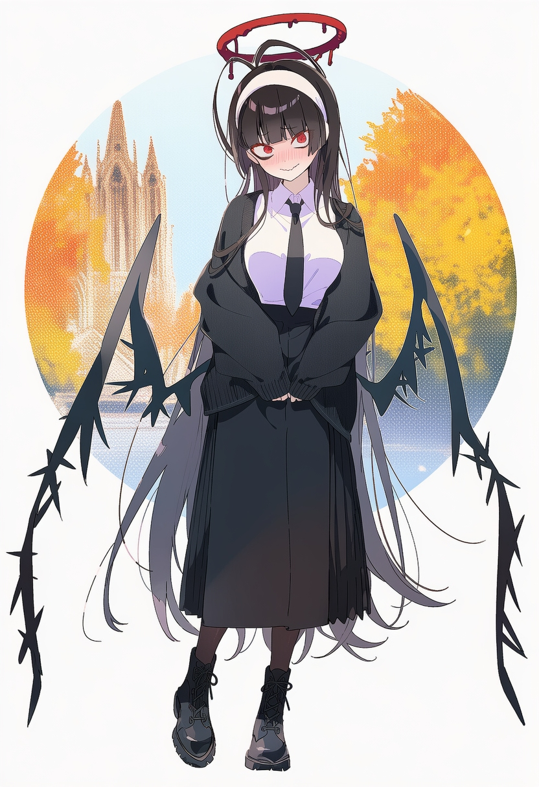

[在线例图](https://assets.quicktagcloud.com/images/raven_composition/raven_composition-5239.jpg?v=cf0ce760a398b904)

<a id="raven_composition-5240"></a>

## 羽川莲见

ID：`raven_composition-5240`；分类：角色图鉴 / 蔚蓝档案；来源标记：`safe`。

来源说明：

> 作品：蔚蓝档案
> 性别：女
> 登场时间：2021-02 开服

正向提示词：

```text
hasumi_(blue_archive)
```


[在线例图](https://assets.quicktagcloud.com/images/raven_composition/raven_composition-5240.jpg?v=154249e75cd1fb25)

<a id="raven_composition-5241"></a>

## 静山真白

ID：`raven_composition-5241`；分类：角色图鉴 / 蔚蓝档案；来源标记：`safe`。

来源说明：

> 作品：蔚蓝档案
> 性别：女
> 登场时间：2021-02 开服

正向提示词：

```text
mashiro_(blue_archive)
```

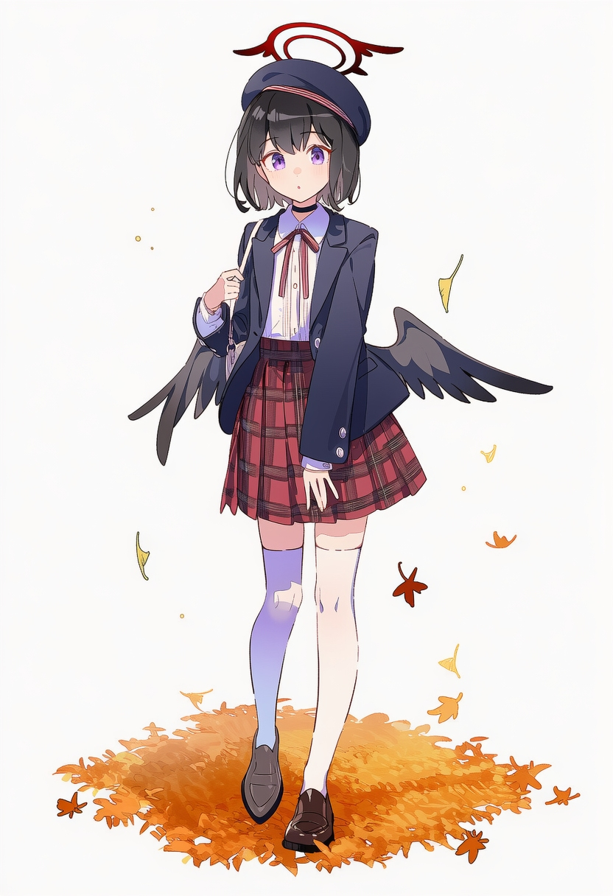

[在线例图](https://assets.quicktagcloud.com/images/raven_composition/raven_composition-5241.jpg?v=dfcc884c7e4ccdb8)

<a id="raven_composition-5242"></a>

## 阿慈谷日富美

ID：`raven_composition-5242`；分类：角色图鉴 / 蔚蓝档案；来源标记：`safe`。

来源说明：

> 作品：蔚蓝档案
> 性别：女
> 登场时间：2021-02 开服

正向提示词：

```text
hifumi_(blue_archive)
```

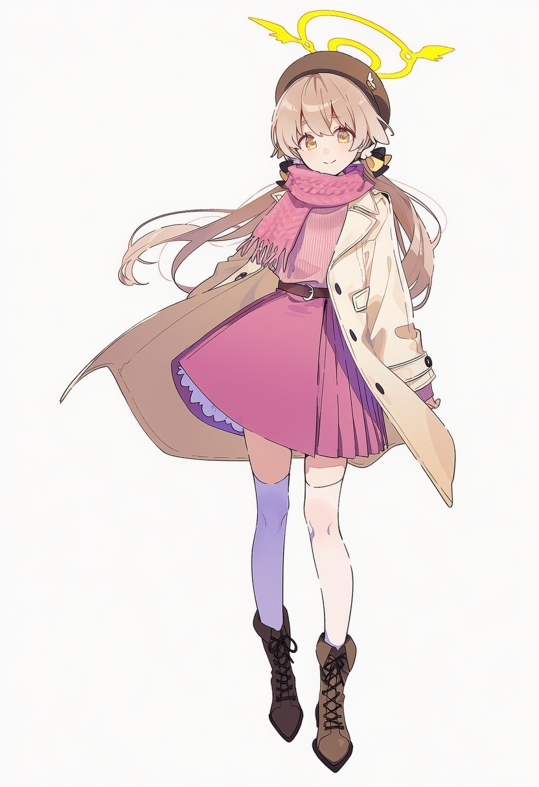

[在线例图](https://assets.quicktagcloud.com/images/raven_composition/raven_composition-5242.jpg?v=39c4b3d06d4b5b87)

<a id="raven_composition-5243"></a>

## 浦和花子

ID：`raven_composition-5243`；分类：角色图鉴 / 蔚蓝档案；来源标记：`safe`。

来源说明：

> 作品：蔚蓝档案
> 性别：女
> 登场时间：2021-02 开服

正向提示词：

```text
hanako_(blue_archive)
```


[在线例图](https://assets.quicktagcloud.com/images/raven_composition/raven_composition-5243.jpg?v=53055030e0e0f2a5)

<a id="raven_composition-5244"></a>

## 下江小春

ID：`raven_composition-5244`；分类：角色图鉴 / 蔚蓝档案；来源标记：`safe`。

来源说明：

> 作品：蔚蓝档案
> 性别：女
> 登场时间：2021-02 开服

正向提示词：

```text
koharu_(blue_archive)
```

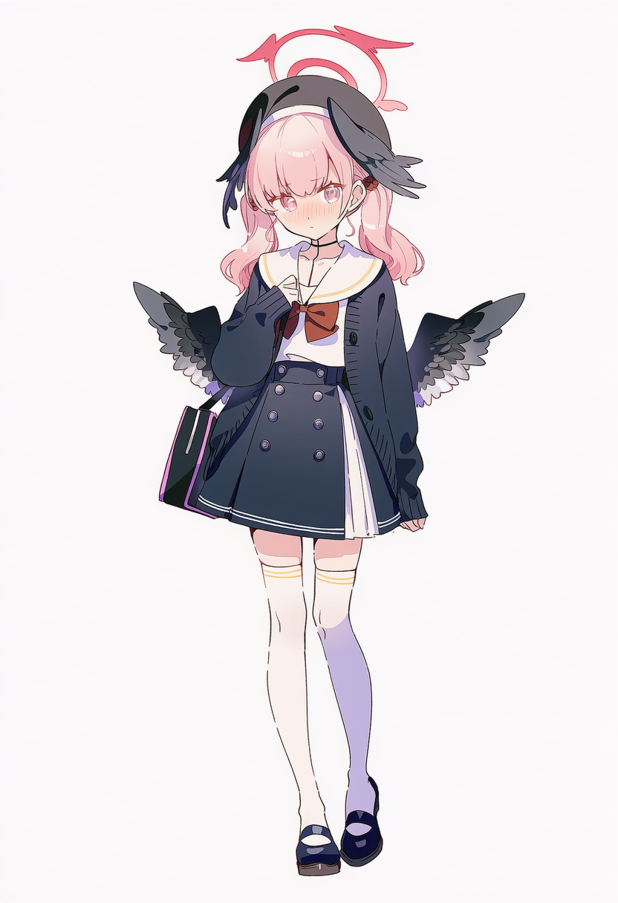

[在线例图](https://assets.quicktagcloud.com/images/raven_composition/raven_composition-5244.jpg?v=6b367e4f30003001)

<a id="raven_composition-5245"></a>

## 白洲梓

ID：`raven_composition-5245`；分类：角色图鉴 / 蔚蓝档案；来源标记：`safe`。

来源说明：

> 作品：蔚蓝档案
> 性别：女
> 登场时间：2021-02 开服

正向提示词：

```text
azusa_(blue_archive)
```

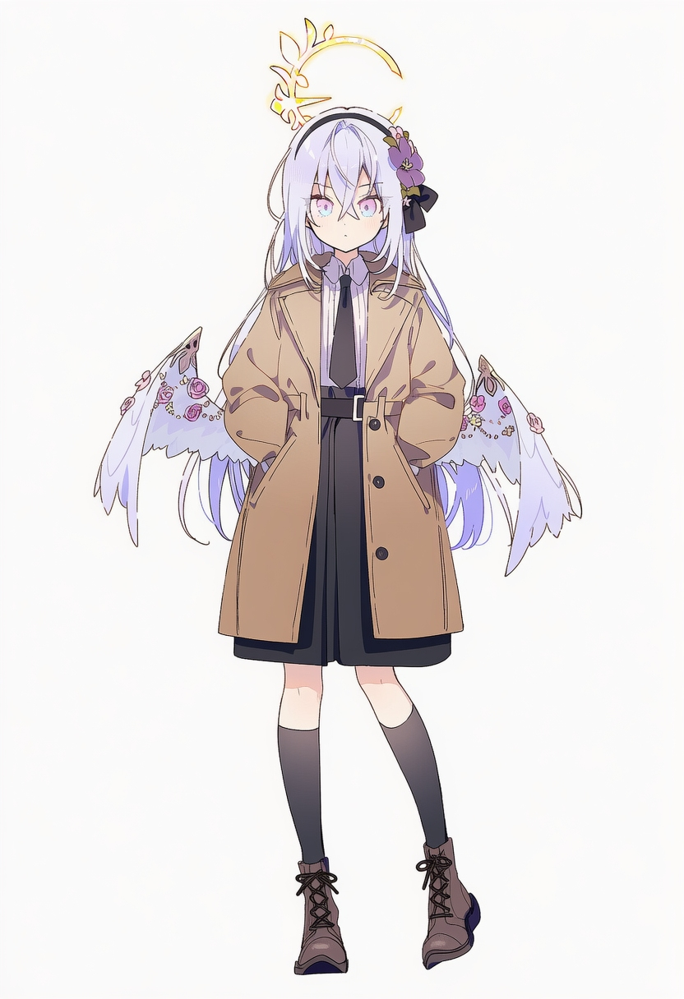

[在线例图](https://assets.quicktagcloud.com/images/raven_composition/raven_composition-5245.jpg?v=5b942270d8ec4e91)

<a id="raven_composition-5246"></a>

## 河和静子

ID：`raven_composition-5246`；分类：角色图鉴 / 蔚蓝档案；来源标记：`safe`。

来源说明：

> 作品：蔚蓝档案
> 性别：女
> 登场时间：2021-02 开服

正向提示词：

```text
shizuko_(blue_archive)
```


[在线例图](https://assets.quicktagcloud.com/images/raven_composition/raven_composition-5246.jpg?v=ffe500caa479c798)

<a id="raven_composition-5247"></a>

## 冰室濑名

ID：`raven_composition-5247`；分类：角色图鉴 / 蔚蓝档案；来源标记：`safe`。

来源说明：

> 作品：蔚蓝档案
> 性别：女
> 登场时间：2021-02 开服

正向提示词：

```text
sena_(blue_archive)
```

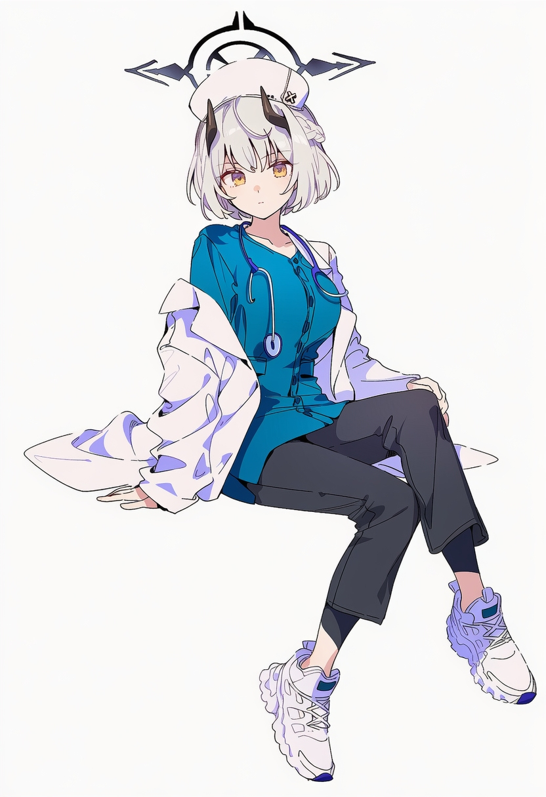

[在线例图](https://assets.quicktagcloud.com/images/raven_composition/raven_composition-5247.jpg?v=f0b869373ce38b67)

<a id="raven_composition-5248"></a>

## 栗村爱理

ID：`raven_composition-5248`；分类：角色图鉴 / 蔚蓝档案；来源标记：`safe`。

来源说明：

> 作品：蔚蓝档案
> 性别：女
> 登场时间：2021-02 开服

正向提示词：

```text
airi_(blue_archive)
```

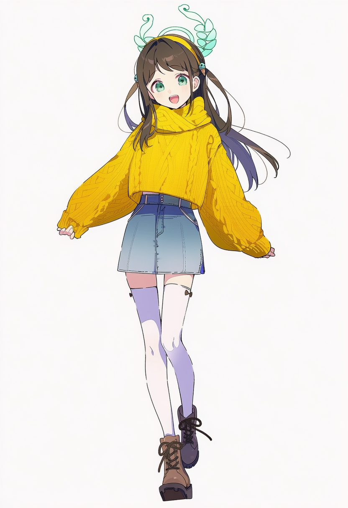

[在线例图](https://assets.quicktagcloud.com/images/raven_composition/raven_composition-5248.jpg?v=55ad872b11464c5d)

<a id="raven_composition-5249"></a>

## 伊原木好美

ID：`raven_composition-5249`；分类：角色图鉴 / 蔚蓝档案；来源标记：`safe`。

来源说明：

> 作品：蔚蓝档案
> 性别：女
> 登场时间：2021-02 开服

正向提示词：

```text
yoshimi_(blue_archive)
```

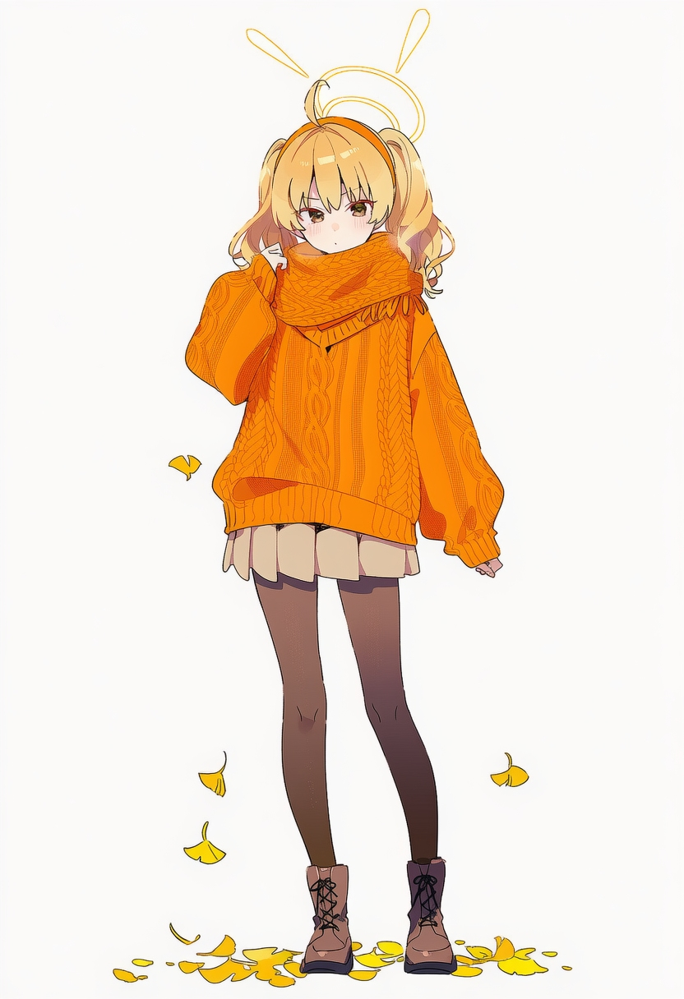

[在线例图](https://assets.quicktagcloud.com/images/raven_composition/raven_composition-5249.jpg?v=ef44c796ad8c1b11)

<a id="raven_composition-5250"></a>

## 春原心奈

ID：`raven_composition-5250`；分类：角色图鉴 / 蔚蓝档案；来源标记：`safe`。

来源说明：

> 作品：蔚蓝档案
> 性别：女
> 登场时间：2021-02 开服

正向提示词：

```text
kokona_(blue_archive)
```

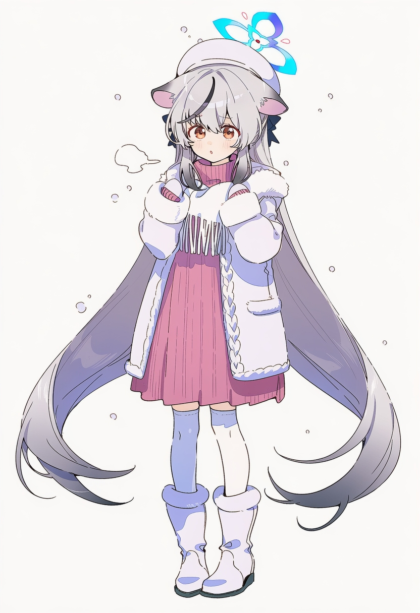

[在线例图](https://assets.quicktagcloud.com/images/raven_composition/raven_composition-5250.jpg?v=0cc5bd0d3f7e4b3a)

<a id="raven_composition-5251"></a>

## 阿罗娜

ID：`raven_composition-5251`；分类：角色图鉴 / 蔚蓝档案；来源标记：`safe`。

来源说明：

> 作品：蔚蓝档案
> 性别：女
> 登场时间：2021-02 开服NPC

正向提示词：

```text
arona_(blue_archive)
```

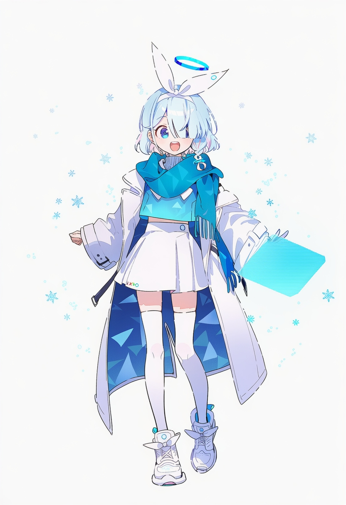

[在线例图](https://assets.quicktagcloud.com/images/raven_composition/raven_composition-5251.jpg?v=3b62994e7724546c)

<a id="raven_composition-5252"></a>

## 索拉

ID：`raven_composition-5252`；分类：角色图鉴 / 蔚蓝档案；来源标记：`safe`。

来源说明：

> 作品：蔚蓝档案
> 性别：女
> 登场时间：2021-02 开服NPC

正向提示词：

```text
sora_(blue_archive)
```

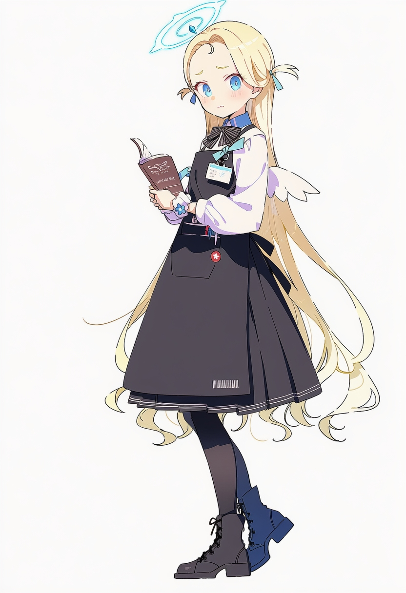

[在线例图](https://assets.quicktagcloud.com/images/raven_composition/raven_composition-5252.jpg?v=7d14c3e450a0c4e4)

<a id="raven_composition-5253"></a>

## 七神凛

ID：`raven_composition-5253`；分类：角色图鉴 / 蔚蓝档案；来源标记：`safe`。

来源说明：

> 作品：蔚蓝档案
> 性别：女
> 登场时间：2021-02 开服NPC

正向提示词：

```text
rin_(blue_archive)
```

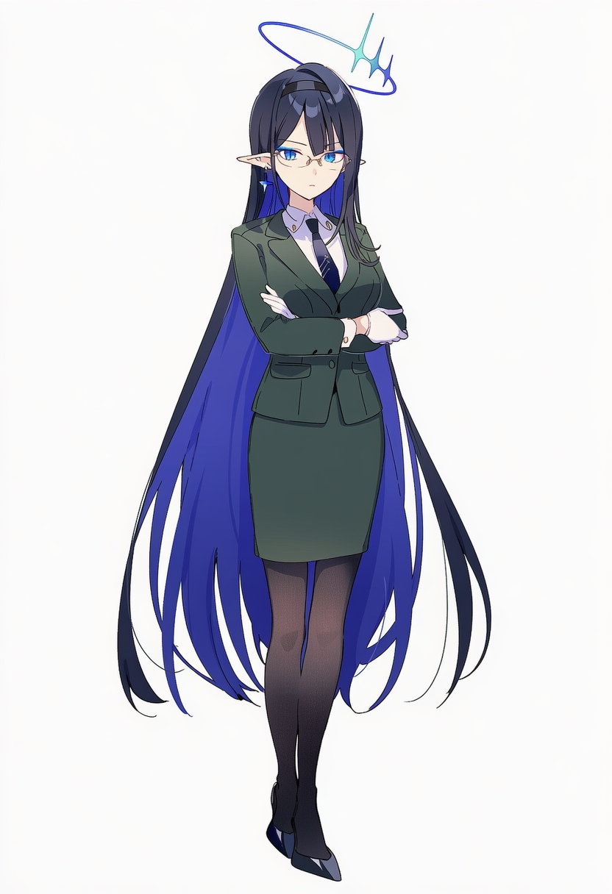

[在线例图](https://assets.quicktagcloud.com/images/raven_composition/raven_composition-5253.jpg?v=34d9c5c5d0bd0b9b)

<a id="raven_composition-5254"></a>

## 岩柜步

ID：`raven_composition-5254`；分类：角色图鉴 / 蔚蓝档案；来源标记：`safe`。

来源说明：

> 作品：蔚蓝档案
> 性别：女
> 登场时间：2021-02 开服NPC

正向提示词：

```text
ayumu_(blue_archive)
```

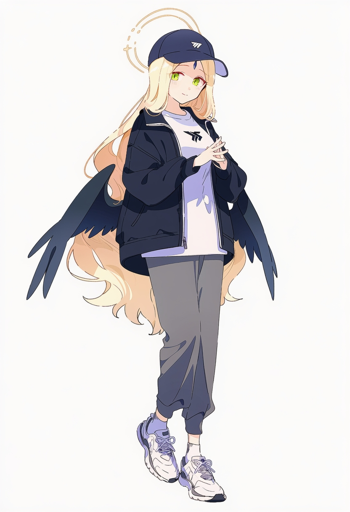

[在线例图](https://assets.quicktagcloud.com/images/raven_composition/raven_composition-5254.jpg?v=5ef351b03753f4e2)

<a id="raven_composition-5255"></a>

## 由良木桃可

ID：`raven_composition-5255`；分类：角色图鉴 / 蔚蓝档案；来源标记：`safe`。

来源说明：

> 作品：蔚蓝档案
> 性别：女
> 登场时间：2021-02 开服NPC

正向提示词：

```text
momoka_(blue_archive)
```


[在线例图](https://assets.quicktagcloud.com/images/raven_composition/raven_composition-5255.jpg?v=ffe9b9de886853a1)

<a id="raven_composition-5256"></a>

## 不知火花耶

ID：`raven_composition-5256`；分类：角色图鉴 / 蔚蓝档案；来源标记：`safe`。

来源说明：

> 作品：蔚蓝档案
> 性别：女
> 登场时间：2021-02 开服NPC

正向提示词：

```text
kaya_(blue_archive)
```


[在线例图](https://assets.quicktagcloud.com/images/raven_composition/raven_composition-5256.jpg?v=267796a331c29988)

<a id="raven_composition-5257"></a>

## 扇喜葵

ID：`raven_composition-5257`；分类：角色图鉴 / 蔚蓝档案；来源标记：`safe`。

来源说明：

> 作品：蔚蓝档案
> 性别：女
> 登场时间：2021-02 开服NPC

正向提示词：

```text
aoi_(blue_archive)
```

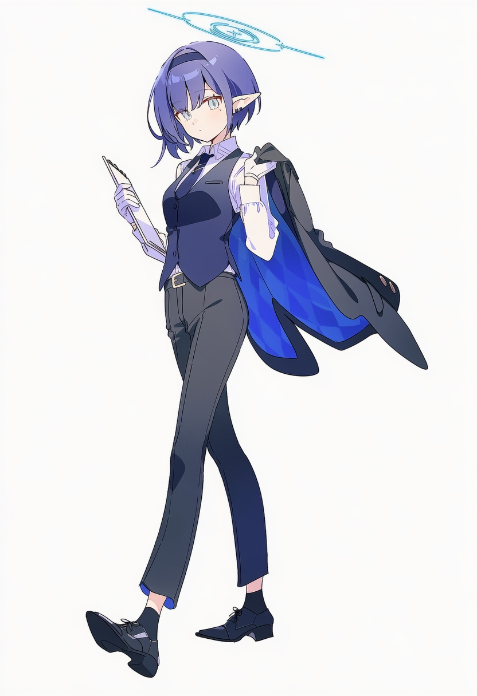

[在线例图](https://assets.quicktagcloud.com/images/raven_composition/raven_composition-5257.jpg?v=e86deddf6efe0214)

<a id="raven_composition-5258"></a>

## 灰音

ID：`raven_composition-5258`；分类：角色图鉴 / 蔚蓝档案；来源标记：`safe`。

来源说明：

> 作品：蔚蓝档案
> 性别：女
> 登场时间：2021-02 开服NPC

正向提示词：

```text
haine_(blue_archive)
```

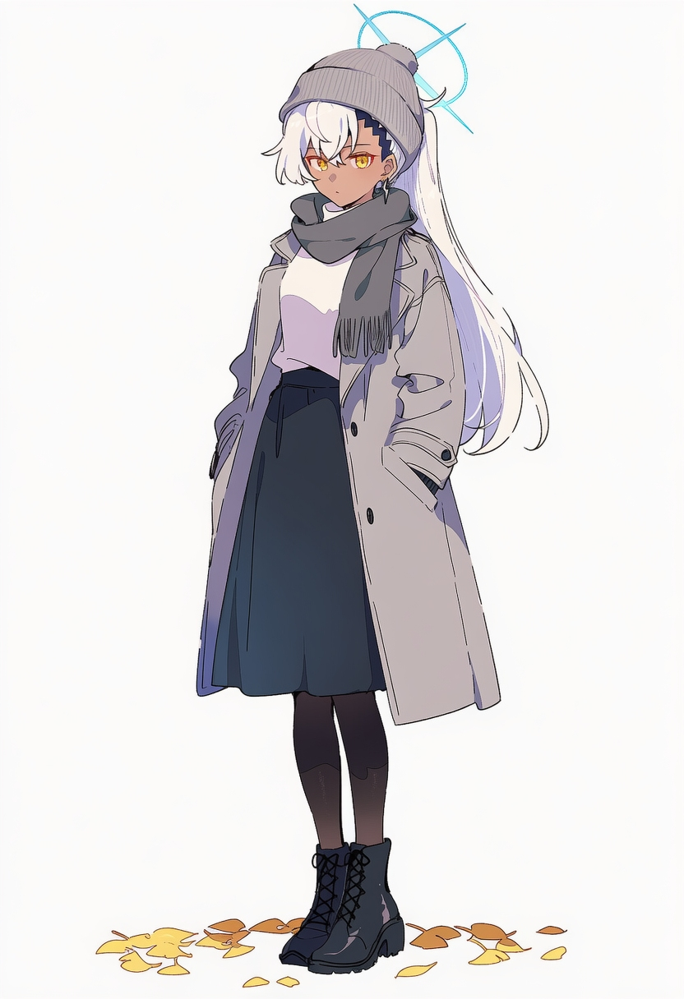

[在线例图](https://assets.quicktagcloud.com/images/raven_composition/raven_composition-5258.jpg?v=0d2fae2f0e8fb92b)

<a id="raven_composition-5259"></a>

## 李莫

ID：`raven_composition-5259`；分类：角色图鉴 / 蔚蓝档案；来源标记：`safe`。

来源说明：

> 作品：蔚蓝档案
> 性别：女
> 登场时间：2021-02 开服NPC

正向提示词：

```text
sumomo_(blue_archive)
```

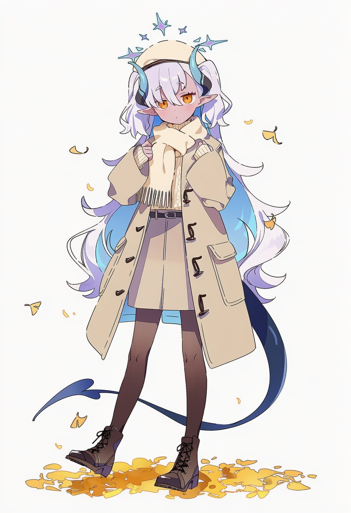

[在线例图](https://assets.quicktagcloud.com/images/raven_composition/raven_composition-5259.jpg?v=a7a9c0464e89fe34)

<a id="raven_composition-5260"></a>

## 联邦学生会会长(无名)

ID：`raven_composition-5260`；分类：角色图鉴 / 蔚蓝档案；来源标记：`safe`。

来源说明：

> 作品：蔚蓝档案
> 性别：女
> 登场时间：2021-02 开服NPC

正向提示词：

```text
general_student_council_president_(blue_archive)
```


[在线例图](https://assets.quicktagcloud.com/images/raven_composition/raven_composition-5260.jpg?v=d5e15a017e34a096)

<a id="raven_composition-5261"></a>

## 春日椿

ID：`raven_composition-5261`；分类：角色图鉴 / 蔚蓝档案；来源标记：`safe`。

来源说明：

> 作品：蔚蓝档案
> 性别：女
> 登场时间：2021-03

正向提示词：

```text
tsubaki_(blue_archive)
```

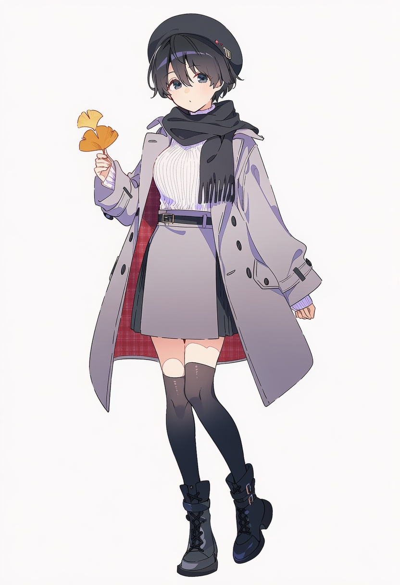

[在线例图](https://assets.quicktagcloud.com/images/raven_composition/raven_composition-5261.jpg?v=8f14e8bace8f3431)

<a id="raven_composition-5262"></a>

## 久田伊树菜

ID：`raven_composition-5262`；分类：角色图鉴 / 蔚蓝档案；来源标记：`safe`。

来源说明：

> 作品：蔚蓝档案
> 性别：女
> 登场时间：2021-03

正向提示词：

```text
izuna_(blue_archive)
```


[在线例图](https://assets.quicktagcloud.com/images/raven_composition/raven_composition-5262.jpg?v=62e43f93deac8378)

<a id="raven_composition-5263"></a>

## 花冈柚子

ID：`raven_composition-5263`；分类：角色图鉴 / 蔚蓝档案；来源标记：`safe`。

来源说明：

> 作品：蔚蓝档案
> 性别：女
> 登场时间：2021-03

正向提示词：

```text
yuzu_(blue_archive)
```


[在线例图](https://assets.quicktagcloud.com/images/raven_composition/raven_composition-5263.jpg?v=56ac61d79044b798)

<a id="raven_composition-5264"></a>

## 猫冢响

ID：`raven_composition-5264`；分类：角色图鉴 / 蔚蓝档案；来源标记：`safe`。

来源说明：

> 作品：蔚蓝档案
> 性别：女
> 登场时间：2021-03

正向提示词：

```text
hibiki_(blue_archive)
```

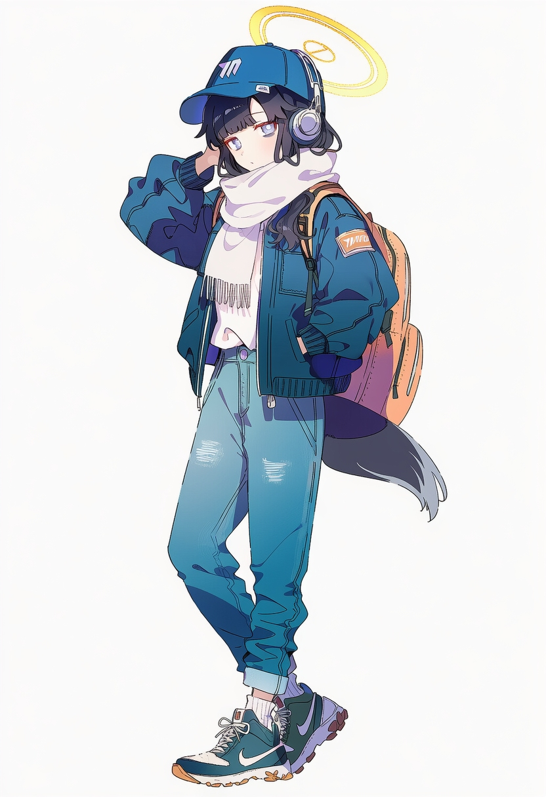

[在线例图](https://assets.quicktagcloud.com/images/raven_composition/raven_composition-5264.jpg?v=096d2b0d58411879)

<a id="raven_composition-5265"></a>

## 丰见琴里

ID：`raven_composition-5265`；分类：角色图鉴 / 蔚蓝档案；来源标记：`safe`。

来源说明：

> 作品：蔚蓝档案
> 性别：女
> 登场时间：2021-03

正向提示词：

```text
kotori_(blue_archive)
```

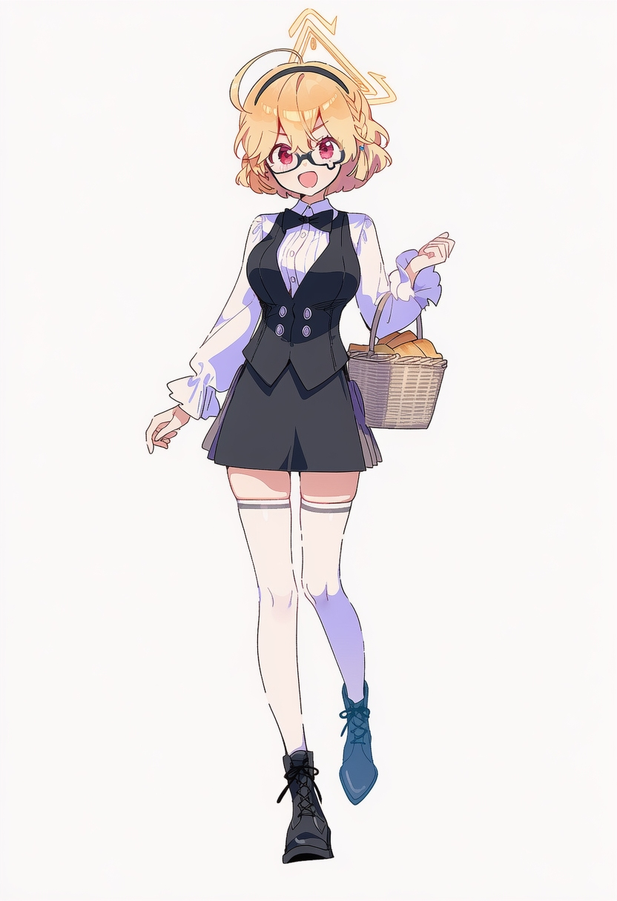

[在线例图](https://assets.quicktagcloud.com/images/raven_composition/raven_composition-5265.jpg?v=b8635386bda25416)

<a id="raven_composition-5266"></a>

## 白石歌原

ID：`raven_composition-5266`；分类：角色图鉴 / 蔚蓝档案；来源标记：`safe`。

来源说明：

> 作品：蔚蓝档案
> 性别：女
> 登场时间：2021-04

正向提示词：

```text
utaha_(blue_archive)
```


[在线例图](https://assets.quicktagcloud.com/images/raven_composition/raven_composition-5266.jpg?v=58b35777f2627183)

<a id="raven_composition-5267"></a>

## 柚鸟夏

ID：`raven_composition-5267`；分类：角色图鉴 / 蔚蓝档案；来源标记：`safe`。

来源说明：

> 作品：蔚蓝档案
> 性别：女
> 登场时间：2021-04

正向提示词：

```text
natsu_(blue_archive)
```

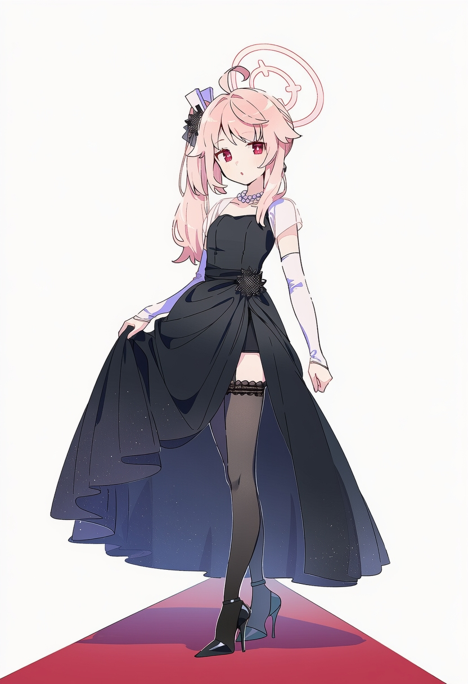

[在线例图](https://assets.quicktagcloud.com/images/raven_composition/raven_composition-5267.jpg?v=4157eb978658bb5c)

<a id="raven_composition-5268"></a>

## 药子纱绫

ID：`raven_composition-5268`；分类：角色图鉴 / 蔚蓝档案；来源标记：`safe`。

来源说明：

> 作品：蔚蓝档案
> 性别：女
> 登场时间：2021-05

正向提示词：

```text
saya_(blue_archive)
```

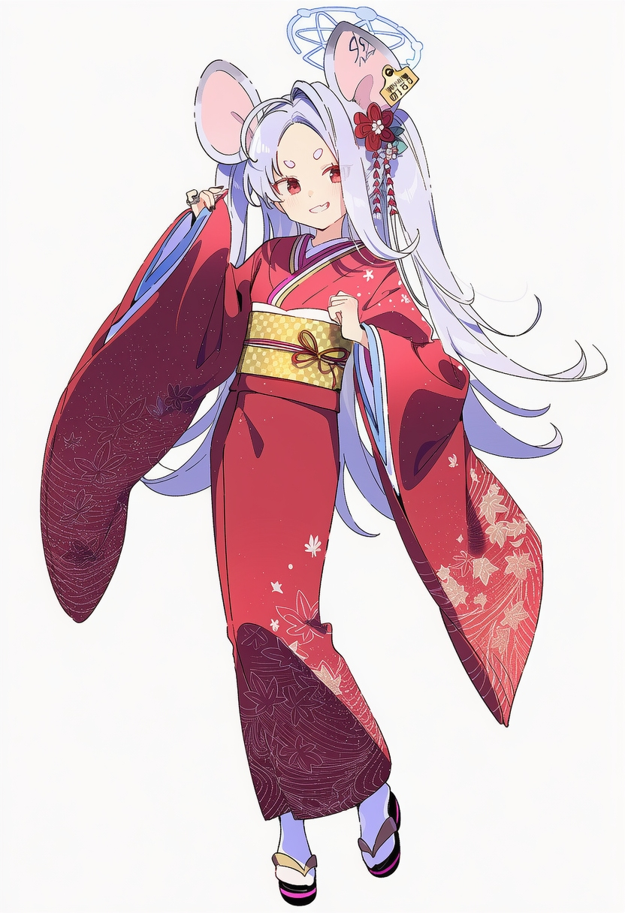

[在线例图](https://assets.quicktagcloud.com/images/raven_composition/raven_composition-5268.jpg?v=a0f0a77077935c06)

<a id="raven_composition-5269"></a>

## 鳄渊明里

ID：`raven_composition-5269`；分类：角色图鉴 / 蔚蓝档案；来源标记：`safe`。

来源说明：

> 作品：蔚蓝档案
> 性别：女
> 登场时间：2021-09

正向提示词：

```text
akari_(blue_archive)
```

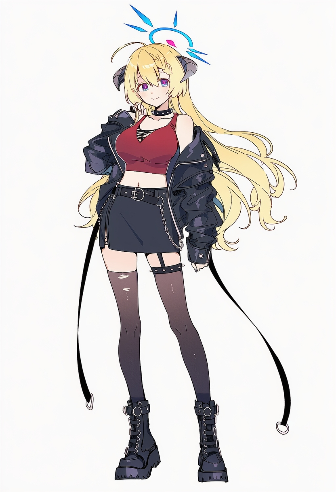

[在线例图](https://assets.quicktagcloud.com/images/raven_composition/raven_composition-5269.jpg?v=5ae2175cd293640d)

<a id="raven_composition-5270"></a>

## 狮子堂泉

ID：`raven_composition-5270`；分类：角色图鉴 / 蔚蓝档案；来源标记：`safe`。

来源说明：

> 作品：蔚蓝档案
> 性别：女
> 登场时间：2021-09

正向提示词：

```text
izumi_(blue_archive)
```

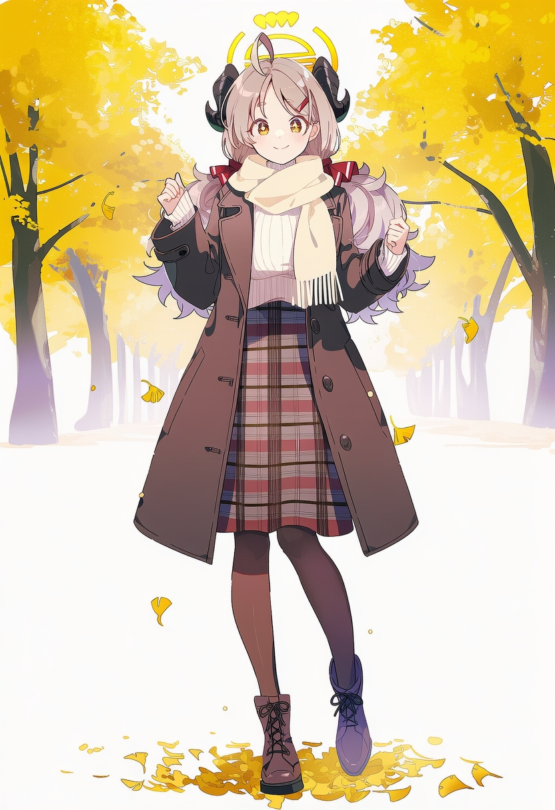

[在线例图](https://assets.quicktagcloud.com/images/raven_composition/raven_composition-5270.jpg?v=4bd33268c3091408)

<a id="raven_composition-5271"></a>

## 若叶日向

ID：`raven_composition-5271`；分类：角色图鉴 / 蔚蓝档案；来源标记：`safe`。

来源说明：

> 作品：蔚蓝档案
> 性别：女
> 登场时间：2021-10

正向提示词：

```text
hinata_(blue_archive)
```

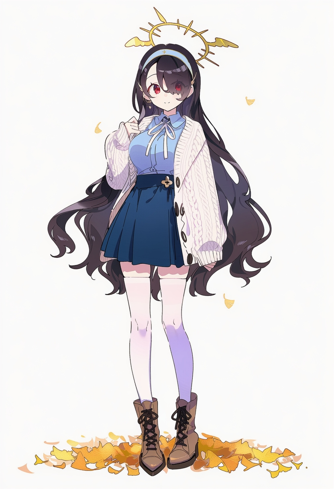

[在线例图](https://assets.quicktagcloud.com/images/raven_composition/raven_composition-5271.jpg?v=07022515e54db137)

<a id="raven_composition-5272"></a>

## 伊落玛丽

ID：`raven_composition-5272`；分类：角色图鉴 / 蔚蓝档案；来源标记：`safe`。

来源说明：

> 作品：蔚蓝档案
> 性别：女
> 登场时间：2021-10

正向提示词：

```text
mari_(blue_archive)
```

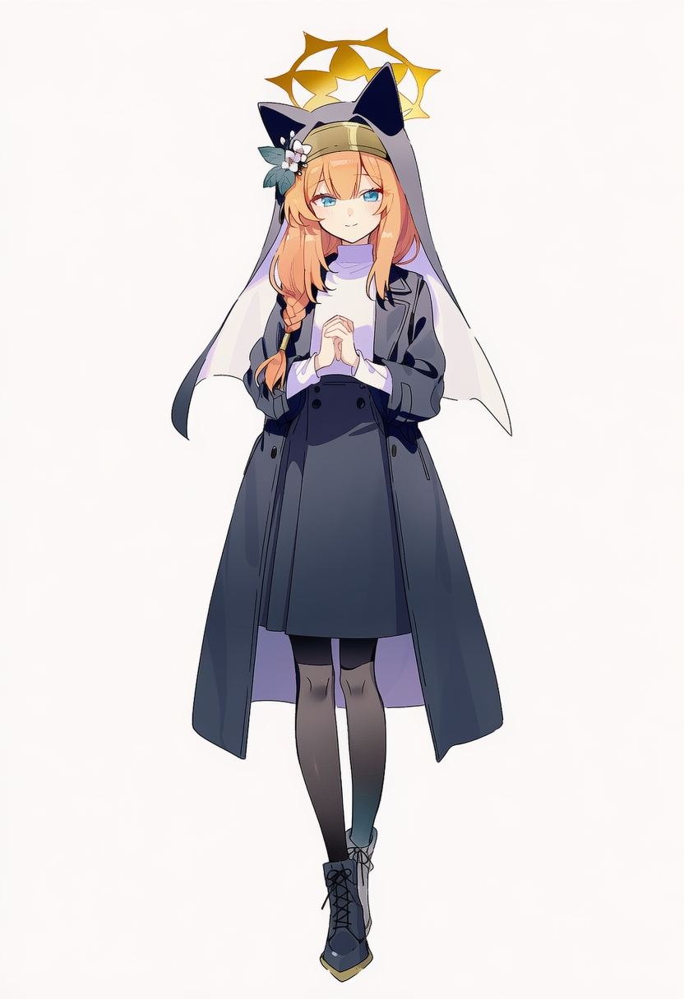

[在线例图](https://assets.quicktagcloud.com/images/raven_composition/raven_composition-5272.jpg?v=22d29f30edc83e66)

<a id="raven_composition-5273"></a>

## 鹫见芹奈

ID：`raven_composition-5273`；分类：角色图鉴 / 蔚蓝档案；来源标记：`safe`。

来源说明：

> 作品：蔚蓝档案
> 性别：女
> 登场时间：2021-11

正向提示词：

```text
serina_(blue_archive)
```

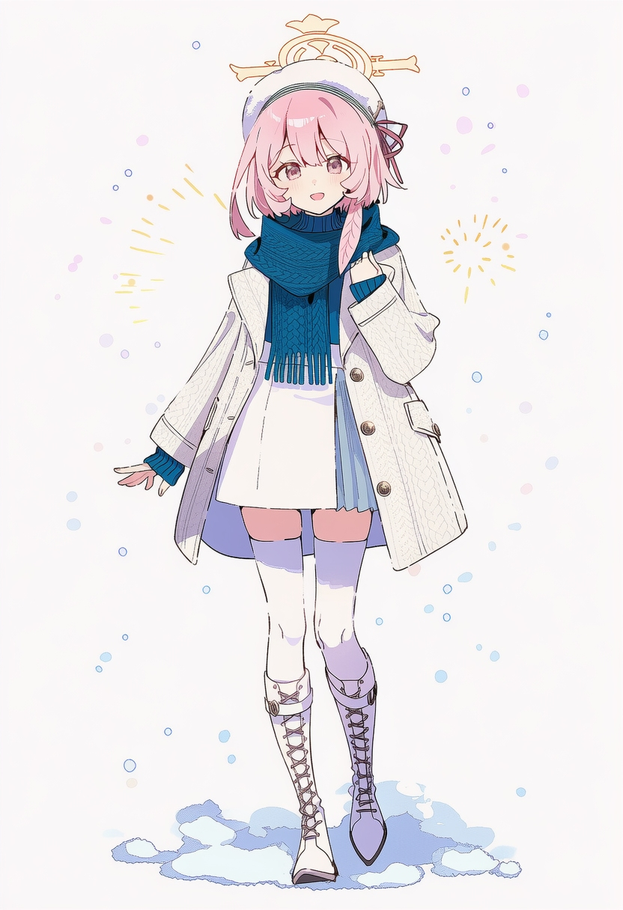

[在线例图](https://assets.quicktagcloud.com/images/raven_composition/raven_composition-5273.jpg?v=c21765881bd1cbeb)

<a id="raven_composition-5274"></a>

## 朝颜花江

ID：`raven_composition-5274`；分类：角色图鉴 / 蔚蓝档案；来源标记：`safe`。

来源说明：

> 作品：蔚蓝档案
> 性别：女
> 登场时间：2021-11

正向提示词：

```text
hanae_(blue_archive)
```


[在线例图](https://assets.quicktagcloud.com/images/raven_composition/raven_composition-5274.jpg?v=9593cb52852d0f70)

<a id="raven_composition-5275"></a>

## 乙花堇

ID：`raven_composition-5275`；分类：角色图鉴 / 蔚蓝档案；来源标记：`safe`。

来源说明：

> 作品：蔚蓝档案
> 性别：女
> 登场时间：2021-12

正向提示词：

```text
sumire_(blue_archive)
```

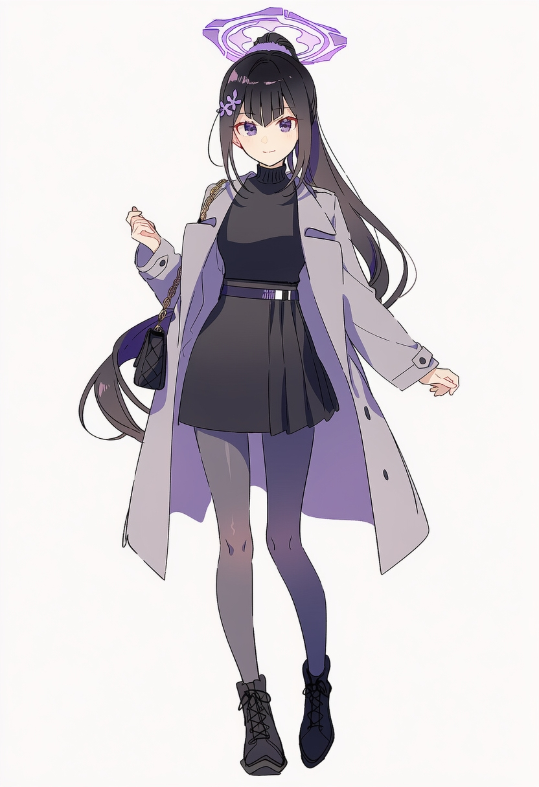

[在线例图](https://assets.quicktagcloud.com/images/raven_composition/raven_composition-5275.jpg?v=8407acd1f2df8e94)

<a id="raven_composition-5276"></a>

## 宇泽玲纱

ID：`raven_composition-5276`；分类：角色图鉴 / 蔚蓝档案；来源标记：`safe`。

来源说明：

> 作品：蔚蓝档案
> 性别：女
> 登场时间：2021-12

正向提示词：

```text
reisa_(blue_archive)
```


[在线例图](https://assets.quicktagcloud.com/images/raven_composition/raven_composition-5276.jpg?v=a993c0fbb9742a6e)

<a id="raven_composition-5277"></a>

## 梔子梦

ID：`raven_composition-5277`；分类：角色图鉴 / 蔚蓝档案；来源标记：`safe`。

来源说明：

> 作品：蔚蓝档案
> 性别：女
> 登场时间：2021开服剧情NPC(阿拜多斯前会长)

正向提示词：

```text
yume_(blue_archive)
```

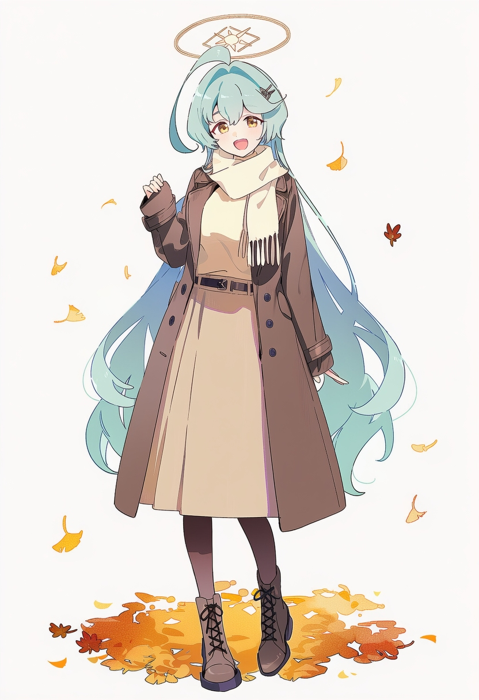

[在线例图](https://assets.quicktagcloud.com/images/raven_composition/raven_composition-5277.jpg?v=bab438a8008707e7)

<a id="raven_composition-5278"></a>

## 普拉娜

ID：`raven_composition-5278`；分类：角色图鉴 / 蔚蓝档案；来源标记：`safe`。

来源说明：

> 作品：蔚蓝档案
> 性别：女
> 登场时间：2022 剧情NPC

正向提示词：

```text
plana_(blue_archive)
```


[在线例图](https://assets.quicktagcloud.com/images/raven_composition/raven_composition-5278.jpg?v=3fabf3bcd6c3d86e)

<a id="raven_composition-5279"></a>

## 连河切里诺

ID：`raven_composition-5279`；分类：角色图鉴 / 蔚蓝档案；来源标记：`safe`。

来源说明：

> 作品：蔚蓝档案
> 性别：女
> 登场时间：2022-01

正向提示词：

```text
cherino_(blue_archive)
```

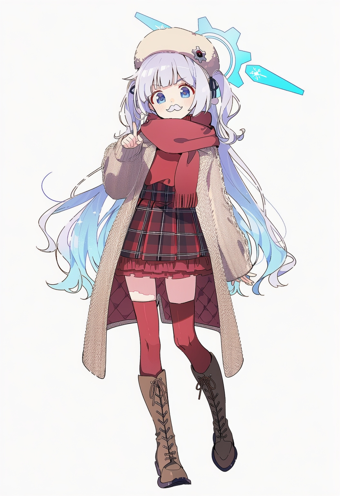

[在线例图](https://assets.quicktagcloud.com/images/raven_composition/raven_composition-5279.jpg?v=a385a83c80a5673b)

<a id="raven_composition-5280"></a>

## 佐城巴

ID：`raven_composition-5280`；分类：角色图鉴 / 蔚蓝档案；来源标记：`safe`。

来源说明：

> 作品：蔚蓝档案
> 性别：女
> 登场时间：2022-01

正向提示词：

```text
tomoe_(blue_archive)
```


[在线例图](https://assets.quicktagcloud.com/images/raven_composition/raven_composition-5280.jpg?v=31250973e659a478)

<a id="raven_composition-5281"></a>

## 池仓真里奈

ID：`raven_composition-5281`；分类：角色图鉴 / 蔚蓝档案；来源标记：`safe`。

来源说明：

> 作品：蔚蓝档案
> 性别：女
> 登场时间：2022-01

正向提示词：

```text
marina_(blue_archive)
```

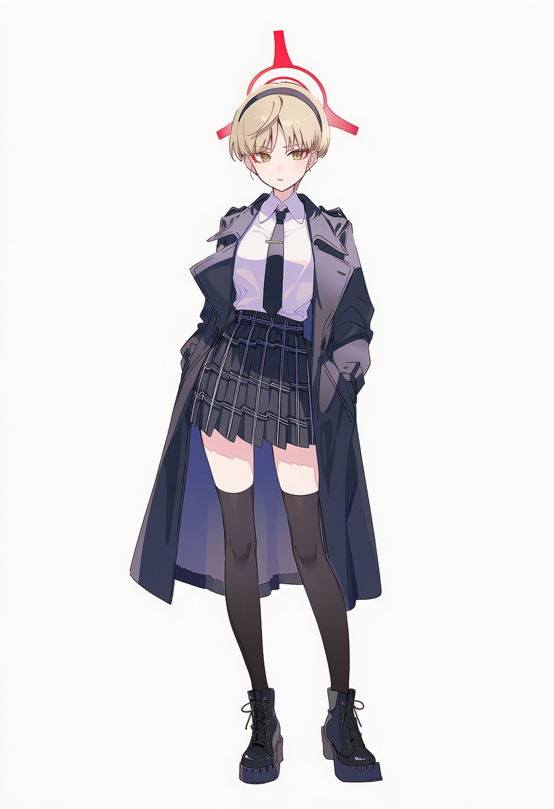

[在线例图](https://assets.quicktagcloud.com/images/raven_composition/raven_composition-5281.jpg?v=5afb816edc69c5ad)

<a id="raven_composition-5282"></a>

## 间宵时雨

ID：`raven_composition-5282`；分类：角色图鉴 / 蔚蓝档案；来源标记：`safe`。

来源说明：

> 作品：蔚蓝档案
> 性别：女
> 登场时间：2022-01

正向提示词：

```text
shigure_(blue_archive)
```

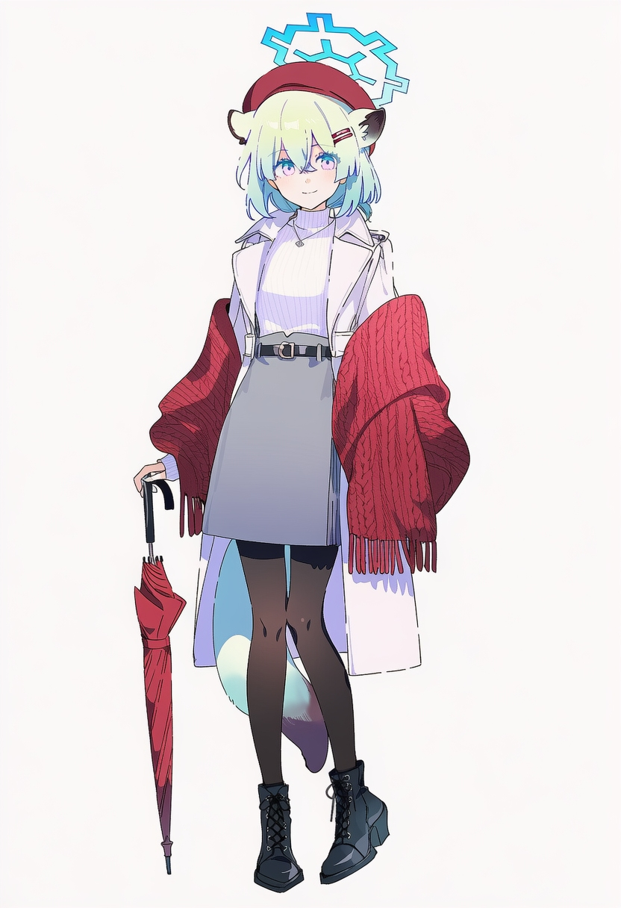

[在线例图](https://assets.quicktagcloud.com/images/raven_composition/raven_composition-5282.jpg?v=559bae38ebc2cae4)

<a id="raven_composition-5283"></a>

## 狐坂若藻

ID：`raven_composition-5283`；分类：角色图鉴 / 蔚蓝档案；来源标记：`safe`。

来源说明：

> 作品：蔚蓝档案
> 性别：女
> 登场时间：2022-03

正向提示词：

```text
wakamo_(blue_archive)
```

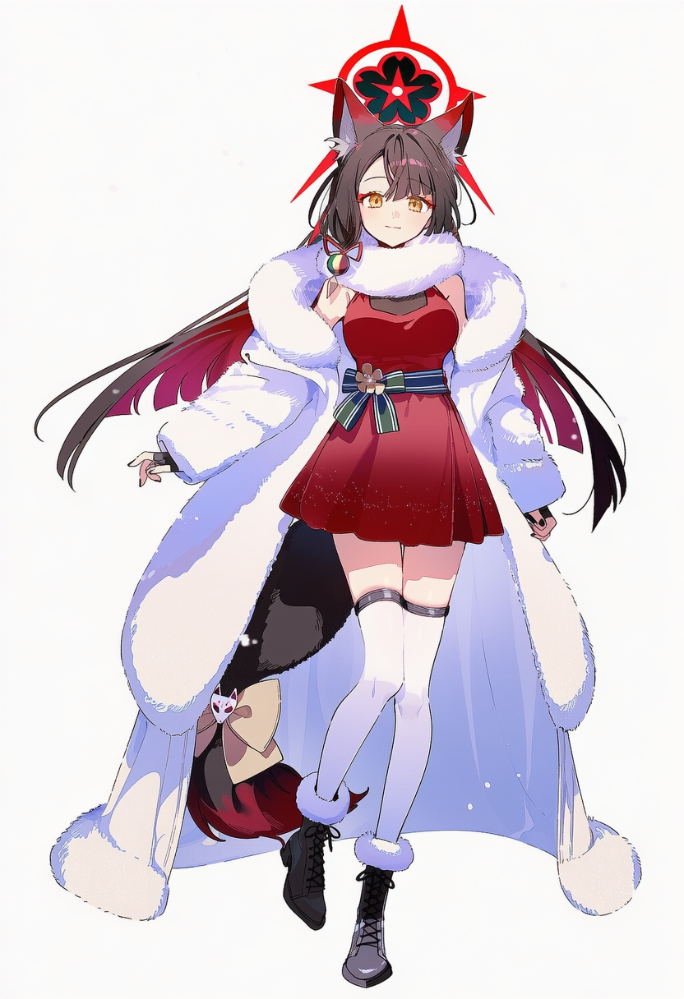

[在线例图](https://assets.quicktagcloud.com/images/raven_composition/raven_composition-5283.jpg?v=ac2f8e032f2bba13)

<a id="raven_composition-5284"></a>

## 天见和香

ID：`raven_composition-5284`；分类：角色图鉴 / 蔚蓝档案；来源标记：`safe`。

来源说明：

> 作品：蔚蓝档案
> 性别：女
> 登场时间：2022-04

正向提示词：

```text
nodoka_(blue_archive)
```

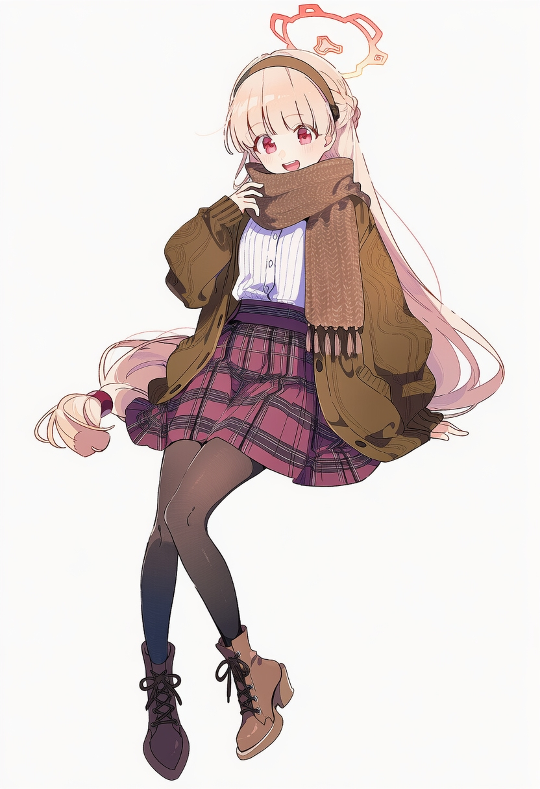

[在线例图](https://assets.quicktagcloud.com/images/raven_composition/raven_composition-5284.jpg?v=961c8fdfd0b77301)

<a id="raven_composition-5285"></a>

## 春原瞬

ID：`raven_composition-5285`；分类：角色图鉴 / 蔚蓝档案；来源标记：`safe`。

来源说明：

> 作品：蔚蓝档案
> 性别：女
> 登场时间：2022-04

正向提示词：

```text
shun_(blue_archive)
```

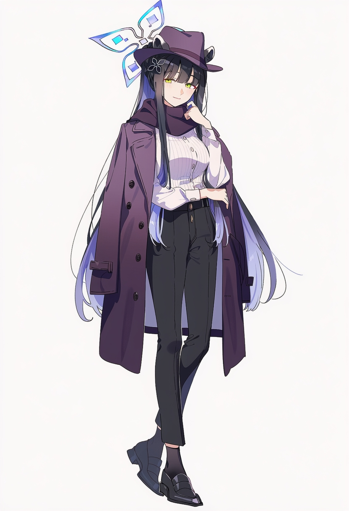

[在线例图](https://assets.quicktagcloud.com/images/raven_composition/raven_composition-5285.jpg?v=0f5f896d30b68c19)

<a id="raven_composition-5286"></a>

## 羽沼真琴

ID：`raven_composition-5286`；分类：角色图鉴 / 蔚蓝档案；来源标记：`safe`。

来源说明：

> 作品：蔚蓝档案
> 性别：女
> 登场时间：2022-04

正向提示词：

```text
makoto_(blue_archive)
```

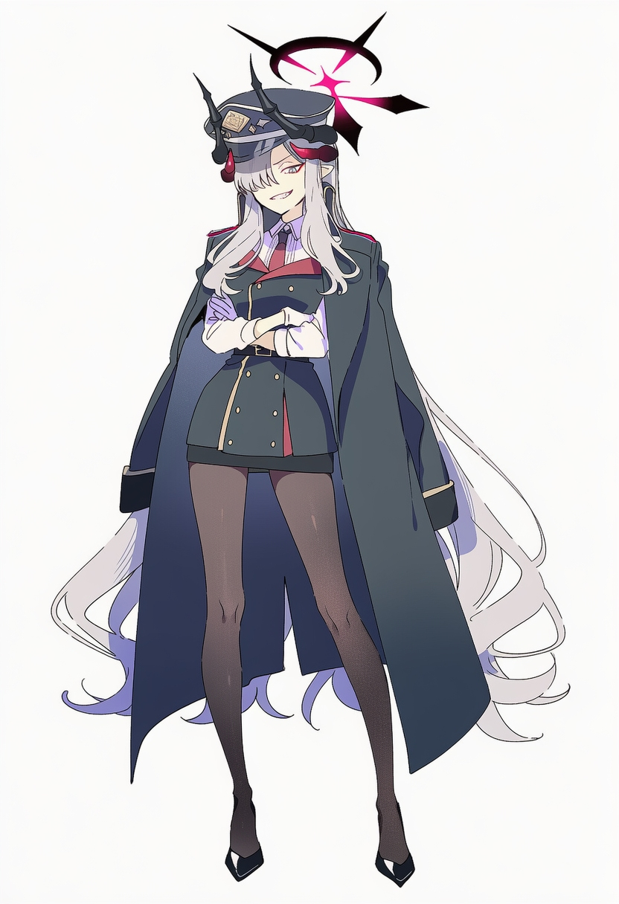

[在线例图](https://assets.quicktagcloud.com/images/raven_composition/raven_composition-5286.jpg?v=82ee23ecf2f32757)

<a id="raven_composition-5287"></a>

## 京极皋月

ID：`raven_composition-5287`；分类：角色图鉴 / 蔚蓝档案；来源标记：`safe`。

来源说明：

> 作品：蔚蓝档案
> 性别：女
> 登场时间：2022-04

正向提示词：

```text
satsuki_(blue_archive)
```


[在线例图](https://assets.quicktagcloud.com/images/raven_composition/raven_composition-5287.jpg?v=775be0e1b7a4ddb1)

<a id="raven_composition-5288"></a>

## 枣伊吕波

ID：`raven_composition-5288`；分类：角色图鉴 / 蔚蓝档案；来源标记：`safe`。

来源说明：

> 作品：蔚蓝档案
> 性别：女
> 登场时间：2022-04

正向提示词：

```text
iroha_(blue_archive)
```

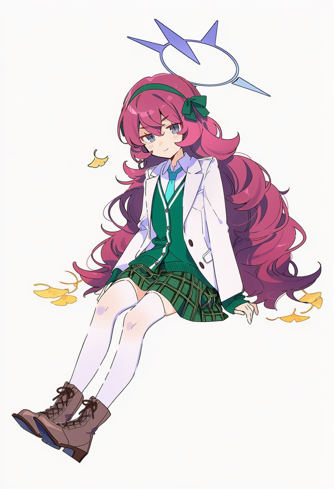

[在线例图](https://assets.quicktagcloud.com/images/raven_composition/raven_composition-5288.jpg?v=6522109b1a3ee859)

<a id="raven_composition-5289"></a>

## 丹花伊吹

ID：`raven_composition-5289`；分类：角色图鉴 / 蔚蓝档案；来源标记：`safe`。

来源说明：

> 作品：蔚蓝档案
> 性别：女
> 登场时间：2022-04

正向提示词：

```text
ibuki_(blue_archive)
```

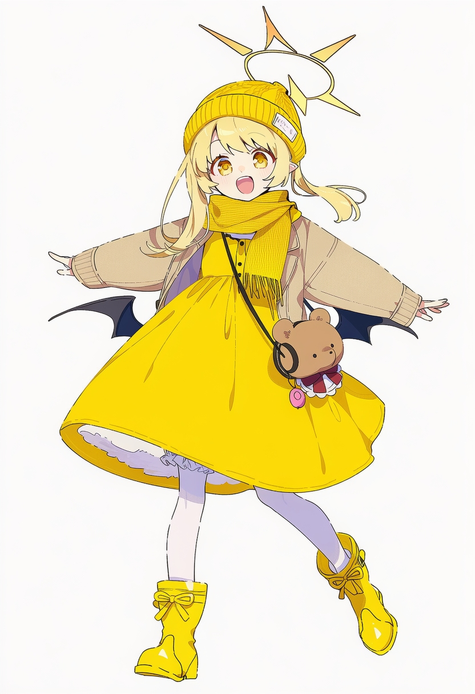

[在线例图](https://assets.quicktagcloud.com/images/raven_composition/raven_composition-5289.jpg?v=626cfd810ea3fe0e)

<a id="raven_composition-5290"></a>

## 大野月咏

ID：`raven_composition-5290`；分类：角色图鉴 / 蔚蓝档案；来源标记：`safe`。

来源说明：

> 作品：蔚蓝档案
> 性别：女
> 登场时间：2022-05

正向提示词：

```text
tsukuyo_(blue_archive)
```


[在线例图](https://assets.quicktagcloud.com/images/raven_composition/raven_composition-5290.jpg?v=f057afc6a2148345)

<a id="raven_composition-5291"></a>

## 千鸟满

ID：`raven_composition-5291`；分类：角色图鉴 / 蔚蓝档案；来源标记：`safe`。

来源说明：

> 作品：蔚蓝档案
> 性别：女
> 登场时间：2022-05

正向提示词：

```text
michiru_(blue_archive)
```


[在线例图](https://assets.quicktagcloud.com/images/raven_composition/raven_composition-5291.jpg?v=e6784e5a4e9a48c3)

<a id="raven_composition-5292"></a>

## 空井咲

ID：`raven_composition-5292`；分类：角色图鉴 / 蔚蓝档案；来源标记：`safe`。

来源说明：

> 作品：蔚蓝档案
> 性别：女
> 登场时间：2022-05

正向提示词：

```text
saki_(blue_archive)
```


[在线例图](https://assets.quicktagcloud.com/images/raven_composition/raven_composition-5292.jpg?v=00543cb630e60494)

<a id="raven_composition-5293"></a>

## 月雪宫子

ID：`raven_composition-5293`；分类：角色图鉴 / 蔚蓝档案；来源标记：`safe`。

来源说明：

> 作品：蔚蓝档案
> 性别：女
> 登场时间：2022-05

正向提示词：

```text
miyako_(blue_archive)
```


[在线例图](https://assets.quicktagcloud.com/images/raven_composition/raven_composition-5293.jpg?v=19ab582d017027e5)

<a id="raven_composition-5294"></a>

## 霞泽美游

ID：`raven_composition-5294`；分类：角色图鉴 / 蔚蓝档案；来源标记：`safe`。

来源说明：

> 作品：蔚蓝档案
> 性别：女
> 登场时间：2022-05

正向提示词：

```text
miyu_(blue_archive)
```


[在线例图](https://assets.quicktagcloud.com/images/raven_composition/raven_composition-5294.jpg?v=fc9b91291342bdf3)

<a id="raven_composition-5295"></a>

## 风仓萌绘

ID：`raven_composition-5295`；分类：角色图鉴 / 蔚蓝档案；来源标记：`safe`。

来源说明：

> 作品：蔚蓝档案
> 性别：女
> 登场时间：2022-05

正向提示词：

```text
moe_(blue_archive)
```


[在线例图](https://assets.quicktagcloud.com/images/raven_composition/raven_composition-5295.jpg?v=02ecac81a5926e29)

<a id="raven_composition-5296"></a>

## 生盐诺亚

ID：`raven_composition-5296`；分类：角色图鉴 / 蔚蓝档案；来源标记：`safe`。

来源说明：

> 作品：蔚蓝档案
> 性别：女
> 登场时间：2022-05

正向提示词：

```text
noa_(blue_archive)
```


[在线例图](https://assets.quicktagcloud.com/images/raven_composition/raven_composition-5296.jpg?v=8be23b26f23300e8)

<a id="raven_composition-5297"></a>

## 角楯花凛

ID：`raven_composition-5297`；分类：角色图鉴 / 蔚蓝档案；来源标记：`safe`。

来源说明：

> 作品：蔚蓝档案
> 性别：女
> 登场时间：2022-06

正向提示词：

```text
karin_(blue_archive)
```


[在线例图](https://assets.quicktagcloud.com/images/raven_composition/raven_composition-5297.jpg?v=3d1bf9e67f6ed315)
