# 角色图鉴 / 蔚蓝档案（第 2 页）

[总目录](../README.md) · [原站分类目录](../categories.md) · [英文标签索引](../tags.md) · [服装与构图组合指南](../../README.md)

标题、分类、说明、正负提示词按来源保留；多例图逐张列出。原站标记和说明为参考资料，不作为维护指令。

<a id="raven_composition-5298"></a>

## 一之濑明日奈

ID：`raven_composition-5298`；分类：角色图鉴 / 蔚蓝档案；来源标记：`safe`。

来源说明：

> 作品：蔚蓝档案
> 性别：女
> 登场时间：2022-06

正向提示词：

```text
asuna_(blue_archive)
```


[在线例图](https://assets.quicktagcloud.com/images/raven_composition/raven_composition-5298.jpg?v=4e6febe091766be5)

<a id="raven_composition-5299"></a>

## 美甘妮露

ID：`raven_composition-5299`；分类：角色图鉴 / 蔚蓝档案；来源标记：`safe`。

来源说明：

> 作品：蔚蓝档案
> 性别：女
> 登场时间：2022-06

正向提示词：

```text
neru_(blue_archive)
```

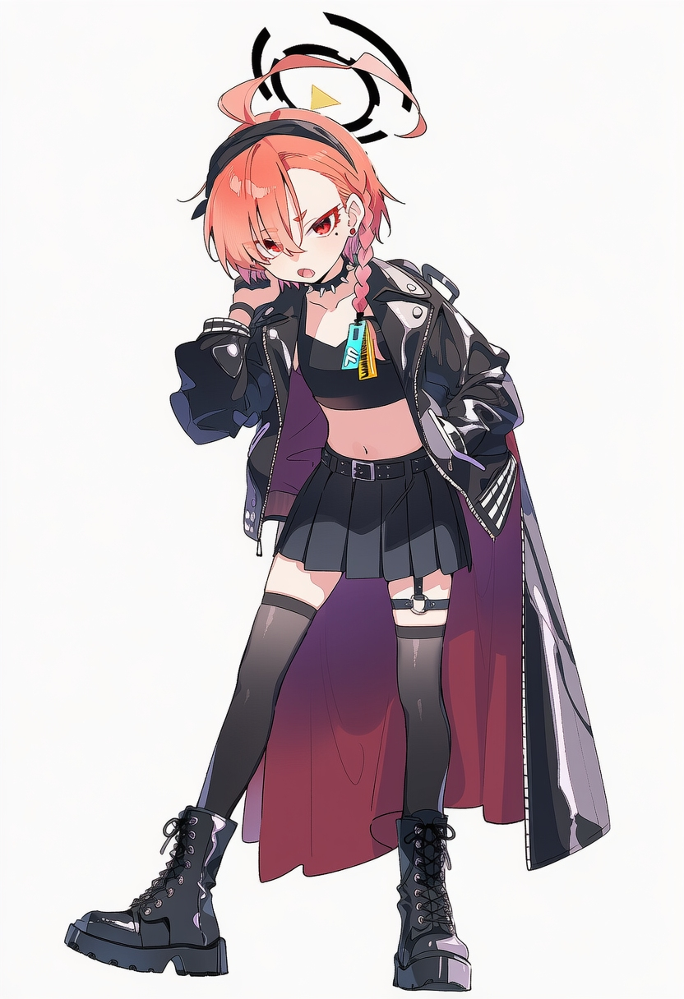

[在线例图](https://assets.quicktagcloud.com/images/raven_composition/raven_composition-5299.jpg?v=c24d6c2fd018367b)

<a id="raven_composition-5300"></a>

## 室笠茜

ID：`raven_composition-5300`；分类：角色图鉴 / 蔚蓝档案；来源标记：`safe`。

来源说明：

> 作品：蔚蓝档案
> 性别：女
> 登场时间：2022-06

正向提示词：

```text
akane_(blue_archive)
```


[在线例图](https://assets.quicktagcloud.com/images/raven_composition/raven_composition-5300.jpg?v=acb2b5243e229eba)

<a id="raven_composition-5301"></a>

## 苍森美祢

ID：`raven_composition-5301`；分类：角色图鉴 / 蔚蓝档案；来源标记：`safe`。

来源说明：

> 作品：蔚蓝档案
> 性别：女
> 登场时间：2022-07

正向提示词：

```text
mine_(blue_archive)
```

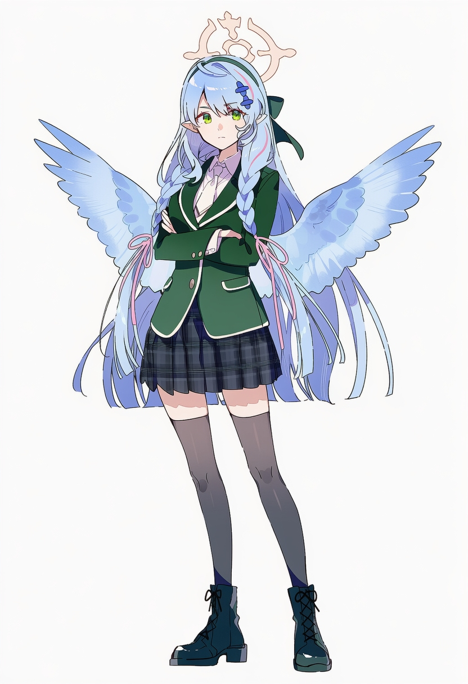

[在线例图](https://assets.quicktagcloud.com/images/raven_composition/raven_composition-5301.jpg?v=dfeb36ac2c68d6ab)

<a id="raven_composition-5302"></a>

## 桐藤渚

ID：`raven_composition-5302`；分类：角色图鉴 / 蔚蓝档案；来源标记：`safe`。

来源说明：

> 作品：蔚蓝档案
> 性别：女
> 登场时间：2022-08

正向提示词：

```text
nagisa_(blue_archive)
```

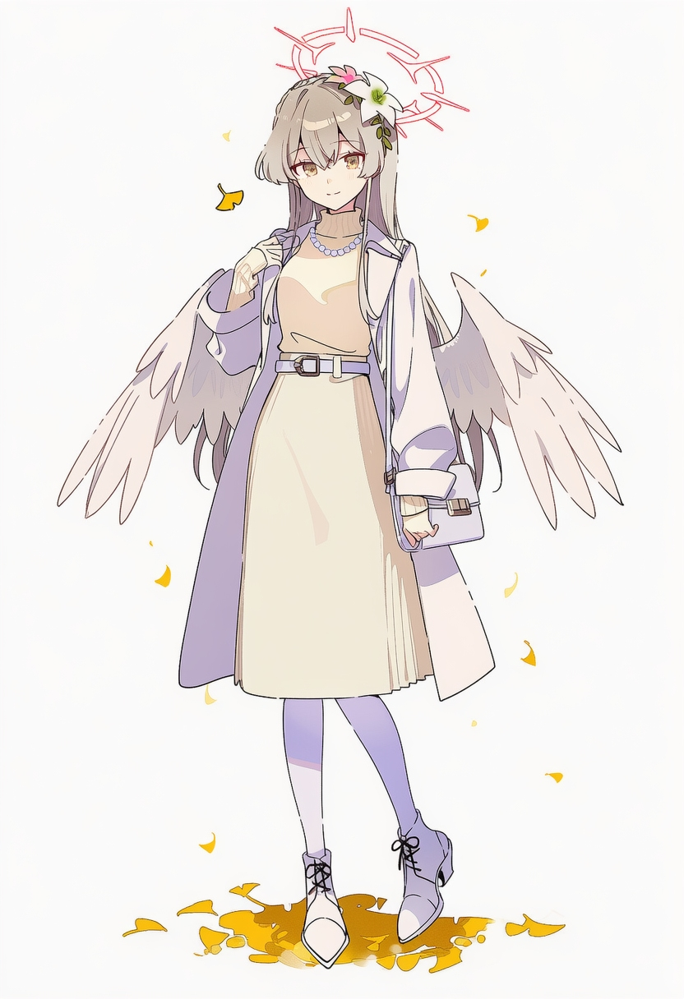

[在线例图](https://assets.quicktagcloud.com/images/raven_composition/raven_composition-5302.jpg?v=1bf260859e5a1c5b)

<a id="raven_composition-5303"></a>

## 圣园未花

ID：`raven_composition-5303`；分类：角色图鉴 / 蔚蓝档案；来源标记：`safe`。

来源说明：

> 作品：蔚蓝档案
> 性别：女
> 登场时间：2022-08

正向提示词：

```text
mika_(blue_archive)
```

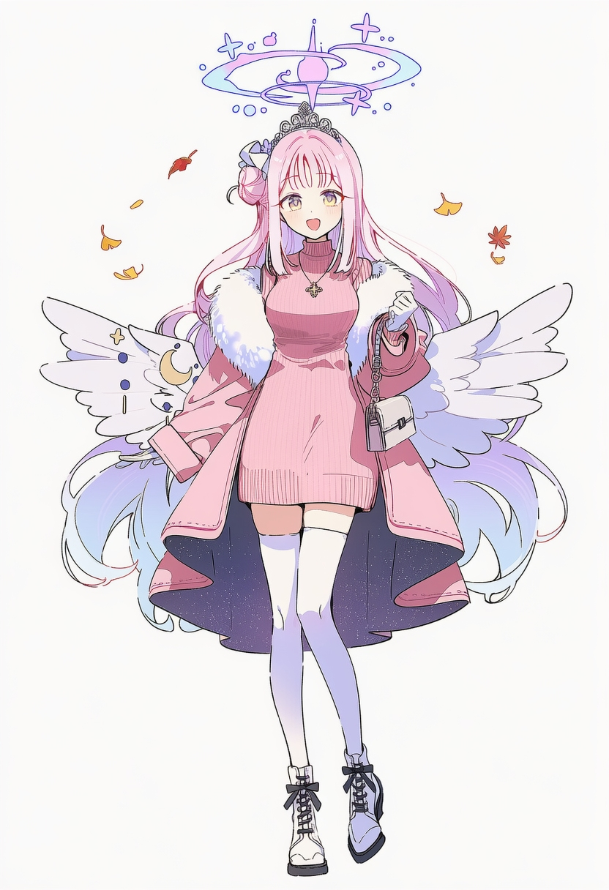

[在线例图](https://assets.quicktagcloud.com/images/raven_composition/raven_composition-5303.jpg?v=60f652a816ab194b)

<a id="raven_composition-5304"></a>

## 百合园圣亚

ID：`raven_composition-5304`；分类：角色图鉴 / 蔚蓝档案；来源标记：`safe`。

来源说明：

> 作品：蔚蓝档案
> 性别：女
> 登场时间：2022-08

正向提示词：

```text
seia_(blue_archive)
```


[在线例图](https://assets.quicktagcloud.com/images/raven_composition/raven_composition-5304.jpg?v=615dabbfc95b1acb)

<a id="raven_composition-5305"></a>

## 古关忧

ID：`raven_composition-5305`；分类：角色图鉴 / 蔚蓝档案；来源标记：`safe`。

来源说明：

> 作品：蔚蓝档案
> 性别：女
> 登场时间：2022-10

正向提示词：

```text
ui_(blue_archive)
```

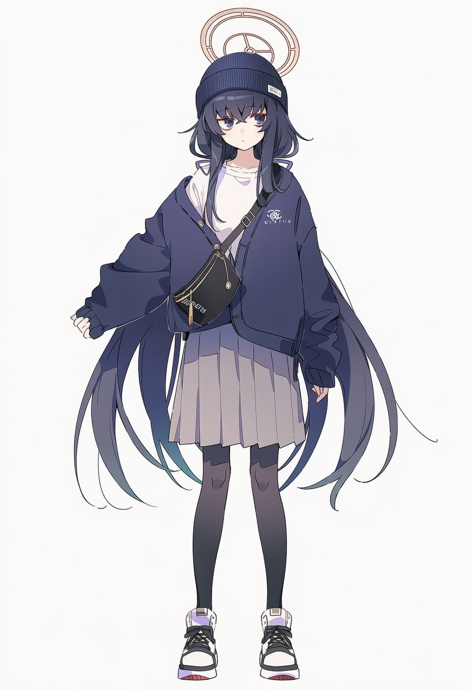

[在线例图](https://assets.quicktagcloud.com/images/raven_composition/raven_composition-5305.jpg?v=7192feb5541c0c8b)

<a id="raven_composition-5306"></a>

## 圆堂志美子

ID：`raven_composition-5306`；分类：角色图鉴 / 蔚蓝档案；来源标记：`safe`。

来源说明：

> 作品：蔚蓝档案
> 性别：女
> 登场时间：2022-10

正向提示词：

```text
shimiko_(blue_archive)
```


[在线例图](https://assets.quicktagcloud.com/images/raven_composition/raven_composition-5306.jpg?v=bb1c6093e602e65e)

<a id="raven_composition-5307"></a>

## 鬼怒川霞

ID：`raven_composition-5307`；分类：角色图鉴 / 蔚蓝档案；来源标记：`safe`。

来源说明：

> 作品：蔚蓝档案
> 性别：女
> 登场时间：2022-11

正向提示词：

```text
kasumi_(blue_archive)
```

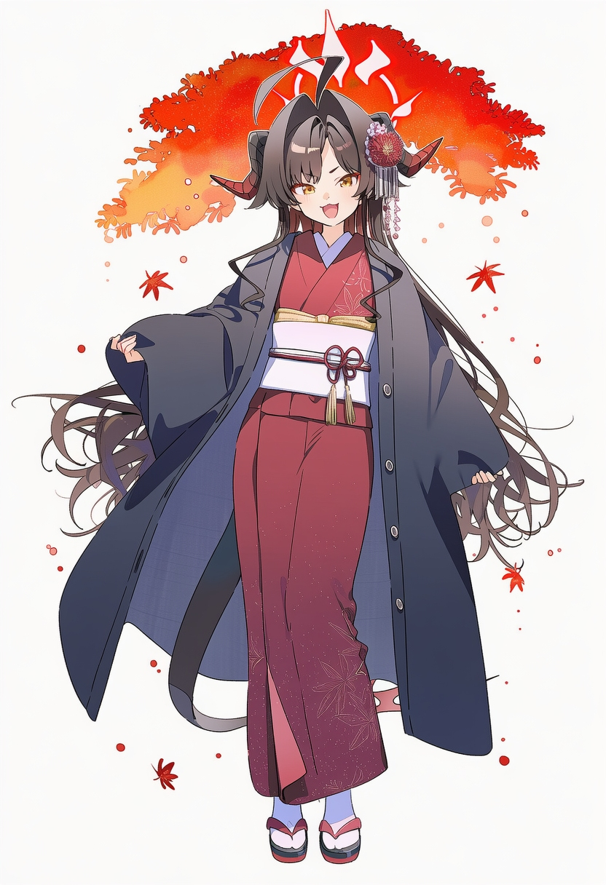

[在线例图](https://assets.quicktagcloud.com/images/raven_composition/raven_composition-5307.jpg?v=d64b577f9e117e29)

<a id="raven_composition-5308"></a>

## 下仓惠

ID：`raven_composition-5308`；分类：角色图鉴 / 蔚蓝档案；来源标记：`safe`。

来源说明：

> 作品：蔚蓝档案
> 性别：女
> 登场时间：2022-11

正向提示词：

```text
megu_(blue_archive)
```

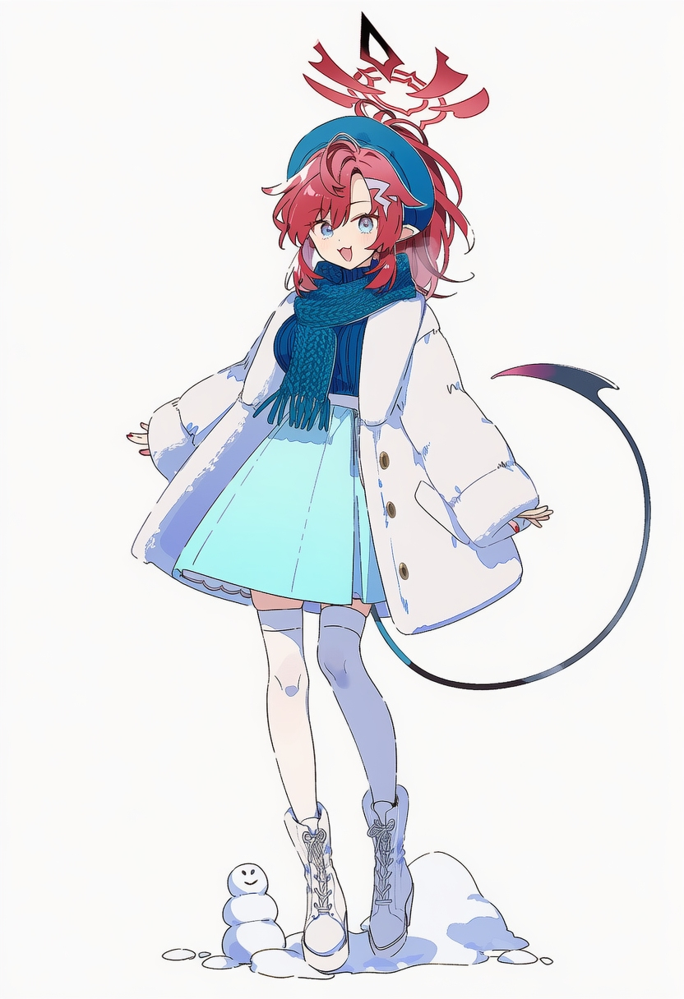

[在线例图](https://assets.quicktagcloud.com/images/raven_composition/raven_composition-5308.jpg?v=cc80b2f06b200296)

<a id="raven_composition-5309"></a>

## 贝阿特丽丝

ID：`raven_composition-5309`；分类：角色图鉴 / 蔚蓝档案；来源标记：`safe`。

来源说明：

> 作品：蔚蓝档案
> 性别：女
> 登场时间：2023 剧情反派

正向提示词：

```text
francis_(blue_archive)
```

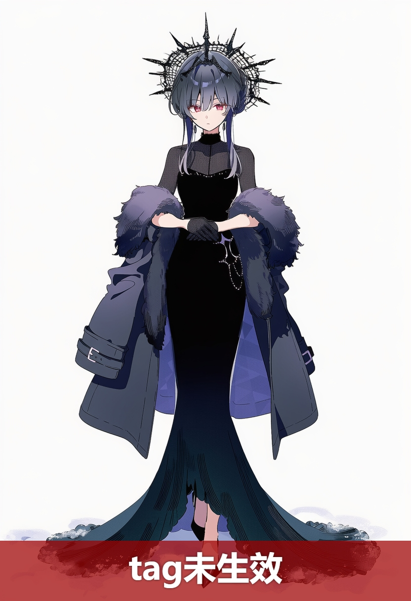

[在线例图](https://assets.quicktagcloud.com/images/raven_composition/raven_composition-5309.jpg?v=e9a3e347c8f12c74)

<a id="raven_composition-5310"></a>

## 调月莉音

ID：`raven_composition-5310`；分类：角色图鉴 / 蔚蓝档案；来源标记：`safe`。

来源说明：

> 作品：蔚蓝档案
> 性别：女
> 登场时间：2023-01

正向提示词：

```text
rio_(blue_archive)
```

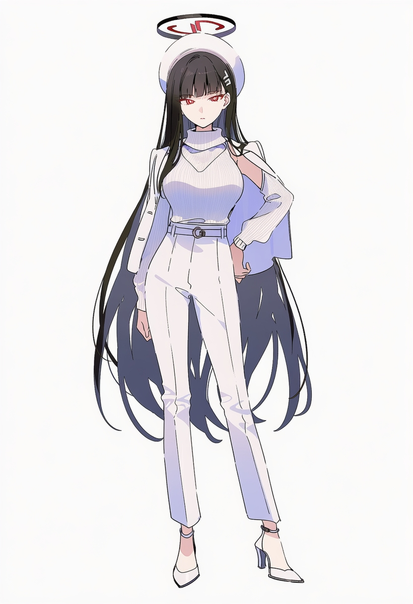

[在线例图](https://assets.quicktagcloud.com/images/raven_composition/raven_composition-5310.jpg?v=ab573729131727b7)

<a id="raven_composition-5311"></a>

## 锭前纱织

ID：`raven_composition-5311`；分类：角色图鉴 / 蔚蓝档案；来源标记：`safe`。

来源说明：

> 作品：蔚蓝档案
> 性别：女
> 登场时间：2023-02

正向提示词：

```text
saori_(blue_archive)
```

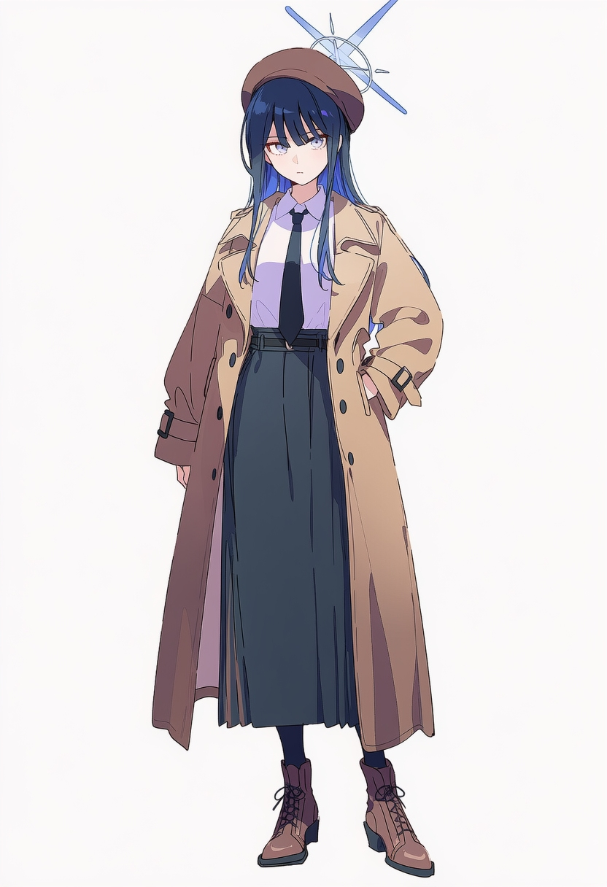

[在线例图](https://assets.quicktagcloud.com/images/raven_composition/raven_composition-5311.jpg?v=43dce61a3b7938d9)

<a id="raven_composition-5312"></a>

## 秤亚津子

ID：`raven_composition-5312`；分类：角色图鉴 / 蔚蓝档案；来源标记：`safe`。

来源说明：

> 作品：蔚蓝档案
> 性别：女
> 登场时间：2023-02

正向提示词：

```text
atsuko_(blue_archive)
```

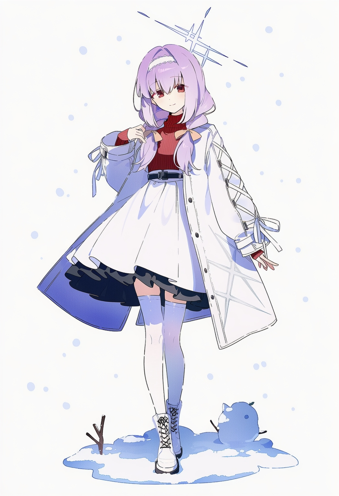

[在线例图](https://assets.quicktagcloud.com/images/raven_composition/raven_composition-5312.jpg?v=b317942e42cb854a)

<a id="raven_composition-5313"></a>

## 戒野美咲

ID：`raven_composition-5313`；分类：角色图鉴 / 蔚蓝档案；来源标记：`safe`。

来源说明：

> 作品：蔚蓝档案
> 性别：女
> 登场时间：2023-02

正向提示词：

```text
misaki_(blue_archive)
```

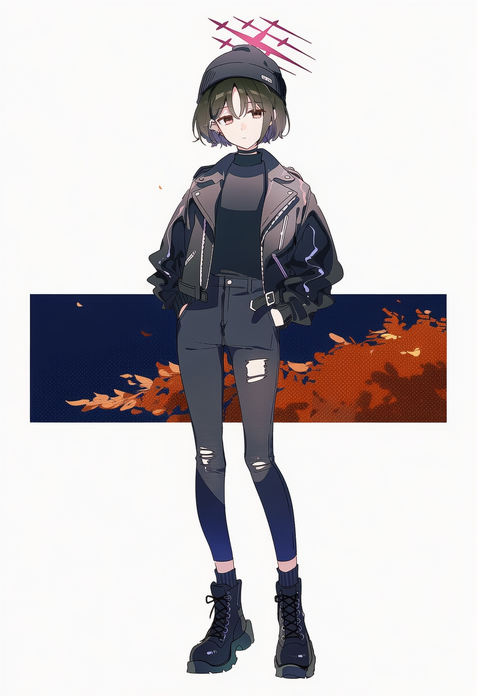

[在线例图](https://assets.quicktagcloud.com/images/raven_composition/raven_composition-5313.jpg?v=ec8a78f840310e62)

<a id="raven_composition-5314"></a>

## 槌永日和

ID：`raven_composition-5314`；分类：角色图鉴 / 蔚蓝档案；来源标记：`safe`。

来源说明：

> 作品：蔚蓝档案
> 性别：女
> 登场时间：2023-02

正向提示词：

```text
hiyori_(blue_archive)
```

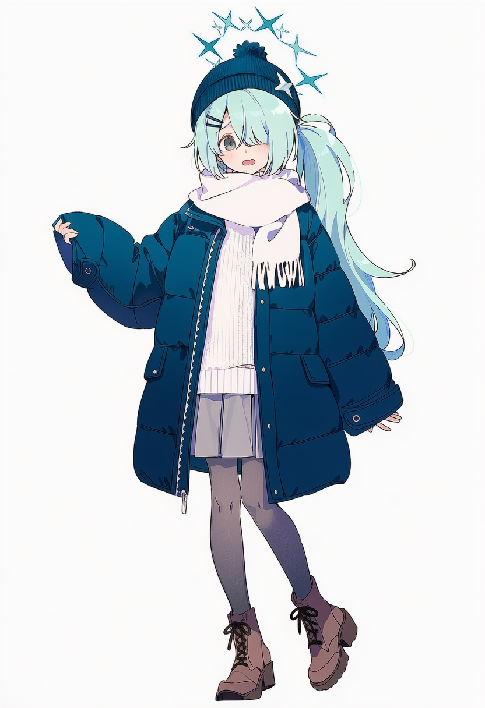

[在线例图](https://assets.quicktagcloud.com/images/raven_composition/raven_composition-5314.jpg?v=5ed3cfa521d17c5e)

<a id="raven_composition-5315"></a>

## 黑崎小雪

ID：`raven_composition-5315`；分类：角色图鉴 / 蔚蓝档案；来源标记：`safe`。

来源说明：

> 作品：蔚蓝档案
> 性别：女
> 登场时间：2023-03

正向提示词：

```text
koyuki_(blue_archive)
```


[在线例图](https://assets.quicktagcloud.com/images/raven_composition/raven_composition-5315.jpg?v=d226b88993f44911)

<a id="raven_composition-5316"></a>

## 星野(临战)

ID：`raven_composition-5316`；分类：角色图鉴 / 蔚蓝档案；来源标记：`safe`。

来源说明：

> 作品：蔚蓝档案
> 性别：女
> 登场时间：2023-04

正向提示词：

```text
hoshino_terror_(blue_archive)
```


[在线例图](https://assets.quicktagcloud.com/images/raven_composition/raven_composition-5316.jpg?v=e51c9ee366a46336)

<a id="raven_composition-5317"></a>

## 砂狼白子(恐怖)

ID：`raven_composition-5317`；分类：角色图鉴 / 蔚蓝档案；来源标记：`safe`。

来源说明：

> 作品：蔚蓝档案
> 性别：女
> 登场时间：2023-04

正向提示词：

```text
shiroko_terror_(blue_archive)
```

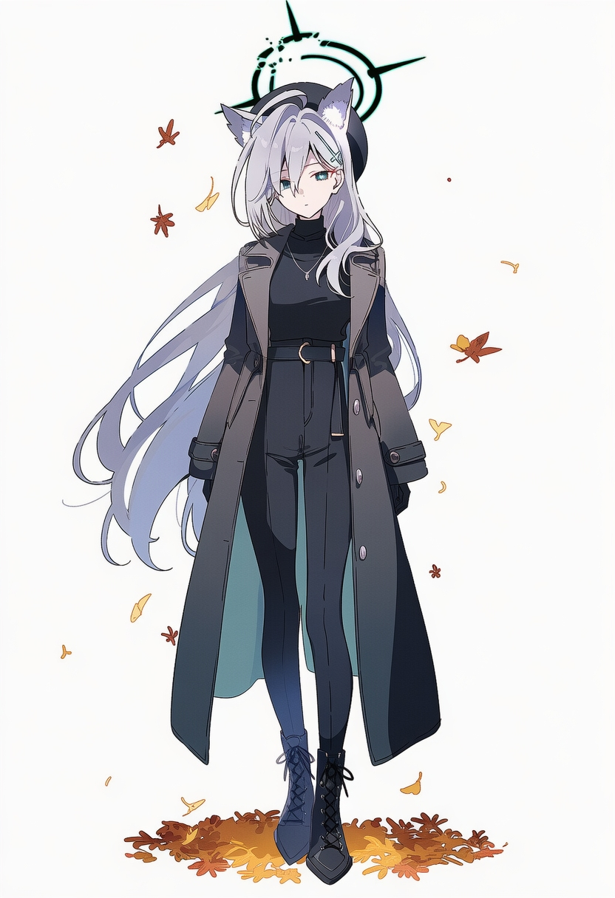

[在线例图](https://assets.quicktagcloud.com/images/raven_composition/raven_composition-5317.jpg?v=ca3ab2e842ba52f8)

<a id="raven_composition-5318"></a>

## 飞鸟马时

ID：`raven_composition-5318`；分类：角色图鉴 / 蔚蓝档案；来源标记：`safe`。

来源说明：

> 作品：蔚蓝档案
> 性别：女
> 登场时间：2023-04

正向提示词：

```text
toki_(blue_archive)
```

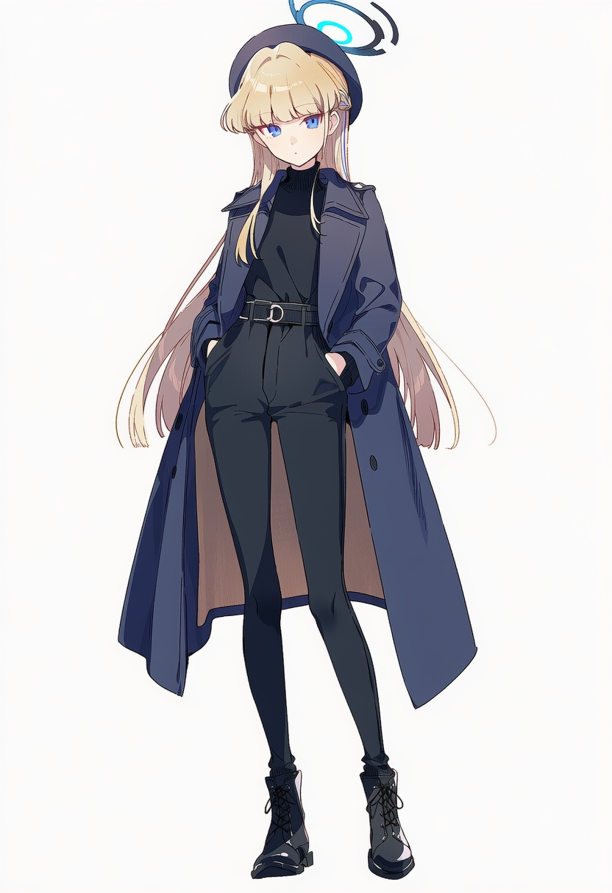

[在线例图](https://assets.quicktagcloud.com/images/raven_composition/raven_composition-5318.jpg?v=5723c4ab766711fc)

<a id="raven_composition-5319"></a>

## 歌住樱子

ID：`raven_composition-5319`；分类：角色图鉴 / 蔚蓝档案；来源标记：`safe`。

来源说明：

> 作品：蔚蓝档案
> 性别：女
> 登场时间：2023-07

正向提示词：

```text
sakurako_(blue_archive)
```

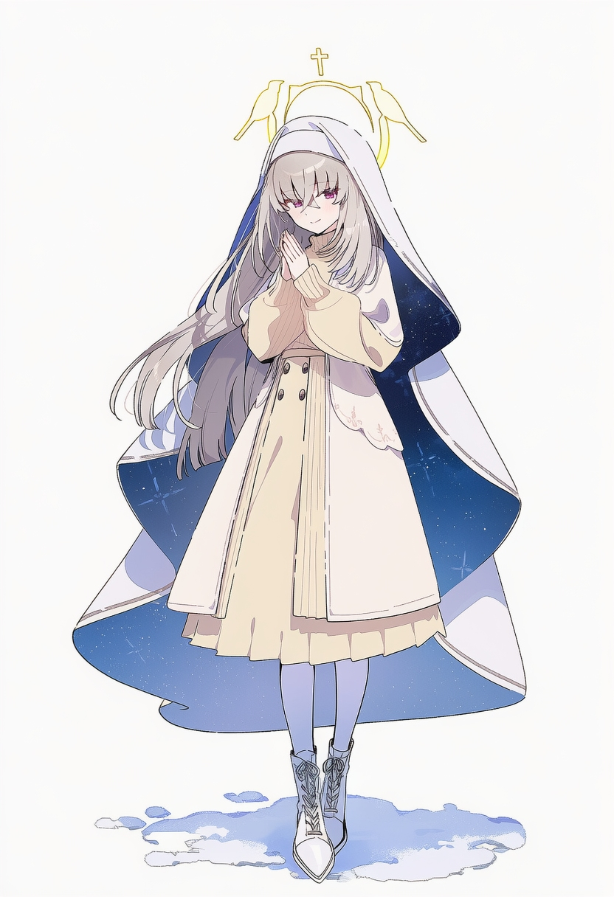

[在线例图](https://assets.quicktagcloud.com/images/raven_composition/raven_composition-5319.jpg?v=cc93e53e21d01633)

<a id="raven_composition-5320"></a>

## 守月铃美

ID：`raven_composition-5320`；分类：角色图鉴 / 蔚蓝档案；来源标记：`safe`。

来源说明：

> 作品：蔚蓝档案
> 性别：女
> 登场时间：2023-07

正向提示词：

```text
suzumi_(blue_archive)
```

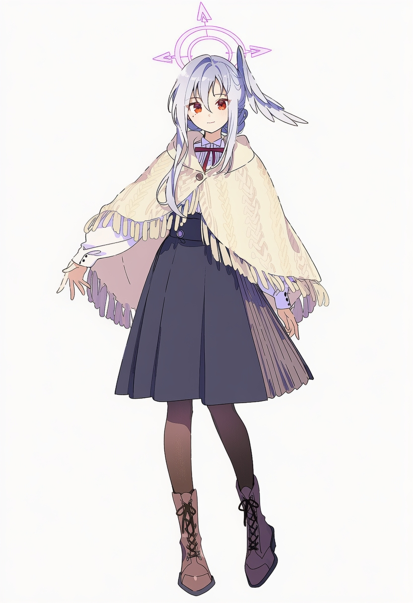

[在线例图](https://assets.quicktagcloud.com/images/raven_composition/raven_composition-5320.jpg?v=ef7b9e27250abf96)

<a id="raven_composition-5321"></a>

## 杏山和纱

ID：`raven_composition-5321`；分类：角色图鉴 / 蔚蓝档案；来源标记：`safe`。

来源说明：

> 作品：蔚蓝档案
> 性别：女
> 登场时间：2023-08

正向提示词：

```text
kazusa_(blue_archive)
```

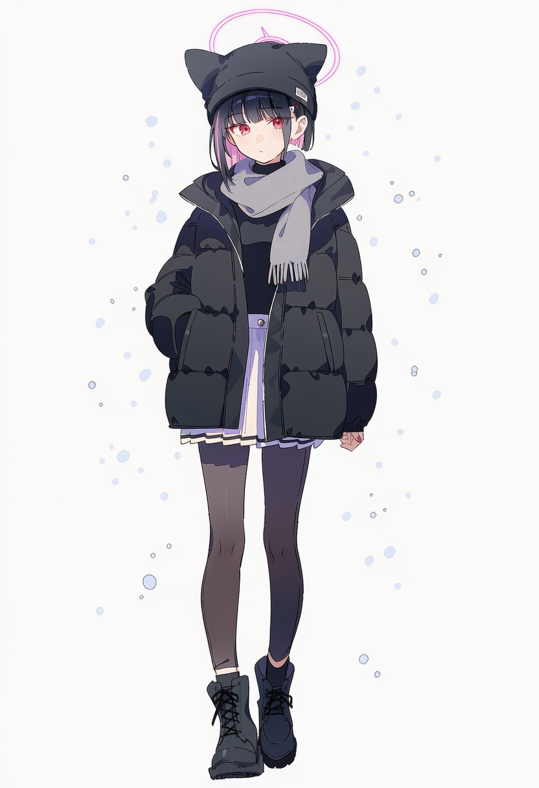

[在线例图](https://assets.quicktagcloud.com/images/raven_composition/raven_composition-5321.jpg?v=a317fb3bb02493cf)

<a id="raven_composition-5322"></a>

## 元宫千秋

ID：`raven_composition-5322`；分类：角色图鉴 / 蔚蓝档案；来源标记：`safe`。

来源说明：

> 作品：蔚蓝档案
> 性别：女
> 登场时间：2023-09

正向提示词：

```text
chiaki_(blue_archive)
```

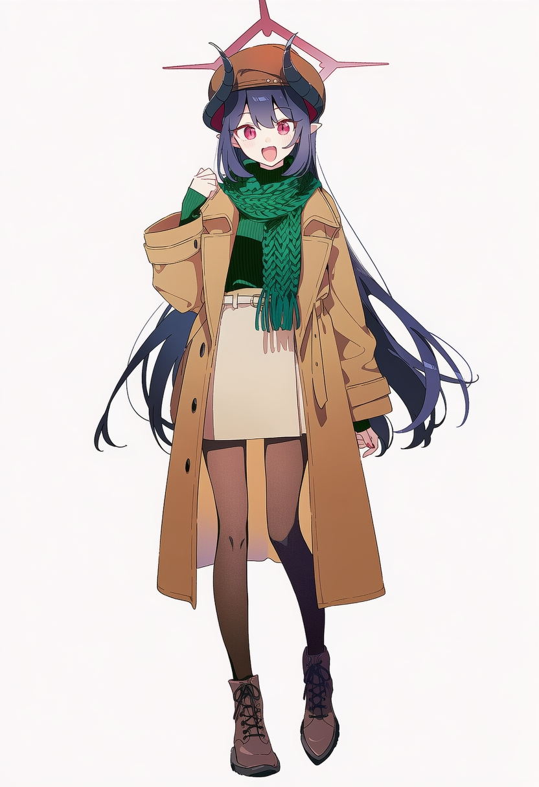

[在线例图](https://assets.quicktagcloud.com/images/raven_composition/raven_composition-5322.jpg?v=bfac14b1993dbc5c)

<a id="raven_composition-5323"></a>

## 尾刃康娜

ID：`raven_composition-5323`；分类：角色图鉴 / 蔚蓝档案；来源标记：`safe`。

来源说明：

> 作品：蔚蓝档案
> 性别：女
> 登场时间：2024-01

正向提示词：

```text
kanna_(blue_archive)
```

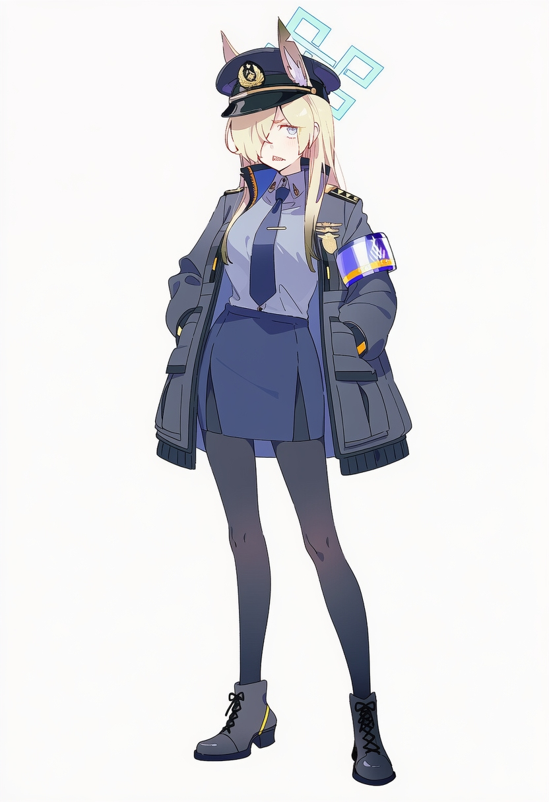

[在线例图](https://assets.quicktagcloud.com/images/raven_composition/raven_composition-5323.jpg?v=422bced94c3b6372)

<a id="raven_composition-5324"></a>

## 中务琪琳

ID：`raven_composition-5324`；分类：角色图鉴 / 蔚蓝档案；来源标记：`safe`。

来源说明：

> 作品：蔚蓝档案
> 性别：女
> 登场时间：2024-01

正向提示词：

```text
kirino_(blue_archive)
```

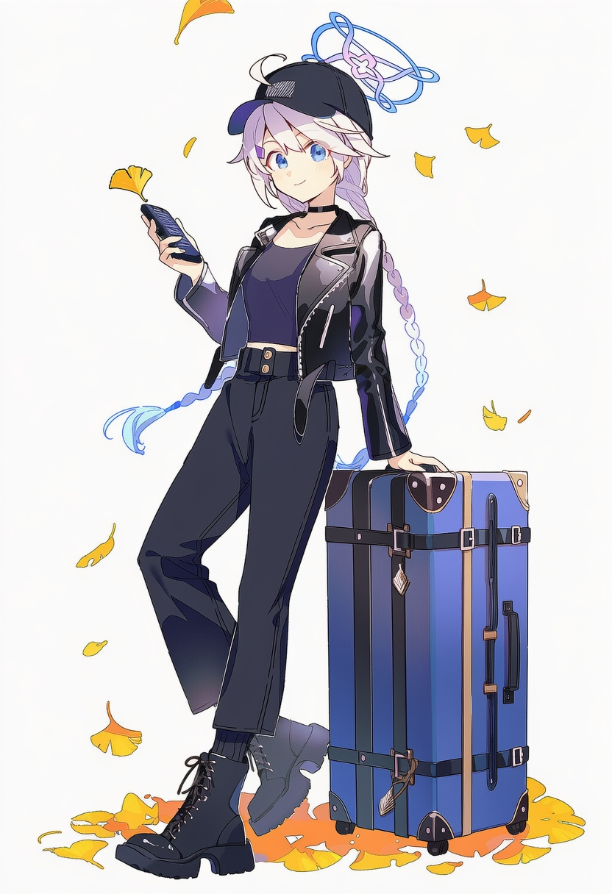

[在线例图](https://assets.quicktagcloud.com/images/raven_composition/raven_composition-5324.jpg?v=2d4b6246098e5907)

<a id="raven_composition-5325"></a>

## 合欢垣吹雪

ID：`raven_composition-5325`；分类：角色图鉴 / 蔚蓝档案；来源标记：`safe`。

来源说明：

> 作品：蔚蓝档案
> 性别：女
> 登场时间：2024-01

正向提示词：

```text
fubuki_(blue_archive)
```

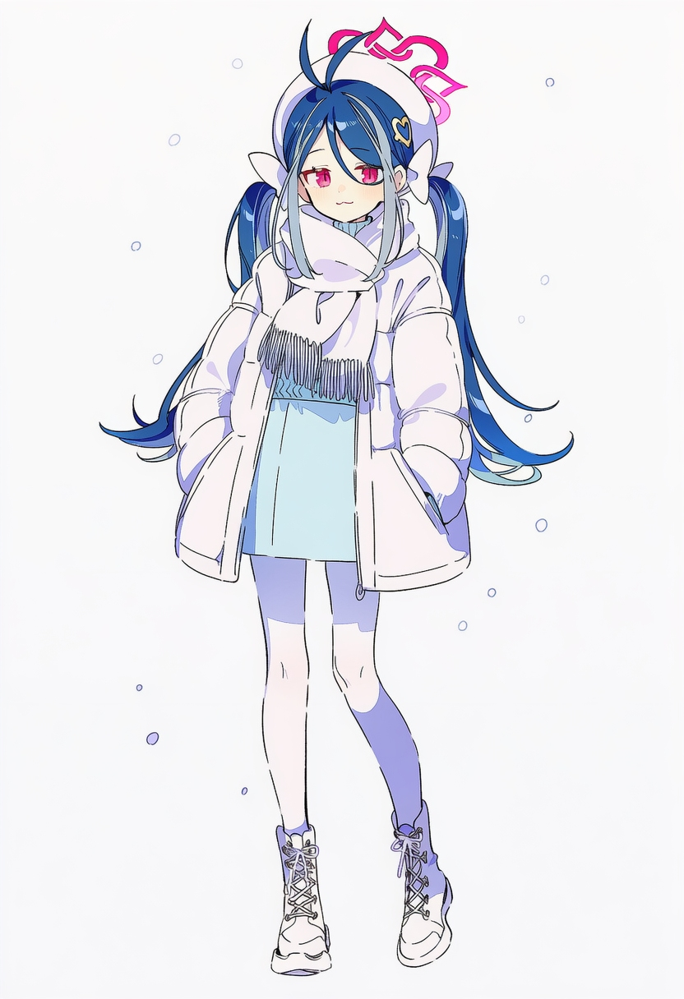

[在线例图](https://assets.quicktagcloud.com/images/raven_composition/raven_composition-5325.jpg?v=fdcd920570890308)

<a id="raven_composition-5326"></a>

## 七度雪乃

ID：`raven_composition-5326`；分类：角色图鉴 / 蔚蓝档案；来源标记：`safe`。

来源说明：

> 作品：蔚蓝档案
> 性别：女
> 登场时间：2024-01

正向提示词：

```text
yukino_(blue_archive)
```

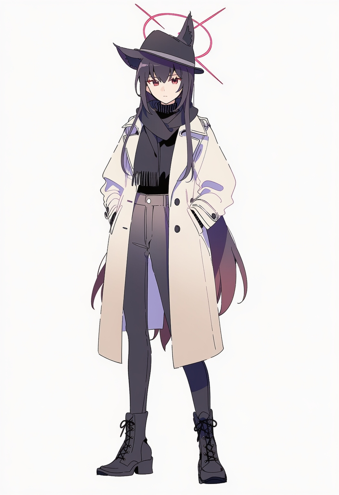

[在线例图](https://assets.quicktagcloud.com/images/raven_composition/raven_composition-5326.jpg?v=70024def5afa142f)

<a id="raven_composition-5327"></a>

## 吉野妮可

ID：`raven_composition-5327`；分类：角色图鉴 / 蔚蓝档案；来源标记：`safe`。

来源说明：

> 作品：蔚蓝档案
> 性别：女
> 登场时间：2024-01

正向提示词：

```text
niko_(blue_archive)
```


[在线例图](https://assets.quicktagcloud.com/images/raven_composition/raven_composition-5327.jpg?v=258e28c90a061f40)

<a id="raven_composition-5328"></a>

## 天神山御伽

ID：`raven_composition-5328`；分类：角色图鉴 / 蔚蓝档案；来源标记：`safe`。

来源说明：

> 作品：蔚蓝档案
> 性别：女
> 登场时间：2024-01

正向提示词：

```text
otogi_(blue_archive)
```

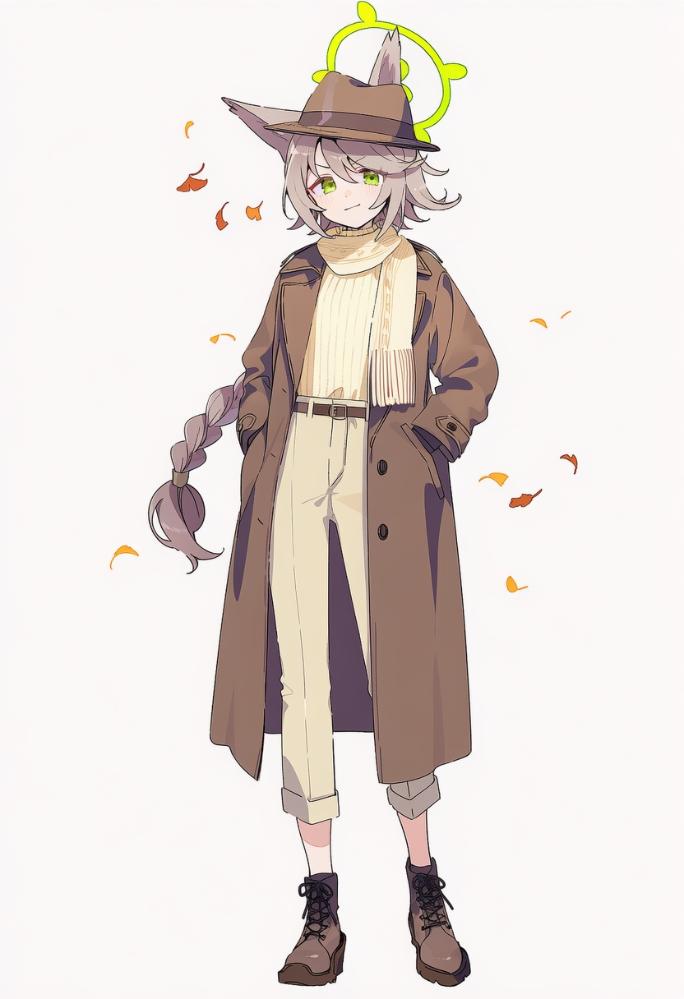

[在线例图](https://assets.quicktagcloud.com/images/raven_composition/raven_composition-5328.jpg?v=52bb9547d07fc587)

<a id="raven_composition-5329"></a>

## 高仓胡桃

ID：`raven_composition-5329`；分类：角色图鉴 / 蔚蓝档案；来源标记：`safe`。

来源说明：

> 作品：蔚蓝档案
> 性别：女
> 登场时间：2024-01

正向提示词：

```text
kurumi_(blue_archive)
```


[在线例图](https://assets.quicktagcloud.com/images/raven_composition/raven_composition-5329.jpg?v=e576ef523897fcf6)

<a id="raven_composition-5330"></a>

## 朝比奈菲娜

ID：`raven_composition-5330`；分类：角色图鉴 / 蔚蓝档案；来源标记：`safe`。

来源说明：

> 作品：蔚蓝档案
> 性别：女
> 登场时间：2024-02

正向提示词：

```text
pina_(blue_archive)
```


[在线例图](https://assets.quicktagcloud.com/images/raven_composition/raven_composition-5330.jpg?v=dcb59b2019cc98b2)

<a id="raven_composition-5331"></a>

## 里滨海花

ID：`raven_composition-5331`；分类：角色图鉴 / 蔚蓝档案；来源标记：`safe`。

来源说明：

> 作品：蔚蓝档案
> 性别：女
> 登场时间：2024-02

正向提示词：

```text
umika_(blue_archive)
```


[在线例图](https://assets.quicktagcloud.com/images/raven_composition/raven_composition-5331.jpg?v=98c2f8609e95c233)

<a id="raven_composition-5332"></a>

## 龙华妃咲

ID：`raven_composition-5332`；分类：角色图鉴 / 蔚蓝档案；来源标记：`safe`。

来源说明：

> 作品：蔚蓝档案
> 性别：女
> 登场时间：2024-02

正向提示词：

```text
kisaki_(blue_archive)
```

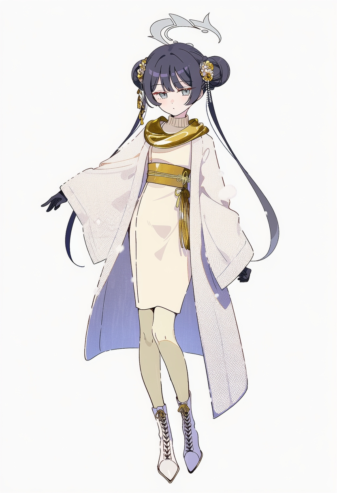

[在线例图](https://assets.quicktagcloud.com/images/raven_composition/raven_composition-5332.jpg?v=0d2c1c35cfb53688)

<a id="raven_composition-5333"></a>

## 近卫南

ID：`raven_composition-5333`；分类：角色图鉴 / 蔚蓝档案；来源标记：`safe`。

来源说明：

> 作品：蔚蓝档案
> 性别：女
> 登场时间：2024-02

正向提示词：

```text
mina_(blue_archive)
```


[在线例图](https://assets.quicktagcloud.com/images/raven_composition/raven_composition-5333.jpg?v=7bee52699fda8303)

<a id="raven_composition-5334"></a>

## 宫内佳音

ID：`raven_composition-5334`；分类：角色图鉴 / 蔚蓝档案；来源标记：`safe`。

来源说明：

> 作品：蔚蓝档案
> 性别：女
> 登场时间：2024-02

正向提示词：

```text
kanae_(blue_archive)
```


[在线例图](https://assets.quicktagcloud.com/images/raven_composition/raven_composition-5334.jpg?v=877107e184219066)

<a id="raven_composition-5335"></a>

## 桐生桔梗

ID：`raven_composition-5335`；分类：角色图鉴 / 蔚蓝档案；来源标记：`safe`。

来源说明：

> 作品：蔚蓝档案
> 性别：女
> 登场时间：2024-03

正向提示词：

```text
kikyou_(blue_archive)
```

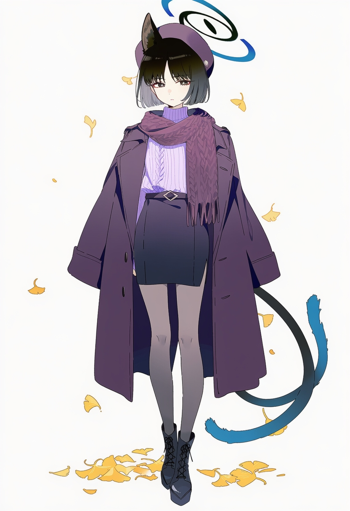

[在线例图](https://assets.quicktagcloud.com/images/raven_composition/raven_composition-5335.jpg?v=a14c2974a727b306)

<a id="raven_composition-5336"></a>

## 勘解由小路紫

ID：`raven_composition-5336`；分类：角色图鉴 / 蔚蓝档案；来源标记：`safe`。

来源说明：

> 作品：蔚蓝档案
> 性别：女
> 登场时间：2024-03

正向提示词：

```text
yukari_(blue_archive)
```


[在线例图](https://assets.quicktagcloud.com/images/raven_composition/raven_composition-5336.jpg?v=e9005ea1a76386a8)

<a id="raven_composition-5337"></a>

## 朱城瑠海

ID：`raven_composition-5337`；分类：角色图鉴 / 蔚蓝档案；来源标记：`safe`。

来源说明：

> 作品：蔚蓝档案
> 性别：女
> 登场时间：2024-03

正向提示词：

```text
rumi_(blue_archive)
```

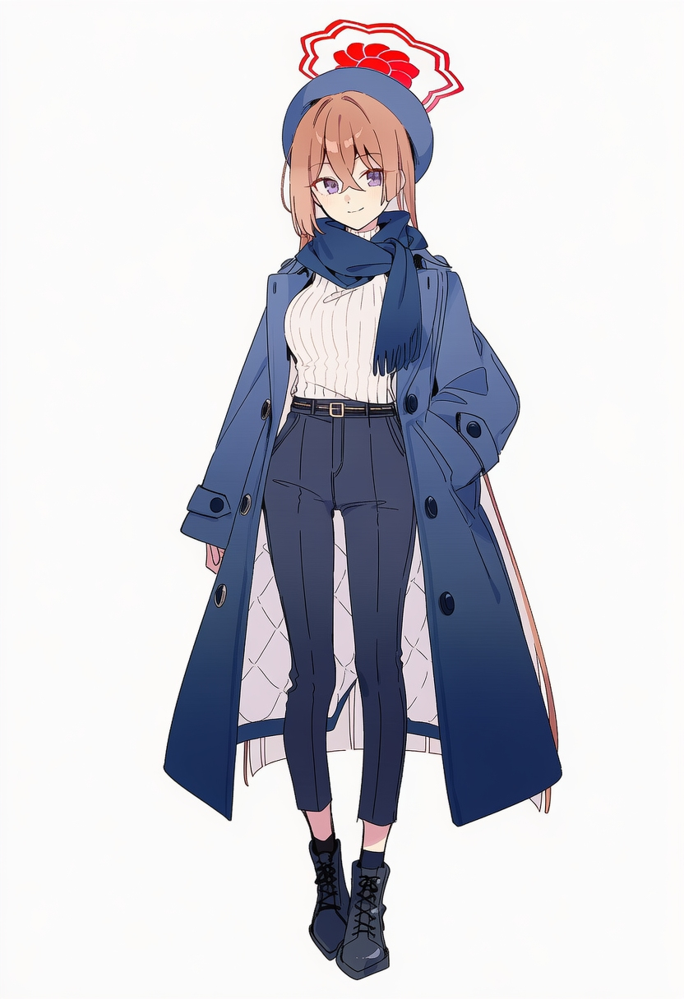

[在线例图](https://assets.quicktagcloud.com/images/raven_composition/raven_composition-5337.jpg?v=1424e91a3baf547c)

<a id="raven_composition-5338"></a>

## 鹿山丽情

ID：`raven_composition-5338`；分类：角色图鉴 / 蔚蓝档案；来源标记：`safe`。

来源说明：

> 作品：蔚蓝档案
> 性别：女
> 登场时间：2024-03

正向提示词：

```text
reijo_(blue_archive)
```


[在线例图](https://assets.quicktagcloud.com/images/raven_composition/raven_composition-5338.jpg?v=3ab30d5a68a9df38)

<a id="raven_composition-5339"></a>

## 夜樱绮罗罗

ID：`raven_composition-5339`；分类：角色图鉴 / 蔚蓝档案；来源标记：`safe`。

来源说明：

> 作品：蔚蓝档案
> 性别：女
> 登场时间：2024-05

正向提示词：

```text
kirara_(blue_archive)
```


[在线例图](https://assets.quicktagcloud.com/images/raven_composition/raven_composition-5339.jpg?v=7200472163471a1a)

<a id="raven_composition-5340"></a>

## 旗见绘梨香

ID：`raven_composition-5340`；分类：角色图鉴 / 蔚蓝档案；来源标记：`safe`。

来源说明：

> 作品：蔚蓝档案
> 性别：女
> 登场时间：2024-05

正向提示词：

```text
erika_(blue_archive)
```


[在线例图](https://assets.quicktagcloud.com/images/raven_composition/raven_composition-5340.jpg?v=e800078803377f2a)

<a id="raven_composition-5341"></a>

## 漆原辉夜

ID：`raven_composition-5341`；分类：角色图鉴 / 蔚蓝档案；来源标记：`safe`。

来源说明：

> 作品：蔚蓝档案
> 性别：女
> 登场时间：2024-06

正向提示词：

```text
kaguya_(blue_archive)
```

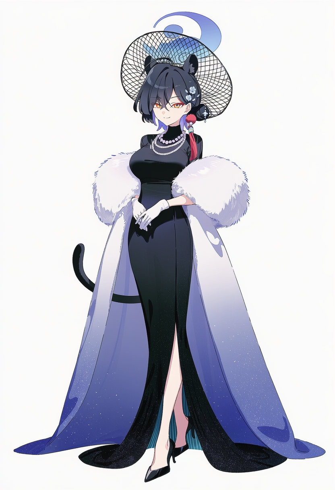

[在线例图](https://assets.quicktagcloud.com/images/raven_composition/raven_composition-5341.jpg?v=0f5907e8ac2546cb)

<a id="raven_composition-5342"></a>

## 水羽三森

ID：`raven_composition-5342`；分类：角色图鉴 / 蔚蓝档案；来源标记：`safe`。

来源说明：

> 作品：蔚蓝档案
> 性别：女
> 登场时间：2024-07

正向提示词：

```text
mimori_(blue_archive)
```


[在线例图](https://assets.quicktagcloud.com/images/raven_composition/raven_composition-5342.jpg?v=902a847b60325108)

<a id="raven_composition-5343"></a>

## 勇美枫

ID：`raven_composition-5343`；分类：角色图鉴 / 蔚蓝档案；来源标记：`safe`。

来源说明：

> 作品：蔚蓝档案
> 性别：女
> 登场时间：2024-07

正向提示词：

```text
kaede_(blue_archive)
```


[在线例图](https://assets.quicktagcloud.com/images/raven_composition/raven_composition-5343.jpg?v=58c6819c2c61f4cc)

<a id="raven_composition-5344"></a>

## 天地尼亚

ID：`raven_composition-5344`；分类：角色图鉴 / 蔚蓝档案；来源标记：`safe`。

来源说明：

> 作品：蔚蓝档案
> 性别：女
> 登场时间：2024-09

正向提示词：

```text
niya_(blue_archive)
```

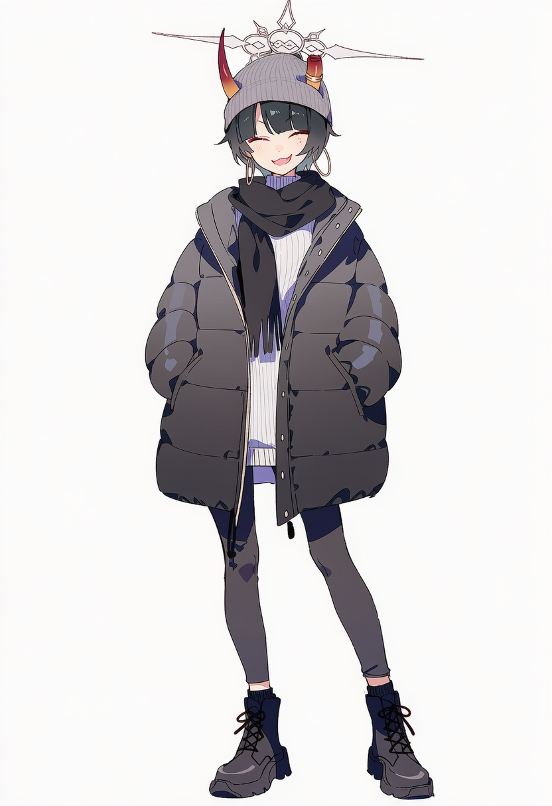

[在线例图](https://assets.quicktagcloud.com/images/raven_composition/raven_composition-5344.jpg?v=10f91293e15f931e)

<a id="raven_composition-5345"></a>

## 桑上果穗

ID：`raven_composition-5345`；分类：角色图鉴 / 蔚蓝档案；来源标记：`safe`。

来源说明：

> 作品：蔚蓝档案
> 性别：女
> 登场时间：2024-09

正向提示词：

```text
kaho_(blue_archive)
```

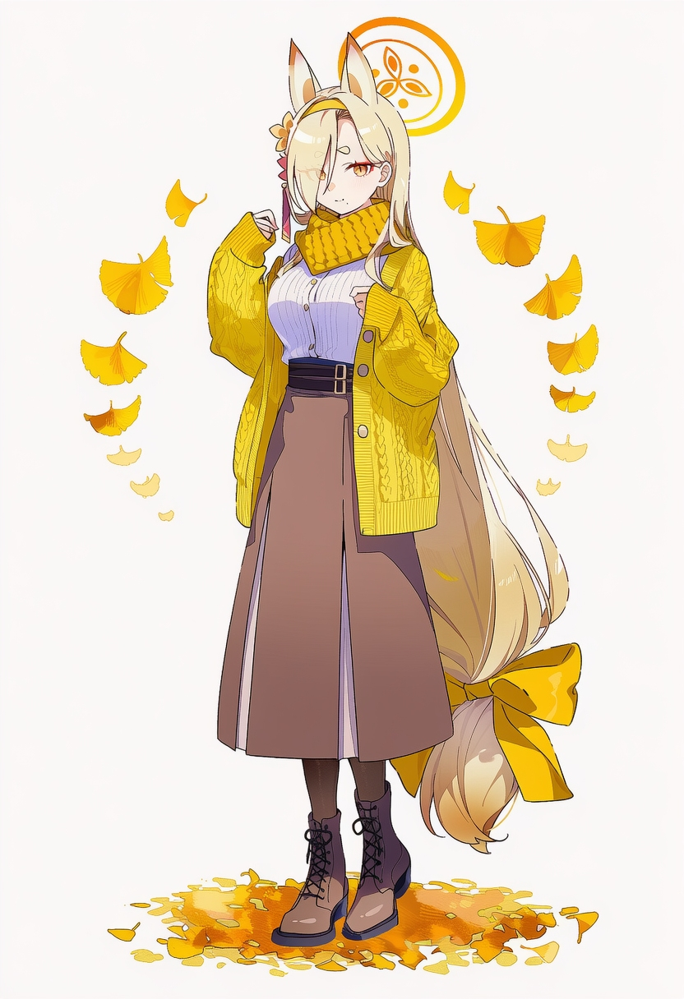

[在线例图](https://assets.quicktagcloud.com/images/raven_composition/raven_composition-5345.jpg?v=8138dcfe7ea9a8b5)

<a id="raven_composition-5346"></a>

## 和乐千世

ID：`raven_composition-5346`；分类：角色图鉴 / 蔚蓝档案；来源标记：`safe`。

来源说明：

> 作品：蔚蓝档案
> 性别：女
> 登场时间：2024-09

正向提示词：

```text
chise_(blue_archive)
```

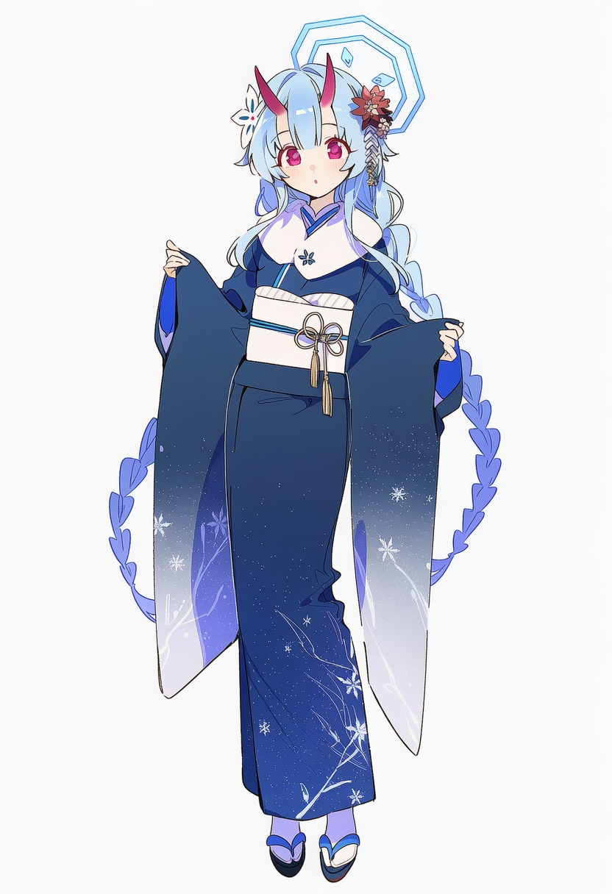

[在线例图](https://assets.quicktagcloud.com/images/raven_composition/raven_composition-5346.jpg?v=3e591585be73f8b0)

<a id="raven_composition-5347"></a>

## 七稜菖蒲

ID：`raven_composition-5347`；分类：角色图鉴 / 蔚蓝档案；来源标记：`safe`。

来源说明：

> 作品：蔚蓝档案
> 性别：女
> 登场时间：2024-10

正向提示词：

```text
ayame_(blue_archive)
```

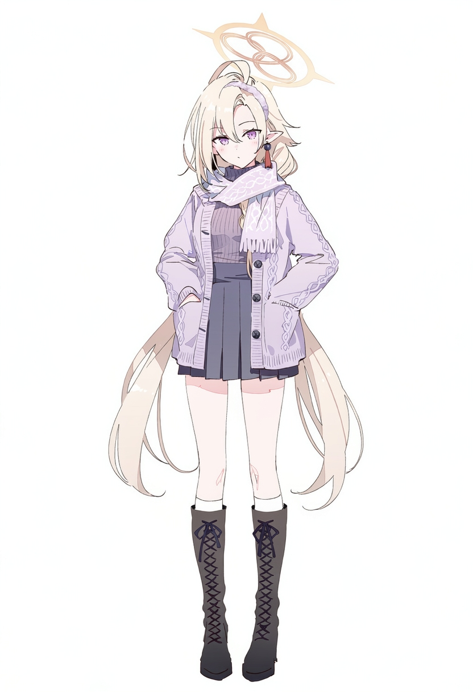

[在线例图](https://assets.quicktagcloud.com/images/raven_composition/raven_composition-5347.jpg?v=513585ad0e40a1a1)

<a id="raven_composition-5348"></a>

## 御稜名草

ID：`raven_composition-5348`；分类：角色图鉴 / 蔚蓝档案；来源标记：`safe`。

来源说明：

> 作品：蔚蓝档案
> 性别：女
> 登场时间：2024-10

正向提示词：

```text
nagusa_(blue_archive)
```

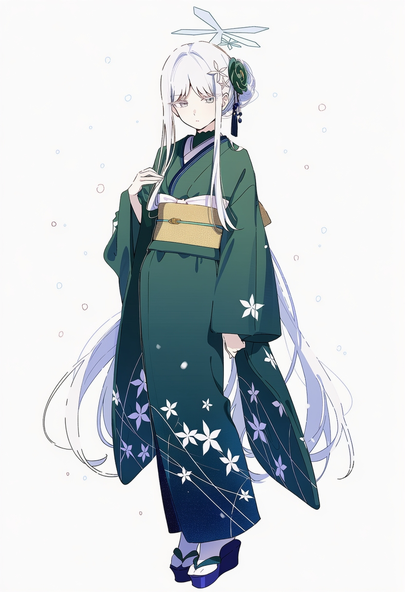

[在线例图](https://assets.quicktagcloud.com/images/raven_composition/raven_composition-5348.jpg?v=af2fef515d9b267a)

<a id="raven_composition-5349"></a>

## 不破莲华

ID：`raven_composition-5349`；分类：角色图鉴 / 蔚蓝档案；来源标记：`safe`。

来源说明：

> 作品：蔚蓝档案
> 性别：女
> 登场时间：2024-10

正向提示词：

```text
renge_(blue_archive)
```

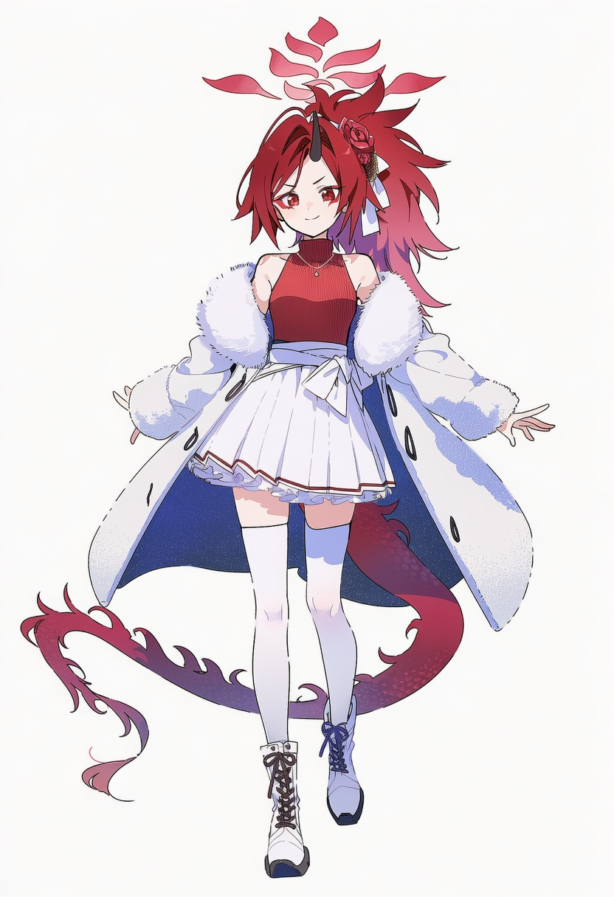

[在线例图](https://assets.quicktagcloud.com/images/raven_composition/raven_composition-5349.jpg?v=0645d860bf36697c)

<a id="raven_composition-5350"></a>

## 各务千寻

ID：`raven_composition-5350`；分类：角色图鉴 / 蔚蓝档案；来源标记：`safe`。

来源说明：

> 作品：蔚蓝档案
> 性别：女
> 登场时间：2024-11

正向提示词：

```text
chihiro_(blue_archive)
```


[在线例图](https://assets.quicktagcloud.com/images/raven_composition/raven_composition-5350.jpg?v=aa336b1e97f822c6)

<a id="raven_composition-5351"></a>

## 音濑小玉

ID：`raven_composition-5351`；分类：角色图鉴 / 蔚蓝档案；来源标记：`safe`。

来源说明：

> 作品：蔚蓝档案
> 性别：女
> 登场时间：2024-11

正向提示词：

```text
kotama_(blue_archive)
```

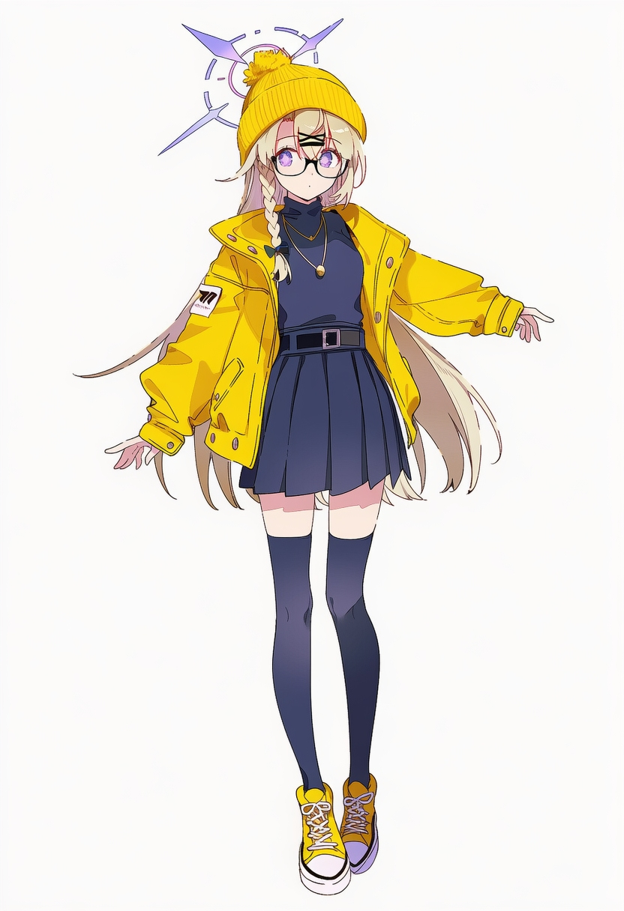

[在线例图](https://assets.quicktagcloud.com/images/raven_composition/raven_composition-5351.jpg?v=8b6212b90629dce1)

<a id="raven_composition-5352"></a>

## 小钩晴

ID：`raven_composition-5352`；分类：角色图鉴 / 蔚蓝档案；来源标记：`safe`。

来源说明：

> 作品：蔚蓝档案
> 性别：女
> 登场时间：2024-11

正向提示词：

```text
hare_(blue_archive)
```


[在线例图](https://assets.quicktagcloud.com/images/raven_composition/raven_composition-5352.jpg?v=35583cd11d273507)

<a id="raven_composition-5353"></a>

## 小涂真纪

ID：`raven_composition-5353`；分类：角色图鉴 / 蔚蓝档案；来源标记：`safe`。

来源说明：

> 作品：蔚蓝档案
> 性别：女
> 登场时间：2024-11

正向提示词：

```text
maki_(blue_archive)
```

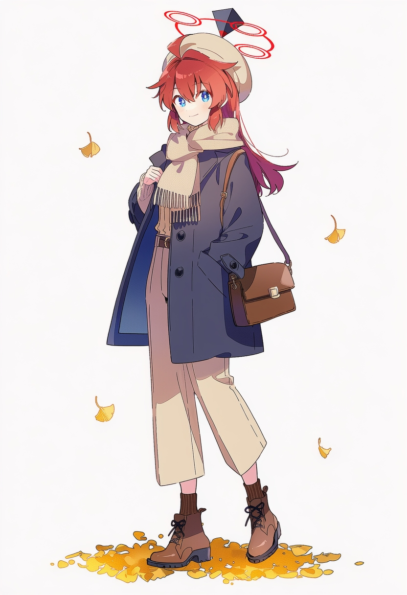

[在线例图](https://assets.quicktagcloud.com/images/raven_composition/raven_composition-5353.jpg?v=09d166b1a08e2bf2)

<a id="raven_composition-5354"></a>

## 明星日鞠

ID：`raven_composition-5354`；分类：角色图鉴 / 蔚蓝档案；来源标记：`safe`。

来源说明：

> 作品：蔚蓝档案
> 性别：女
> 登场时间：2024-12

正向提示词：

```text
himari_(blue_archive)
```

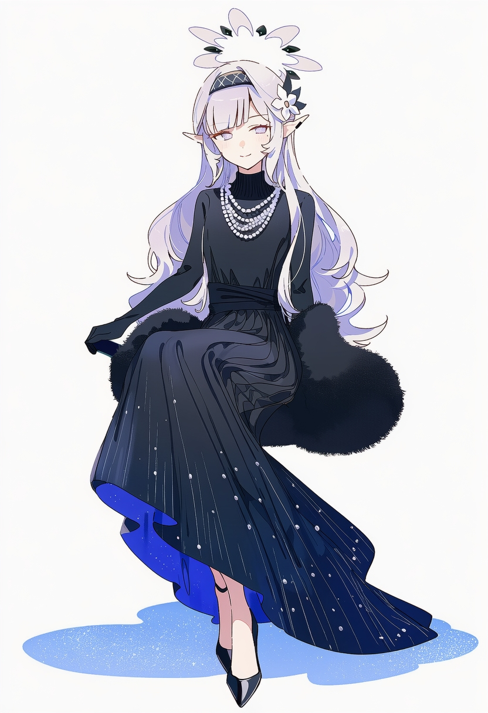

[在线例图](https://assets.quicktagcloud.com/images/raven_composition/raven_composition-5354.jpg?v=7d1a799ae54b0871)

<a id="raven_composition-5355"></a>

## 和泉元艾米

ID：`raven_composition-5355`；分类：角色图鉴 / 蔚蓝档案；来源标记：`safe`。

来源说明：

> 作品：蔚蓝档案
> 性别：女
> 登场时间：2024-12

正向提示词：

```text
eimi_(blue_archive)
```


[在线例图](https://assets.quicktagcloud.com/images/raven_composition/raven_composition-5355.jpg?v=65ec31f6384e296a)

<a id="raven_composition-5356"></a>

## 柯伊

ID：`raven_composition-5356`；分类：角色图鉴 / 蔚蓝档案；来源标记：`safe`。

来源说明：

> 作品：蔚蓝档案
> 性别：女
> 登场时间：2024-12

正向提示词：

```text
kei_(blue_archive)
```

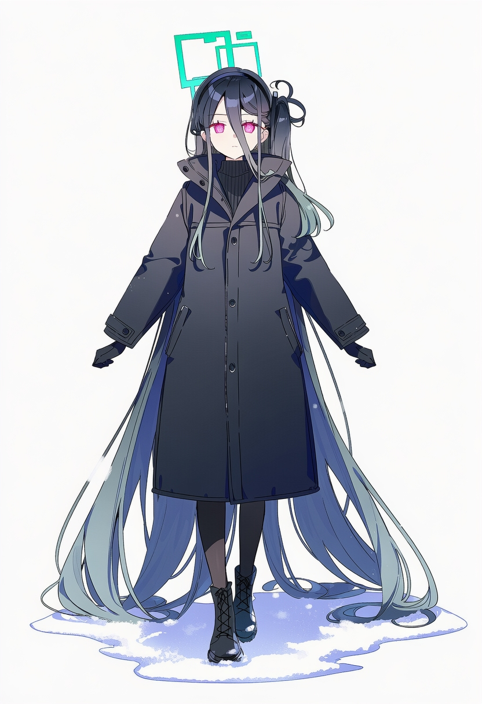

[在线例图](https://assets.quicktagcloud.com/images/raven_composition/raven_composition-5356.jpg?v=f146b91d57727333)

<a id="raven_composition-5357"></a>

## 野正丽

ID：`raven_composition-5357`；分类：角色图鉴 / 蔚蓝档案；来源标记：`safe`。

来源说明：

> 作品：蔚蓝档案
> 性别：女
> 登场时间：2024-12

正向提示词：

```text
rei_(blue_archive)
```

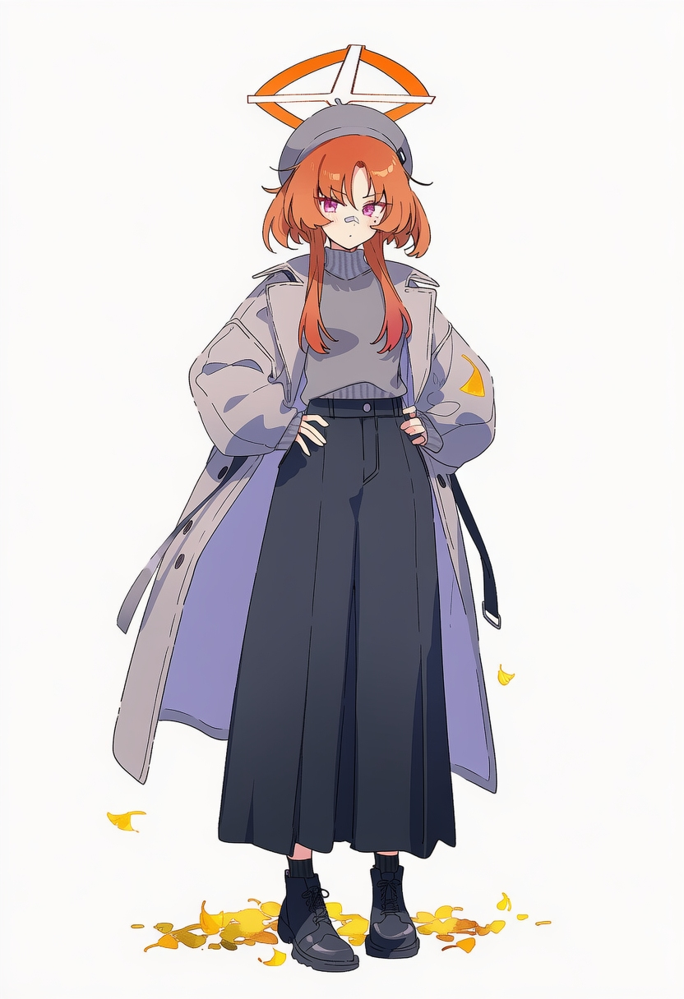

[在线例图](https://assets.quicktagcloud.com/images/raven_composition/raven_composition-5357.jpg?v=d78255497cc313ec)

<a id="raven_composition-5358"></a>

## 吾妻未来

ID：`raven_composition-5358`；分类：角色图鉴 / 蔚蓝档案；来源标记：`safe`。

来源说明：

> 作品：蔚蓝档案
> 性别：女
> 登场时间：2024-12

正向提示词：

```text
mirai_(blue_archive)
```

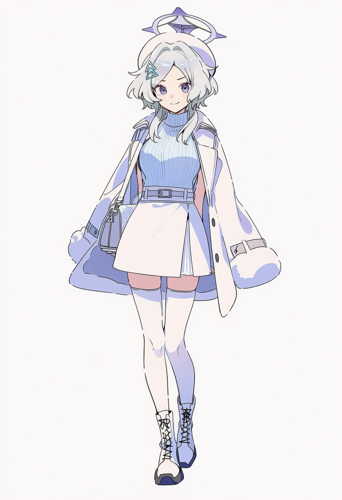

[在线例图](https://assets.quicktagcloud.com/images/raven_composition/raven_composition-5358.jpg?v=0365f3df63913763)

<a id="raven_composition-5359"></a>

## 羽咋翼

ID：`raven_composition-5359`；分类：角色图鉴 / 蔚蓝档案；来源标记：`safe`。

来源说明：

> 作品：蔚蓝档案
> 性别：女
> 登场时间：2024-12

正向提示词：

```text
tsubasa_(blue_archive)
```

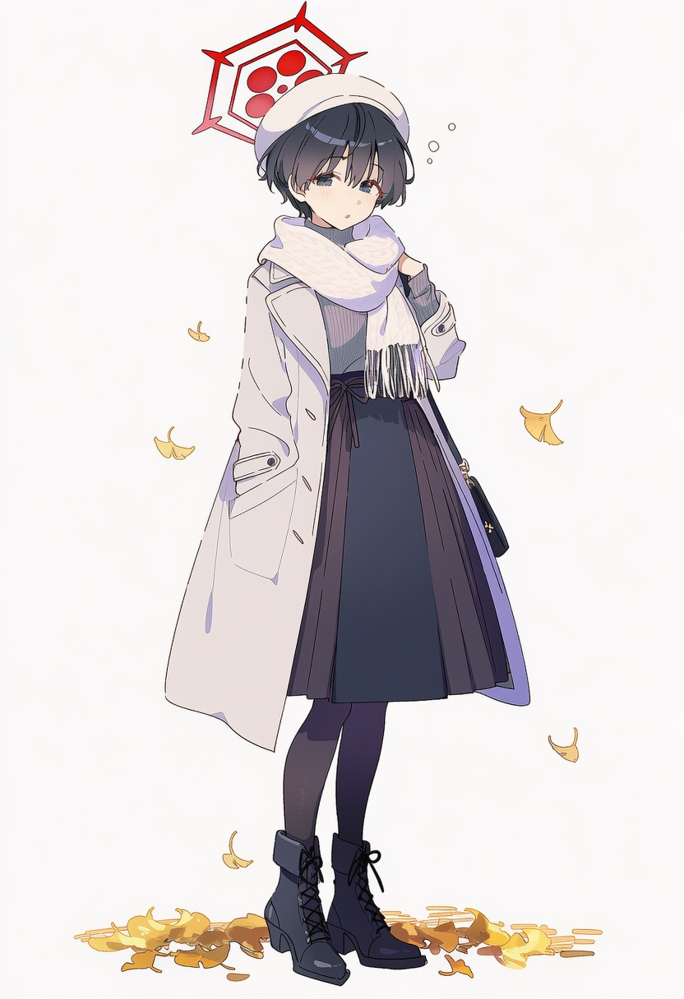

[在线例图](https://assets.quicktagcloud.com/images/raven_composition/raven_composition-5359.jpg?v=fa69a3595a1f8c17)

<a id="raven_composition-5360"></a>

## 川流诗音

ID：`raven_composition-5360`；分类：角色图鉴 / 蔚蓝档案；来源标记：`safe`。

来源说明：

> 作品：蔚蓝档案
> 性别：女
> 登场时间：2025

正向提示词：

```text
shinon_(blue_archive)
```


[在线例图](https://assets.quicktagcloud.com/images/raven_composition/raven_composition-5360.jpg?v=35b01a0b7210a584)

<a id="raven_composition-5361"></a>

## 风卷舞

ID：`raven_composition-5361`；分类：角色图鉴 / 蔚蓝档案；来源标记：`safe`。

来源说明：

> 作品：蔚蓝档案
> 性别：女
> 登场时间：2025

正向提示词：

```text
mai_(blue_archive)
```

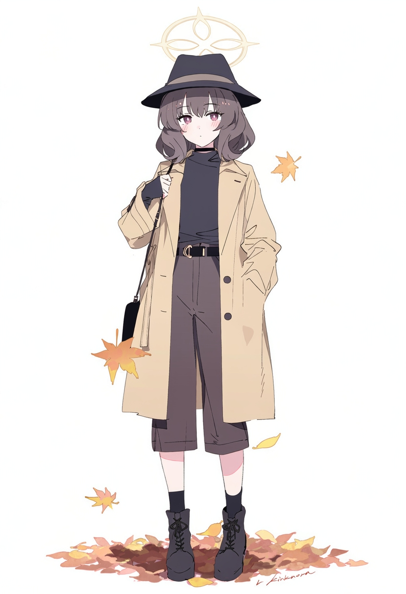

[在线例图](https://assets.quicktagcloud.com/images/raven_composition/raven_composition-5361.jpg?v=414a0cd48285b86f)

<a id="raven_composition-5362"></a>

## 姬木芽瑠

ID：`raven_composition-5362`；分类：角色图鉴 / 蔚蓝档案；来源标记：`safe`。

来源说明：

> 作品：蔚蓝档案
> 性别：女
> 登场时间：2025

正向提示词：

```text
meru_(blue_archive)
```

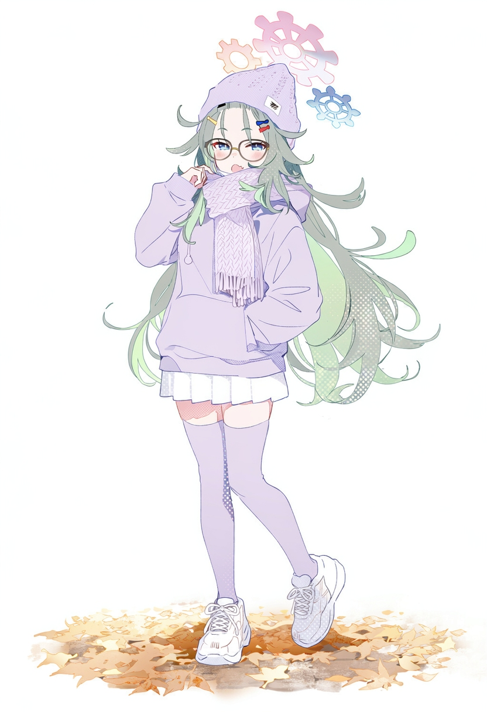

[在线例图](https://assets.quicktagcloud.com/images/raven_composition/raven_composition-5362.jpg?v=5cea79dcab338661)

<a id="raven_composition-5363"></a>

## 秋泉红叶

ID：`raven_composition-5363`；分类：角色图鉴 / 蔚蓝档案；来源标记：`safe`。

来源说明：

> 作品：蔚蓝档案
> 性别：女
> 登场时间：2025

正向提示词：

```text
momiji_(blue_archive)
```


[在线例图](https://assets.quicktagcloud.com/images/raven_composition/raven_composition-5363.jpg?v=adcccfa6eef7c0ec)

<a id="raven_composition-5364"></a>

## 安守实梨

ID：`raven_composition-5364`；分类：角色图鉴 / 蔚蓝档案；来源标记：`safe`。

来源说明：

> 作品：蔚蓝档案
> 性别：女
> 登场时间：2025

正向提示词：

```text
minori_(blue_archive)
```


[在线例图](https://assets.quicktagcloud.com/images/raven_composition/raven_composition-5364.jpg?v=fe38a39498358935)

<a id="raven_composition-5365"></a>

## 荒槙八云

ID：`raven_composition-5365`；分类：角色图鉴 / 蔚蓝档案；来源标记：`safe`。

来源说明：

> 作品：蔚蓝档案
> 性别：女
> 登场时间：2025

正向提示词：

```text
yakumo_(blue_archive)
```


[在线例图](https://assets.quicktagcloud.com/images/raven_composition/raven_composition-5365.jpg?v=95b0228d6fddb4d2)

<a id="raven_composition-5366"></a>

## 三善贵音

ID：`raven_composition-5366`；分类：角色图鉴 / 蔚蓝档案；来源标记：`safe`。

来源说明：

> 作品：蔚蓝档案
> 性别：女
> 登场时间：2025

正向提示词：

```text
takane_(blue_archive)
```


[在线例图](https://assets.quicktagcloud.com/images/raven_composition/raven_composition-5366.jpg?v=d2802d951e458782)

<a id="raven_composition-5367"></a>

## 仁木安娜

ID：`raven_composition-5367`；分类：角色图鉴 / 蔚蓝档案；来源标记：`safe`。

来源说明：

> 作品：蔚蓝档案
> 性别：女
> 登场时间：2025

正向提示词：

```text
anna_(blue_archive)
```


[在线例图](https://assets.quicktagcloud.com/images/raven_composition/raven_composition-5367.jpg?v=b66be140721f2701)

<a id="raven_composition-5368"></a>

## 二木艾莉娜

ID：`raven_composition-5368`；分类：角色图鉴 / 蔚蓝档案；来源标记：`safe`。

来源说明：

> 作品：蔚蓝档案
> 性别：女
> 登场时间：2025

正向提示词：

```text
erina_(blue_archive)
```


[在线例图](https://assets.quicktagcloud.com/images/raven_composition/raven_composition-5368.jpg?v=9479165f24c250cf)

<a id="raven_composition-5369"></a>

## 古畑拉娜

ID：`raven_composition-5369`；分类：角色图鉴 / 蔚蓝档案；来源标记：`safe`。

来源说明：

> 作品：蔚蓝档案
> 性别：女
> 登场时间：2025

正向提示词：

```text
rana_(blue_archive)
```


[在线例图](https://assets.quicktagcloud.com/images/raven_composition/raven_composition-5369.jpg?v=c2de05e60d61865c)

<a id="raven_composition-5370"></a>

## 五百雀和

ID：`raven_composition-5370`；分类：角色图鉴 / 蔚蓝档案；来源标记：`safe`。

来源说明：

> 作品：蔚蓝档案
> 性别：女
> 登场时间：2025

正向提示词：

```text
nagomi_(blue_archive)
```


[在线例图](https://assets.quicktagcloud.com/images/raven_composition/raven_composition-5370.jpg?v=d8320483080dc859)

<a id="raven_composition-5371"></a>

## 鷹野主酔子

ID：`raven_composition-5371`；分类：角色图鉴 / 蔚蓝档案；来源标记：`safe`。

来源说明：

> 作品：蔚蓝档案
> 性别：女
> 登场时间：2025

正向提示词：

```text
suiko_(blue_archive)
```

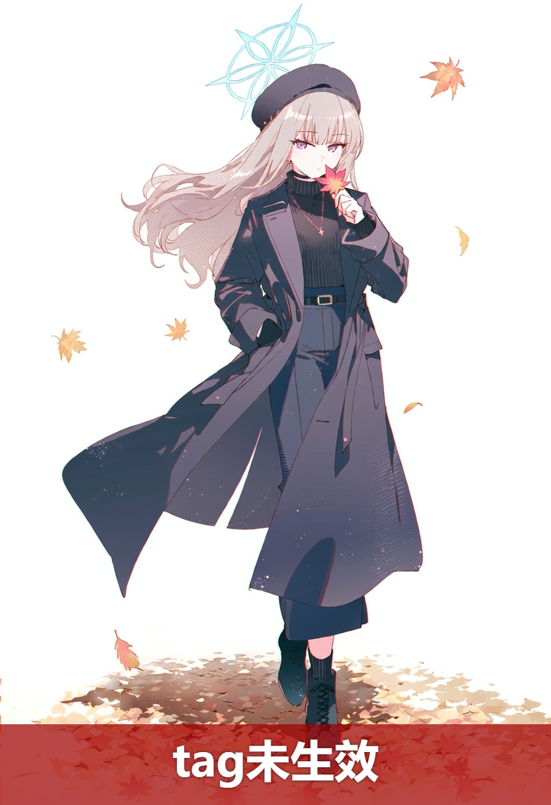

[在线例图](https://assets.quicktagcloud.com/images/raven_composition/raven_composition-5371.jpg?v=08b4f2241b543e36)

<a id="raven_composition-5372"></a>

## 烏頭尾陽子

ID：`raven_composition-5372`；分类：角色图鉴 / 蔚蓝档案；来源标记：`safe`。

来源说明：

> 作品：蔚蓝档案
> 性别：女
> 登场时间：2025

正向提示词：

```text
youko_(blue_archive)
```

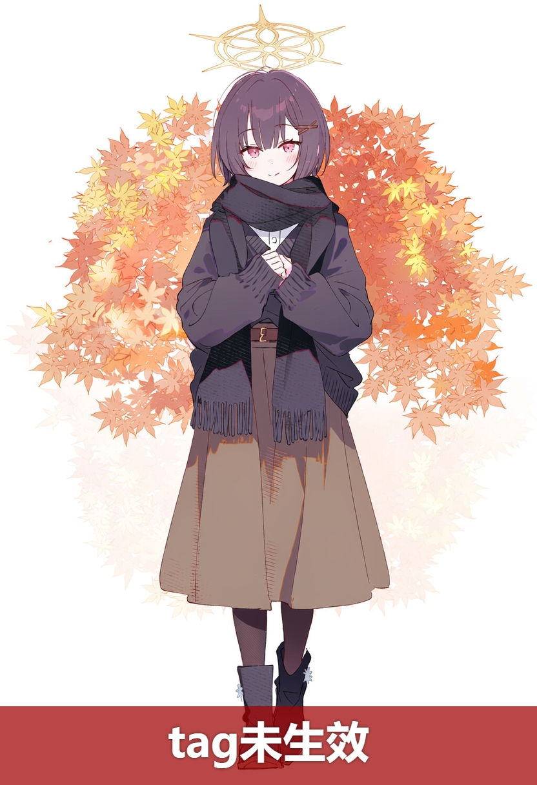

[在线例图](https://assets.quicktagcloud.com/images/raven_composition/raven_composition-5372.jpg?v=9ac551f47225e9cf)

<a id="raven_composition-5373"></a>

## 浅草夏月

ID：`raven_composition-5373`；分类：角色图鉴 / 蔚蓝档案；来源标记：`safe`。

来源说明：

> 作品：蔚蓝档案
> 性别：女
> 登场时间：2025

正向提示词：

```text
natsuki_(blue_archive)
```


[在线例图](https://assets.quicktagcloud.com/images/raven_composition/raven_composition-5373.jpg?v=9727334a2783b86d)

<a id="raven_composition-5374"></a>

## 橘光

ID：`raven_composition-5374`；分类：角色图鉴 / 蔚蓝档案；来源标记：`safe`。

来源说明：

> 作品：蔚蓝档案
> 性别：女
> 登场时间：2025

正向提示词：

```text
hikari_(blue_archive)
```


[在线例图](https://assets.quicktagcloud.com/images/raven_composition/raven_composition-5374.jpg?v=725732e8826333b1)

<a id="raven_composition-5375"></a>

## 橘望

ID：`raven_composition-5375`；分类：角色图鉴 / 蔚蓝档案；来源标记：`safe`。

来源说明：

> 作品：蔚蓝档案
> 性别：女
> 登场时间：2025

正向提示词：

```text
nozomi_(blue_archive)
```


[在线例图](https://assets.quicktagcloud.com/images/raven_composition/raven_composition-5375.jpg?v=00a2592061e8954b)

<a id="raven_composition-5376"></a>

## 朝雾周防

ID：`raven_composition-5376`；分类：角色图鉴 / 蔚蓝档案；来源标记：`safe`。

来源说明：

> 作品：蔚蓝档案
> 性别：女
> 登场时间：2025

正向提示词：

```text
suou_(blue_archive)
```


[在线例图](https://assets.quicktagcloud.com/images/raven_composition/raven_composition-5376.jpg?v=fada6c1fdd720c80)

<a id="raven_composition-5377"></a>

## 内海青叶

ID：`raven_composition-5377`；分类：角色图鉴 / 蔚蓝档案；来源标记：`safe`。

来源说明：

> 作品：蔚蓝档案
> 性别：女
> 登场时间：2025

正向提示词：

```text
aoba_(blue_archive)
```


[在线例图](https://assets.quicktagcloud.com/images/raven_composition/raven_composition-5377.jpg?v=ce9f9010791e5b7c)
