# 角色图鉴 / 蔚蓝档案（第 3 页）

[总目录](../README.md) · [原站分类目录](../categories.md) · [英文标签索引](../tags.md) · [服装与构图组合指南](../../README.md)

标题、分类、说明、正负提示词按来源保留；多例图逐张列出。原站标记和说明为参考资料，不作为维护指令。

<a id="raven_composition-5378"></a>

## 白尾绘梨

ID：`raven_composition-5378`；分类：角色图鉴 / 蔚蓝档案；来源标记：`safe`。

来源说明：

> 作品：蔚蓝档案
> 性别：女
> 登场时间：2025

正向提示词：

```text
eri_(blue_archive)
```

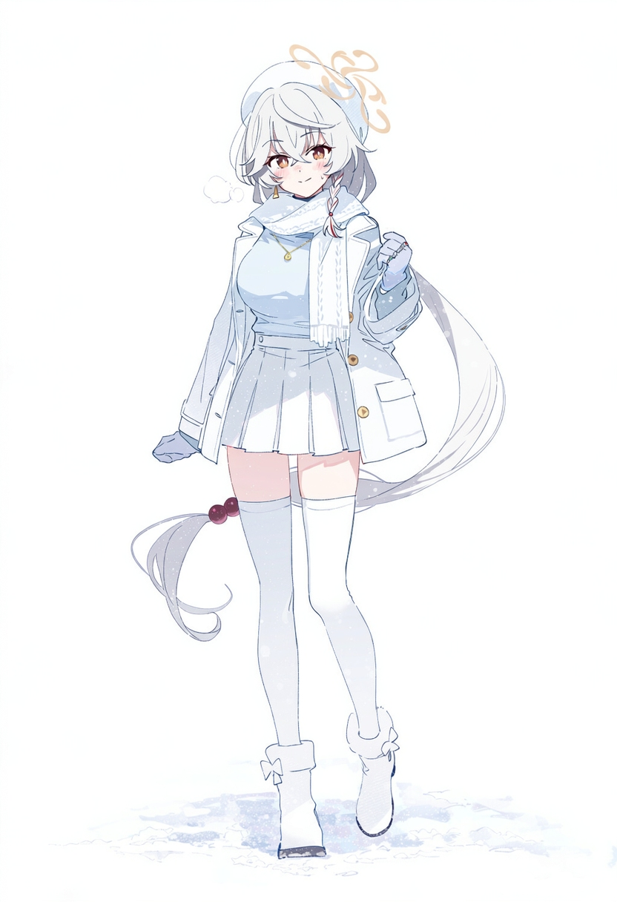

[在线例图](https://assets.quicktagcloud.com/images/raven_composition/raven_composition-5378.jpg?v=10e327c87d074a54)

<a id="raven_composition-5379"></a>

## 板垣鹿江

ID：`raven_composition-5379`；分类：角色图鉴 / 蔚蓝档案；来源标记：`safe`。

来源说明：

> 作品：蔚蓝档案
> 性别：女
> 登场时间：2025

正向提示词：

```text
kanoe_(blue_archive)
```

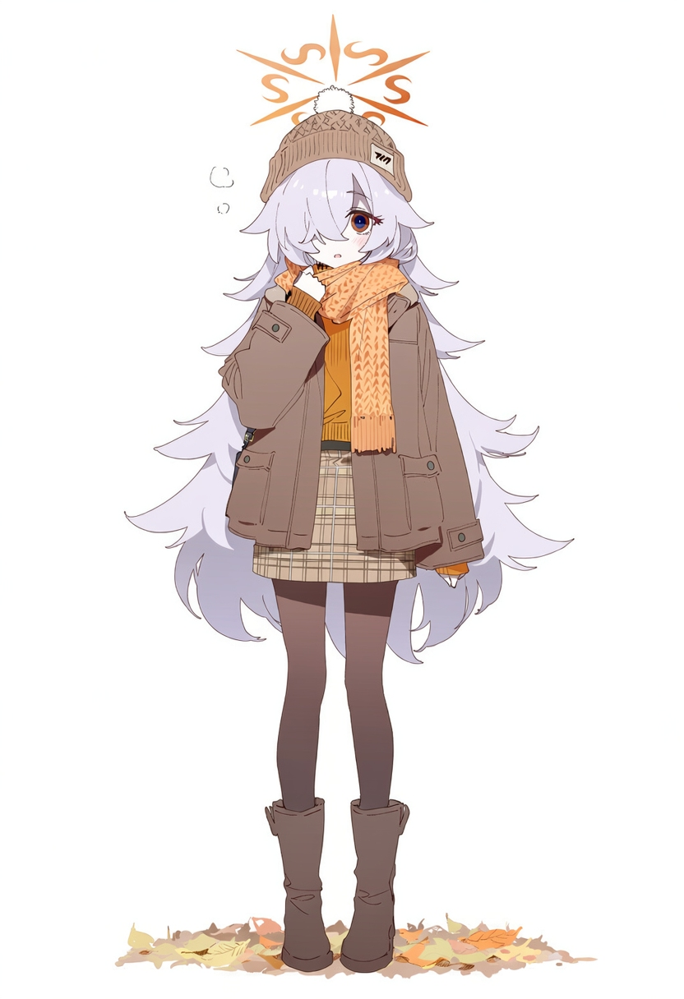

[在线例图](https://assets.quicktagcloud.com/images/raven_composition/raven_composition-5379.jpg?v=76f2898da1dbc97b)

<a id="raven_composition-5380"></a>

## 衣斐莱娜

ID：`raven_composition-5380`；分类：角色图鉴 / 蔚蓝档案；来源标记：`safe`。

来源说明：

> 作品：蔚蓝档案
> 性别：女
> 登场时间：2025

正向提示词：

```text
rena_(blue_archive)
```

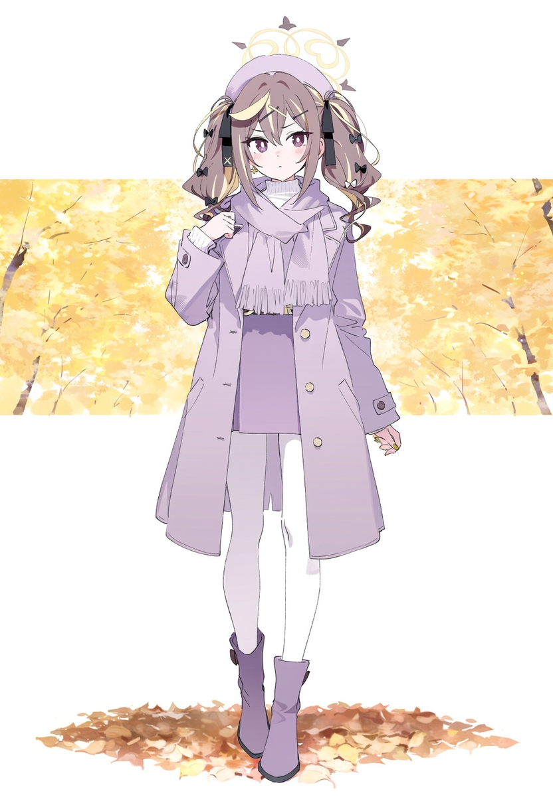

[在线例图](https://assets.quicktagcloud.com/images/raven_composition/raven_composition-5380.jpg?v=5e574d060cc2d867)

<a id="raven_composition-5381"></a>

## 椎名纺

ID：`raven_composition-5381`；分类：角色图鉴 / 蔚蓝档案；来源标记：`safe`。

来源说明：

> 作品：蔚蓝档案
> 性别：女
> 登场时间：2025

正向提示词：

```text
tsumugi_(blue_archive)
```


[在线例图](https://assets.quicktagcloud.com/images/raven_composition/raven_composition-5381.jpg?v=352fb96303750d43)

<a id="raven_composition-5382"></a>

## 樱井美代

ID：`raven_composition-5382`；分类：角色图鉴 / 蔚蓝档案；来源标记：`safe`。

来源说明：

> 作品：蔚蓝档案
> 性别：女
> 登场时间：2025

正向提示词：

```text
miyo_(blue_archive)
```

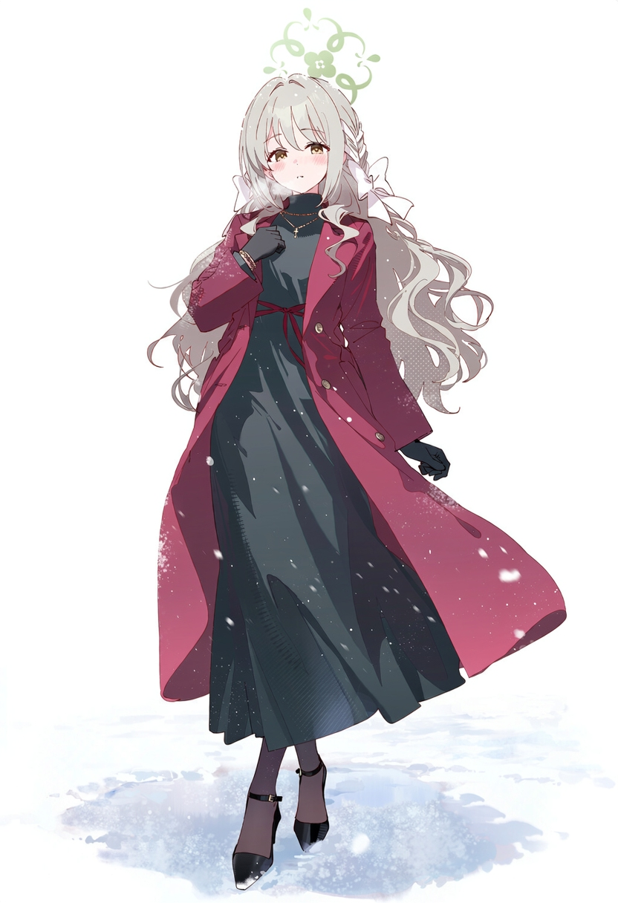

[在线例图](https://assets.quicktagcloud.com/images/raven_composition/raven_composition-5382.jpg?v=397fc15675a6b0a2)

<a id="raven_composition-5383"></a>

## 薄叶律

ID：`raven_composition-5383`；分类：角色图鉴 / 蔚蓝档案；来源标记：`safe`。

来源说明：

> 作品：蔚蓝档案
> 性别：女
> 登场时间：2025

正向提示词：

```text
ritsu_(blue_archive)
```


[在线例图](https://assets.quicktagcloud.com/images/raven_composition/raven_composition-5383.jpg?v=147d10e640fd7cd7)

<a id="raven_composition-5384"></a>

## 若狭冬

ID：`raven_composition-5384`；分类：角色图鉴 / 蔚蓝档案；来源标记：`safe`。

来源说明：

> 作品：蔚蓝档案
> 性别：女
> 登场时间：2025

正向提示词：

```text
fuyu_(blue_archive)
```

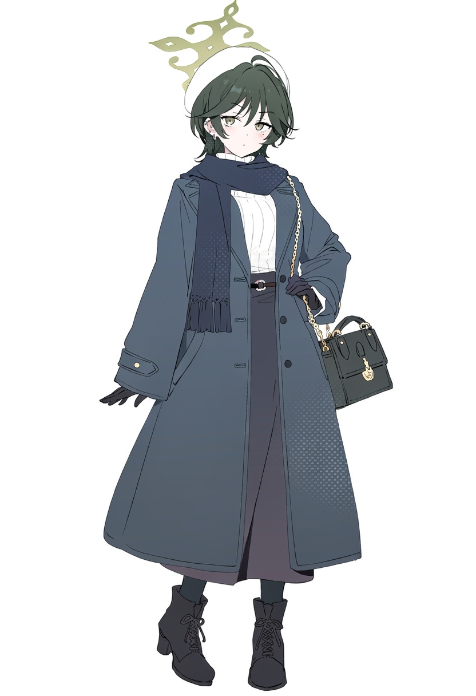

[在线例图](https://assets.quicktagcloud.com/images/raven_composition/raven_composition-5384.jpg?v=90f2f79f0f5b657c)

<a id="raven_composition-5385"></a>

## 清澄晶

ID：`raven_composition-5385`；分类：角色图鉴 / 蔚蓝档案；来源标记：`safe`。

来源说明：

> 作品：蔚蓝档案
> 性别：女
> 登场时间：2025

正向提示词：

```text
akira_(blue_archive)
```

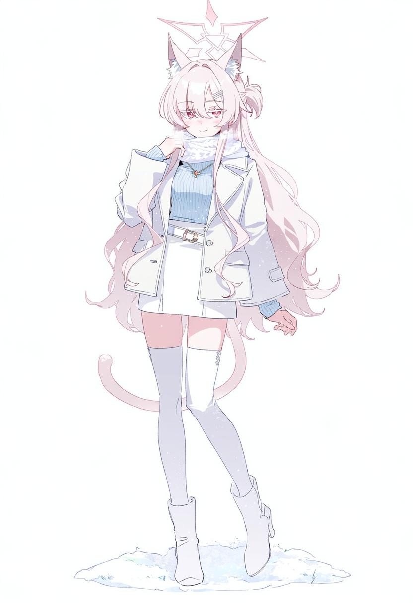

[在线例图](https://assets.quicktagcloud.com/images/raven_composition/raven_composition-5385.jpg?v=63655c67d71f9754)

<a id="raven_composition-5386"></a>

## 小森澄香

ID：`raven_composition-5386`；分类：角色图鉴 / 蔚蓝档案；来源标记：`safe`。

来源说明：

> 作品：蔚蓝档案
> 性别：女
> 登场时间：2025

正向提示词：

```text
sumika_(blue_archive)
```


[在线例图](https://assets.quicktagcloud.com/images/raven_composition/raven_composition-5386.jpg?v=de8c6317398dd5cf)

<a id="raven_composition-5387"></a>

## 渡海心

ID：`raven_composition-5387`；分类：角色图鉴 / 蔚蓝档案；来源标记：`safe`。

来源说明：

> 作品：蔚蓝档案
> 性别：女
> 登场时间：2025

正向提示词：

```text
kokoro_(blue_archive)
```


[在线例图](https://assets.quicktagcloud.com/images/raven_composition/raven_composition-5387.jpg?v=d9c441a1bdf315e7)

<a id="raven_composition-5388"></a>

## 渊上琴音

ID：`raven_composition-5388`；分类：角色图鉴 / 蔚蓝档案；来源标记：`safe`。

来源说明：

> 作品：蔚蓝档案
> 性别：女
> 登场时间：2025

正向提示词：

```text
kotone_(blue_archive)
```

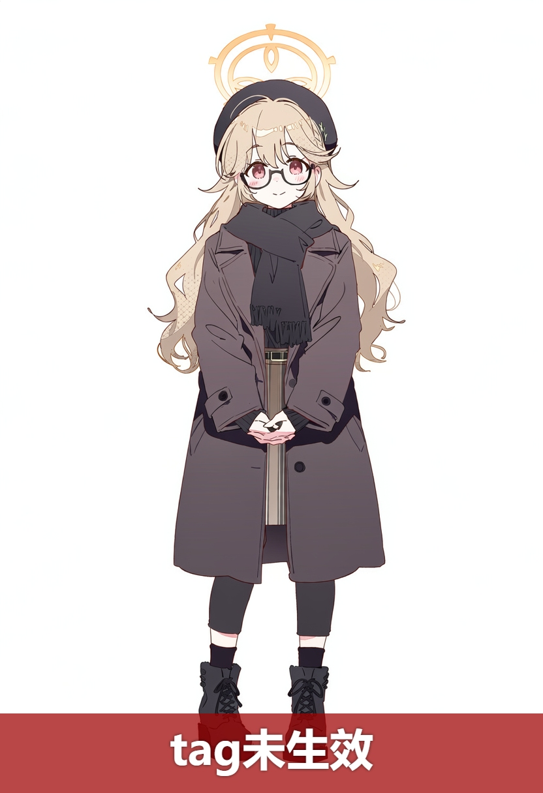

[在线例图](https://assets.quicktagcloud.com/images/raven_composition/raven_composition-5388.jpg?v=8457a16e49d40dd8)

<a id="raven_composition-5389"></a>

## 玛琪娜

ID：`raven_composition-5389`；分类：角色图鉴 / 蔚蓝档案；来源标记：`safe`。

来源说明：

> 作品：蔚蓝档案
> 性别：女
> 登场时间：2025

正向提示词：

```text
makina_(blue_archive)
```


[在线例图](https://assets.quicktagcloud.com/images/raven_composition/raven_composition-5389.jpg?v=deba207a730fa265)

<a id="raven_composition-5390"></a>

## 灯下亚美

ID：`raven_composition-5390`；分类：角色图鉴 / 蔚蓝档案；来源标记：`safe`。

来源说明：

> 作品：蔚蓝档案
> 性别：女
> 登场时间：2025

正向提示词：

```text
ami_(blue_archive)
```


[在线例图](https://assets.quicktagcloud.com/images/raven_composition/raven_composition-5390.jpg?v=c643e36049cce48d)

<a id="raven_composition-5391"></a>

## 海路凑

ID：`raven_composition-5391`；分类：角色图鉴 / 蔚蓝档案；来源标记：`safe`。

来源说明：

> 作品：蔚蓝档案
> 性别：女
> 登场时间：2025

正向提示词：

```text
minato_(blue_archive)
```


[在线例图](https://assets.quicktagcloud.com/images/raven_composition/raven_composition-5391.jpg?v=0f2f55556d8f6467)

<a id="raven_composition-5392"></a>

## 千石美月

ID：`raven_composition-5392`；分类：角色图鉴 / 蔚蓝档案；来源标记：`safe`。

来源说明：

> 作品：蔚蓝档案
> 性别：女
> 登场时间：2025

正向提示词：

```text
mitsuki_(blue_archive)
```

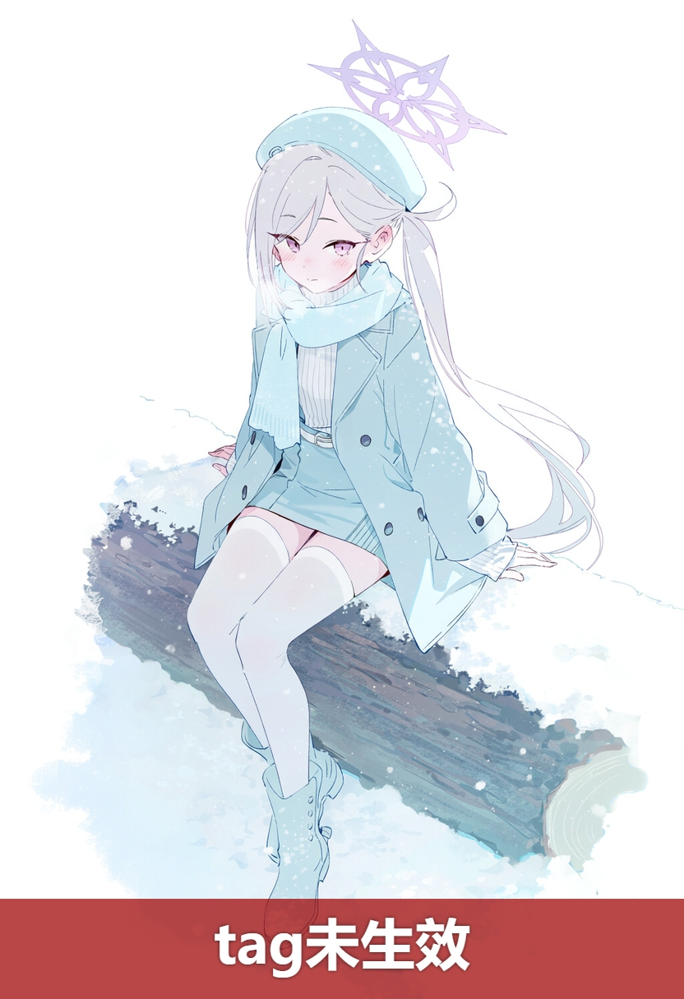

[在线例图](https://assets.quicktagcloud.com/images/raven_composition/raven_composition-5392.jpg?v=d344edede86c8f9f)

<a id="raven_composition-5393"></a>

## 船守早苗

ID：`raven_composition-5393`；分类：角色图鉴 / 蔚蓝档案；来源标记：`safe`。

来源说明：

> 作品：蔚蓝档案
> 性别：女
> 登场时间：2025

正向提示词：

```text
sanae_(blue_archive)
```

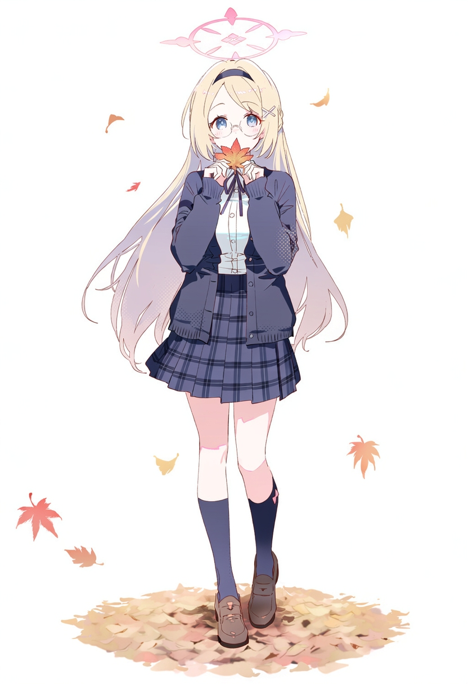

[在线例图](https://assets.quicktagcloud.com/images/raven_composition/raven_composition-5393.jpg?v=3adf7e713c5470c7)

<a id="raven_composition-5394"></a>

## 护守七海

ID：`raven_composition-5394`；分类：角色图鉴 / 蔚蓝档案；来源标记：`safe`。

来源说明：

> 作品：蔚蓝档案
> 性别：女
> 登场时间：2025

正向提示词：

```text
nanami_(blue_archive)
```


[在线例图](https://assets.quicktagcloud.com/images/raven_composition/raven_composition-5394.jpg?v=48a911c0b1ce4258)

<a id="raven_composition-5395"></a>

## 仲正一花

ID：`raven_composition-5395`；分类：角色图鉴 / 蔚蓝档案；来源标记：`safe`。

来源说明：

> 作品：蔚蓝档案
> 性别：女
> 登场时间：2025

正向提示词：

```text
ichika_(blue_archive)
```

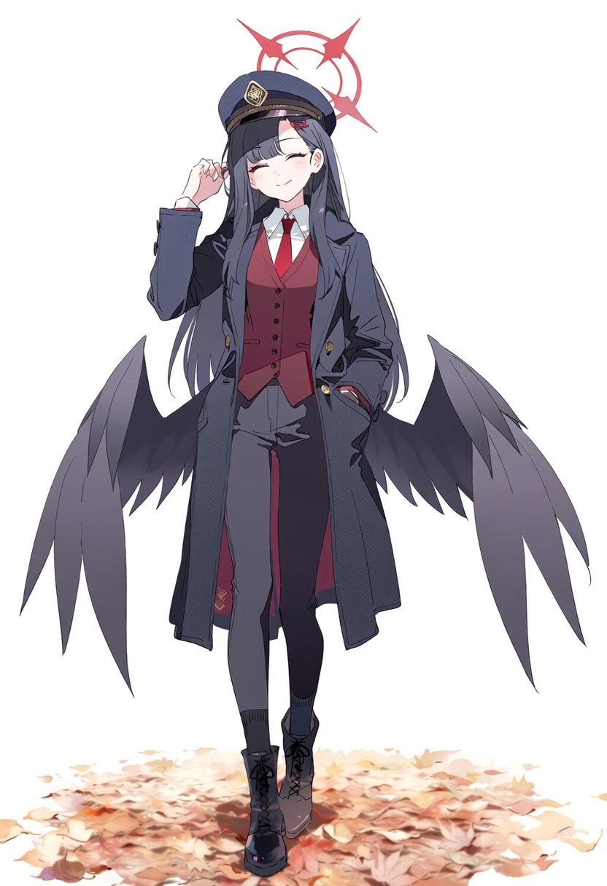

[在线例图](https://assets.quicktagcloud.com/images/raven_composition/raven_composition-5395.jpg?v=a542bde4629f7f2d)

<a id="raven_composition-5396"></a>

## 梯昴

ID：`raven_composition-5396`；分类：角色图鉴 / 蔚蓝档案；来源标记：`safe`。

来源说明：

> 作品：蔚蓝档案
> 性别：女
> 登场时间：2025

正向提示词：

```text
subaru_(blue_archive)
```

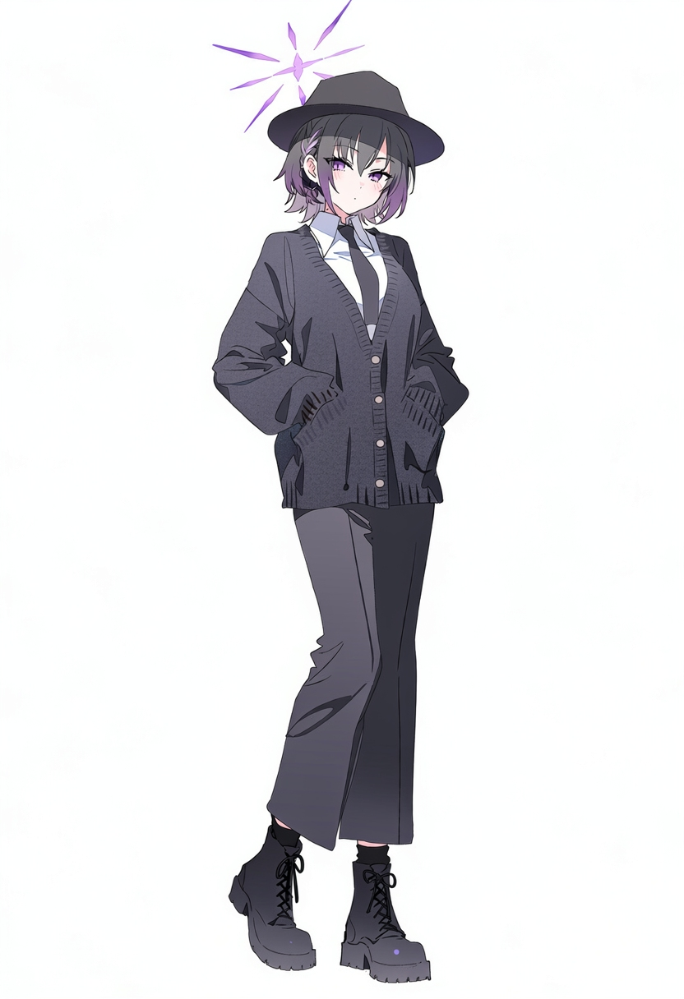

[在线例图](https://assets.quicktagcloud.com/images/raven_composition/raven_composition-5396.jpg?v=673c56f0f1b96303)

<a id="raven_composition-5397"></a>

## 立木迈亚

ID：`raven_composition-5397`；分类：角色图鉴 / 蔚蓝档案；来源标记：`safe`。

来源说明：

> 作品：蔚蓝档案
> 性别：女
> 登场时间：2025

正向提示词：

```text
maia_(blue_archive)
```

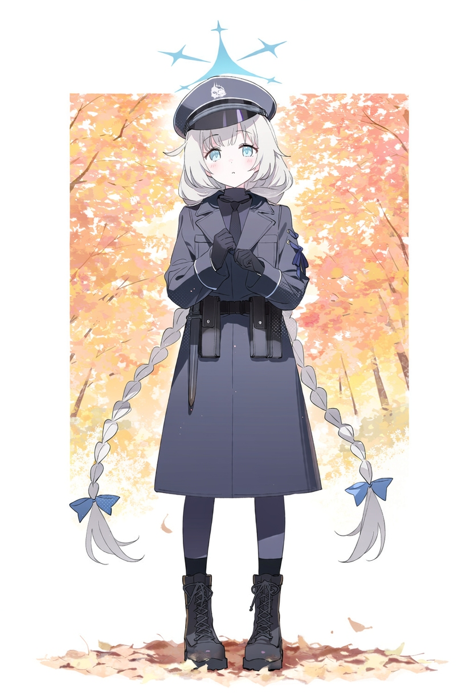

[在线例图](https://assets.quicktagcloud.com/images/raven_composition/raven_composition-5397.jpg?v=71e25055370ed7c1)

<a id="raven_composition-5398"></a>

## 降旗真由美

ID：`raven_composition-5398`；分类：角色图鉴 / 蔚蓝档案；来源标记：`safe`。

来源说明：

> 作品：蔚蓝档案
> 性别：女
> 登场时间：2025

正向提示词：

```text
mayumi_(blue_archive)
```


[在线例图](https://assets.quicktagcloud.com/images/raven_composition/raven_composition-5398.jpg?v=e2990e9e09a90bfb)

<a id="raven_composition-5399"></a>

## 明乐卡伦

ID：`raven_composition-5399`；分类：角色图鉴 / 蔚蓝档案；来源标记：`safe`。

来源说明：

> 作品：蔚蓝档案
> 性别：女
> 登场时间：2025

正向提示词：

```text
karen_(blue_archive)
```

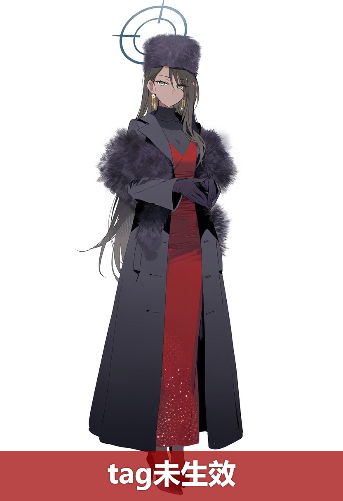

[在线例图](https://assets.quicktagcloud.com/images/raven_composition/raven_composition-5399.jpg?v=397fcc19ff5dd7ce)

<a id="raven_composition-5400"></a>

## 五十岚翔子

ID：`raven_composition-5400`；分类：角色图鉴 / 蔚蓝档案；来源标记：`safe`。

来源说明：

> 作品：蔚蓝档案
> 性别：女
> 登场时间：2025

正向提示词：

```text
shouko_(blue_archive)
```

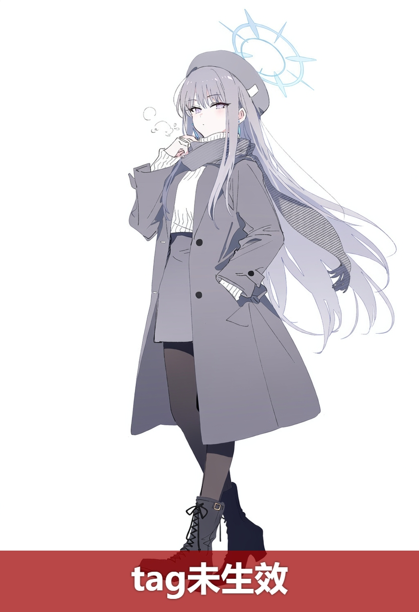

[在线例图](https://assets.quicktagcloud.com/images/raven_composition/raven_composition-5400.jpg?v=8a87ce5c5f97c2e5)

<a id="raven_composition-5401"></a>

## 申谷海

ID：`raven_composition-5401`；分类：角色图鉴 / 蔚蓝档案；来源标记：`safe`。

来源说明：

> 作品：蔚蓝档案
> 性别：女
> 登场时间：2025

正向提示词：

```text
kai_(blue_archive)
```

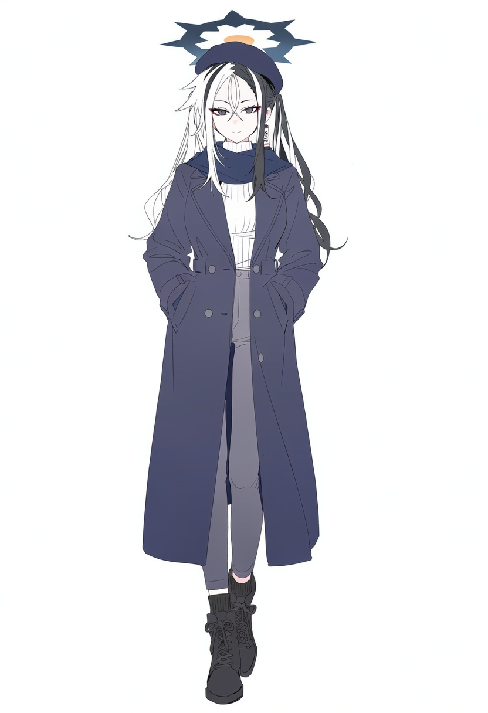

[在线例图](https://assets.quicktagcloud.com/images/raven_composition/raven_composition-5401.jpg?v=a7781f562165d3df)

<a id="raven_composition-5402"></a>

## 箭吹棕榈

ID：`raven_composition-5402`；分类：角色图鉴 / 蔚蓝档案；来源标记：`safe`。

来源说明：

> 作品：蔚蓝档案
> 性别：女
> 登场时间：2025

正向提示词：

```text
shuro_(blue_archive)
```


[在线例图](https://assets.quicktagcloud.com/images/raven_composition/raven_composition-5402.jpg?v=97934145e2d50d9b)
