# 角色图鉴 / 原神

[总目录](../README.md) · [原站分类目录](../categories.md) · [英文标签索引](../tags.md) · [服装与构图组合指南](../../README.md)

标题、分类、说明、正负提示词按来源保留；多例图逐张列出。原站标记和说明为参考资料，不作为维护指令。

<a id="raven_composition-5403"></a>

## 荧

ID：`raven_composition-5403`；分类：角色图鉴 / 原神；来源标记：`safe`。

来源说明：

> 作品：原神
> 性别：女

正向提示词：

```text
lumine (genshin impact)
```

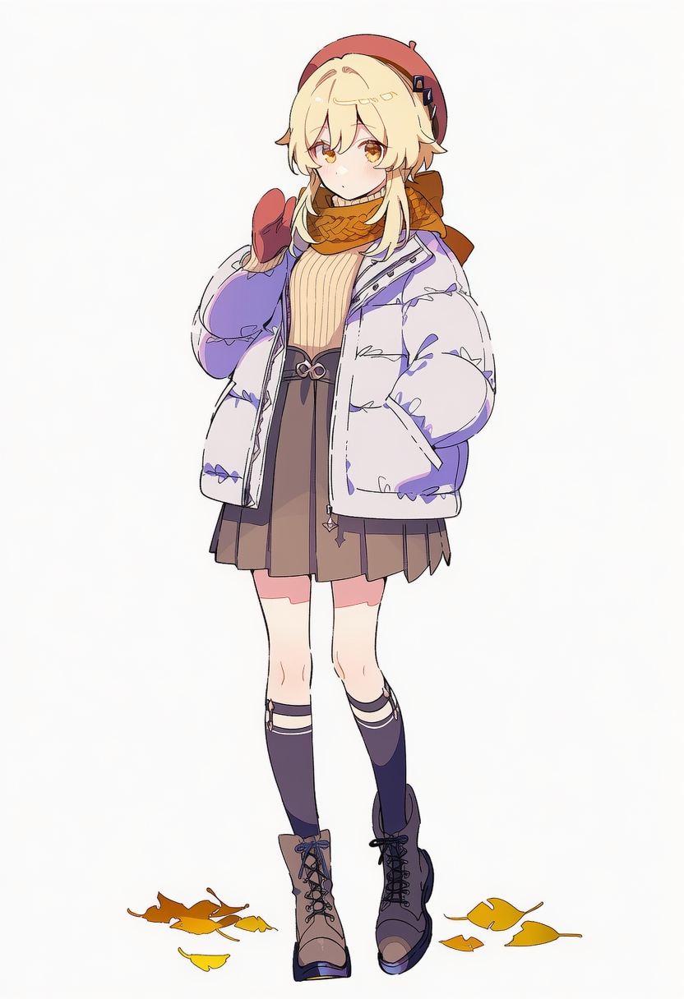

[在线例图](https://assets.quicktagcloud.com/images/raven_composition/raven_composition-5403.jpg?v=ac139991a60e0be9)

<a id="raven_composition-5404"></a>

## 空

ID：`raven_composition-5404`；分类：角色图鉴 / 原神；来源标记：`safe`。

来源说明：

> 作品：原神
> 性别：男

正向提示词：

```text
aether (genshin impact)
```

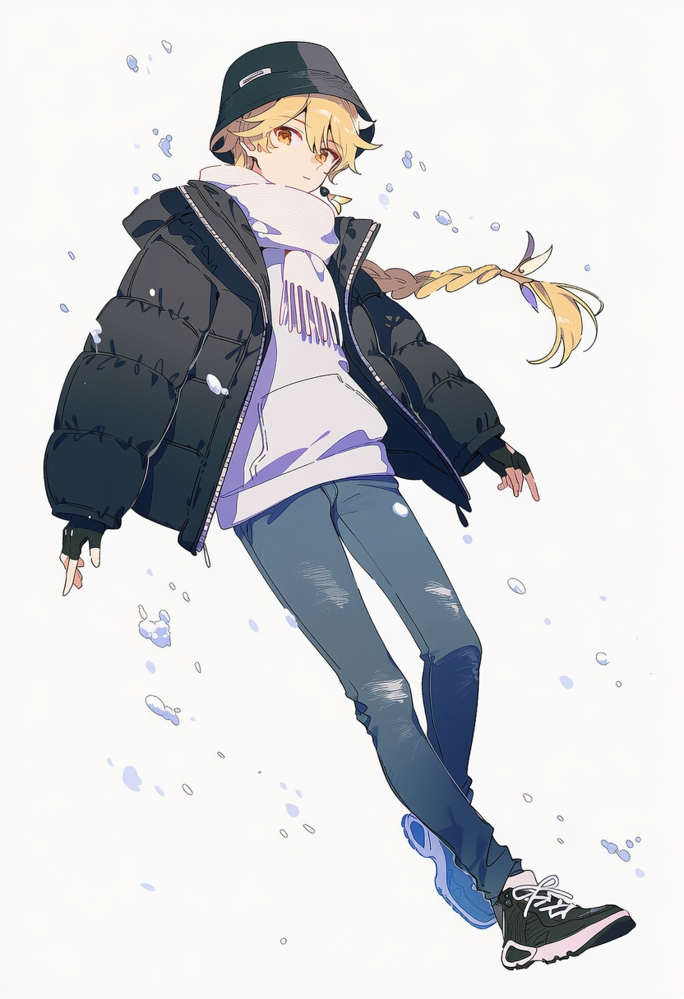

[在线例图](https://assets.quicktagcloud.com/images/raven_composition/raven_composition-5404.jpg?v=14d1bdf978561161)

<a id="raven_composition-5405"></a>

## 派蒙

ID：`raven_composition-5405`；分类：角色图鉴 / 原神；来源标记：`safe`。

来源说明：

> 作品：原神
> 性别：女

正向提示词：

```text
paimon (genshin impact)
```

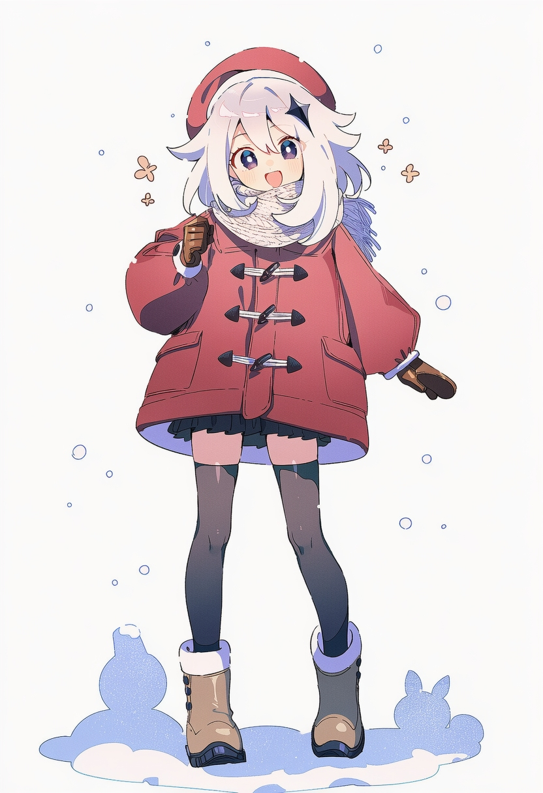

[在线例图](https://assets.quicktagcloud.com/images/raven_composition/raven_composition-5405.jpg?v=86b5e2f28c27d47c)

<a id="raven_composition-5406"></a>

## 琴

ID：`raven_composition-5406`；分类：角色图鉴 / 原神；来源标记：`safe`。

来源说明：

> 作品：原神
> 性别：女

正向提示词：

```text
jean (genshin impact)
```

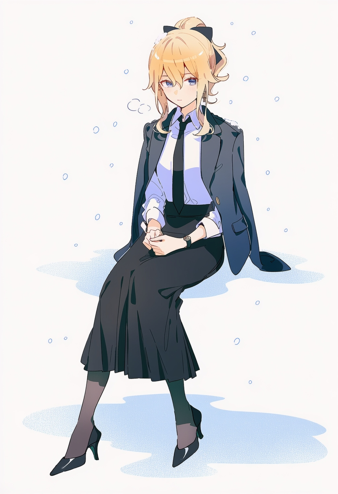

[在线例图](https://assets.quicktagcloud.com/images/raven_composition/raven_composition-5406.jpg?v=ffbf2a161ed722f3)

<a id="raven_composition-5407"></a>

## 安柏

ID：`raven_composition-5407`；分类：角色图鉴 / 原神；来源标记：`safe`。

来源说明：

> 作品：原神
> 性别：女

正向提示词：

```text
amber (genshin impact)
```

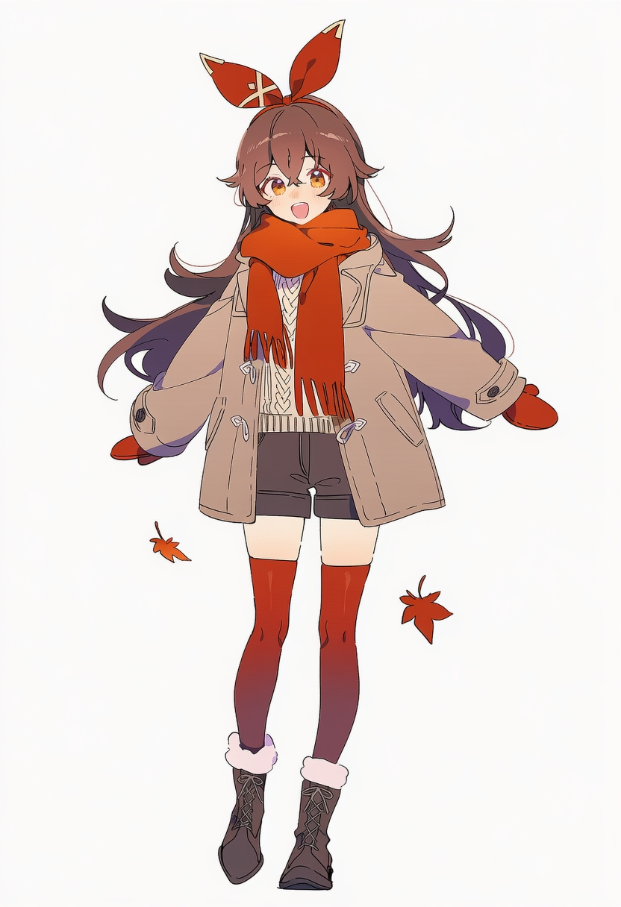

[在线例图](https://assets.quicktagcloud.com/images/raven_composition/raven_composition-5407.jpg?v=f58f91ad7d51d9d2)

<a id="raven_composition-5408"></a>

## 丽莎

ID：`raven_composition-5408`；分类：角色图鉴 / 原神；来源标记：`safe`。

来源说明：

> 作品：原神
> 性别：女

正向提示词：

```text
lisa (genshin impact)
```

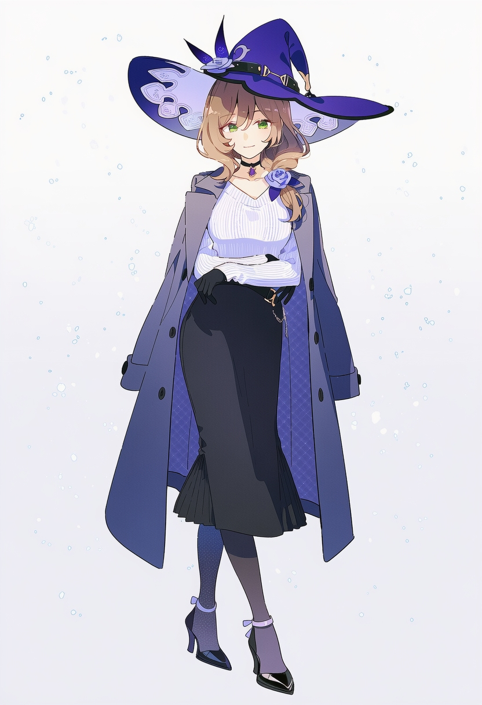

[在线例图](https://assets.quicktagcloud.com/images/raven_composition/raven_composition-5408.jpg?v=48b2e3f98ef03358)

<a id="raven_composition-5409"></a>

## 凯亚

ID：`raven_composition-5409`；分类：角色图鉴 / 原神；来源标记：`safe`。

来源说明：

> 作品：原神
> 性别：男

正向提示词：

```text
kaeya (genshin impact)
```

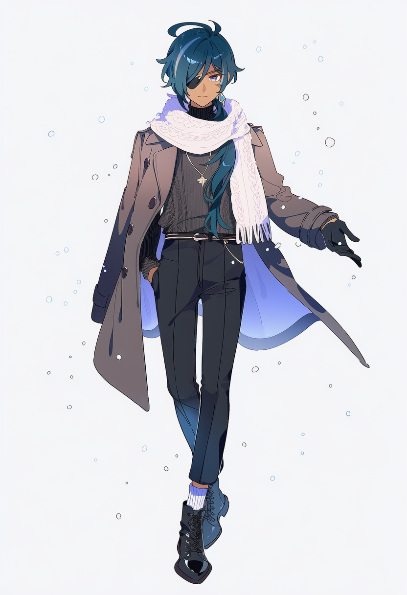

[在线例图](https://assets.quicktagcloud.com/images/raven_composition/raven_composition-5409.jpg?v=e5a8821e68560c00)

<a id="raven_composition-5410"></a>

## 芭芭拉

ID：`raven_composition-5410`；分类：角色图鉴 / 原神；来源标记：`safe`。

来源说明：

> 作品：原神
> 性别：女

正向提示词：

```text
barbara (genshin impact)
```

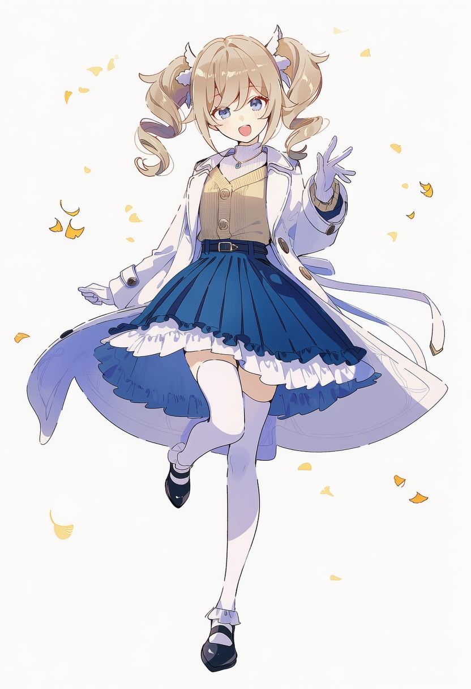

[在线例图](https://assets.quicktagcloud.com/images/raven_composition/raven_composition-5410.jpg?v=39d286428b363208)

<a id="raven_composition-5411"></a>

## 迪卢克

ID：`raven_composition-5411`；分类：角色图鉴 / 原神；来源标记：`safe`。

来源说明：

> 作品：原神
> 性别：男

正向提示词：

```text
diluc (genshin impact)
```

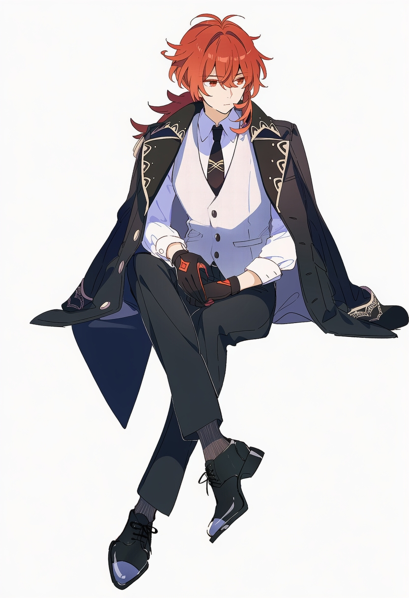

[在线例图](https://assets.quicktagcloud.com/images/raven_composition/raven_composition-5411.jpg?v=74c6e305c7a0f401)

<a id="raven_composition-5412"></a>

## 雷泽

ID：`raven_composition-5412`；分类：角色图鉴 / 原神；来源标记：`safe`。

来源说明：

> 作品：原神
> 性别：男

正向提示词：

```text
razor (genshin impact)
```

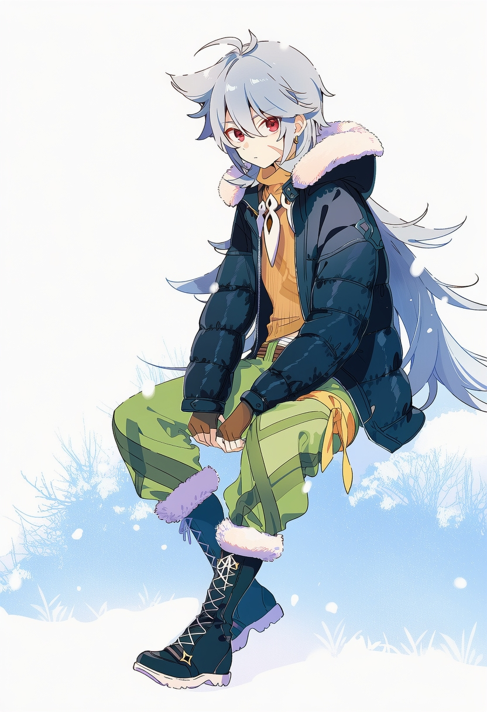

[在线例图](https://assets.quicktagcloud.com/images/raven_composition/raven_composition-5412.jpg?v=1114d4d202c13bb0)

<a id="raven_composition-5413"></a>

## 班尼特

ID：`raven_composition-5413`；分类：角色图鉴 / 原神；来源标记：`safe`。

来源说明：

> 作品：原神
> 性别：男

正向提示词：

```text
bennett (genshin impact)
```

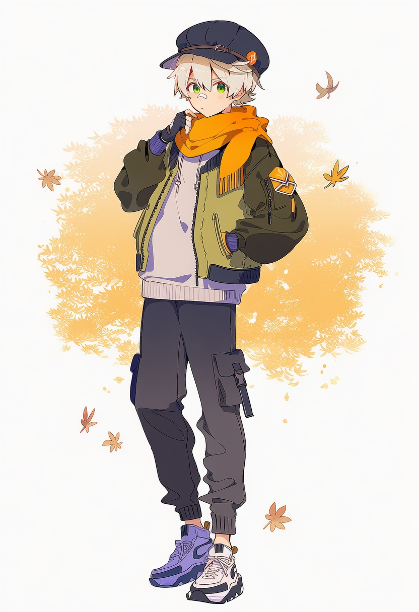

[在线例图](https://assets.quicktagcloud.com/images/raven_composition/raven_composition-5413.jpg?v=09a7ef28dc468ecd)

<a id="raven_composition-5414"></a>

## 诺艾尔

ID：`raven_composition-5414`；分类：角色图鉴 / 原神；来源标记：`safe`。

来源说明：

> 作品：原神
> 性别：女

正向提示词：

```text
noelle (genshin impact)
```

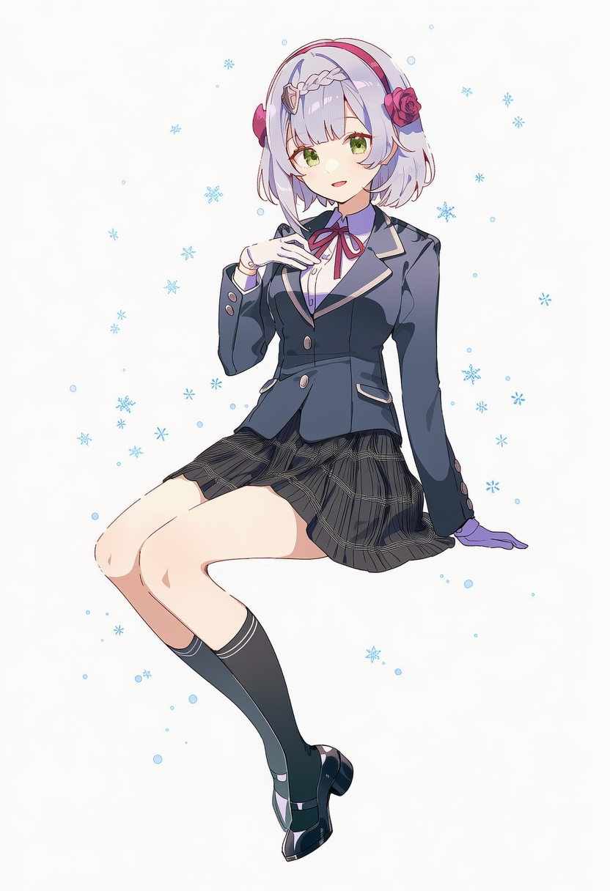

[在线例图](https://assets.quicktagcloud.com/images/raven_composition/raven_composition-5414.jpg?v=c0a5c3cba84c82bd)

<a id="raven_composition-5415"></a>

## 菲谢尔

ID：`raven_composition-5415`；分类：角色图鉴 / 原神；来源标记：`safe`。

来源说明：

> 作品：原神
> 性别：女

正向提示词：

```text
fischl (genshin impact)
```

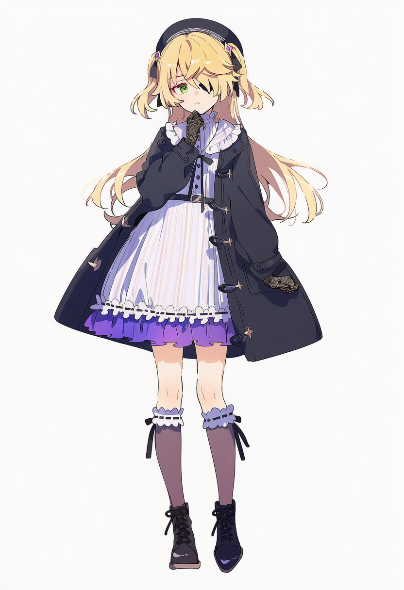

[在线例图](https://assets.quicktagcloud.com/images/raven_composition/raven_composition-5415.jpg?v=e393b5a6c894446b)

<a id="raven_composition-5416"></a>

## 砂糖

ID：`raven_composition-5416`；分类：角色图鉴 / 原神；来源标记：`safe`。

来源说明：

> 作品：原神
> 性别：女

正向提示词：

```text
sucrose (genshin impact)
```

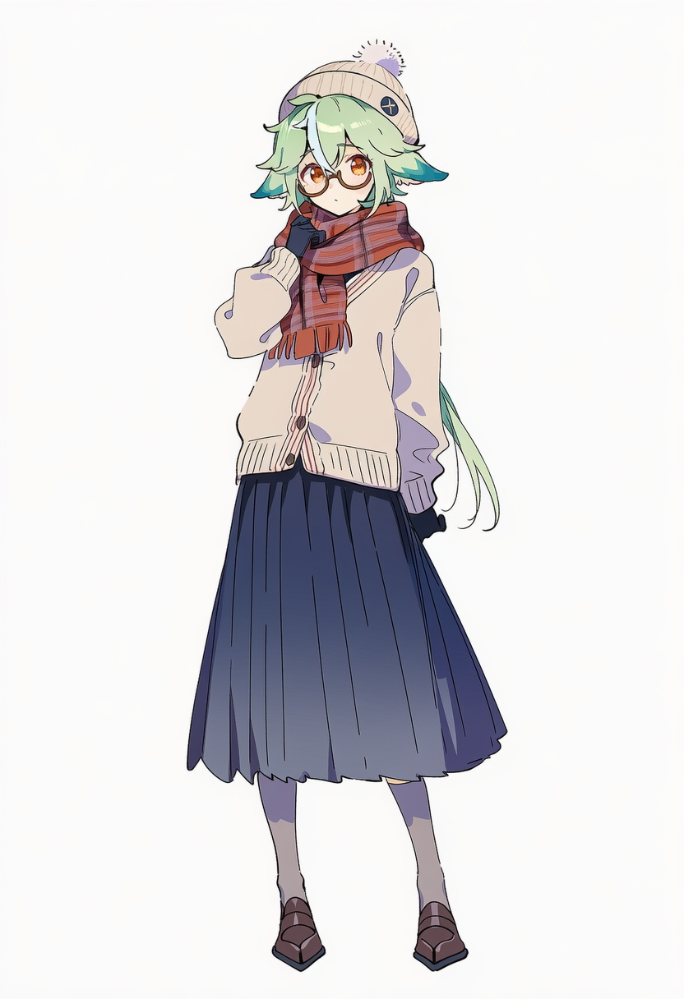

[在线例图](https://assets.quicktagcloud.com/images/raven_composition/raven_composition-5416.jpg?v=f7f1b8987db70ff3)

<a id="raven_composition-5417"></a>

## 莫娜

ID：`raven_composition-5417`；分类：角色图鉴 / 原神；来源标记：`safe`。

来源说明：

> 作品：原神
> 性别：女

正向提示词：

```text
mona (genshin impact)
```

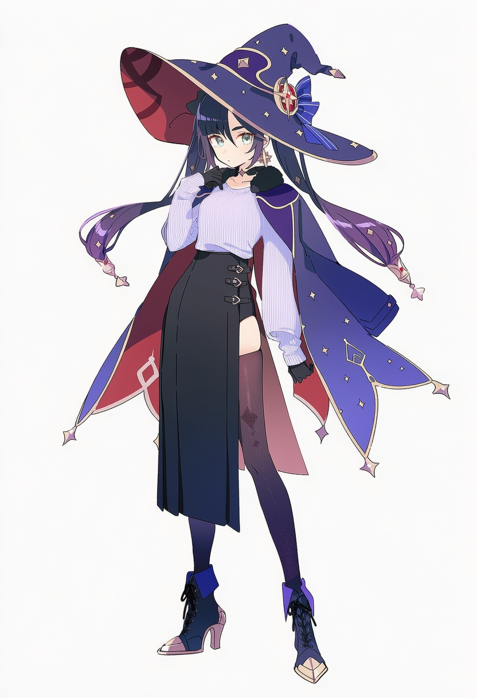

[在线例图](https://assets.quicktagcloud.com/images/raven_composition/raven_composition-5417.jpg?v=d4e1a6ea38f5ba37)

<a id="raven_composition-5418"></a>

## 迪奥娜

ID：`raven_composition-5418`；分类：角色图鉴 / 原神；来源标记：`safe`。

来源说明：

> 作品：原神
> 性别：女

正向提示词：

```text
diona (genshin impact)
```

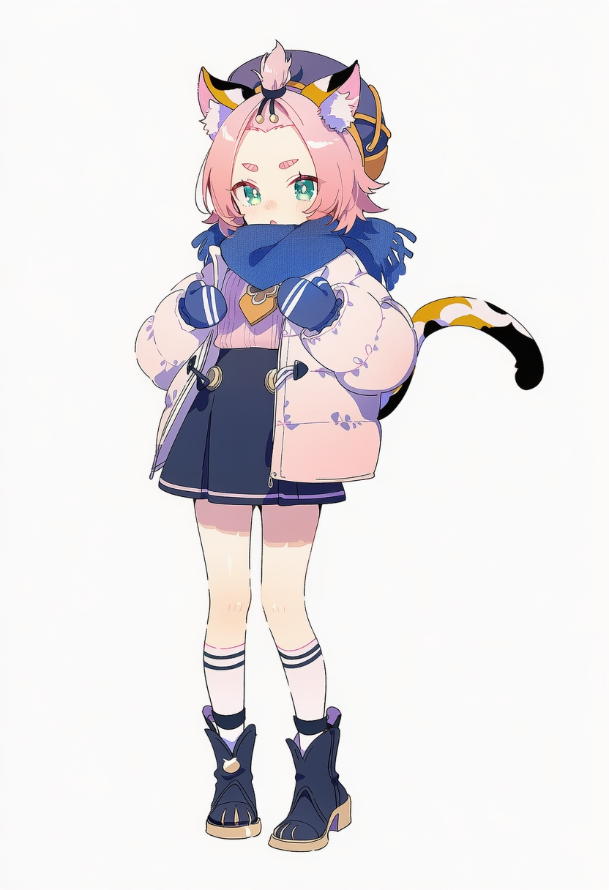

[在线例图](https://assets.quicktagcloud.com/images/raven_composition/raven_composition-5418.jpg?v=c5a615b9b46a8d3c)

<a id="raven_composition-5419"></a>

## 北斗

ID：`raven_composition-5419`；分类：角色图鉴 / 原神；来源标记：`safe`。

来源说明：

> 作品：原神
> 性别：女

正向提示词：

```text
beidou (genshin impact)
```

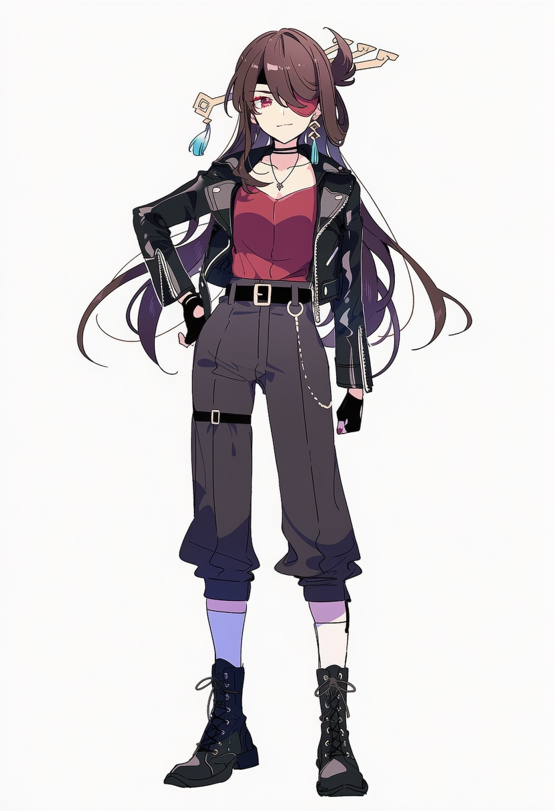

[在线例图](https://assets.quicktagcloud.com/images/raven_composition/raven_composition-5419.jpg?v=efb27748d6deae2e)

<a id="raven_composition-5420"></a>

## 凝光

ID：`raven_composition-5420`；分类：角色图鉴 / 原神；来源标记：`safe`。

来源说明：

> 作品：原神
> 性别：女

正向提示词：

```text
ningguang (genshin impact)
```

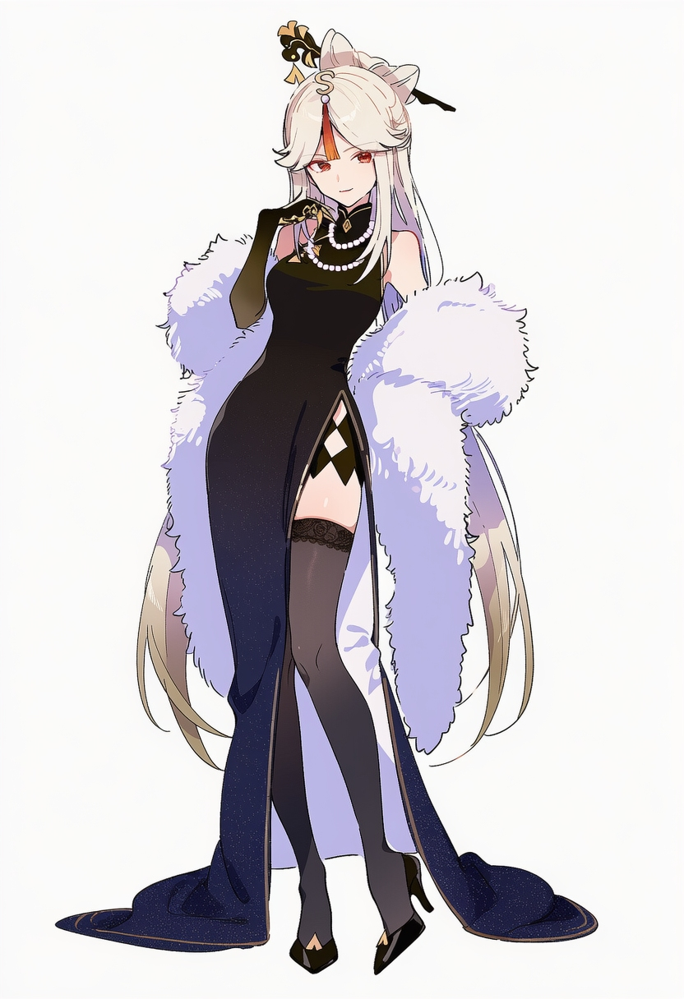

[在线例图](https://assets.quicktagcloud.com/images/raven_composition/raven_composition-5420.jpg?v=0ea6112c854aa20c)

<a id="raven_composition-5421"></a>

## 香菱

ID：`raven_composition-5421`；分类：角色图鉴 / 原神；来源标记：`safe`。

来源说明：

> 作品：原神
> 性别：女

正向提示词：

```text
xiangling (genshin impact)
```

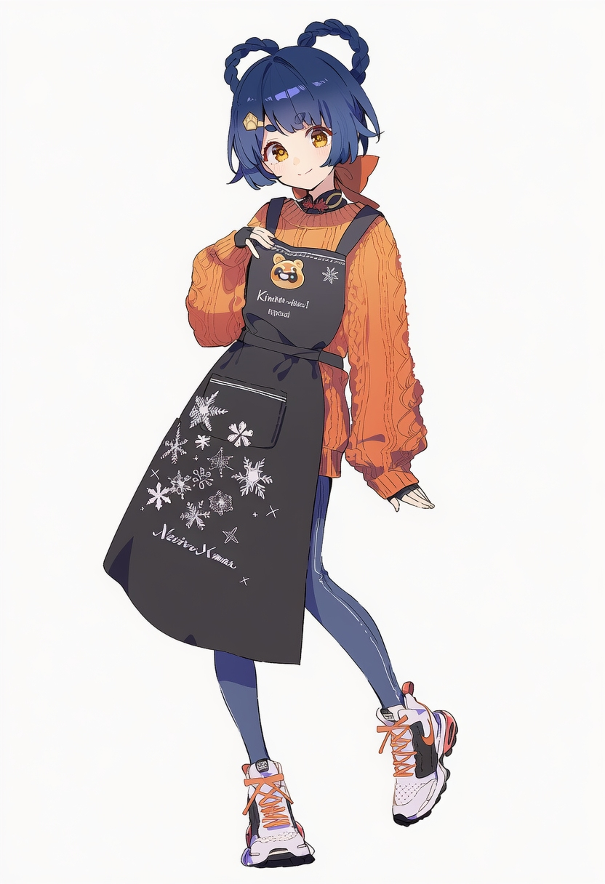

[在线例图](https://assets.quicktagcloud.com/images/raven_composition/raven_composition-5421.jpg?v=32189ab8367942b8)

<a id="raven_composition-5422"></a>

## 行秋

ID：`raven_composition-5422`；分类：角色图鉴 / 原神；来源标记：`safe`。

来源说明：

> 作品：原神
> 性别：男

正向提示词：

```text
xingqiu (genshin impact)
```

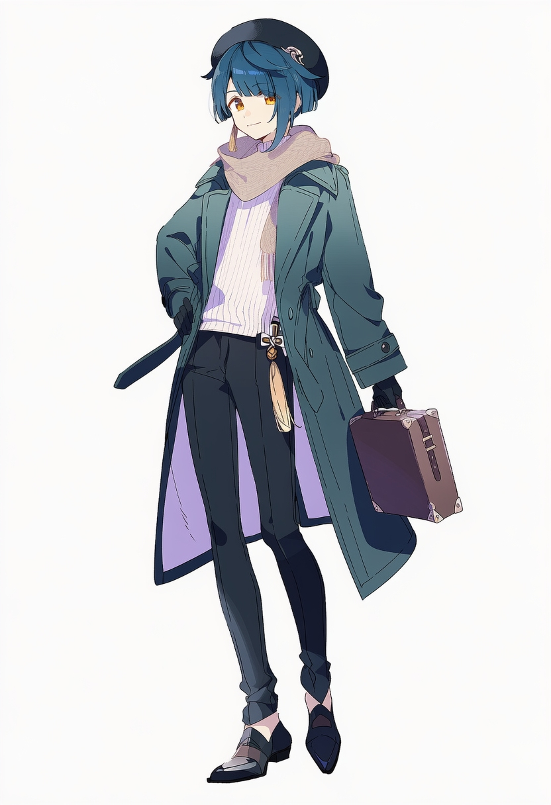

[在线例图](https://assets.quicktagcloud.com/images/raven_composition/raven_composition-5422.jpg?v=52d361ac83d01b3f)

<a id="raven_composition-5423"></a>

## 重云

ID：`raven_composition-5423`；分类：角色图鉴 / 原神；来源标记：`safe`。

来源说明：

> 作品：原神
> 性别：男

正向提示词：

```text
chongyun (genshin impact)
```

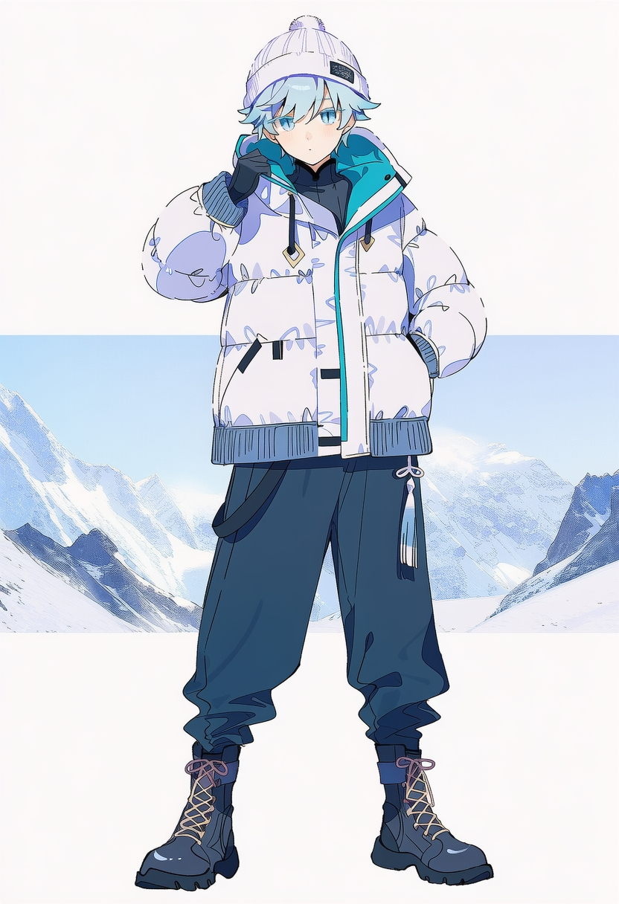

[在线例图](https://assets.quicktagcloud.com/images/raven_composition/raven_composition-5423.jpg?v=4b7f47a0681a21c5)

<a id="raven_composition-5424"></a>

## 刻晴

ID：`raven_composition-5424`；分类：角色图鉴 / 原神；来源标记：`safe`。

来源说明：

> 作品：原神
> 性别：女

正向提示词：

```text
keqing (genshin impact)
```

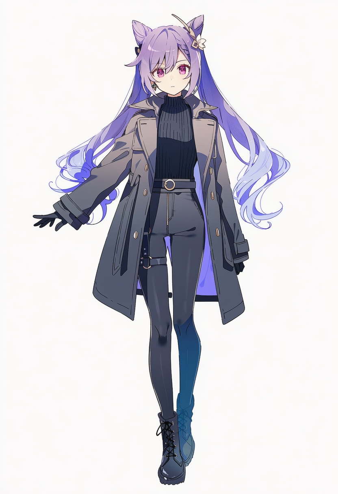

[在线例图](https://assets.quicktagcloud.com/images/raven_composition/raven_composition-5424.jpg?v=80315d47d264ba42)

<a id="raven_composition-5425"></a>

## 七七

ID：`raven_composition-5425`；分类：角色图鉴 / 原神；来源标记：`safe`。

来源说明：

> 作品：原神
> 性别：女

正向提示词：

```text
qiqi (genshin impact)
```

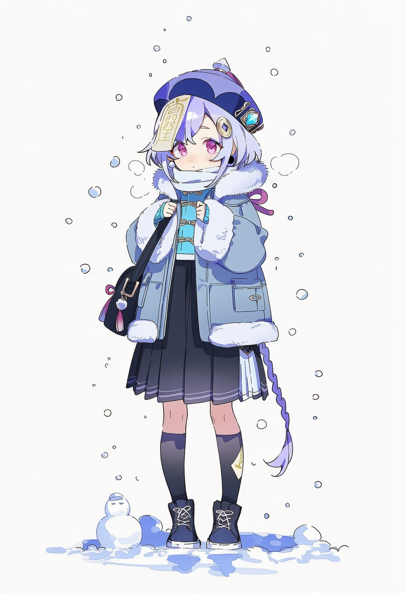

[在线例图](https://assets.quicktagcloud.com/images/raven_composition/raven_composition-5425.jpg?v=1407bd8161023e65)

<a id="raven_composition-5426"></a>

## 可莉

ID：`raven_composition-5426`；分类：角色图鉴 / 原神；来源标记：`safe`。

来源说明：

> 作品：原神
> 性别：女

正向提示词：

```text
klee (genshin impact)
```

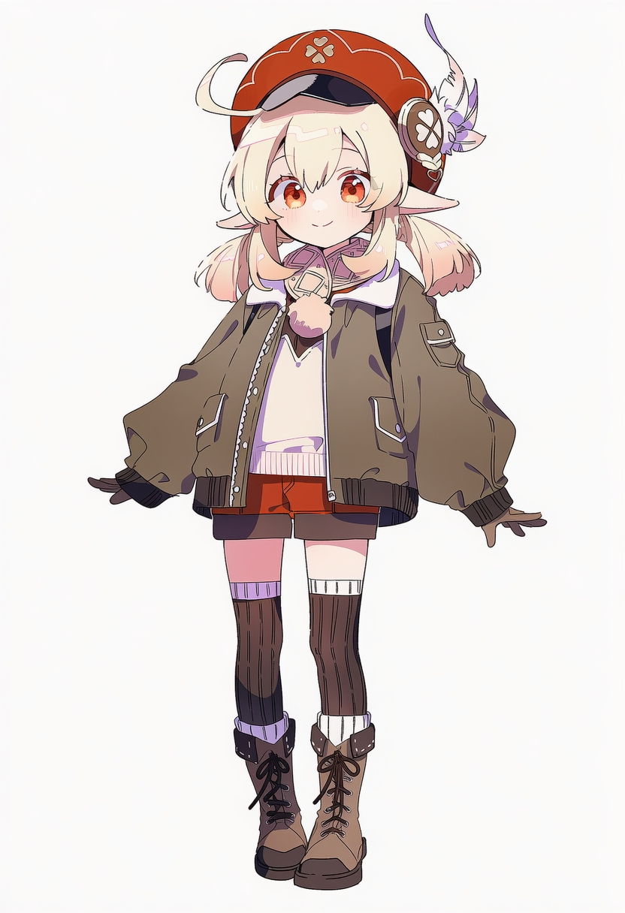

[在线例图](https://assets.quicktagcloud.com/images/raven_composition/raven_composition-5426.jpg?v=5db053164e819487)

<a id="raven_composition-5427"></a>

## 温迪

ID：`raven_composition-5427`；分类：角色图鉴 / 原神；来源标记：`safe`。

来源说明：

> 作品：原神
> 性别：男

正向提示词：

```text
venti (genshin impact)
```

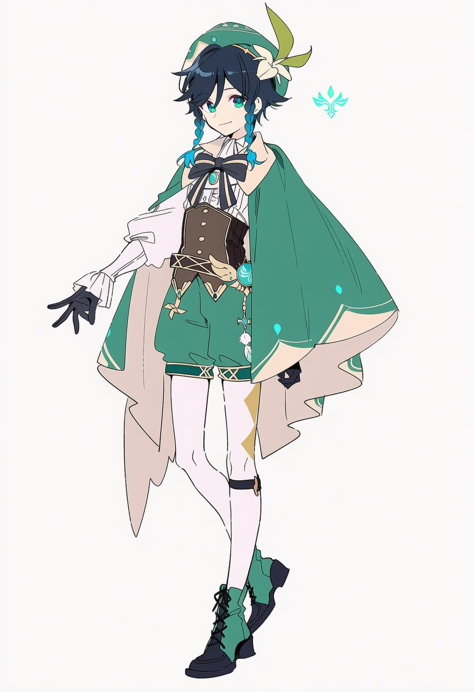

[在线例图](https://assets.quicktagcloud.com/images/raven_composition/raven_composition-5427.jpg?v=2ed137501c2f7893)

<a id="raven_composition-5428"></a>

## 凯瑟琳

ID：`raven_composition-5428`；分类：角色图鉴 / 原神；来源标记：`safe`。

来源说明：

> 作品：原神
> 性别：女

正向提示词：

```text
katheryne (genshin impact)
```

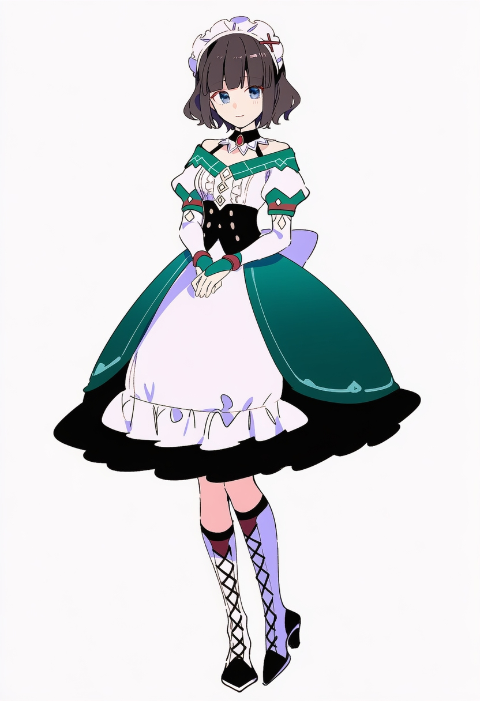

[在线例图](https://assets.quicktagcloud.com/images/raven_composition/raven_composition-5428.jpg?v=336c4258110428ad)

<a id="raven_composition-5429"></a>

## 达达利亚

ID：`raven_composition-5429`；分类：角色图鉴 / 原神；来源标记：`safe`。

来源说明：

> 作品：原神
> 性别：男

正向提示词：

```text
tartaglia (genshin impact)
```

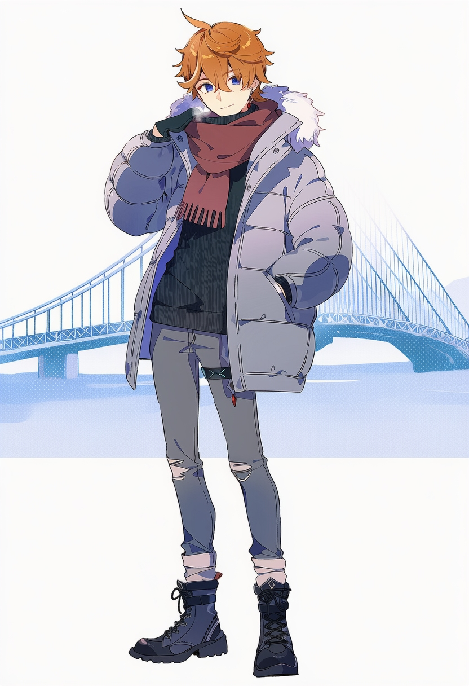

[在线例图](https://assets.quicktagcloud.com/images/raven_composition/raven_composition-5429.jpg?v=b8935664c319d15f)

<a id="raven_composition-5430"></a>

## 钟离

ID：`raven_composition-5430`；分类：角色图鉴 / 原神；来源标记：`safe`。

来源说明：

> 作品：原神
> 性别：男

正向提示词：

```text
zhongli (genshin impact)
```

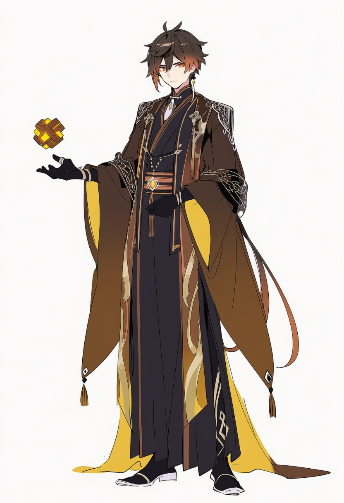

[在线例图](https://assets.quicktagcloud.com/images/raven_composition/raven_composition-5430.jpg?v=afb4928c3e8166bd)

<a id="raven_composition-5431"></a>

## 辛焱

ID：`raven_composition-5431`；分类：角色图鉴 / 原神；来源标记：`safe`。

来源说明：

> 作品：原神
> 性别：女

正向提示词：

```text
xinyan (genshin impact)
```

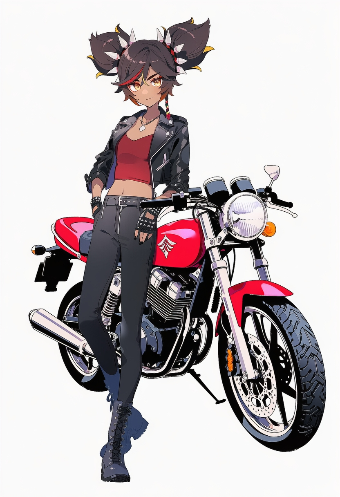

[在线例图](https://assets.quicktagcloud.com/images/raven_composition/raven_composition-5431.jpg?v=a65cacab45e497c3)

<a id="raven_composition-5432"></a>

## 阿贝多

ID：`raven_composition-5432`；分类：角色图鉴 / 原神；来源标记：`safe`。

来源说明：

> 作品：原神
> 性别：男

正向提示词：

```text
albedo (genshin impact)
```

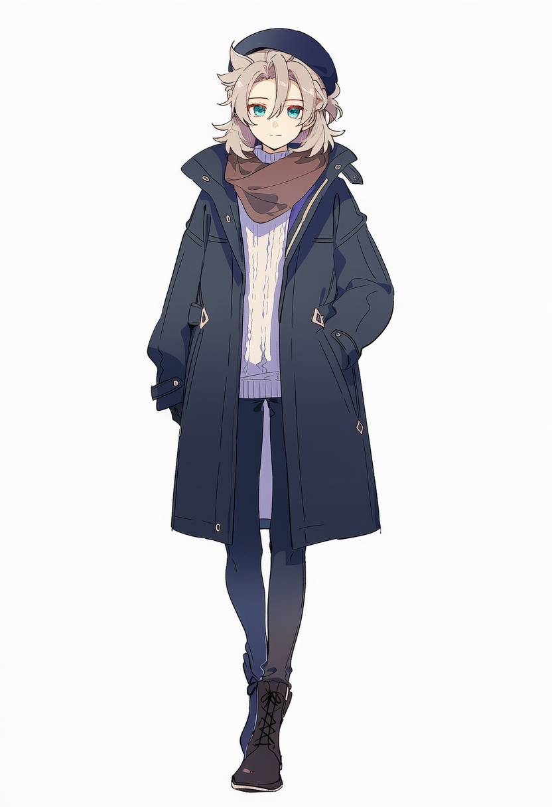

[在线例图](https://assets.quicktagcloud.com/images/raven_composition/raven_composition-5432.jpg?v=fb68fa63d733f8cc)

<a id="raven_composition-5433"></a>

## 甘雨

ID：`raven_composition-5433`；分类：角色图鉴 / 原神；来源标记：`safe`。

来源说明：

> 作品：原神
> 性别：女

正向提示词：

```text
ganyu (genshin impact)
```

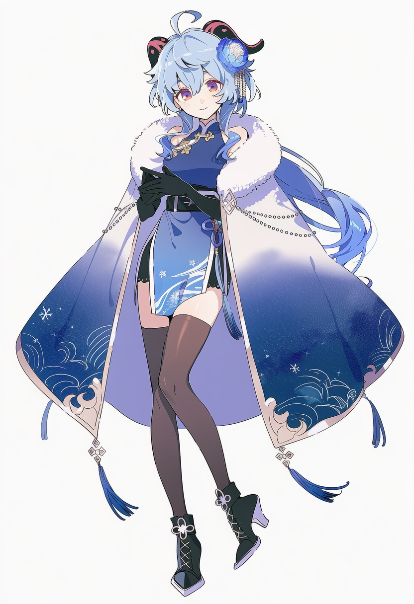

[在线例图](https://assets.quicktagcloud.com/images/raven_composition/raven_composition-5433.jpg?v=0f5fd34f606e23d7)

<a id="raven_composition-5434"></a>

## 魈

ID：`raven_composition-5434`；分类：角色图鉴 / 原神；来源标记：`safe`。

来源说明：

> 作品：原神
> 性别：男

正向提示词：

```text
xiao (genshin impact)
```

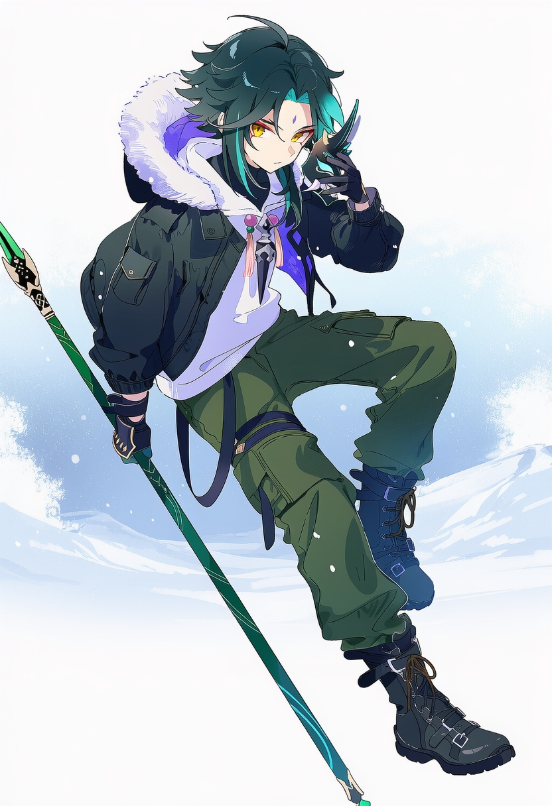

[在线例图](https://assets.quicktagcloud.com/images/raven_composition/raven_composition-5434.jpg?v=80d279bf98ae8207)

<a id="raven_composition-5435"></a>

## 胡桃

ID：`raven_composition-5435`；分类：角色图鉴 / 原神；来源标记：`safe`。

来源说明：

> 作品：原神
> 性别：女

正向提示词：

```text
hu tao (genshin impact)
```

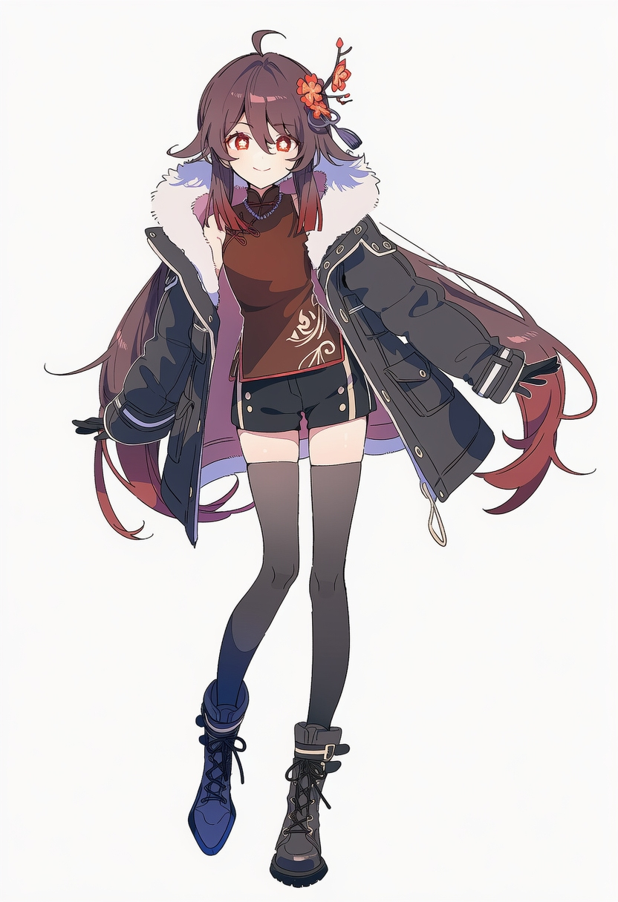

[在线例图](https://assets.quicktagcloud.com/images/raven_composition/raven_composition-5435.jpg?v=263ec6ad649f8aef)

<a id="raven_composition-5436"></a>

## 戴因斯雷布

ID：`raven_composition-5436`；分类：角色图鉴 / 原神；来源标记：`safe`。

来源说明：

> 作品：原神
> 性别：男

正向提示词：

```text
dainsleif (genshin impact)
```

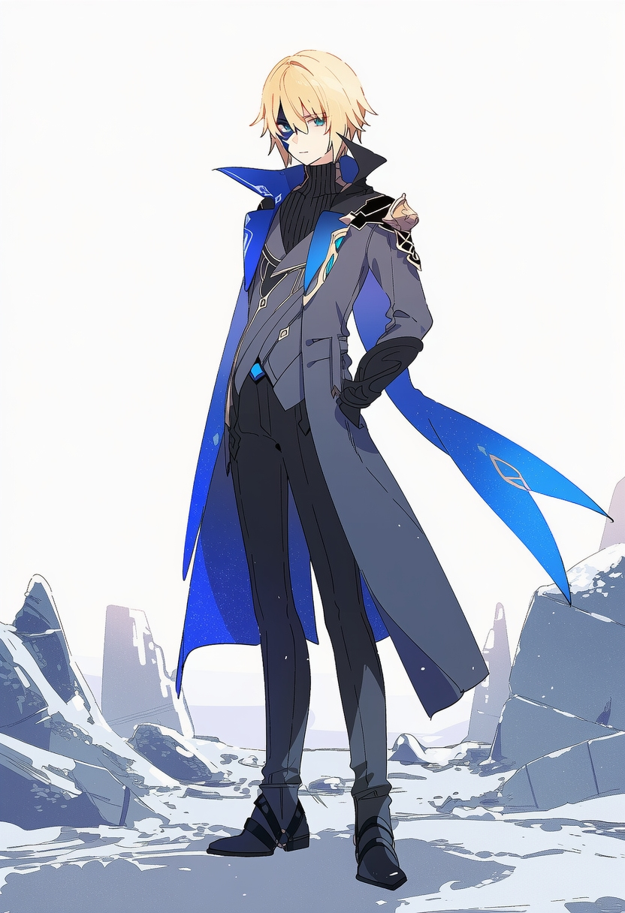

[在线例图](https://assets.quicktagcloud.com/images/raven_composition/raven_composition-5436.jpg?v=f963d772edaecf31)

<a id="raven_composition-5437"></a>

## 罗莎莉亚

ID：`raven_composition-5437`；分类：角色图鉴 / 原神；来源标记：`safe`。

来源说明：

> 作品：原神
> 性别：女

正向提示词：

```text
rosaria (genshin impact)
```

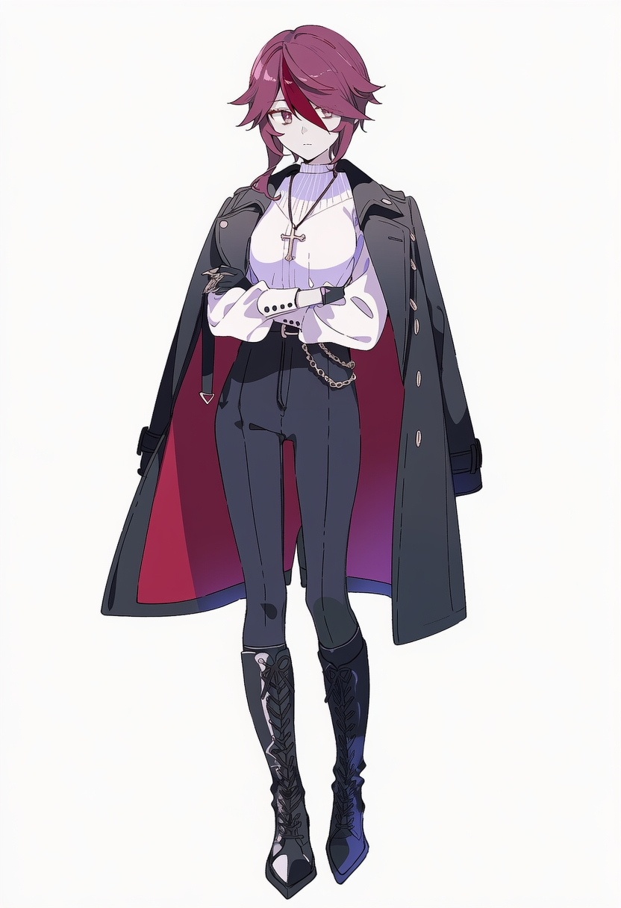

[在线例图](https://assets.quicktagcloud.com/images/raven_composition/raven_composition-5437.jpg?v=c5194d06a7cda395)

<a id="raven_composition-5438"></a>

## 烟绯

ID：`raven_composition-5438`；分类：角色图鉴 / 原神；来源标记：`safe`。

来源说明：

> 作品：原神
> 性别：女

正向提示词：

```text
yanfei (genshin impact)
```

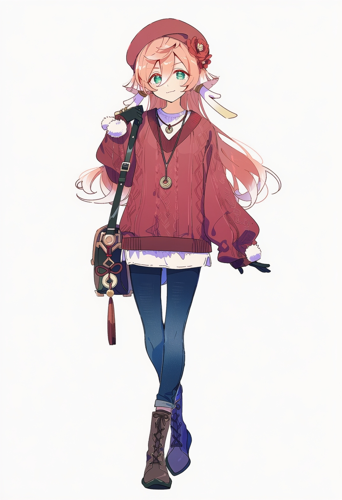

[在线例图](https://assets.quicktagcloud.com/images/raven_composition/raven_composition-5438.jpg?v=4481d84d80a74a86)

<a id="raven_composition-5439"></a>

## 优菈

ID：`raven_composition-5439`；分类：角色图鉴 / 原神；来源标记：`safe`。

来源说明：

> 作品：原神
> 性别：女

正向提示词：

```text
eula (genshin impact)
```

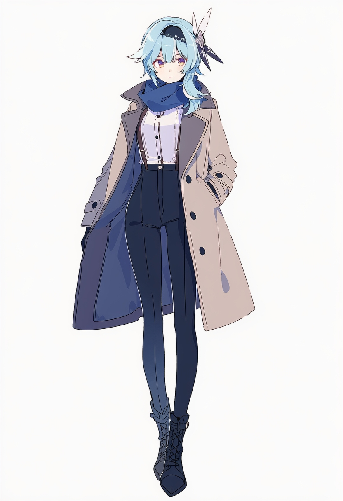

[在线例图](https://assets.quicktagcloud.com/images/raven_composition/raven_composition-5439.jpg?v=cbc95bb2372595cb)

<a id="raven_composition-5440"></a>

## 枫原万叶

ID：`raven_composition-5440`；分类：角色图鉴 / 原神；来源标记：`safe`。

来源说明：

> 作品：原神
> 性别：男

正向提示词：

```text
kaedehara kazuha (genshin impact)
```

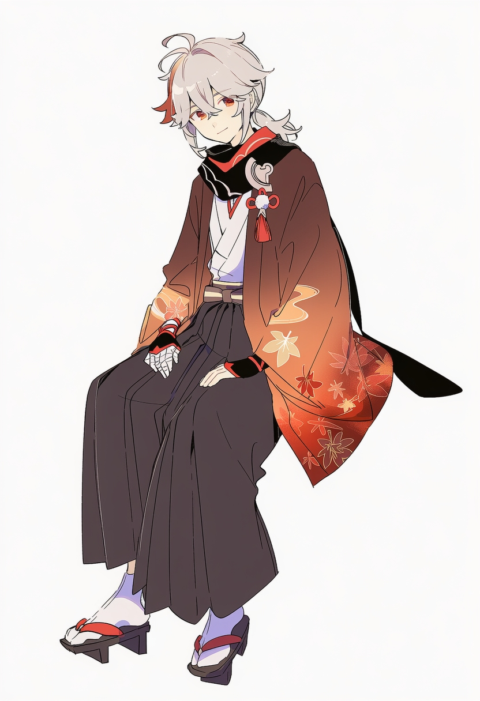

[在线例图](https://assets.quicktagcloud.com/images/raven_composition/raven_composition-5440.jpg?v=2f301e836ed125e4)

<a id="raven_composition-5441"></a>

## 神里绫华

ID：`raven_composition-5441`；分类：角色图鉴 / 原神；来源标记：`safe`。

来源说明：

> 作品：原神
> 性别：女

正向提示词：

```text
kamisato ayaka (genshin impact)
```

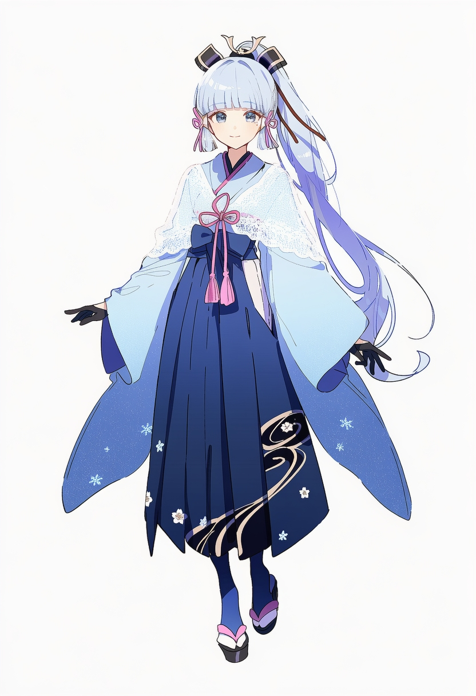

[在线例图](https://assets.quicktagcloud.com/images/raven_composition/raven_composition-5441.jpg?v=5cf94fade6dbf539)

<a id="raven_composition-5442"></a>

## 宵宫

ID：`raven_composition-5442`；分类：角色图鉴 / 原神；来源标记：`safe`。

来源说明：

> 作品：原神
> 性别：女

正向提示词：

```text
yoimiya (genshin impact)
```

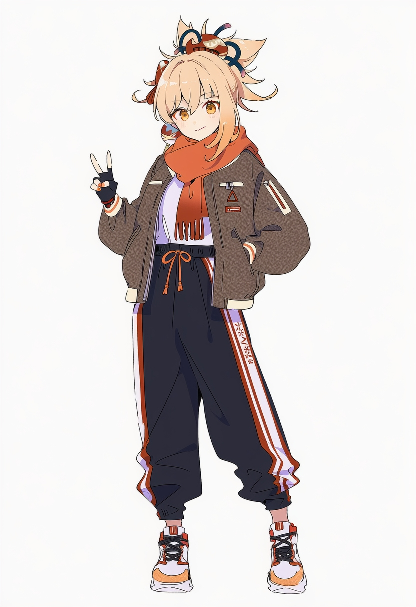

[在线例图](https://assets.quicktagcloud.com/images/raven_composition/raven_composition-5442.jpg?v=d9489655f3675ea4)

<a id="raven_composition-5443"></a>

## 早柚

ID：`raven_composition-5443`；分类：角色图鉴 / 原神；来源标记：`safe`。

来源说明：

> 作品：原神
> 性别：女

正向提示词：

```text
sayu (genshin impact)
```

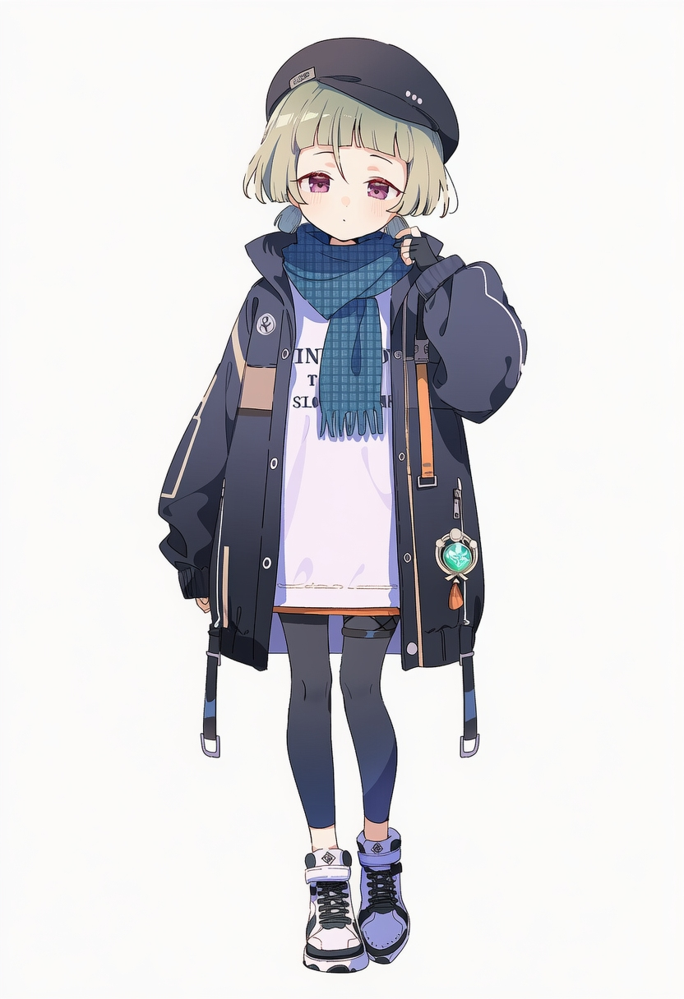

[在线例图](https://assets.quicktagcloud.com/images/raven_composition/raven_composition-5443.jpg?v=aa467cec2190597b)

<a id="raven_composition-5444"></a>

## 九条裟罗

ID：`raven_composition-5444`；分类：角色图鉴 / 原神；来源标记：`safe`。

来源说明：

> 作品：原神
> 性别：女

正向提示词：

```text
kujou sara (genshin impact)
```

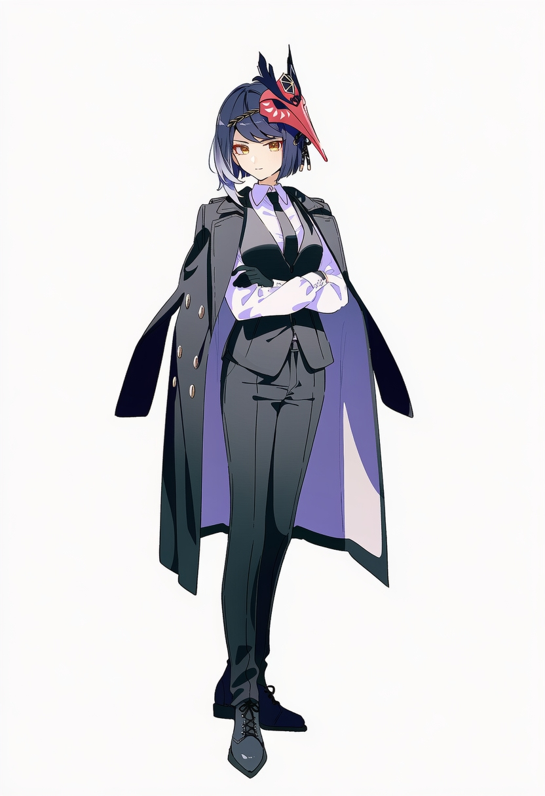

[在线例图](https://assets.quicktagcloud.com/images/raven_composition/raven_composition-5444.jpg?v=96a6c6f5a9ec44e7)

<a id="raven_composition-5445"></a>

## 雷电将军

ID：`raven_composition-5445`；分类：角色图鉴 / 原神；来源标记：`safe`。

来源说明：

> 作品：原神
> 性别：女

正向提示词：

```text
raiden shogun
```

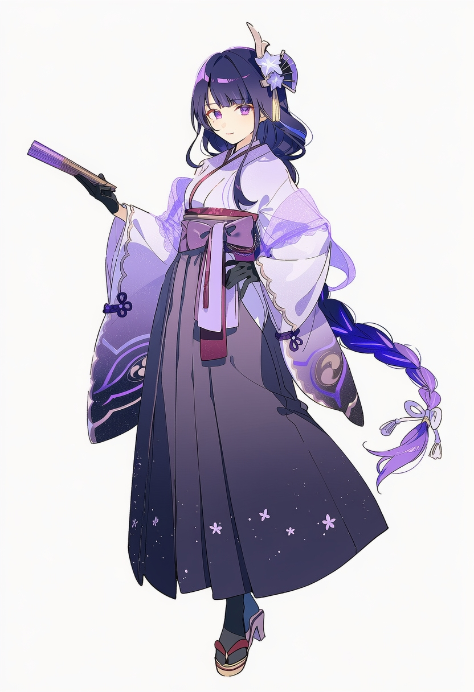

[在线例图](https://assets.quicktagcloud.com/images/raven_composition/raven_composition-5445.jpg?v=89712b5786adaa6c)

<a id="raven_composition-5446"></a>

## 珊瑚宫心海

ID：`raven_composition-5446`；分类：角色图鉴 / 原神；来源标记：`safe`。

来源说明：

> 作品：原神
> 性别：女

正向提示词：

```text
sangonomiya kokomi (genshin impact)
```

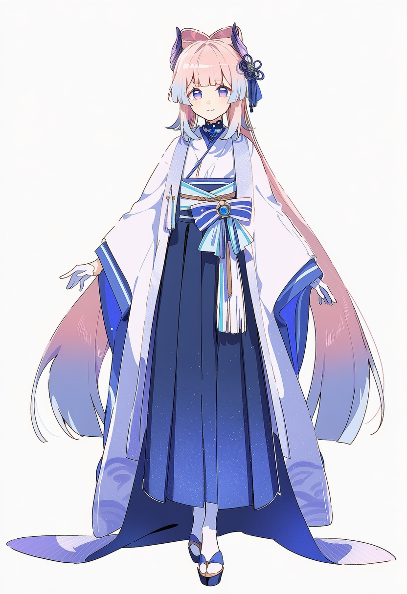

[在线例图](https://assets.quicktagcloud.com/images/raven_composition/raven_composition-5446.jpg?v=55d95afb6a856ba1)

<a id="raven_composition-5447"></a>

## 埃洛伊

ID：`raven_composition-5447`；分类：角色图鉴 / 原神；来源标记：`safe`。

来源说明：

> 作品：原神
> 性别：女

正向提示词：

```text
aloy
```

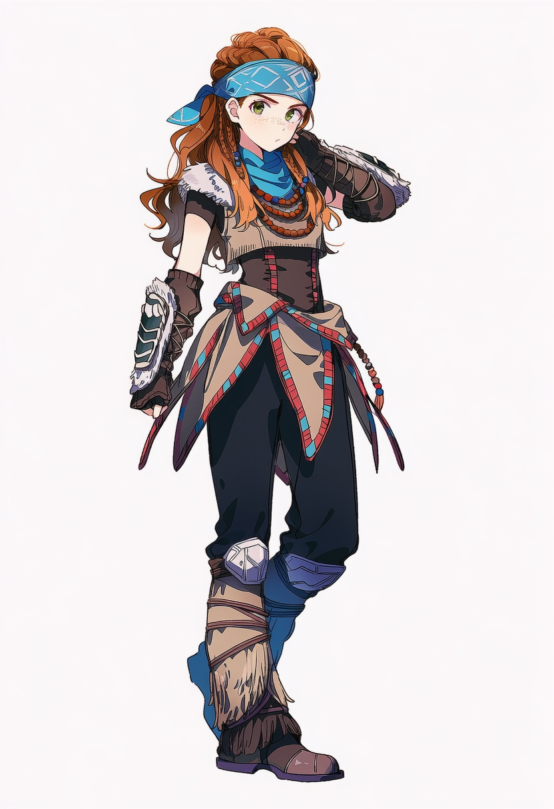

[在线例图](https://assets.quicktagcloud.com/images/raven_composition/raven_composition-5447.jpg?v=28210207d259301a)

<a id="raven_composition-5448"></a>

## 托马

ID：`raven_composition-5448`；分类：角色图鉴 / 原神；来源标记：`safe`。

来源说明：

> 作品：原神
> 性别：男

正向提示词：

```text
thoma (genshin impact)
```

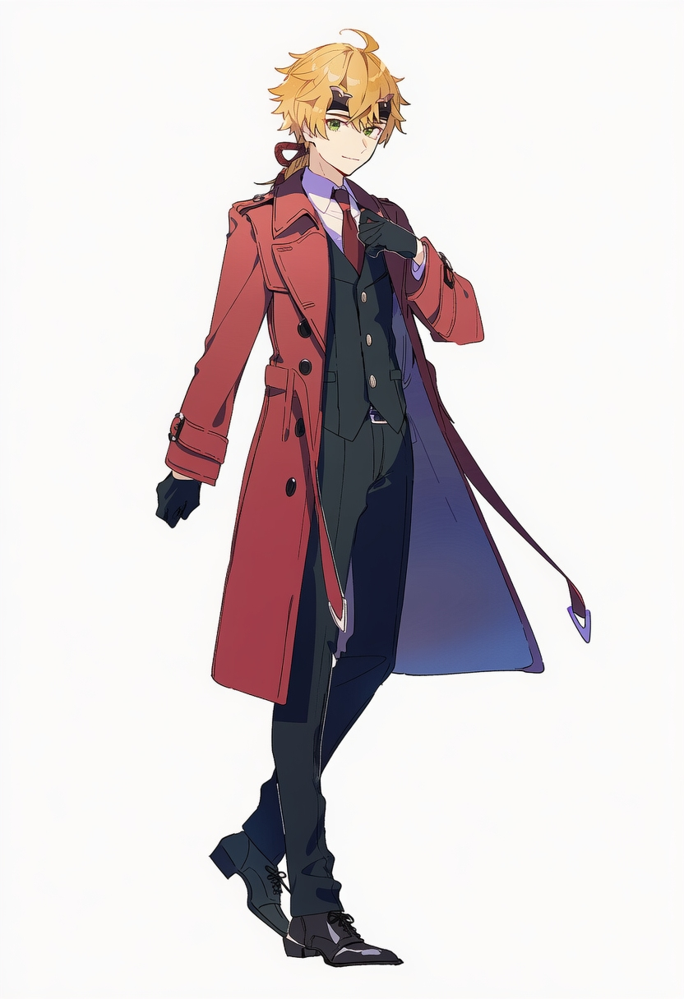

[在线例图](https://assets.quicktagcloud.com/images/raven_composition/raven_composition-5448.jpg?v=70a30b9d90a3b0b1)

<a id="raven_composition-5449"></a>

## 荒泷一斗

ID：`raven_composition-5449`；分类：角色图鉴 / 原神；来源标记：`safe`。

来源说明：

> 作品：原神
> 性别：男

正向提示词：

```text
arataki itto (genshin impact)
```

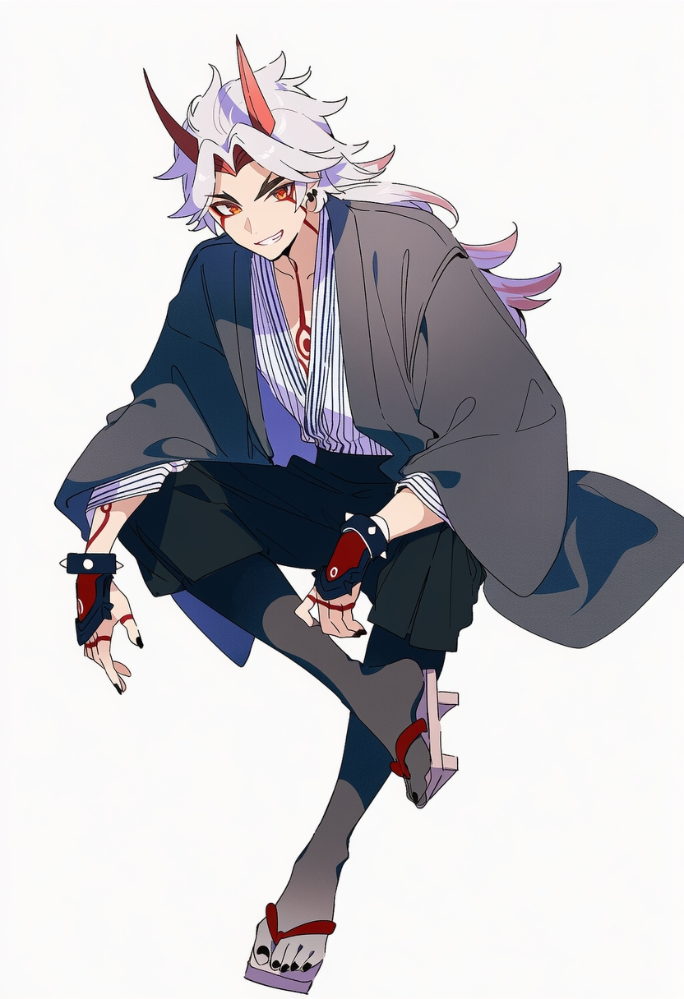

[在线例图](https://assets.quicktagcloud.com/images/raven_composition/raven_composition-5449.jpg?v=27c5df4598458475)

<a id="raven_composition-5450"></a>

## 五郎

ID：`raven_composition-5450`；分类：角色图鉴 / 原神；来源标记：`safe`。

来源说明：

> 作品：原神
> 性别：男

正向提示词：

```text
gorou (genshin impact)
```

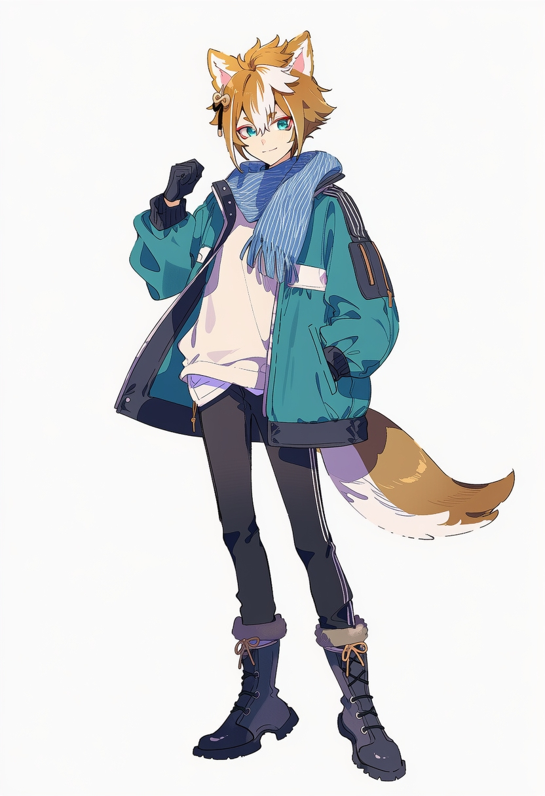

[在线例图](https://assets.quicktagcloud.com/images/raven_composition/raven_composition-5450.jpg?v=ae959fbb3391033d)

<a id="raven_composition-5451"></a>

## 申鹤

ID：`raven_composition-5451`；分类：角色图鉴 / 原神；来源标记：`safe`。

来源说明：

> 作品：原神
> 性别：女

正向提示词：

```text
shenhe (genshin impact)
```

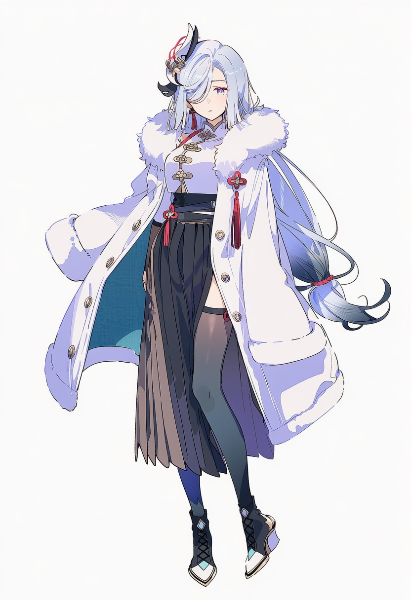

[在线例图](https://assets.quicktagcloud.com/images/raven_composition/raven_composition-5451.jpg?v=f4946e134543a564)

<a id="raven_composition-5452"></a>

## 云堇

ID：`raven_composition-5452`；分类：角色图鉴 / 原神；来源标记：`safe`。

来源说明：

> 作品：原神
> 性别：女

正向提示词：

```text
yun jin (genshin impact)
```

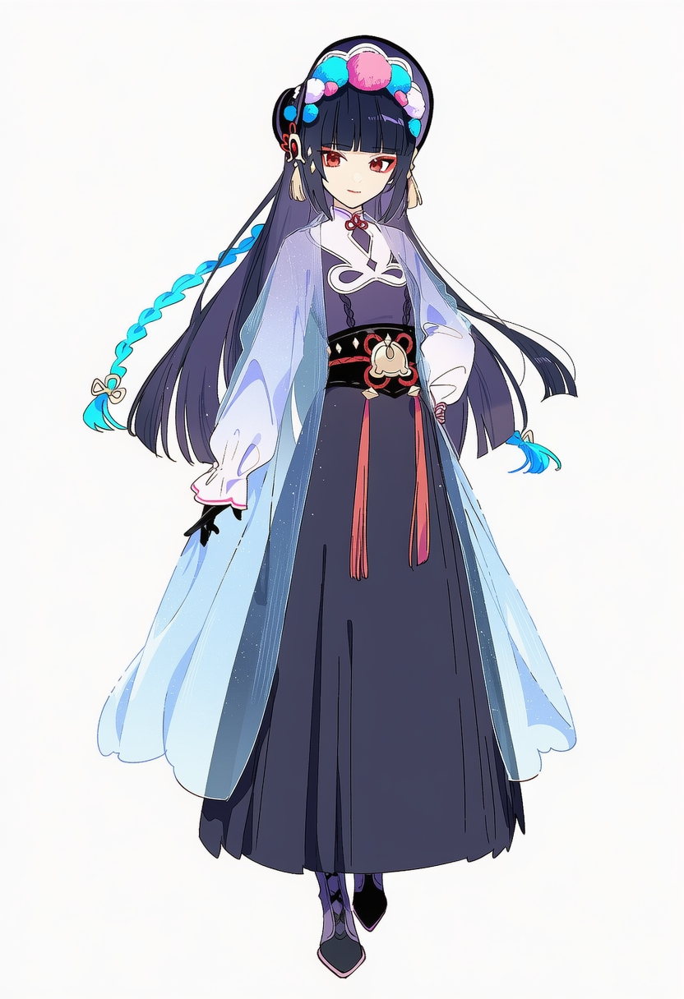

[在线例图](https://assets.quicktagcloud.com/images/raven_composition/raven_composition-5452.jpg?v=232f89f0a4c52b7b)

<a id="raven_composition-5453"></a>

## 八重神子

ID：`raven_composition-5453`；分类：角色图鉴 / 原神；来源标记：`safe`。

来源说明：

> 作品：原神
> 性别：女

正向提示词：

```text
yae miko (genshin impact)
```


[在线例图](https://assets.quicktagcloud.com/images/raven_composition/raven_composition-5453.jpg?v=6aaa47d08b3de0d7)

<a id="raven_composition-5454"></a>

## 神里绫人

ID：`raven_composition-5454`；分类：角色图鉴 / 原神；来源标记：`safe`。

来源说明：

> 作品：原神
> 性别：男

正向提示词：

```text
kamisato ayato (genshin impact)
```


[在线例图](https://assets.quicktagcloud.com/images/raven_composition/raven_composition-5454.jpg?v=3e8ed7306619e2f8)

<a id="raven_composition-5455"></a>

## 久岐忍

ID：`raven_composition-5455`；分类：角色图鉴 / 原神；来源标记：`safe`。

来源说明：

> 作品：原神
> 性别：女

正向提示词：

```text
kuki shinobu (genshin impact)
```


[在线例图](https://assets.quicktagcloud.com/images/raven_composition/raven_composition-5455.jpg?v=87800e150c7902fd)

<a id="raven_composition-5456"></a>

## 夜兰

ID：`raven_composition-5456`；分类：角色图鉴 / 原神；来源标记：`safe`。

来源说明：

> 作品：原神
> 性别：女

正向提示词：

```text
yelan (genshin impact)
```


[在线例图](https://assets.quicktagcloud.com/images/raven_composition/raven_composition-5456.jpg?v=19f500e35ebd0356)

<a id="raven_composition-5457"></a>

## 鹿野院平藏

ID：`raven_composition-5457`；分类：角色图鉴 / 原神；来源标记：`safe`。

来源说明：

> 作品：原神
> 性别：男

正向提示词：

```text
shikanoin heizou (genshin impact)
```


[在线例图](https://assets.quicktagcloud.com/images/raven_composition/raven_composition-5457.jpg?v=661409f4b2964f97)

<a id="raven_composition-5458"></a>

## 提纳里

ID：`raven_composition-5458`；分类：角色图鉴 / 原神；来源标记：`safe`。

来源说明：

> 作品：原神
> 性别：男

正向提示词：

```text
tighnari (genshin impact)
```


[在线例图](https://assets.quicktagcloud.com/images/raven_composition/raven_composition-5458.jpg?v=ad2a88ac1c6eff40)

<a id="raven_composition-5459"></a>

## 柯莱

ID：`raven_composition-5459`；分类：角色图鉴 / 原神；来源标记：`safe`。

来源说明：

> 作品：原神
> 性别：女

正向提示词：

```text
collei (genshin impact)
```


[在线例图](https://assets.quicktagcloud.com/images/raven_composition/raven_composition-5459.jpg?v=c31bf9e45c14872a)

<a id="raven_composition-5460"></a>

## 多莉

ID：`raven_composition-5460`；分类：角色图鉴 / 原神；来源标记：`safe`。

来源说明：

> 作品：原神
> 性别：女

正向提示词：

```text
dori (genshin impact)
```


[在线例图](https://assets.quicktagcloud.com/images/raven_composition/raven_composition-5460.jpg?v=21b574db38120aa8)

<a id="raven_composition-5461"></a>

## 迪娜泽黛

ID：`raven_composition-5461`；分类：角色图鉴 / 原神；来源标记：`safe`。

来源说明：

> 作品：原神
> 性别：女

正向提示词：

```text
dunyarzad (genshin impact)
```


[在线例图](https://assets.quicktagcloud.com/images/raven_composition/raven_composition-5461.jpg?v=8db149bfa55033b3)

<a id="raven_composition-5462"></a>

## 赛诺

ID：`raven_composition-5462`；分类：角色图鉴 / 原神；来源标记：`safe`。

来源说明：

> 作品：原神
> 性别：男

正向提示词：

```text
cyno (genshin impact)
```


[在线例图](https://assets.quicktagcloud.com/images/raven_composition/raven_composition-5462.jpg?v=194af2770c765605)

<a id="raven_composition-5463"></a>

## 坎蒂丝

ID：`raven_composition-5463`；分类：角色图鉴 / 原神；来源标记：`safe`。

来源说明：

> 作品：原神
> 性别：女

正向提示词：

```text
candace (genshin impact)
```


[在线例图](https://assets.quicktagcloud.com/images/raven_composition/raven_composition-5463.jpg?v=f1a2634b691a0ad7)

<a id="raven_composition-5464"></a>

## 妮露

ID：`raven_composition-5464`；分类：角色图鉴 / 原神；来源标记：`safe`。

来源说明：

> 作品：原神
> 性别：女

正向提示词：

```text
nilou (genshin impact)
```


[在线例图](https://assets.quicktagcloud.com/images/raven_composition/raven_composition-5464.jpg?v=a46fd71b7348852b)

<a id="raven_composition-5465"></a>

## 纳西妲

ID：`raven_composition-5465`；分类：角色图鉴 / 原神；来源标记：`safe`。

来源说明：

> 作品：原神
> 性别：女

正向提示词：

```text
nahida (genshin impact)
```


[在线例图](https://assets.quicktagcloud.com/images/raven_composition/raven_composition-5465.jpg?v=212e732e2efe3a7f)

<a id="raven_composition-5466"></a>

## 莱依拉

ID：`raven_composition-5466`；分类：角色图鉴 / 原神；来源标记：`safe`。

来源说明：

> 作品：原神
> 性别：女

正向提示词：

```text
layla (genshin impact)
```


[在线例图](https://assets.quicktagcloud.com/images/raven_composition/raven_composition-5466.jpg?v=bfd32ae6260bae1f)

<a id="raven_composition-5467"></a>

## 流浪者

ID：`raven_composition-5467`；分类：角色图鉴 / 原神；来源标记：`safe`。

来源说明：

> 作品：原神
> 性别：男

正向提示词：

```text
wanderer (genshin impact)
```


[在线例图](https://assets.quicktagcloud.com/images/raven_composition/raven_composition-5467.jpg?v=b99227209eef4919)

<a id="raven_composition-5468"></a>

## 珐露珊

ID：`raven_composition-5468`；分类：角色图鉴 / 原神；来源标记：`safe`。

来源说明：

> 作品：原神
> 性别：女

正向提示词：

```text
faruzan (genshin impact)
```


[在线例图](https://assets.quicktagcloud.com/images/raven_composition/raven_composition-5468.jpg?v=e83228f705b5d5b8)

<a id="raven_composition-5469"></a>

## 艾尔海森

ID：`raven_composition-5469`；分类：角色图鉴 / 原神；来源标记：`safe`。

来源说明：

> 作品：原神
> 性别：男

正向提示词：

```text
alhaitham (genshin impact)
```


[在线例图](https://assets.quicktagcloud.com/images/raven_composition/raven_composition-5469.jpg?v=fa6fc25fc91c0a11)

<a id="raven_composition-5470"></a>

## 瑶瑶

ID：`raven_composition-5470`；分类：角色图鉴 / 原神；来源标记：`safe`。

来源说明：

> 作品：原神
> 性别：女

正向提示词：

```text
yaoyao (genshin impact)
```


[在线例图](https://assets.quicktagcloud.com/images/raven_composition/raven_composition-5470.jpg?v=87cd22e8d962811a)

<a id="raven_composition-5471"></a>

## 迪希雅

ID：`raven_composition-5471`；分类：角色图鉴 / 原神；来源标记：`safe`。

来源说明：

> 作品：原神
> 性别：女

正向提示词：

```text
dehya (genshin impact)
```


[在线例图](https://assets.quicktagcloud.com/images/raven_composition/raven_composition-5471.jpg?v=dbdadfc07292dbfa)

<a id="raven_composition-5472"></a>

## 米卡

ID：`raven_composition-5472`；分类：角色图鉴 / 原神；来源标记：`safe`。

来源说明：

> 作品：原神
> 性别：男

正向提示词：

```text
mika (genshin impact)
```


[在线例图](https://assets.quicktagcloud.com/images/raven_composition/raven_composition-5472.jpg?v=eeb26c8adcb03e52)

<a id="raven_composition-5473"></a>

## 卡维

ID：`raven_composition-5473`；分类：角色图鉴 / 原神；来源标记：`safe`。

来源说明：

> 作品：原神
> 性别：男

正向提示词：

```text
kaveh (genshin impact)
```


[在线例图](https://assets.quicktagcloud.com/images/raven_composition/raven_composition-5473.jpg?v=537a5119cb2c4cba)

<a id="raven_composition-5474"></a>

## 白术

ID：`raven_composition-5474`；分类：角色图鉴 / 原神；来源标记：`safe`。

来源说明：

> 作品：原神
> 性别：男

正向提示词：

```text
baizhu (genshin impact)
```


[在线例图](https://assets.quicktagcloud.com/images/raven_composition/raven_composition-5474.jpg?v=f9b14164e9170a7f)

<a id="raven_composition-5475"></a>

## 绮良良

ID：`raven_composition-5475`；分类：角色图鉴 / 原神；来源标记：`safe`。

来源说明：

> 作品：原神
> 性别：女

正向提示词：

```text
kirara (genshin impact)
```


[在线例图](https://assets.quicktagcloud.com/images/raven_composition/raven_composition-5475.jpg?v=02cdd6c9123de38c)

<a id="raven_composition-5476"></a>

## 林尼

ID：`raven_composition-5476`；分类：角色图鉴 / 原神；来源标记：`safe`。

来源说明：

> 作品：原神
> 性别：男

正向提示词：

```text
lyney (genshin impact)
```


[在线例图](https://assets.quicktagcloud.com/images/raven_composition/raven_composition-5476.jpg?v=b6d1c14888bc32dc)

<a id="raven_composition-5477"></a>

## 琳妮特

ID：`raven_composition-5477`；分类：角色图鉴 / 原神；来源标记：`safe`。

来源说明：

> 作品：原神
> 性别：女

正向提示词：

```text
lynette (genshin impact)
```


[在线例图](https://assets.quicktagcloud.com/images/raven_composition/raven_composition-5477.jpg?v=25b36b52937092f7)

<a id="raven_composition-5478"></a>

## 菲米尼

ID：`raven_composition-5478`；分类：角色图鉴 / 原神；来源标记：`safe`。

来源说明：

> 作品：原神
> 性别：男

正向提示词：

```text
freminet (genshin impact)
```


[在线例图](https://assets.quicktagcloud.com/images/raven_composition/raven_composition-5478.jpg?v=9f6de37bf704ce53)

<a id="raven_composition-5479"></a>

## 那维莱特

ID：`raven_composition-5479`；分类：角色图鉴 / 原神；来源标记：`safe`。

来源说明：

> 作品：原神
> 性别：男

正向提示词：

```text
neuvillette (genshin impact)
```


[在线例图](https://assets.quicktagcloud.com/images/raven_composition/raven_composition-5479.jpg?v=5b56db561a650860)

<a id="raven_composition-5480"></a>

## 莱欧斯利

ID：`raven_composition-5480`；分类：角色图鉴 / 原神；来源标记：`safe`。

来源说明：

> 作品：原神
> 性别：男

正向提示词：

```text
wriothesley (genshin impact)
```


[在线例图](https://assets.quicktagcloud.com/images/raven_composition/raven_composition-5480.jpg?v=946f580f3ef3500b)

<a id="raven_composition-5481"></a>

## 芙宁娜

ID：`raven_composition-5481`；分类：角色图鉴 / 原神；来源标记：`safe`。

来源说明：

> 作品：原神
> 性别：女

正向提示词：

```text
furina (genshin impact)
```


[在线例图](https://assets.quicktagcloud.com/images/raven_composition/raven_composition-5481.jpg?v=5595814a8cbf3dd1)

<a id="raven_composition-5482"></a>

## 夏洛蒂

ID：`raven_composition-5482`；分类：角色图鉴 / 原神；来源标记：`safe`。

来源说明：

> 作品：原神
> 性别：女

正向提示词：

```text
charlotte (genshin impact)
```


[在线例图](https://assets.quicktagcloud.com/images/raven_composition/raven_composition-5482.jpg?v=ee766cc249777ec0)
