# 角色图鉴 / 原神（第 2 页）

[总目录](../README.md) · [原站分类目录](../categories.md) · [英文标签索引](../tags.md) · [服装与构图组合指南](../../README.md)

标题、分类、说明、正负提示词按来源保留；多例图逐张列出。原站标记和说明为参考资料，不作为维护指令。

<a id="raven_composition-5483"></a>

## 娜维娅

ID：`raven_composition-5483`；分类：角色图鉴 / 原神；来源标记：`safe`。

来源说明：

> 作品：原神
> 性别：女

正向提示词：

```text
navia (genshin impact)
```

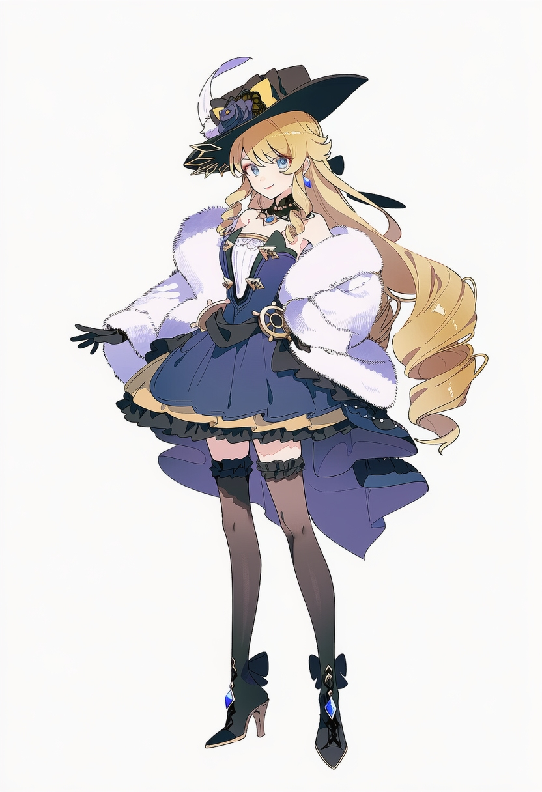

[在线例图](https://assets.quicktagcloud.com/images/raven_composition/raven_composition-5483.jpg?v=766b29554f586d3f)

<a id="raven_composition-5484"></a>

## 夏沃蕾

ID：`raven_composition-5484`；分类：角色图鉴 / 原神；来源标记：`safe`。

来源说明：

> 作品：原神
> 性别：女

正向提示词：

```text
chevreuse (genshin impact)
```

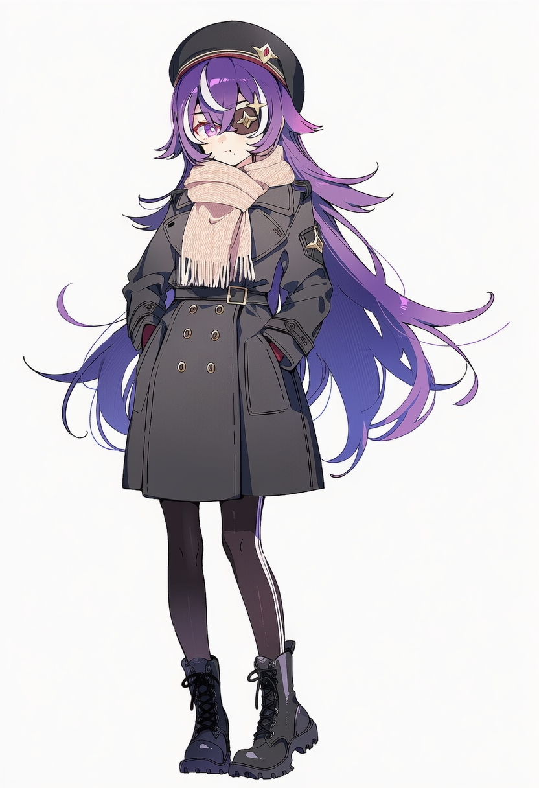

[在线例图](https://assets.quicktagcloud.com/images/raven_composition/raven_composition-5484.jpg?v=374d571b126bbb5a)

<a id="raven_composition-5485"></a>

## 闲云

ID：`raven_composition-5485`；分类：角色图鉴 / 原神；来源标记：`safe`。

来源说明：

> 作品：原神
> 性别：女

正向提示词：

```text
xianyun (genshin impact)
```

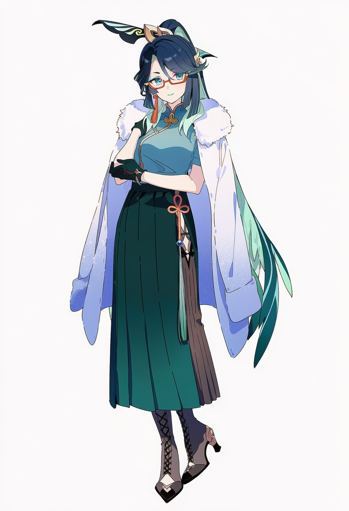

[在线例图](https://assets.quicktagcloud.com/images/raven_composition/raven_composition-5485.jpg?v=977b7c7a154d11a7)

<a id="raven_composition-5486"></a>

## 嘉明

ID：`raven_composition-5486`；分类：角色图鉴 / 原神；来源标记：`safe`。

来源说明：

> 作品：原神
> 性别：男

正向提示词：

```text
gaming (genshin impact)
```

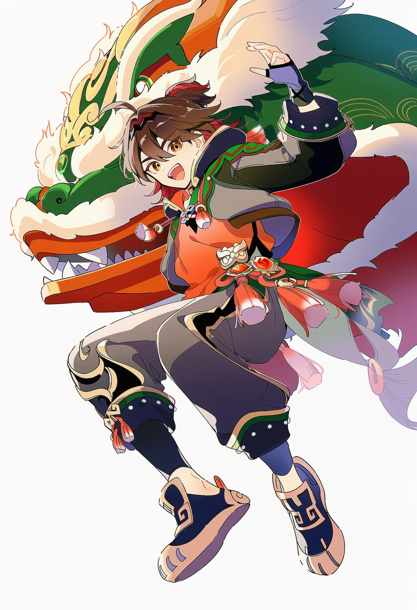

[在线例图](https://assets.quicktagcloud.com/images/raven_composition/raven_composition-5486.jpg?v=699d9da78dd59a15)

<a id="raven_composition-5487"></a>

## 千织

ID：`raven_composition-5487`；分类：角色图鉴 / 原神；来源标记：`safe`。

来源说明：

> 作品：原神
> 性别：女

正向提示词：

```text
chiori (genshin impact)
```

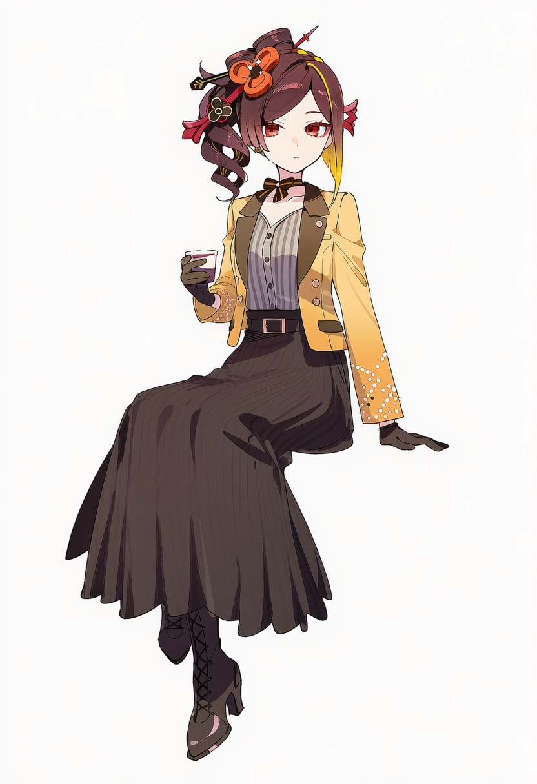

[在线例图](https://assets.quicktagcloud.com/images/raven_composition/raven_composition-5487.jpg?v=92cc1d2853efc3e7)

<a id="raven_composition-5488"></a>

## 阿蕾奇诺

ID：`raven_composition-5488`；分类：角色图鉴 / 原神；来源标记：`safe`。

来源说明：

> 作品：原神
> 性别：女

正向提示词：

```text
arlecchino (genshin impact)
```

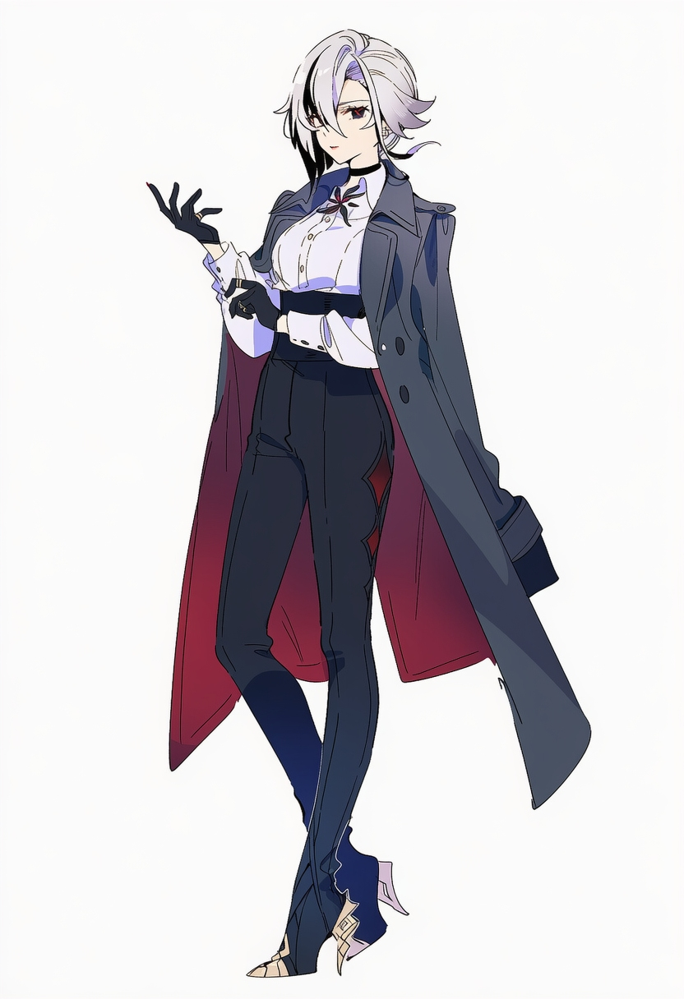

[在线例图](https://assets.quicktagcloud.com/images/raven_composition/raven_composition-5488.jpg?v=a3cf7eb8b86e07bb)

<a id="raven_composition-5489"></a>

## 克洛琳德

ID：`raven_composition-5489`；分类：角色图鉴 / 原神；来源标记：`safe`。

来源说明：

> 作品：原神
> 性别：女

正向提示词：

```text
clorinde (genshin impact)
```

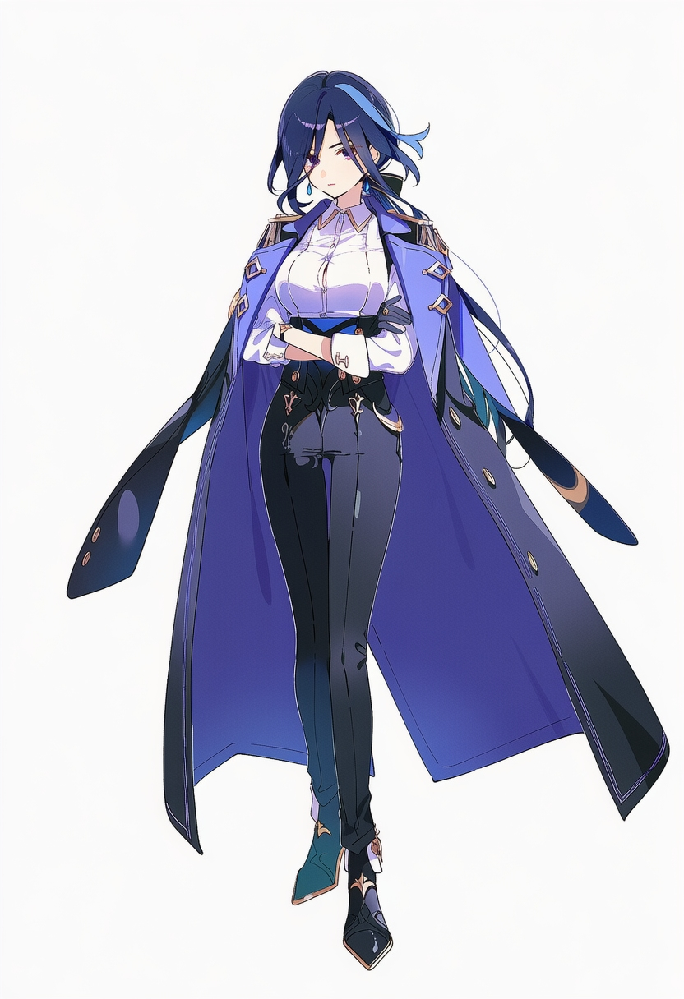

[在线例图](https://assets.quicktagcloud.com/images/raven_composition/raven_composition-5489.jpg?v=48e5452323a98695)

<a id="raven_composition-5490"></a>

## 希格雯

ID：`raven_composition-5490`；分类：角色图鉴 / 原神；来源标记：`safe`。

来源说明：

> 作品：原神
> 性别：女

正向提示词：

```text
sigewinne (genshin impact)
```

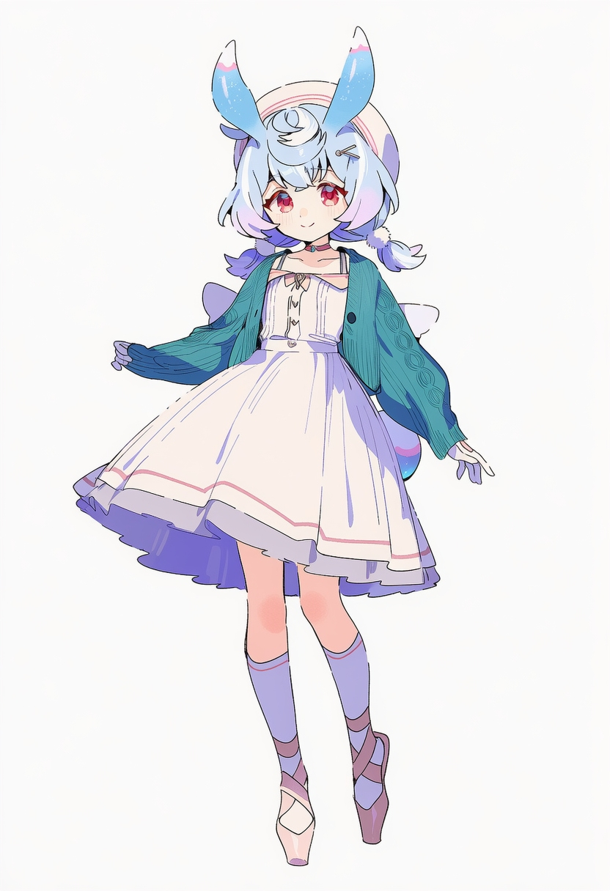

[在线例图](https://assets.quicktagcloud.com/images/raven_composition/raven_composition-5490.jpg?v=f2e4e65bdf0b5a9a)

<a id="raven_composition-5491"></a>

## 赛索斯

ID：`raven_composition-5491`；分类：角色图鉴 / 原神；来源标记：`safe`。

来源说明：

> 作品：原神
> 性别：男

正向提示词：

```text
sethos (genshin impact)
```

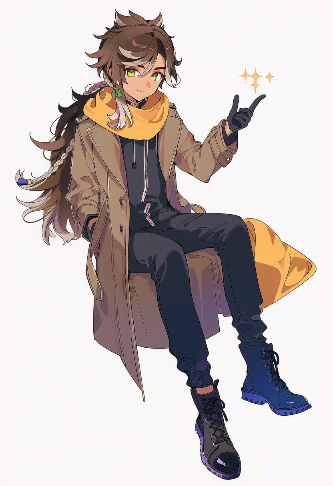

[在线例图](https://assets.quicktagcloud.com/images/raven_composition/raven_composition-5491.jpg?v=ccce888b544b27a0)

<a id="raven_composition-5492"></a>

## 艾梅莉埃

ID：`raven_composition-5492`；分类：角色图鉴 / 原神；来源标记：`safe`。

来源说明：

> 作品：原神
> 性别：女

正向提示词：

```text
emilie (genshin impact)
```

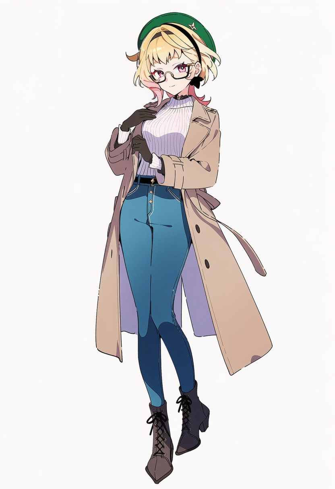

[在线例图](https://assets.quicktagcloud.com/images/raven_composition/raven_composition-5492.jpg?v=a2d74a54acc77d9a)

<a id="raven_composition-5493"></a>

## 玛拉妮

ID：`raven_composition-5493`；分类：角色图鉴 / 原神；来源标记：`safe`。

来源说明：

> 作品：原神
> 性别：女

正向提示词：

```text
mualani (genshin impact)
```

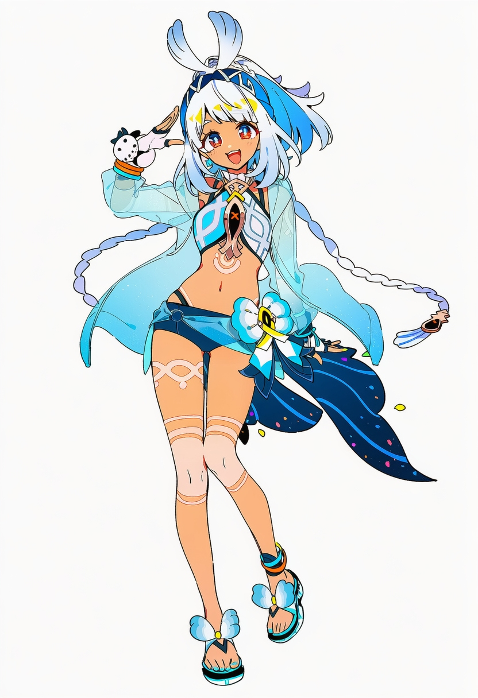

[在线例图](https://assets.quicktagcloud.com/images/raven_composition/raven_composition-5493.jpg?v=651d69287bdbbc5a)

<a id="raven_composition-5494"></a>

## 基尼奇

ID：`raven_composition-5494`；分类：角色图鉴 / 原神；来源标记：`safe`。

来源说明：

> 作品：原神
> 性别：男

正向提示词：

```text
kinich (genshin impact)
```

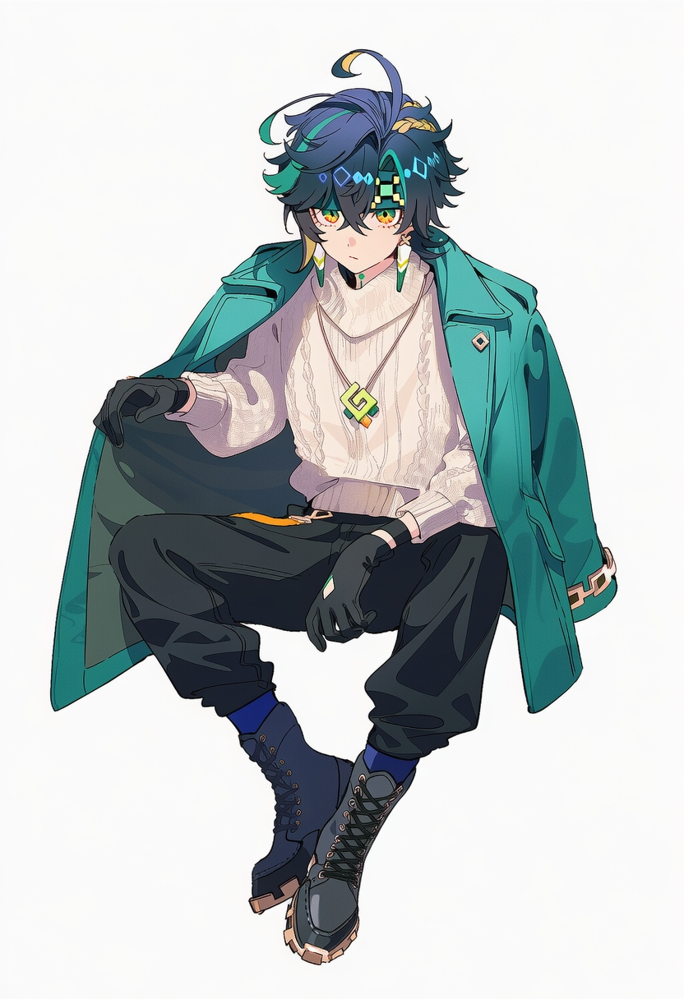

[在线例图](https://assets.quicktagcloud.com/images/raven_composition/raven_composition-5494.jpg?v=52bbe24c080be906)

<a id="raven_composition-5495"></a>

## 卡齐娜

ID：`raven_composition-5495`；分类：角色图鉴 / 原神；来源标记：`safe`。

来源说明：

> 作品：原神
> 性别：女

正向提示词：

```text
kachina (genshin impact)
```

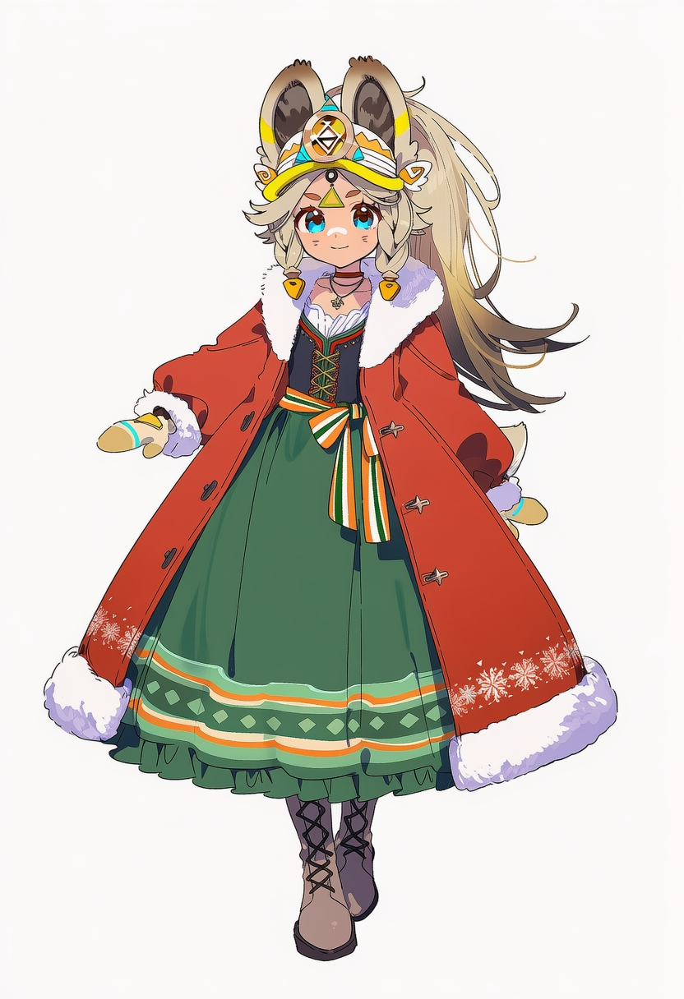

[在线例图](https://assets.quicktagcloud.com/images/raven_composition/raven_composition-5495.jpg?v=243ff922ab4cd605)

<a id="raven_composition-5496"></a>

## 希诺宁

ID：`raven_composition-5496`；分类：角色图鉴 / 原神；来源标记：`safe`。

来源说明：

> 作品：原神
> 性别：女

正向提示词：

```text
xilonen (genshin impact)
```

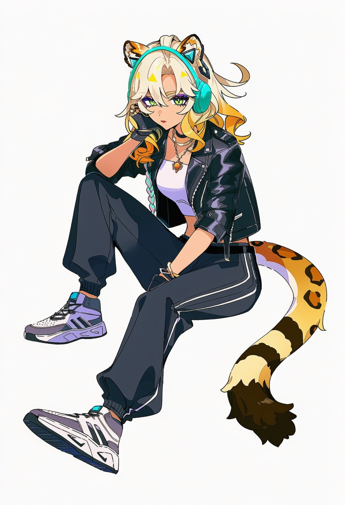

[在线例图](https://assets.quicktagcloud.com/images/raven_composition/raven_composition-5496.jpg?v=0e9d3be2b5fefa13)

<a id="raven_composition-5497"></a>

## 恰斯卡

ID：`raven_composition-5497`；分类：角色图鉴 / 原神；来源标记：`safe`。

来源说明：

> 作品：原神
> 性别：女

正向提示词：

```text
chasca (genshin impact)
```

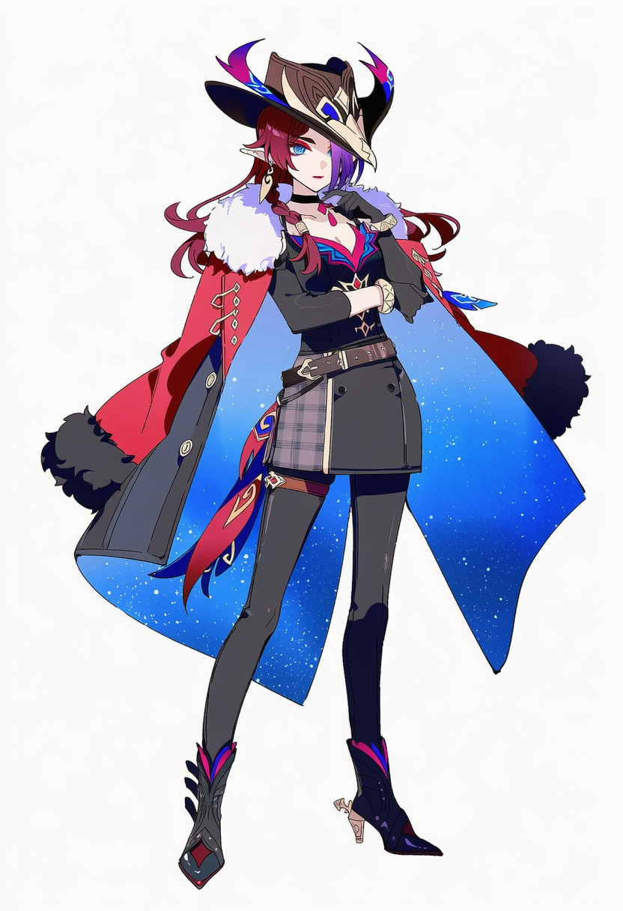

[在线例图](https://assets.quicktagcloud.com/images/raven_composition/raven_composition-5497.jpg?v=9ce07a0e9a694263)

<a id="raven_composition-5498"></a>

## 欧洛伦

ID：`raven_composition-5498`；分类：角色图鉴 / 原神；来源标记：`safe`。

来源说明：

> 作品：原神
> 性别：男

正向提示词：

```text
ororon (genshin impact)
```

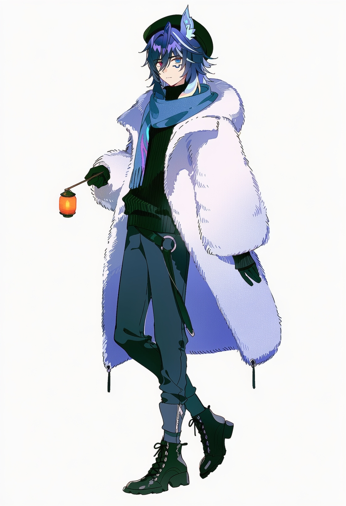

[在线例图](https://assets.quicktagcloud.com/images/raven_composition/raven_composition-5498.jpg?v=957684c4fc922b31)

<a id="raven_composition-5499"></a>

## 若娜瓦

ID：`raven_composition-5499`；分类：角色图鉴 / 原神；来源标记：`safe`。

来源说明：

> 作品：原神
> 性别：女

正向提示词：

```text
ronova (genshin impact)
```

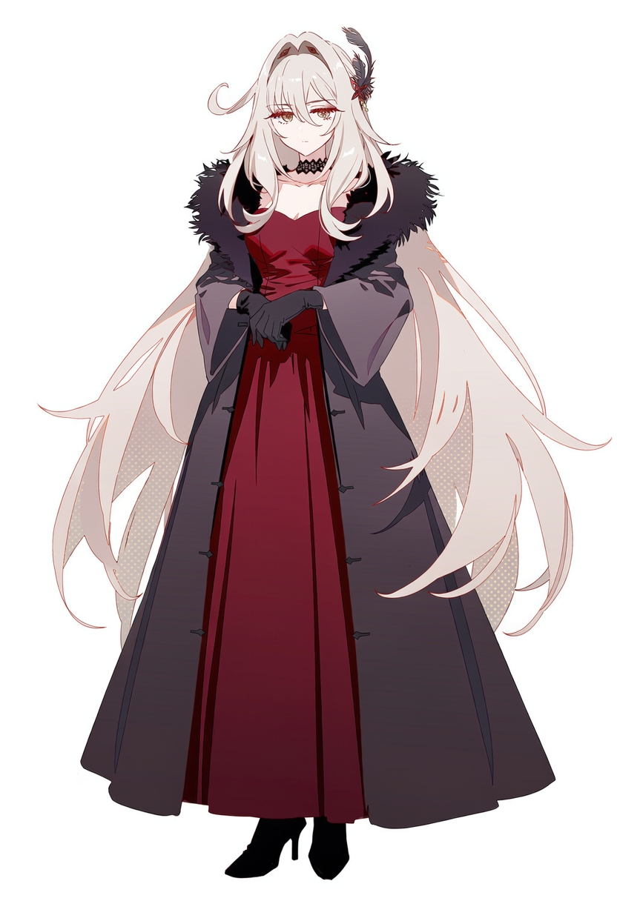

[在线例图](https://assets.quicktagcloud.com/images/raven_composition/raven_composition-5499.jpg?v=c6dbf0017d4f319b)

<a id="raven_composition-5500"></a>

## 玛薇卡

ID：`raven_composition-5500`；分类：角色图鉴 / 原神；来源标记：`safe`。

来源说明：

> 作品：原神
> 性别：女

正向提示词：

```text
mavuika (genshin impact)
```

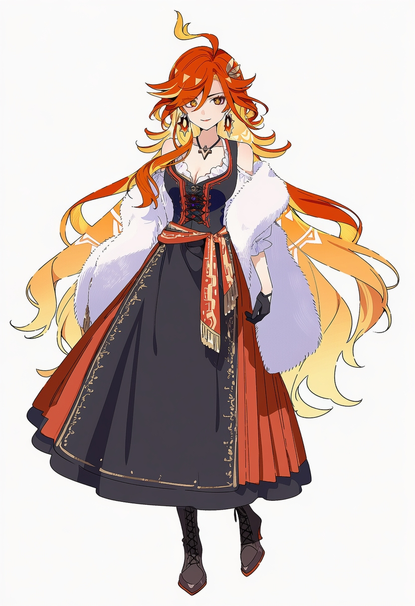

[在线例图](https://assets.quicktagcloud.com/images/raven_composition/raven_composition-5500.jpg?v=7f46dbf292d71ff2)

<a id="raven_composition-5501"></a>

## 茜特菈莉

ID：`raven_composition-5501`；分类：角色图鉴 / 原神；来源标记：`safe`。

来源说明：

> 作品：原神
> 性别：女

正向提示词：

```text
citlali (genshin impact)
```

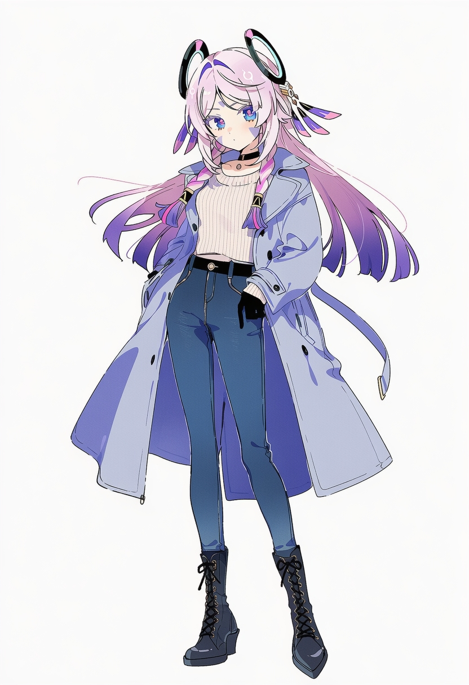

[在线例图](https://assets.quicktagcloud.com/images/raven_composition/raven_composition-5501.jpg?v=c3a6e66176f1331a)

<a id="raven_composition-5502"></a>

## 瓦雷莎

ID：`raven_composition-5502`；分类：角色图鉴 / 原神；来源标记：`safe`。

来源说明：

> 作品：原神
> 性别：女

正向提示词：

```text
varesa (genshin impact)
```

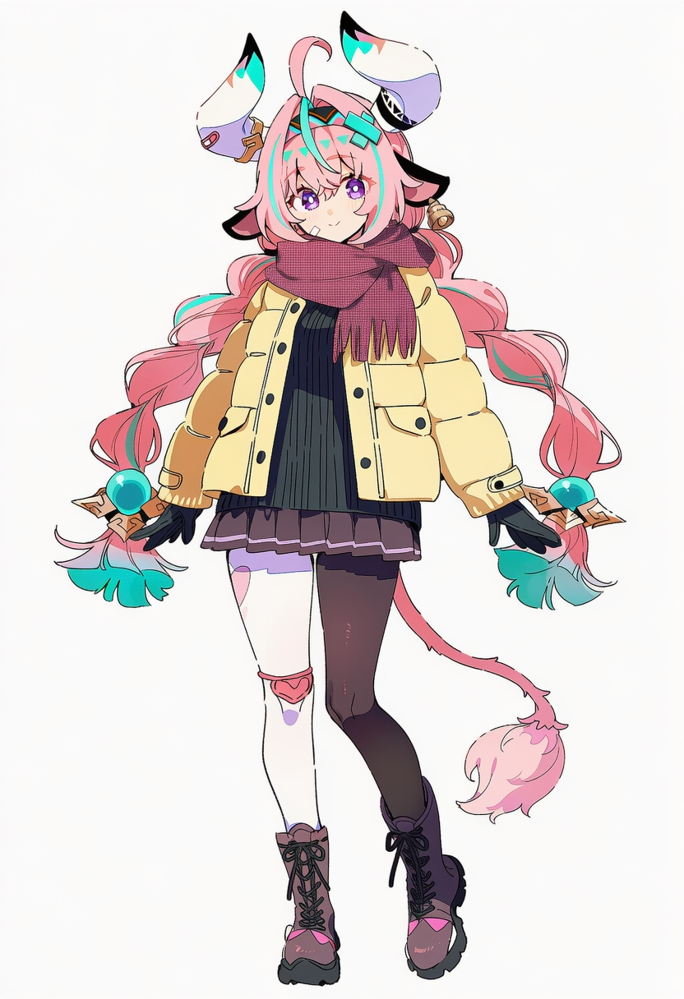

[在线例图](https://assets.quicktagcloud.com/images/raven_composition/raven_composition-5502.jpg?v=261116d4287712fe)

<a id="raven_composition-5503"></a>

## 伊安珊

ID：`raven_composition-5503`；分类：角色图鉴 / 原神；来源标记：`safe`。

来源说明：

> 作品：原神
> 性别：女

正向提示词：

```text
iansan (genshin impact)
```

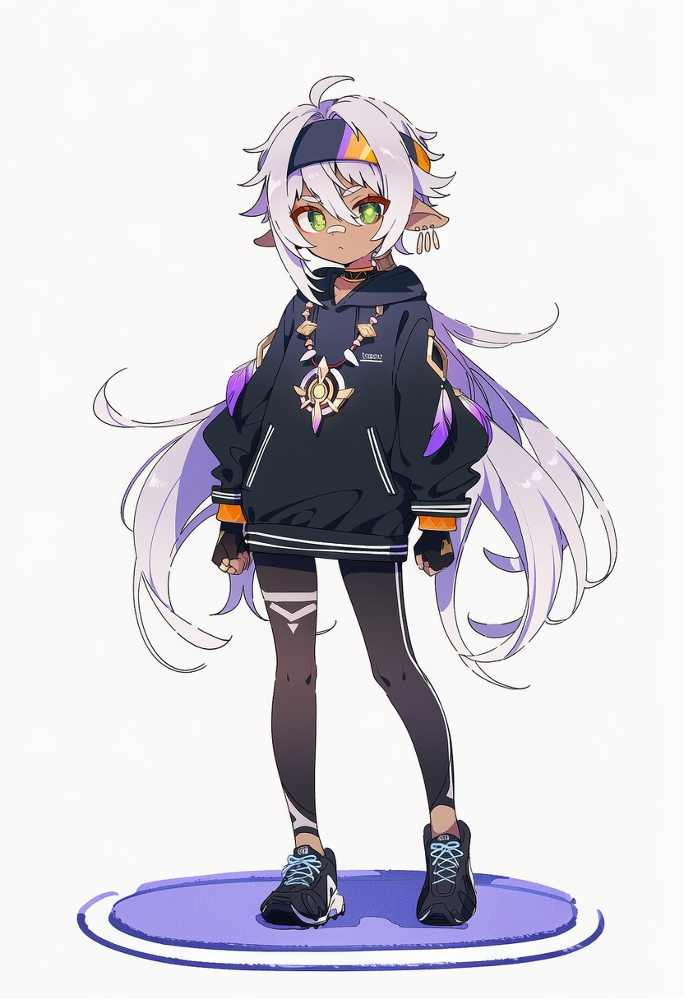

[在线例图](https://assets.quicktagcloud.com/images/raven_composition/raven_composition-5503.jpg?v=1089cf624c9b1977)

<a id="raven_composition-5504"></a>

## 菲林斯

ID：`raven_composition-5504`；分类：角色图鉴 / 原神；来源标记：`safe`。

来源说明：

> 作品：原神
> 性别：女

正向提示词：

```text
flins (genshin impact)
```

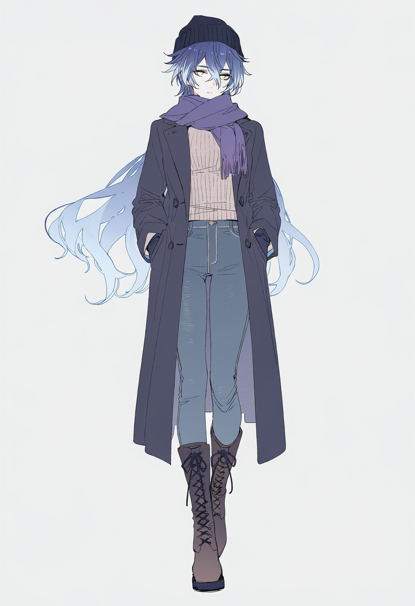

[在线例图](https://assets.quicktagcloud.com/images/raven_composition/raven_composition-5504.jpg?v=ced702af1c8822a1)

<a id="raven_composition-5505"></a>

## 伊法

ID：`raven_composition-5505`；分类：角色图鉴 / 原神；来源标记：`safe`。

来源说明：

> 作品：原神
> 性别：男

正向提示词：

```text
ifa (genshin impact)
```

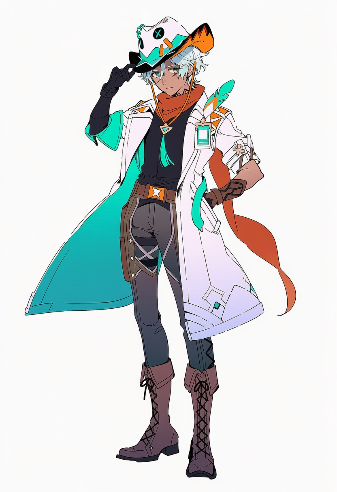

[在线例图](https://assets.quicktagcloud.com/images/raven_composition/raven_composition-5505.jpg?v=1b8a0b917a15632f)

<a id="raven_composition-5506"></a>

## 丝柯克

ID：`raven_composition-5506`；分类：角色图鉴 / 原神；来源标记：`safe`。

来源说明：

> 作品：原神
> 性别：女

正向提示词：

```text
skirk (genshin impact)
```

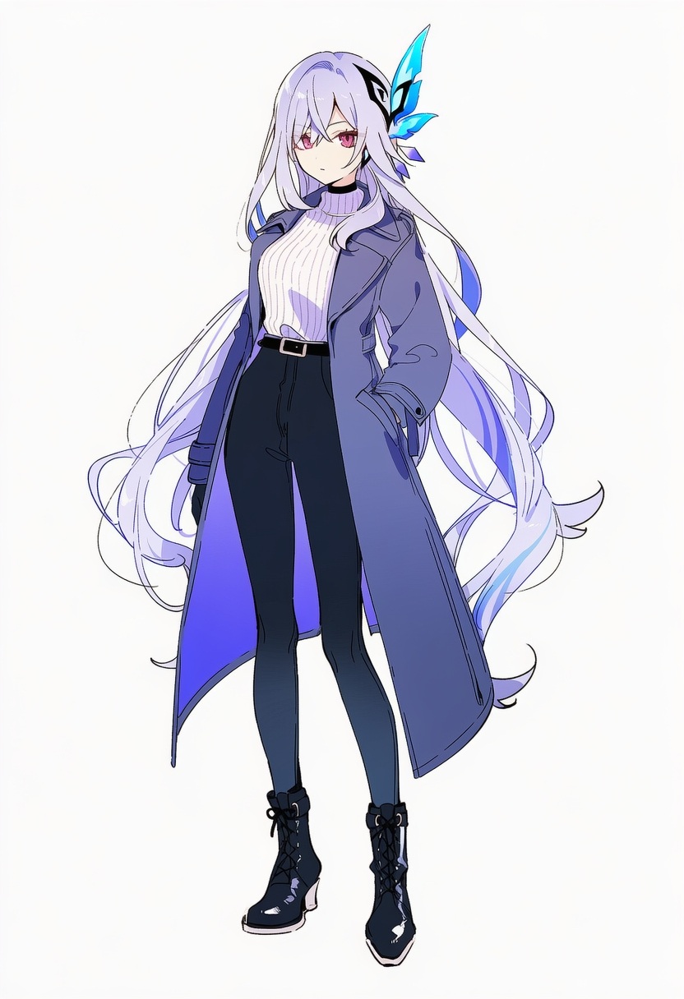

[在线例图](https://assets.quicktagcloud.com/images/raven_composition/raven_composition-5506.jpg?v=e9f5943cda1b8695)

<a id="raven_composition-5507"></a>

## 妮可

ID：`raven_composition-5507`；分类：角色图鉴 / 原神；来源标记：`safe`。

来源说明：

> 作品：原神
> 性别：女

正向提示词：

```text
nicole (genshin impact)
```

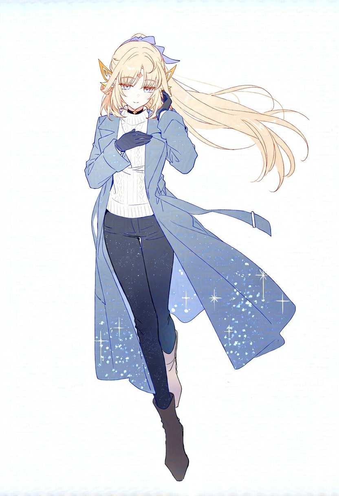

[在线例图](https://assets.quicktagcloud.com/images/raven_composition/raven_composition-5507.jpg?v=53365d1304ca7457)

<a id="raven_composition-5508"></a>

## 杜林

ID：`raven_composition-5508`；分类：角色图鉴 / 原神；来源标记：`safe`。

来源说明：

> 作品：原神
> 性别：男

正向提示词：

```text
durin (genshin impact)
```

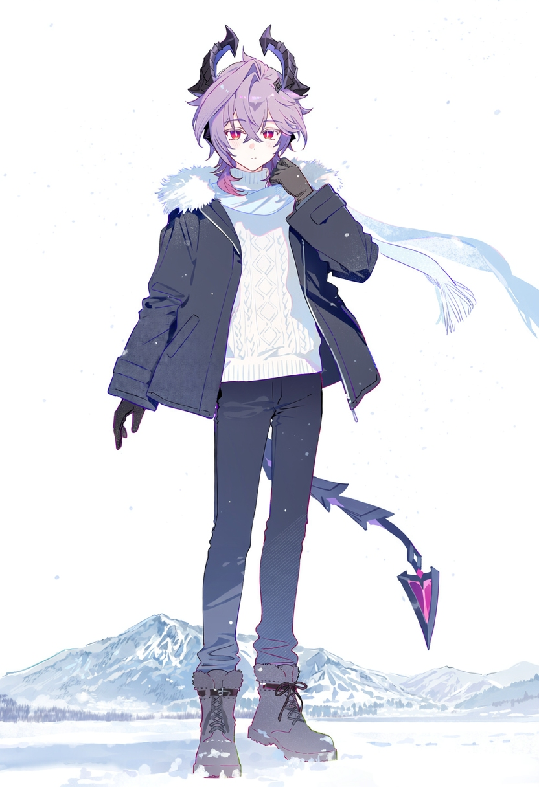

[在线例图](https://assets.quicktagcloud.com/images/raven_composition/raven_composition-5508.jpg?v=17abf25f9a814897)

<a id="raven_composition-5509"></a>

## 尼可

ID：`raven_composition-5509`；分类：角色图鉴 / 原神；来源标记：`safe`。

来源说明：

> 作品：原神
> 性别：女

正向提示词：

```text
nicole (genshin impact)
```

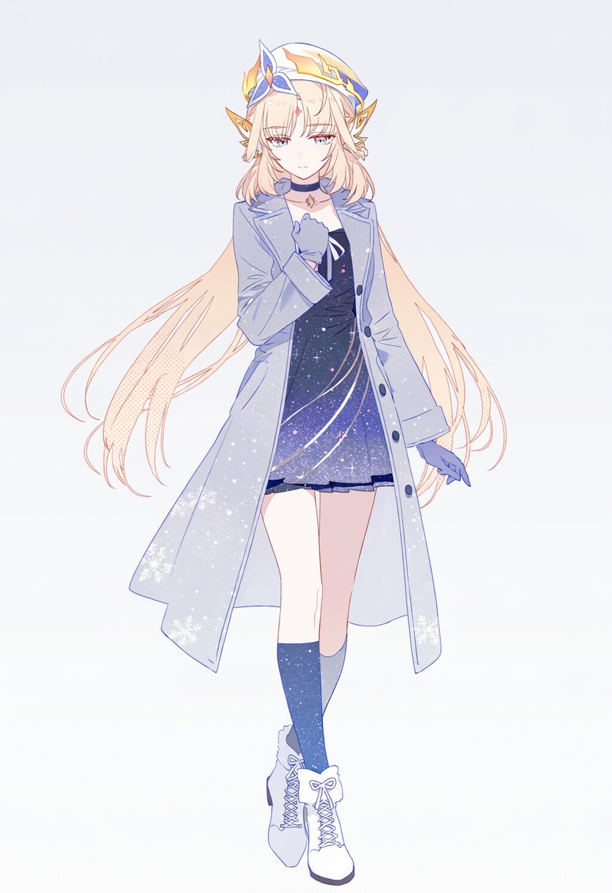

[在线例图](https://assets.quicktagcloud.com/images/raven_composition/raven_composition-5509.jpg?v=9df1b4d395518734)

<a id="raven_composition-5510"></a>

## 洛恩

ID：`raven_composition-5510`；分类：角色图鉴 / 原神；来源标记：`safe`。

来源说明：

> 作品：原神
> 性别：男

正向提示词：

```text
lohen (genshin impact)
```

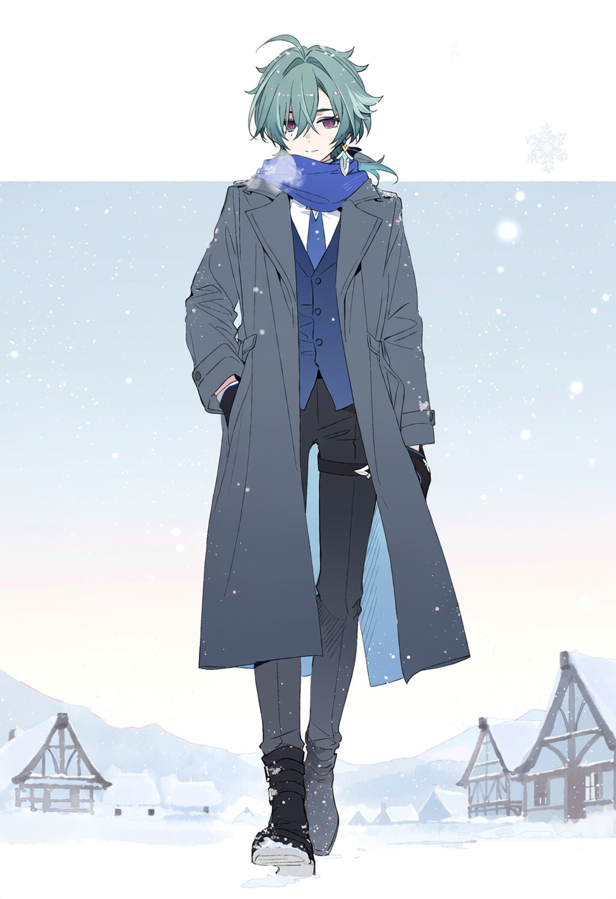

[在线例图](https://assets.quicktagcloud.com/images/raven_composition/raven_composition-5510.jpg?v=9dd1d440873b5d01)

<a id="raven_composition-5511"></a>

## 蓝砚

ID：`raven_composition-5511`；分类：角色图鉴 / 原神；来源标记：`safe`。

来源说明：

> 作品：原神
> 性别：女

正向提示词：

```text
lan yan (genshin impact)
```

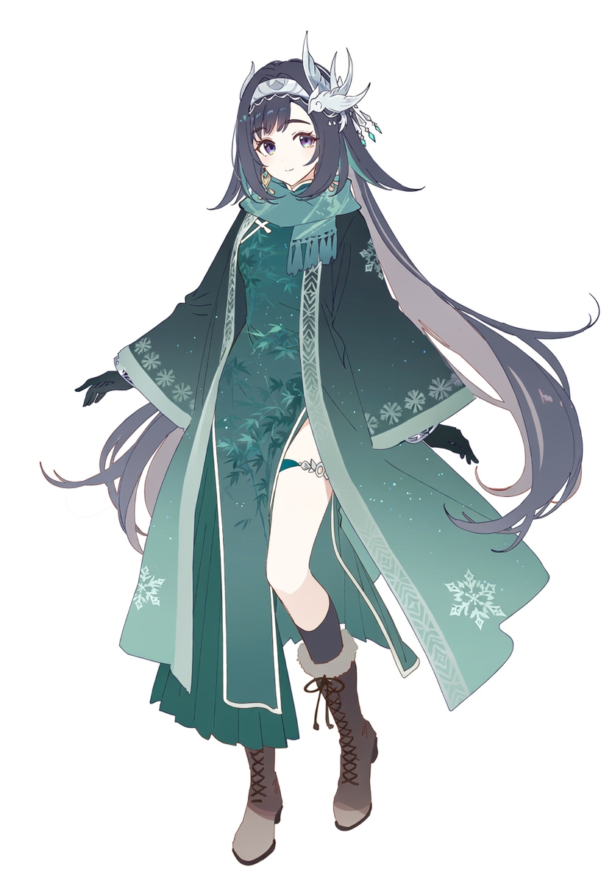

[在线例图](https://assets.quicktagcloud.com/images/raven_composition/raven_composition-5511.jpg?v=2d460aef9e0ce29d)

<a id="raven_composition-5512"></a>

## 爱诺

ID：`raven_composition-5512`；分类：角色图鉴 / 原神；来源标记：`safe`。

来源说明：

> 作品：原神
> 性别：女

正向提示词：

```text
aino (genshin impact)
```

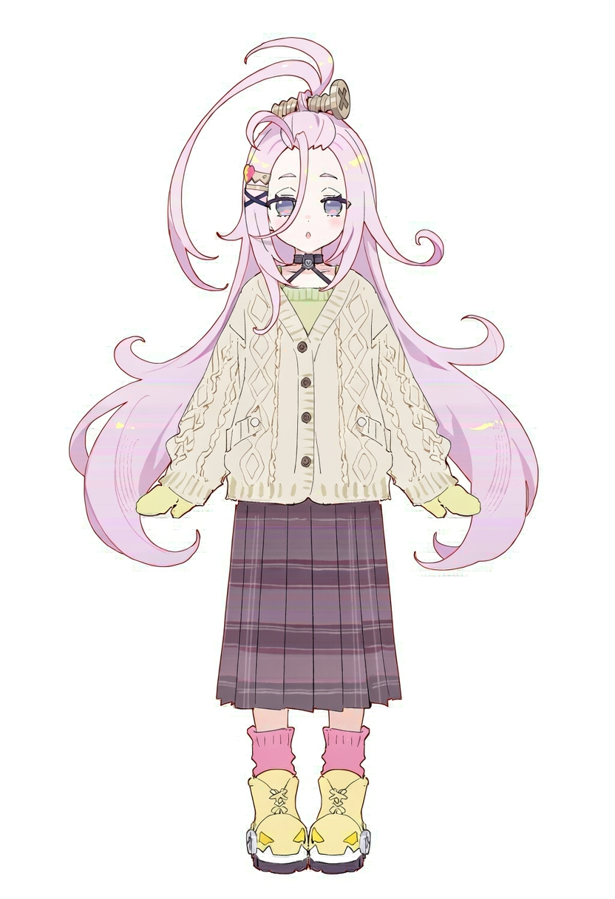

[在线例图](https://assets.quicktagcloud.com/images/raven_composition/raven_composition-5512.jpg?v=92d557a45daf6c01)

<a id="raven_composition-5513"></a>

## 塔利雅

ID：`raven_composition-5513`；分类：角色图鉴 / 原神；来源标记：`safe`。

来源说明：

> 作品：原神
> 性别：男

正向提示词：

```text
dahlia (genshin impact)
```

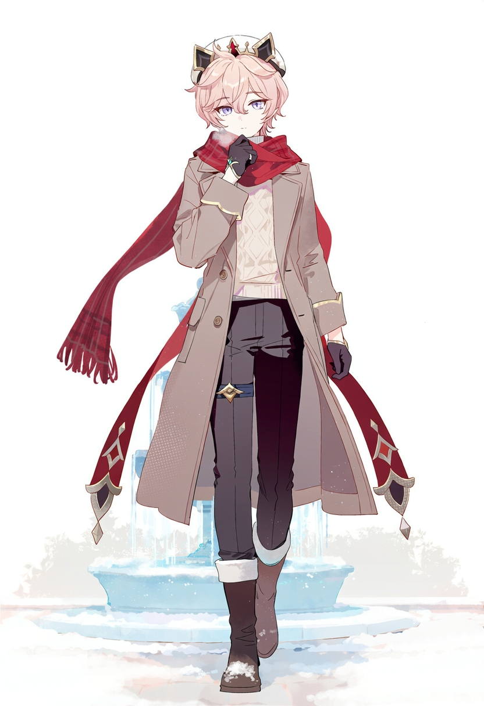

[在线例图](https://assets.quicktagcloud.com/images/raven_composition/raven_composition-5513.jpg?v=3bbb0f0e3bf0d353)

<a id="raven_composition-5514"></a>

## 雅珂达

ID：`raven_composition-5514`；分类：角色图鉴 / 原神；来源标记：`safe`。

来源说明：

> 作品：原神
> 性别：女

正向提示词：

```text
jahoda (genshin impact)
```

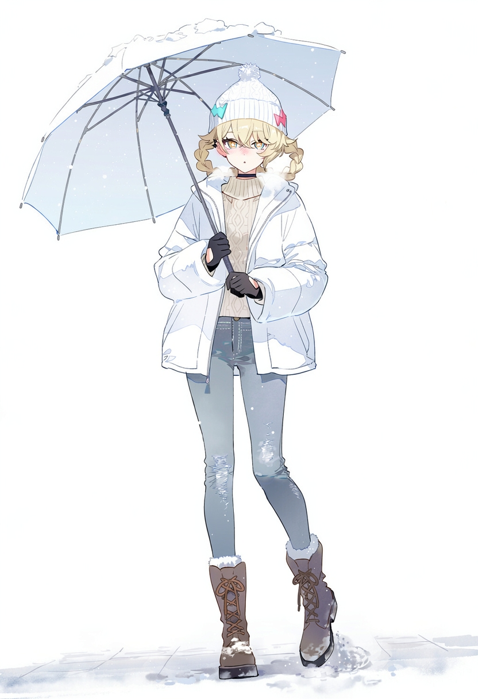

[在线例图](https://assets.quicktagcloud.com/images/raven_composition/raven_composition-5514.jpg?v=a36dbf8c98169d27)

<a id="raven_composition-5515"></a>

## 奈芙尔

ID：`raven_composition-5515`；分类：角色图鉴 / 原神；来源标记：`safe`。

来源说明：

> 作品：原神
> 性别：女

正向提示词：

```text
nefer (genshin impact)
```

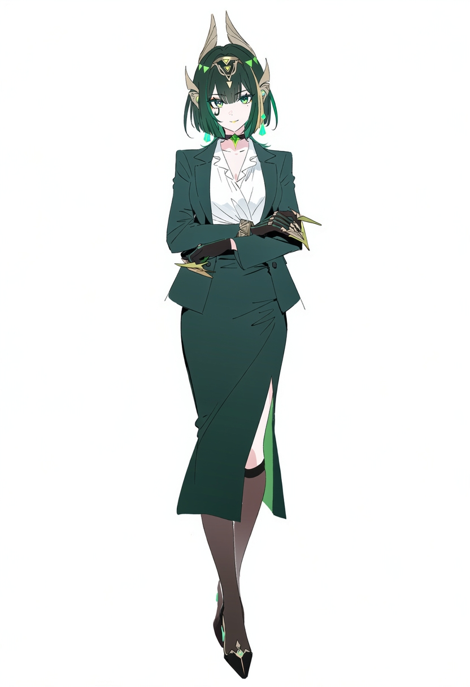

[在线例图](https://assets.quicktagcloud.com/images/raven_composition/raven_composition-5515.jpg?v=282eb895989a41a8)

<a id="raven_composition-5516"></a>

## 菈乌玛

ID：`raven_composition-5516`；分类：角色图鉴 / 原神；来源标记：`safe`。

来源说明：

> 作品：原神
> 性别：女

正向提示词：

```text
lauma (genshin impact)
```

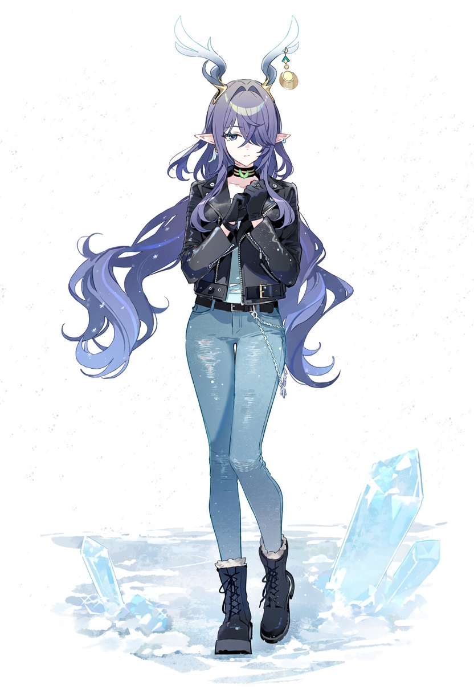

[在线例图](https://assets.quicktagcloud.com/images/raven_composition/raven_composition-5516.jpg?v=148bc5e0a99f39ed)

<a id="raven_composition-5517"></a>

## 伊涅芙

ID：`raven_composition-5517`；分类：角色图鉴 / 原神；来源标记：`safe`。

来源说明：

> 作品：原神
> 性别：女

正向提示词：

```text
ineffa (genshin impact)
```

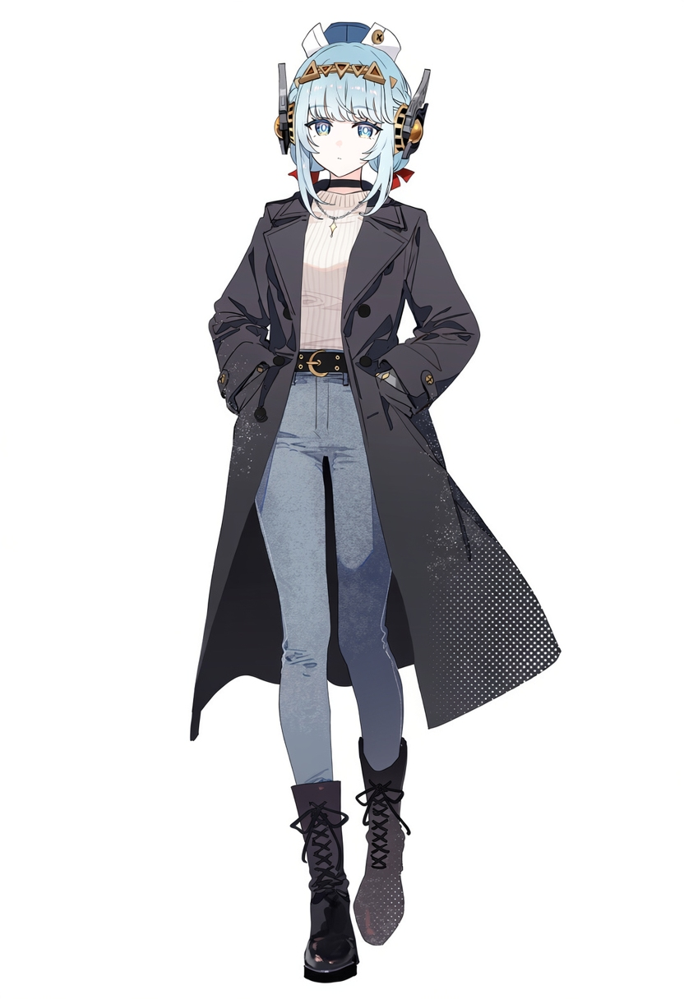

[在线例图](https://assets.quicktagcloud.com/images/raven_composition/raven_composition-5517.jpg?v=2e7a90e14e88ae3f)

<a id="raven_composition-5518"></a>

## 莉奈娅

ID：`raven_composition-5518`；分类：角色图鉴 / 原神；来源标记：`safe`。

来源说明：

> 作品：原神
> 性别：女

正向提示词：

```text
linnea (genshin impact)
```

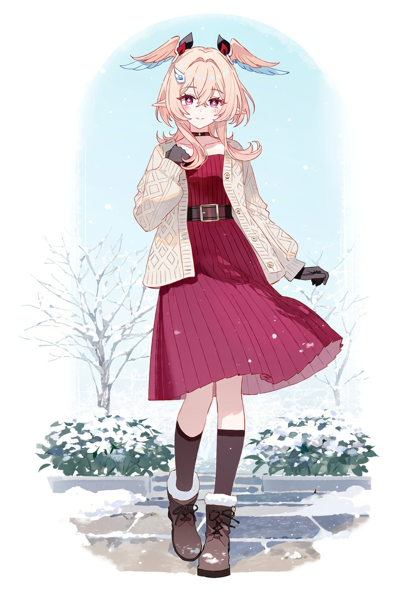

[在线例图](https://assets.quicktagcloud.com/images/raven_composition/raven_composition-5518.jpg?v=863815d8b63bb3cd)

<a id="raven_composition-5519"></a>

## 薇斯纳

ID：`raven_composition-5519`；分类：角色图鉴 / 原神；来源标记：`safe`。

来源说明：

> 作品：原神
> 性别：女

正向提示词：

```text
vesna (genshin impact)
```

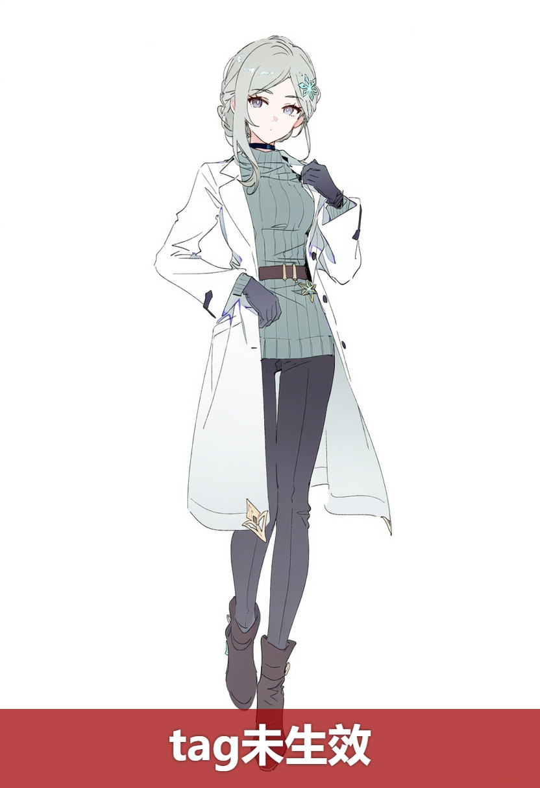

[在线例图](https://assets.quicktagcloud.com/images/raven_composition/raven_composition-5519.jpg?v=d591bae95e56c229)

<a id="raven_composition-5520"></a>

## 沃雅妮莎

ID：`raven_composition-5520`；分类：角色图鉴 / 原神；来源标记：`safe`。

来源说明：

> 作品：原神
> 性别：女

正向提示词：

```text
vodyanitsa (genshin impact)
```

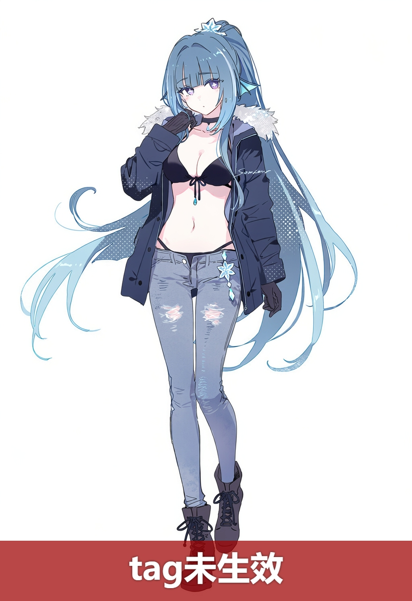

[在线例图](https://assets.quicktagcloud.com/images/raven_composition/raven_composition-5520.jpg?v=44f65d321d8279cd)

<a id="raven_composition-5521"></a>

## 兹白

ID：`raven_composition-5521`；分类：角色图鉴 / 原神；来源标记：`safe`。

来源说明：

> 作品：原神
> 性别：女

正向提示词：

```text
zibai (genshin impact)
```

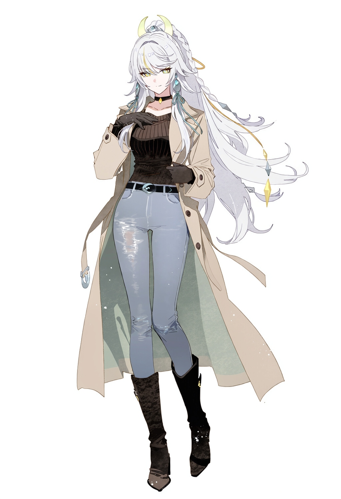

[在线例图](https://assets.quicktagcloud.com/images/raven_composition/raven_composition-5521.jpg?v=f7a0a57b844e8a89)

<a id="raven_composition-5522"></a>

## 阿罗夏

ID：`raven_composition-5522`；分类：角色图鉴 / 原神；来源标记：`safe`。

来源说明：

> 作品：原神
> 性别：男

正向提示词：

```text
alyosha (genshin impact)
```

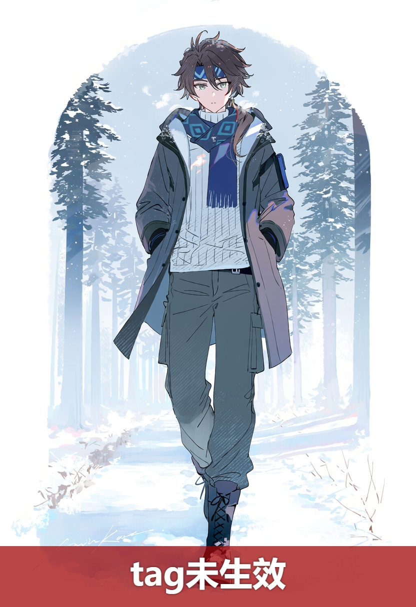

[在线例图](https://assets.quicktagcloud.com/images/raven_composition/raven_composition-5522.jpg?v=6ffe62ade8aeef53)

<a id="raven_composition-5523"></a>

## 奥黛塔

ID：`raven_composition-5523`；分类：角色图鉴 / 原神；来源标记：`safe`。

来源说明：

> 作品：原神
> 性别：女

正向提示词：

```text
odette (genshin impact)
```

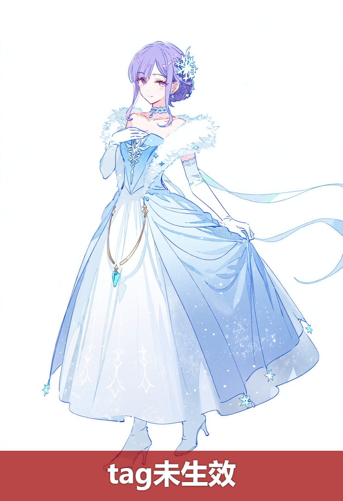

[在线例图](https://assets.quicktagcloud.com/images/raven_composition/raven_composition-5523.jpg?v=3d4d9143329baa28)

<a id="raven_composition-5524"></a>

## 桑多涅

ID：`raven_composition-5524`；分类：角色图鉴 / 原神；来源标记：`safe`。

来源说明：

> 作品：原神
> 性别：女

正向提示词：

```text
sandrone (genshin impact)
```

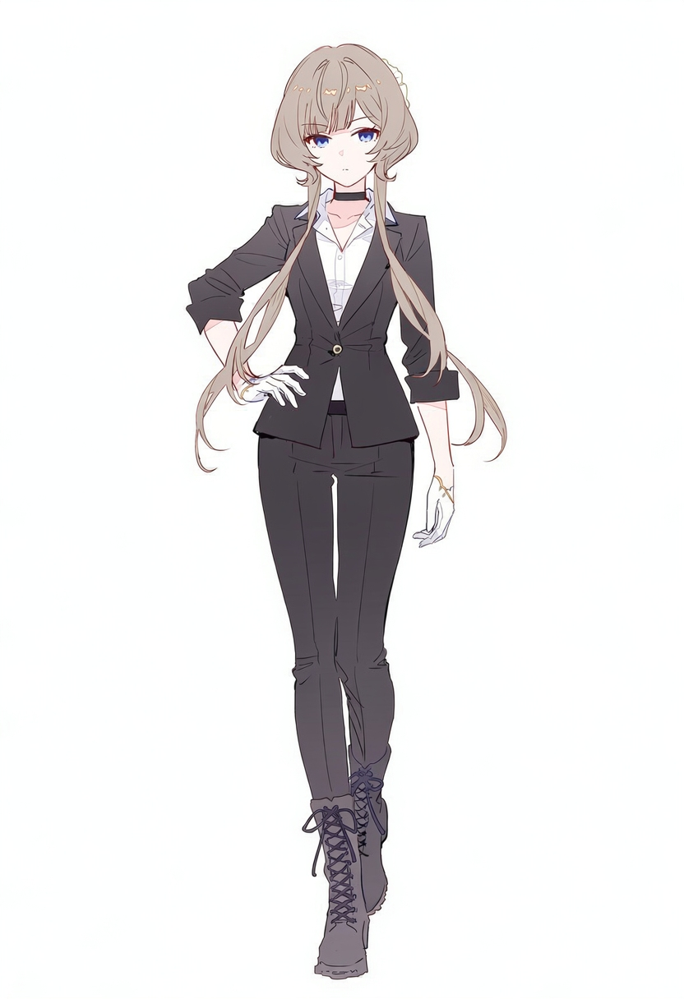

[在线例图](https://assets.quicktagcloud.com/images/raven_composition/raven_composition-5524.jpg?v=6b8ebcfa277e3996)

<a id="raven_composition-5525"></a>

## 哥伦比娅

ID：`raven_composition-5525`；分类：角色图鉴 / 原神；来源标记：`safe`。

来源说明：

> 作品：原神
> 性别：女

正向提示词：

```text
columbina (genshin impact)
```

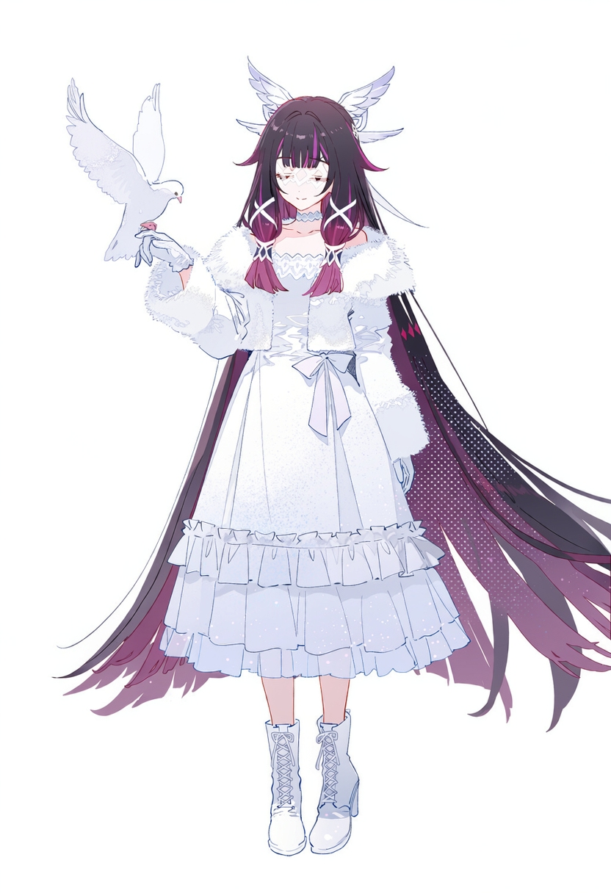

[在线例图](https://assets.quicktagcloud.com/images/raven_composition/raven_composition-5525.jpg?v=8247bfd6ef3128b1)

<a id="raven_composition-5526"></a>

## 法尔伽

ID：`raven_composition-5526`；分类：角色图鉴 / 原神；来源标记：`safe`。

来源说明：

> 作品：原神
> 性别：男

正向提示词：

```text
varka (genshin impact)
```

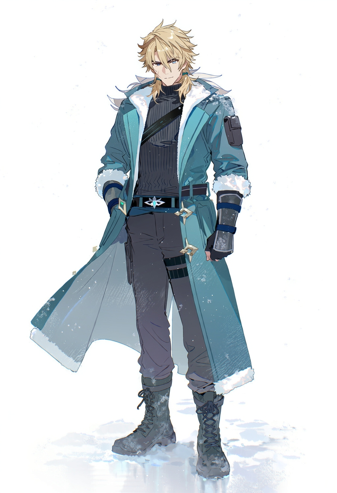

[在线例图](https://assets.quicktagcloud.com/images/raven_composition/raven_composition-5526.jpg?v=57ea769c0f7332de)

<a id="raven_composition-5527"></a>

## 艾莉丝

ID：`raven_composition-5527`；分类：角色图鉴 / 原神；来源标记：`safe`。

来源说明：

> 作品：原神
> 性别：女

正向提示词：

```text
alice (genshin impact)
```

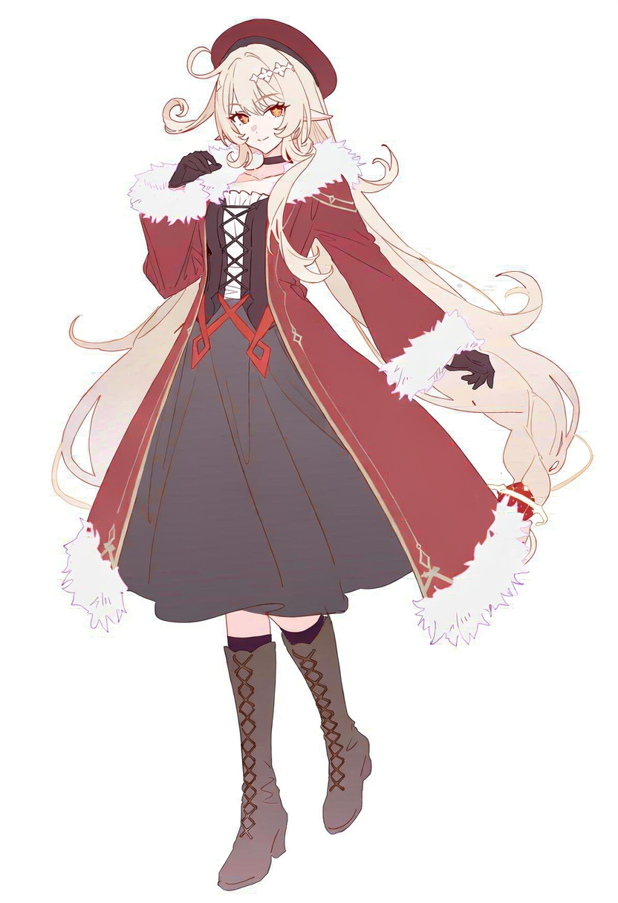

[在线例图](https://assets.quicktagcloud.com/images/raven_composition/raven_composition-5527.jpg?v=5c947289067138bf)
