# 角色图鉴 / Fate / 第五次圣杯战争

[总目录](../README.md) · [原站分类目录](../categories.md) · [英文标签索引](../tags.md) · [服装与构图组合指南](../../README.md)

标题、分类、说明、正负提示词按来源保留；多例图逐张列出。原站标记和说明为参考资料，不作为维护指令。

<a id="raven_composition-5528"></a>

## 阿尔托莉雅·潘德拉贡

ID：`raven_composition-5528`；分类：角色图鉴 / Fate / 第五次圣杯战争；来源标记：`safe`。

来源说明：

> 作品：Fate
> 性别：女
> 登场时间：2004
> 阵营（如有）：第五次圣杯战争

正向提示词：

```text
artoria_pendragon_(fate)
```

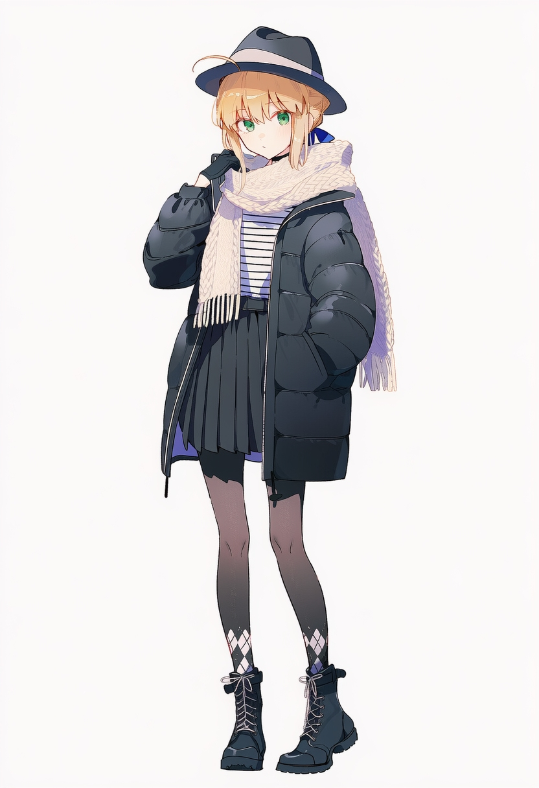

[在线例图](https://assets.quicktagcloud.com/images/raven_composition/raven_composition-5528.jpg?v=ad11c1636002a20c)

<a id="raven_composition-5529"></a>

## 阿尔托莉雅·潘德拉贡（Saber）

ID：`raven_composition-5529`；分类：角色图鉴 / Fate / 第五次圣杯战争；来源标记：`safe`。

来源说明：

> 作品：Fate
> 性别：女
> 登场时间：2004
> 阵营（如有）：第五次圣杯战争

正向提示词：

```text
saber_(fate)
```

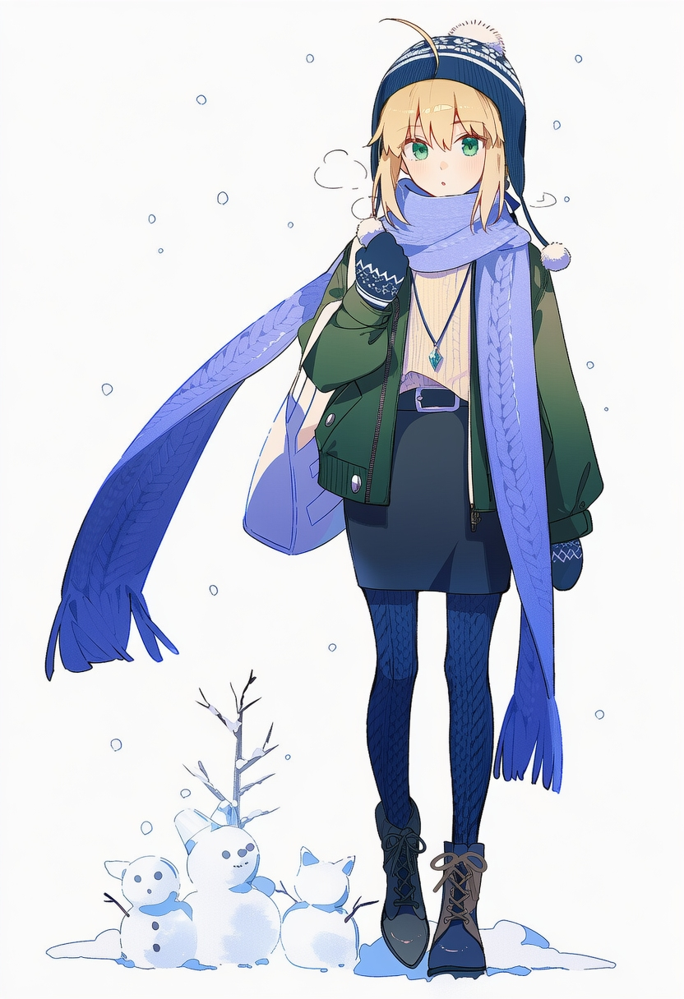

[在线例图](https://assets.quicktagcloud.com/images/raven_composition/raven_composition-5529.jpg?v=e76d2ac3780fa87f)

<a id="raven_composition-5530"></a>

## 吉尔伽美什

ID：`raven_composition-5530`；分类：角色图鉴 / Fate / 第五次圣杯战争；来源标记：`safe`。

来源说明：

> 作品：Fate
> 性别：男
> 登场时间：2004
> 阵营（如有）：第五次圣杯战争

正向提示词：

```text
gilgamesh_(fate)
```

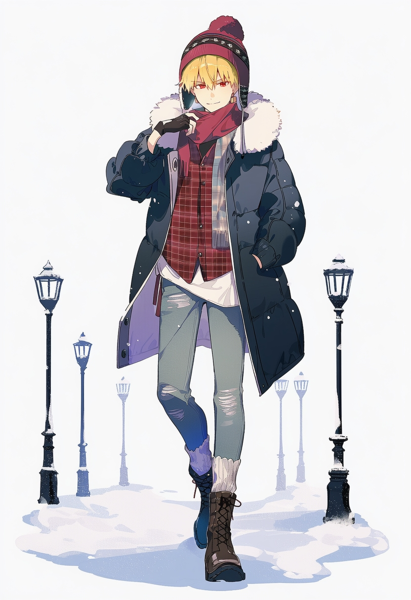

[在线例图](https://assets.quicktagcloud.com/images/raven_composition/raven_composition-5530.jpg?v=8d9f355f29e5bc30)

<a id="raven_composition-5531"></a>

## 卫宫（Archer）

ID：`raven_composition-5531`；分类：角色图鉴 / Fate / 第五次圣杯战争；来源标记：`safe`。

来源说明：

> 作品：Fate
> 性别：男
> 登场时间：2004
> 阵营（如有）：第五次圣杯战争

正向提示词：

```text
archer_(fate)
```

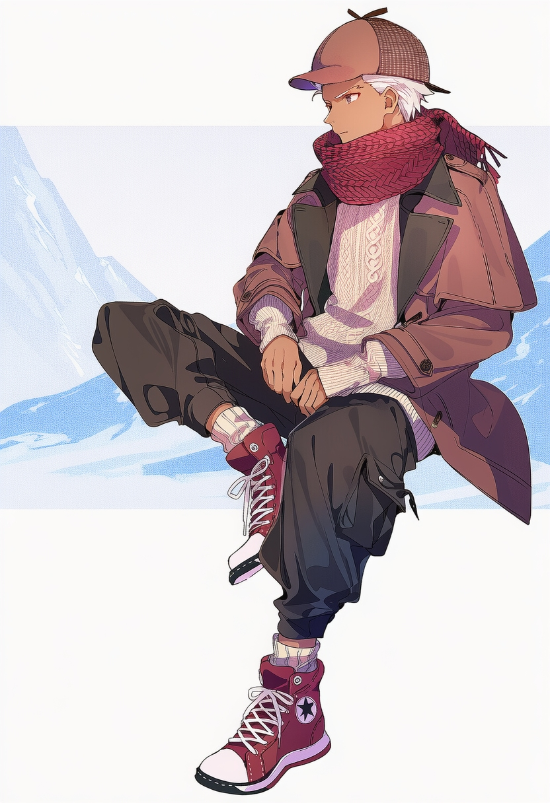

[在线例图](https://assets.quicktagcloud.com/images/raven_composition/raven_composition-5531.jpg?v=7954705454b3974a)

<a id="raven_composition-5532"></a>

## 库·丘林

ID：`raven_composition-5532`；分类：角色图鉴 / Fate / 第五次圣杯战争；来源标记：`safe`。

来源说明：

> 作品：Fate
> 性别：男
> 登场时间：2004
> 阵营（如有）：第五次圣杯战争

正向提示词：

```text
cu_chulainn_(fate)
```

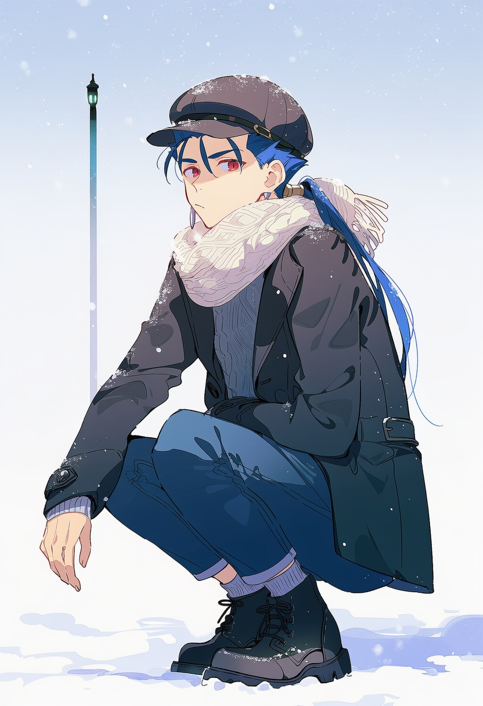

[在线例图](https://assets.quicktagcloud.com/images/raven_composition/raven_composition-5532.jpg?v=1d551348f0e6d637)

<a id="raven_composition-5533"></a>

## 美杜莎

ID：`raven_composition-5533`；分类：角色图鉴 / Fate / 第五次圣杯战争；来源标记：`safe`。

来源说明：

> 作品：Fate
> 性别：女
> 登场时间：2004
> 阵营（如有）：第五次圣杯战争

正向提示词：

```text
medusa_(fate)
```

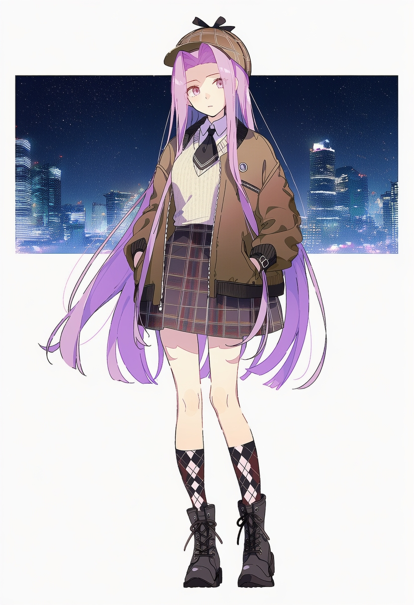

[在线例图](https://assets.quicktagcloud.com/images/raven_composition/raven_composition-5533.jpg?v=d99215fa399c0912)

<a id="raven_composition-5534"></a>

## 美狄亚

ID：`raven_composition-5534`；分类：角色图鉴 / Fate / 第五次圣杯战争；来源标记：`safe`。

来源说明：

> 作品：Fate
> 性别：女
> 登场时间：2004
> 阵营（如有）：第五次圣杯战争

正向提示词：

```text
medea_(fate)
```

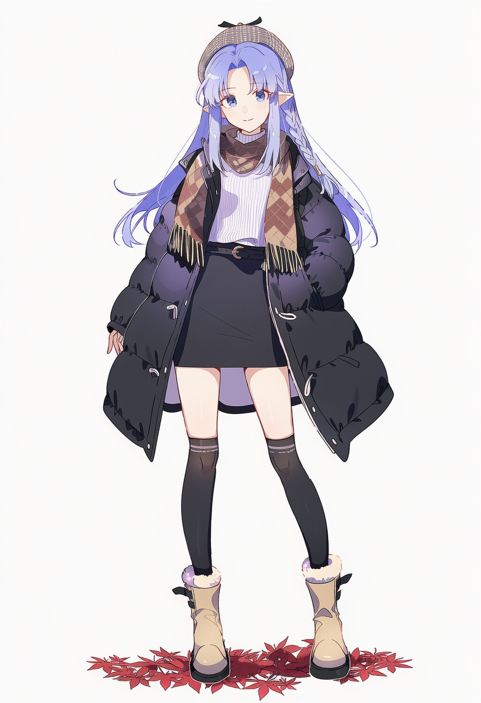

[在线例图](https://assets.quicktagcloud.com/images/raven_composition/raven_composition-5534.jpg?v=2f87006b1af334c2)

<a id="raven_composition-5535"></a>

## 梅林

ID：`raven_composition-5535`；分类：角色图鉴 / Fate / 第五次圣杯战争；来源标记：`safe`。

来源说明：

> 作品：Fate
> 性别：男
> 登场时间：2004
> 阵营（如有）：第五次圣杯战争

正向提示词：

```text
merlin_(fate)
```

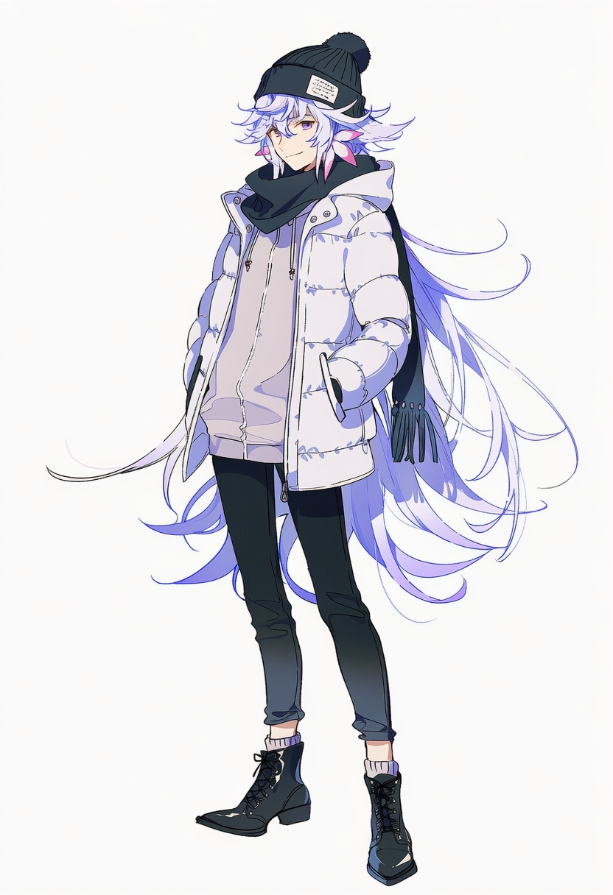

[在线例图](https://assets.quicktagcloud.com/images/raven_composition/raven_composition-5535.jpg?v=0385f7d06720c21d)

<a id="raven_composition-5536"></a>

## 赫拉克勒斯

ID：`raven_composition-5536`；分类：角色图鉴 / Fate / 第五次圣杯战争；来源标记：`safe`。

来源说明：

> 作品：Fate
> 性别：男
> 登场时间：2004
> 阵营（如有）：第五次圣杯战争

正向提示词：

```text
heracles_(fate)
```

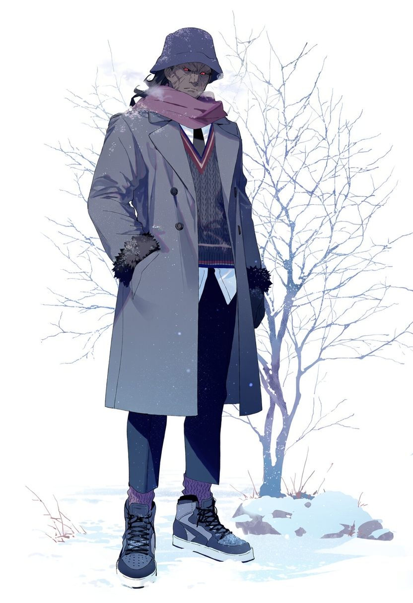

[在线例图](https://assets.quicktagcloud.com/images/raven_composition/raven_composition-5536.jpg?v=238c8c4e4a4643a5)

<a id="raven_composition-5537"></a>

## 安哥拉曼纽

ID：`raven_composition-5537`；分类：角色图鉴 / Fate / 第五次圣杯战争；来源标记：`safe`。

来源说明：

> 作品：Fate
> 性别：男
> 登场时间：2004
> 阵营（如有）：第五次圣杯战争

正向提示词：

```text
angra_mainyu_(fate)
```

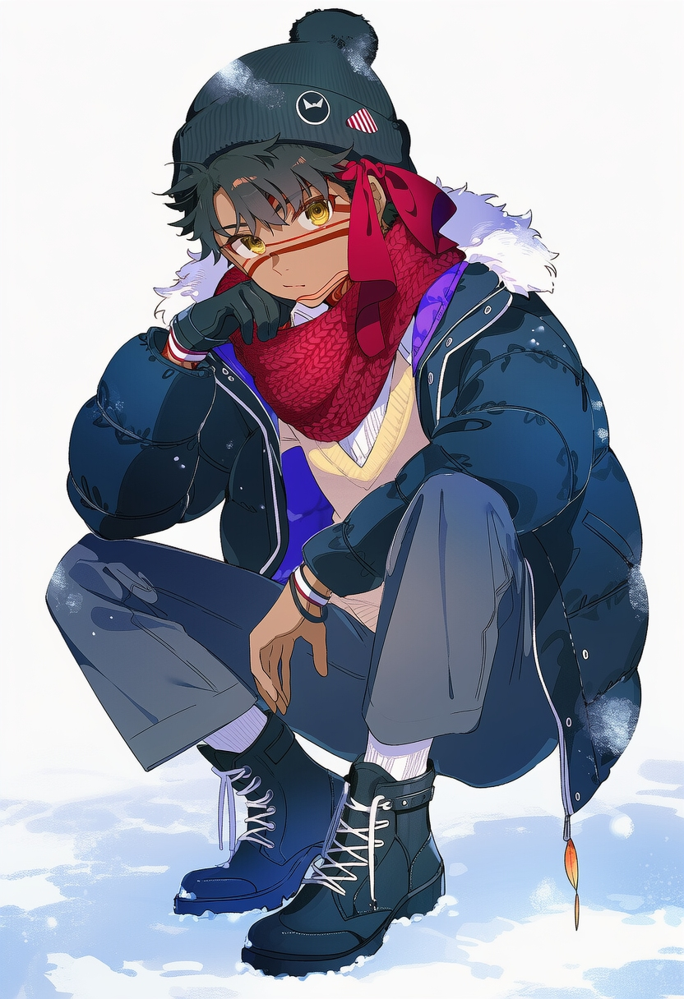

[在线例图](https://assets.quicktagcloud.com/images/raven_composition/raven_composition-5537.jpg?v=37c5cd40290f5ae8)

<a id="raven_composition-5538"></a>

## 贝德维尔

ID：`raven_composition-5538`；分类：角色图鉴 / Fate / 第五次圣杯战争；来源标记：`safe`。

来源说明：

> 作品：Fate
> 性别：男
> 登场时间：2004
> 阵营（如有）：第五次圣杯战争

正向提示词：

```text
bedivere_(fate)
```

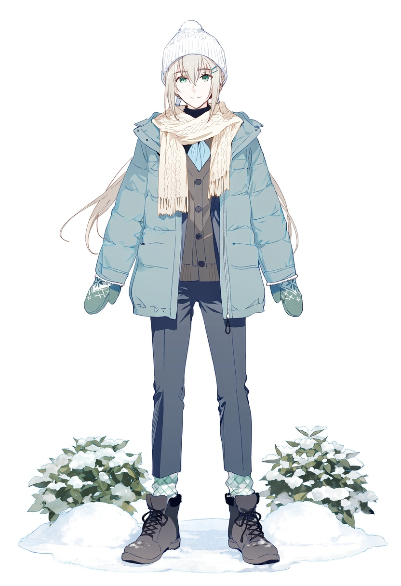

[在线例图](https://assets.quicktagcloud.com/images/raven_composition/raven_composition-5538.jpg?v=ffd17ffd7e88c795)

<a id="raven_composition-5539"></a>

## 佐佐木小次郎

ID：`raven_composition-5539`；分类：角色图鉴 / Fate / 第五次圣杯战争；来源标记：`safe`。

来源说明：

> 作品：Fate
> 性别：男
> 登场时间：2004
> 阵营（如有）：第五次圣杯战争

正向提示词：

```text
sasaki_kojirou_(fate)
```

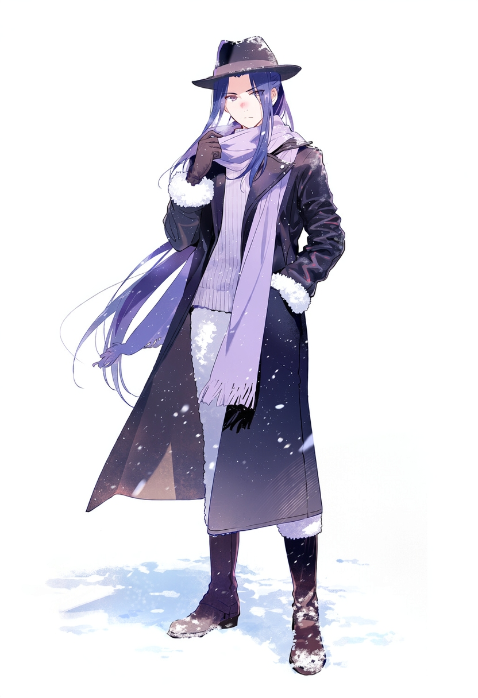

[在线例图](https://assets.quicktagcloud.com/images/raven_composition/raven_composition-5539.jpg?v=3f187f98b225209f)

<a id="raven_composition-5540"></a>

## 咒腕哈桑

ID：`raven_composition-5540`；分类：角色图鉴 / Fate / 第五次圣杯战争；来源标记：`safe`。

来源说明：

> 作品：Fate
> 性别：男
> 登场时间：2004
> 阵营（如有）：第五次圣杯战争

正向提示词：

```text
hassan_of_the_cursed_arm_(fate)
```

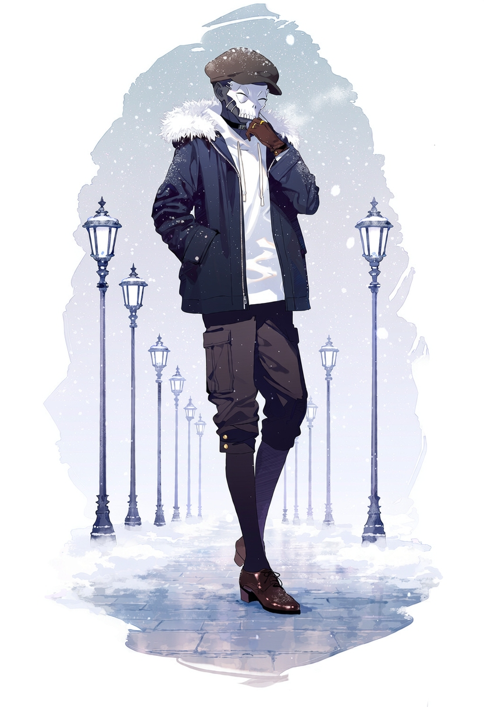

[在线例图](https://assets.quicktagcloud.com/images/raven_composition/raven_composition-5540.jpg?v=5cf68e83fc6066dc)

<a id="raven_composition-5541"></a>

## 卫宫士郎

ID：`raven_composition-5541`；分类：角色图鉴 / Fate / 第五次圣杯战争；来源标记：`safe`。

来源说明：

> 作品：Fate
> 性别：男
> 登场时间：2004
> 阵营（如有）：第五次圣杯战争

正向提示词：

```text
emiya_shirou
```

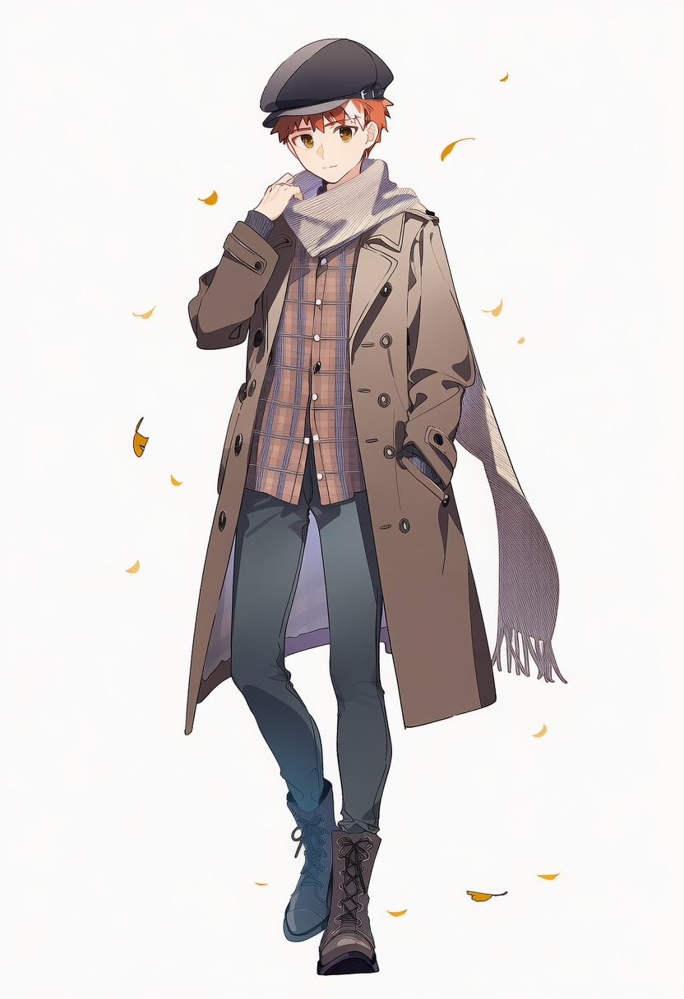

[在线例图](https://assets.quicktagcloud.com/images/raven_composition/raven_composition-5541.jpg?v=b4b875af85a9cbd3)

<a id="raven_composition-5542"></a>

## 远坂凛

ID：`raven_composition-5542`；分类：角色图鉴 / Fate / 第五次圣杯战争；来源标记：`safe`。

来源说明：

> 作品：Fate
> 性别：女
> 登场时间：2004
> 阵营（如有）：第五次圣杯战争

正向提示词：

```text
tohsaka_rin
```

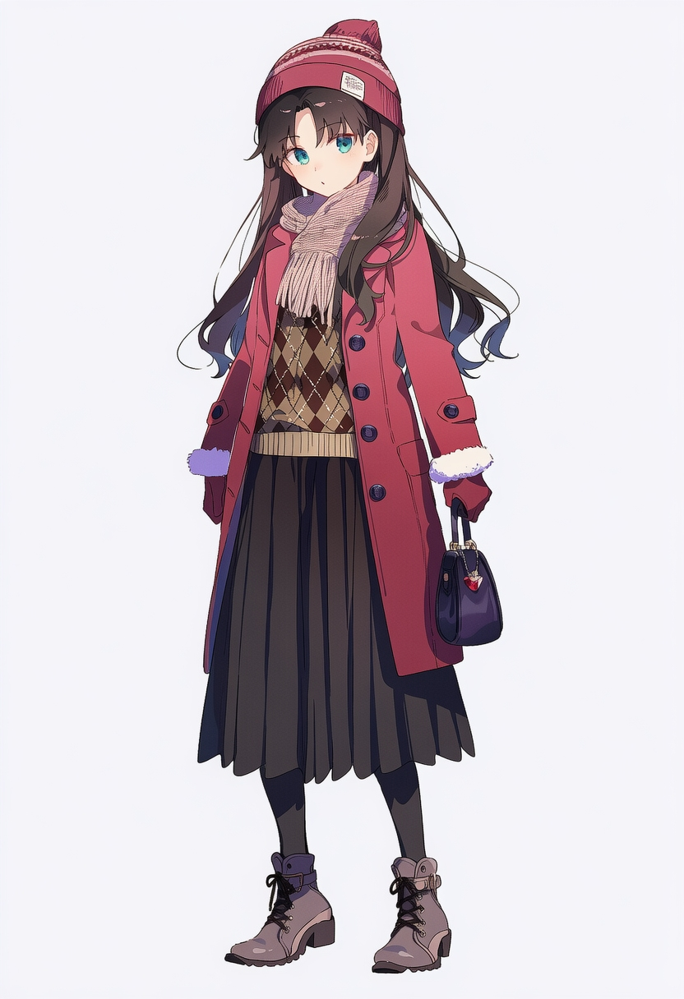

[在线例图](https://assets.quicktagcloud.com/images/raven_composition/raven_composition-5542.jpg?v=90ceaacd8124b2dc)

<a id="raven_composition-5543"></a>

## 间桐樱

ID：`raven_composition-5543`；分类：角色图鉴 / Fate / 第五次圣杯战争；来源标记：`safe`。

来源说明：

> 作品：Fate
> 性别：女
> 登场时间：2004
> 阵营（如有）：第五次圣杯战争

正向提示词：

```text
matou_sakura
```

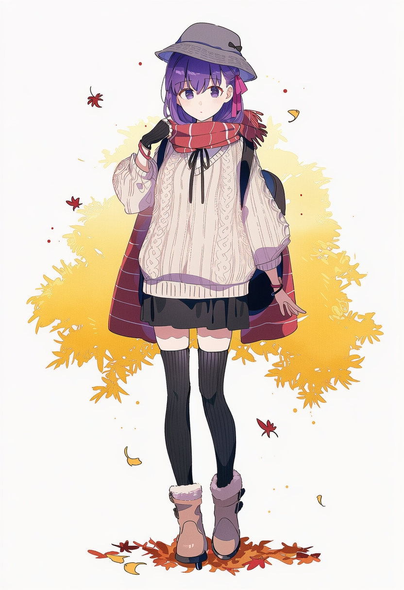

[在线例图](https://assets.quicktagcloud.com/images/raven_composition/raven_composition-5543.jpg?v=e3d378384b86347a)

<a id="raven_composition-5544"></a>

## 伊莉雅丝菲尔·冯·爱因兹贝伦

ID：`raven_composition-5544`；分类：角色图鉴 / Fate / 第五次圣杯战争；来源标记：`safe`。

来源说明：

> 作品：Fate
> 性别：女
> 登场时间：2004
> 阵营（如有）：第五次圣杯战争

正向提示词：

```text
illyasviel_von_einzbern
```

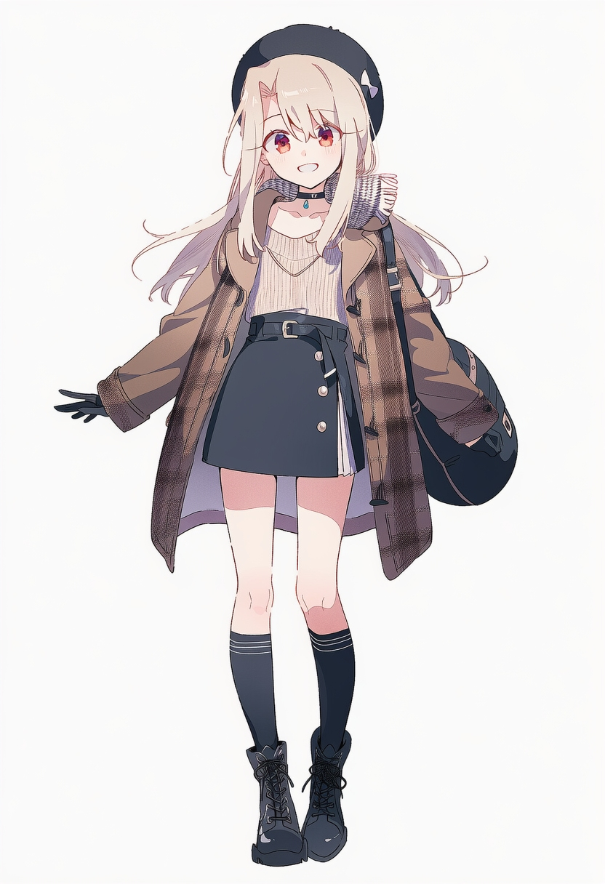

[在线例图](https://assets.quicktagcloud.com/images/raven_composition/raven_composition-5544.jpg?v=7f61be5a29621405)

<a id="raven_composition-5545"></a>

## 卫宫切嗣

ID：`raven_composition-5545`；分类：角色图鉴 / Fate / 第五次圣杯战争；来源标记：`safe`。

来源说明：

> 作品：Fate
> 性别：男
> 登场时间：2004
> 阵营（如有）：第五次圣杯战争

正向提示词：

```text
emiya_kiritsugu
```

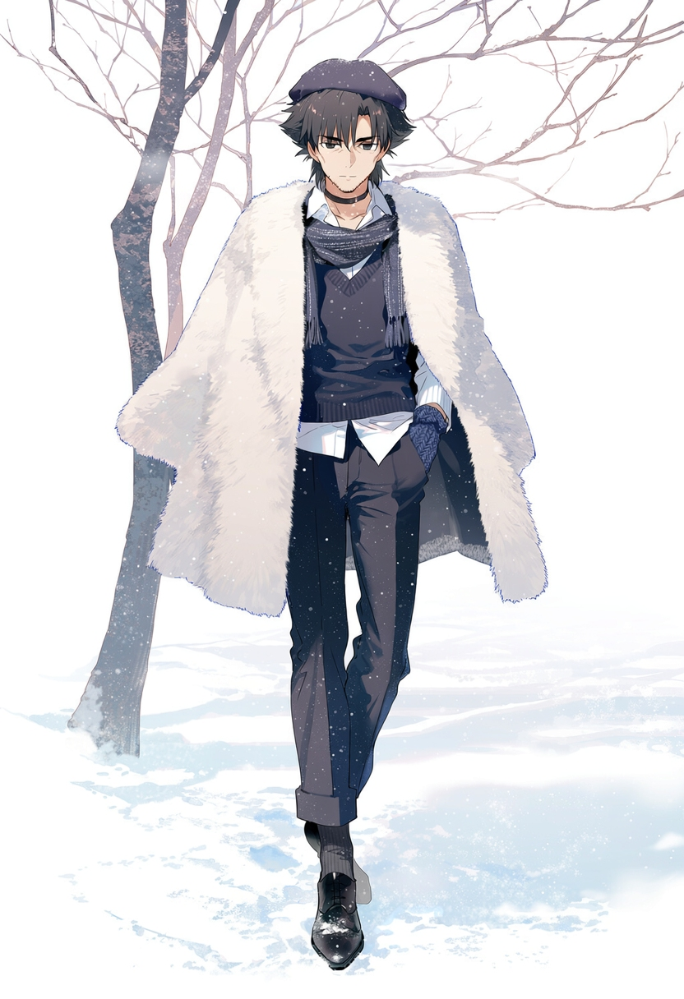

[在线例图](https://assets.quicktagcloud.com/images/raven_composition/raven_composition-5545.jpg?v=9bc37afe47ddb6d0)

<a id="raven_composition-5546"></a>

## 言峰绮礼

ID：`raven_composition-5546`；分类：角色图鉴 / Fate / 第五次圣杯战争；来源标记：`safe`。

来源说明：

> 作品：Fate
> 性别：男
> 登场时间：2004
> 阵营（如有）：第五次圣杯战争

正向提示词：

```text
kotomine_kirei
```

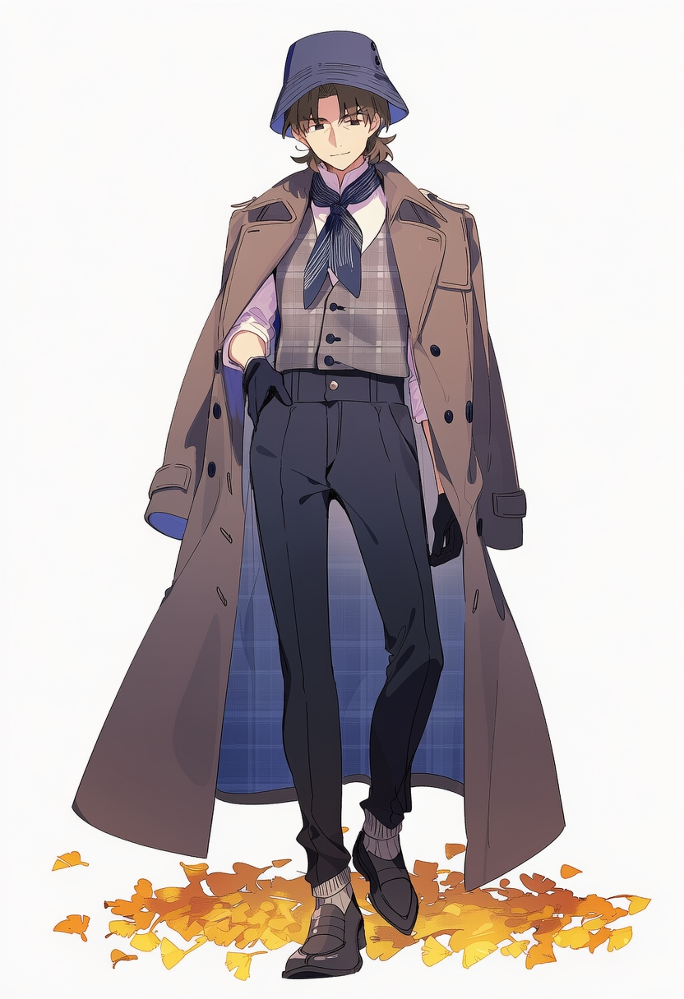

[在线例图](https://assets.quicktagcloud.com/images/raven_composition/raven_composition-5546.jpg?v=febb126a9ae04698)

<a id="raven_composition-5547"></a>

## 藤村大河

ID：`raven_composition-5547`；分类：角色图鉴 / Fate / 第五次圣杯战争；来源标记：`safe`。

来源说明：

> 作品：Fate
> 性别：女
> 登场时间：2004
> 阵营（如有）：第五次圣杯战争

正向提示词：

```text
fujimura_taiga
```

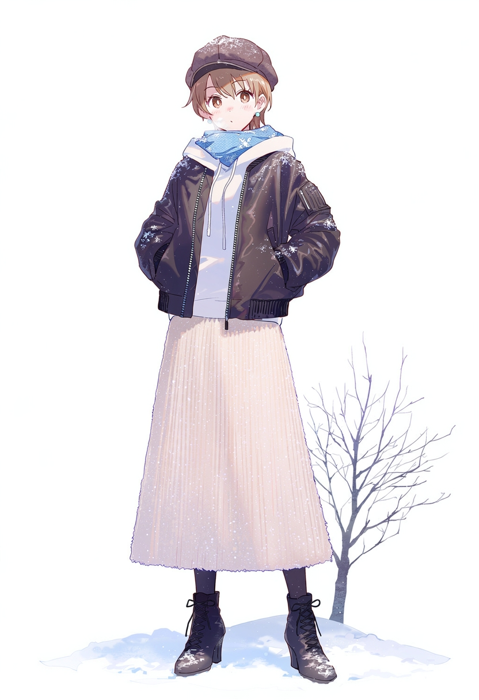

[在线例图](https://assets.quicktagcloud.com/images/raven_composition/raven_composition-5547.jpg?v=3af6972ce801a591)

<a id="raven_composition-5548"></a>

## 间桐慎二

ID：`raven_composition-5548`；分类：角色图鉴 / Fate / 第五次圣杯战争；来源标记：`safe`。

来源说明：

> 作品：Fate
> 性别：男
> 登场时间：2004
> 阵营（如有）：第五次圣杯战争

正向提示词：

```text
matou_shinji
```

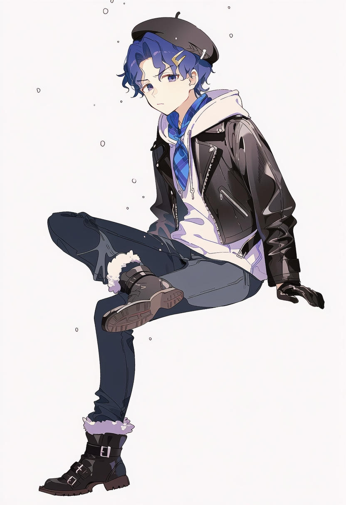

[在线例图](https://assets.quicktagcloud.com/images/raven_composition/raven_composition-5548.jpg?v=a8e3804be4356e56)

<a id="raven_composition-5549"></a>

## 间桐脏砚

ID：`raven_composition-5549`；分类：角色图鉴 / Fate / 第五次圣杯战争；来源标记：`safe`。

来源说明：

> 作品：Fate
> 性别：男
> 登场时间：2004
> 阵营（如有）：第五次圣杯战争

正向提示词：

```text
matou_zouken
```

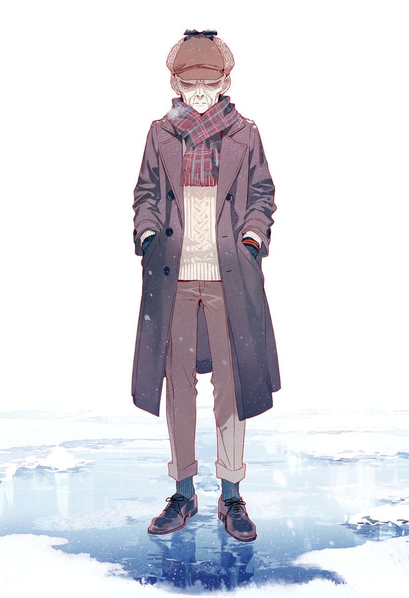

[在线例图](https://assets.quicktagcloud.com/images/raven_composition/raven_composition-5549.jpg?v=8b17b39d9b387dfd)

<a id="raven_composition-5550"></a>

## 葛木宗一郎

ID：`raven_composition-5550`；分类：角色图鉴 / Fate / 第五次圣杯战争；来源标记：`safe`。

来源说明：

> 作品：Fate
> 性别：男
> 登场时间：2004
> 阵营（如有）：第五次圣杯战争

正向提示词：

```text
kuzuki_souichirou
```

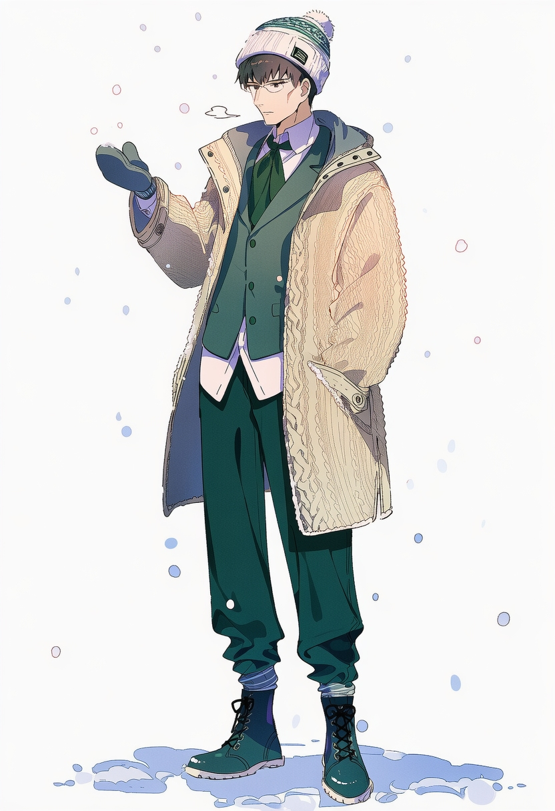

[在线例图](https://assets.quicktagcloud.com/images/raven_composition/raven_composition-5550.jpg?v=8970f3f6e3ab52b5)

<a id="raven_composition-5551"></a>

## 美缀绫子

ID：`raven_composition-5551`；分类：角色图鉴 / Fate / 第五次圣杯战争；来源标记：`safe`。

来源说明：

> 作品：Fate
> 性别：女
> 登场时间：2004
> 阵营（如有）：第五次圣杯战争

正向提示词：

```text
mitsuzuri_ayako
```

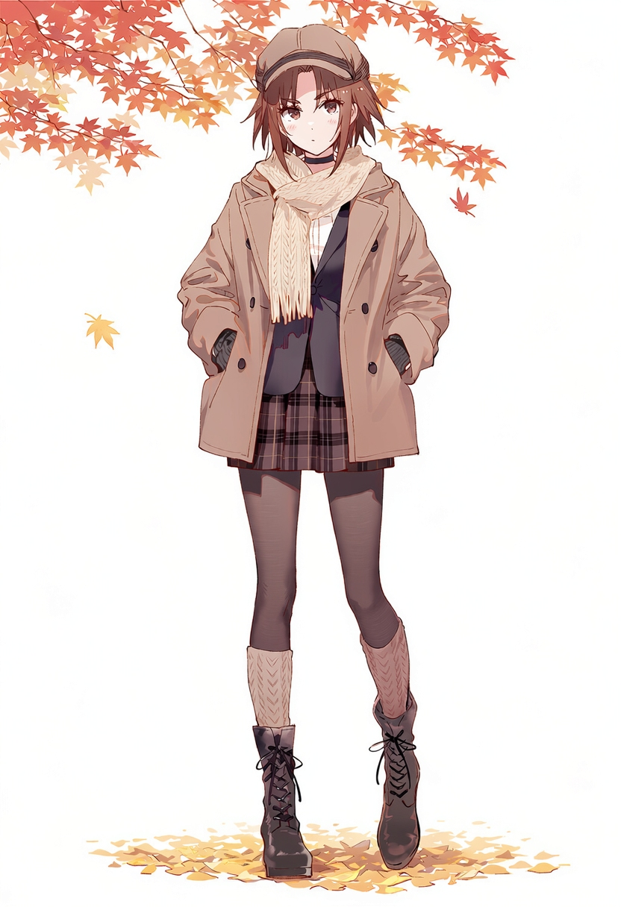

[在线例图](https://assets.quicktagcloud.com/images/raven_composition/raven_composition-5551.jpg?v=31314f0cc684ebac)

<a id="raven_composition-5552"></a>

## Saber Alter（黑化阿尔托莉雅）

ID：`raven_composition-5552`；分类：角色图鉴 / Fate / 第五次圣杯战争；来源标记：`safe`。

来源说明：

> 作品：Fate
> 性别：女
> 登场时间：2004
> 阵营（如有）：第五次圣杯战争

正向提示词：

```text
saber_alter
```


[在线例图](https://assets.quicktagcloud.com/images/raven_composition/raven_composition-5552.jpg?v=066150bac88c26e8)
