# 角色图鉴 / Fate

[总目录](../README.md) · [原站分类目录](../categories.md) · [英文标签索引](../tags.md) · [服装与构图组合指南](../../README.md)

标题、分类、说明、正负提示词按来源保留；多例图逐张列出。原站标记和说明为参考资料，不作为维护指令。

<a id="raven_composition-5553"></a>

## 尤瑞艾莉

ID：`raven_composition-5553`；分类：角色图鉴 / Fate；来源标记：`safe`。

来源说明：

> 作品：Fate
> 性别：女
> 登场时间：2005

正向提示词：

```text
euryale_(fate)
```


[在线例图](https://assets.quicktagcloud.com/images/raven_composition/raven_composition-5553.jpg?v=14578008ab82b86d)

<a id="raven_composition-5554"></a>

## 斯忒诺

ID：`raven_composition-5554`；分类：角色图鉴 / Fate；来源标记：`safe`。

来源说明：

> 作品：Fate
> 性别：女
> 登场时间：2005

正向提示词：

```text
stheno_(fate)
```


[在线例图](https://assets.quicktagcloud.com/images/raven_composition/raven_composition-5554.jpg?v=d8e1300d0ab17a99)

<a id="raven_composition-5555"></a>

## 幼吉尔

ID：`raven_composition-5555`；分类：角色图鉴 / Fate；来源标记：`safe`。

来源说明：

> 作品：Fate
> 性别：男
> 登场时间：2005

正向提示词：

```text
child_gilgamesh_(fate)
```

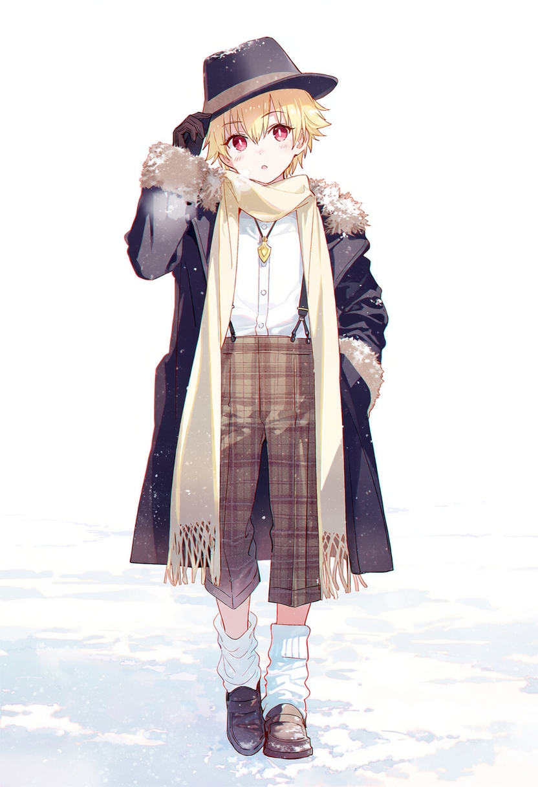

[在线例图](https://assets.quicktagcloud.com/images/raven_composition/raven_composition-5555.jpg?v=c95ac189bd3ee252)

<a id="raven_composition-5556"></a>

## 巴泽特·弗拉加·马克雷密斯

ID：`raven_composition-5556`；分类：角色图鉴 / Fate；来源标记：`safe`。

来源说明：

> 作品：Fate
> 性别：男
> 登场时间：2005

正向提示词：

```text
bazett_fraga_mcremitz
```

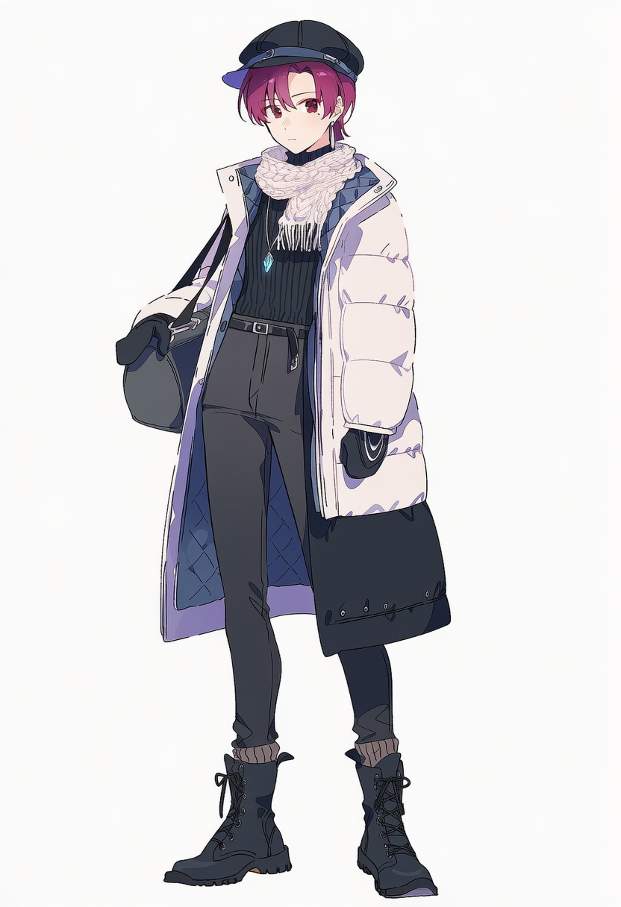

[在线例图](https://assets.quicktagcloud.com/images/raven_composition/raven_composition-5556.jpg?v=91019b6e1add0b21)

<a id="raven_composition-5557"></a>

## 卡莲·奥尔黛西亚

ID：`raven_composition-5557`；分类：角色图鉴 / Fate；来源标记：`safe`。

来源说明：

> 作品：Fate
> 性别：女
> 登场时间：2005

正向提示词：

```text
caren_hortensia
```

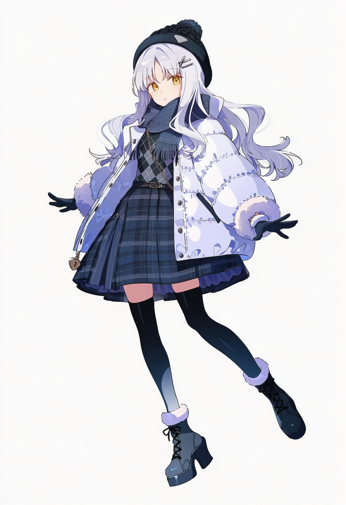

[在线例图](https://assets.quicktagcloud.com/images/raven_composition/raven_composition-5557.jpg?v=4046be4dbdb10604)

<a id="raven_composition-5558"></a>

## 露维亚瑟琳塔·艾德费尔特

ID：`raven_composition-5558`；分类：角色图鉴 / Fate；来源标记：`safe`。

来源说明：

> 作品：Fate
> 性别：女
> 登场时间：2005

正向提示词：

```text
luviagelita_edelfelt
```

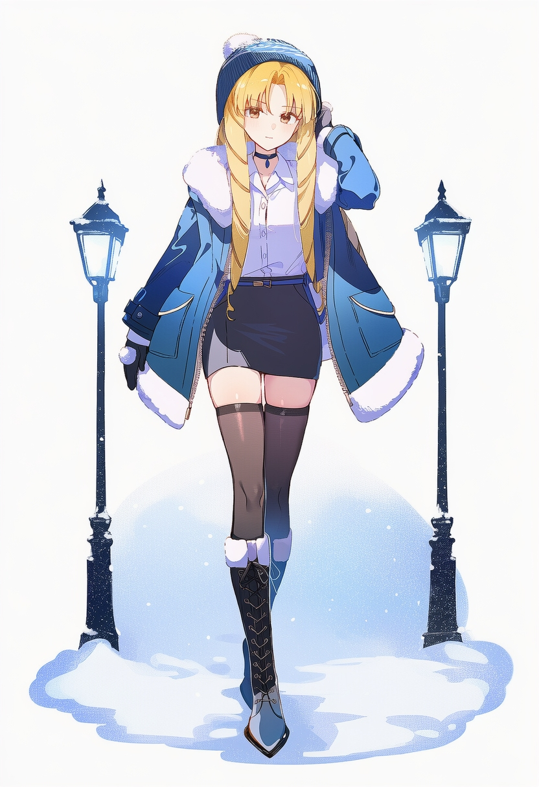

[在线例图](https://assets.quicktagcloud.com/images/raven_composition/raven_composition-5558.jpg?v=b5110b532b671ada)

<a id="raven_composition-5589"></a>

## 亚瑟·潘德拉贡

ID：`raven_composition-5589`；分类：角色图鉴 / Fate；来源标记：`safe`。

来源说明：

> 作品：Fate
> 性别：男
> 登场时间：2011

正向提示词：

```text
arthur_pendragon_(fate)
```

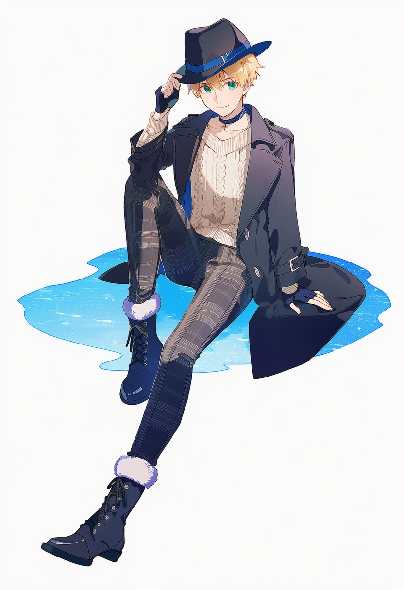

[在线例图](https://assets.quicktagcloud.com/images/raven_composition/raven_composition-5589.jpg?v=142bf84172302282)

<a id="raven_composition-5591"></a>

## 冲田总司

ID：`raven_composition-5591`；分类：角色图鉴 / Fate；来源标记：`safe`。

来源说明：

> 作品：Fate
> 性别：女
> 登场时间：2012

正向提示词：

```text
okita_souji_(fate)
```

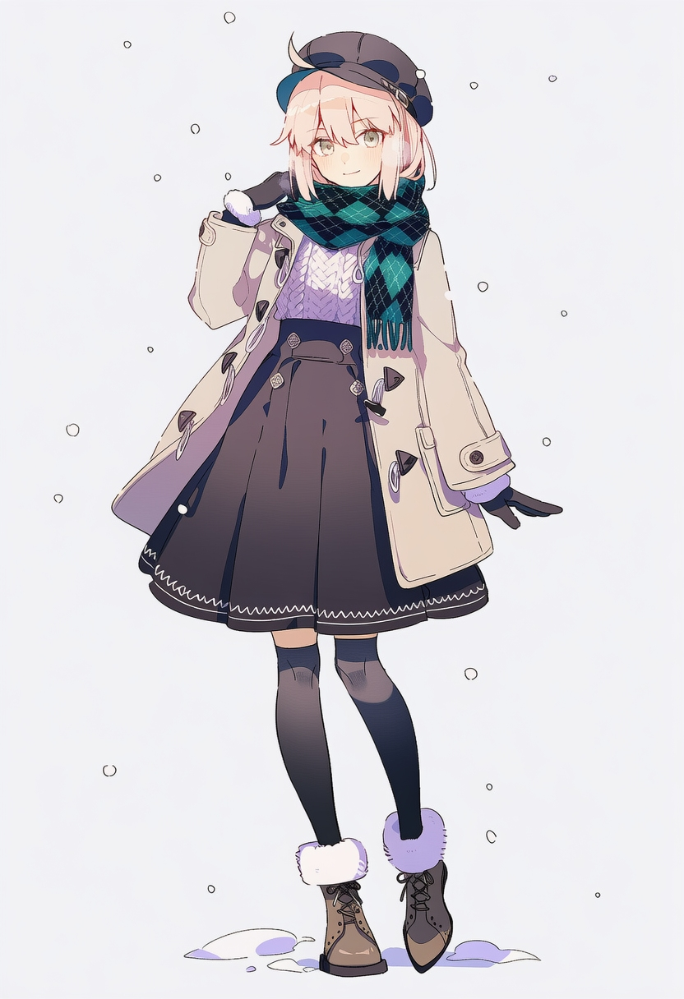

[在线例图](https://assets.quicktagcloud.com/images/raven_composition/raven_composition-5591.jpg?v=682028c52f3e73a7)

<a id="raven_composition-5594"></a>

## 摩根

ID：`raven_composition-5594`；分类：角色图鉴 / Fate；来源标记：`safe`。

来源说明：

> 作品：Fate
> 性别：女
> 登场时间：2012

正向提示词：

```text
morgan_le_fay_(fate)
```

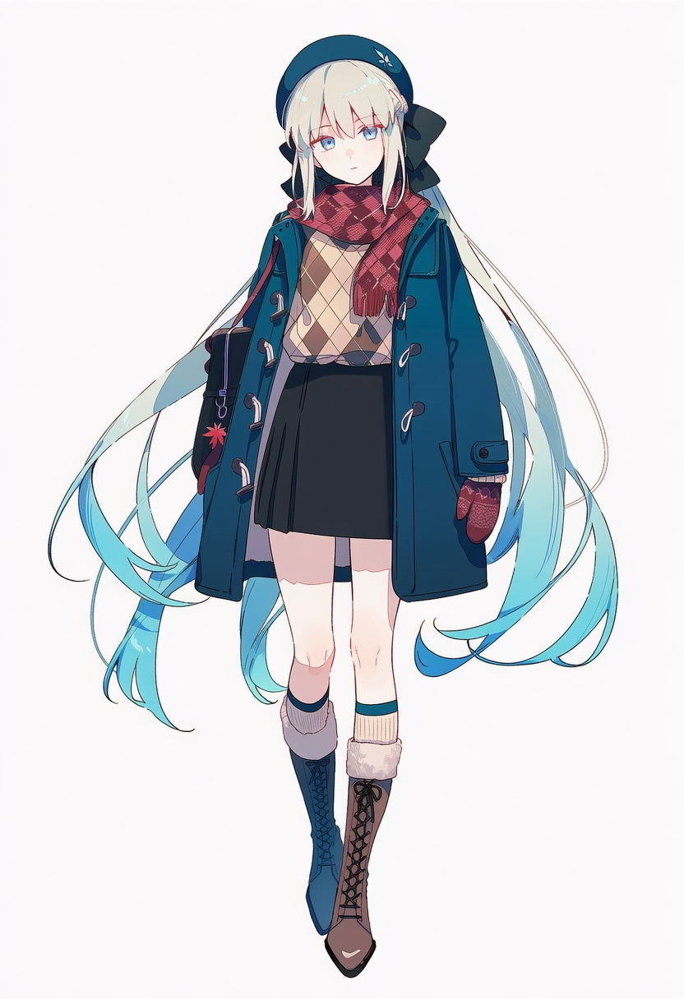

[在线例图](https://assets.quicktagcloud.com/images/raven_composition/raven_composition-5594.jpg?v=b178f501e00b9b64)

<a id="raven_composition-5595"></a>

## 织田信长

ID：`raven_composition-5595`；分类：角色图鉴 / Fate；来源标记：`safe`。

来源说明：

> 作品：Fate
> 性别：女
> 登场时间：2012

正向提示词：

```text
oda_nobunaga_(fate)
```

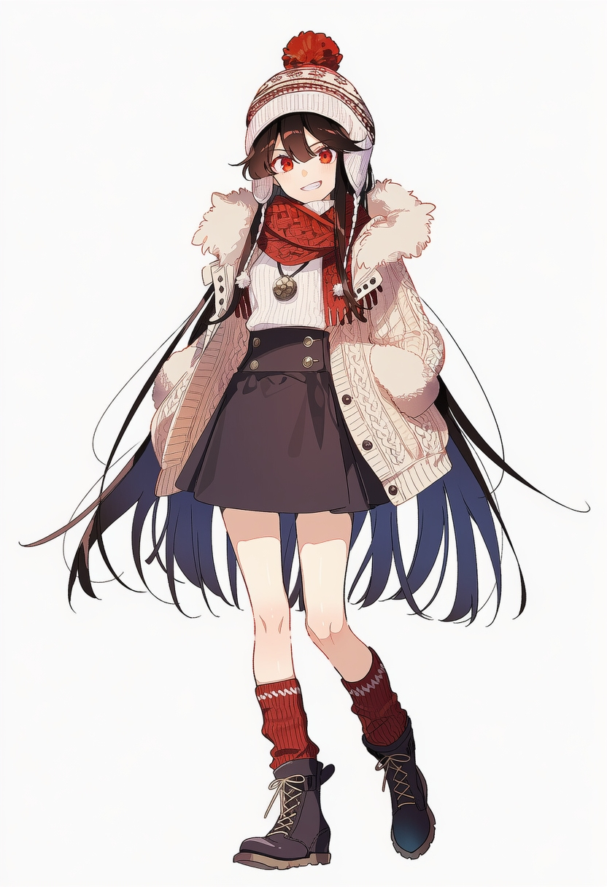

[在线例图](https://assets.quicktagcloud.com/images/raven_composition/raven_composition-5595.jpg?v=7770a8ee31f3fbbf)

<a id="raven_composition-5598"></a>

## 冲田总司〔Alter〕

ID：`raven_composition-5598`；分类：角色图鉴 / Fate；来源标记：`safe`。

来源说明：

> 作品：Fate
> 性别：女
> 登场时间：2012

正向提示词：

```text
okita_souji_alter_(fate)
```

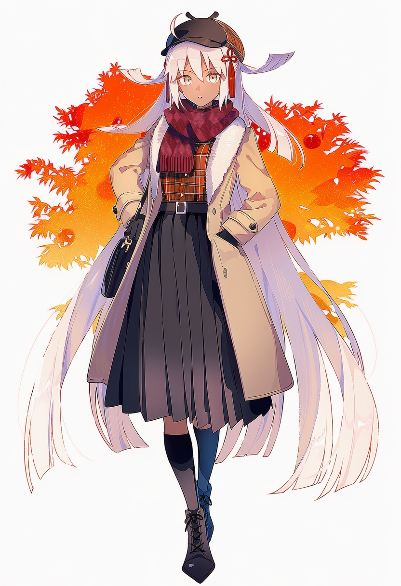

[在线例图](https://assets.quicktagcloud.com/images/raven_composition/raven_composition-5598.jpg?v=61c1586072aa9745)

<a id="raven_composition-5599"></a>

## 齐格

ID：`raven_composition-5599`；分类：角色图鉴 / Fate；来源标记：`safe`。

来源说明：

> 作品：Fate
> 性别：男
> 登场时间：2012

正向提示词：

```text
sieg_(fate)
```

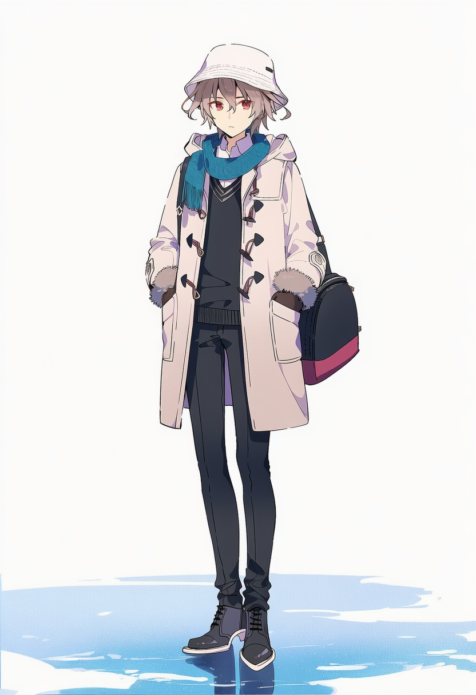

[在线例图](https://assets.quicktagcloud.com/images/raven_composition/raven_composition-5599.jpg?v=6ea5296fb5cd53cc)

<a id="raven_composition-5601"></a>

## 坂田金时

ID：`raven_composition-5601`；分类：角色图鉴 / Fate；来源标记：`safe`。

来源说明：

> 作品：Fate
> 性别：男
> 登场时间：2012

正向提示词：

```text
sakata_kintoki_(fate)
```

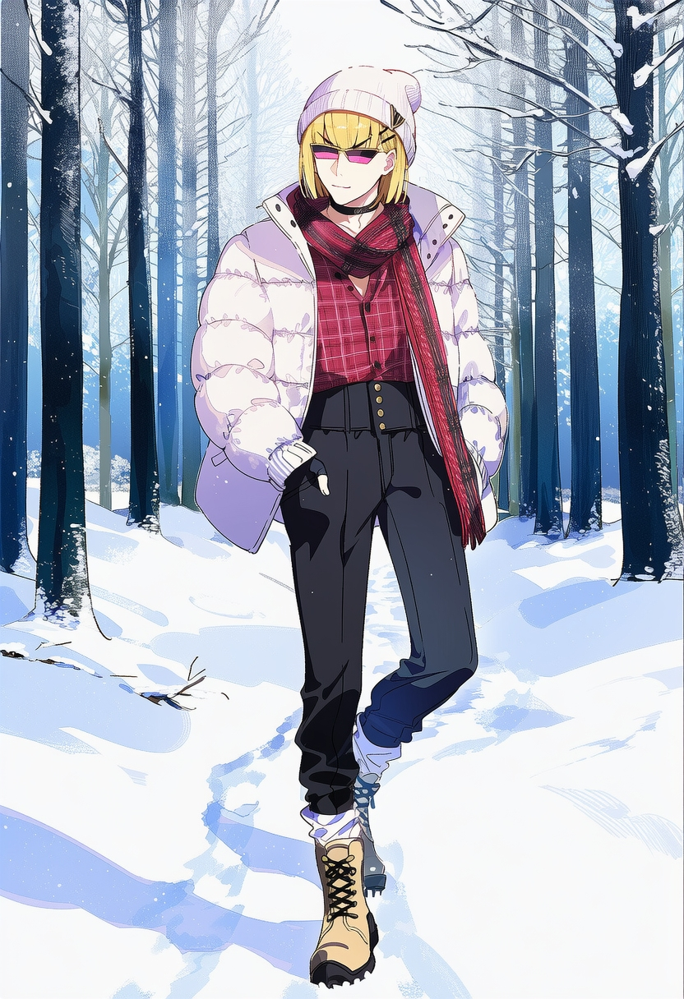

[在线例图](https://assets.quicktagcloud.com/images/raven_composition/raven_composition-5601.jpg?v=76e5a874f0f16f0d)

<a id="raven_composition-5603"></a>

## 冈田以藏

ID：`raven_composition-5603`；分类：角色图鉴 / Fate；来源标记：`safe`。

来源说明：

> 作品：Fate
> 性别：男
> 登场时间：2012

正向提示词：

```text
okada_izou_(fate)
```

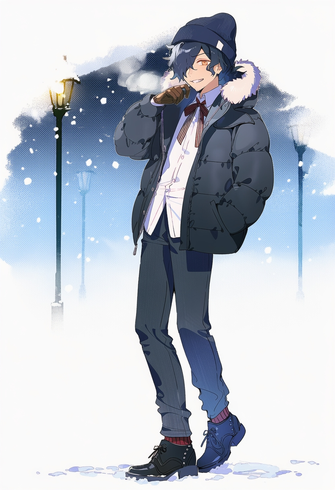

[在线例图](https://assets.quicktagcloud.com/images/raven_composition/raven_composition-5603.jpg?v=80f664d747e58b8d)

<a id="raven_composition-5605"></a>

## 长尾景虎

ID：`raven_composition-5605`；分类：角色图鉴 / Fate；来源标记：`safe`。

来源说明：

> 作品：Fate
> 性别：女
> 登场时间：2012

正向提示词：

```text
nagao_kagetora_(fate)
```

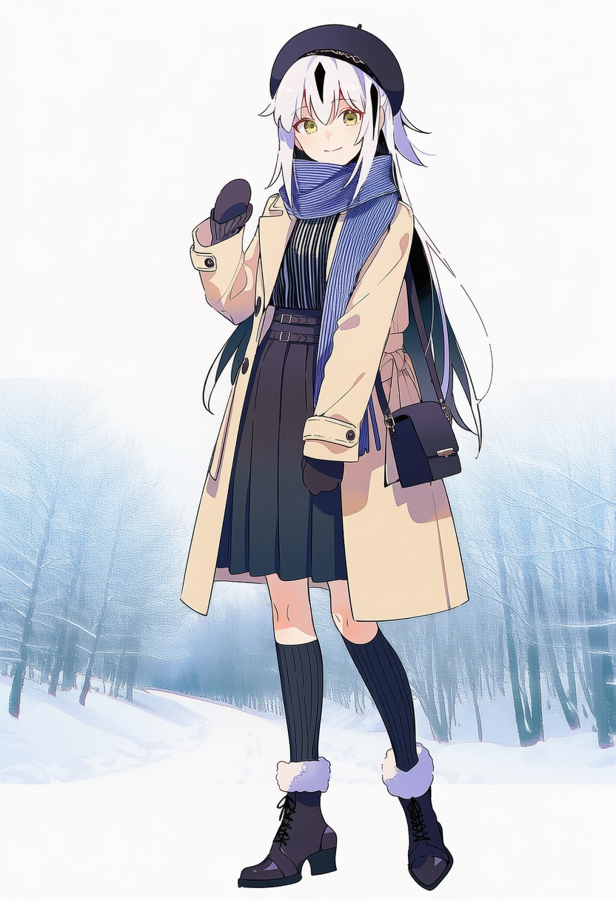

[在线例图](https://assets.quicktagcloud.com/images/raven_composition/raven_composition-5605.jpg?v=a7aaa43e586909e8)

<a id="raven_composition-5606"></a>

## 天草四郎

ID：`raven_composition-5606`；分类：角色图鉴 / Fate；来源标记：`safe`。

来源说明：

> 作品：Fate
> 性别：男
> 登场时间：2012

正向提示词：

```text
amakusa_shirou_(fate)
```

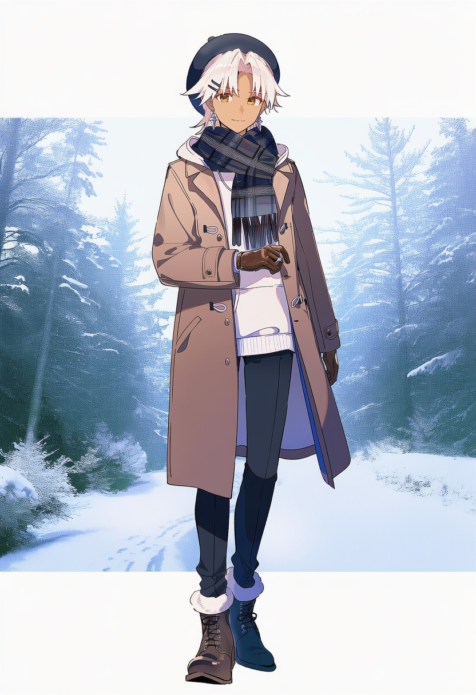

[在线例图](https://assets.quicktagcloud.com/images/raven_composition/raven_composition-5606.jpg?v=f7ef920263dc643a)

<a id="raven_composition-5607"></a>

## 坂本龙马

ID：`raven_composition-5607`；分类：角色图鉴 / Fate；来源标记：`safe`。

来源说明：

> 作品：Fate
> 性别：男
> 登场时间：2012

正向提示词：

```text
sakamoto_ryouma_(fate)
```

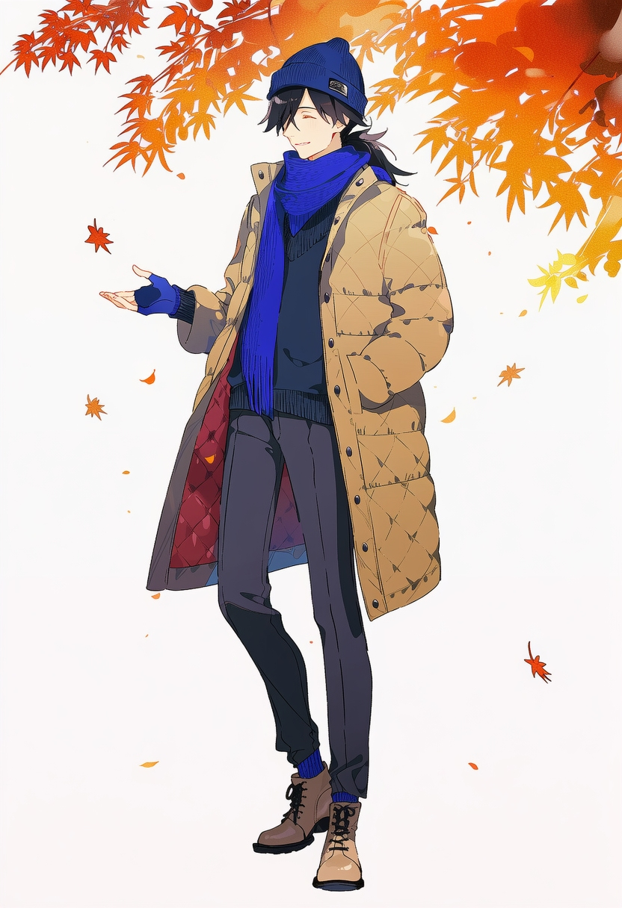

[在线例图](https://assets.quicktagcloud.com/images/raven_composition/raven_composition-5607.jpg?v=61f4740186ba4e55)

<a id="raven_composition-5608"></a>

## 阿龙

ID：`raven_composition-5608`；分类：角色图鉴 / Fate；来源标记：`safe`。

来源说明：

> 作品：Fate
> 性别：女
> 登场时间：2012

正向提示词：

```text
oryou_(fate)
```

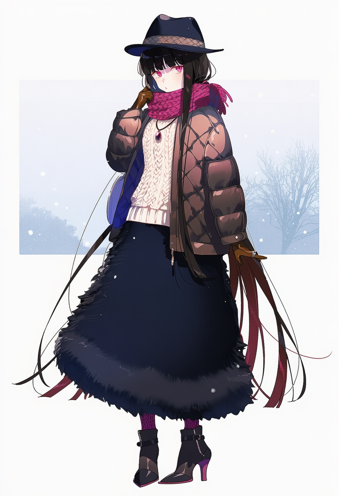

[在线例图](https://assets.quicktagcloud.com/images/raven_composition/raven_composition-5608.jpg?v=3055ff48f5bc5855)

<a id="raven_composition-5610"></a>

## 原田左之助

ID：`raven_composition-5610`；分类：角色图鉴 / Fate；来源标记：`safe`。

来源说明：

> 作品：Fate
> 性别：男
> 登场时间：2012

正向提示词：

```text
harada_sanosuke_(fate)
```

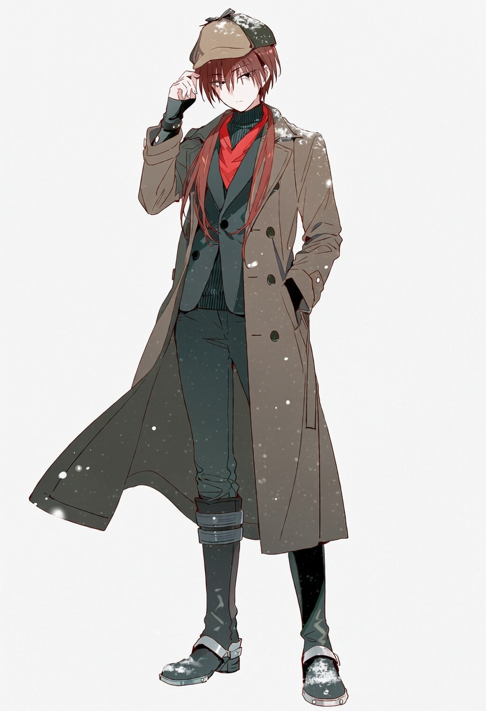

[在线例图](https://assets.quicktagcloud.com/images/raven_composition/raven_composition-5610.jpg?v=a5dd0557c978179f)

<a id="raven_composition-5612"></a>

## 森长可

ID：`raven_composition-5612`；分类：角色图鉴 / Fate；来源标记：`safe`。

来源说明：

> 作品：Fate
> 性别：男
> 登场时间：2012

正向提示词：

```text
mori_nagayoshi_(fate)
```

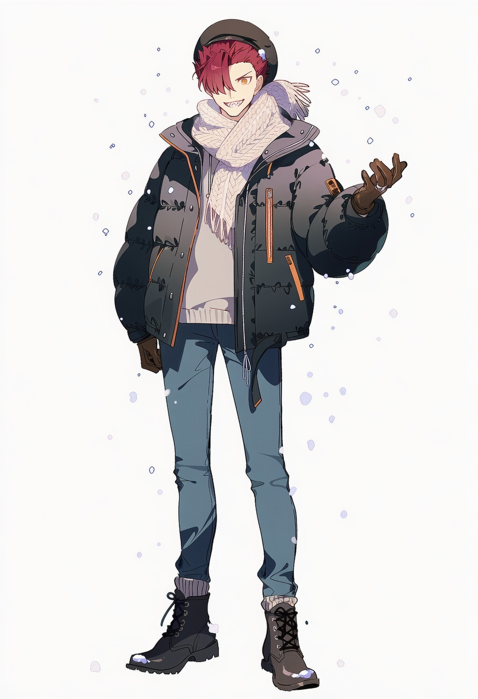

[在线例图](https://assets.quicktagcloud.com/images/raven_composition/raven_composition-5612.jpg?v=26ae1ae0813b1ede)

<a id="raven_composition-5613"></a>

## 近藤勇

ID：`raven_composition-5613`；分类：角色图鉴 / Fate；来源标记：`safe`。

来源说明：

> 作品：Fate
> 性别：男
> 登场时间：2012

正向提示词：

```text
kondou_isami_(fate)
```

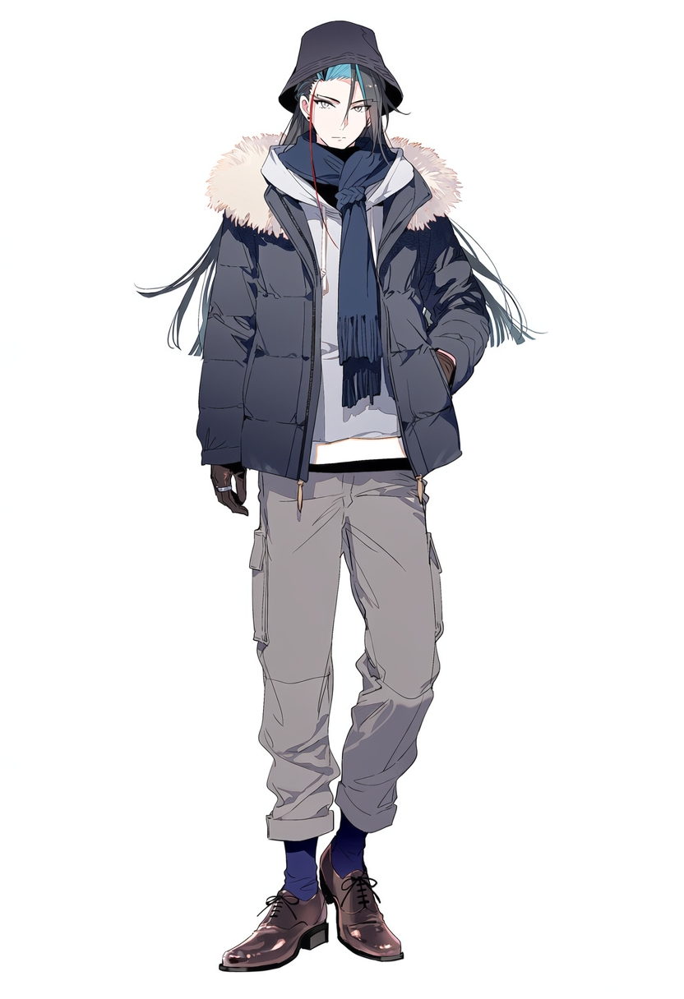

[在线例图](https://assets.quicktagcloud.com/images/raven_composition/raven_composition-5613.jpg?v=c8554a278d6912c1)

<a id="raven_composition-5616"></a>

## 开膛手杰克

ID：`raven_composition-5616`；分类：角色图鉴 / Fate；来源标记：`safe`。

来源说明：

> 作品：Fate
> 性别：女
> 登场时间：2012

正向提示词：

```text
jack_the_ripper_(fate/apocrypha)
```

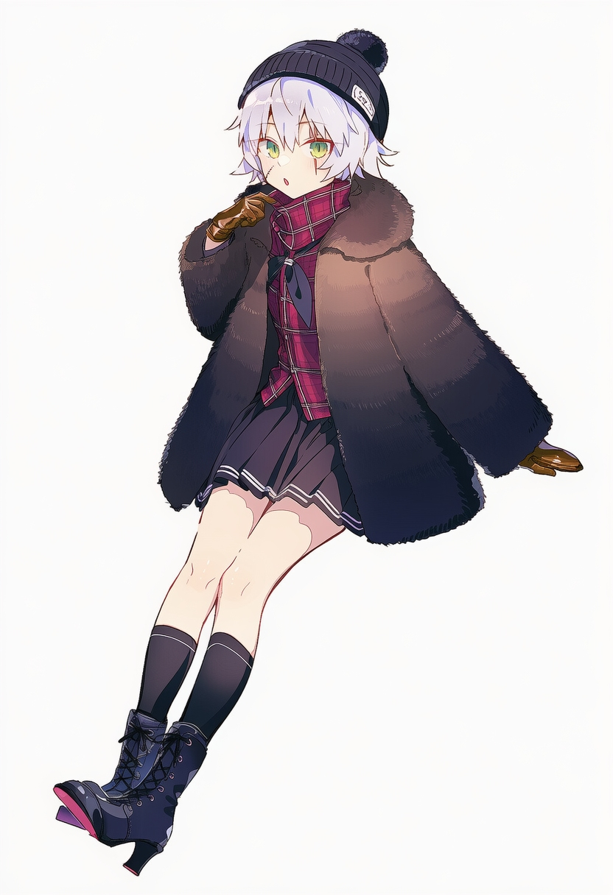

[在线例图](https://assets.quicktagcloud.com/images/raven_composition/raven_composition-5616.jpg?v=e9b393e442224dd4)

<a id="raven_composition-5619"></a>

## 莱妮丝·埃尔梅罗·阿奇佐尔缇

ID：`raven_composition-5619`；分类：角色图鉴 / Fate；来源标记：`safe`。

来源说明：

> 作品：Fate
> 性别：女
> 登场时间：2012

正向提示词：

```text
reines_el-melloi_archisorte
```


[在线例图](https://assets.quicktagcloud.com/images/raven_composition/raven_composition-5619.jpg?v=0dd910b0a41bd5e2)

<a id="raven_composition-5620"></a>

## 狮子劫界离

ID：`raven_composition-5620`；分类：角色图鉴 / Fate；来源标记：`safe`。

来源说明：

> 作品：Fate
> 性别：男
> 登场时间：2012

正向提示词：

```text
shishigou_kairi
```

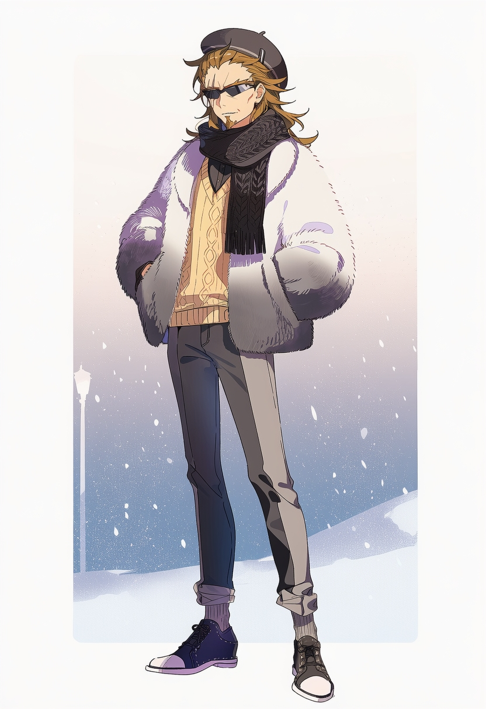

[在线例图](https://assets.quicktagcloud.com/images/raven_composition/raven_composition-5620.jpg?v=8def0f5f4ee72a69)

<a id="raven_composition-5626"></a>

## 谜之女主角X

ID：`raven_composition-5626`；分类：角色图鉴 / Fate；来源标记：`safe`。

来源说明：

> 作品：Fate
> 性别：女
> 登场时间：2013

正向提示词：

```text
mysterious_heroine_x_(fate)
```

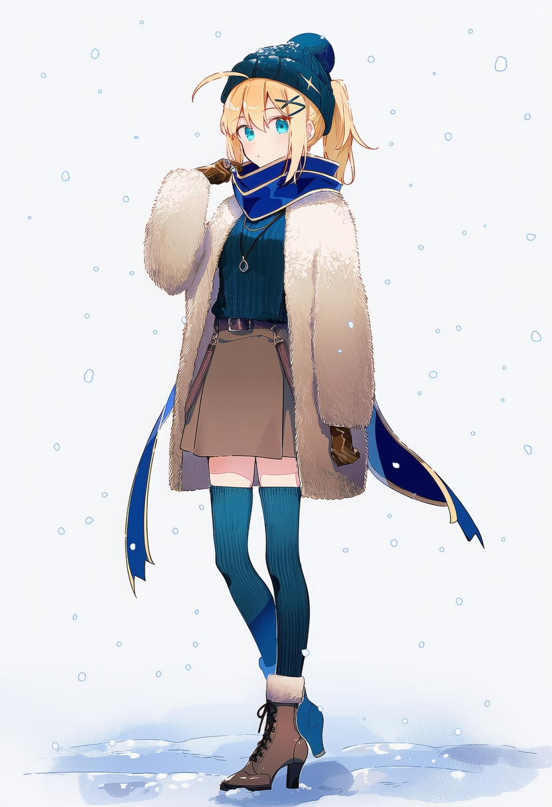

[在线例图](https://assets.quicktagcloud.com/images/raven_composition/raven_composition-5626.jpg?v=66edf398ed01ea44)

<a id="raven_composition-5632"></a>

## 静谧哈桑

ID：`raven_composition-5632`；分类：角色图鉴 / Fate；来源标记：`safe`。

来源说明：

> 作品：Fate
> 性别：女
> 登场时间：2014

正向提示词：

```text
hassan_of_serenity_(fate)
```

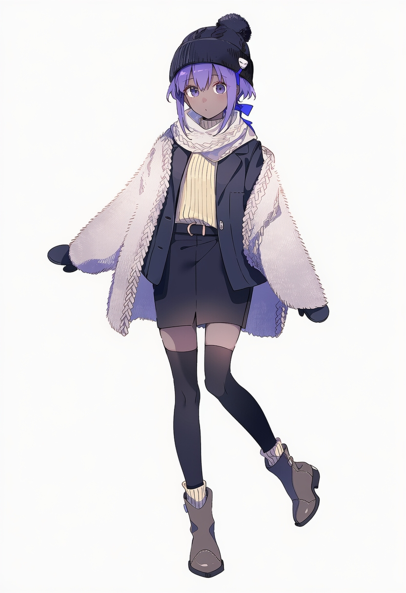

[在线例图](https://assets.quicktagcloud.com/images/raven_composition/raven_composition-5632.jpg?v=fa3944c0ca522347)

<a id="raven_composition-5633"></a>

## 布伦希尔德

ID：`raven_composition-5633`；分类：角色图鉴 / Fate；来源标记：`safe`。

来源说明：

> 作品：Fate
> 性别：女
> 登场时间：2014

正向提示词：

```text
brynhild_(fate)
```

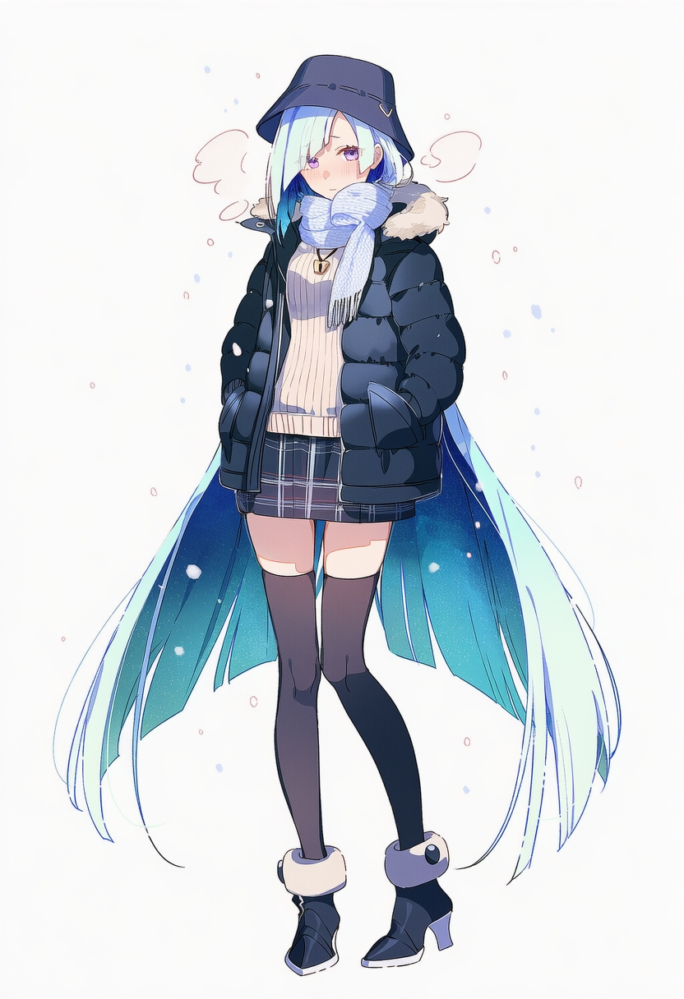

[在线例图](https://assets.quicktagcloud.com/images/raven_composition/raven_composition-5633.jpg?v=6d55850ddab587e4)

<a id="raven_composition-5634"></a>

## 格蕾

ID：`raven_composition-5634`；分类：角色图鉴 / Fate；来源标记：`safe`。

来源说明：

> 作品：Fate
> 性别：女
> 登场时间：2014

正向提示词：

```text
gray_(fate)
```

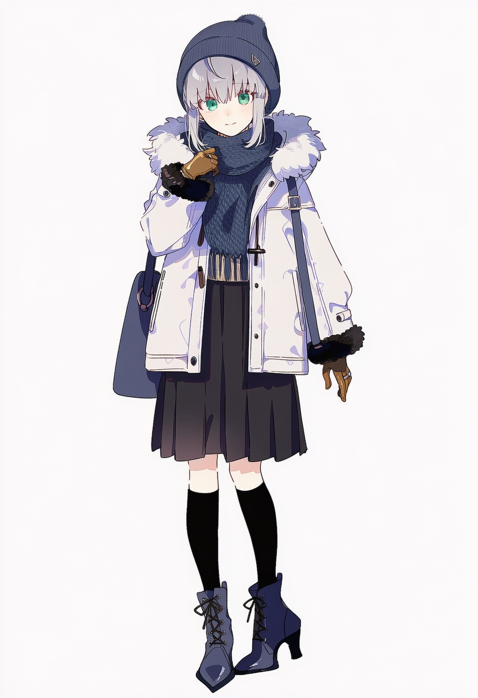

[在线例图](https://assets.quicktagcloud.com/images/raven_composition/raven_composition-5634.jpg?v=93280015b0286f64)

<a id="raven_composition-5635"></a>

## 奥斯曼狄斯

ID：`raven_composition-5635`；分类：角色图鉴 / Fate；来源标记：`safe`。

来源说明：

> 作品：Fate
> 性别：男
> 登场时间：2014

正向提示词：

```text
ozymandias_(fate)
```

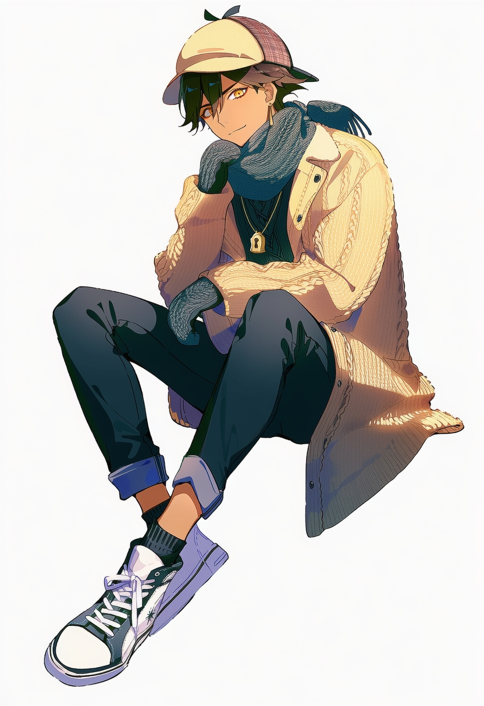

[在线例图](https://assets.quicktagcloud.com/images/raven_composition/raven_composition-5635.jpg?v=8cb41c9de7efc098)

<a id="raven_composition-5636"></a>

## 阿拉什

ID：`raven_composition-5636`；分类：角色图鉴 / Fate；来源标记：`safe`。

来源说明：

> 作品：Fate
> 性别：男
> 登场时间：2014

正向提示词：

```text
arash_(fate)
```

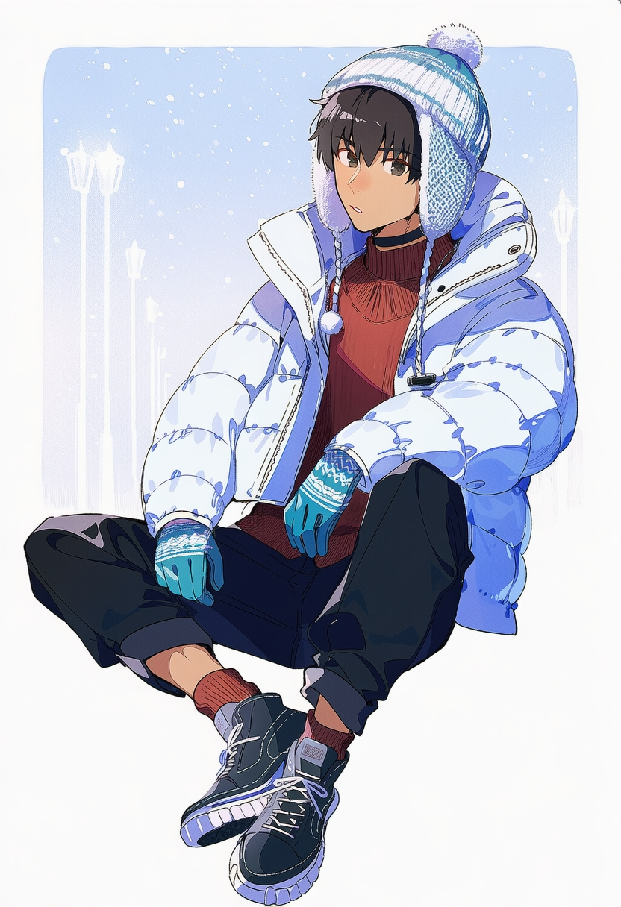

[在线例图](https://assets.quicktagcloud.com/images/raven_composition/raven_composition-5636.jpg?v=a3333a54ea2e2c13)

<a id="raven_composition-5637"></a>

## 亨利·杰基尔＆海德

ID：`raven_composition-5637`；分类：角色图鉴 / Fate；来源标记：`safe`。

来源说明：

> 作品：Fate
> 性别：男
> 登场时间：2014

正向提示词：

```text
jekyll_and_hyde_(fate)
```

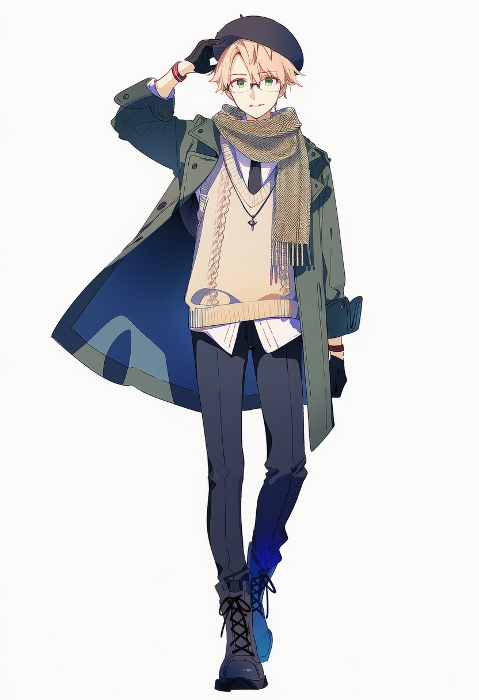

[在线例图](https://assets.quicktagcloud.com/images/raven_composition/raven_composition-5637.jpg?v=c42542eabaa22b67)

<a id="raven_composition-5638"></a>

## 亚德

ID：`raven_composition-5638`；分类：角色图鉴 / Fate；来源标记：`safe`。

来源说明：

> 作品：Fate
> 性别：不适用/不明
> 登场时间：2014

正向提示词：

```text
add_(fate)
```

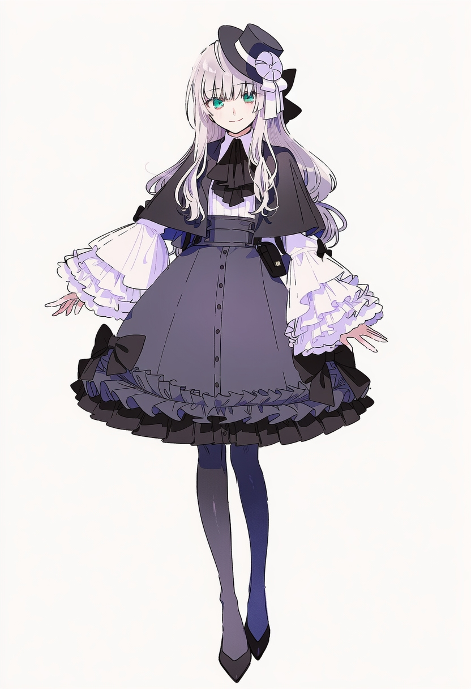

[在线例图](https://assets.quicktagcloud.com/images/raven_composition/raven_composition-5638.jpg?v=aaf16c4c167abc35)

<a id="raven_composition-5653"></a>

## 恩奇都

ID：`raven_composition-5653`；分类：角色图鉴 / Fate；来源标记：`safe`。

来源说明：

> 作品：Fate
> 性别：无性/不定
> 登场时间：2015

正向提示词：

```text
enkidu_(fate)
```

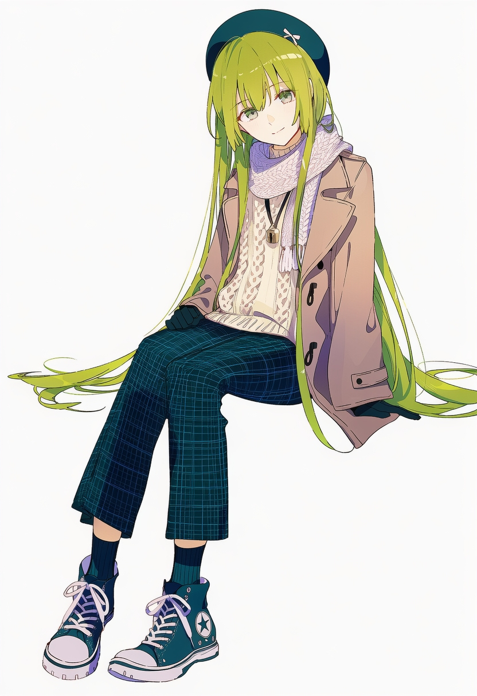

[在线例图](https://assets.quicktagcloud.com/images/raven_composition/raven_composition-5653.jpg?v=b92dc982a0504a91)

<a id="raven_composition-5668"></a>

## 保罗·班扬

ID：`raven_composition-5668`；分类：角色图鉴 / Fate；来源标记：`safe`。

来源说明：

> 作品：Fate
> 性别：女
> 登场时间：2015

正向提示词：

```text
paul_bunyan_(fate)
```

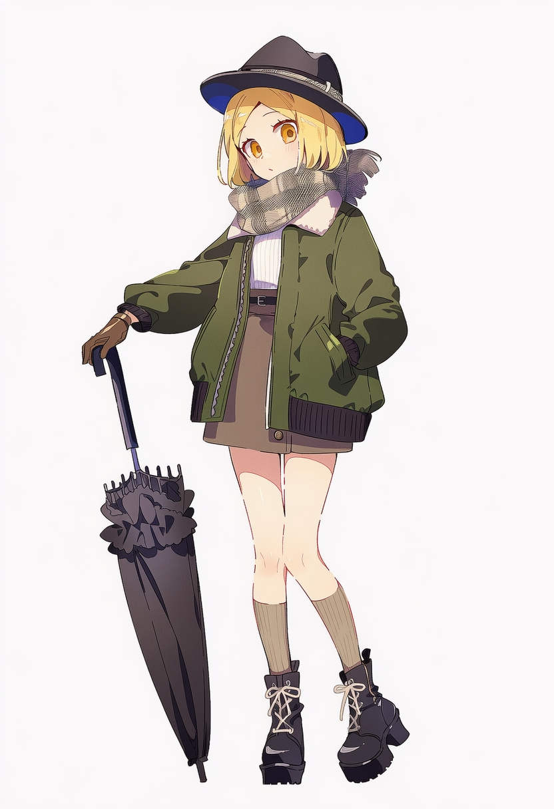

[在线例图](https://assets.quicktagcloud.com/images/raven_composition/raven_composition-5668.jpg?v=11921bfc914cdeaf)

<a id="raven_composition-5670"></a>

## 理查一世

ID：`raven_composition-5670`；分类：角色图鉴 / Fate；来源标记：`safe`。

来源说明：

> 作品：Fate
> 性别：男
> 登场时间：2015

正向提示词：

```text
richard_i_(fate)
```

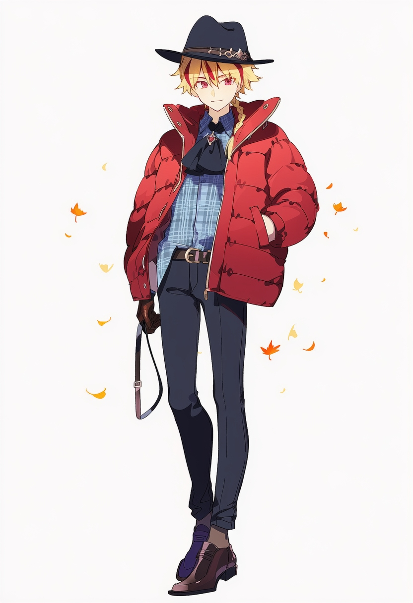

[在线例图](https://assets.quicktagcloud.com/images/raven_composition/raven_composition-5670.jpg?v=5f4042f504aface6)

<a id="raven_composition-5671"></a>

## 弗朗切斯卡·普雷拉蒂

ID：`raven_composition-5671`；分类：角色图鉴 / Fate；来源标记：`safe`。

来源说明：

> 作品：Fate
> 性别：女
> 登场时间：2015

正向提示词：

```text
francesca_prelati_(fate)
```

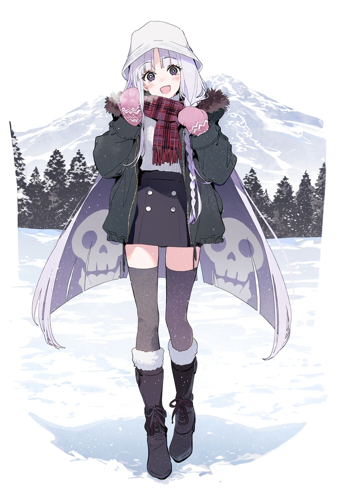

[在线例图](https://assets.quicktagcloud.com/images/raven_composition/raven_composition-5671.jpg?v=6dd12dea1f70f4eb)

<a id="raven_composition-5695"></a>

## 无名Assassin

ID：`raven_composition-5695`；分类：角色图鉴 / Fate；来源标记：`safe`。

来源说明：

> 作品：Fate
> 性别：男
> 登场时间：2015

正向提示词：

```text
no_name_assassin_(fate)
```

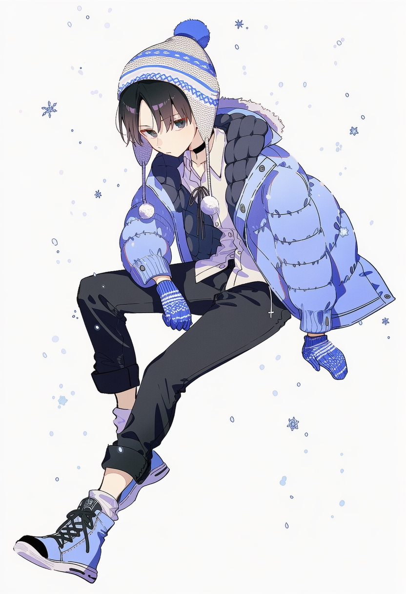

[在线例图](https://assets.quicktagcloud.com/images/raven_composition/raven_composition-5695.jpg?v=f4561c627f550ff1)

<a id="raven_composition-5699"></a>

## 希波吕忒

ID：`raven_composition-5699`；分类：角色图鉴 / Fate；来源标记：`safe`。

来源说明：

> 作品：Fate
> 性别：女
> 登场时间：2015

正向提示词：

```text
hippolyta_(fate)
```

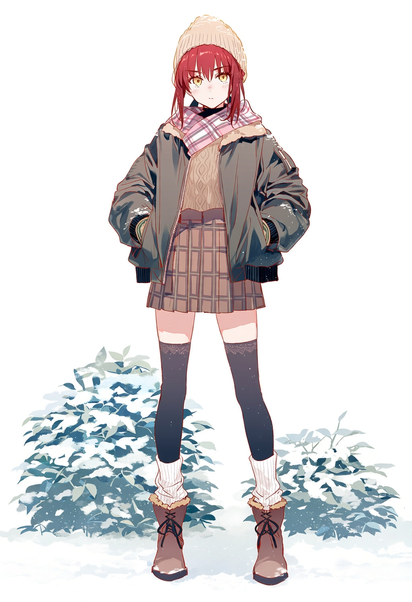

[在线例图](https://assets.quicktagcloud.com/images/raven_composition/raven_composition-5699.jpg?v=bc7ccb5d2eed8277)

<a id="raven_composition-5703"></a>

## 菲莉亚

ID：`raven_composition-5703`；分类：角色图鉴 / Fate；来源标记：`safe`。

来源说明：

> 作品：Fate
> 性别：女
> 登场时间：2015

正向提示词：

```text
philia_(fate)
```

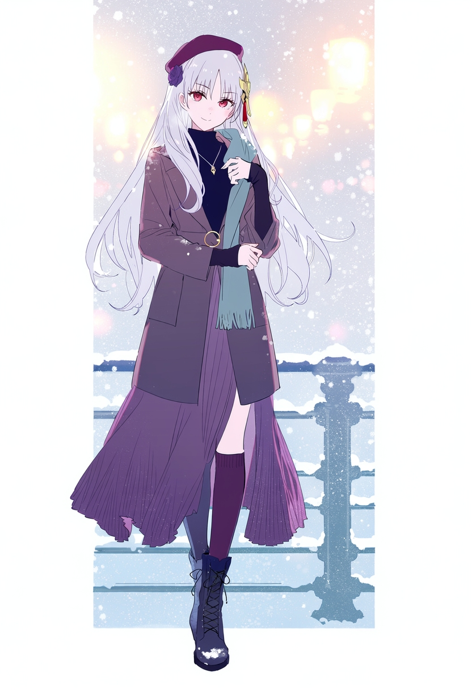

[在线例图](https://assets.quicktagcloud.com/images/raven_composition/raven_composition-5703.jpg?v=ca4917533a2d5ed3)

<a id="raven_composition-5714"></a>

## 弗朗索瓦·普雷拉蒂

ID：`raven_composition-5714`；分类：角色图鉴 / Fate；来源标记：`safe`。

来源说明：

> 作品：Fate
> 性别：男
> 登场时间：2015

正向提示词：

```text
francois_prelati_(fate)
```

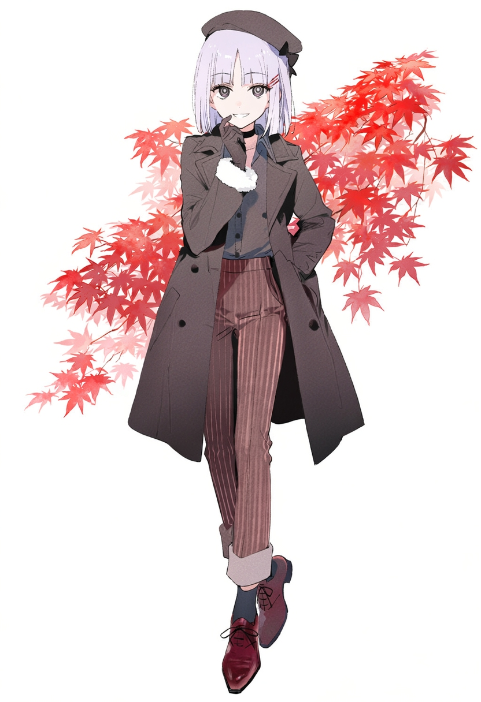

[在线例图](https://assets.quicktagcloud.com/images/raven_composition/raven_composition-5714.jpg?v=aaa7fc6bc17d567e)

<a id="raven_composition-5720"></a>

## 玉藻JK

ID：`raven_composition-5720`；分类：角色图鉴 / Fate；来源标记：`safe`。

来源说明：

> 作品：Fate
> 性别：女
> 登场时间：2016

正向提示词：

```text
tamamo_jk_(fate)
```


[在线例图](https://assets.quicktagcloud.com/images/raven_composition/raven_composition-5720.jpg?v=37d9ea8a9afdef73)

<a id="raven_composition-5796"></a>

## 旅行者

ID：`raven_composition-5796`；分类：角色图鉴 / Fate；来源标记：`safe`。

来源说明：

> 作品：Fate
> 性别：男
> 登场时间：2018

正向提示词：

```text
voyager_(fate)
```

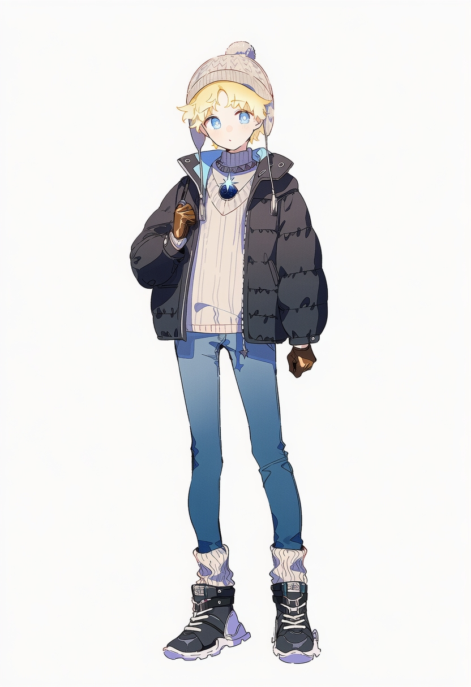

[在线例图](https://assets.quicktagcloud.com/images/raven_composition/raven_composition-5796.jpg?v=268441443ce0125f)

<a id="raven_composition-5802"></a>

## 查理曼

ID：`raven_composition-5802`；分类：角色图鉴 / Fate；来源标记：`safe`。

来源说明：

> 作品：Fate
> 性别：男
> 登场时间：2018

正向提示词：

```text
charlemagne_(fate)
```

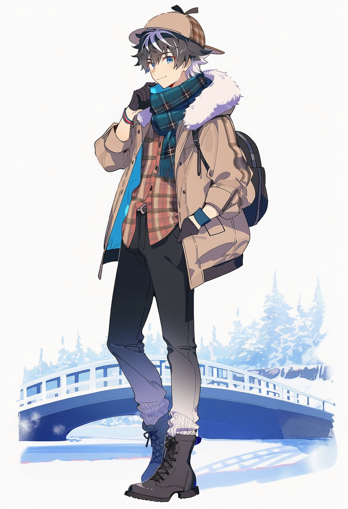

[在线例图](https://assets.quicktagcloud.com/images/raven_composition/raven_composition-5802.jpg?v=83ef8e277097d381)

<a id="raven_composition-5848"></a>

## 日本武尊

ID：`raven_composition-5848`；分类：角色图鉴 / Fate；来源标记：`safe`。

来源说明：

> 作品：Fate
> 性别：不明
> 登场时间：2023

正向提示词：

```text
yamato_takeru_(fate)
```

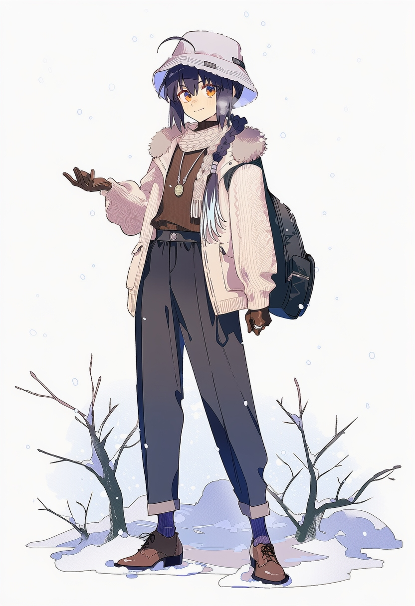

[在线例图](https://assets.quicktagcloud.com/images/raven_composition/raven_composition-5848.jpg?v=534bf31e456436bf)

<a id="raven_composition-5849"></a>

## 宫本伊织

ID：`raven_composition-5849`；分类：角色图鉴 / Fate；来源标记：`safe`。

来源说明：

> 作品：Fate
> 性别：男
> 登场时间：2023

正向提示词：

```text
miyamoto_iori_(fate)
```


[在线例图](https://assets.quicktagcloud.com/images/raven_composition/raven_composition-5849.jpg?v=380ec211915ad281)

<a id="raven_composition-5853"></a>

## 由井正雪

ID：`raven_composition-5853`；分类：角色图鉴 / Fate；来源标记：`safe`。

来源说明：

> 作品：Fate
> 性别：男
> 登场时间：2023

正向提示词：

```text
yui_shousetsu_(fate)
```

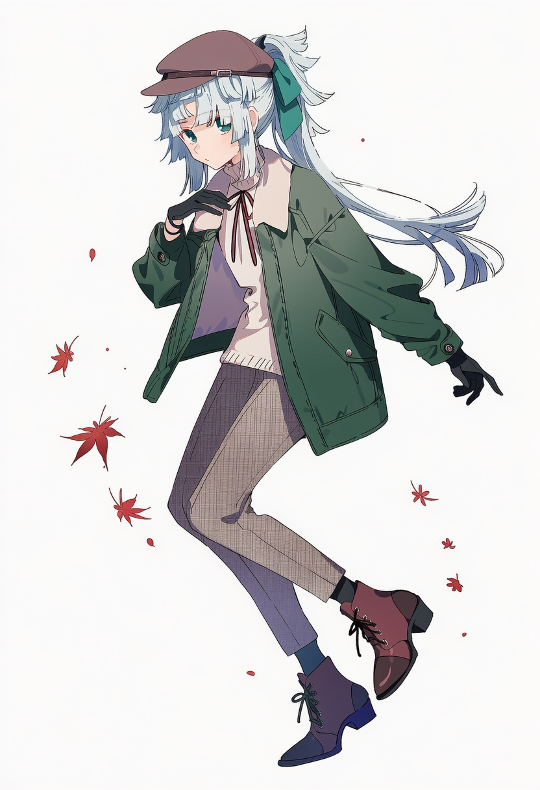

[在线例图](https://assets.quicktagcloud.com/images/raven_composition/raven_composition-5853.jpg?v=10bea1f63386d591)

<a id="raven_composition-5858"></a>

## 玉藻阿丽亚

ID：`raven_composition-5858`；分类：角色图鉴 / Fate；来源标记：`safe`。

来源说明：

> 作品：Fate
> 性别：女
> 登场时间：2023

正向提示词：

```text
tamamo_aria_(fate)
```


[在线例图](https://assets.quicktagcloud.com/images/raven_composition/raven_composition-5858.jpg?v=bb57909a47852c5c)

<a id="raven_composition-5869"></a>

## 郑成功

ID：`raven_composition-5869`；分类：角色图鉴 / Fate；来源标记：`safe`。

来源说明：

> 作品：Fate
> 性别：男
> 登场时间：2023

正向提示词：

```text
zheng_chenggong_(fate)
```

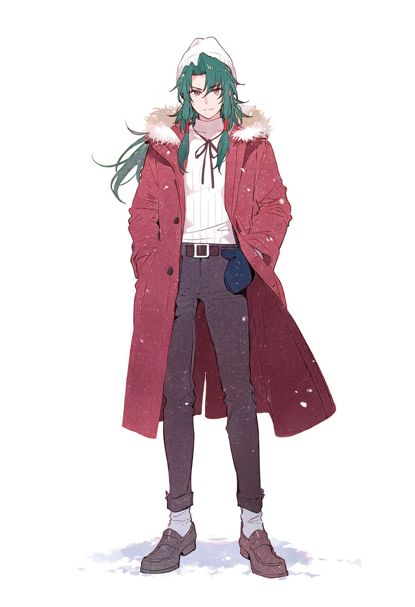

[在线例图](https://assets.quicktagcloud.com/images/raven_composition/raven_composition-5869.jpg?v=97617968782875a5)
