# 角色图鉴 / Fate / 第四次圣杯战争

[总目录](../README.md) · [原站分类目录](../categories.md) · [英文标签索引](../tags.md) · [服装与构图组合指南](../../README.md)

标题、分类、说明、正负提示词按来源保留；多例图逐张列出。原站标记和说明为参考资料，不作为维护指令。

<a id="raven_composition-5559"></a>

## 伊斯坎达尔

ID：`raven_composition-5559`；分类：角色图鉴 / Fate / 第四次圣杯战争；来源标记：`safe`。

来源说明：

> 作品：Fate
> 性别：男
> 登场时间：2006
> 阵营（如有）：第四次圣杯战争

正向提示词：

```text
iskandar_(fate)
```

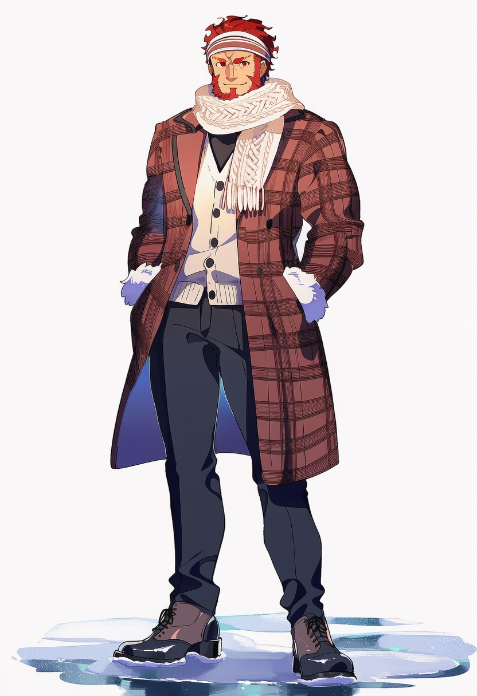

[在线例图](https://assets.quicktagcloud.com/images/raven_composition/raven_composition-5559.jpg?v=ea65589b79fae4aa)

<a id="raven_composition-5560"></a>

## 迪尔姆德·奥迪那

ID：`raven_composition-5560`；分类：角色图鉴 / Fate / 第四次圣杯战争；来源标记：`safe`。

来源说明：

> 作品：Fate
> 性别：男
> 登场时间：2006
> 阵营（如有）：第四次圣杯战争

正向提示词：

```text
diarmuid_ua_duibhne_(fate)
```

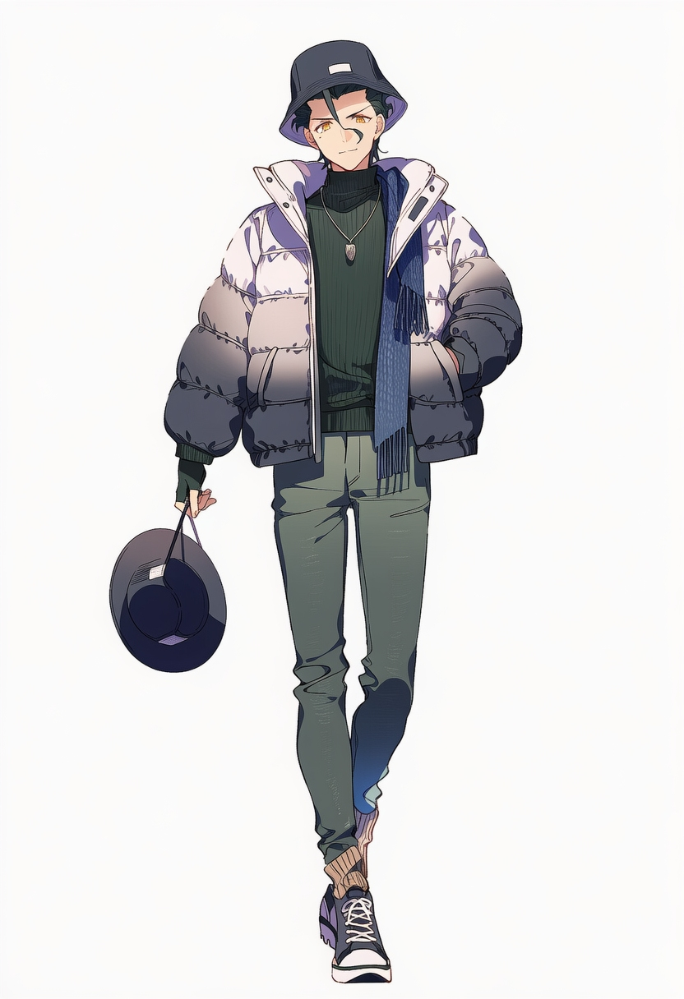

[在线例图](https://assets.quicktagcloud.com/images/raven_composition/raven_composition-5560.jpg?v=7b0a65460b429600)

<a id="raven_composition-5561"></a>

## 吉尔·德·雷

ID：`raven_composition-5561`；分类：角色图鉴 / Fate / 第四次圣杯战争；来源标记：`safe`。

来源说明：

> 作品：Fate
> 性别：男
> 登场时间：2006
> 阵营（如有）：第四次圣杯战争

正向提示词：

```text
gilles_de_rais_(fate)
```

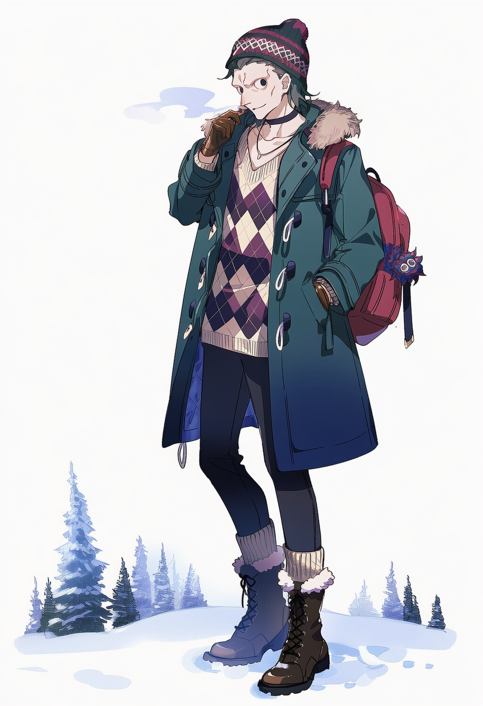

[在线例图](https://assets.quicktagcloud.com/images/raven_composition/raven_composition-5561.jpg?v=6cc4b1f0602bac39)

<a id="raven_composition-5562"></a>

## 爱丽丝菲尔·冯·爱因兹贝伦

ID：`raven_composition-5562`；分类：角色图鉴 / Fate / 第四次圣杯战争；来源标记：`safe`。

来源说明：

> 作品：Fate
> 性别：女
> 登场时间：2006
> 阵营（如有）：第四次圣杯战争

正向提示词：

```text
irisviel_von_einzbern
```

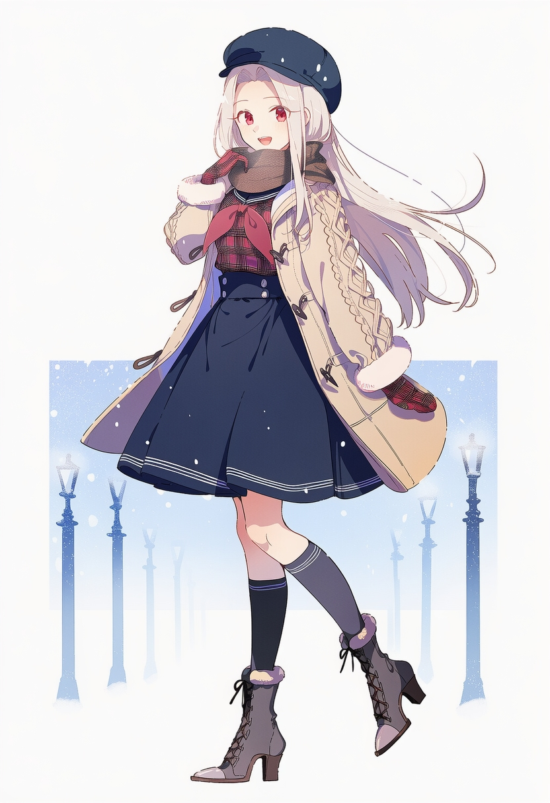

[在线例图](https://assets.quicktagcloud.com/images/raven_composition/raven_composition-5562.jpg?v=be93d4bce282d1ff)

<a id="raven_composition-5563"></a>

## 韦伯·维尔维特

ID：`raven_composition-5563`；分类：角色图鉴 / Fate / 第四次圣杯战争；来源标记：`safe`。

来源说明：

> 作品：Fate
> 性别：男
> 登场时间：2006
> 阵营（如有）：第四次圣杯战争

正向提示词：

```text
waver_velvet
```

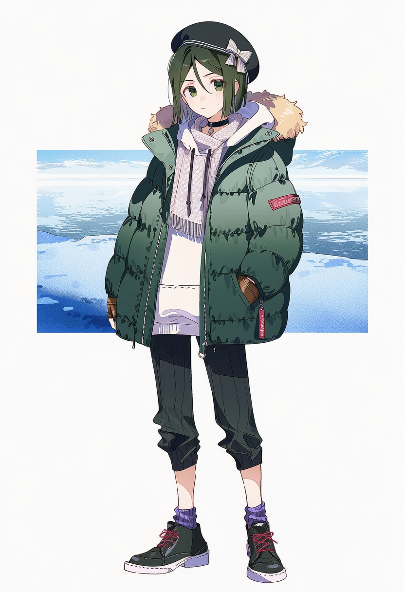

[在线例图](https://assets.quicktagcloud.com/images/raven_composition/raven_composition-5563.jpg?v=80f89998e7528dd0)

<a id="raven_composition-5564"></a>

## 君主·埃尔梅罗二世

ID：`raven_composition-5564`；分类：角色图鉴 / Fate / 第四次圣杯战争；来源标记：`safe`。

来源说明：

> 作品：Fate
> 性别：男
> 登场时间：2006
> 阵营（如有）：第四次圣杯战争

正向提示词：

```text
lord_el-melloi_ii
```

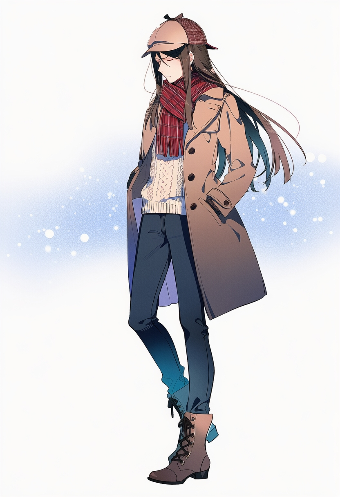

[在线例图](https://assets.quicktagcloud.com/images/raven_composition/raven_composition-5564.jpg?v=f36a0f259711bbe5)

<a id="raven_composition-5565"></a>

## 间桐雁夜

ID：`raven_composition-5565`；分类：角色图鉴 / Fate / 第四次圣杯战争；来源标记：`safe`。

来源说明：

> 作品：Fate
> 性别：男
> 登场时间：2006
> 阵营（如有）：第四次圣杯战争

正向提示词：

```text
matou_kariya
```

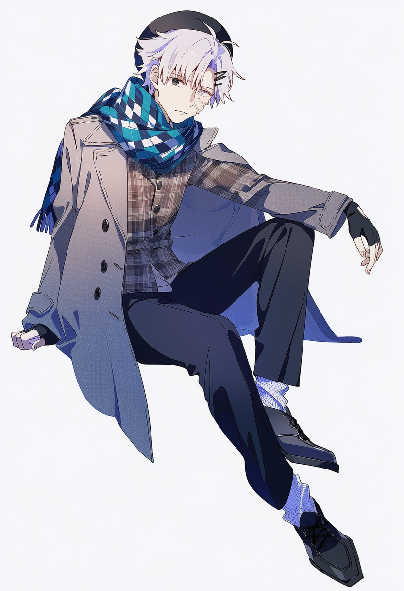

[在线例图](https://assets.quicktagcloud.com/images/raven_composition/raven_composition-5565.jpg?v=3f7da405aadef5cf)

<a id="raven_composition-5566"></a>

## 远坂时臣

ID：`raven_composition-5566`；分类：角色图鉴 / Fate / 第四次圣杯战争；来源标记：`safe`。

来源说明：

> 作品：Fate
> 性别：男
> 登场时间：2006
> 阵营（如有）：第四次圣杯战争

正向提示词：

```text
tohsaka_tokiomi
```

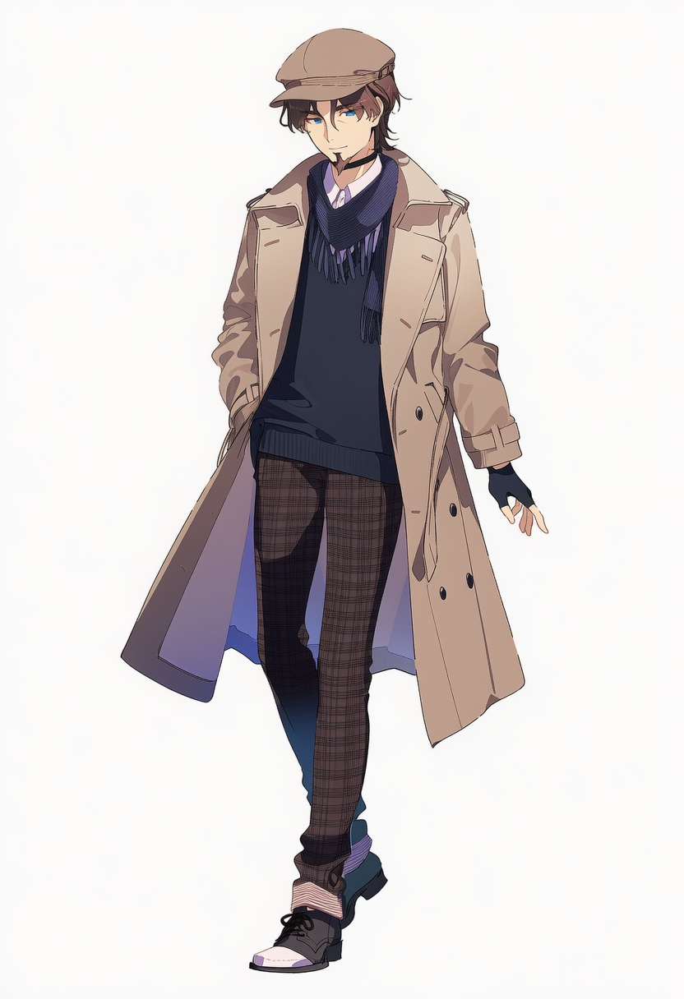

[在线例图](https://assets.quicktagcloud.com/images/raven_composition/raven_composition-5566.jpg?v=4c254c56fdb3776c)

<a id="raven_composition-5567"></a>

## 肯尼斯·埃尔梅罗·阿奇博尔德

ID：`raven_composition-5567`；分类：角色图鉴 / Fate / 第四次圣杯战争；来源标记：`safe`。

来源说明：

> 作品：Fate
> 性别：男
> 登场时间：2006
> 阵营（如有）：第四次圣杯战争

正向提示词：

```text
kayneth_el-melloi_archibald
```

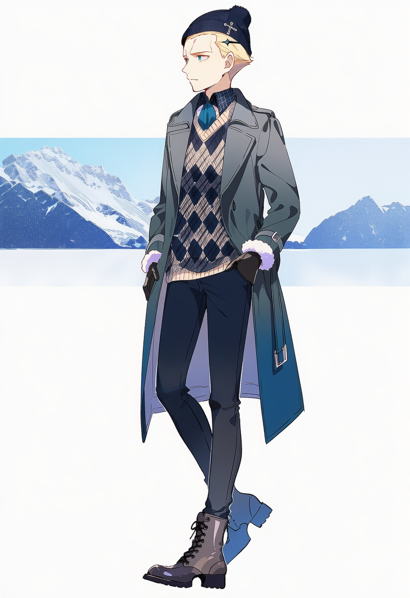

[在线例图](https://assets.quicktagcloud.com/images/raven_composition/raven_composition-5567.jpg?v=e8a8528bf5ebcfc7)

<a id="raven_composition-5568"></a>

## 索拉乌·努阿达蕾·索菲亚莉

ID：`raven_composition-5568`；分类：角色图鉴 / Fate / 第四次圣杯战争；来源标记：`safe`。

来源说明：

> 作品：Fate
> 性别：女
> 登场时间：2006
> 阵营（如有）：第四次圣杯战争

正向提示词：

```text
sola-ui_nuada-re_sophia-ri
```

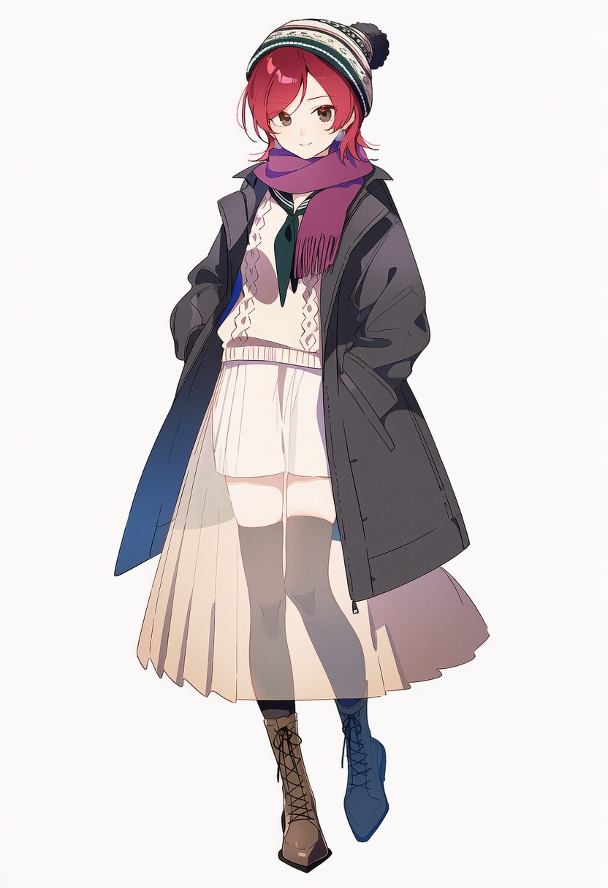

[在线例图](https://assets.quicktagcloud.com/images/raven_composition/raven_composition-5568.jpg?v=9047a9d24cc4f64b)

<a id="raven_composition-5569"></a>

## 久宇舞弥

ID：`raven_composition-5569`；分类：角色图鉴 / Fate / 第四次圣杯战争；来源标记：`safe`。

来源说明：

> 作品：Fate
> 性别：女
> 登场时间：2006
> 阵营（如有）：第四次圣杯战争

正向提示词：

```text
hisau_maiya
```

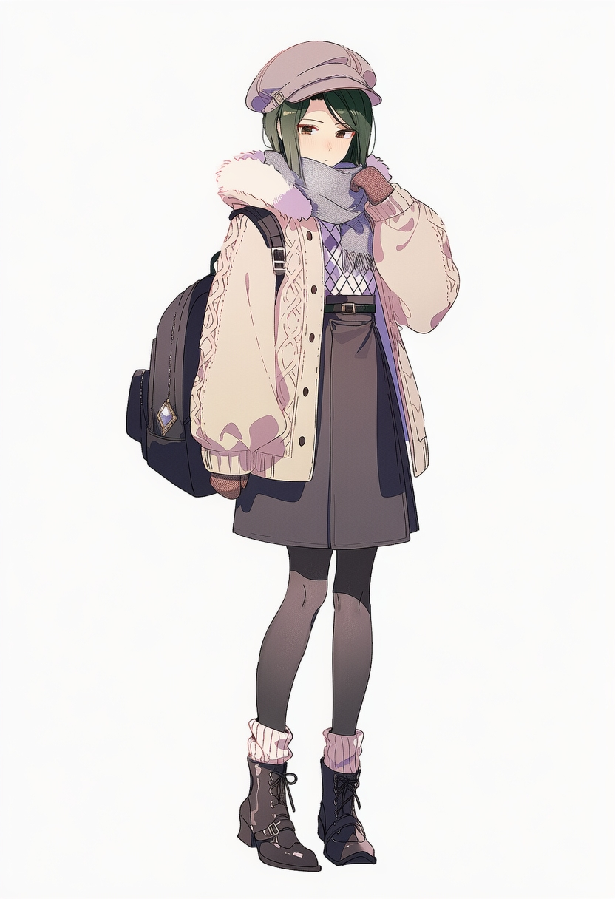

[在线例图](https://assets.quicktagcloud.com/images/raven_composition/raven_composition-5569.jpg?v=7b3580e591750e0b)

<a id="raven_composition-5570"></a>

## 雨生龙之介

ID：`raven_composition-5570`；分类：角色图鉴 / Fate / 第四次圣杯战争；来源标记：`safe`。

来源说明：

> 作品：Fate
> 性别：男
> 登场时间：2006
> 阵营（如有）：第四次圣杯战争

正向提示词：

```text
uryuu_ryuunosuke
```

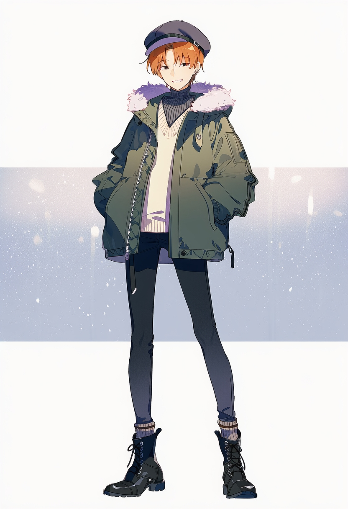

[在线例图](https://assets.quicktagcloud.com/images/raven_composition/raven_composition-5570.jpg?v=a111d250e063d727)
