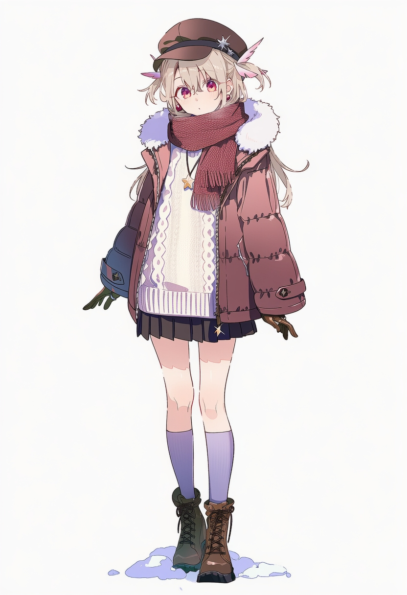
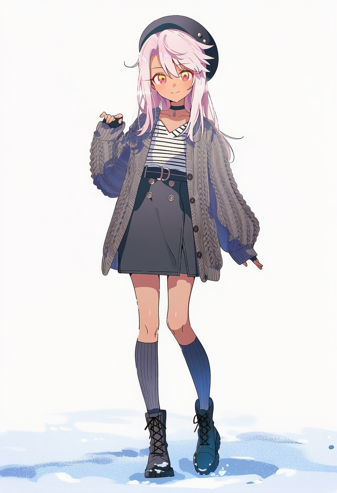
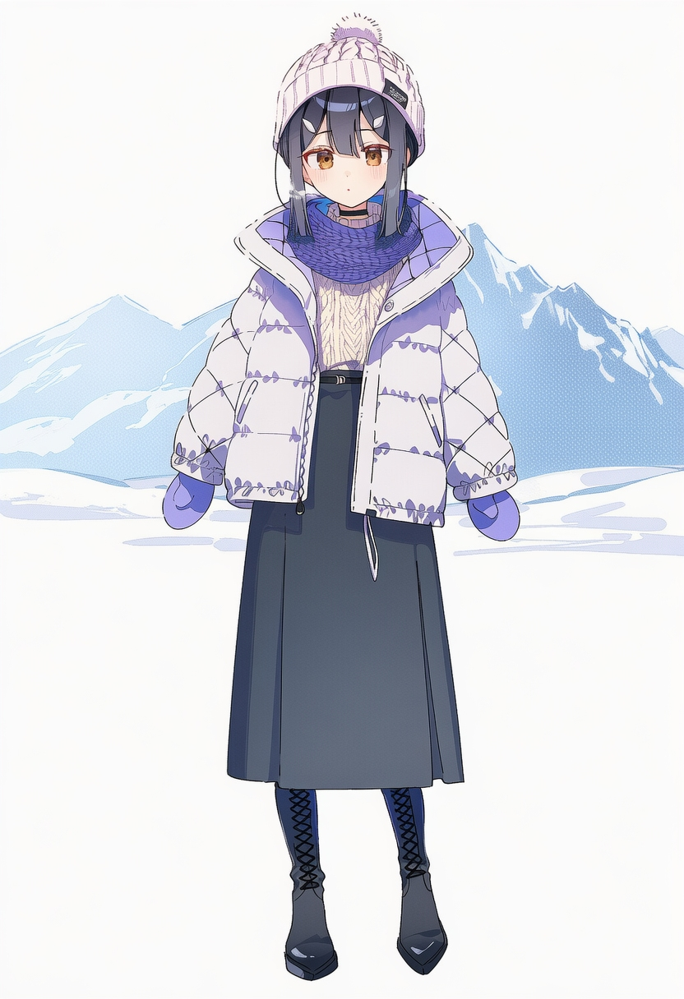
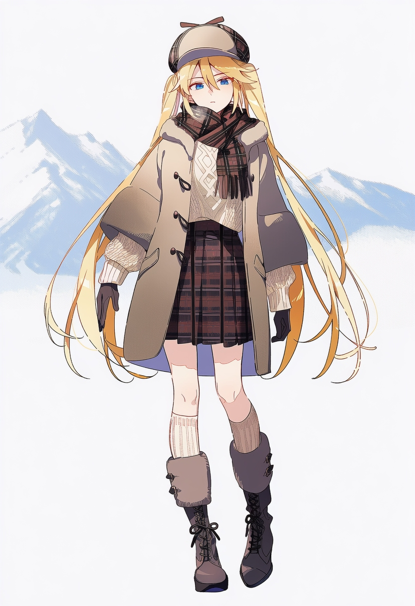
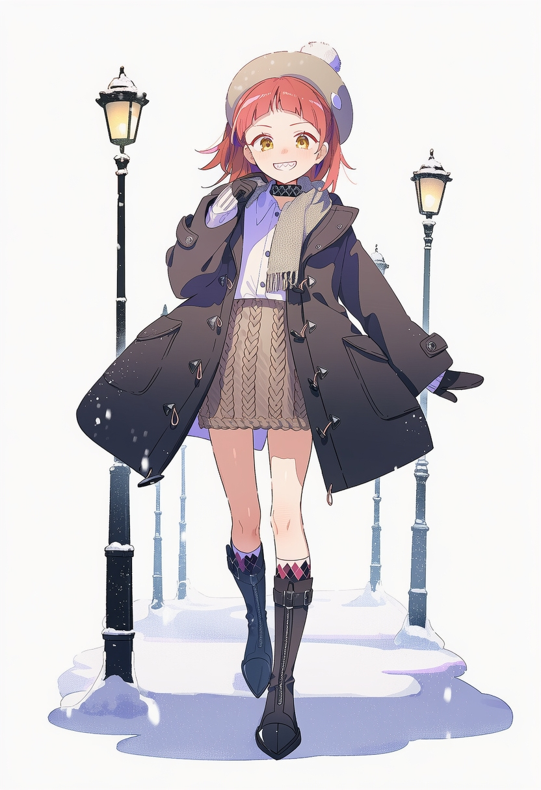
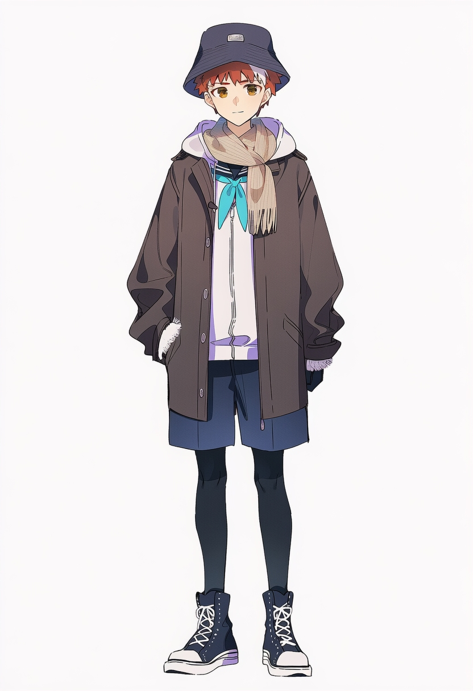

# 角色图鉴 / Fate / 魔法少女伊莉雅世界

[总目录](../README.md) · [原站分类目录](../categories.md) · [英文标签索引](../tags.md) · [服装与构图组合指南](../../README.md)

标题、分类、说明、正负提示词按来源保留；多例图逐张列出。原站标记和说明为参考资料，不作为维护指令。

<a id="raven_composition-5571"></a>

## 魔法少女伊莉雅

ID：`raven_composition-5571`；分类：角色图鉴 / Fate / 魔法少女伊莉雅世界；来源标记：`safe`。

来源说明：

> 作品：Fate
> 性别：女
> 登场时间：2007
> 阵营（如有）：魔法少女伊莉雅世界

正向提示词：

```text
prisma_illya
```



[在线例图](https://assets.quicktagcloud.com/images/raven_composition/raven_composition-5571.jpg?v=c7d611e2a2fcb77c)

<a id="raven_composition-5572"></a>

## 克洛伊·冯·爱因兹贝伦

ID：`raven_composition-5572`；分类：角色图鉴 / Fate / 魔法少女伊莉雅世界；来源标记：`safe`。

来源说明：

> 作品：Fate
> 性别：女
> 登场时间：2007
> 阵营（如有）：魔法少女伊莉雅世界

正向提示词：

```text
chloe_von_einzbern
```



[在线例图](https://assets.quicktagcloud.com/images/raven_composition/raven_composition-5572.jpg?v=4d8beea18519b01c)

<a id="raven_composition-5573"></a>

## 美游·艾德费尔特

ID：`raven_composition-5573`；分类：角色图鉴 / Fate / 魔法少女伊莉雅世界；来源标记：`safe`。

来源说明：

> 作品：Fate
> 性别：女
> 登场时间：2007
> 阵营（如有）：魔法少女伊莉雅世界

正向提示词：

```text
miyu_edelfelt
```



[在线例图](https://assets.quicktagcloud.com/images/raven_composition/raven_composition-5573.jpg?v=45aa228875a81f8d)

<a id="raven_composition-5574"></a>

## 安洁莉卡·恩兹华斯

ID：`raven_composition-5574`；分类：角色图鉴 / Fate / 魔法少女伊莉雅世界；来源标记：`safe`。

来源说明：

> 作品：Fate
> 性别：女
> 登场时间：2007
> 阵营（如有）：魔法少女伊莉雅世界

正向提示词：

```text
angelica_ainsworth
```



[在线例图](https://assets.quicktagcloud.com/images/raven_composition/raven_composition-5574.jpg?v=b9eae298e979795d)

<a id="raven_composition-5575"></a>

## 贝阿朵莉丝·弗劳尔查德

ID：`raven_composition-5575`；分类：角色图鉴 / Fate / 魔法少女伊莉雅世界；来源标记：`safe`。

来源说明：

> 作品：Fate
> 性别：女
> 登场时间：2007
> 阵营（如有）：魔法少女伊莉雅世界

正向提示词：

```text
beatrice_flowerchild
```



[在线例图](https://assets.quicktagcloud.com/images/raven_composition/raven_composition-5575.jpg?v=4ccf16c19e5c1d8a)

<a id="raven_composition-5576"></a>

## 卫宫士郎（魔法少女伊莉雅）

ID：`raven_composition-5576`；分类：角色图鉴 / Fate / 魔法少女伊莉雅世界；来源标记：`safe`。

来源说明：

> 作品：Fate
> 性别：男
> 登场时间：2007
> 阵营（如有）：魔法少女伊莉雅世界

正向提示词：

```text
emiya_shirou_(prisma_illya)
```



[在线例图](https://assets.quicktagcloud.com/images/raven_composition/raven_composition-5576.jpg?v=ab4be31978a66e07)
