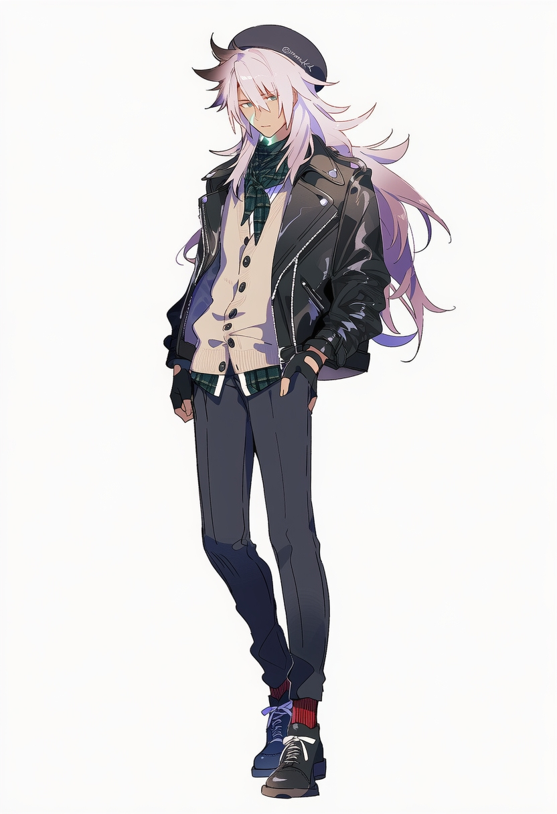
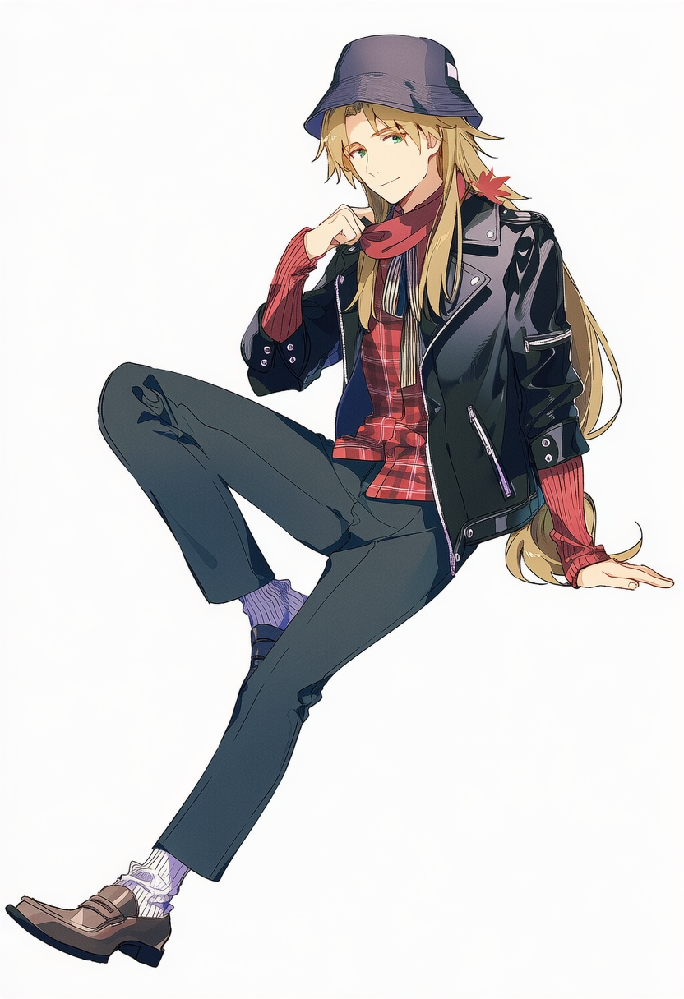
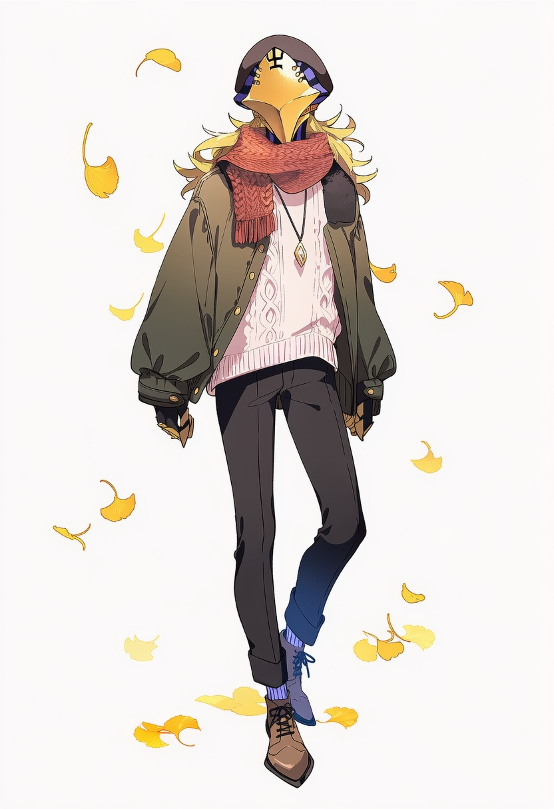
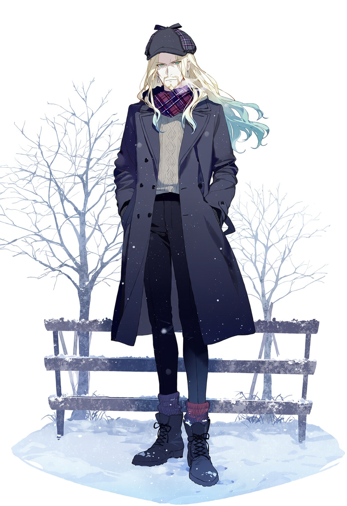

# 角色图鉴 / Fate / 黑方

[总目录](../README.md) · [原站分类目录](../categories.md) · [英文标签索引](../tags.md) · [服装与构图组合指南](../../README.md)

标题、分类、说明、正负提示词按来源保留；多例图逐张列出。原站标记和说明为参考资料，不作为维护指令。

<a id="raven_composition-5592"></a>

## 阿斯托尔福

ID：`raven_composition-5592`；分类：角色图鉴 / Fate / 黑方；来源标记：`safe`。

来源说明：

> 作品：Fate
> 性别：男
> 登场时间：2012
> 阵营（如有）：黑方

正向提示词：

```text
astolfo_(fate)
```


[在线例图](https://assets.quicktagcloud.com/images/raven_composition/raven_composition-5592.jpg?v=d97721ba657e15ac)

<a id="raven_composition-5600"></a>

## 弗兰肯斯坦

ID：`raven_composition-5600`；分类：角色图鉴 / Fate / 黑方；来源标记：`safe`。

来源说明：

> 作品：Fate
> 性别：女
> 登场时间：2012
> 阵营（如有）：黑方

正向提示词：

```text
frankenstein's_monster_(fate)
```


[在线例图](https://assets.quicktagcloud.com/images/raven_composition/raven_composition-5600.jpg?v=467144302953d61b)

<a id="raven_composition-5609"></a>

## 齐格飞

ID：`raven_composition-5609`；分类：角色图鉴 / Fate / 黑方；来源标记：`safe`。

来源说明：

> 作品：Fate
> 性别：男
> 登场时间：2012
> 阵营（如有）：黑方

正向提示词：

```text
siegfried_(fate)
```



[在线例图](https://assets.quicktagcloud.com/images/raven_composition/raven_composition-5609.jpg?v=caf2ed3802aadba1)

<a id="raven_composition-5611"></a>

## 喀戎

ID：`raven_composition-5611`；分类：角色图鉴 / Fate / 黑方；来源标记：`safe`。

来源说明：

> 作品：Fate
> 性别：男
> 登场时间：2012
> 阵营（如有）：黑方

正向提示词：

```text
chiron_(fate)
```



[在线例图](https://assets.quicktagcloud.com/images/raven_composition/raven_composition-5611.jpg?v=8d405f870fe50b4e)

<a id="raven_composition-5614"></a>

## 阿维斯布隆

ID：`raven_composition-5614`；分类：角色图鉴 / Fate / 黑方；来源标记：`safe`。

来源说明：

> 作品：Fate
> 性别：男
> 登场时间：2012
> 阵营（如有）：黑方

正向提示词：

```text
avicebron_(fate)
```



[在线例图](https://assets.quicktagcloud.com/images/raven_composition/raven_composition-5614.jpg?v=805f9b0ef73fd92d)

<a id="raven_composition-5617"></a>

## 弗拉德三世

ID：`raven_composition-5617`；分类：角色图鉴 / Fate / 黑方；来源标记：`safe`。

来源说明：

> 作品：Fate
> 性别：男
> 登场时间：2012
> 阵营（如有）：黑方

正向提示词：

```text
vlad_iii_(fate/apocrypha)
```



[在线例图](https://assets.quicktagcloud.com/images/raven_composition/raven_composition-5617.jpg?v=b434318a39febfa9)
