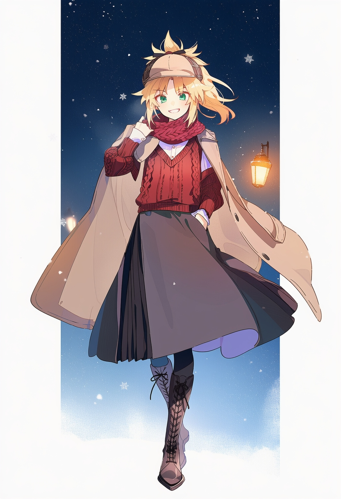
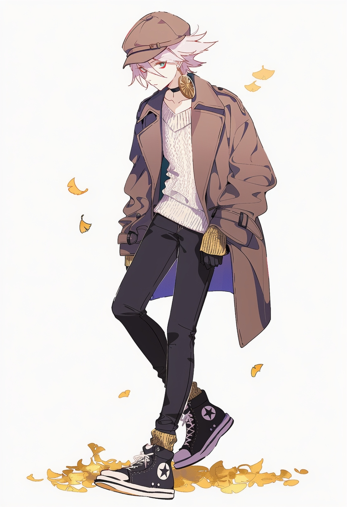
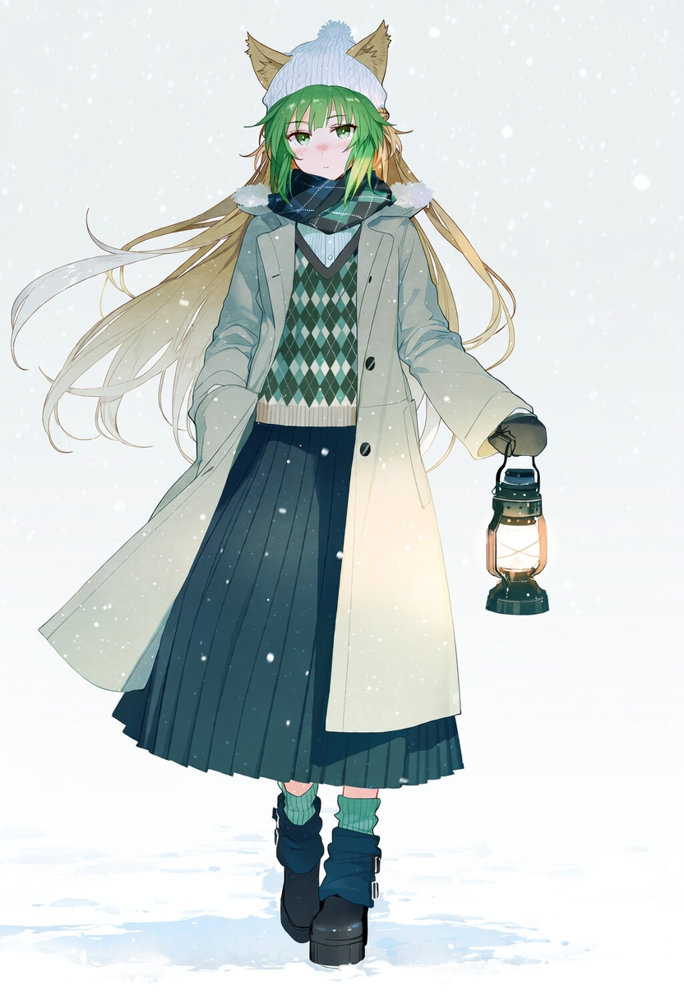
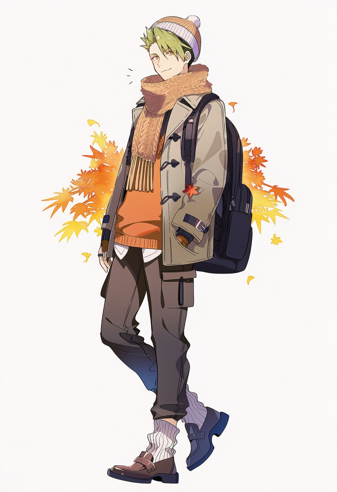
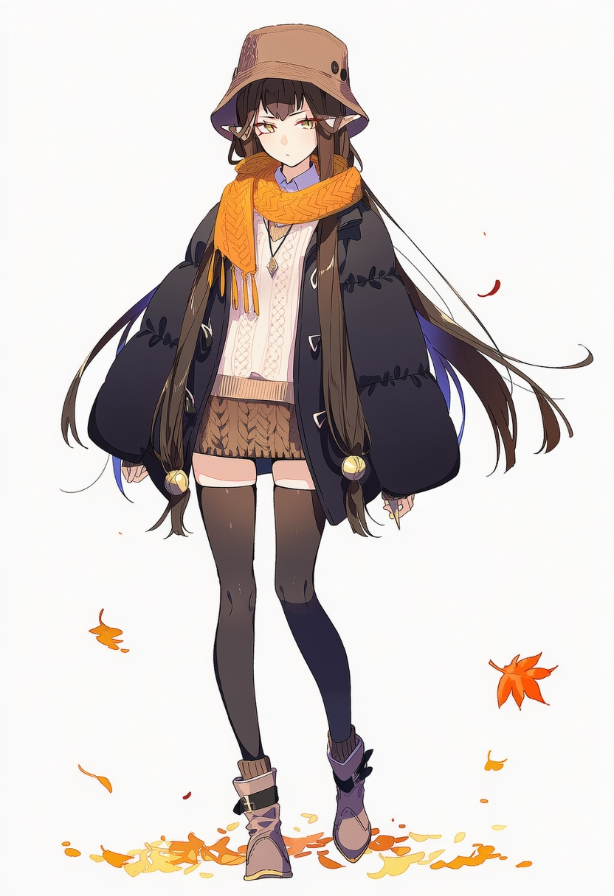
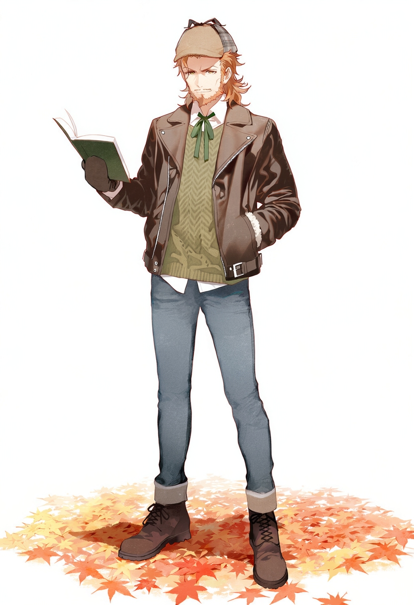
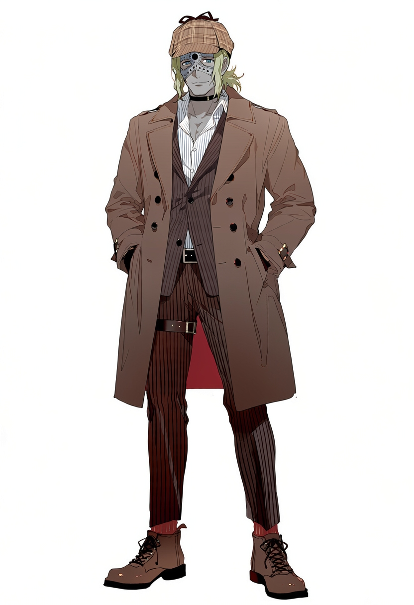

# 角色图鉴 / Fate / 红方

[总目录](../README.md) · [原站分类目录](../categories.md) · [英文标签索引](../tags.md) · [服装与构图组合指南](../../README.md)

标题、分类、说明、正负提示词按来源保留；多例图逐张列出。原站标记和说明为参考资料，不作为维护指令。

<a id="raven_composition-5593"></a>

## 莫德雷德

ID：`raven_composition-5593`；分类：角色图鉴 / Fate / 红方；来源标记：`safe`。

来源说明：

> 作品：Fate
> 性别：女
> 登场时间：2012
> 阵营（如有）：红方

正向提示词：

```text
mordred_(fate)
```



[在线例图](https://assets.quicktagcloud.com/images/raven_composition/raven_composition-5593.jpg?v=d2b968c1069e98d7)

<a id="raven_composition-5596"></a>

## 迦尔纳

ID：`raven_composition-5596`；分类：角色图鉴 / Fate / 红方；来源标记：`safe`。

来源说明：

> 作品：Fate
> 性别：男
> 登场时间：2012
> 阵营（如有）：红方

正向提示词：

```text
karna_(fate)
```



[在线例图](https://assets.quicktagcloud.com/images/raven_composition/raven_composition-5596.jpg?v=6c7b6cf8d6484447)

<a id="raven_composition-5597"></a>

## 阿塔兰忒

ID：`raven_composition-5597`；分类：角色图鉴 / Fate / 红方；来源标记：`safe`。

来源说明：

> 作品：Fate
> 性别：女
> 登场时间：2012
> 阵营（如有）：红方

正向提示词：

```text
atalanta_(fate)
```



[在线例图](https://assets.quicktagcloud.com/images/raven_composition/raven_composition-5597.jpg?v=b243b8ff0199e705)

<a id="raven_composition-5602"></a>

## 阿喀琉斯

ID：`raven_composition-5602`；分类：角色图鉴 / Fate / 红方；来源标记：`safe`。

来源说明：

> 作品：Fate
> 性别：男
> 登场时间：2012
> 阵营（如有）：红方

正向提示词：

```text
achilles_(fate)
```



[在线例图](https://assets.quicktagcloud.com/images/raven_composition/raven_composition-5602.jpg?v=7b7af15634ea2e73)

<a id="raven_composition-5604"></a>

## 塞弥拉弥斯

ID：`raven_composition-5604`；分类：角色图鉴 / Fate / 红方；来源标记：`safe`。

来源说明：

> 作品：Fate
> 性别：女
> 登场时间：2012
> 阵营（如有）：红方

正向提示词：

```text
semiramis_(fate)
```



[在线例图](https://assets.quicktagcloud.com/images/raven_composition/raven_composition-5604.jpg?v=f9cbeac2cd1413a1)

<a id="raven_composition-5615"></a>

## 威廉·莎士比亚

ID：`raven_composition-5615`；分类：角色图鉴 / Fate / 红方；来源标记：`safe`。

来源说明：

> 作品：Fate
> 性别：男
> 登场时间：2012
> 阵营（如有）：红方

正向提示词：

```text
william_shakespeare_(fate)
```



[在线例图](https://assets.quicktagcloud.com/images/raven_composition/raven_composition-5615.jpg?v=7cdbdd49b36bf618)

<a id="raven_composition-5618"></a>

## 斯巴达克斯

ID：`raven_composition-5618`；分类：角色图鉴 / Fate / 红方；来源标记：`safe`。

来源说明：

> 作品：Fate
> 性别：男
> 登场时间：2012
> 阵营（如有）：红方

正向提示词：

```text
spartacus_(fate)
```



[在线例图](https://assets.quicktagcloud.com/images/raven_composition/raven_composition-5618.jpg?v=ef55869bc986905b)
