# 角色图鉴 / Fate / FGO

[总目录](../README.md) · [原站分类目录](../categories.md) · [英文标签索引](../tags.md) · [服装与构图组合指南](../../README.md)

标题、分类、说明、正负提示词按来源保留；多例图逐张列出。原站标记和说明为参考资料，不作为维护指令。

<a id="raven_composition-5639"></a>

## 贞德〔Alter〕

ID：`raven_composition-5639`；分类：角色图鉴 / Fate / FGO；来源标记：`safe`。

来源说明：

> 作品：Fate
> 性别：女
> 登场时间：2015
> 阵营（如有）：FGO

正向提示词：

```text
jeanne_d'arc_alter_(fate)
```

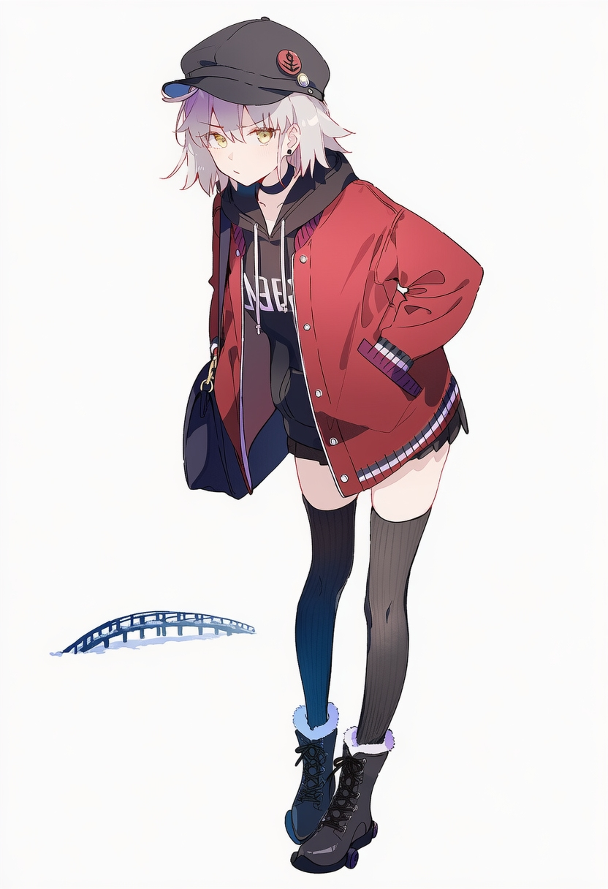

[在线例图](https://assets.quicktagcloud.com/images/raven_composition/raven_composition-5639.jpg?v=590d011174b9a172)

<a id="raven_composition-5640"></a>

## 斯卡哈

ID：`raven_composition-5640`；分类：角色图鉴 / Fate / FGO；来源标记：`safe`。

来源说明：

> 作品：Fate
> 性别：女
> 登场时间：2015
> 阵营（如有）：FGO

正向提示词：

```text
scathach_(fate)
```

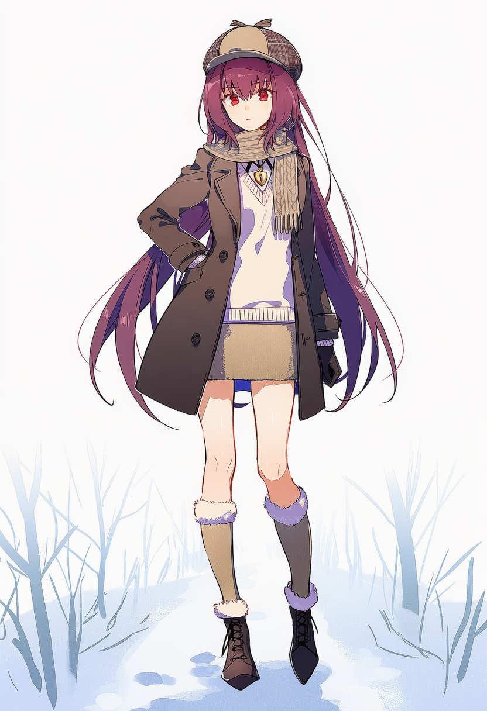

[在线例图](https://assets.quicktagcloud.com/images/raven_composition/raven_composition-5640.jpg?v=781fbbb81e11d6a5)

<a id="raven_composition-5641"></a>

## 酒吞童子

ID：`raven_composition-5641`；分类：角色图鉴 / Fate / FGO；来源标记：`safe`。

来源说明：

> 作品：Fate
> 性别：女
> 登场时间：2015
> 阵营（如有）：FGO

正向提示词：

```text
shuten_douji_(fate)
```


[在线例图](https://assets.quicktagcloud.com/images/raven_composition/raven_composition-5641.jpg?v=f05363a0b577b541)

<a id="raven_composition-5642"></a>

## 源赖光

ID：`raven_composition-5642`；分类：角色图鉴 / Fate / FGO；来源标记：`safe`。

来源说明：

> 作品：Fate
> 性别：女
> 登场时间：2015
> 阵营（如有）：FGO

正向提示词：

```text
minamoto_no_raikou_(fate)
```

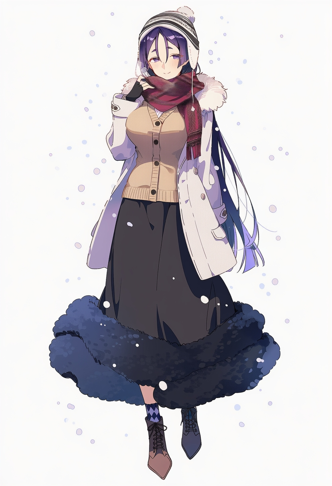

[在线例图](https://assets.quicktagcloud.com/images/raven_composition/raven_composition-5642.jpg?v=9def1ecf70750646)

<a id="raven_composition-5643"></a>

## 埃列什基伽勒

ID：`raven_composition-5643`；分类：角色图鉴 / Fate / FGO；来源标记：`safe`。

来源说明：

> 作品：Fate
> 性别：女
> 登场时间：2015
> 阵营（如有）：FGO

正向提示词：

```text
ereshkigal_(fate)
```


[在线例图](https://assets.quicktagcloud.com/images/raven_composition/raven_composition-5643.jpg?v=d2127631a4f20031)

<a id="raven_composition-5644"></a>

## 伊什塔尔

ID：`raven_composition-5644`；分类：角色图鉴 / Fate / FGO；来源标记：`safe`。

来源说明：

> 作品：Fate
> 性别：女
> 登场时间：2015
> 阵营（如有）：FGO

正向提示词：

```text
ishtar_(fate)
```

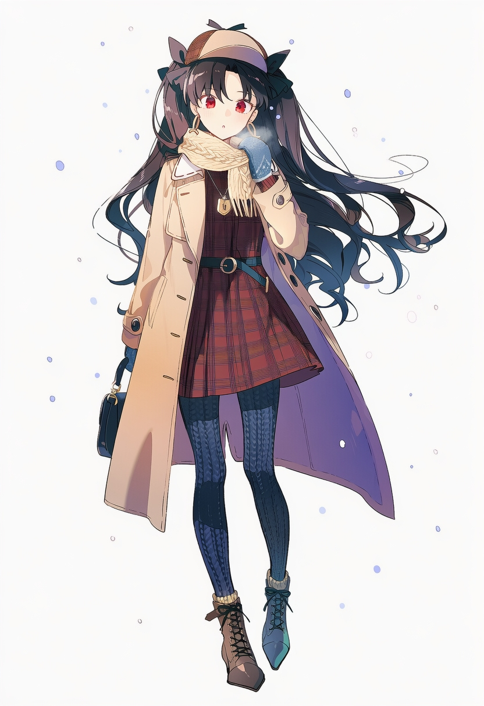

[在线例图](https://assets.quicktagcloud.com/images/raven_composition/raven_composition-5644.jpg?v=fdd96d4a36ac8249)

<a id="raven_composition-5645"></a>

## 南丁格尔

ID：`raven_composition-5645`；分类：角色图鉴 / Fate / FGO；来源标记：`safe`。

来源说明：

> 作品：Fate
> 性别：女
> 登场时间：2015
> 阵营（如有）：FGO

正向提示词：

```text
florence_nightingale_(fate)
```

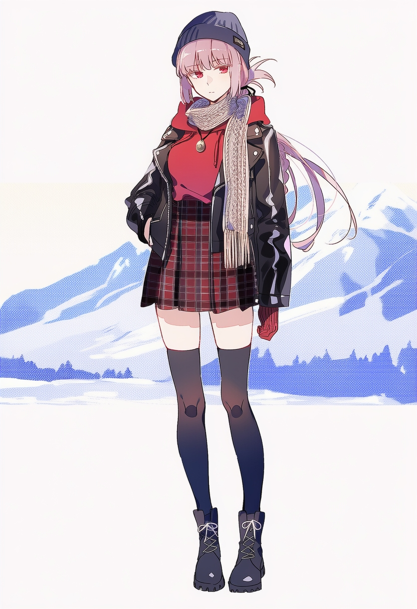

[在线例图](https://assets.quicktagcloud.com/images/raven_composition/raven_composition-5645.jpg?v=71ee36ab1ec7426a)

<a id="raven_composition-5646"></a>

## 尼托克丽丝

ID：`raven_composition-5646`；分类：角色图鉴 / Fate / FGO；来源标记：`safe`。

来源说明：

> 作品：Fate
> 性别：女
> 登场时间：2015
> 阵营（如有）：FGO

正向提示词：

```text
nitocris_(fate)
```

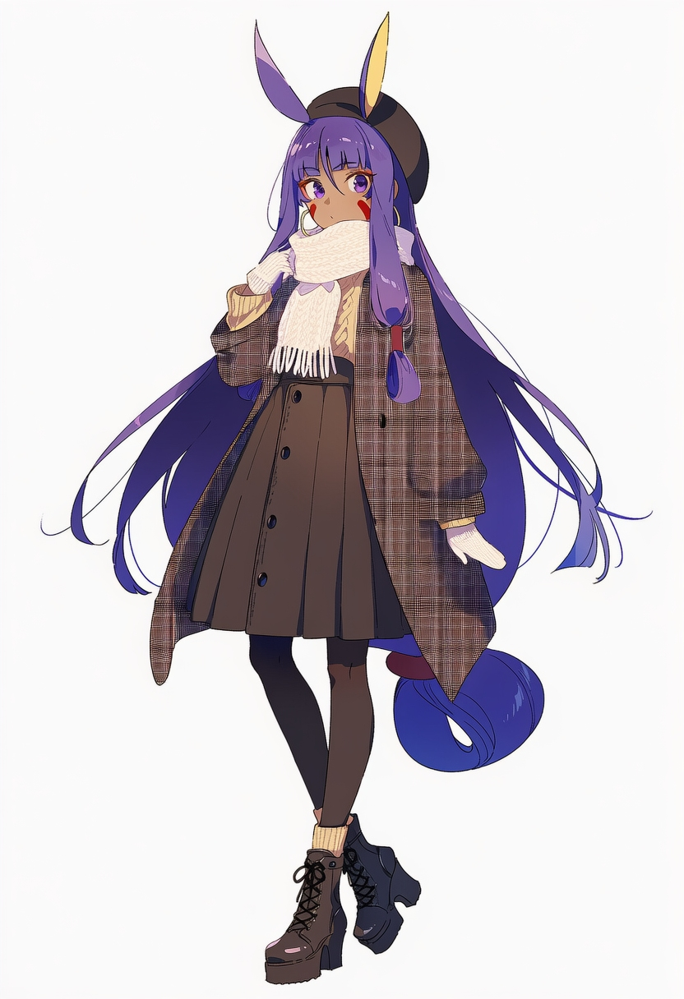

[在线例图](https://assets.quicktagcloud.com/images/raven_composition/raven_composition-5646.jpg?v=9c2921d65a928dfa)

<a id="raven_composition-5647"></a>

## 清姬

ID：`raven_composition-5647`；分类：角色图鉴 / Fate / FGO；来源标记：`safe`。

来源说明：

> 作品：Fate
> 性别：女
> 登场时间：2015
> 阵营（如有）：FGO

正向提示词：

```text
kiyohime_(fate)
```

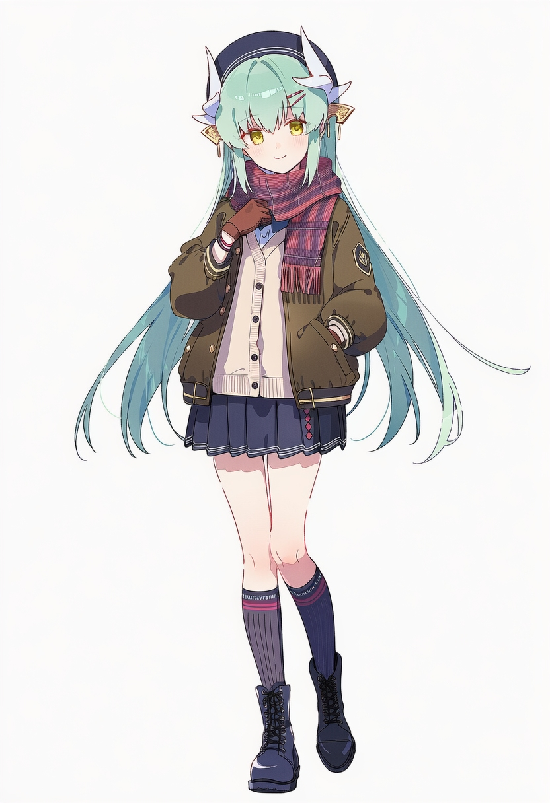

[在线例图](https://assets.quicktagcloud.com/images/raven_composition/raven_composition-5647.jpg?v=5ef81da15e8e4b3c)

<a id="raven_composition-5648"></a>

## 玉藻猫

ID：`raven_composition-5648`；分类：角色图鉴 / Fate / FGO；来源标记：`safe`。

来源说明：

> 作品：Fate
> 性别：女
> 登场时间：2015
> 阵营（如有）：FGO

正向提示词：

```text
tamamo_cat_(fate)
```

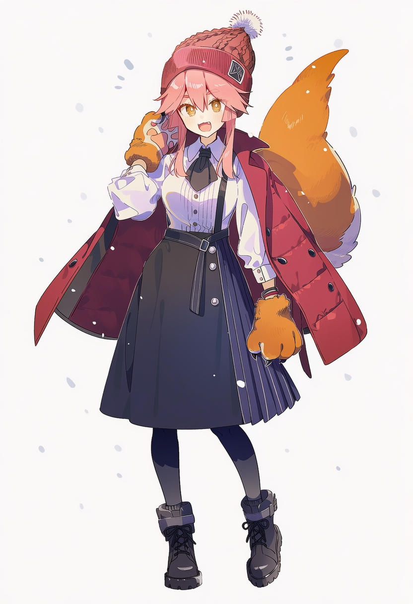

[在线例图](https://assets.quicktagcloud.com/images/raven_composition/raven_composition-5648.jpg?v=81fe35b1ca75f376)

<a id="raven_composition-5650"></a>

## 茨木童子

ID：`raven_composition-5650`；分类：角色图鉴 / Fate / FGO；来源标记：`safe`。

来源说明：

> 作品：Fate
> 性别：女
> 登场时间：2015
> 阵营（如有）：FGO

正向提示词：

```text
ibaraki_douji_(fate)
```

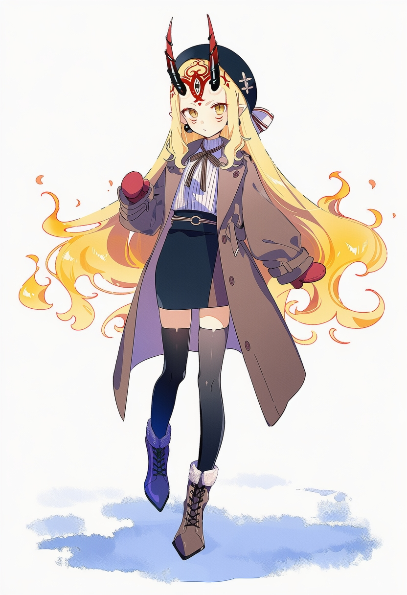

[在线例图](https://assets.quicktagcloud.com/images/raven_composition/raven_composition-5650.jpg?v=3849817725e5d343)

<a id="raven_composition-5652"></a>

## 牛若丸

ID：`raven_composition-5652`；分类：角色图鉴 / Fate / FGO；来源标记：`safe`。

来源说明：

> 作品：Fate
> 性别：女
> 登场时间：2015
> 阵营（如有）：FGO

正向提示词：

```text
ushiwakamaru_(fate)
```

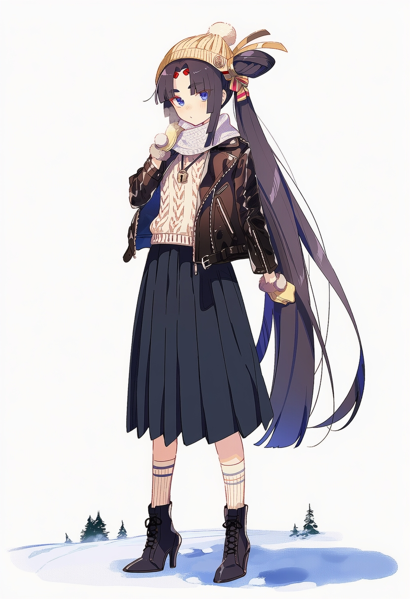

[在线例图](https://assets.quicktagcloud.com/images/raven_composition/raven_composition-5652.jpg?v=edee502ea9ac2168)

<a id="raven_composition-5654"></a>

## 玛丽·安托瓦内特

ID：`raven_composition-5654`；分类：角色图鉴 / Fate / FGO；来源标记：`safe`。

来源说明：

> 作品：Fate
> 性别：女
> 登场时间：2015
> 阵营（如有）：FGO

正向提示词：

```text
marie_antoinette_(fate)
```

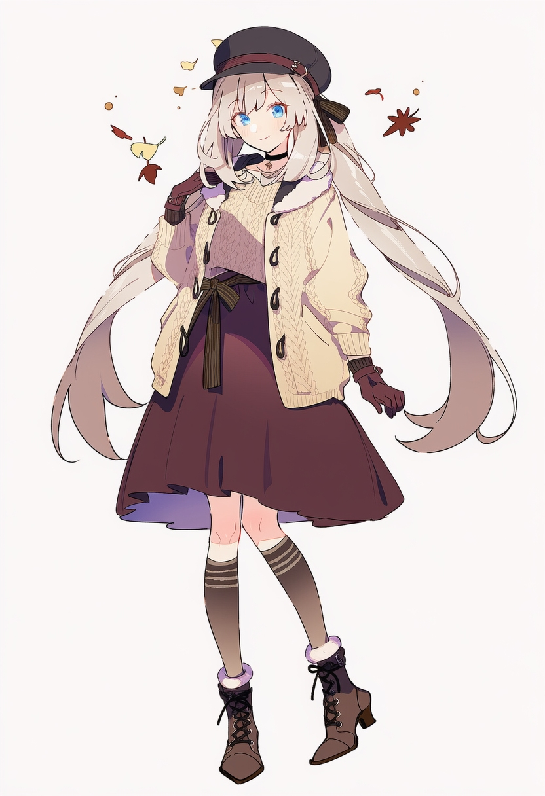

[在线例图](https://assets.quicktagcloud.com/images/raven_composition/raven_composition-5654.jpg?v=9c701879c9a1cbb7)

<a id="raven_composition-5655"></a>

## 贞德·Alter·Santa·Lily

ID：`raven_composition-5655`；分类：角色图鉴 / Fate / FGO；来源标记：`safe`。

来源说明：

> 作品：Fate
> 性别：女
> 登场时间：2015
> 阵营（如有）：FGO

正向提示词：

```text
jeanne_d'arc_alter_santa_lily_(fate)
```

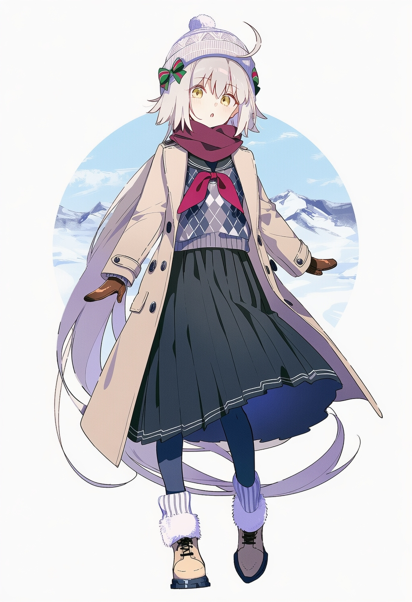

[在线例图](https://assets.quicktagcloud.com/images/raven_composition/raven_composition-5655.jpg?v=490600610286a8c4)

<a id="raven_composition-5656"></a>

## 玛尔达

ID：`raven_composition-5656`；分类：角色图鉴 / Fate / FGO；来源标记：`safe`。

来源说明：

> 作品：Fate
> 性别：女
> 登场时间：2015
> 阵营（如有）：FGO

正向提示词：

```text
martha_(fate)
```

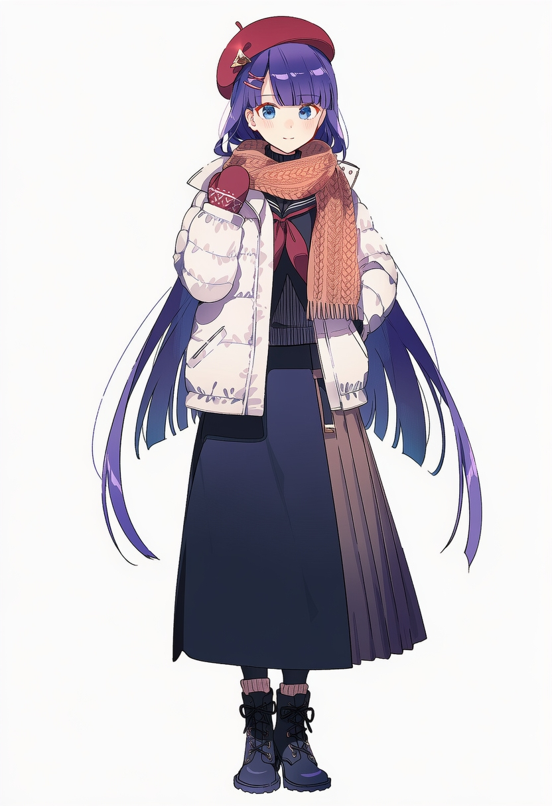

[在线例图](https://assets.quicktagcloud.com/images/raven_composition/raven_composition-5656.jpg?v=30e9f7fe3bfb305d)

<a id="raven_composition-5657"></a>

## 海伦娜·布拉瓦茨基

ID：`raven_composition-5657`；分类：角色图鉴 / Fate / FGO；来源标记：`safe`。

来源说明：

> 作品：Fate
> 性别：女
> 登场时间：2015
> 阵营（如有）：FGO

正向提示词：

```text
helena_blavatsky_(fate)
```

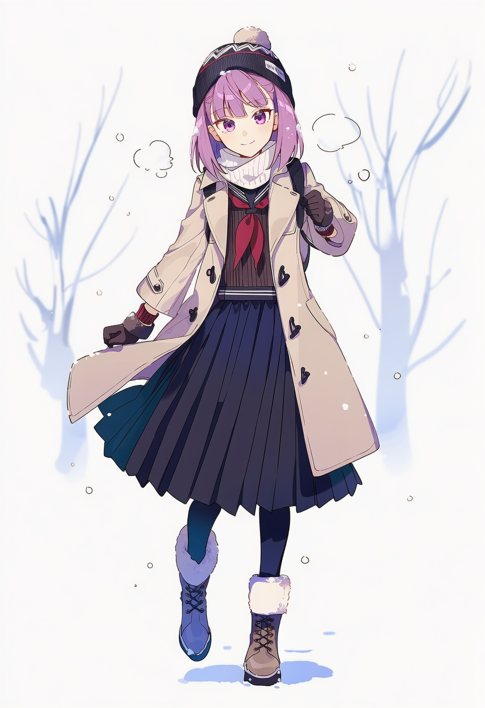

[在线例图](https://assets.quicktagcloud.com/images/raven_composition/raven_composition-5657.jpg?v=09c5b3db4c1ff48b)

<a id="raven_composition-5658"></a>

## 阿周那

ID：`raven_composition-5658`；分类：角色图鉴 / Fate / FGO；来源标记：`safe`。

来源说明：

> 作品：Fate
> 性别：男
> 登场时间：2015
> 阵营（如有）：FGO

正向提示词：

```text
arjuna_(fate)
```

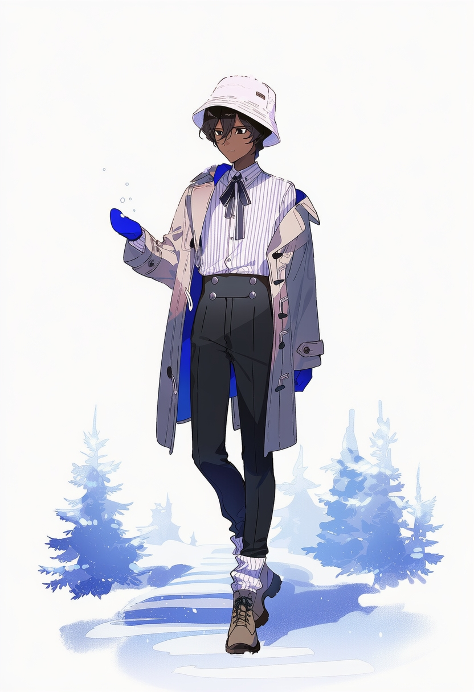

[在线例图](https://assets.quicktagcloud.com/images/raven_composition/raven_composition-5658.jpg?v=b8686bab2dd5ca37)

<a id="raven_composition-5659"></a>

## 布狄卡

ID：`raven_composition-5659`；分类：角色图鉴 / Fate / FGO；来源标记：`safe`。

来源说明：

> 作品：Fate
> 性别：女
> 登场时间：2015
> 阵营（如有）：FGO

正向提示词：

```text
boudica_(fate)
```

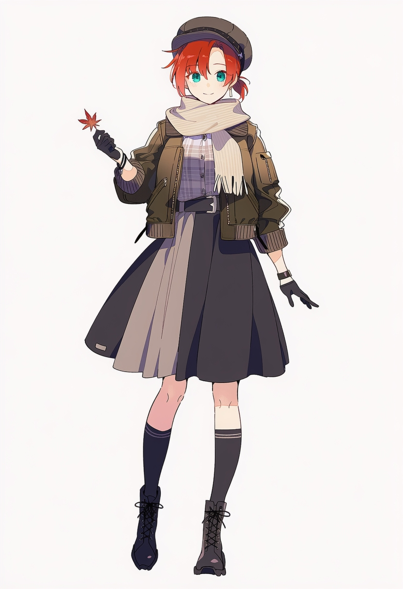

[在线例图](https://assets.quicktagcloud.com/images/raven_composition/raven_composition-5659.jpg?v=4b8dac98ff9b331a)

<a id="raven_composition-5660"></a>

## 岩窟王 爱德蒙·唐泰斯

ID：`raven_composition-5660`；分类：角色图鉴 / Fate / FGO；来源标记：`safe`。

来源说明：

> 作品：Fate
> 性别：男
> 登场时间：2015
> 阵营（如有）：FGO

正向提示词：

```text
edmond_dantes_(fate)
```

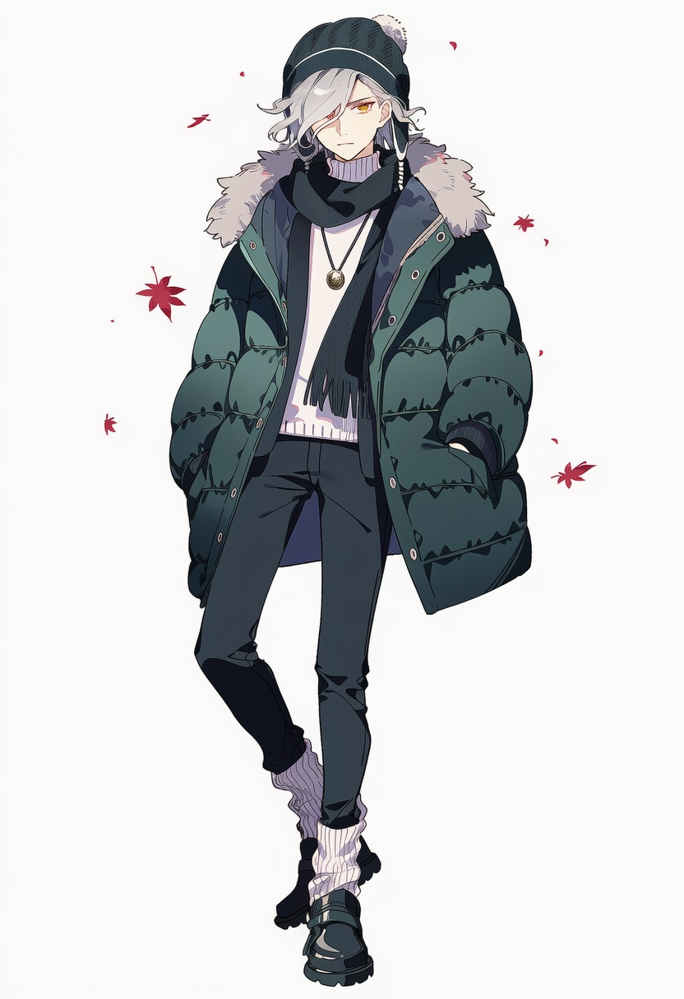

[在线例图](https://assets.quicktagcloud.com/images/raven_composition/raven_composition-5660.jpg?v=a2e96ea2106b9c0d)

<a id="raven_composition-5661"></a>

## 阿蒂拉

ID：`raven_composition-5661`；分类：角色图鉴 / Fate / FGO；来源标记：`safe`。

来源说明：

> 作品：Fate
> 性别：女
> 登场时间：2015
> 阵营（如有）：FGO

正向提示词：

```text
altera_(fate)
```

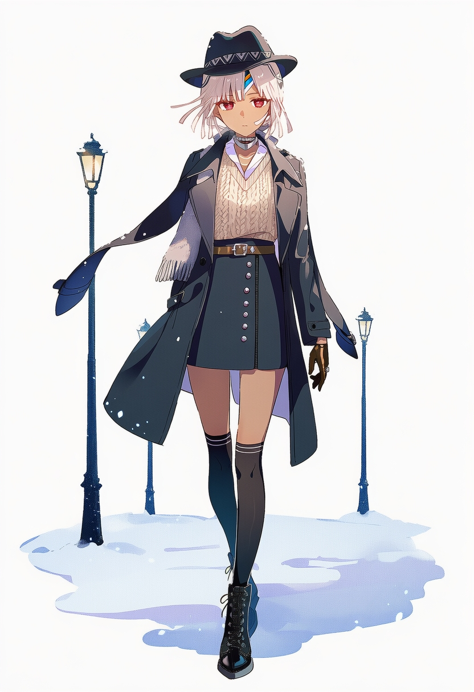

[在线例图](https://assets.quicktagcloud.com/images/raven_composition/raven_composition-5661.jpg?v=14848b75746539b5)

<a id="raven_composition-5662"></a>

## 梅芙

ID：`raven_composition-5662`；分类：角色图鉴 / Fate / FGO；来源标记：`safe`。

来源说明：

> 作品：Fate
> 性别：女
> 登场时间：2015
> 阵营（如有）：FGO

正向提示词：

```text
medb_(fate)
```

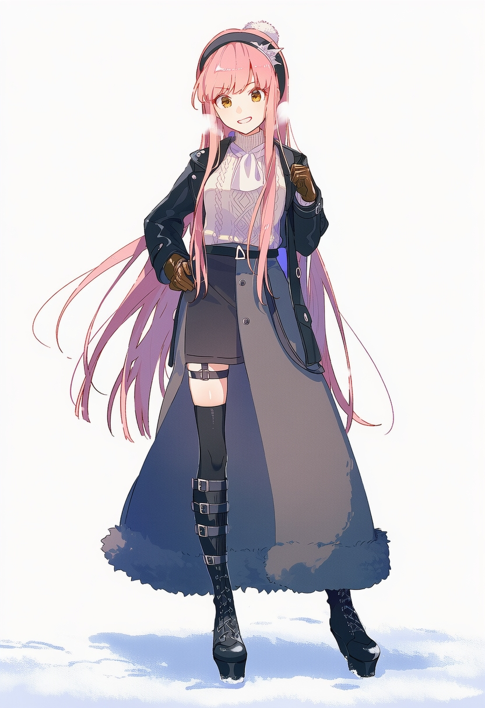

[在线例图](https://assets.quicktagcloud.com/images/raven_composition/raven_composition-5662.jpg?v=4eac49c9784136c9)

<a id="raven_composition-5663"></a>

## 梅杰德

ID：`raven_composition-5663`；分类：角色图鉴 / Fate / FGO；来源标记：`safe`。

来源说明：

> 作品：Fate
> 性别：不适用/不明
> 登场时间：2015
> 阵营（如有）：FGO

正向提示词：

```text
medjed_(fate)
```

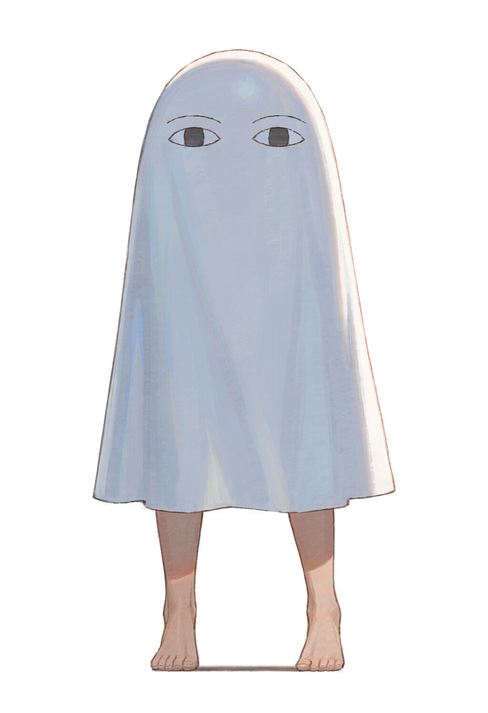

[在线例图](https://assets.quicktagcloud.com/images/raven_composition/raven_composition-5663.jpg?v=0570466a9b75e523)

<a id="raven_composition-5664"></a>

## 库·丘林〔Alter〕

ID：`raven_composition-5664`；分类：角色图鉴 / Fate / FGO；来源标记：`safe`。

来源说明：

> 作品：Fate
> 性别：男
> 登场时间：2015
> 阵营（如有）：FGO

正向提示词：

```text
cu_chulainn_alter_(fate)
```

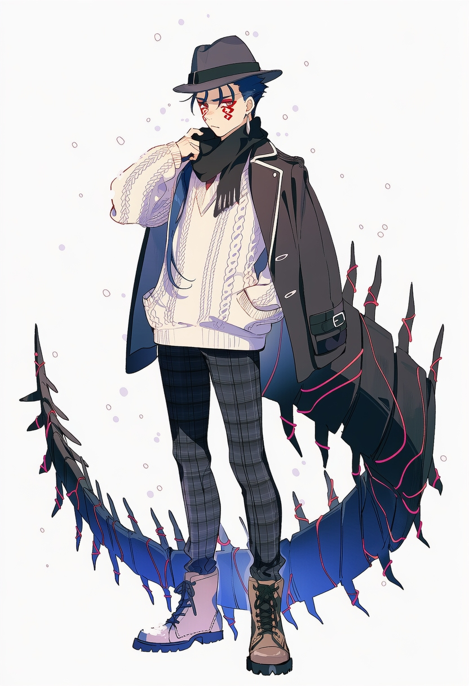

[在线例图](https://assets.quicktagcloud.com/images/raven_composition/raven_composition-5664.jpg?v=59127a4f173021ab)

<a id="raven_composition-5665"></a>

## 玄奘三藏

ID：`raven_composition-5665`；分类：角色图鉴 / Fate / FGO；来源标记：`safe`。

来源说明：

> 作品：Fate
> 性别：女
> 登场时间：2015
> 阵营（如有）：FGO

正向提示词：

```text
xuangzang_sanzang_(fate)
```

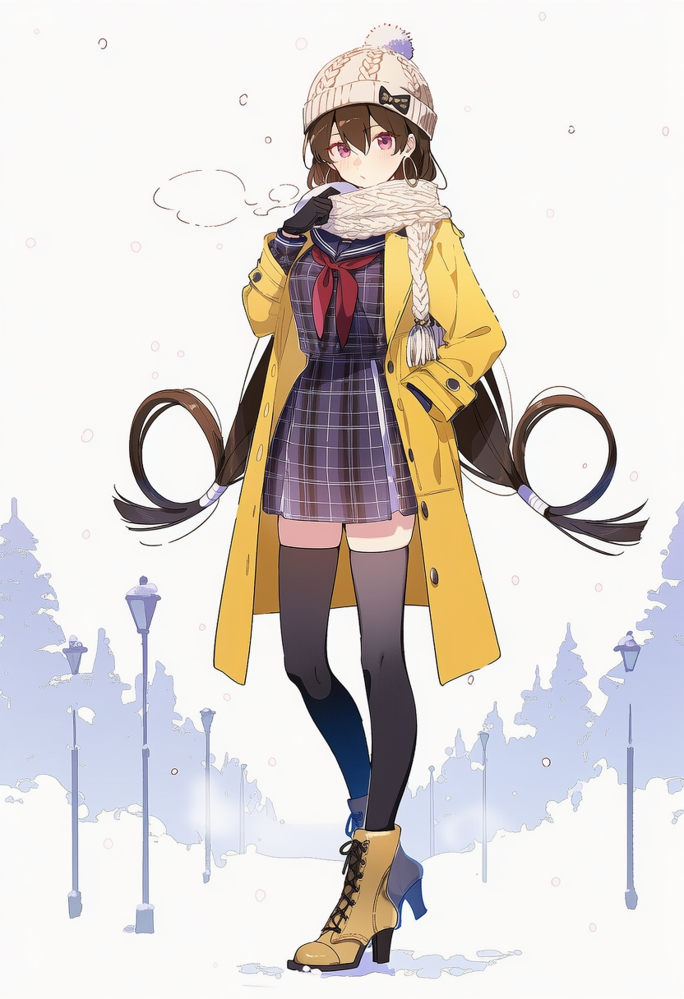

[在线例图](https://assets.quicktagcloud.com/images/raven_composition/raven_composition-5665.jpg?v=ef60b43091a05d3c)

<a id="raven_composition-5666"></a>

## “山中老人”

ID：`raven_composition-5666`；分类：角色图鉴 / Fate / FGO；来源标记：`safe`。

来源说明：

> 作品：Fate
> 性别：男
> 登场时间：2015
> 阵营（如有）：FGO

正向提示词：

```text
king_hassan_(fate)
```

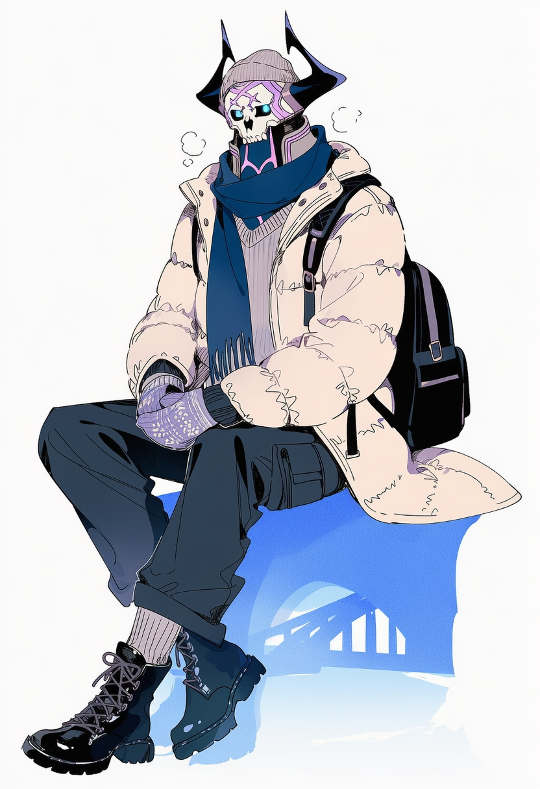

[在线例图](https://assets.quicktagcloud.com/images/raven_composition/raven_composition-5666.jpg?v=916984c5cafb5d95)

<a id="raven_composition-5667"></a>

## 提亚马特

ID：`raven_composition-5667`；分类：角色图鉴 / Fate / FGO；来源标记：`safe`。

来源说明：

> 作品：Fate
> 性别：女
> 登场时间：2015
> 阵营（如有）：FGO

正向提示词：

```text
tiamat_(fate)
```

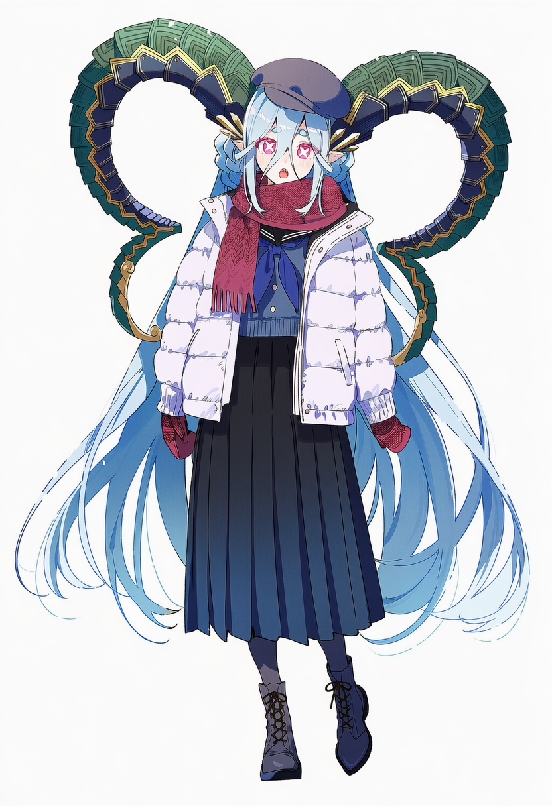

[在线例图](https://assets.quicktagcloud.com/images/raven_composition/raven_composition-5667.jpg?v=6da926288edc8148)

<a id="raven_composition-5669"></a>

## 卡米拉

ID：`raven_composition-5669`；分类：角色图鉴 / Fate / FGO；来源标记：`safe`。

来源说明：

> 作品：Fate
> 性别：女
> 登场时间：2015
> 阵营（如有）：FGO

正向提示词：

```text
carmilla_(fate)
```

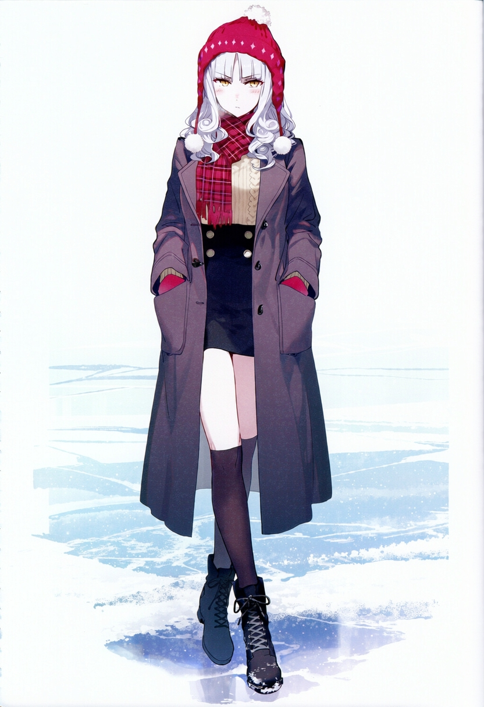

[在线例图](https://assets.quicktagcloud.com/images/raven_composition/raven_composition-5669.jpg?v=9aec128fe4864237)

<a id="raven_composition-5672"></a>

## 魁札尔·科亚特尔

ID：`raven_composition-5672`；分类：角色图鉴 / Fate / FGO；来源标记：`safe`。

来源说明：

> 作品：Fate
> 性别：女
> 登场时间：2015
> 阵营（如有）：FGO

正向提示词：

```text
quetzalcoatl_(fate)
```

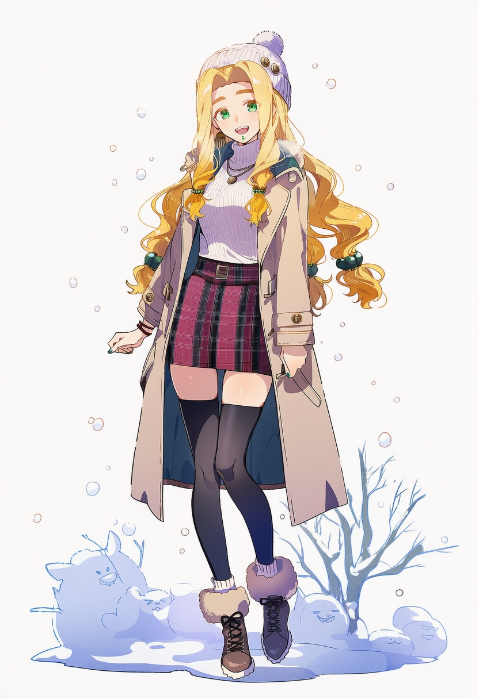

[在线例图](https://assets.quicktagcloud.com/images/raven_composition/raven_composition-5672.jpg?v=3cd19da94a537ad9)

<a id="raven_composition-5673"></a>

## 兰斯洛特

ID：`raven_composition-5673`；分类：角色图鉴 / Fate / FGO；来源标记：`safe`。

来源说明：

> 作品：Fate
> 性别：男
> 登场时间：2015
> 阵营（如有）：FGO

正向提示词：

```text
lancelot_(fate/grand_order)
```

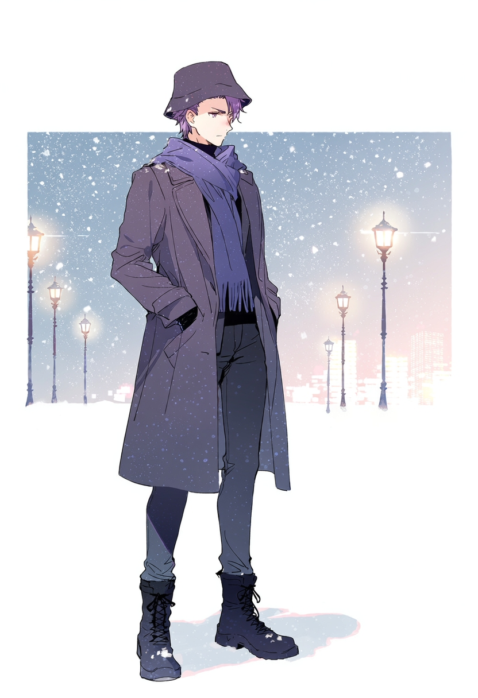

[在线例图](https://assets.quicktagcloud.com/images/raven_composition/raven_composition-5673.jpg?v=441845c2ad4823a8)

<a id="raven_composition-5674"></a>

## 崔斯坦

ID：`raven_composition-5674`；分类：角色图鉴 / Fate / FGO；来源标记：`safe`。

来源说明：

> 作品：Fate
> 性别：男
> 登场时间：2015
> 阵营（如有）：FGO

正向提示词：

```text
tristan_(fate)
```

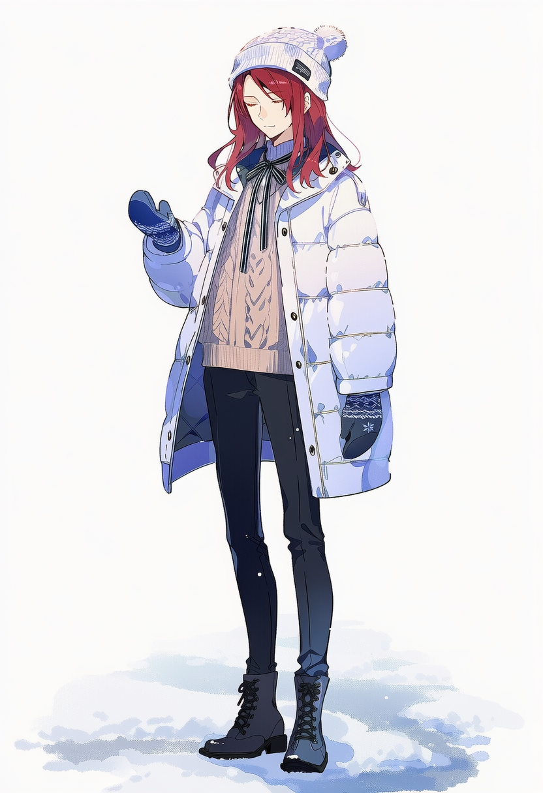

[在线例图](https://assets.quicktagcloud.com/images/raven_composition/raven_composition-5674.jpg?v=b8eccdff396a162d)

<a id="raven_composition-5675"></a>

## 赫克托耳

ID：`raven_composition-5675`；分类：角色图鉴 / Fate / FGO；来源标记：`safe`。

来源说明：

> 作品：Fate
> 性别：男
> 登场时间：2015
> 阵营（如有）：FGO

正向提示词：

```text
hector_(fate)
```

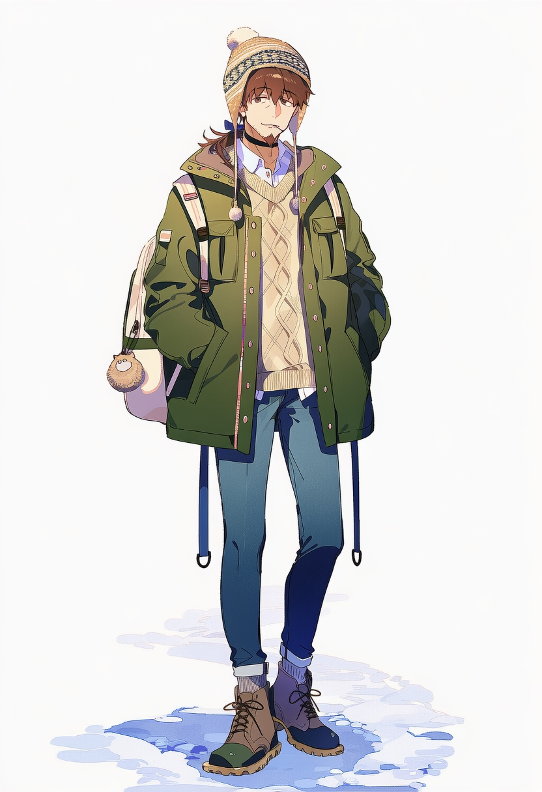

[在线例图](https://assets.quicktagcloud.com/images/raven_composition/raven_composition-5675.jpg?v=ec9d106bd2d47f45)

<a id="raven_composition-5676"></a>

## 戈耳工

ID：`raven_composition-5676`；分类：角色图鉴 / Fate / FGO；来源标记：`safe`。

来源说明：

> 作品：Fate
> 性别：女
> 登场时间：2015
> 阵营（如有）：FGO

正向提示词：

```text
gorgon_(fate)
```

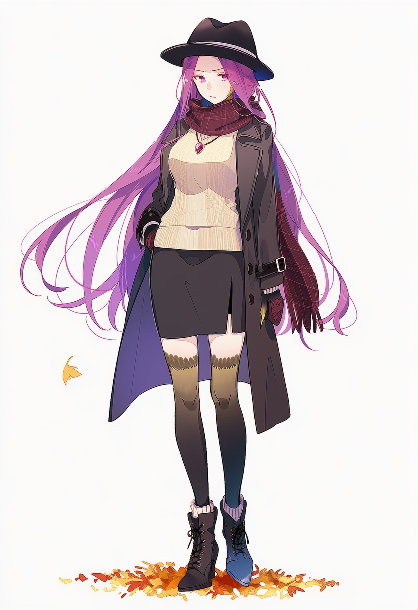

[在线例图](https://assets.quicktagcloud.com/images/raven_composition/raven_composition-5676.jpg?v=f3599044f0f20043)

<a id="raven_composition-5677"></a>

## 骑士迪昂

ID：`raven_composition-5677`；分类：角色图鉴 / Fate / FGO；来源标记：`safe`。

来源说明：

> 作品：Fate
> 性别：不定/特殊
> 登场时间：2015
> 阵营（如有）：FGO

正向提示词：

```text
chevalier_d'eon_(fate)
```

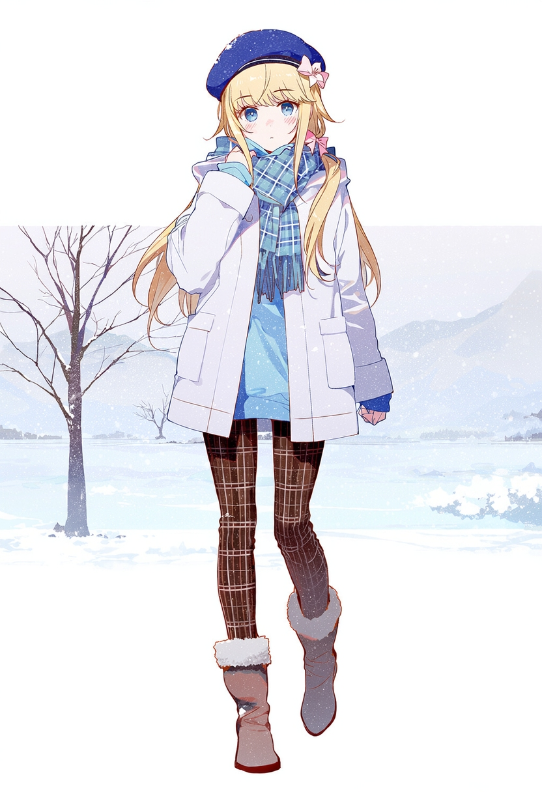

[在线例图](https://assets.quicktagcloud.com/images/raven_composition/raven_composition-5677.jpg?v=1d8ae7c51d7d8040)

<a id="raven_composition-5679"></a>

## 克娄巴特拉

ID：`raven_composition-5679`；分类：角色图鉴 / Fate / FGO；来源标记：`safe`。

来源说明：

> 作品：Fate
> 性别：女
> 登场时间：2015
> 阵营（如有）：FGO

正向提示词：

```text
cleopatra_(fate)
```

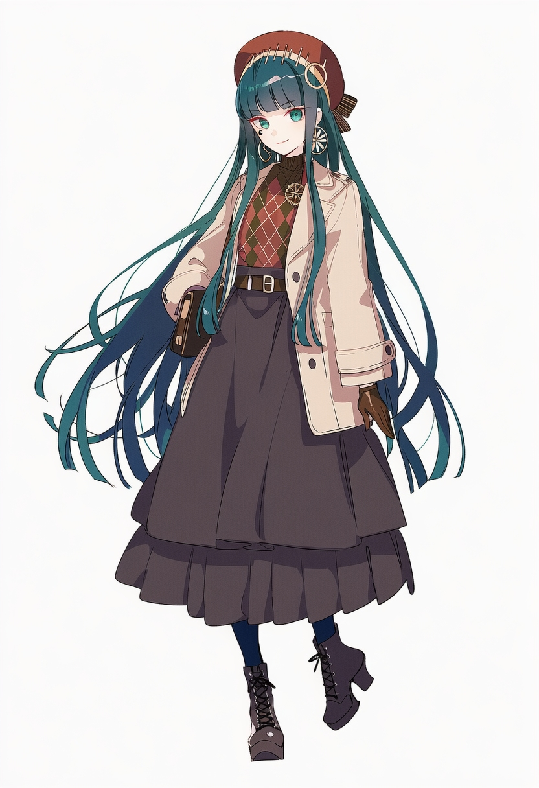

[在线例图](https://assets.quicktagcloud.com/images/raven_composition/raven_composition-5679.jpg?v=29f6ecce1ddcea94)

<a id="raven_composition-5680"></a>

## 爱德华·蒂奇

ID：`raven_composition-5680`；分类：角色图鉴 / Fate / FGO；来源标记：`safe`。

来源说明：

> 作品：Fate
> 性别：男
> 登场时间：2015
> 阵营（如有）：FGO

正向提示词：

```text
edward_teach_(fate)
```

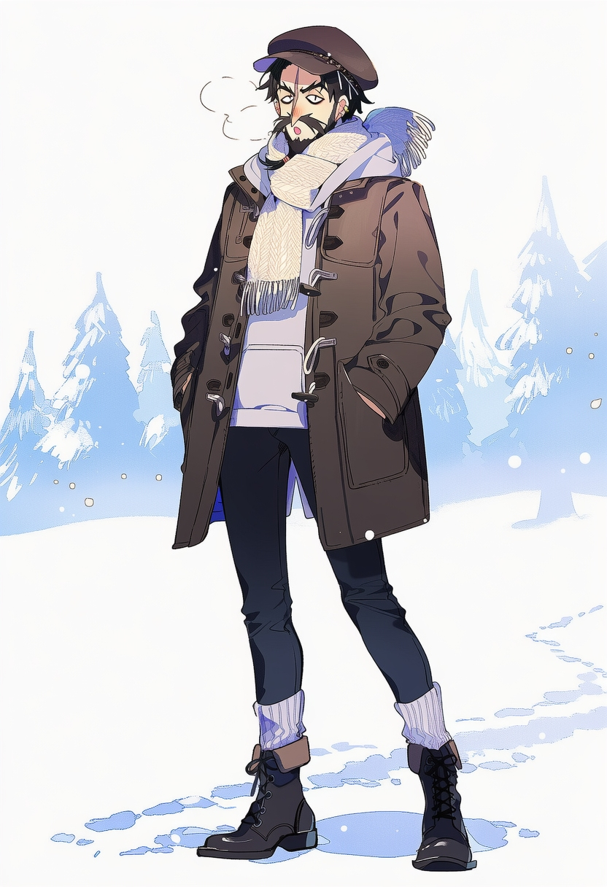

[在线例图](https://assets.quicktagcloud.com/images/raven_composition/raven_composition-5680.jpg?v=1761b4a82ad34db2)

<a id="raven_composition-5681"></a>

## 亚历山大

ID：`raven_composition-5681`；分类：角色图鉴 / Fate / FGO；来源标记：`safe`。

来源说明：

> 作品：Fate
> 性别：男
> 登场时间：2015
> 阵营（如有）：FGO

正向提示词：

```text
alexander_(fate)
```

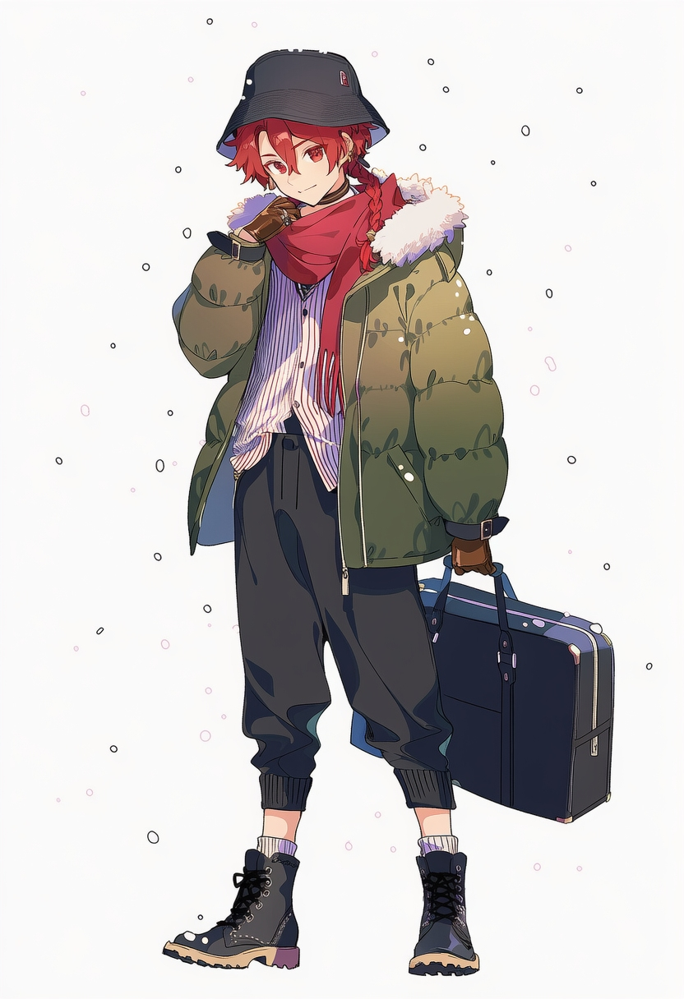

[在线例图](https://assets.quicktagcloud.com/images/raven_composition/raven_composition-5681.jpg?v=2bb6021cce22b766)

<a id="raven_composition-5682"></a>

## 沃尔夫冈·阿马德乌斯·莫扎特

ID：`raven_composition-5682`；分类：角色图鉴 / Fate / FGO；来源标记：`safe`。

来源说明：

> 作品：Fate
> 性别：男
> 登场时间：2015
> 阵营（如有）：FGO

正向提示词：

```text
wolfgang_amadeus_mozart_(fate)
```

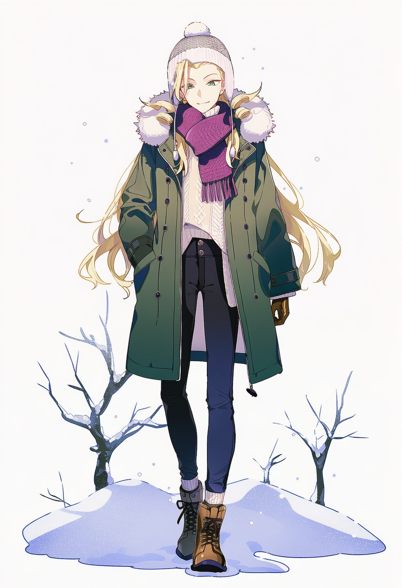

[在线例图](https://assets.quicktagcloud.com/images/raven_composition/raven_composition-5682.jpg?v=0ff022dd384986e7)

<a id="raven_composition-5683"></a>

## 所罗门

ID：`raven_composition-5683`；分类：角色图鉴 / Fate / FGO；来源标记：`safe`。

来源说明：

> 作品：Fate
> 性别：男
> 登场时间：2015
> 阵营（如有）：FGO

正向提示词：

```text
solomon_(fate)
```

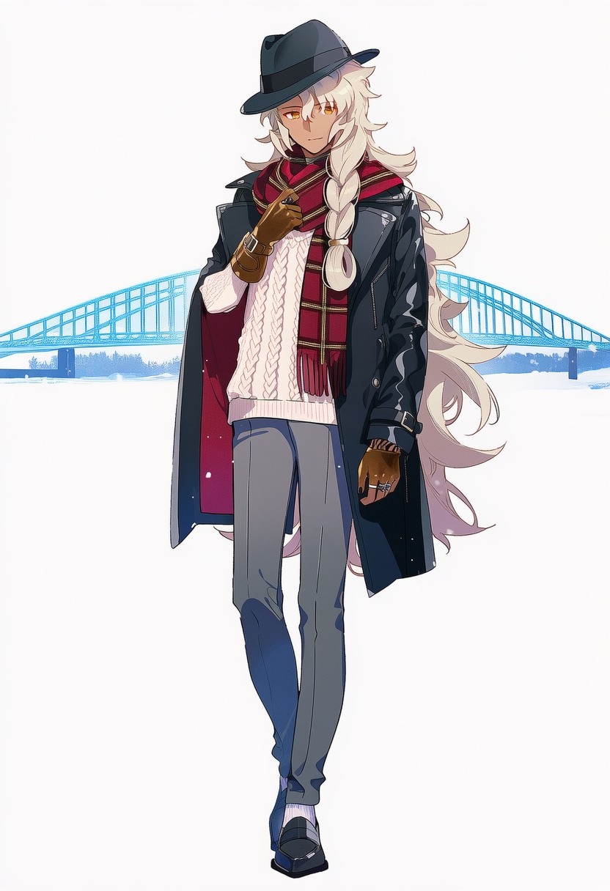

[在线例图](https://assets.quicktagcloud.com/images/raven_composition/raven_composition-5683.jpg?v=bd4fe47b291d6d1f)

<a id="raven_composition-5684"></a>

## 贝奥武夫

ID：`raven_composition-5684`；分类：角色图鉴 / Fate / FGO；来源标记：`safe`。

来源说明：

> 作品：Fate
> 性别：男
> 登场时间：2015
> 阵营（如有）：FGO

正向提示词：

```text
beowulf_(fate)
```

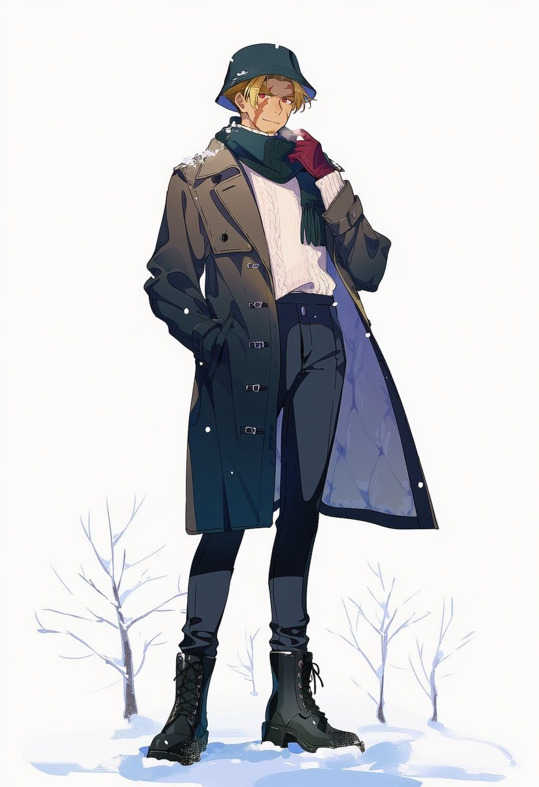

[在线例图](https://assets.quicktagcloud.com/images/raven_composition/raven_composition-5684.jpg?v=780dfa8f13119caa)

<a id="raven_composition-5685"></a>

## 安妮·伯妮

ID：`raven_composition-5685`；分类：角色图鉴 / Fate / FGO；来源标记：`safe`。

来源说明：

> 作品：Fate
> 性别：女
> 登场时间：2015
> 阵营（如有）：FGO

正向提示词：

```text
anne_bonny_(fate)
```

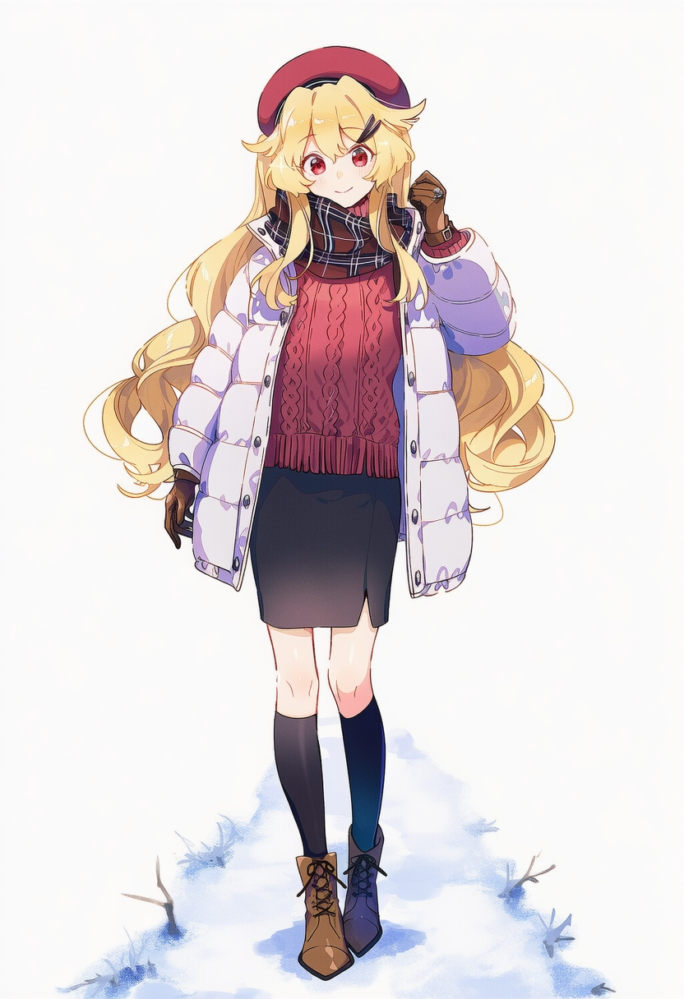

[在线例图](https://assets.quicktagcloud.com/images/raven_composition/raven_composition-5685.jpg?v=88ac25183f18ad8d)

<a id="raven_composition-5686"></a>

## 风魔小太郎

ID：`raven_composition-5686`；分类：角色图鉴 / Fate / FGO；来源标记：`safe`。

来源说明：

> 作品：Fate
> 性别：男
> 登场时间：2015
> 阵营（如有）：FGO

正向提示词：

```text
fuuma_kotarou_(fate)
```

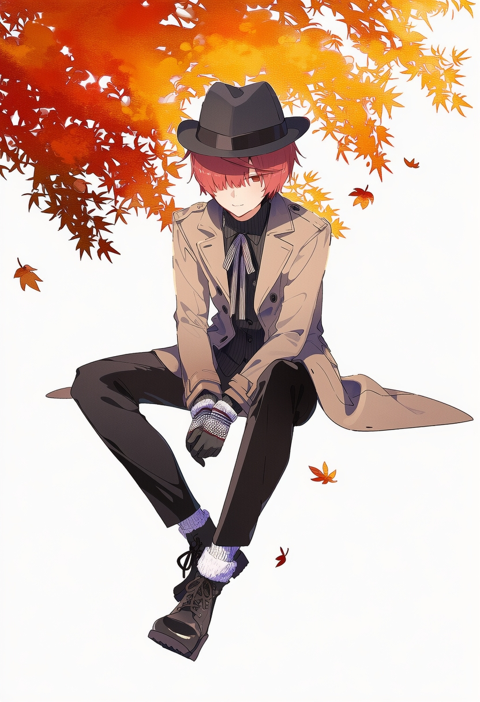

[在线例图](https://assets.quicktagcloud.com/images/raven_composition/raven_composition-5686.jpg?v=80043f4d5fcb0e02)

<a id="raven_composition-5687"></a>

## 玛塔·哈丽

ID：`raven_composition-5687`；分类：角色图鉴 / Fate / FGO；来源标记：`safe`。

来源说明：

> 作品：Fate
> 性别：女
> 登场时间：2015
> 阵营（如有）：FGO

正向提示词：

```text
mata_hari_(fate)
```

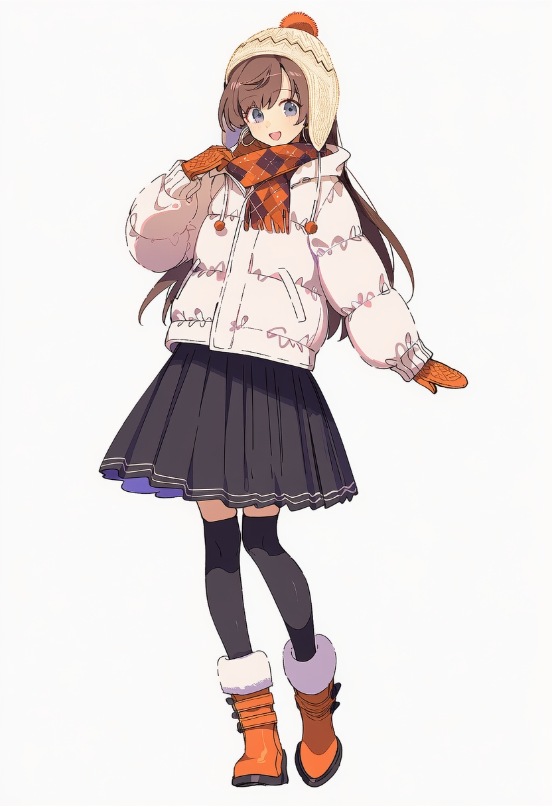

[在线例图](https://assets.quicktagcloud.com/images/raven_composition/raven_composition-5687.jpg?v=50ccf7c62ba9789e)

<a id="raven_composition-5688"></a>

## 阿斯忒里俄斯

ID：`raven_composition-5688`；分类：角色图鉴 / Fate / FGO；来源标记：`safe`。

来源说明：

> 作品：Fate
> 性别：男
> 登场时间：2015
> 阵营（如有）：FGO

正向提示词：

```text
asterios_(fate)
```

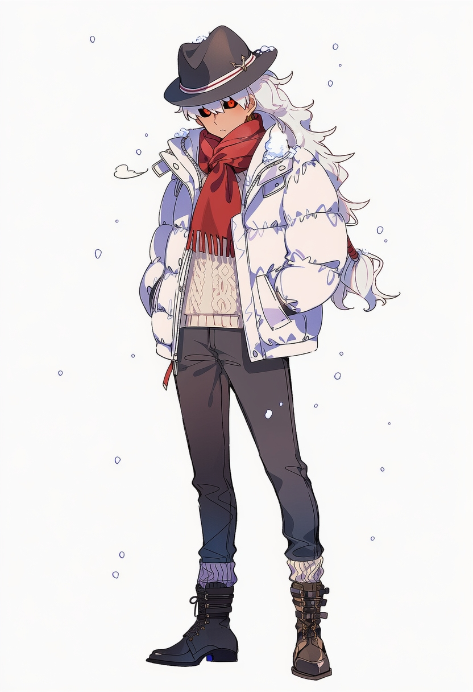

[在线例图](https://assets.quicktagcloud.com/images/raven_composition/raven_composition-5688.jpg?v=7540961b867b249c)

<a id="raven_composition-5689"></a>

## 迷你信

ID：`raven_composition-5689`；分类：角色图鉴 / Fate / FGO；来源标记：`safe`。

来源说明：

> 作品：Fate
> 性别：不明
> 登场时间：2015
> 阵营（如有）：FGO

正向提示词：

```text
mini_nobu_(fate)
```

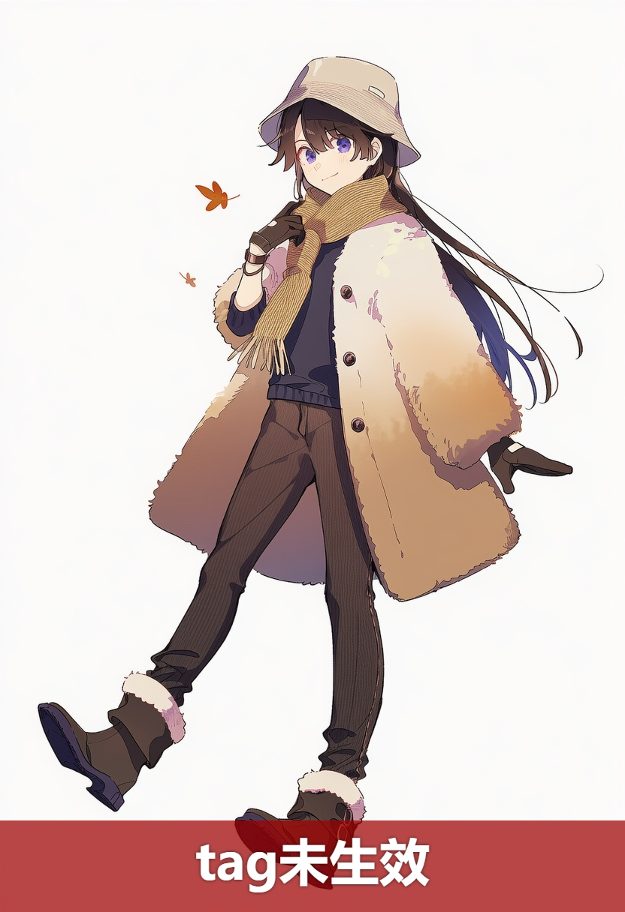

[在线例图](https://assets.quicktagcloud.com/images/raven_composition/raven_composition-5689.jpg?v=d2a71b244723d1eb)

<a id="raven_composition-5690"></a>

## 玛丽·里德

ID：`raven_composition-5690`；分类：角色图鉴 / Fate / FGO；来源标记：`safe`。

来源说明：

> 作品：Fate
> 性别：女
> 登场时间：2015
> 阵营（如有）：FGO

正向提示词：

```text
mary_read_(fate)
```

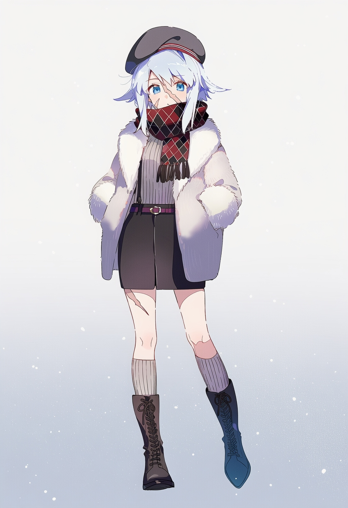

[在线例图](https://assets.quicktagcloud.com/images/raven_composition/raven_composition-5690.jpg?v=00f8cb1b16e202d9)

<a id="raven_composition-5691"></a>

## 伊阿宋

ID：`raven_composition-5691`；分类：角色图鉴 / Fate / FGO；来源标记：`safe`。

来源说明：

> 作品：Fate
> 性别：男
> 登场时间：2015
> 阵营（如有）：FGO

正向提示词：

```text
jason_(fate)
```

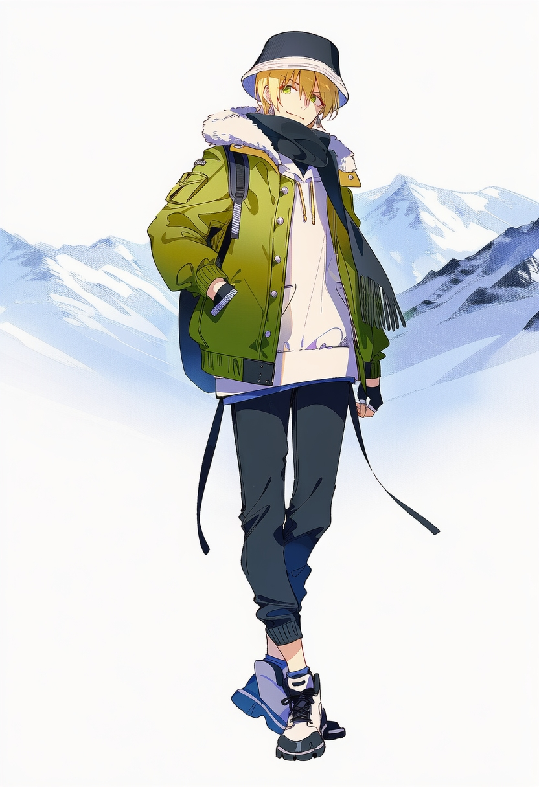

[在线例图](https://assets.quicktagcloud.com/images/raven_composition/raven_composition-5691.jpg?v=55e283719db64199)

<a id="raven_composition-5692"></a>

## 阿耳忒弥斯

ID：`raven_composition-5692`；分类：角色图鉴 / Fate / FGO；来源标记：`safe`。

来源说明：

> 作品：Fate
> 性别：女
> 登场时间：2015
> 阵营（如有）：FGO

正向提示词：

```text
artemis_(fate)
```

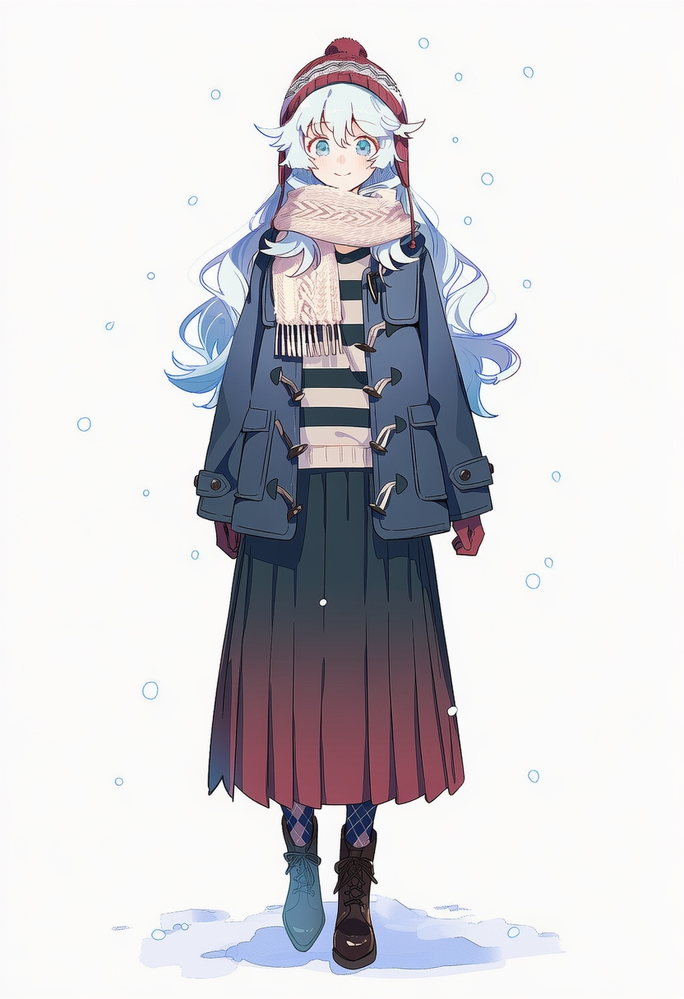

[在线例图](https://assets.quicktagcloud.com/images/raven_composition/raven_composition-5692.jpg?v=59892cc15b7c3935)

<a id="raven_composition-5693"></a>

## 美狄亚〔Lily〕

ID：`raven_composition-5693`；分类：角色图鉴 / Fate / FGO；来源标记：`safe`。

来源说明：

> 作品：Fate
> 性别：女
> 登场时间：2015
> 阵营（如有）：FGO

正向提示词：

```text
medea_lily_(fate)
```


[在线例图](https://assets.quicktagcloud.com/images/raven_composition/raven_composition-5693.jpg?v=65299f8798fdb4a1)

<a id="raven_composition-5694"></a>

## 丑御前

ID：`raven_composition-5694`；分类：角色图鉴 / Fate / FGO；来源标记：`safe`。

来源说明：

> 作品：Fate
> 性别：女
> 登场时间：2015
> 阵营（如有）：FGO

正向提示词：

```text
ushi_gozen_(fate)
```

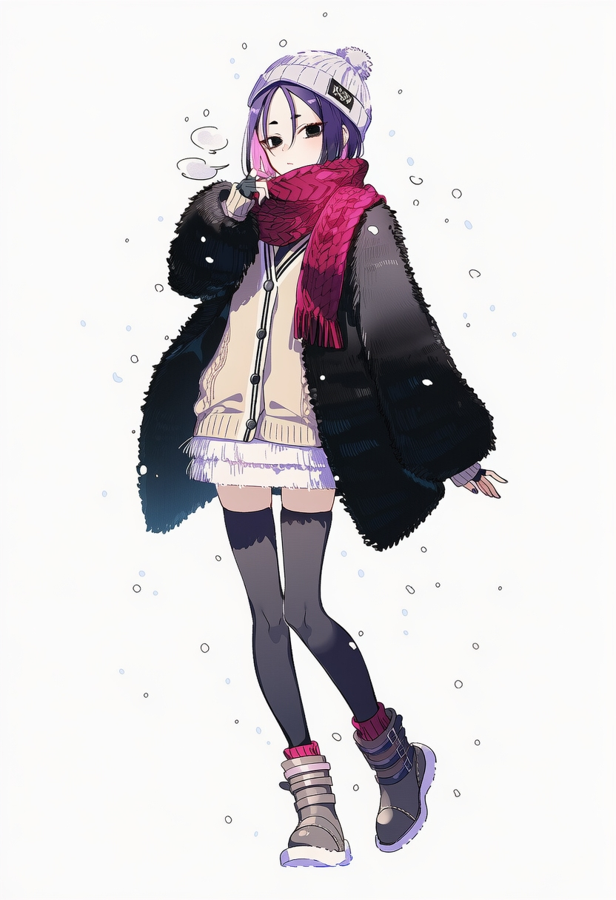

[在线例图](https://assets.quicktagcloud.com/images/raven_composition/raven_composition-5694.jpg?v=81f3cbd366369251)

<a id="raven_composition-5696"></a>

## 金固

ID：`raven_composition-5696`；分类：角色图鉴 / Fate / FGO；来源标记：`safe`。

来源说明：

> 作品：Fate
> 性别：无性/不定
> 登场时间：2015
> 阵营（如有）：FGO

正向提示词：

```text
kingu_(fate)
```

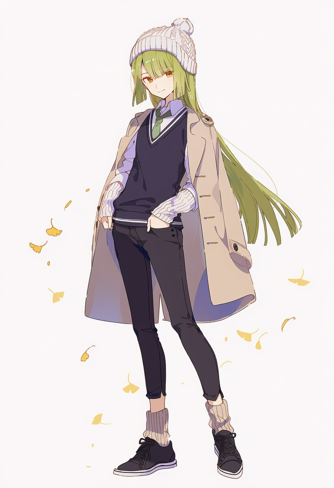

[在线例图](https://assets.quicktagcloud.com/images/raven_composition/raven_composition-5696.jpg?v=950a34521cfe9b66)

<a id="raven_composition-5697"></a>

## 罗摩

ID：`raven_composition-5697`；分类：角色图鉴 / Fate / FGO；来源标记：`safe`。

来源说明：

> 作品：Fate
> 性别：男
> 登场时间：2015
> 阵营（如有）：FGO

正向提示词：

```text
rama_(fate)
```

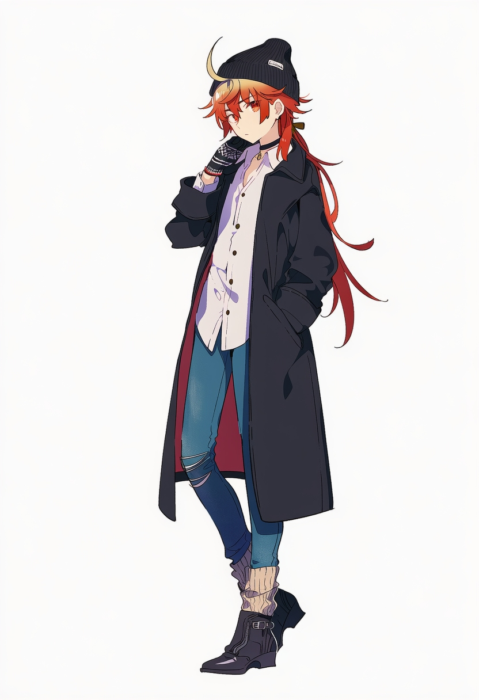

[在线例图](https://assets.quicktagcloud.com/images/raven_composition/raven_composition-5697.jpg?v=bbb158722cae528c)

<a id="raven_composition-5698"></a>

## 夏尔-亨利·桑松

ID：`raven_composition-5698`；分类：角色图鉴 / Fate / FGO；来源标记：`safe`。

来源说明：

> 作品：Fate
> 性别：男
> 登场时间：2015
> 阵营（如有）：FGO

正向提示词：

```text
charles-henri_sanson_(fate)
```

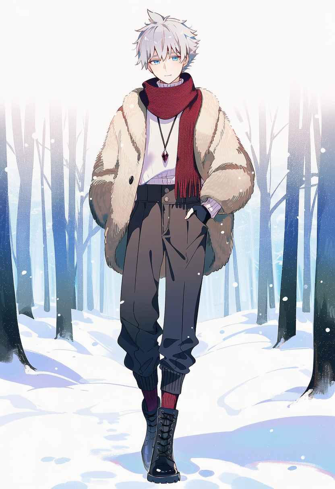

[在线例图](https://assets.quicktagcloud.com/images/raven_composition/raven_composition-5698.jpg?v=fabbca7801fa664c)

<a id="raven_composition-5700"></a>

## 豹人

ID：`raven_composition-5700`；分类：角色图鉴 / Fate / FGO；来源标记：`safe`。

来源说明：

> 作品：Fate
> 性别：女
> 登场时间：2015
> 阵营（如有）：FGO

正向提示词：

```text
jaguarman_(fate)
```

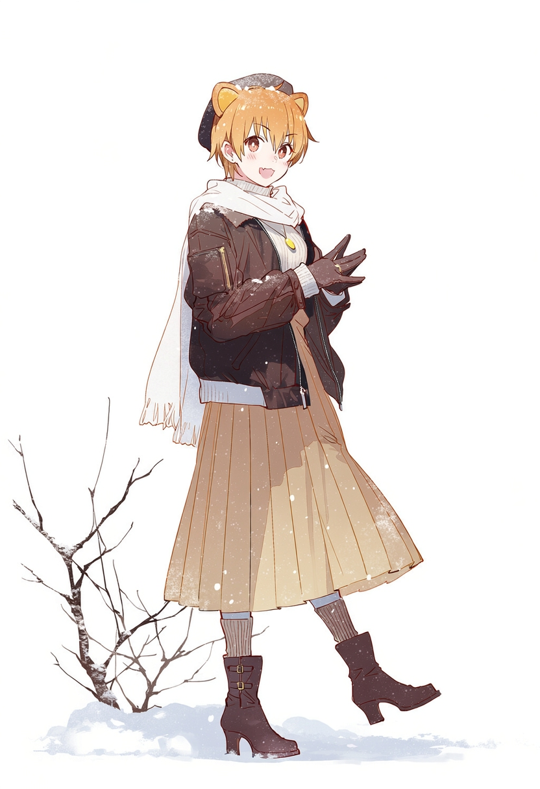

[在线例图](https://assets.quicktagcloud.com/images/raven_composition/raven_composition-5700.jpg?v=9f405a5d234b7a14)

<a id="raven_composition-5701"></a>

## 弗格斯·马克·罗伊

ID：`raven_composition-5701`；分类：角色图鉴 / Fate / FGO；来源标记：`safe`。

来源说明：

> 作品：Fate
> 性别：男
> 登场时间：2015
> 阵营（如有）：FGO

正向提示词：

```text
fergus_mac_roich_(fate)
```


[在线例图](https://assets.quicktagcloud.com/images/raven_composition/raven_composition-5701.jpg?v=3bad139b08980bca)

<a id="raven_composition-5702"></a>

## 梅菲斯托费勒斯

ID：`raven_composition-5702`；分类：角色图鉴 / Fate / FGO；来源标记：`safe`。

来源说明：

> 作品：Fate
> 性别：男
> 登场时间：2015
> 阵营（如有）：FGO

正向提示词：

```text
mephistopheles_(fate)
```


[在线例图](https://assets.quicktagcloud.com/images/raven_composition/raven_composition-5702.jpg?v=b52c6f4f7ba20da9)

<a id="raven_composition-5704"></a>

## 荆轲

ID：`raven_composition-5704`；分类：角色图鉴 / Fate / FGO；来源标记：`safe`。

来源说明：

> 作品：Fate
> 性别：女
> 登场时间：2015
> 阵营（如有）：FGO

正向提示词：

```text
jing_ke_(fate)
```


[在线例图](https://assets.quicktagcloud.com/images/raven_composition/raven_composition-5704.jpg?v=943f1a5259b78791)

<a id="raven_composition-5705"></a>

## 加拉哈德

ID：`raven_composition-5705`；分类：角色图鉴 / Fate / FGO；来源标记：`safe`。

来源说明：

> 作品：Fate
> 性别：男
> 登场时间：2015
> 阵营（如有）：FGO

正向提示词：

```text
galahad_(fate)
```


[在线例图](https://assets.quicktagcloud.com/images/raven_composition/raven_composition-5705.jpg?v=19d1cc7ef7b8c1a1)

<a id="raven_composition-5706"></a>

## 罗穆路斯

ID：`raven_composition-5706`；分类：角色图鉴 / Fate / FGO；来源标记：`safe`。

来源说明：

> 作品：Fate
> 性别：男
> 登场时间：2015
> 阵营（如有）：FGO

正向提示词：

```text
romulus_(fate)
```


[在线例图](https://assets.quicktagcloud.com/images/raven_composition/raven_composition-5706.jpg?v=f6c713125807de10)

<a id="raven_composition-5707"></a>

## 魔神柱

ID：`raven_composition-5707`；分类：角色图鉴 / Fate / FGO；来源标记：`safe`。

来源说明：

> 作品：Fate
> 性别：不适用/不明
> 登场时间：2015
> 阵营（如有）：FGO

正向提示词：

```text
demon_pillar_(fate)
```


[在线例图](https://assets.quicktagcloud.com/images/raven_composition/raven_composition-5707.jpg?v=036fc5132f278f36)

<a id="raven_composition-5708"></a>

## 比利小子

ID：`raven_composition-5708`；分类：角色图鉴 / Fate / FGO；来源标记：`safe`。

来源说明：

> 作品：Fate
> 性别：男
> 登场时间：2015
> 阵营（如有）：FGO

正向提示词：

```text
billy_the_kid_(fate)
```


[在线例图](https://assets.quicktagcloud.com/images/raven_composition/raven_composition-5708.jpg?v=6fe7e57cd52d8c89)

<a id="raven_composition-5709"></a>

## 托马斯·爱迪生

ID：`raven_composition-5709`；分类：角色图鉴 / Fate / FGO；来源标记：`safe`。

来源说明：

> 作品：Fate
> 性别：男
> 登场时间：2015
> 阵营（如有）：FGO

正向提示词：

```text
thomas_edison_(fate)
```


[在线例图](https://assets.quicktagcloud.com/images/raven_composition/raven_composition-5709.jpg?v=4aadc99096fe0c86)

<a id="raven_composition-5710"></a>

## 尼古拉·特斯拉

ID：`raven_composition-5710`；分类：角色图鉴 / Fate / FGO；来源标记：`safe`。

来源说明：

> 作品：Fate
> 性别：男
> 登场时间：2015
> 阵营（如有）：FGO

正向提示词：

```text
nikola_tesla_(fate)
```


[在线例图](https://assets.quicktagcloud.com/images/raven_composition/raven_composition-5710.jpg?v=d8a82f1774b75034)

<a id="raven_composition-5711"></a>

## 盖乌斯·尤利乌斯·恺撒

ID：`raven_composition-5711`；分类：角色图鉴 / Fate / FGO；来源标记：`safe`。

来源说明：

> 作品：Fate
> 性别：男
> 登场时间：2015
> 阵营（如有）：FGO

正向提示词：

```text
gaius_julius_caesar_(fate)
```


[在线例图](https://assets.quicktagcloud.com/images/raven_composition/raven_composition-5711.jpg?v=06d67a6475f1dbb2)

<a id="raven_composition-5712"></a>

## 拉赫穆

ID：`raven_composition-5712`；分类：角色图鉴 / Fate / FGO；来源标记：`safe`。

来源说明：

> 作品：Fate
> 性别：不适用/不明
> 登场时间：2015
> 阵营（如有）：FGO

正向提示词：

```text
lahmu_(fate)
```


[在线例图](https://assets.quicktagcloud.com/images/raven_composition/raven_composition-5712.jpg?v=a98b3a53ef283666)

<a id="raven_composition-5713"></a>

## 阿格规文

ID：`raven_composition-5713`；分类：角色图鉴 / Fate / FGO；来源标记：`safe`。

来源说明：

> 作品：Fate
> 性别：男
> 登场时间：2015
> 阵营（如有）：FGO

正向提示词：

```text
agravain_(fate)
```


[在线例图](https://assets.quicktagcloud.com/images/raven_composition/raven_composition-5713.jpg?v=36a362d6cbe06147)

<a id="raven_composition-5719"></a>

## 奥尔加玛丽·亚斯密雷特·阿尼姆斯菲亚

ID：`raven_composition-5719`；分类：角色图鉴 / Fate / FGO；来源标记：`safe`。

来源说明：

> 作品：Fate
> 性别：女
> 登场时间：2015
> 阵营（如有）：FGO

正向提示词：

```text
olga_marie_animusphere
```


[在线例图](https://assets.quicktagcloud.com/images/raven_composition/raven_composition-5719.jpg?v=c39d8e56282e340e)

<a id="raven_composition-5721"></a>

## 阿比盖尔·威廉姆斯

ID：`raven_composition-5721`；分类：角色图鉴 / Fate / FGO；来源标记：`safe`。

来源说明：

> 作品：Fate
> 性别：女
> 登场时间：2017
> 阵营（如有）：FGO

正向提示词：

```text
abigail_williams_(fate)
```


[在线例图](https://assets.quicktagcloud.com/images/raven_composition/raven_composition-5721.jpg?v=256ba314179fe5a5)

<a id="raven_composition-5722"></a>

## 宫本武藏

ID：`raven_composition-5722`；分类：角色图鉴 / Fate / FGO；来源标记：`safe`。

来源说明：

> 作品：Fate
> 性别：女
> 登场时间：2017
> 阵营（如有）：FGO

正向提示词：

```text
miyamoto_musashi_(fate)
```


[在线例图](https://assets.quicktagcloud.com/images/raven_composition/raven_composition-5722.jpg?v=ce49700a010a8c8c)

<a id="raven_composition-5723"></a>

## 巴御前

ID：`raven_composition-5723`；分类：角色图鉴 / Fate / FGO；来源标记：`safe`。

来源说明：

> 作品：Fate
> 性别：女
> 登场时间：2017
> 阵营（如有）：FGO

正向提示词：

```text
tomoe_gozen_(fate)
```


[在线例图](https://assets.quicktagcloud.com/images/raven_composition/raven_composition-5723.jpg?v=00b8ea15fc36b68e)

<a id="raven_composition-5724"></a>

## 芦屋道满

ID：`raven_composition-5724`；分类：角色图鉴 / Fate / FGO；来源标记：`safe`。

来源说明：

> 作品：Fate
> 性别：男
> 登场时间：2017
> 阵营（如有）：FGO

正向提示词：

```text
ashiya_douman_(fate)
```


[在线例图](https://assets.quicktagcloud.com/images/raven_composition/raven_composition-5724.jpg?v=c2e90e1d202bc11a)

<a id="raven_composition-5725"></a>

## 谜之女主角X〔Alter〕

ID：`raven_composition-5725`；分类：角色图鉴 / Fate / FGO；来源标记：`safe`。

来源说明：

> 作品：Fate
> 性别：女
> 登场时间：2017
> 阵营（如有）：FGO

正向提示词：

```text
mysterious_heroine_x_alter_(fate)
```


[在线例图](https://assets.quicktagcloud.com/images/raven_composition/raven_composition-5725.jpg?v=b86292007ae72e38)

<a id="raven_composition-5726"></a>

## 刑部姬

ID：`raven_composition-5726`；分类：角色图鉴 / Fate / FGO；来源标记：`safe`。

来源说明：

> 作品：Fate
> 性别：女
> 登场时间：2017
> 阵营（如有）：FGO

正向提示词：

```text
osakabehime_(fate)
```


[在线例图](https://assets.quicktagcloud.com/images/raven_composition/raven_composition-5726.jpg?v=fec2466a1a8a6c6e)

<a id="raven_composition-5727"></a>

## 千子村正

ID：`raven_composition-5727`；分类：角色图鉴 / Fate / FGO；来源标记：`safe`。

来源说明：

> 作品：Fate
> 性别：男
> 登场时间：2017
> 阵营（如有）：FGO

正向提示词：

```text
senji_muramasa_(fate)
```


[在线例图](https://assets.quicktagcloud.com/images/raven_composition/raven_composition-5727.jpg?v=329c005e2ea6b869)

<a id="raven_composition-5728"></a>

## 武则天

ID：`raven_composition-5728`；分类：角色图鉴 / Fate / FGO；来源标记：`safe`。

来源说明：

> 作品：Fate
> 性别：女
> 登场时间：2017
> 阵营（如有）：FGO

正向提示词：

```text
wu_zetian_(fate)
```


[在线例图](https://assets.quicktagcloud.com/images/raven_composition/raven_composition-5728.jpg?v=73ec5032883eea85)

<a id="raven_composition-5729"></a>

## 织田信胜

ID：`raven_composition-5729`；分类：角色图鉴 / Fate / FGO；来源标记：`safe`。

来源说明：

> 作品：Fate
> 性别：男
> 登场时间：2017
> 阵营（如有）：FGO

正向提示词：

```text
oda_nobukatsu_(fate)
```


[在线例图](https://assets.quicktagcloud.com/images/raven_composition/raven_composition-5729.jpg?v=62aa24019f5c480f)

<a id="raven_composition-5730"></a>

## 山鲁佐德

ID：`raven_composition-5730`；分类：角色图鉴 / Fate / FGO；来源标记：`safe`。

来源说明：

> 作品：Fate
> 性别：女
> 登场时间：2017
> 阵营（如有）：FGO

正向提示词：

```text
scheherazade_(fate)
```


[在线例图](https://assets.quicktagcloud.com/images/raven_composition/raven_composition-5730.jpg?v=8310aa13bf6ccf5b)

<a id="raven_composition-5731"></a>

## 拉维妮娅·惠特利

ID：`raven_composition-5731`；分类：角色图鉴 / Fate / FGO；来源标记：`safe`。

来源说明：

> 作品：Fate
> 性别：女
> 登场时间：2017
> 阵营（如有）：FGO

正向提示词：

```text
lavinia_whateley_(fate)
```


[在线例图](https://assets.quicktagcloud.com/images/raven_composition/raven_composition-5731.jpg?v=feb5d619a7c6dedd)

<a id="raven_composition-5732"></a>

## 土方岁三

ID：`raven_composition-5732`；分类：角色图鉴 / Fate / FGO；来源标记：`safe`。

来源说明：

> 作品：Fate
> 性别：男
> 登场时间：2017
> 阵营（如有）：FGO

正向提示词：

```text
hijikata_toshizou_(fate)
```


[在线例图](https://assets.quicktagcloud.com/images/raven_composition/raven_composition-5732.jpg?v=0087d3400568e3e1)

<a id="raven_composition-5733"></a>

## 喀耳刻

ID：`raven_composition-5733`；分类：角色图鉴 / Fate / FGO；来源标记：`safe`。

来源说明：

> 作品：Fate
> 性别：女
> 登场时间：2017
> 阵营（如有）：FGO

正向提示词：

```text
circe_(fate)
```


[在线例图](https://assets.quicktagcloud.com/images/raven_composition/raven_composition-5733.jpg?v=c1c2ed331b1373df)

<a id="raven_composition-5734"></a>

## 燕青

ID：`raven_composition-5734`；分类：角色图鉴 / Fate / FGO；来源标记：`safe`。

来源说明：

> 作品：Fate
> 性别：男
> 登场时间：2017
> 阵营（如有）：FGO

正向提示词：

```text
yan_qing_(fate)
```


[在线例图](https://assets.quicktagcloud.com/images/raven_composition/raven_composition-5734.jpg?v=578dcf782c122c78)
