# 角色图鉴 / Fate / FGO（第 2 页）

[总目录](../README.md) · [原站分类目录](../categories.md) · [英文标签索引](../tags.md) · [服装与构图组合指南](../../README.md)

标题、分类、说明、正负提示词按来源保留；多例图逐张列出。原站标记和说明为参考资料，不作为维护指令。

<a id="raven_composition-5735"></a>

## 示巴女王

ID：`raven_composition-5735`；分类：角色图鉴 / Fate / FGO；来源标记：`safe`。

来源说明：

> 作品：Fate
> 性别：女
> 登场时间：2017
> 阵营（如有）：FGO

正向提示词：

```text
queen_of_sheba_(fate)
```

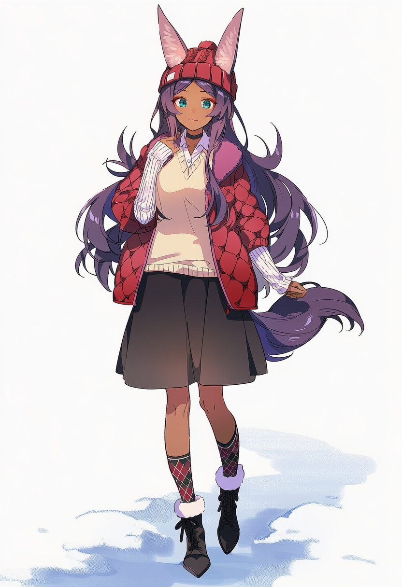

[在线例图](https://assets.quicktagcloud.com/images/raven_composition/raven_composition-5735.jpg?v=5bad51a5413bf944)

<a id="raven_composition-5736"></a>

## 加藤段藏

ID：`raven_composition-5736`；分类：角色图鉴 / Fate / FGO；来源标记：`safe`。

来源说明：

> 作品：Fate
> 性别：女
> 登场时间：2017
> 阵营（如有）：FGO

正向提示词：

```text
katou_danzou_(fate)
```

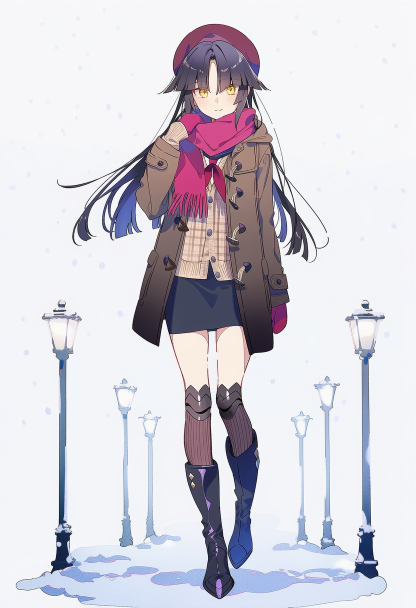

[在线例图](https://assets.quicktagcloud.com/images/raven_composition/raven_composition-5736.jpg?v=499b8ecde0b5d3c1)

<a id="raven_composition-5737"></a>

## 茶茶

ID：`raven_composition-5737`；分类：角色图鉴 / Fate / FGO；来源标记：`safe`。

来源说明：

> 作品：Fate
> 性别：女
> 登场时间：2017
> 阵营（如有）：FGO

正向提示词：

```text
chacha_(fate)
```

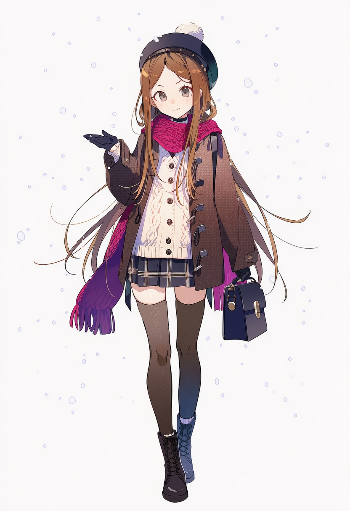

[在线例图](https://assets.quicktagcloud.com/images/raven_composition/raven_composition-5737.jpg?v=a24e3a731c5b6092)

<a id="raven_composition-5738"></a>

## 彭忒西勒亚

ID：`raven_composition-5738`；分类：角色图鉴 / Fate / FGO；来源标记：`safe`。

来源说明：

> 作品：Fate
> 性别：女
> 登场时间：2017
> 阵营（如有）：FGO

正向提示词：

```text
penthesilea_(fate)
```

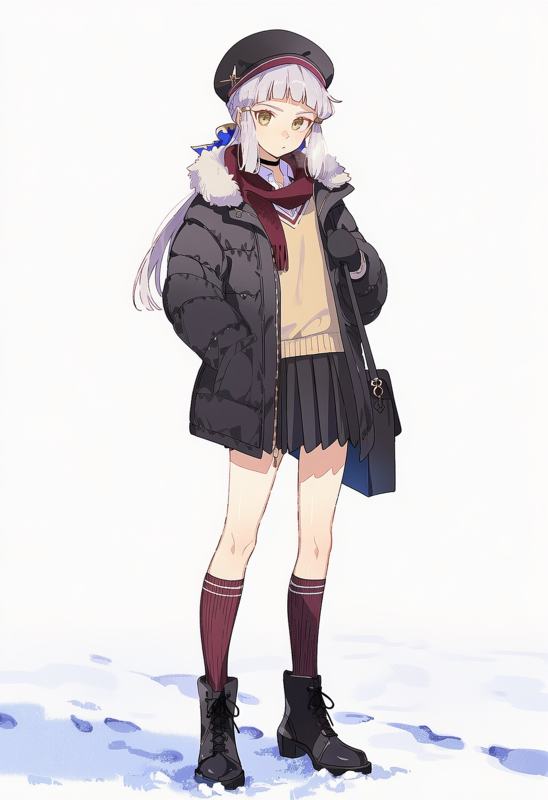

[在线例图](https://assets.quicktagcloud.com/images/raven_composition/raven_composition-5738.jpg?v=f75f8f9749b479dc)

<a id="raven_composition-5739"></a>

## 望月千代女

ID：`raven_composition-5739`；分类：角色图鉴 / Fate / FGO；来源标记：`safe`。

来源说明：

> 作品：Fate
> 性别：女
> 登场时间：2017
> 阵营（如有）：FGO

正向提示词：

```text
mochizuki_chiyome_(fate)
```

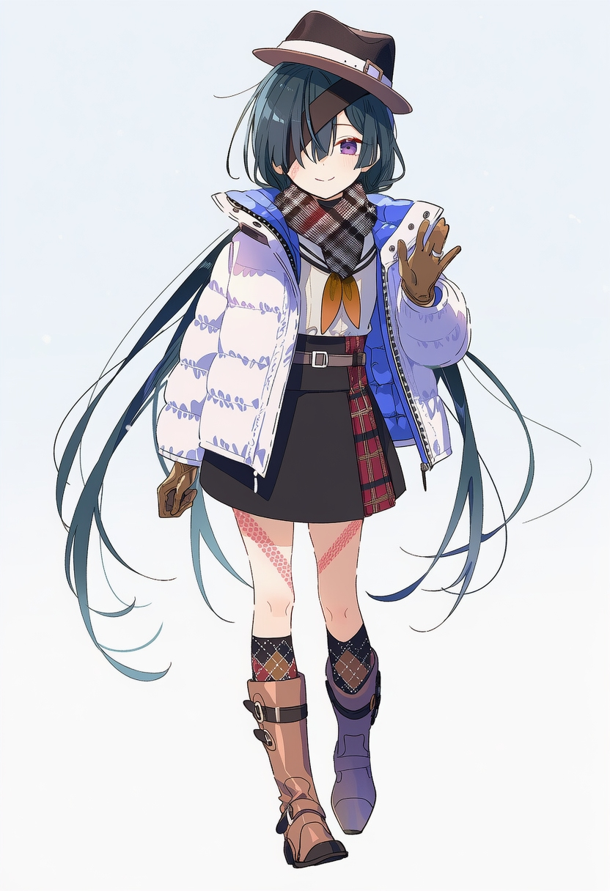

[在线例图](https://assets.quicktagcloud.com/images/raven_composition/raven_composition-5739.jpg?v=101b723adb03d786)

<a id="raven_composition-5740"></a>

## 帕尔瓦蒂

ID：`raven_composition-5740`；分类：角色图鉴 / Fate / FGO；来源标记：`safe`。

来源说明：

> 作品：Fate
> 性别：女
> 登场时间：2017
> 阵营（如有）：FGO

正向提示词：

```text
parvati_(fate)
```

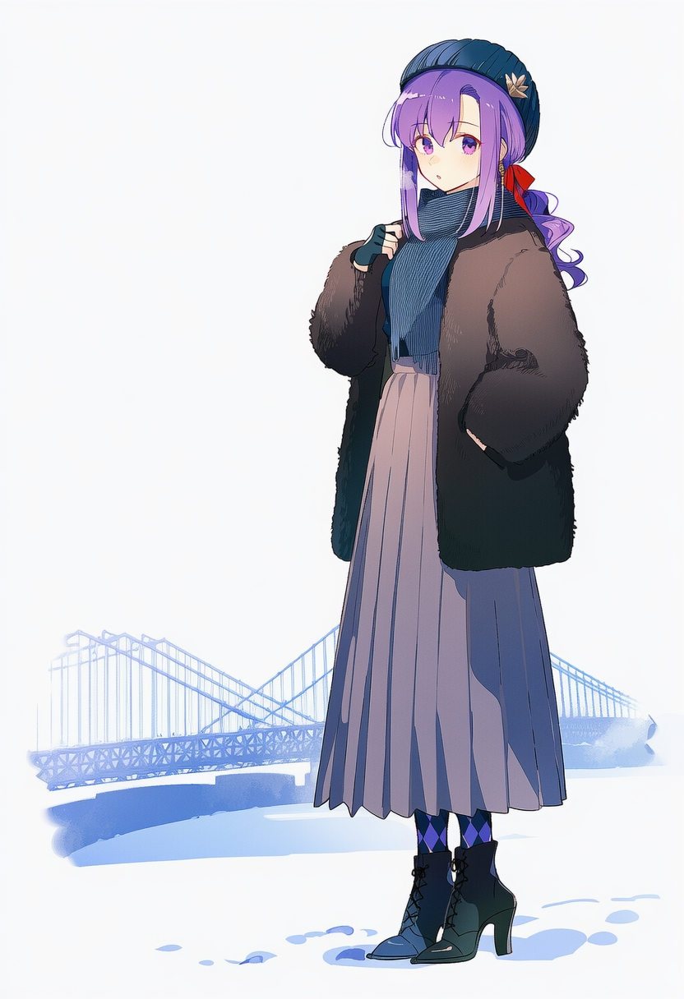

[在线例图](https://assets.quicktagcloud.com/images/raven_composition/raven_composition-5740.jpg?v=ae21f9c52c2ccb72)

<a id="raven_composition-5741"></a>

## 阿蒂拉·Santa

ID：`raven_composition-5741`；分类：角色图鉴 / Fate / FGO；来源标记：`safe`。

来源说明：

> 作品：Fate
> 性别：女
> 登场时间：2017
> 阵营（如有）：FGO

正向提示词：

```text
altera_the_santa_(fate)
```

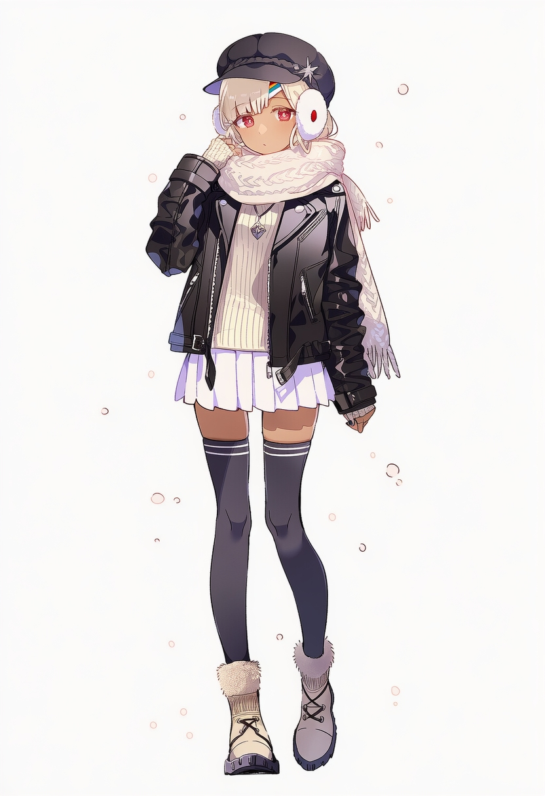

[在线例图](https://assets.quicktagcloud.com/images/raven_composition/raven_composition-5741.jpg?v=2dd102d257de3b75)

<a id="raven_composition-5742"></a>

## 罗伯

ID：`raven_composition-5742`；分类：角色图鉴 / Fate / FGO；来源标记：`safe`。

来源说明：

> 作品：Fate
> 性别：不适用/不明
> 登场时间：2017
> 阵营（如有）：FGO

正向提示词：

```text
lobo_(fate)
```

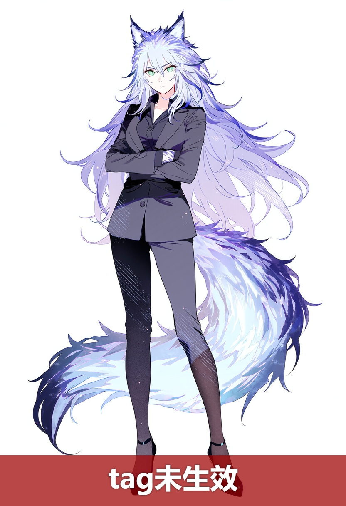

[在线例图](https://assets.quicktagcloud.com/images/raven_composition/raven_composition-5742.jpg?v=dd9f77577497ac46)

<a id="raven_composition-5743"></a>

## 柳生但马守宗矩

ID：`raven_composition-5743`；分类：角色图鉴 / Fate / FGO；来源标记：`safe`。

来源说明：

> 作品：Fate
> 性别：男
> 登场时间：2017
> 阵营（如有）：FGO

正向提示词：

```text
yagyuu_munenori_(fate)
```

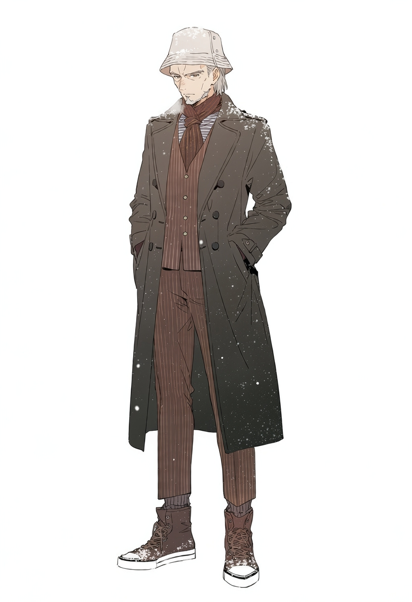

[在线例图](https://assets.quicktagcloud.com/images/raven_composition/raven_composition-5743.jpg?v=fbde78cc30952c82)

<a id="raven_composition-5744"></a>

## 泽尔科

ID：`raven_composition-5744`；分类：角色图鉴 / Fate / FGO；来源标记：`safe`。

来源说明：

> 作品：Fate
> 性别：不适用/不明
> 登场时间：2017
> 阵营（如有）：FGO

正向提示词：

```text
zerco_(fate)
```


[在线例图](https://assets.quicktagcloud.com/images/raven_composition/raven_composition-5744.jpg?v=b60ef91f3c1d3d98)

<a id="raven_composition-5745"></a>

## 妖精骑士崔斯坦（芭万·希）

ID：`raven_composition-5745`；分类：角色图鉴 / Fate / FGO；来源标记：`safe`。

来源说明：

> 作品：Fate
> 性别：女
> 登场时间：2018
> 阵营（如有）：FGO

正向提示词：

```text
baobhan_sith_(fate)
```

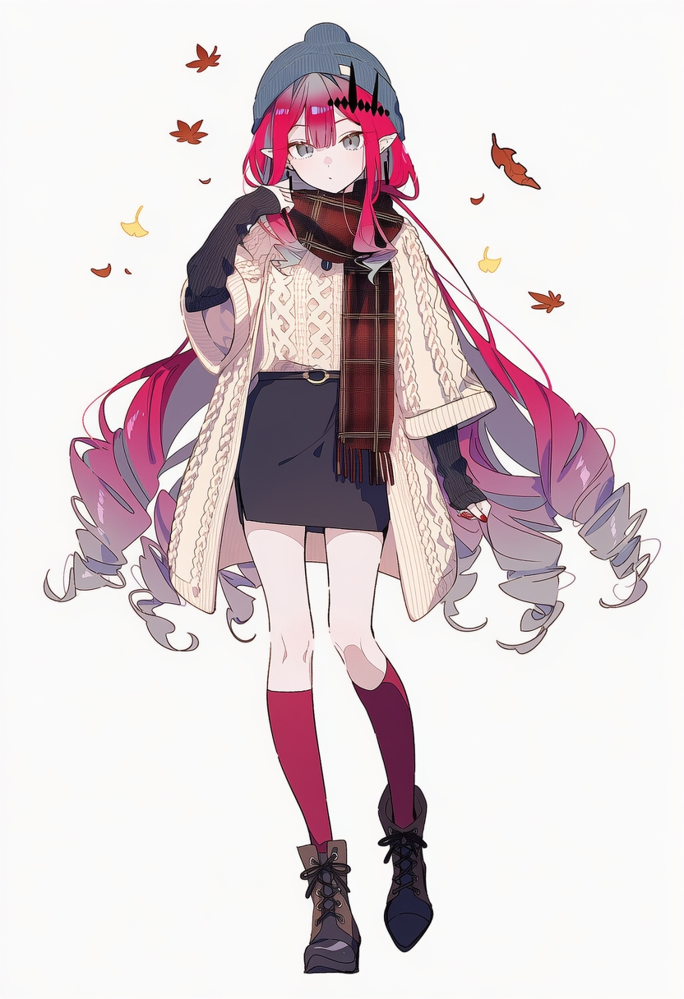

[在线例图](https://assets.quicktagcloud.com/images/raven_composition/raven_composition-5745.jpg?v=103fbb6446e53692)

<a id="raven_composition-5746"></a>

## 阿尔托莉雅·Caster

ID：`raven_composition-5746`；分类：角色图鉴 / Fate / FGO；来源标记：`safe`。

来源说明：

> 作品：Fate
> 性别：女
> 登场时间：2018
> 阵营（如有）：FGO

正向提示词：

```text
artoria_caster_(fate)
```

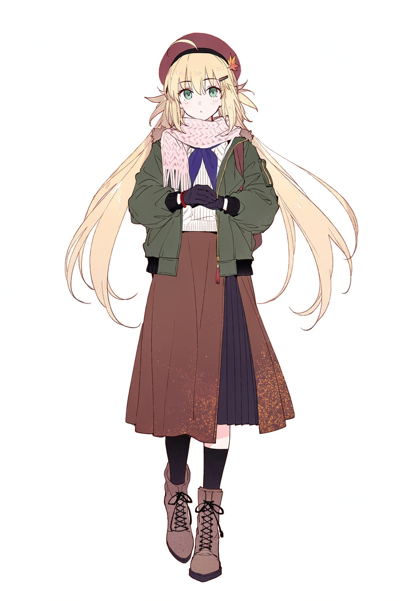

[在线例图](https://assets.quicktagcloud.com/images/raven_composition/raven_composition-5746.jpg?v=6b760c9f27ebe1da)

<a id="raven_composition-5747"></a>

## 迦摩

ID：`raven_composition-5747`；分类：角色图鉴 / Fate / FGO；来源标记：`safe`。

来源说明：

> 作品：Fate
> 性别：女
> 登场时间：2018
> 阵营（如有）：FGO

正向提示词：

```text
kama_(fate)
```


[在线例图](https://assets.quicktagcloud.com/images/raven_composition/raven_composition-5747.jpg?v=ee066d8ff1ec46f7)

<a id="raven_composition-5748"></a>

## 奥伯龙

ID：`raven_composition-5748`；分类：角色图鉴 / Fate / FGO；来源标记：`safe`。

来源说明：

> 作品：Fate
> 性别：男
> 登场时间：2018
> 阵营（如有）：FGO

正向提示词：

```text
oberon_(fate)
```

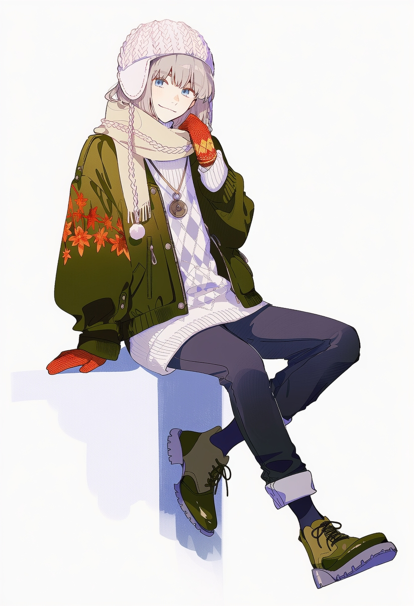

[在线例图](https://assets.quicktagcloud.com/images/raven_composition/raven_composition-5748.jpg?v=fd42ea6d542bf2d0)

<a id="raven_composition-5749"></a>

## 妖精骑士兰斯洛特（梅柳齐娜）

ID：`raven_composition-5749`；分类：角色图鉴 / Fate / FGO；来源标记：`safe`。

来源说明：

> 作品：Fate
> 性别：女
> 登场时间：2018
> 阵营（如有）：FGO

正向提示词：

```text
melusine_(fate)
```

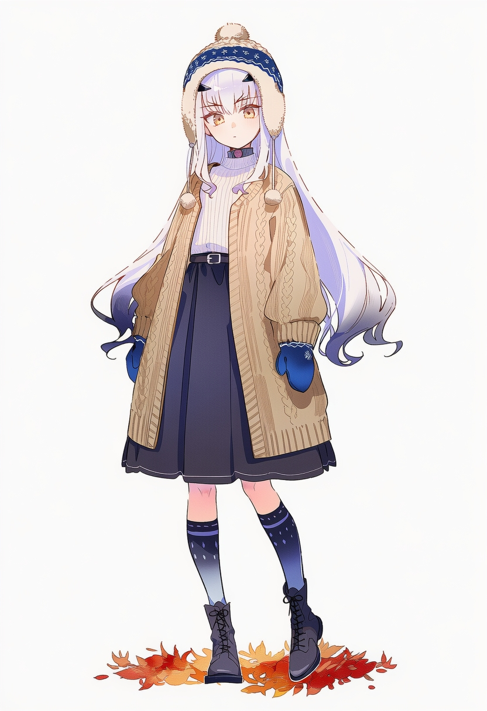

[在线例图](https://assets.quicktagcloud.com/images/raven_composition/raven_composition-5749.jpg?v=9741fc53de3e6a0d)

<a id="raven_composition-5750"></a>

## 葛饰北斋

ID：`raven_composition-5750`；分类：角色图鉴 / Fate / FGO；来源标记：`safe`。

来源说明：

> 作品：Fate
> 性别：女
> 登场时间：2018
> 阵营（如有）：FGO

正向提示词：

```text
katsushika_hokusai_(fate)
```

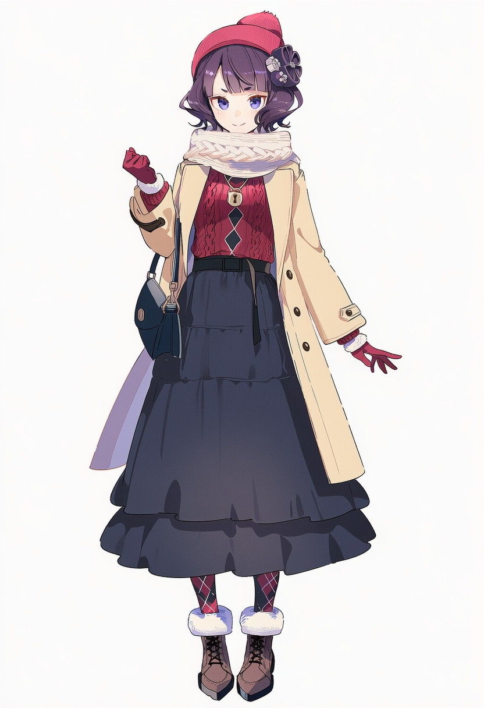

[在线例图](https://assets.quicktagcloud.com/images/raven_composition/raven_composition-5750.jpg?v=295d7454aa53ec3d)

<a id="raven_composition-5751"></a>

## 妖精骑士高文（巴格斯特）

ID：`raven_composition-5751`；分类：角色图鉴 / Fate / FGO；来源标记：`safe`。

来源说明：

> 作品：Fate
> 性别：女
> 登场时间：2018
> 阵营（如有）：FGO

正向提示词：

```text
barghest_(fate)
```


[在线例图](https://assets.quicktagcloud.com/images/raven_composition/raven_composition-5751.jpg?v=fe9b7f2150f8ad06)

<a id="raven_composition-5752"></a>

## 高扬斯卡娅

ID：`raven_composition-5752`；分类：角色图鉴 / Fate / FGO；来源标记：`safe`。

来源说明：

> 作品：Fate
> 性别：女
> 登场时间：2018
> 阵营（如有）：FGO

正向提示词：

```text
koyanskaya_(fate)
```


[在线例图](https://assets.quicktagcloud.com/images/raven_composition/raven_composition-5752.jpg?v=29382430d28adb0b)

<a id="raven_composition-5753"></a>

## 阿纳斯塔西娅

ID：`raven_composition-5753`；分类：角色图鉴 / Fate / FGO；来源标记：`safe`。

来源说明：

> 作品：Fate
> 性别：女
> 登场时间：2018
> 阵营（如有）：FGO

正向提示词：

```text
anastasia_(fate)
```

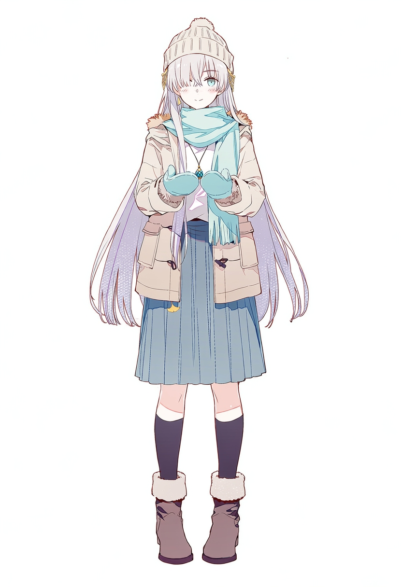

[在线例图](https://assets.quicktagcloud.com/images/raven_composition/raven_composition-5753.jpg?v=321a30accbb5fa1e)

<a id="raven_composition-5754"></a>

## 虞美人

ID：`raven_composition-5754`；分类：角色图鉴 / Fate / FGO；来源标记：`safe`。

来源说明：

> 作品：Fate
> 性别：女
> 登场时间：2018
> 阵营（如有）：FGO

正向提示词：

```text
yu_mei-ren_(fate)
```

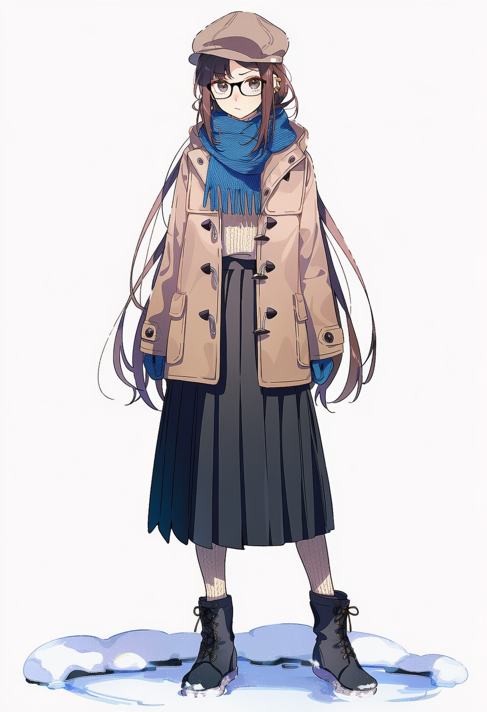

[在线例图](https://assets.quicktagcloud.com/images/raven_composition/raven_composition-5754.jpg?v=e24e88d2c04705dc)

<a id="raven_composition-5755"></a>

## 拿破仑

ID：`raven_composition-5755`；分类：角色图鉴 / Fate / FGO；来源标记：`safe`。

来源说明：

> 作品：Fate
> 性别：男
> 登场时间：2018
> 阵营（如有）：FGO

正向提示词：

```text
napoleon_bonaparte_(fate)
```

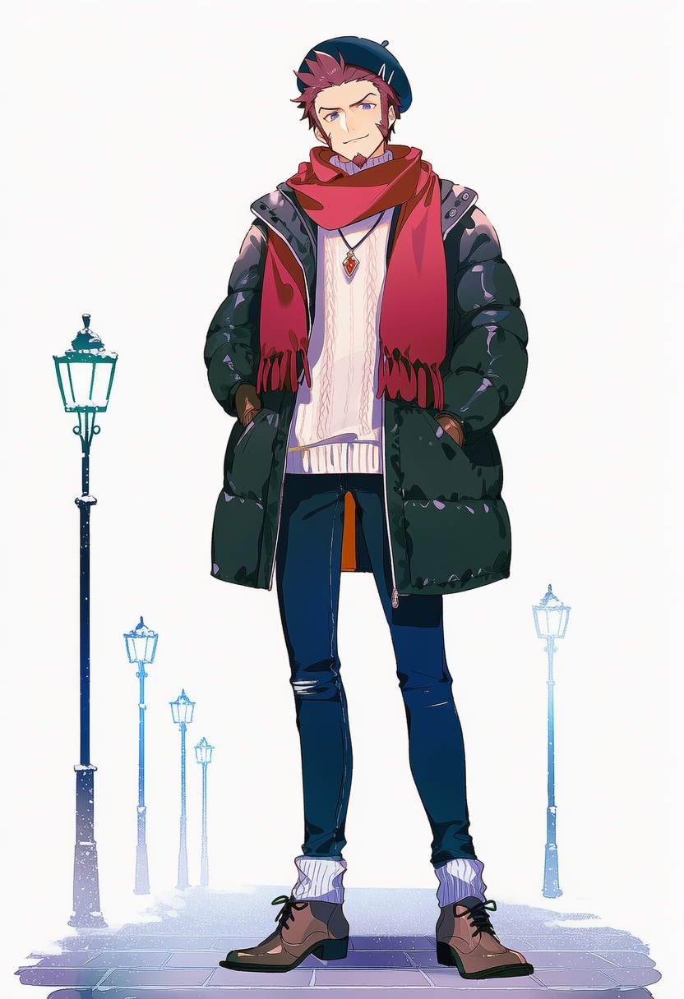

[在线例图](https://assets.quicktagcloud.com/images/raven_composition/raven_composition-5755.jpg?v=5333231a6d32cbb8)

<a id="raven_composition-5756"></a>

## 谜之女主角XX

ID：`raven_composition-5756`；分类：角色图鉴 / Fate / FGO；来源标记：`safe`。

来源说明：

> 作品：Fate
> 性别：女
> 登场时间：2018
> 阵营（如有）：FGO

正向提示词：

```text
mysterious_heroine_xx_(fate)
```

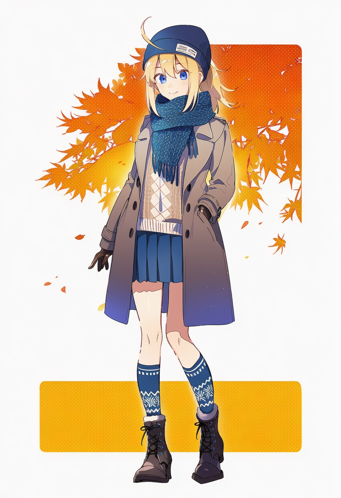

[在线例图](https://assets.quicktagcloud.com/images/raven_composition/raven_composition-5756.jpg?v=c40e749095eff29d)

<a id="raven_composition-5757"></a>

## 斯卡哈·斯卡蒂

ID：`raven_composition-5757`；分类：角色图鉴 / Fate / FGO；来源标记：`safe`。

来源说明：

> 作品：Fate
> 性别：女
> 登场时间：2018
> 阵营（如有）：FGO

正向提示词：

```text
scathach-skadi_(fate)
```


[在线例图](https://assets.quicktagcloud.com/images/raven_composition/raven_composition-5757.jpg?v=e1dcd822eb176ff3)

<a id="raven_composition-5758"></a>

## 斯卡哈·斯卡蒂

ID：`raven_composition-5758`；分类：角色图鉴 / Fate / FGO；来源标记：`safe`。

来源说明：

> 作品：Fate
> 性别：女
> 登场时间：2018
> 阵营（如有）：FGO

正向提示词：

```text
scathach_skadi_(fate)
```

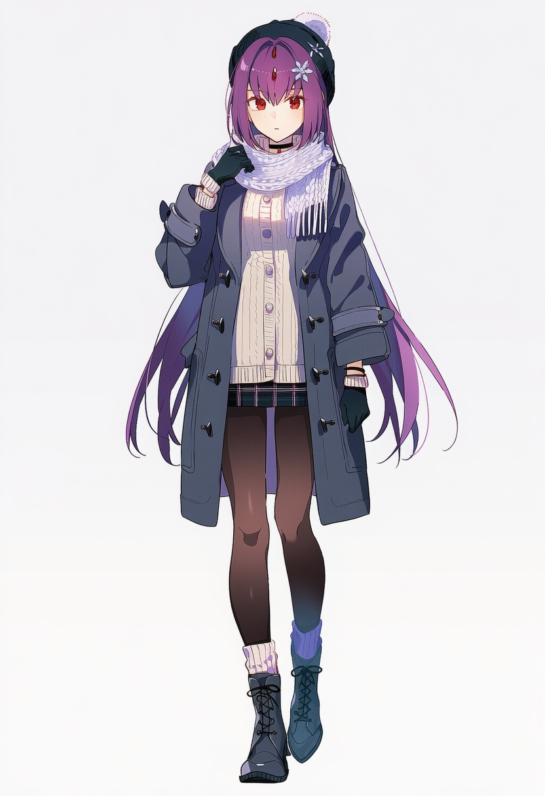

[在线例图](https://assets.quicktagcloud.com/images/raven_composition/raven_composition-5758.jpg?v=fe74e2bbefded88c)

<a id="raven_composition-5759"></a>

## 凯尼斯

ID：`raven_composition-5759`；分类：角色图鉴 / Fate / FGO；来源标记：`safe`。

来源说明：

> 作品：Fate
> 性别：女
> 登场时间：2018
> 阵营（如有）：FGO

正向提示词：

```text
caenis_(fate)
```

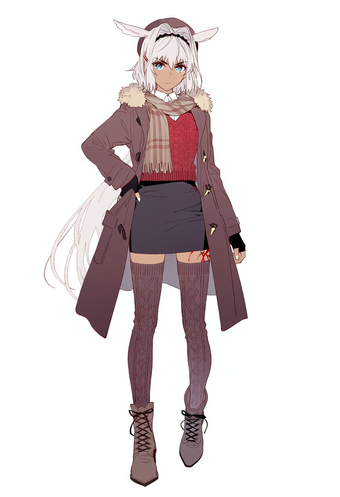

[在线例图](https://assets.quicktagcloud.com/images/raven_composition/raven_composition-5759.jpg?v=8a3de7a335bb2525)

<a id="raven_composition-5760"></a>

## 杨贵妃

ID：`raven_composition-5760`；分类：角色图鉴 / Fate / FGO；来源标记：`safe`。

来源说明：

> 作品：Fate
> 性别：女
> 登场时间：2018
> 阵营（如有）：FGO

正向提示词：

```text
yang_guifei_(fate)
```

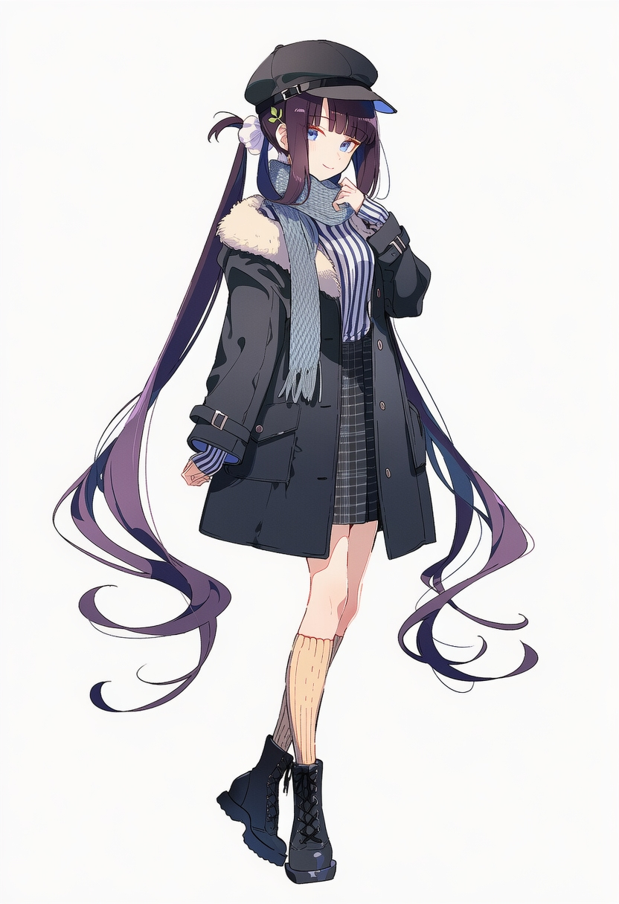

[在线例图](https://assets.quicktagcloud.com/images/raven_composition/raven_composition-5760.jpg?v=33225be4cc548d9b)

<a id="raven_composition-5761"></a>

## 特诺奇蒂特兰

ID：`raven_composition-5761`；分类：角色图鉴 / Fate / FGO；来源标记：`safe`。

来源说明：

> 作品：Fate
> 性别：女
> 登场时间：2018
> 阵营（如有）：FGO

正向提示词：

```text
tenochtitlan_(fate)
```

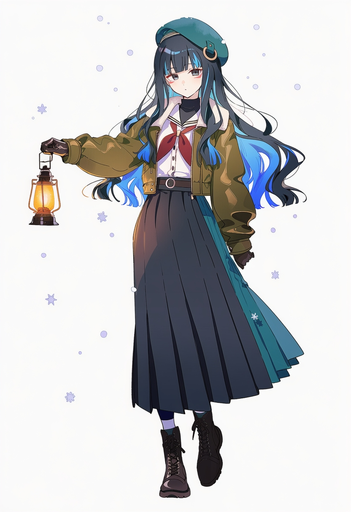

[在线例图](https://assets.quicktagcloud.com/images/raven_composition/raven_composition-5761.jpg?v=9706e4894e5e7ec7)

<a id="raven_composition-5762"></a>

## 紫式部

ID：`raven_composition-5762`；分类：角色图鉴 / Fate / FGO；来源标记：`safe`。

来源说明：

> 作品：Fate
> 性别：女
> 登场时间：2018
> 阵营（如有）：FGO

正向提示词：

```text
murasaki_shikibu_(fate)
```

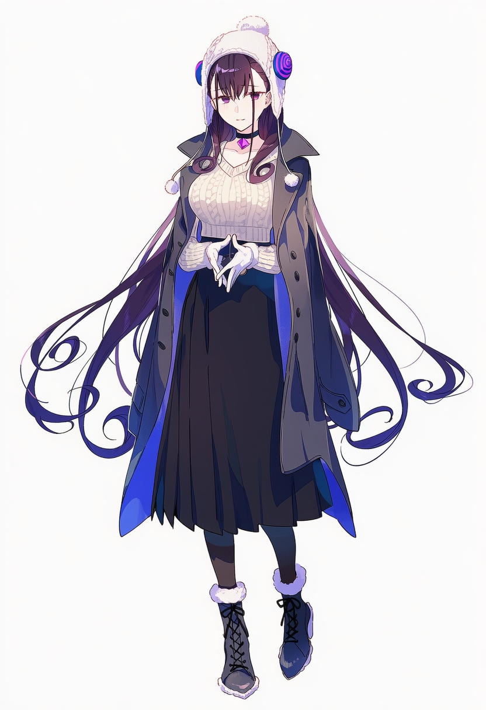

[在线例图](https://assets.quicktagcloud.com/images/raven_composition/raven_composition-5762.jpg?v=57fa3961a125f304)

<a id="raven_composition-5763"></a>

## 托托大人

ID：`raven_composition-5763`；分类：角色图鉴 / Fate / FGO；来源标记：`safe`。

来源说明：

> 作品：Fate
> 性别：不适用/不明
> 登场时间：2018
> 阵营（如有）：FGO

正向提示词：

```text
toto-sama_(fate)
```

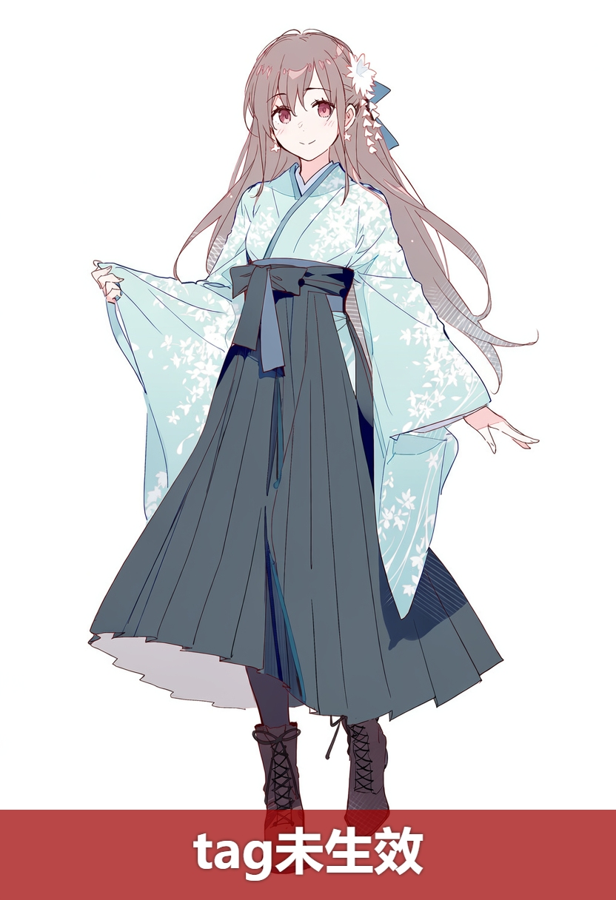

[在线例图](https://assets.quicktagcloud.com/images/raven_composition/raven_composition-5763.jpg?v=c239c09da877391c)

<a id="raven_composition-5764"></a>

## 救世主托内莉可

ID：`raven_composition-5764`；分类：角色图鉴 / Fate / FGO；来源标记：`safe`。

来源说明：

> 作品：Fate
> 性别：女
> 登场时间：2018
> 阵营（如有）：FGO

正向提示词：

```text
aesc_(fate)
```

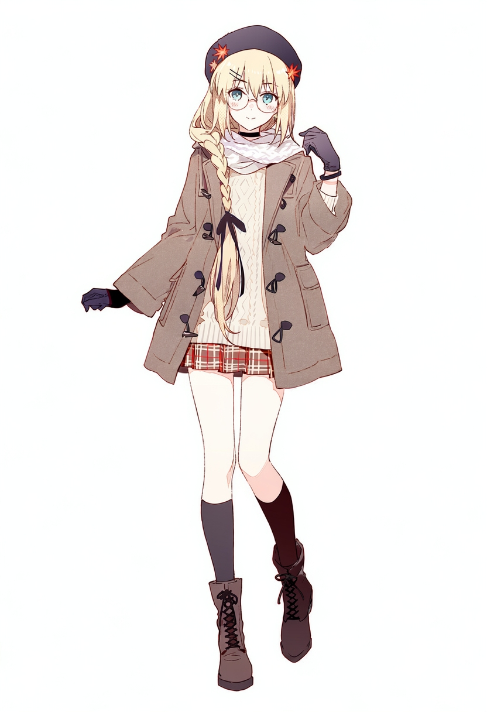

[在线例图](https://assets.quicktagcloud.com/images/raven_composition/raven_composition-5764.jpg?v=6b03f3f29fec7b6f)

<a id="raven_composition-5766"></a>

## 特斯卡特利波卡

ID：`raven_composition-5766`；分类：角色图鉴 / Fate / FGO；来源标记：`safe`。

来源说明：

> 作品：Fate
> 性别：男
> 登场时间：2018
> 阵营（如有）：FGO

正向提示词：

```text
tezcatlipoca_(fate)
```

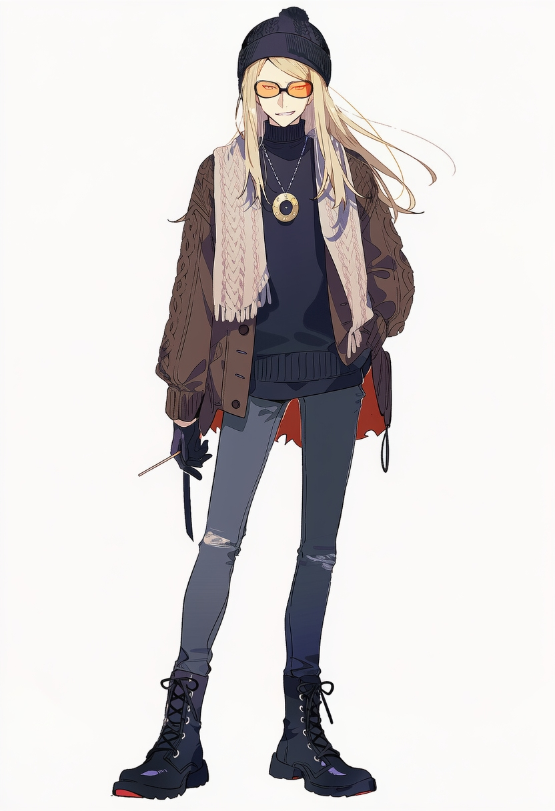

[在线例图](https://assets.quicktagcloud.com/images/raven_composition/raven_composition-5766.jpg?v=1f7737f0fd85e4e6)

<a id="raven_composition-5767"></a>

## 德拉科

ID：`raven_composition-5767`；分类：角色图鉴 / Fate / FGO；来源标记：`safe`。

来源说明：

> 作品：Fate
> 性别：女
> 登场时间：2018
> 阵营（如有）：FGO

正向提示词：

```text
queen_draco_(fate)
```


[在线例图](https://assets.quicktagcloud.com/images/raven_composition/raven_composition-5767.jpg?v=e733f59391004100)

<a id="raven_composition-5768"></a>

## 布拉达曼特

ID：`raven_composition-5768`；分类：角色图鉴 / Fate / FGO；来源标记：`safe`。

来源说明：

> 作品：Fate
> 性别：女
> 登场时间：2018
> 阵营（如有）：FGO

正向提示词：

```text
bradamante_(fate)
```

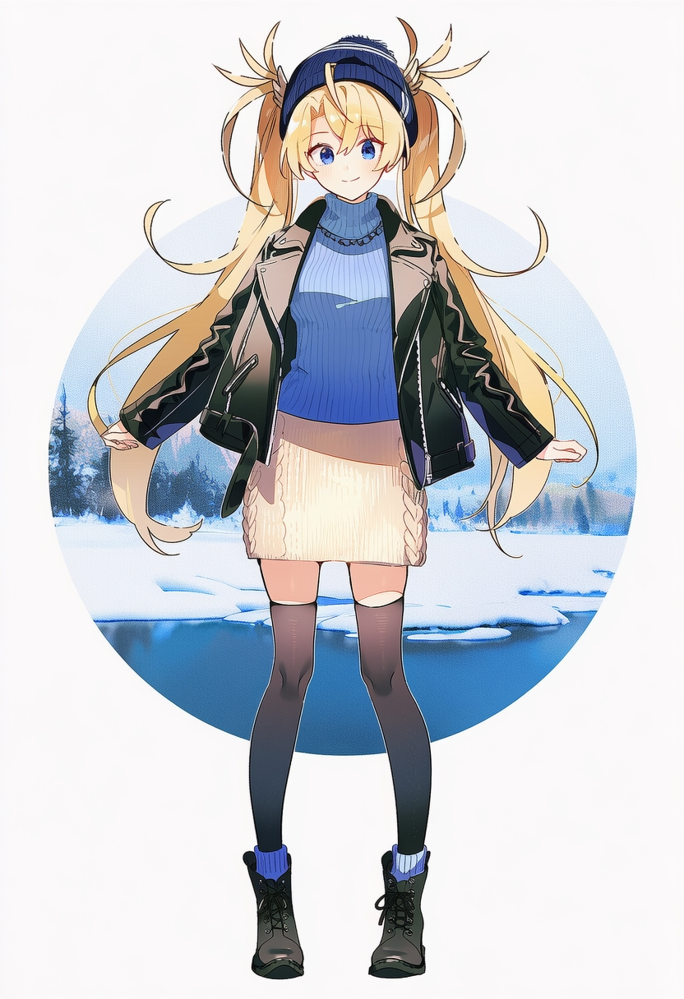

[在线例图](https://assets.quicktagcloud.com/images/raven_composition/raven_composition-5768.jpg?v=b96f38056b00b7b4)

<a id="raven_composition-5769"></a>

## 梵高

ID：`raven_composition-5769`；分类：角色图鉴 / Fate / FGO；来源标记：`safe`。

来源说明：

> 作品：Fate
> 性别：女
> 登场时间：2018
> 阵营（如有）：FGO

正向提示词：

```text
van_gogh_(fate)
```

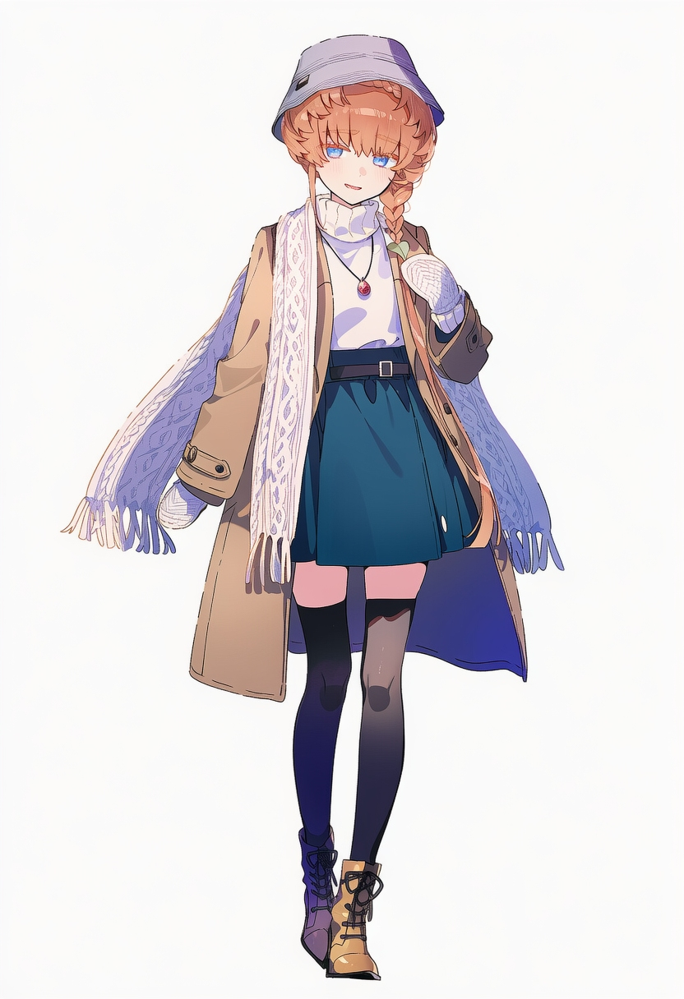

[在线例图](https://assets.quicktagcloud.com/images/raven_composition/raven_composition-5769.jpg?v=1ef6c6db6356060d)

<a id="raven_composition-5770"></a>

## 清少纳言

ID：`raven_composition-5770`；分类：角色图鉴 / Fate / FGO；来源标记：`safe`。

来源说明：

> 作品：Fate
> 性别：女
> 登场时间：2018
> 阵营（如有）：FGO

正向提示词：

```text
sei_shounagon_(fate)
```

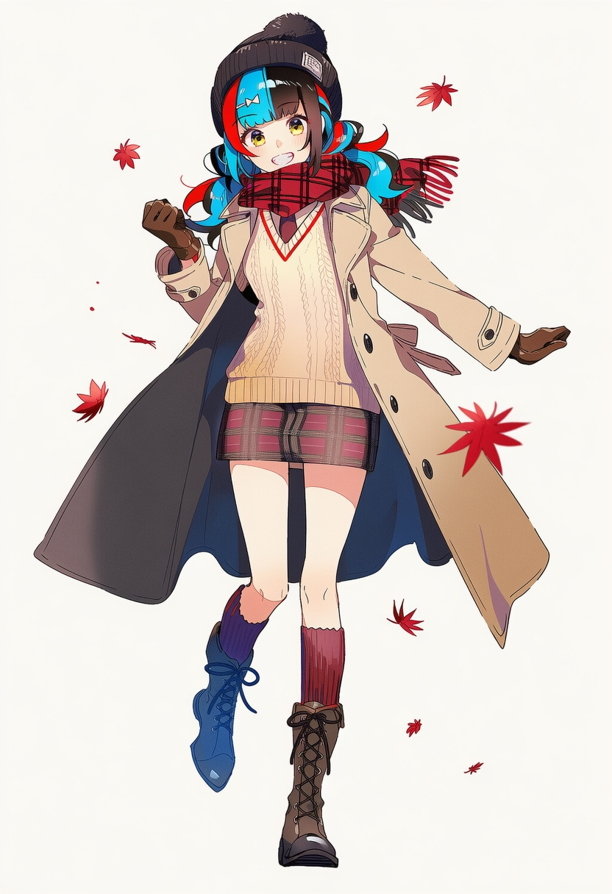

[在线例图](https://assets.quicktagcloud.com/images/raven_composition/raven_composition-5770.jpg?v=7e5a26794e16f32d)

<a id="raven_composition-5771"></a>

## 维伊

ID：`raven_composition-5771`；分类：角色图鉴 / Fate / FGO；来源标记：`safe`。

来源说明：

> 作品：Fate
> 性别：不适用/不明
> 登场时间：2018
> 阵营（如有）：FGO

正向提示词：

```text
viy_(fate)
```

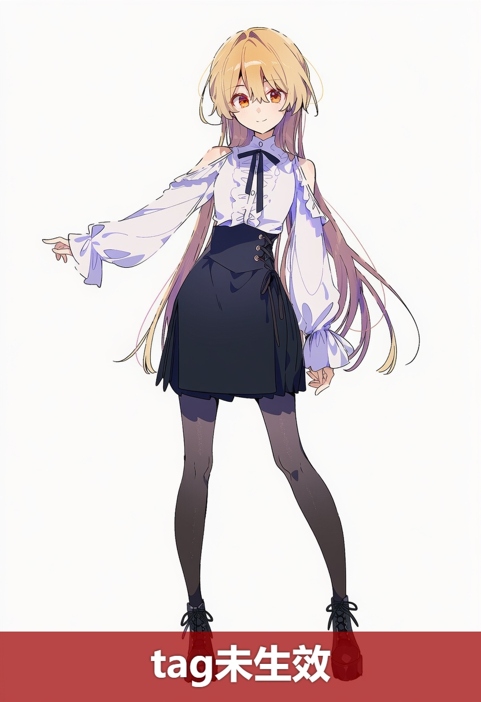

[在线例图](https://assets.quicktagcloud.com/images/raven_composition/raven_composition-5771.jpg?v=1a6b9706ba4f0c24)

<a id="raven_composition-5772"></a>

## 斋藤一

ID：`raven_composition-5772`；分类：角色图鉴 / Fate / FGO；来源标记：`safe`。

来源说明：

> 作品：Fate
> 性别：男
> 登场时间：2018
> 阵营（如有）：FGO

正向提示词：

```text
saitou_hajime_(fate)
```

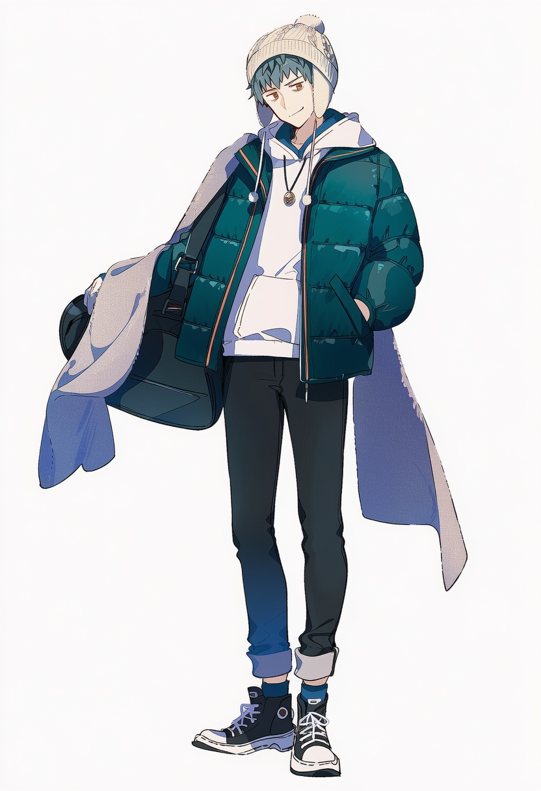

[在线例图](https://assets.quicktagcloud.com/images/raven_composition/raven_composition-5772.jpg?v=393d6d638dea3275)

<a id="raven_composition-5774"></a>

## 徐福

ID：`raven_composition-5774`；分类：角色图鉴 / Fate / FGO；来源标记：`safe`。

来源说明：

> 作品：Fate
> 性别：女
> 登场时间：2018
> 阵营（如有）：FGO

正向提示词：

```text
xu_fu_(fate)
```

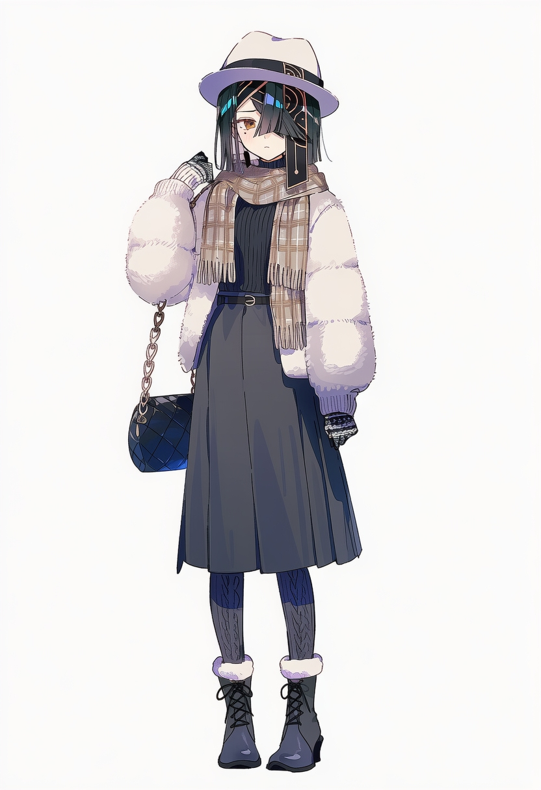

[在线例图](https://assets.quicktagcloud.com/images/raven_composition/raven_composition-5774.jpg?v=58fc9727efec6ba5)

<a id="raven_composition-5775"></a>

## 伊吹童子

ID：`raven_composition-5775`；分类：角色图鉴 / Fate / FGO；来源标记：`safe`。

来源说明：

> 作品：Fate
> 性别：女
> 登场时间：2018
> 阵营（如有）：FGO

正向提示词：

```text
ibuki_douji_(fate)
```

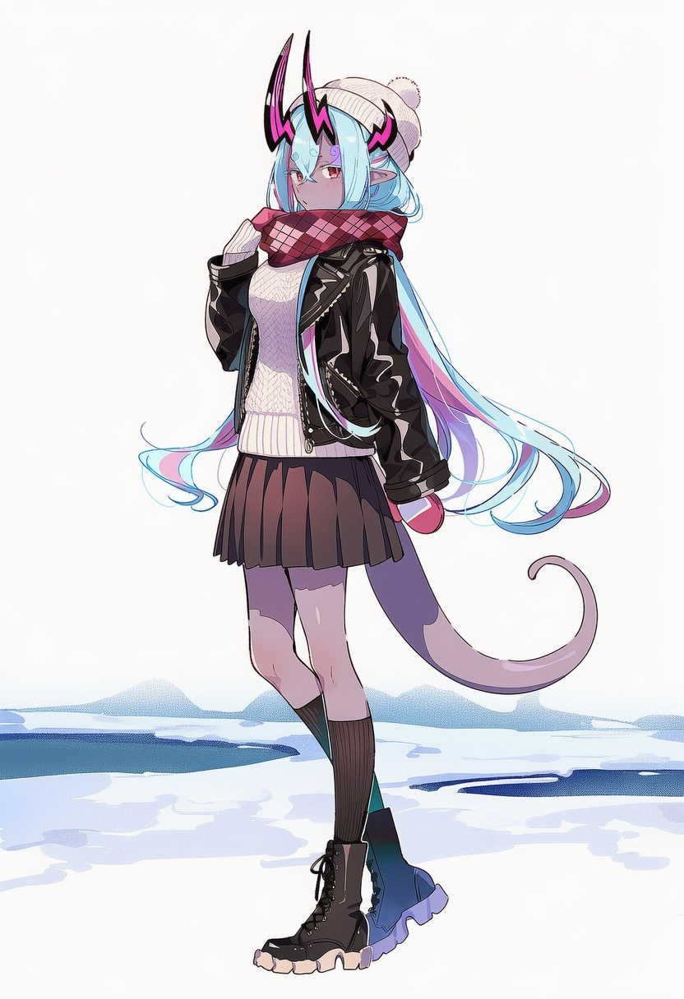

[在线例图](https://assets.quicktagcloud.com/images/raven_composition/raven_composition-5775.jpg?v=56932ad016da0540)

<a id="raven_composition-5776"></a>

## 冲田J总司

ID：`raven_composition-5776`；分类：角色图鉴 / Fate / FGO；来源标记：`safe`。

来源说明：

> 作品：Fate
> 性别：女
> 登场时间：2018
> 阵营（如有）：FGO

正向提示词：

```text
okita_j._souji_(fate)
```

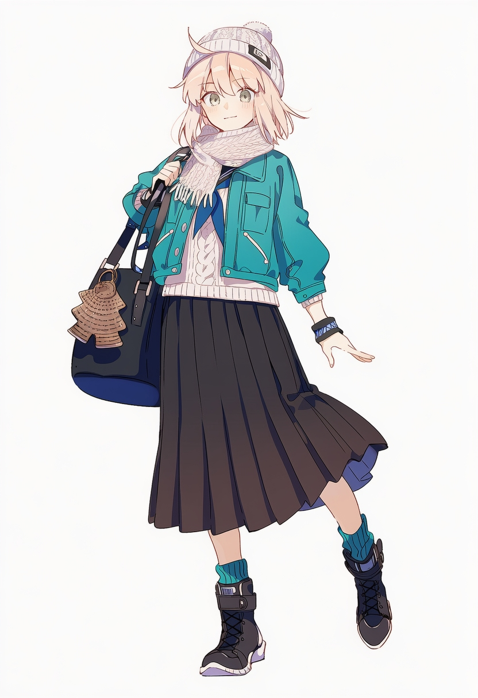

[在线例图](https://assets.quicktagcloud.com/images/raven_composition/raven_composition-5776.jpg?v=f3adbbf8a12056e1)

<a id="raven_composition-5777"></a>

## 女武神

ID：`raven_composition-5777`；分类：角色图鉴 / Fate / FGO；来源标记：`safe`。

来源说明：

> 作品：Fate
> 性别：女
> 登场时间：2018
> 阵营（如有）：FGO

正向提示词：

```text
valkyrie_(fate)
```

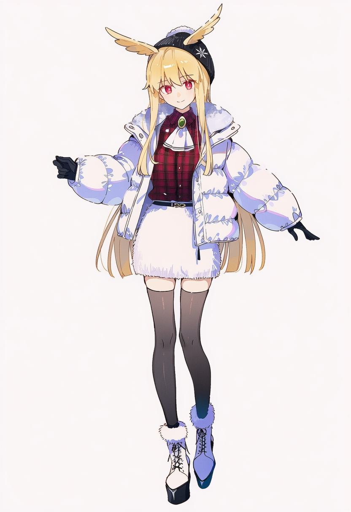

[在线例图](https://assets.quicktagcloud.com/images/raven_composition/raven_composition-5777.jpg?v=29e9201903d314d5)

<a id="raven_composition-5778"></a>

## 加雷斯

ID：`raven_composition-5778`；分类：角色图鉴 / Fate / FGO；来源标记：`safe`。

来源说明：

> 作品：Fate
> 性别：女
> 登场时间：2018
> 阵营（如有）：FGO

正向提示词：

```text
gareth_(fate)
```

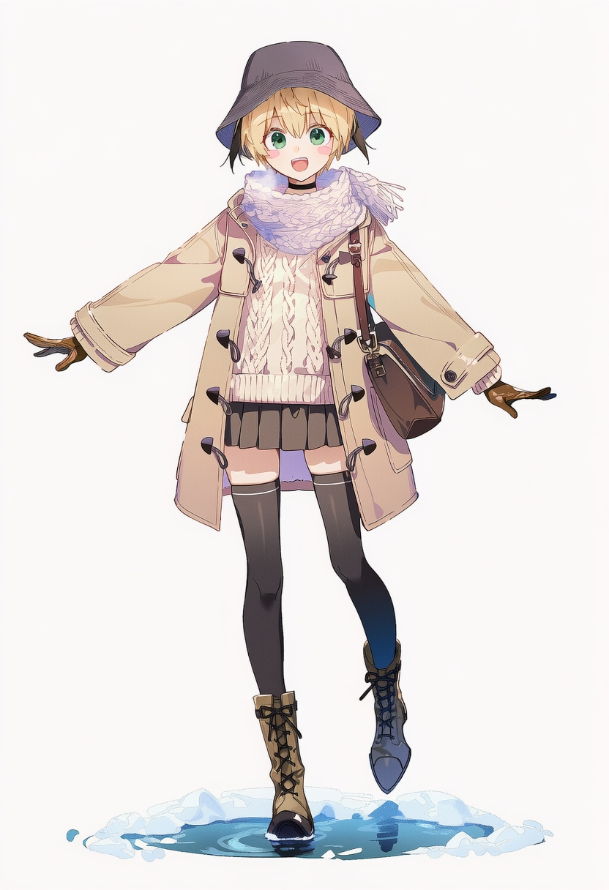

[在线例图](https://assets.quicktagcloud.com/images/raven_composition/raven_composition-5778.jpg?v=d3aa84b8349ab6cb)

<a id="raven_composition-5779"></a>

## 阿瓦隆女士

ID：`raven_composition-5779`；分类：角色图鉴 / Fate / FGO；来源标记：`safe`。

来源说明：

> 作品：Fate
> 性别：女
> 登场时间：2018
> 阵营（如有）：FGO

正向提示词：

```text
lady_avalon_(fate)
```

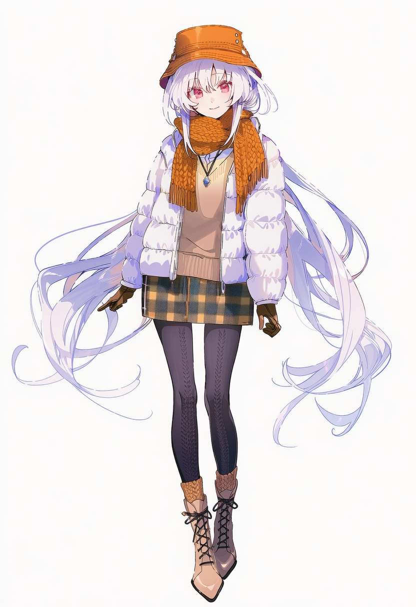

[在线例图](https://assets.quicktagcloud.com/images/raven_composition/raven_composition-5779.jpg?v=e4a9d4e786f0805e)

<a id="raven_composition-5780"></a>

## 安东尼奥·萨列里

ID：`raven_composition-5780`；分类：角色图鉴 / Fate / FGO；来源标记：`safe`。

来源说明：

> 作品：Fate
> 性别：男
> 登场时间：2018
> 阵营（如有）：FGO

正向提示词：

```text
antonio_salieri_(fate)
```

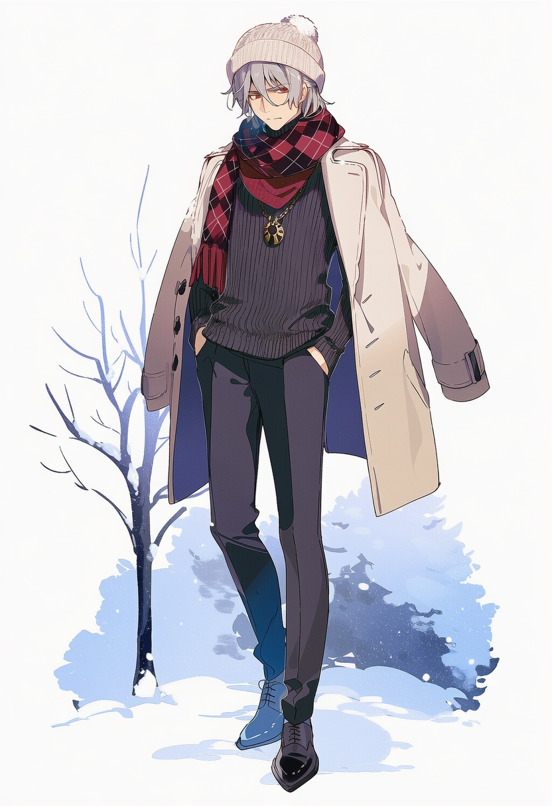

[在线例图](https://assets.quicktagcloud.com/images/raven_composition/raven_composition-5780.jpg?v=ec73df880208cdd9)

<a id="raven_composition-5781"></a>

## 哈贝特洛特

ID：`raven_composition-5781`；分类：角色图鉴 / Fate / FGO；来源标记：`safe`。

来源说明：

> 作品：Fate
> 性别：女
> 登场时间：2018
> 阵营（如有）：FGO

正向提示词：

```text
habetrot_(fate)
```

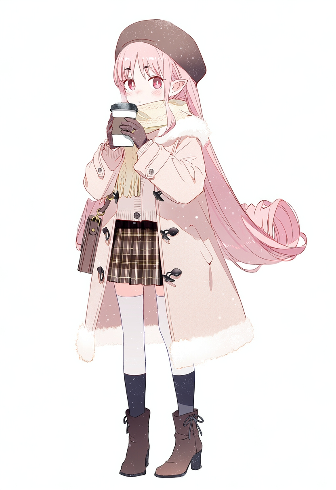

[在线例图](https://assets.quicktagcloud.com/images/raven_composition/raven_composition-5781.jpg?v=84d30c7daabd751c)

<a id="raven_composition-5782"></a>

## 兰陵王

ID：`raven_composition-5782`；分类：角色图鉴 / Fate / FGO；来源标记：`safe`。

来源说明：

> 作品：Fate
> 性别：男
> 登场时间：2018
> 阵营（如有）：FGO

正向提示词：

```text
prince_of_lan_ling_(fate)
```

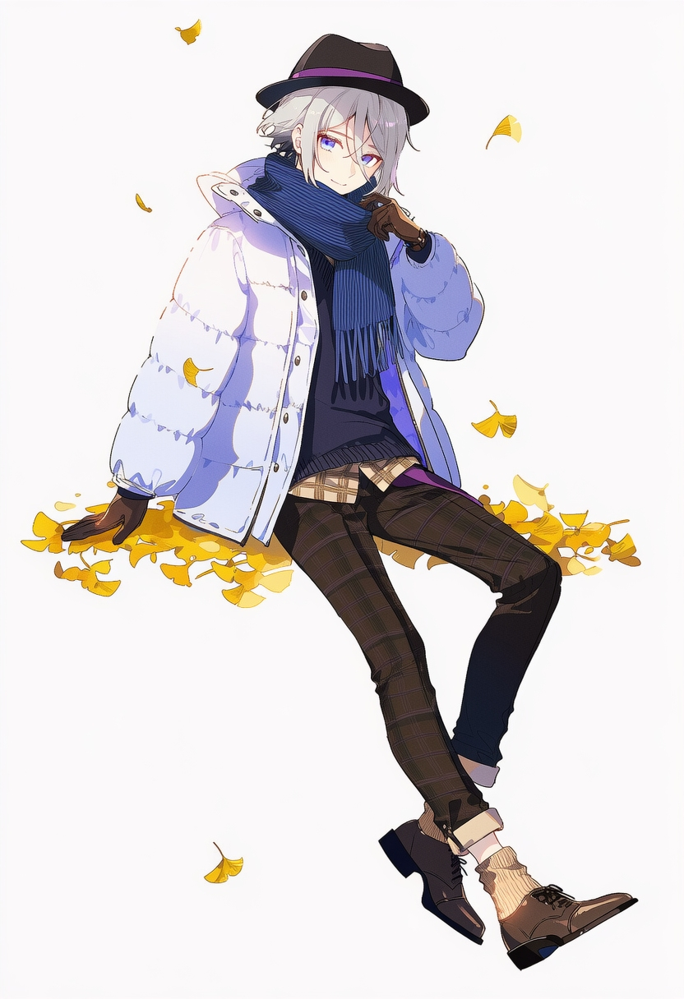

[在线例图](https://assets.quicktagcloud.com/images/raven_composition/raven_composition-5782.jpg?v=03fa79a63946b656)

<a id="raven_composition-5783"></a>

## 宇宙伊什塔尔

ID：`raven_composition-5783`；分类：角色图鉴 / Fate / FGO；来源标记：`safe`。

来源说明：

> 作品：Fate
> 性别：女
> 登场时间：2018
> 阵营（如有）：FGO

正向提示词：

```text
space_ishtar_(fate)
```

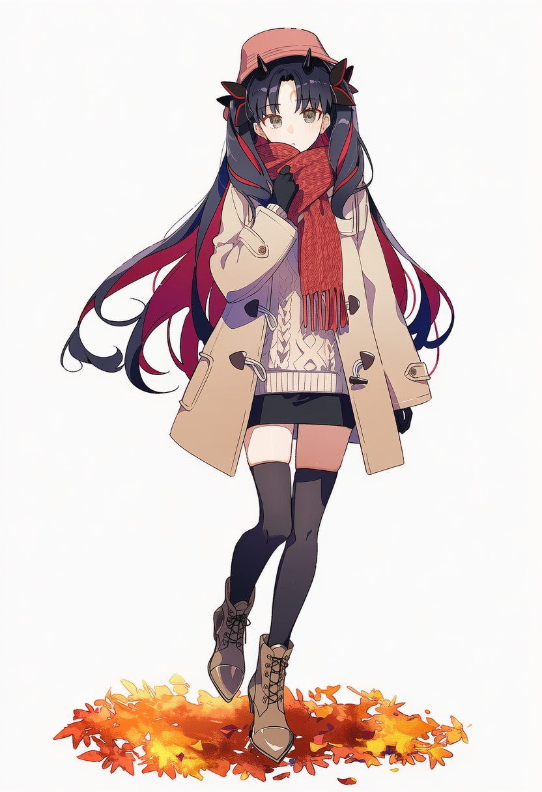

[在线例图](https://assets.quicktagcloud.com/images/raven_composition/raven_composition-5783.jpg?v=fe96f42232b8543c)

<a id="raven_composition-5784"></a>

## 科尔努诺斯

ID：`raven_composition-5784`；分类：角色图鉴 / Fate / FGO；来源标记：`safe`。

来源说明：

> 作品：Fate
> 性别：不适用/不明
> 登场时间：2018
> 阵营（如有）：FGO

正向提示词：

```text
cernunnos_(fate)
```

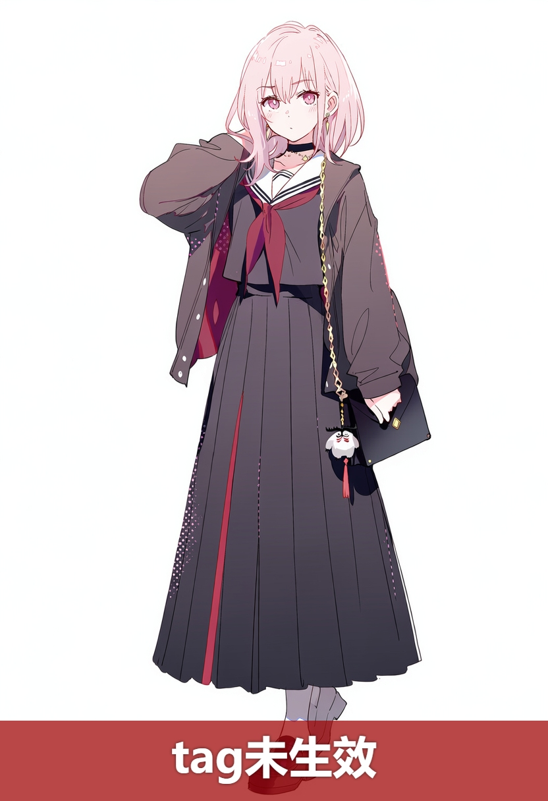

[在线例图](https://assets.quicktagcloud.com/images/raven_composition/raven_composition-5784.jpg?v=095e0360be73f0eb)

<a id="raven_composition-5785"></a>

## 多布雷尼亚·尼基季奇

ID：`raven_composition-5785`；分类：角色图鉴 / Fate / FGO；来源标记：`safe`。

来源说明：

> 作品：Fate
> 性别：女
> 登场时间：2018
> 阵营（如有）：FGO

正向提示词：

```text
dobrynya_nikitich_(fate)
```

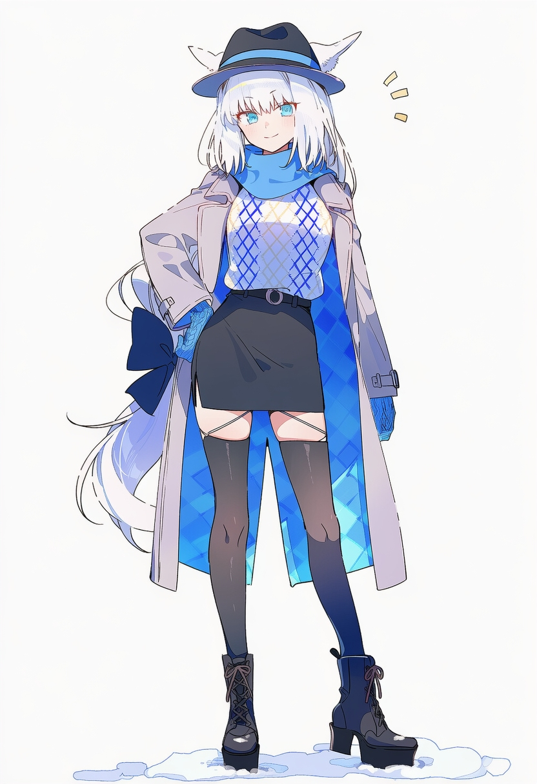

[在线例图](https://assets.quicktagcloud.com/images/raven_composition/raven_composition-5785.jpg?v=fc0d0e7183c8e75b)

<a id="raven_composition-5786"></a>

## 卑弥呼

ID：`raven_composition-5786`；分类：角色图鉴 / Fate / FGO；来源标记：`safe`。

来源说明：

> 作品：Fate
> 性别：女
> 登场时间：2018
> 阵营（如有）：FGO

正向提示词：

```text
himiko_(fate)
```

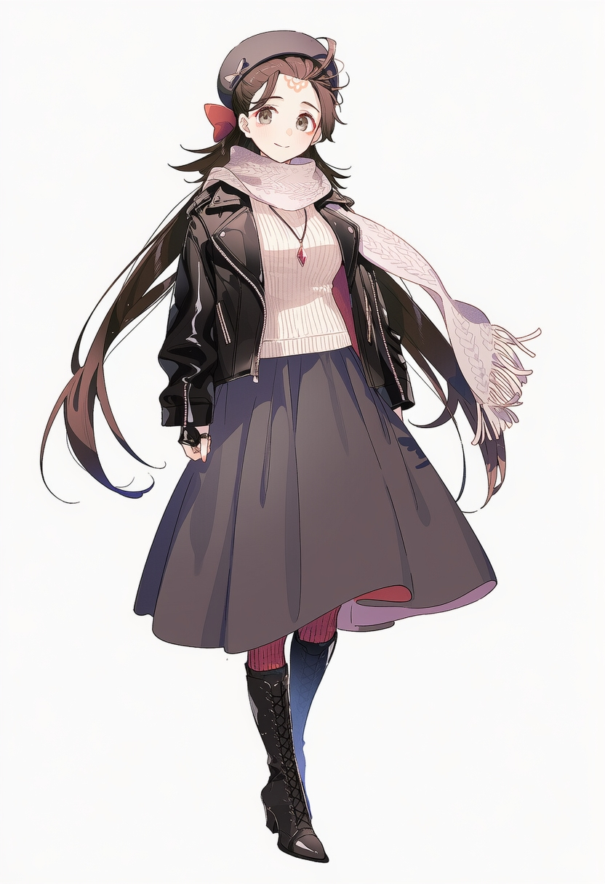

[在线例图](https://assets.quicktagcloud.com/images/raven_composition/raven_composition-5786.jpg?v=aa0383fb7d51899d)

<a id="raven_composition-5787"></a>

## 芝诺比阿

ID：`raven_composition-5787`；分类：角色图鉴 / Fate / FGO；来源标记：`safe`。

来源说明：

> 作品：Fate
> 性别：女
> 登场时间：2018
> 阵营（如有）：FGO

正向提示词：

```text
zenobia_(fate)
```

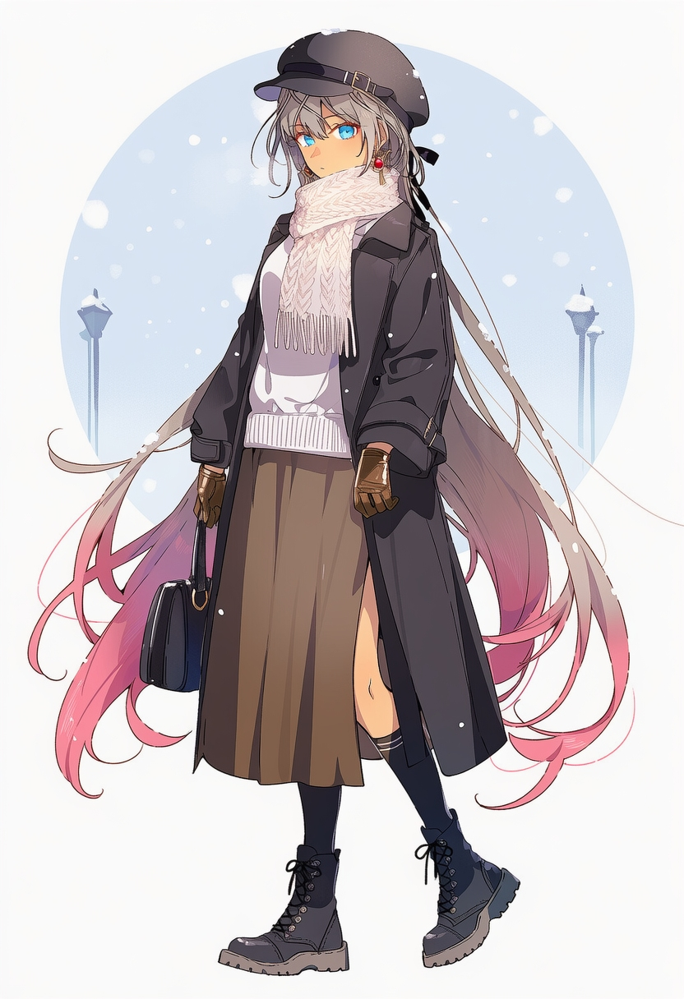

[在线例图](https://assets.quicktagcloud.com/images/raven_composition/raven_composition-5787.jpg?v=5cc150669843bcd0)

<a id="raven_composition-5788"></a>

## 秦良玉

ID：`raven_composition-5788`；分类：角色图鉴 / Fate / FGO；来源标记：`safe`。

来源说明：

> 作品：Fate
> 性别：女
> 登场时间：2018
> 阵营（如有）：FGO

正向提示词：

```text
qin_liangyu_(fate)
```

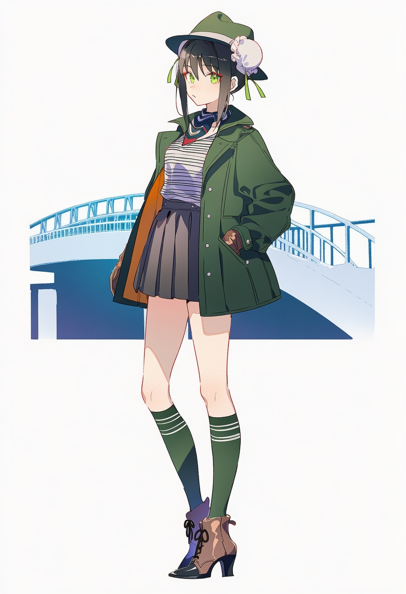

[在线例图](https://assets.quicktagcloud.com/images/raven_composition/raven_composition-5788.jpg?v=96f8a50a64a2a0c7)

<a id="raven_composition-5789"></a>

## 呼延灼

ID：`raven_composition-5789`；分类：角色图鉴 / Fate / FGO；来源标记：`safe`。

来源说明：

> 作品：Fate
> 性别：女
> 登场时间：2018
> 阵营（如有）：FGO

正向提示词：

```text
huyan_zhuo_(fate)
```

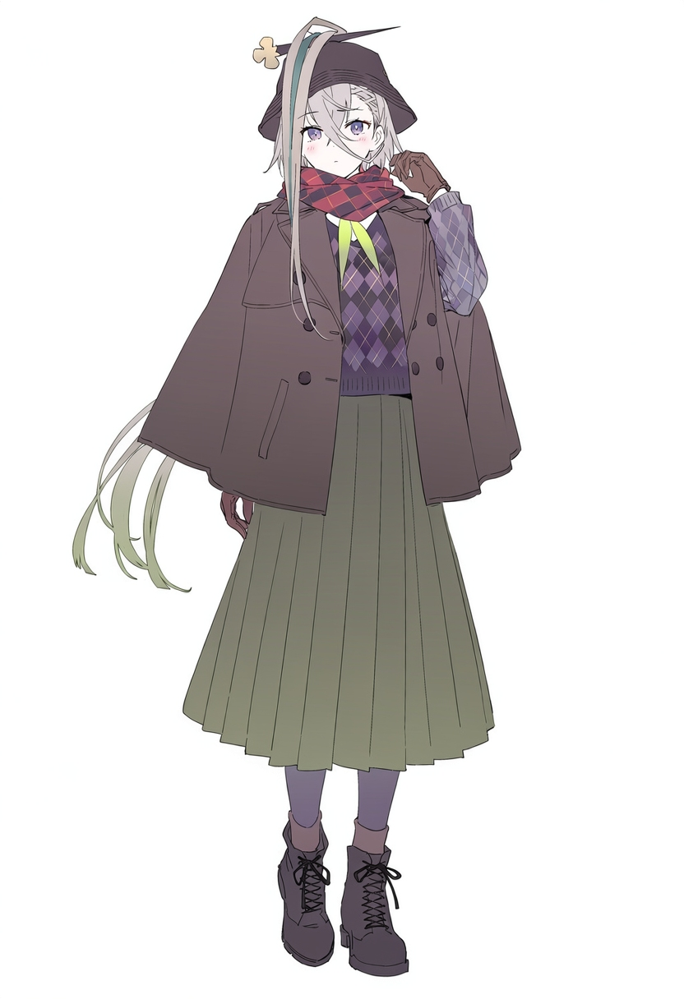

[在线例图](https://assets.quicktagcloud.com/images/raven_composition/raven_composition-5789.jpg?v=2ba4d08eb4e7bf58)

<a id="raven_composition-5790"></a>

## 诺什

ID：`raven_composition-5790`；分类：角色图鉴 / Fate / FGO；来源标记：`safe`。

来源说明：

> 作品：Fate
> 性别：不适用/不明
> 登场时间：2018
> 阵营（如有）：FGO

正向提示词：

```text
nosh_(fate)
```

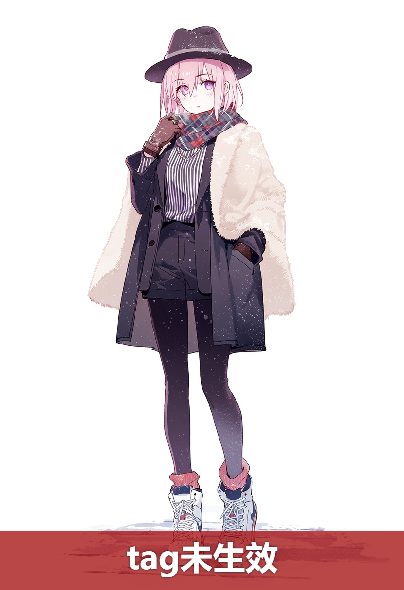

[在线例图](https://assets.quicktagcloud.com/images/raven_composition/raven_composition-5790.jpg?v=264c515dbc627109)

<a id="raven_composition-5791"></a>

## 志度内

ID：`raven_composition-5791`；分类：角色图鉴 / Fate / FGO；来源标记：`safe`。

来源说明：

> 作品：Fate
> 性别：女
> 登场时间：2018
> 阵营（如有）：FGO

正向提示词：

```text
sitonai_(fate)
```


[在线例图](https://assets.quicktagcloud.com/images/raven_composition/raven_composition-5791.jpg?v=ca464a1dbe26c789)

<a id="raven_composition-5792"></a>

## 阿周那〔Alter〕

ID：`raven_composition-5792`；分类：角色图鉴 / Fate / FGO；来源标记：`safe`。

来源说明：

> 作品：Fate
> 性别：男
> 登场时间：2018
> 阵营（如有）：FGO

正向提示词：

```text
arjuna_alter_(fate)
```

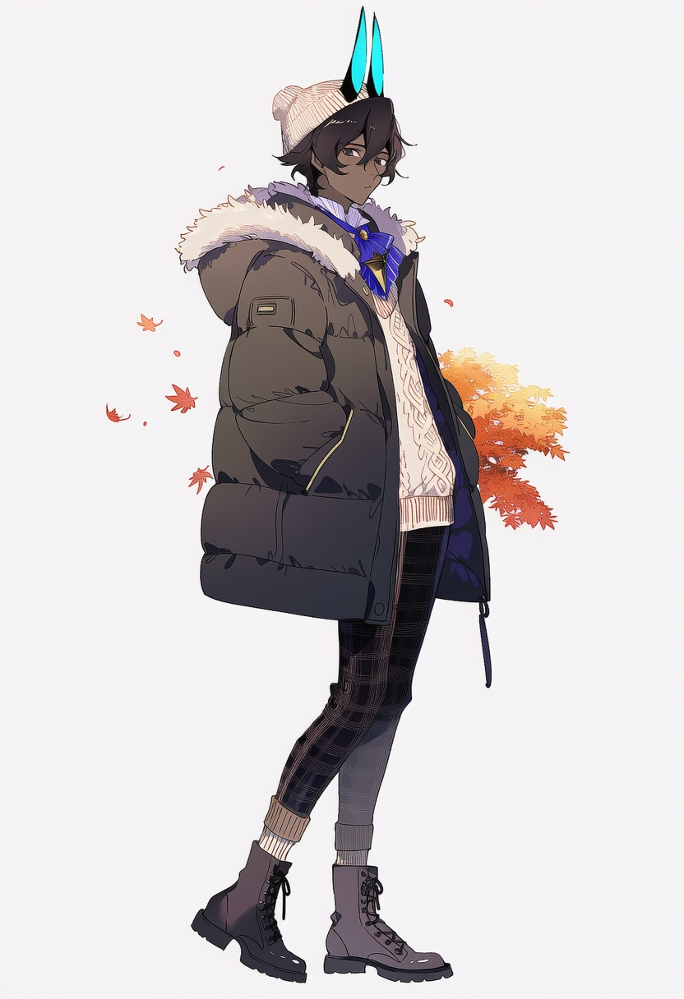

[在线例图](https://assets.quicktagcloud.com/images/raven_composition/raven_composition-5792.jpg?v=fc250aa01eb4a4ce)

<a id="raven_composition-5793"></a>

## 玛丽·安托瓦内特〔Alter〕

ID：`raven_composition-5793`；分类：角色图鉴 / Fate / FGO；来源标记：`safe`。

来源说明：

> 作品：Fate
> 性别：女
> 登场时间：2018
> 阵营（如有）：FGO

正向提示词：

```text
marie_antoinette_alter_(fate)
```

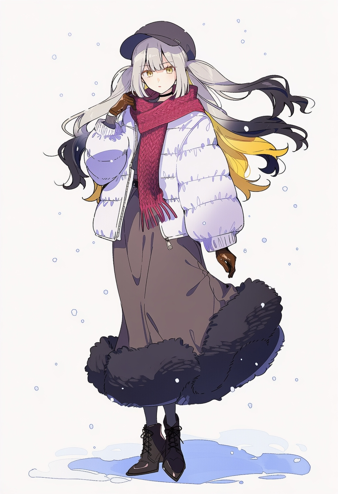

[在线例图](https://assets.quicktagcloud.com/images/raven_composition/raven_composition-5793.jpg?v=ba289ae549aa17ac)

<a id="raven_composition-5794"></a>

## 夏洛特·科黛

ID：`raven_composition-5794`；分类：角色图鉴 / Fate / FGO；来源标记：`safe`。

来源说明：

> 作品：Fate
> 性别：女
> 登场时间：2018
> 阵营（如有）：FGO

正向提示词：

```text
charlotte_corday_(fate)
```


[在线例图](https://assets.quicktagcloud.com/images/raven_composition/raven_composition-5794.jpg?v=06f3ea3be9c778ec)

<a id="raven_composition-5795"></a>

## 齐格鲁德

ID：`raven_composition-5795`；分类：角色图鉴 / Fate / FGO；来源标记：`safe`。

来源说明：

> 作品：Fate
> 性别：男
> 登场时间：2018
> 阵营（如有）：FGO

正向提示词：

```text
sigurd_(fate)
```


[在线例图](https://assets.quicktagcloud.com/images/raven_composition/raven_composition-5795.jpg?v=741f9f2b66b68dcb)

<a id="raven_composition-5797"></a>

## 高杉晋作

ID：`raven_composition-5797`；分类：角色图鉴 / Fate / FGO；来源标记：`safe`。

来源说明：

> 作品：Fate
> 性别：男
> 登场时间：2018
> 阵营（如有）：FGO

正向提示词：

```text
takasugi_shinsaku_(fate)
```


[在线例图](https://assets.quicktagcloud.com/images/raven_composition/raven_composition-5797.jpg?v=a7d739553cc293b6)

<a id="raven_composition-5798"></a>

## 君士坦丁十一世

ID：`raven_composition-5798`；分类：角色图鉴 / Fate / FGO；来源标记：`safe`。

来源说明：

> 作品：Fate
> 性别：男
> 登场时间：2018
> 阵营（如有）：FGO

正向提示词：

```text
constantine_xi_(fate)
```


[在线例图](https://assets.quicktagcloud.com/images/raven_composition/raven_composition-5798.jpg?v=d6c58634ba4bab29)

<a id="raven_composition-5799"></a>

## 库库尔坎

ID：`raven_composition-5799`；分类：角色图鉴 / Fate / FGO；来源标记：`safe`。

来源说明：

> 作品：Fate
> 性别：女
> 登场时间：2018
> 阵营（如有）：FGO

正向提示词：

```text
kukulkan_(fate)
```


[在线例图](https://assets.quicktagcloud.com/images/raven_composition/raven_composition-5799.jpg?v=31bbbc9265835a36)

<a id="raven_composition-5800"></a>

## 奥特琳德

ID：`raven_composition-5800`；分类：角色图鉴 / Fate / FGO；来源标记：`safe`。

来源说明：

> 作品：Fate
> 性别：女
> 登场时间：2018
> 阵营（如有）：FGO

正向提示词：

```text
ortlinde_(fate)
```


[在线例图](https://assets.quicktagcloud.com/images/raven_composition/raven_composition-5800.jpg?v=c9ccc356162cc4ea)

<a id="raven_composition-5801"></a>

## 斯露德

ID：`raven_composition-5801`；分类：角色图鉴 / Fate / FGO；来源标记：`safe`。

来源说明：

> 作品：Fate
> 性别：女
> 登场时间：2018
> 阵营（如有）：FGO

正向提示词：

```text
thrud_(fate)
```


[在线例图](https://assets.quicktagcloud.com/images/raven_composition/raven_composition-5801.jpg?v=87829a5d93e871e5)

<a id="raven_composition-5803"></a>

## 阿塔兰忒〔Alter〕

ID：`raven_composition-5803`；分类：角色图鉴 / Fate / FGO；来源标记：`safe`。

来源说明：

> 作品：Fate
> 性别：女
> 登场时间：2018
> 阵营（如有）：FGO

正向提示词：

```text
atalanta_alter_(fate)
```


[在线例图](https://assets.quicktagcloud.com/images/raven_composition/raven_composition-5803.jpg?v=2f7302510fe426f7)

<a id="raven_composition-5804"></a>

## 克里姆希尔德

ID：`raven_composition-5804`；分类：角色图鉴 / Fate / FGO；来源标记：`safe`。

来源说明：

> 作品：Fate
> 性别：女
> 登场时间：2018
> 阵营（如有）：FGO

正向提示词：

```text
kriemhild_(fate)
```


[在线例图](https://assets.quicktagcloud.com/images/raven_composition/raven_composition-5804.jpg?v=d88e3b4127b50408)

<a id="raven_composition-5805"></a>

## 波鲁克斯

ID：`raven_composition-5805`；分类：角色图鉴 / Fate / FGO；来源标记：`safe`。

来源说明：

> 作品：Fate
> 性别：女
> 登场时间：2018
> 阵营（如有）：FGO

正向提示词：

```text
pollux_(fate)
```


[在线例图](https://assets.quicktagcloud.com/images/raven_composition/raven_composition-5805.jpg?v=aadf0b7478b29987)

<a id="raven_composition-5806"></a>

## 阿斯克勒庇俄斯

ID：`raven_composition-5806`；分类：角色图鉴 / Fate / FGO；来源标记：`safe`。

来源说明：

> 作品：Fate
> 性别：男
> 登场时间：2018
> 阵营（如有）：FGO

正向提示词：

```text
asclepius_(fate)
```


[在线例图](https://assets.quicktagcloud.com/images/raven_composition/raven_composition-5806.jpg?v=974e2e28baa0c765)

<a id="raven_composition-5807"></a>

## 阿周那之友 阿什瓦塔曼

ID：`raven_composition-5807`；分类：角色图鉴 / Fate / FGO；来源标记：`safe`。

来源说明：

> 作品：Fate
> 性别：男
> 登场时间：2018
> 阵营（如有）：FGO

正向提示词：

```text
ashwatthama_(fate)
```


[在线例图](https://assets.quicktagcloud.com/images/raven_composition/raven_composition-5807.jpg?v=cc9eb4a9c1ce56b1)

<a id="raven_composition-5808"></a>

## 山南敬助

ID：`raven_composition-5808`；分类：角色图鉴 / Fate / FGO；来源标记：`safe`。

来源说明：

> 作品：Fate
> 性别：男
> 登场时间：2018
> 阵营（如有）：FGO

正向提示词：

```text
yamanami_keisuke_(fate)
```


[在线例图](https://assets.quicktagcloud.com/images/raven_composition/raven_composition-5808.jpg?v=a377017666fea809)

<a id="raven_composition-5809"></a>

## 希露德

ID：`raven_composition-5809`；分类：角色图鉴 / Fate / FGO；来源标记：`safe`。

来源说明：

> 作品：Fate
> 性别：女
> 登场时间：2018
> 阵营（如有）：FGO

正向提示词：

```text
hildr_(fate)
```


[在线例图](https://assets.quicktagcloud.com/images/raven_composition/raven_composition-5809.jpg?v=b06b0f934f08d2ed)

<a id="raven_composition-5810"></a>

## 尼托克丽丝〔Alter〕

ID：`raven_composition-5810`；分类：角色图鉴 / Fate / FGO；来源标记：`safe`。

来源说明：

> 作品：Fate
> 性别：女
> 登场时间：2018
> 阵营（如有）：FGO

正向提示词：

```text
nitocris_alter_(fate)
```


[在线例图](https://assets.quicktagcloud.com/images/raven_composition/raven_composition-5810.jpg?v=86c639733fd656c3)

<a id="raven_composition-5811"></a>

## 曼迪卡尔多

ID：`raven_composition-5811`；分类：角色图鉴 / Fate / FGO；来源标记：`safe`。

来源说明：

> 作品：Fate
> 性别：男
> 登场时间：2018
> 阵营（如有）：FGO

正向提示词：

```text
mandricardo_(fate)
```


[在线例图](https://assets.quicktagcloud.com/images/raven_composition/raven_composition-5811.jpg?v=82210f2c284beaf8)

<a id="raven_composition-5812"></a>

## 幼体提亚马特

ID：`raven_composition-5812`；分类：角色图鉴 / Fate / FGO；来源标记：`safe`。

来源说明：

> 作品：Fate
> 性别：女
> 登场时间：2018
> 阵营（如有）：FGO

正向提示词：

```text
larva_tiamat_(fate)
```


[在线例图](https://assets.quicktagcloud.com/images/raven_composition/raven_composition-5812.jpg?v=8029ac096de63be7)

<a id="raven_composition-5813"></a>

## 珀西瓦尔

ID：`raven_composition-5813`；分类：角色图鉴 / Fate / FGO；来源标记：`safe`。

来源说明：

> 作品：Fate
> 性别：男
> 登场时间：2018
> 阵营（如有）：FGO

正向提示词：

```text
percival_(fate)
```


[在线例图](https://assets.quicktagcloud.com/images/raven_composition/raven_composition-5813.jpg?v=3a2b94f7f58f6254)

<a id="raven_composition-5814"></a>

## 瑟坦特

ID：`raven_composition-5814`；分类：角色图鉴 / Fate / FGO；来源标记：`safe`。

来源说明：

> 作品：Fate
> 性别：男
> 登场时间：2018
> 阵营（如有）：FGO

正向提示词：

```text
setanta_(fate)
```


[在线例图](https://assets.quicktagcloud.com/images/raven_composition/raven_composition-5814.jpg?v=3bf4291673088039)

<a id="raven_composition-5815"></a>

## 路塔尔

ID：`raven_composition-5815`；分类：角色图鉴 / Fate / FGO；来源标记：`safe`。

来源说明：

> 作品：Fate
> 性别：男
> 登场时间：2018
> 阵营（如有）：FGO

正向提示词：

```text
luthar_(fate)
```


[在线例图](https://assets.quicktagcloud.com/images/raven_composition/raven_composition-5815.jpg?v=55c0f77801f651b9)

<a id="raven_composition-5816"></a>

## 千利休

ID：`raven_composition-5816`；分类：角色图鉴 / Fate / FGO；来源标记：`safe`。

来源说明：

> 作品：Fate
> 性别：女
> 登场时间：2018
> 阵营（如有）：FGO

正向提示词：

```text
sen_no_rikyu_(fate)
```


[在线例图](https://assets.quicktagcloud.com/images/raven_composition/raven_composition-5816.jpg?v=a39864b79c3f7ab6)

<a id="raven_composition-5817"></a>

## 平景清

ID：`raven_composition-5817`；分类：角色图鉴 / Fate / FGO；来源标记：`safe`。

来源说明：

> 作品：Fate
> 性别：女
> 登场时间：2018
> 阵营（如有）：FGO

正向提示词：

```text
taira_no_kagekiyo_(fate)
```


[在线例图](https://assets.quicktagcloud.com/images/raven_composition/raven_composition-5817.jpg?v=be42bfe870bc5823)

<a id="raven_composition-5818"></a>

## 康

ID：`raven_composition-5818`；分类：角色图鉴 / Fate / FGO；来源标记：`safe`。

来源说明：

> 作品：Fate
> 性别：不适用/不明
> 登场时间：2018
> 阵营（如有）：FGO

正向提示词：

```text
con_(fate)
```


[在线例图](https://assets.quicktagcloud.com/images/raven_composition/raven_composition-5818.jpg?v=8fd2f3f2de5d9116)
