# 角色图鉴 / Fate / FGO（第 3 页）

[总目录](../README.md) · [原站分类目录](../categories.md) · [英文标签索引](../tags.md) · [服装与构图组合指南](../../README.md)

标题、分类、说明、正负提示词按来源保留；多例图逐张列出。原站标记和说明为参考资料，不作为维护指令。

<a id="raven_composition-5819"></a>

## 始皇帝

ID：`raven_composition-5819`；分类：角色图鉴 / Fate / FGO；来源标记：`safe`。

来源说明：

> 作品：Fate
> 性别：男
> 登场时间：2018
> 阵营（如有）：FGO

正向提示词：

```text
shi_huang_di_(fate)
```

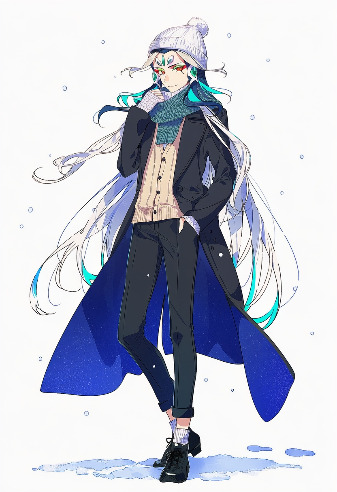

[在线例图](https://assets.quicktagcloud.com/images/raven_composition/raven_composition-5819.jpg?v=5b0fa113070a6794)

<a id="raven_composition-5820"></a>

## 诺亚

ID：`raven_composition-5820`；分类：角色图鉴 / Fate / FGO；来源标记：`safe`。

来源说明：

> 作品：Fate
> 性别：男
> 登场时间：2018
> 阵营（如有）：FGO

正向提示词：

```text
noah_(fate)
```

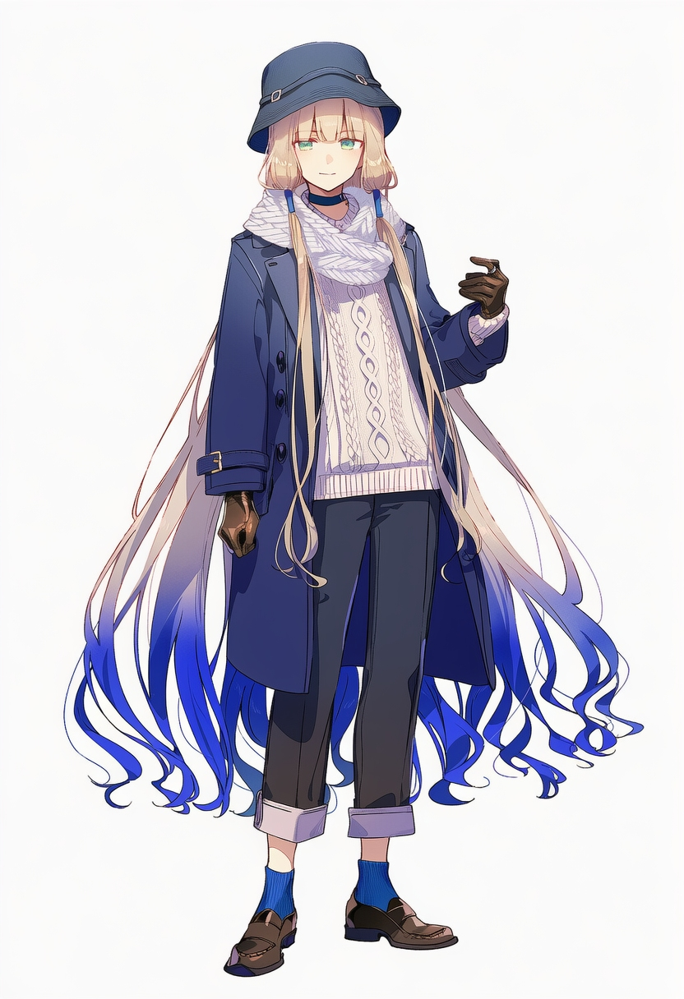

[在线例图](https://assets.quicktagcloud.com/images/raven_composition/raven_composition-5820.jpg?v=53c1be00751d7e1c)

<a id="raven_composition-5821"></a>

## 弗栗多

ID：`raven_composition-5821`；分类：角色图鉴 / Fate / FGO；来源标记：`safe`。

来源说明：

> 作品：Fate
> 性别：女
> 登场时间：2018
> 阵营（如有）：FGO

正向提示词：

```text
vritra_(fate)
```

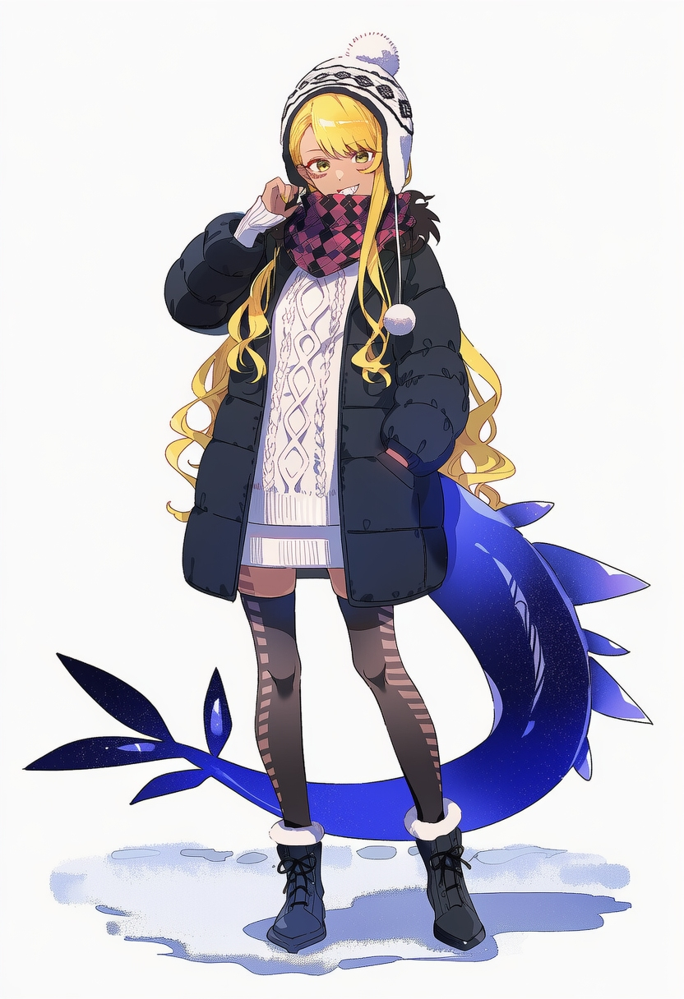

[在线例图](https://assets.quicktagcloud.com/images/raven_composition/raven_composition-5821.jpg?v=1526d15809bae89f)

<a id="raven_composition-5822"></a>

## 拉克什米·芭伊

ID：`raven_composition-5822`；分类：角色图鉴 / Fate / FGO；来源标记：`safe`。

来源说明：

> 作品：Fate
> 性别：女
> 登场时间：2018
> 阵营（如有）：FGO

正向提示词：

```text
lakshmibai_(fate)
```

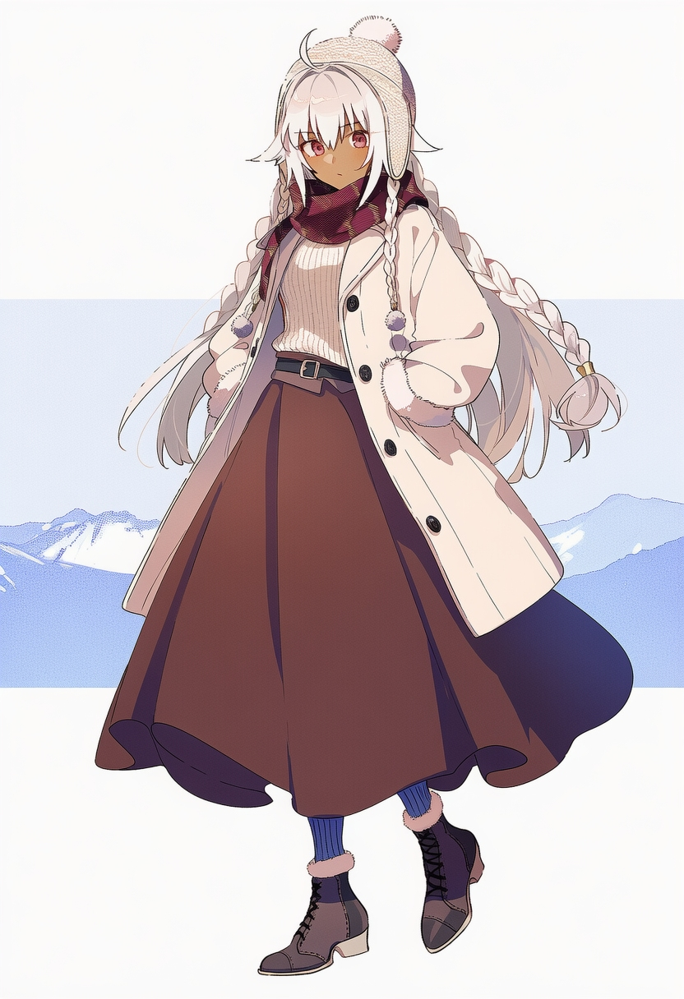

[在线例图](https://assets.quicktagcloud.com/images/raven_composition/raven_composition-5822.jpg?v=e0f8e653ccdb6637)

<a id="raven_composition-5823"></a>

## 太公望

ID：`raven_composition-5823`；分类：角色图鉴 / Fate / FGO；来源标记：`safe`。

来源说明：

> 作品：Fate
> 性别：男
> 登场时间：2018
> 阵营（如有）：FGO

正向提示词：

```text
taigong_wang_(fate)
```

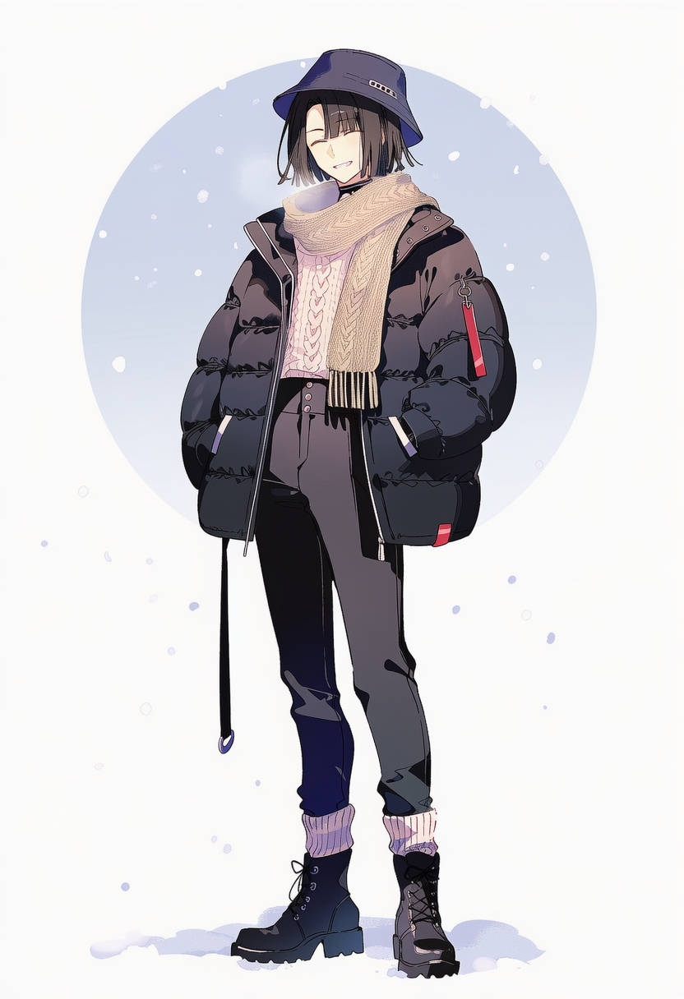

[在线例图](https://assets.quicktagcloud.com/images/raven_composition/raven_composition-5823.jpg?v=5a74810de8663dac)

<a id="raven_composition-5824"></a>

## 布里托玛特

ID：`raven_composition-5824`；分类：角色图鉴 / Fate / FGO；来源标记：`safe`。

来源说明：

> 作品：Fate
> 性别：女
> 登场时间：2018
> 阵营（如有）：FGO

正向提示词：

```text
britomart_(fate)
```

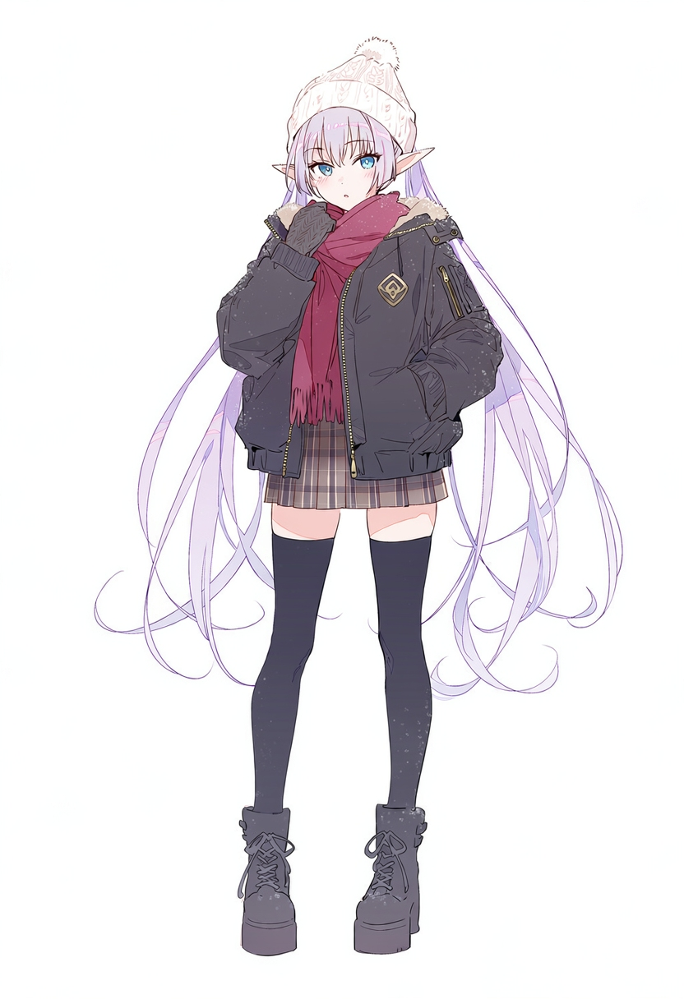

[在线例图](https://assets.quicktagcloud.com/images/raven_composition/raven_composition-5824.jpg?v=bcb6f66812e29169)

<a id="raven_composition-5825"></a>

## 渡边纲

ID：`raven_composition-5825`；分类：角色图鉴 / Fate / FGO；来源标记：`safe`。

来源说明：

> 作品：Fate
> 性别：男
> 登场时间：2018
> 阵营（如有）：FGO

正向提示词：

```text
watanabe_no_tsuna_(fate)
```

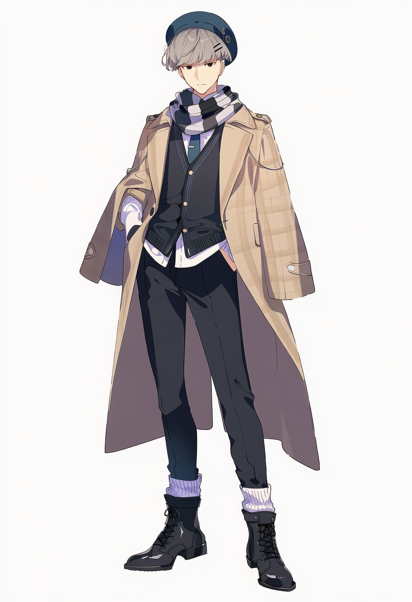

[在线例图](https://assets.quicktagcloud.com/images/raven_composition/raven_composition-5825.jpg?v=09cba33467d87b0d)

<a id="raven_composition-5826"></a>

## 征侧

ID：`raven_composition-5826`；分类：角色图鉴 / Fate / FGO；来源标记：`safe`。

来源说明：

> 作品：Fate
> 性别：女
> 登场时间：2018
> 阵营（如有）：FGO

正向提示词：

```text
trung_trac_(fate)
```

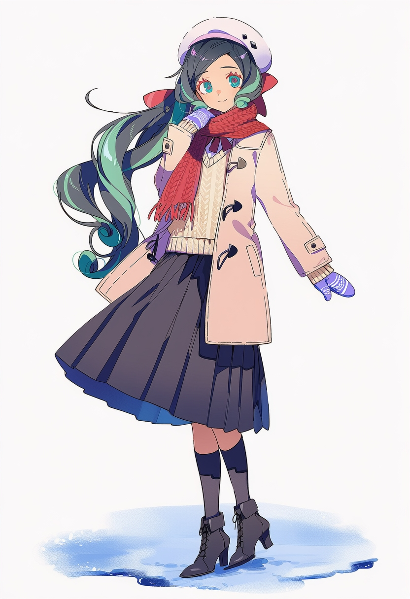

[在线例图](https://assets.quicktagcloud.com/images/raven_composition/raven_composition-5826.jpg?v=1b59a0a61ee451f2)

<a id="raven_composition-5828"></a>

## 布兰卡

ID：`raven_composition-5828`；分类：角色图鉴 / Fate / FGO；来源标记：`safe`。

来源说明：

> 作品：Fate
> 性别：不适用/不明
> 登场时间：2018
> 阵营（如有）：FGO

正向提示词：

```text
blanca_(fate)
```


[在线例图](https://assets.quicktagcloud.com/images/raven_composition/raven_composition-5828.jpg?v=056cf789b8fb65f7)

<a id="raven_composition-5829"></a>

## 征贰

ID：`raven_composition-5829`；分类：角色图鉴 / Fate / FGO；来源标记：`safe`。

来源说明：

> 作品：Fate
> 性别：女
> 登场时间：2018
> 阵营（如有）：FGO

正向提示词：

```text
trung_nhi_(fate)
```

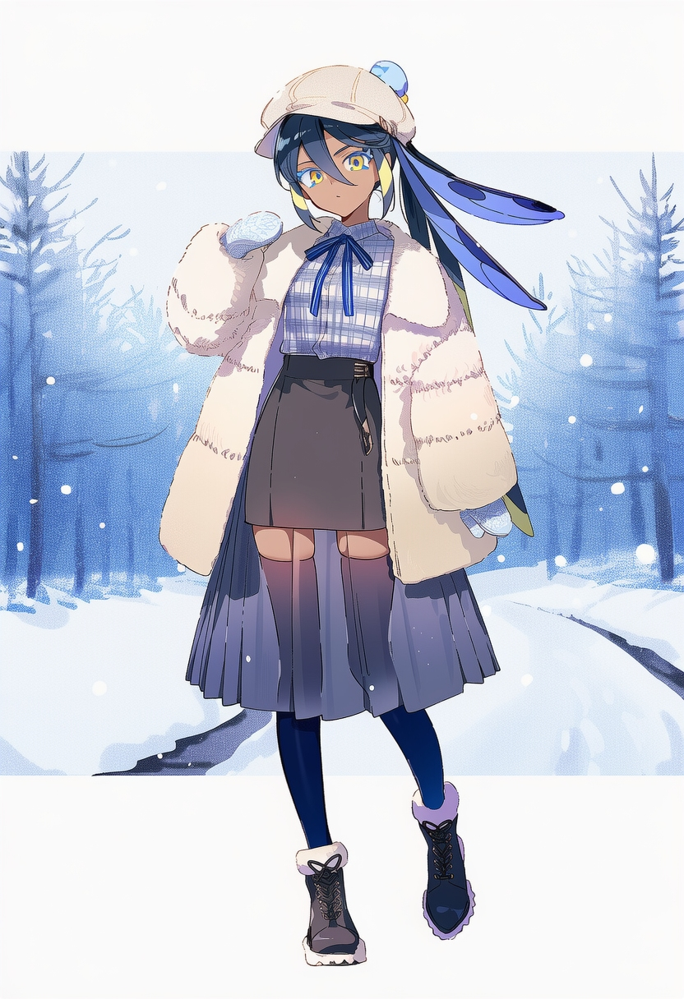

[在线例图](https://assets.quicktagcloud.com/images/raven_composition/raven_composition-5829.jpg?v=f007aec2e28c609c)

<a id="raven_composition-5830"></a>

## 罗穆路斯=奎里努斯

ID：`raven_composition-5830`；分类：角色图鉴 / Fate / FGO；来源标记：`safe`。

来源说明：

> 作品：Fate
> 性别：男
> 登场时间：2018
> 阵营（如有）：FGO

正向提示词：

```text
romulus-quirinus_(fate)
```

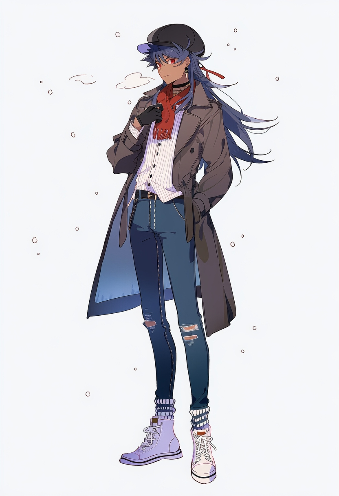

[在线例图](https://assets.quicktagcloud.com/images/raven_composition/raven_composition-5830.jpg?v=327cc5947549aab3)

<a id="raven_composition-5831"></a>

## 格里戈里·拉斯普京

ID：`raven_composition-5831`；分类：角色图鉴 / Fate / FGO；来源标记：`safe`。

来源说明：

> 作品：Fate
> 性别：男
> 登场时间：2018
> 阵营（如有）：FGO

正向提示词：

```text
grigori_rasputin_(fate)
```

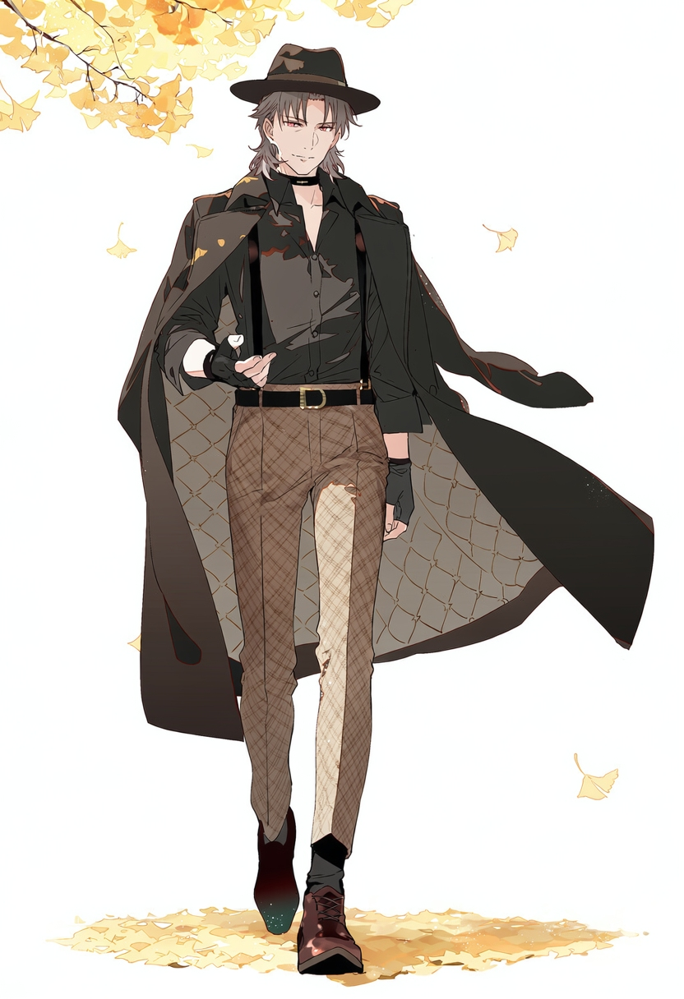

[在线例图](https://assets.quicktagcloud.com/images/raven_composition/raven_composition-5831.jpg?v=1b8bba63cdd8ab14)

<a id="raven_composition-5832"></a>

## 罗穆路斯=奎里努斯

ID：`raven_composition-5832`；分类：角色图鉴 / Fate / FGO；来源标记：`safe`。

来源说明：

> 作品：Fate
> 性别：男
> 登场时间：2018
> 阵营（如有）：FGO

正向提示词：

```text
romulus_quirinus_(fate)
```

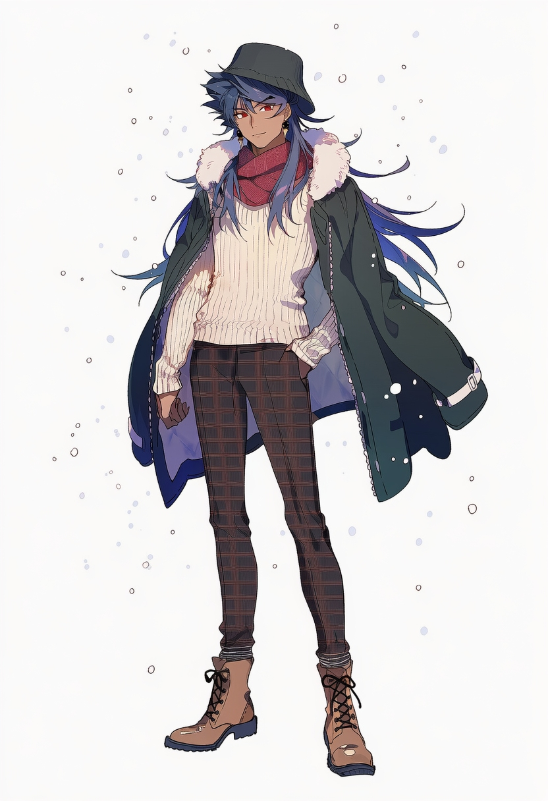

[在线例图](https://assets.quicktagcloud.com/images/raven_composition/raven_composition-5832.jpg?v=8e743e3cf8358c42)

<a id="raven_composition-5833"></a>

## 灾星简

ID：`raven_composition-5833`；分类：角色图鉴 / Fate / FGO；来源标记：`safe`。

来源说明：

> 作品：Fate
> 性别：女
> 登场时间：2018
> 阵营（如有）：FGO

正向提示词：

```text
calamity_jane_(fate)
```

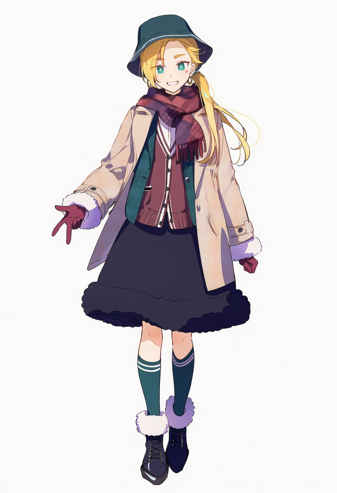

[在线例图](https://assets.quicktagcloud.com/images/raven_composition/raven_composition-5833.jpg?v=5277baff65654e48)

<a id="raven_composition-5834"></a>

## 卡斯托耳

ID：`raven_composition-5834`；分类：角色图鉴 / Fate / FGO；来源标记：`safe`。

来源说明：

> 作品：Fate
> 性别：男
> 登场时间：2018
> 阵营（如有）：FGO

正向提示词：

```text
castor_(fate)
```


[在线例图](https://assets.quicktagcloud.com/images/raven_composition/raven_composition-5834.jpg?v=5007bb0cf361e51f)

<a id="raven_composition-5835"></a>

## 鹤小姐

ID：`raven_composition-5835`；分类：角色图鉴 / Fate / FGO；来源标记：`safe`。

来源说明：

> 作品：Fate
> 性别：女
> 登场时间：2018
> 阵营（如有）：FGO

正向提示词：

```text
miss_crane_(fate)
```

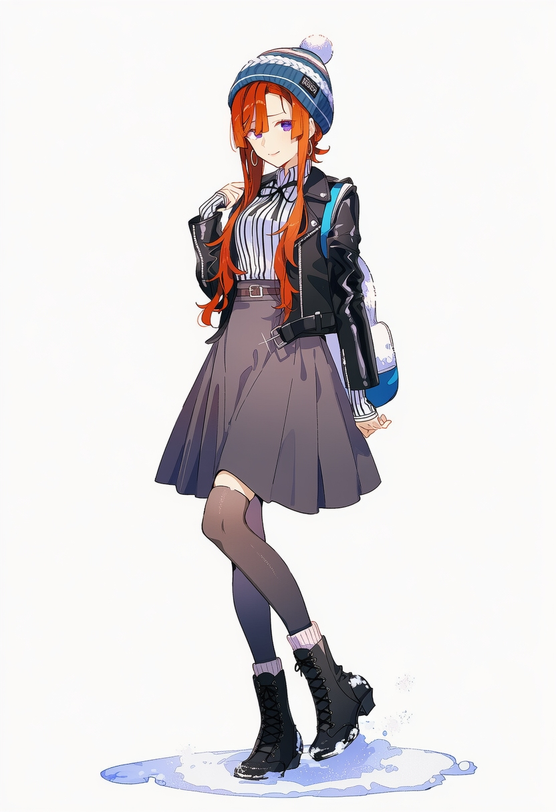

[在线例图](https://assets.quicktagcloud.com/images/raven_composition/raven_composition-5835.jpg?v=aa898ff8d8709359)

<a id="raven_composition-5836"></a>

## 超人俄里翁

ID：`raven_composition-5836`；分类：角色图鉴 / Fate / FGO；来源标记：`safe`。

来源说明：

> 作品：Fate
> 性别：男
> 登场时间：2018
> 阵营（如有）：FGO

正向提示词：

```text
super_orion_(fate)
```


[在线例图](https://assets.quicktagcloud.com/images/raven_composition/raven_composition-5836.jpg?v=16a3fe686ec19e4b)

<a id="raven_composition-5837"></a>

## 驹姬

ID：`raven_composition-5837`；分类：角色图鉴 / Fate / FGO；来源标记：`safe`。

来源说明：

> 作品：Fate
> 性别：女
> 登场时间：2018
> 阵营（如有）：FGO

正向提示词：

```text
komahime_(fate)
```

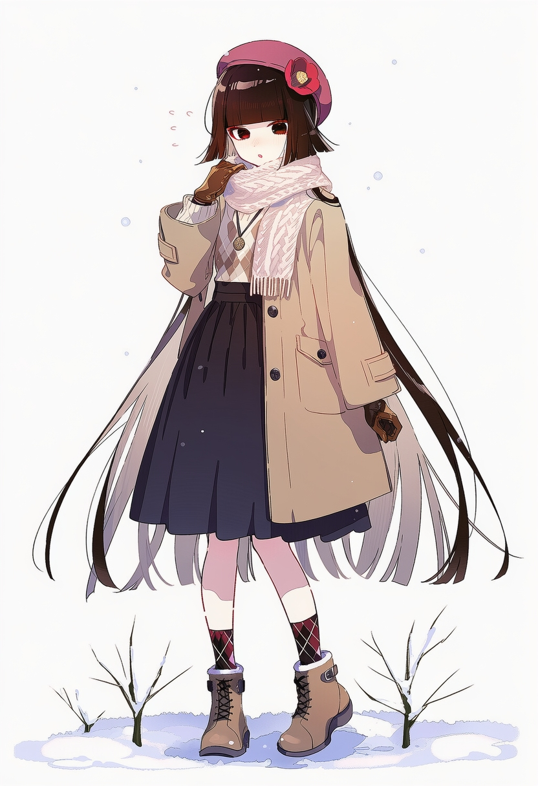

[在线例图](https://assets.quicktagcloud.com/images/raven_composition/raven_composition-5837.jpg?v=4e7698ef518e19c1)

<a id="raven_composition-5847"></a>

## 莉莉丝

ID：`raven_composition-5847`；分类：角色图鉴 / Fate / FGO；来源标记：`safe`。

来源说明：

> 作品：Fate
> 性别：女
> 登场时间：2023
> 阵营（如有）：FGO

正向提示词：

```text
lilith_(fate)
```

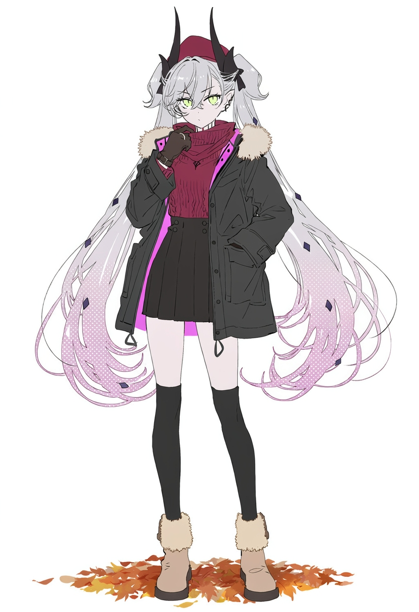

[在线例图](https://assets.quicktagcloud.com/images/raven_composition/raven_composition-5847.jpg?v=f2435320c8c694a8)

<a id="raven_composition-5850"></a>

## 蛇女房

ID：`raven_composition-5850`；分类：角色图鉴 / Fate / FGO；来源标记：`safe`。

来源说明：

> 作品：Fate
> 性别：女
> 登场时间：2023
> 阵营（如有）：FGO

正向提示词：

```text
hebi_nyoubou_(fate)
```

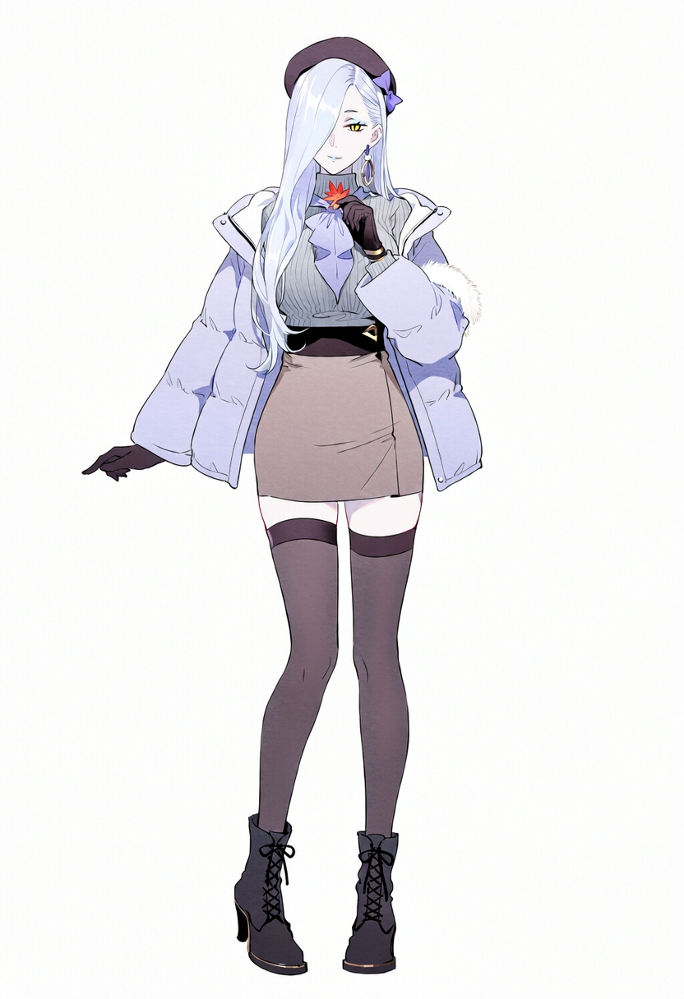

[在线例图](https://assets.quicktagcloud.com/images/raven_composition/raven_composition-5850.jpg?v=75c51fb84e7dcdcf)

<a id="raven_composition-5851"></a>

## 蛇夫人

ID：`raven_composition-5851`；分类：角色图鉴 / Fate / FGO；来源标记：`safe`。

来源说明：

> 作品：Fate
> 性别：女
> 登场时间：2023
> 阵营（如有）：FGO

正向提示词：

```text
mrs._snake_(fate)
```

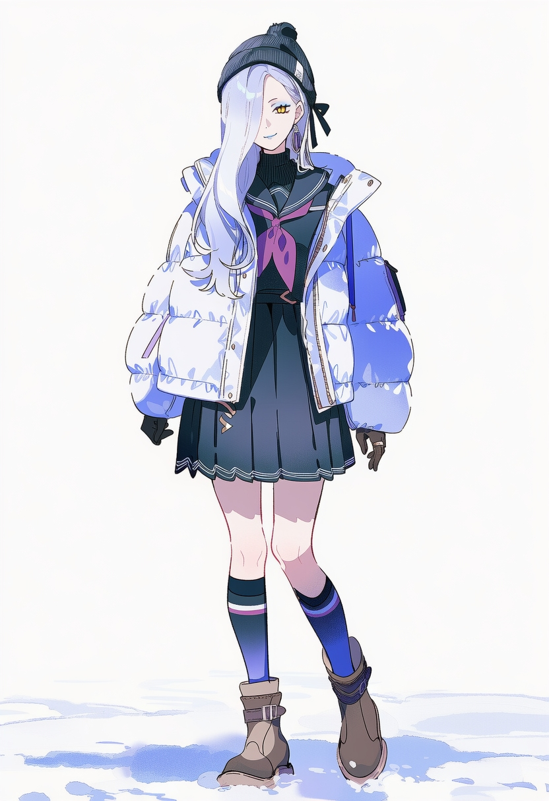

[在线例图](https://assets.quicktagcloud.com/images/raven_composition/raven_composition-5851.jpg?v=b1360c640587e329)

<a id="raven_composition-5852"></a>

## BB迪拜

ID：`raven_composition-5852`；分类：角色图鉴 / Fate / FGO；来源标记：`safe`。

来源说明：

> 作品：Fate
> 性别：女
> 登场时间：2023
> 阵营（如有）：FGO

正向提示词：

```text
bb_dubai_(fate)
```

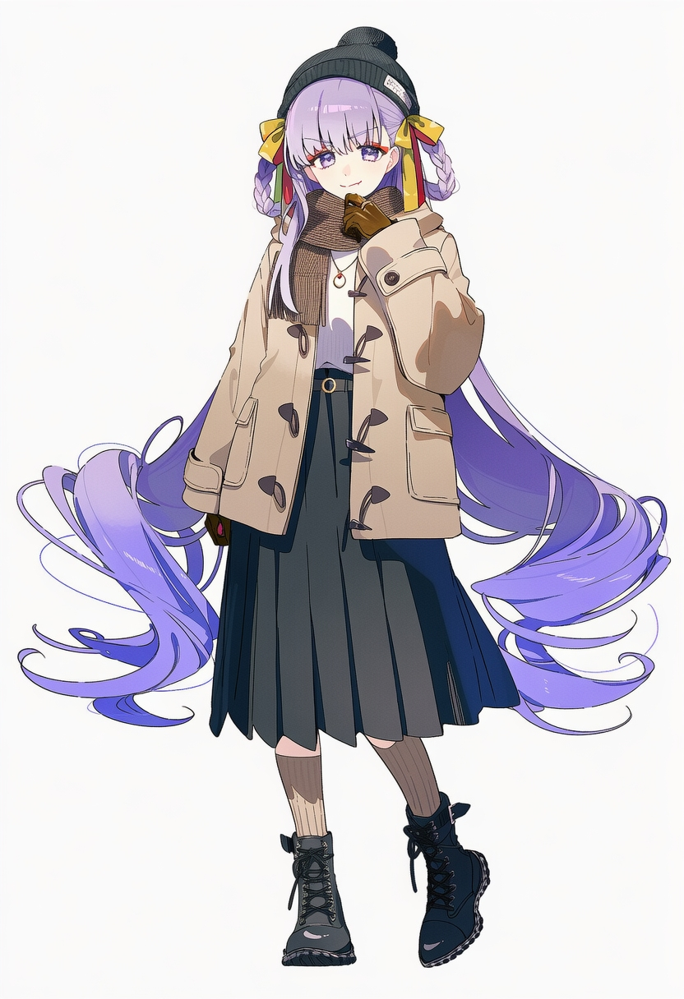

[在线例图](https://assets.quicktagcloud.com/images/raven_composition/raven_composition-5852.jpg?v=9b85207d4a9281c2)

<a id="raven_composition-5854"></a>

## 河上彦斋

ID：`raven_composition-5854`；分类：角色图鉴 / Fate / FGO；来源标记：`safe`。

来源说明：

> 作品：Fate
> 性别：男
> 登场时间：2023
> 阵营（如有）：FGO

正向提示词：

```text
kawakami_gensai_(fate)
```

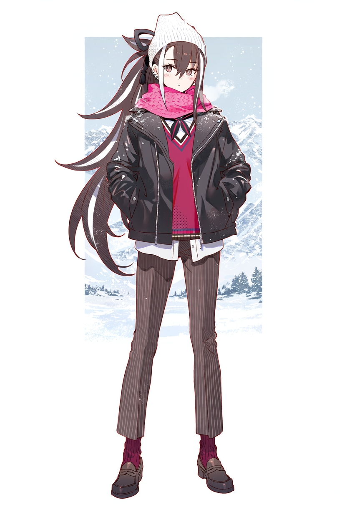

[在线例图](https://assets.quicktagcloud.com/images/raven_composition/raven_composition-5854.jpg?v=d68ee78cc4eb87fa)

<a id="raven_composition-5855"></a>

## 娄希

ID：`raven_composition-5855`；分类：角色图鉴 / Fate / FGO；来源标记：`safe`。

来源说明：

> 作品：Fate
> 性别：女
> 登场时间：2023
> 阵营（如有）：FGO

正向提示词：

```text
louhi_(fate)
```

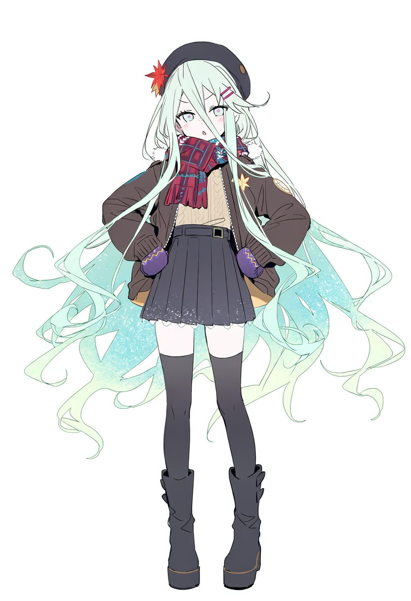

[在线例图](https://assets.quicktagcloud.com/images/raven_composition/raven_composition-5855.jpg?v=0cc436558ae7c2bb)

<a id="raven_composition-5856"></a>

## 永仓新八

ID：`raven_composition-5856`；分类：角色图鉴 / Fate / FGO；来源标记：`safe`。

来源说明：

> 作品：Fate
> 性别：男
> 登场时间：2023
> 阵营（如有）：FGO

正向提示词：

```text
nagakura_shinpachi_(fate)
```

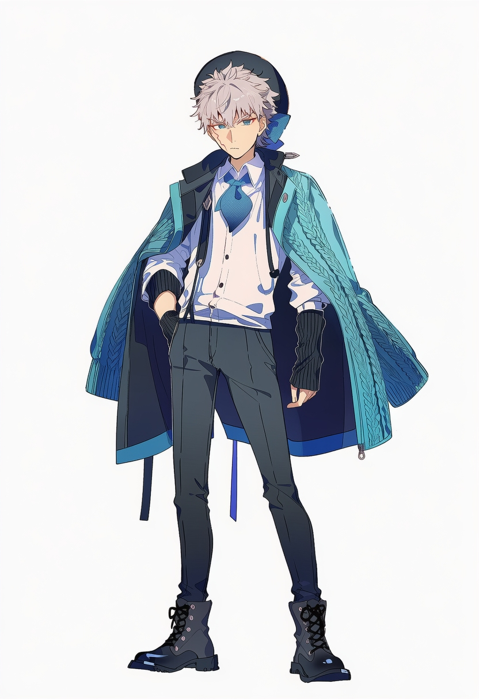

[在线例图](https://assets.quicktagcloud.com/images/raven_composition/raven_composition-5856.jpg?v=051e2b08142e2b3d)

<a id="raven_composition-5857"></a>

## 杜尔迦

ID：`raven_composition-5857`；分类：角色图鉴 / Fate / FGO；来源标记：`safe`。

来源说明：

> 作品：Fate
> 性别：女
> 登场时间：2023
> 阵营（如有）：FGO

正向提示词：

```text
durga_(fate)
```

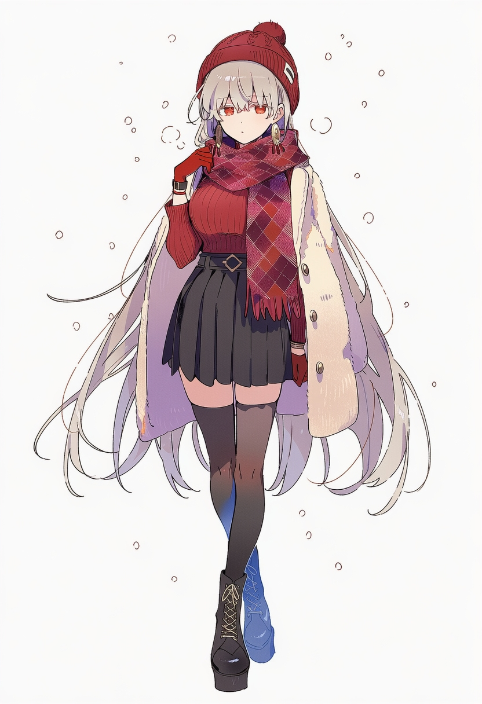

[在线例图](https://assets.quicktagcloud.com/images/raven_composition/raven_composition-5857.jpg?v=fae431b6c6fa04cf)

<a id="raven_composition-5859"></a>

## 堤丰·厄菲梅洛斯

ID：`raven_composition-5859`；分类：角色图鉴 / Fate / FGO；来源标记：`safe`。

来源说明：

> 作品：Fate
> 性别：女
> 登场时间：2023
> 阵营（如有）：FGO

正向提示词：

```text
typhon_ephemeros_(fate)
```

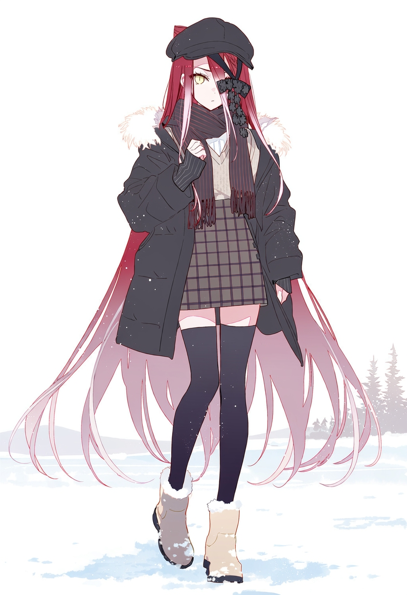

[在线例图](https://assets.quicktagcloud.com/images/raven_composition/raven_composition-5859.jpg?v=a4c6b83092656897)

<a id="raven_composition-5860"></a>

## 藤堂平助

ID：`raven_composition-5860`；分类：角色图鉴 / Fate / FGO；来源标记：`safe`。

来源说明：

> 作品：Fate
> 性别：男
> 登场时间：2023
> 阵营（如有）：FGO

正向提示词：

```text
toudou_heisuke_(fate)
```

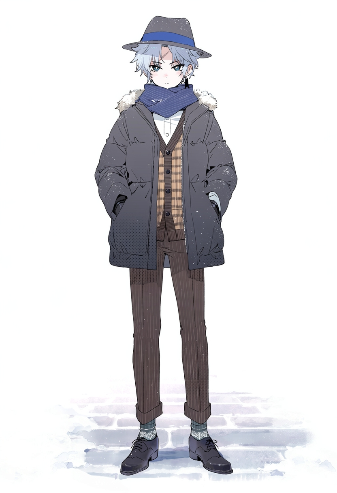

[在线例图](https://assets.quicktagcloud.com/images/raven_composition/raven_composition-5860.jpg?v=3eee76fb3f323afb)

<a id="raven_composition-5861"></a>

## 梅塔特隆·贞德

ID：`raven_composition-5861`；分类：角色图鉴 / Fate / FGO；来源标记：`safe`。

来源说明：

> 作品：Fate
> 性别：女
> 登场时间：2023
> 阵营（如有）：FGO

正向提示词：

```text
metatron_jeanne_(fate)
```

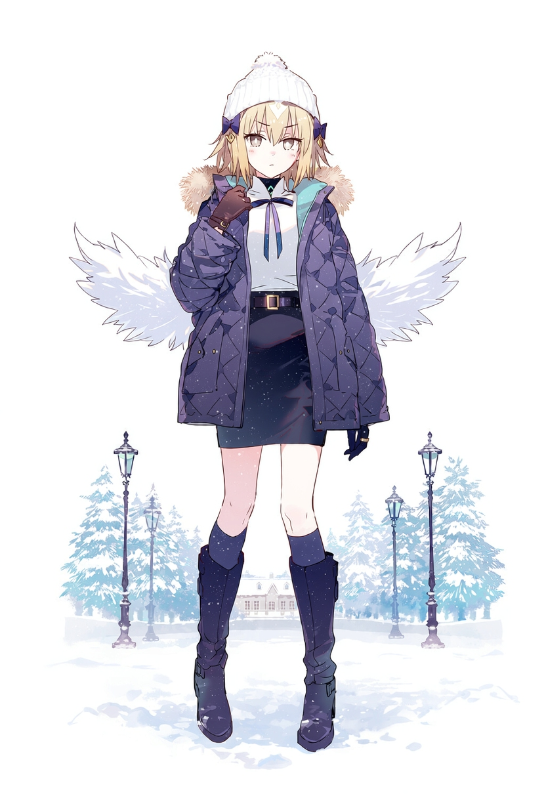

[在线例图](https://assets.quicktagcloud.com/images/raven_composition/raven_composition-5861.jpg?v=455a079dd32072ce)

<a id="raven_composition-5862"></a>

## 因陀罗

ID：`raven_composition-5862`；分类：角色图鉴 / Fate / FGO；来源标记：`safe`。

来源说明：

> 作品：Fate
> 性别：男
> 登场时间：2023
> 阵营（如有）：FGO

正向提示词：

```text
indra_(fate)
```

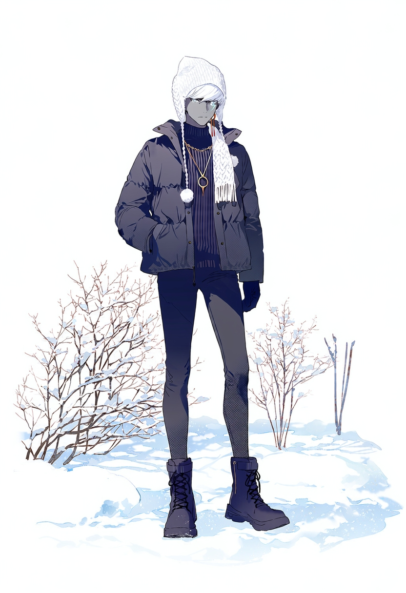

[在线例图](https://assets.quicktagcloud.com/images/raven_composition/raven_composition-5862.jpg?v=814da64889a59388)

<a id="raven_composition-5863"></a>

## 难敌

ID：`raven_composition-5863`；分类：角色图鉴 / Fate / FGO；来源标记：`safe`。

来源说明：

> 作品：Fate
> 性别：男
> 登场时间：2023
> 阵营（如有）：FGO

正向提示词：

```text
duryodhana_(fate)
```


[在线例图](https://assets.quicktagcloud.com/images/raven_composition/raven_composition-5863.jpg?v=1469093ea1114bf0)

<a id="raven_composition-5864"></a>

## 宇宙埃列什基伽勒

ID：`raven_composition-5864`；分类：角色图鉴 / Fate / FGO；来源标记：`safe`。

来源说明：

> 作品：Fate
> 性别：女
> 登场时间：2023
> 阵营（如有）：FGO

正向提示词：

```text
space_ereshkigal_(fate)
```

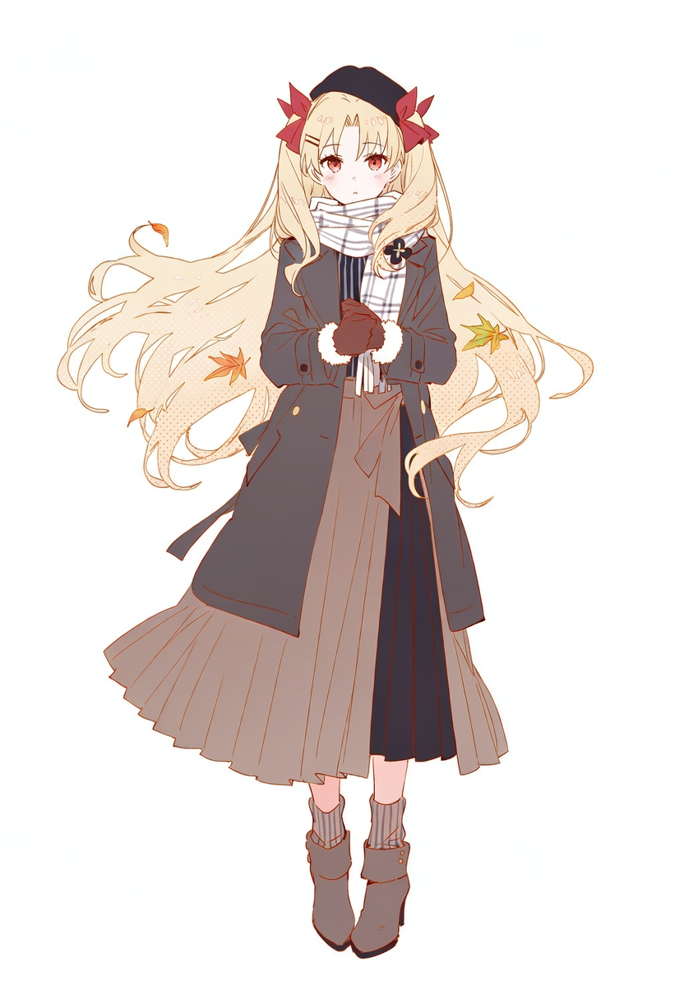

[在线例图](https://assets.quicktagcloud.com/images/raven_composition/raven_composition-5864.jpg?v=4bca0ead907706bd)

<a id="raven_composition-5865"></a>

## 基督山伯爵

ID：`raven_composition-5865`；分类：角色图鉴 / Fate / FGO；来源标记：`safe`。

来源说明：

> 作品：Fate
> 性别：男
> 登场时间：2023
> 阵营（如有）：FGO

正向提示词：

```text
the_count_of_monte_cristo_(fate)
```

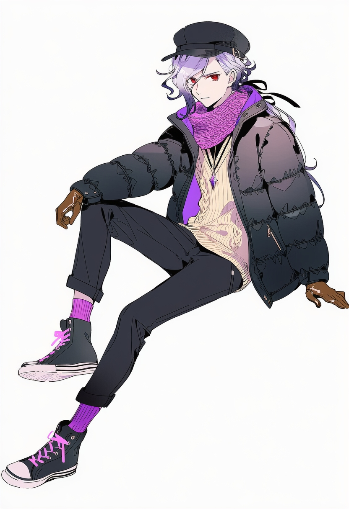

[在线例图](https://assets.quicktagcloud.com/images/raven_composition/raven_composition-5865.jpg?v=a52fc892d955d2bd)

<a id="raven_composition-5866"></a>

## 但丁·阿利吉耶里

ID：`raven_composition-5866`；分类：角色图鉴 / Fate / FGO；来源标记：`safe`。

来源说明：

> 作品：Fate
> 性别：男
> 登场时间：2023
> 阵营（如有）：FGO

正向提示词：

```text
dante_alighieri_(fate)
```

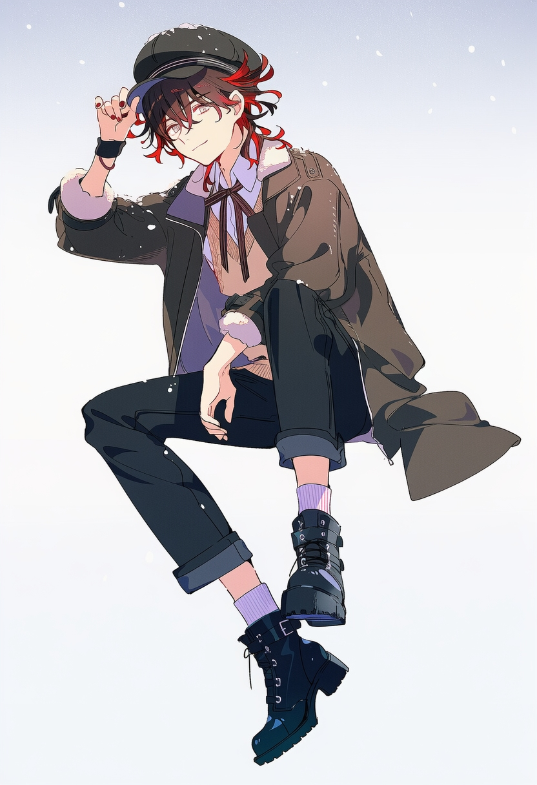

[在线例图](https://assets.quicktagcloud.com/images/raven_composition/raven_composition-5866.jpg?v=5e7cfbb7fc092b63)

<a id="raven_composition-5867"></a>

## 怖军

ID：`raven_composition-5867`；分类：角色图鉴 / Fate / FGO；来源标记：`safe`。

来源说明：

> 作品：Fate
> 性别：男
> 登场时间：2023
> 阵营（如有）：FGO

正向提示词：

```text
bhima_(fate)
```


[在线例图](https://assets.quicktagcloud.com/images/raven_composition/raven_composition-5867.jpg?v=709142b6b0167e45)

<a id="raven_composition-5868"></a>

## 迦梨

ID：`raven_composition-5868`；分类：角色图鉴 / Fate / FGO；来源标记：`safe`。

来源说明：

> 作品：Fate
> 性别：女
> 登场时间：2023
> 阵营（如有）：FGO

正向提示词：

```text
kali_(fate)
```

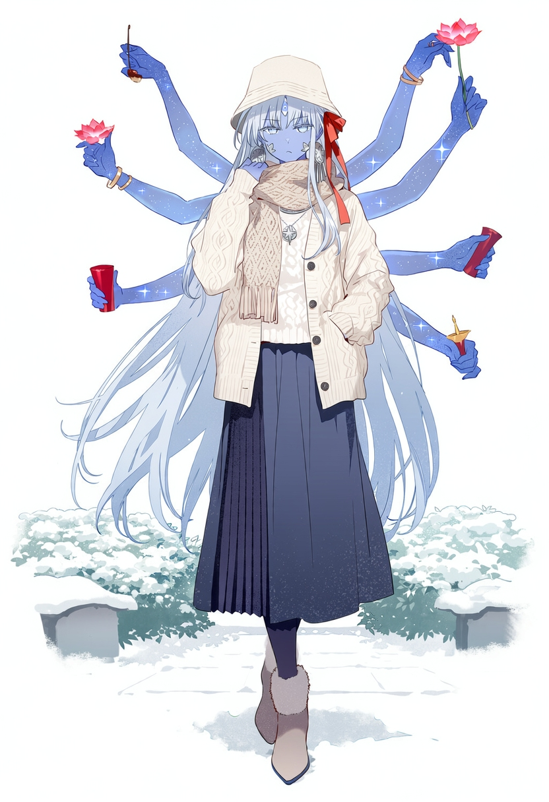

[在线例图](https://assets.quicktagcloud.com/images/raven_composition/raven_composition-5868.jpg?v=f5600280b05d2d72)

<a id="raven_composition-5870"></a>

## 安德洛墨达

ID：`raven_composition-5870`；分类：角色图鉴 / Fate / FGO；来源标记：`safe`。

来源说明：

> 作品：Fate
> 性别：女
> 登场时间：2023
> 阵营（如有）：FGO

正向提示词：

```text
andromeda_(fate)
```

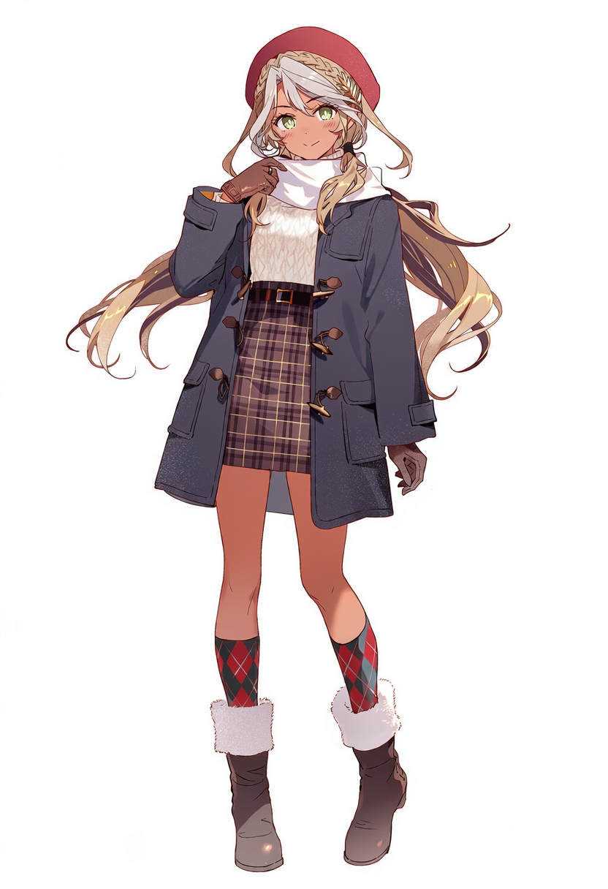

[在线例图](https://assets.quicktagcloud.com/images/raven_composition/raven_composition-5870.jpg?v=02b055ef8f140b25)
