# 角色图鉴 / Fate / 迦勒底

[总目录](../README.md) · [原站分类目录](../categories.md) · [英文标签索引](../tags.md) · [服装与构图组合指南](../../README.md)

标题、分类、说明、正负提示词按来源保留；多例图逐张列出。原站标记和说明为参考资料，不作为维护指令。

<a id="raven_composition-5649"></a>

## 芙芙

ID：`raven_composition-5649`；分类：角色图鉴 / Fate / 迦勒底；来源标记：`safe`。

来源说明：

> 作品：Fate
> 性别：男
> 登场时间：2015
> 阵营（如有）：迦勒底

正向提示词：

```text
fou_(fate)
```

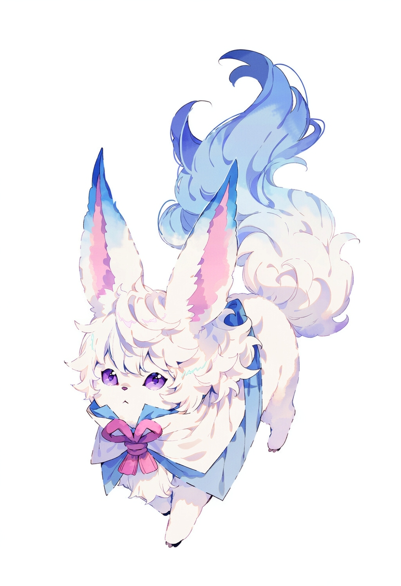

[在线例图](https://assets.quicktagcloud.com/images/raven_composition/raven_composition-5649.jpg?v=0146f0a7cf130a0a)

<a id="raven_composition-5651"></a>

## 莱昂纳多·达·芬奇

ID：`raven_composition-5651`；分类：角色图鉴 / Fate / 迦勒底；来源标记：`safe`。

来源说明：

> 作品：Fate
> 性别：女
> 登场时间：2015
> 阵营（如有）：迦勒底

正向提示词：

```text
leonardo_da_vinci_(fate)
```

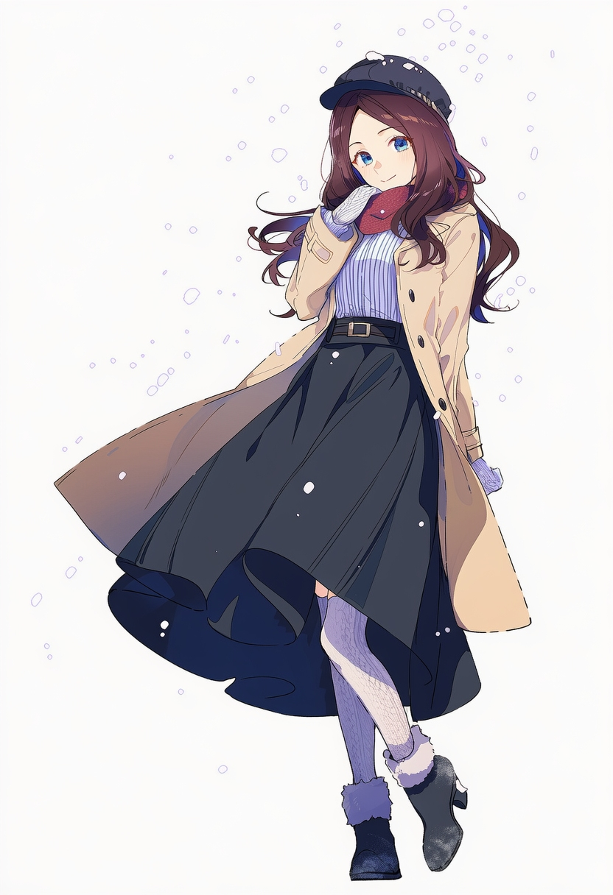

[在线例图](https://assets.quicktagcloud.com/images/raven_composition/raven_composition-5651.jpg?v=c2f51fabaaec1a73)

<a id="raven_composition-5678"></a>

## 夏洛克·福尔摩斯

ID：`raven_composition-5678`；分类：角色图鉴 / Fate / 迦勒底；来源标记：`safe`。

来源说明：

> 作品：Fate
> 性别：男
> 登场时间：2015
> 阵营（如有）：迦勒底

正向提示词：

```text
sherlock_holmes_(fate)
```

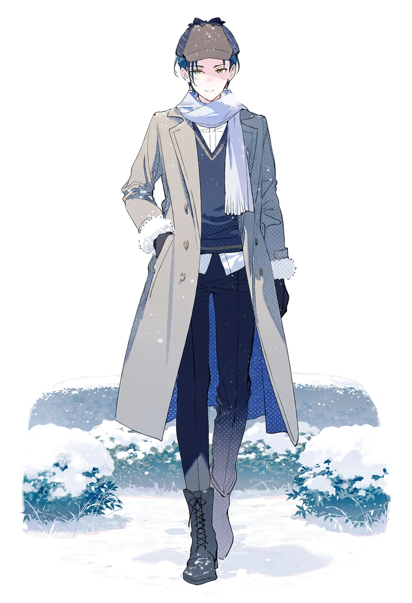

[在线例图](https://assets.quicktagcloud.com/images/raven_composition/raven_composition-5678.jpg?v=de7f2d8d4a2aad13)

<a id="raven_composition-5715"></a>

## 玛修·基列莱特

ID：`raven_composition-5715`；分类：角色图鉴 / Fate / 迦勒底；来源标记：`safe`。

来源说明：

> 作品：Fate
> 性别：女
> 登场时间：2015
> 阵营（如有）：迦勒底

正向提示词：

```text
mash_kyrielight
```

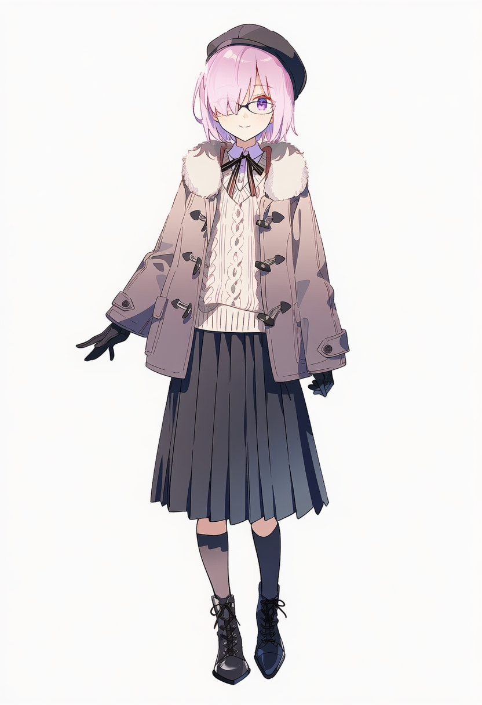

[在线例图](https://assets.quicktagcloud.com/images/raven_composition/raven_composition-5715.jpg?v=3bf83a45fee3bdfb)

<a id="raven_composition-5716"></a>

## 藤丸立香（女）

ID：`raven_composition-5716`；分类：角色图鉴 / Fate / 迦勒底；来源标记：`safe`。

来源说明：

> 作品：Fate
> 性别：女
> 登场时间：2015
> 阵营（如有）：迦勒底

正向提示词：

```text
fujimaru_ritsuka_(female)
```

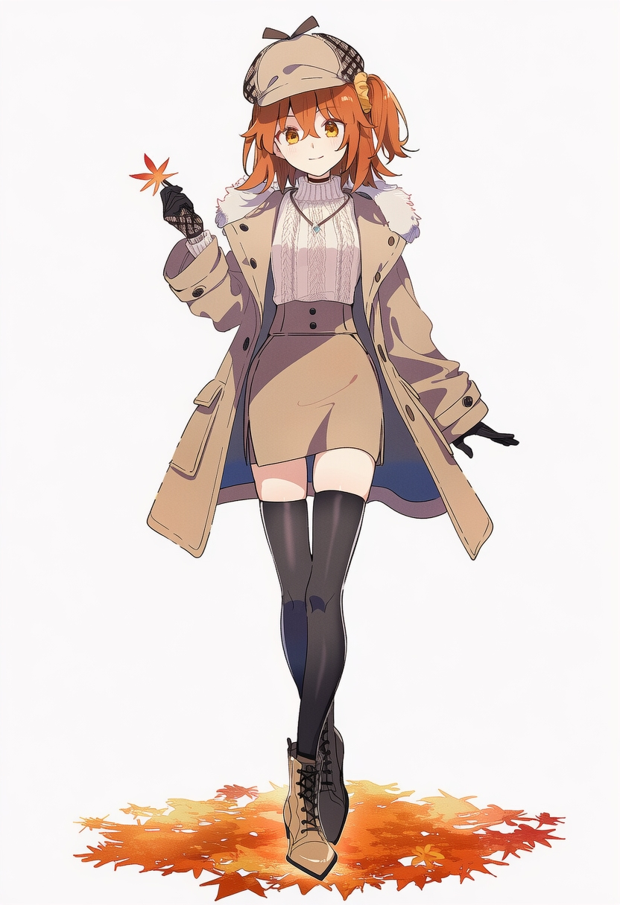

[在线例图](https://assets.quicktagcloud.com/images/raven_composition/raven_composition-5716.jpg?v=8c67710bbf6b6e6d)

<a id="raven_composition-5717"></a>

## 藤丸立香（男）

ID：`raven_composition-5717`；分类：角色图鉴 / Fate / 迦勒底；来源标记：`safe`。

来源说明：

> 作品：Fate
> 性别：男
> 登场时间：2015
> 阵营（如有）：迦勒底

正向提示词：

```text
fujimaru_ritsuka_(male)
```

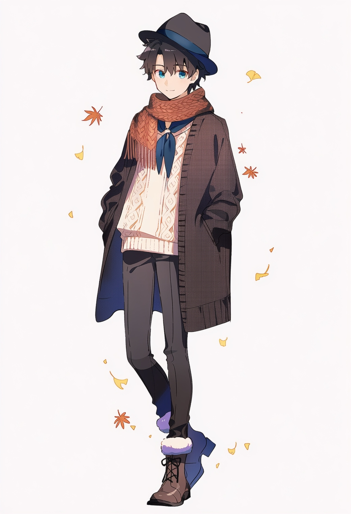

[在线例图](https://assets.quicktagcloud.com/images/raven_composition/raven_composition-5717.jpg?v=48c738f2f448ca72)

<a id="raven_composition-5718"></a>

## 罗玛尼·阿其曼

ID：`raven_composition-5718`；分类：角色图鉴 / Fate / 迦勒底；来源标记：`safe`。

来源说明：

> 作品：Fate
> 性别：男
> 登场时间：2015
> 阵营（如有）：迦勒底

正向提示词：

```text
romani_archaman
```

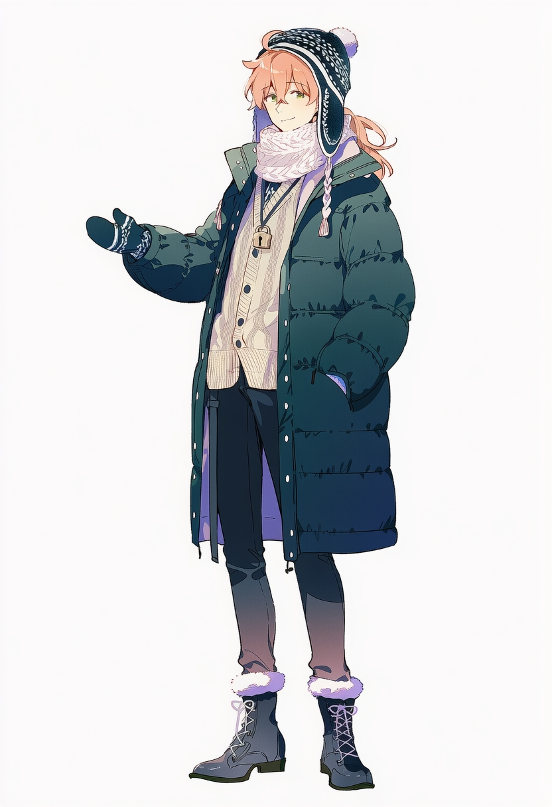

[在线例图](https://assets.quicktagcloud.com/images/raven_composition/raven_composition-5718.jpg?v=f2545b6394d08b0f)

<a id="raven_composition-5765"></a>

## 尼莫

ID：`raven_composition-5765`；分类：角色图鉴 / Fate / 迦勒底；来源标记：`safe`。

来源说明：

> 作品：Fate
> 性别：男
> 登场时间：2018
> 阵营（如有）：迦勒底

正向提示词：

```text
nemo_(fate)
```

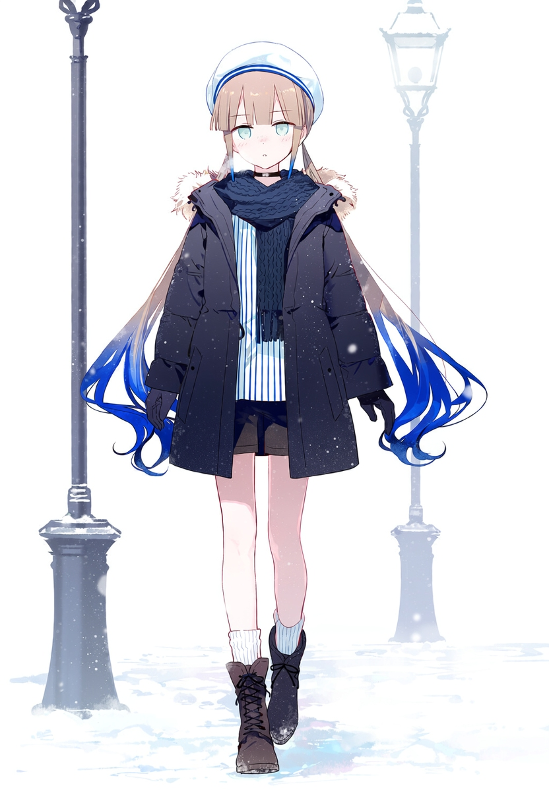

[在线例图](https://assets.quicktagcloud.com/images/raven_composition/raven_composition-5765.jpg?v=596f706cb970e627)

<a id="raven_composition-5773"></a>

## 尼莫船长

ID：`raven_composition-5773`；分类：角色图鉴 / Fate / 迦勒底；来源标记：`safe`。

来源说明：

> 作品：Fate
> 性别：男
> 登场时间：2018
> 阵营（如有）：迦勒底

正向提示词：

```text
captain_nemo_(fate)
```

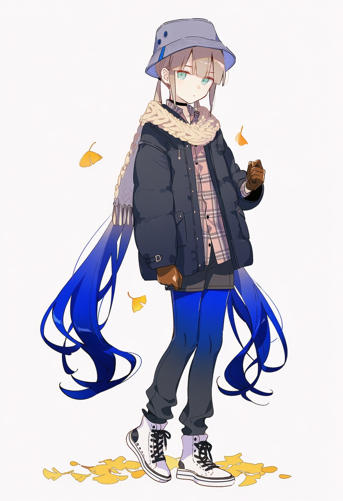

[在线例图](https://assets.quicktagcloud.com/images/raven_composition/raven_composition-5773.jpg?v=1c4550062209c89f)

<a id="raven_composition-5827"></a>

## 尼莫·水兵

ID：`raven_composition-5827`；分类：角色图鉴 / Fate / 迦勒底；来源标记：`safe`。

来源说明：

> 作品：Fate
> 性别：男
> 登场时间：2018
> 阵营（如有）：迦勒底

正向提示词：

```text
marine_nemo_(fate)
```

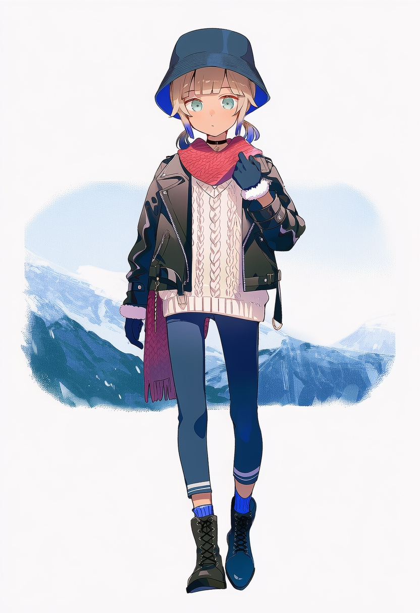

[在线例图](https://assets.quicktagcloud.com/images/raven_composition/raven_composition-5827.jpg?v=3c7f4ce55b4d42db)

<a id="raven_composition-5838"></a>

## 莱昂纳多·达·芬奇（Rider）

ID：`raven_composition-5838`；分类：角色图鉴 / Fate / 迦勒底；来源标记：`safe`。

来源说明：

> 作品：Fate
> 性别：女
> 登场时间：2018
> 阵营（如有）：迦勒底

正向提示词：

```text
leonardo_da_vinci_(rider)_(fate)
```


[在线例图](https://assets.quicktagcloud.com/images/raven_composition/raven_composition-5838.jpg?v=3a88b3b280be7774)

<a id="raven_composition-5839"></a>

## 戈尔德鲁夫·穆吉克

ID：`raven_composition-5839`；分类：角色图鉴 / Fate / 迦勒底；来源标记：`safe`。

来源说明：

> 作品：Fate
> 性别：男
> 登场时间：2018
> 阵营（如有）：迦勒底

正向提示词：

```text
goredolf_musik
```

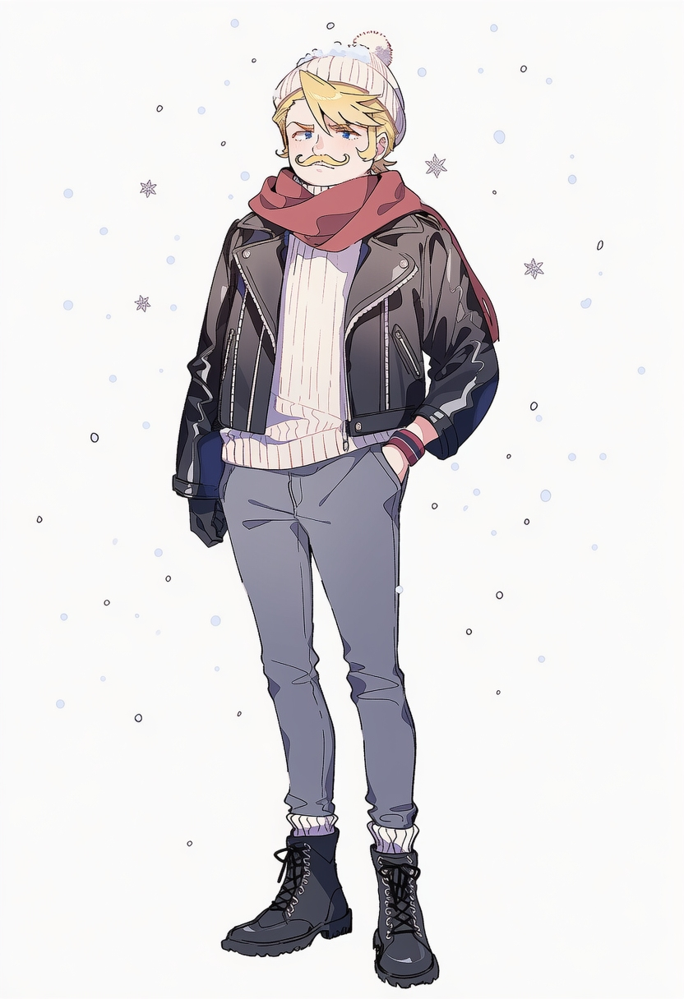

[在线例图](https://assets.quicktagcloud.com/images/raven_composition/raven_composition-5839.jpg?v=163f1b1adbfe8a4a)
