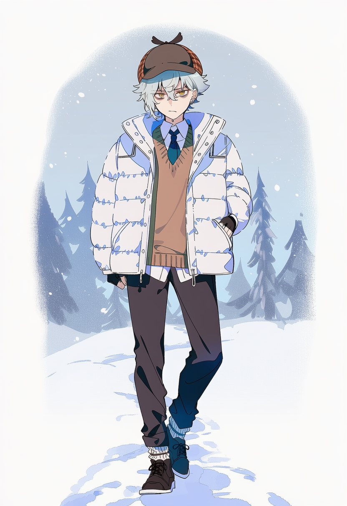
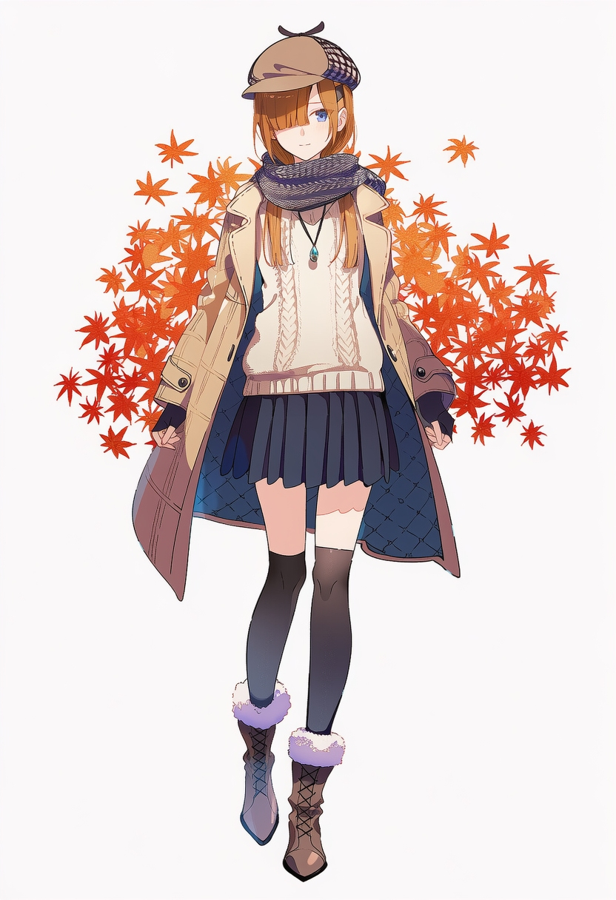
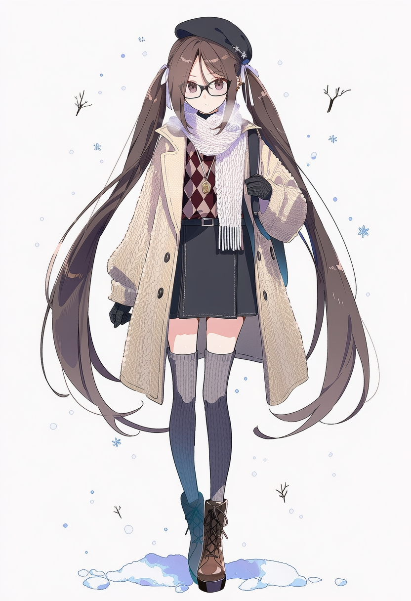
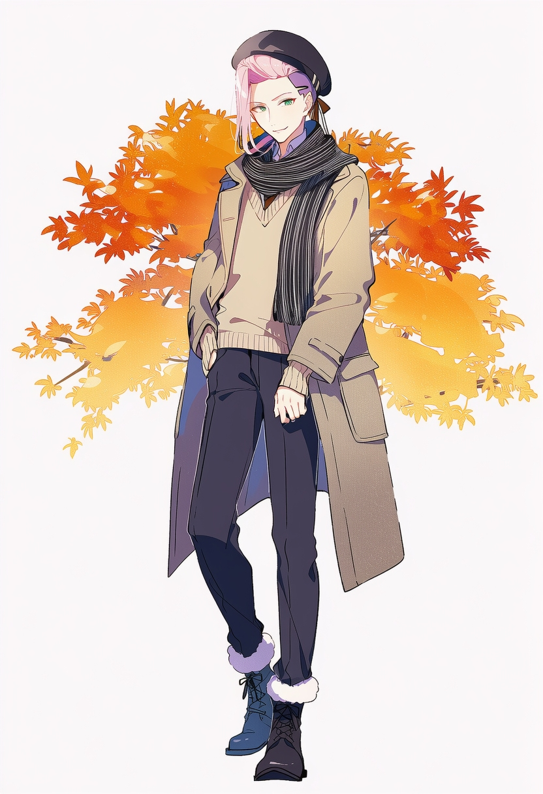
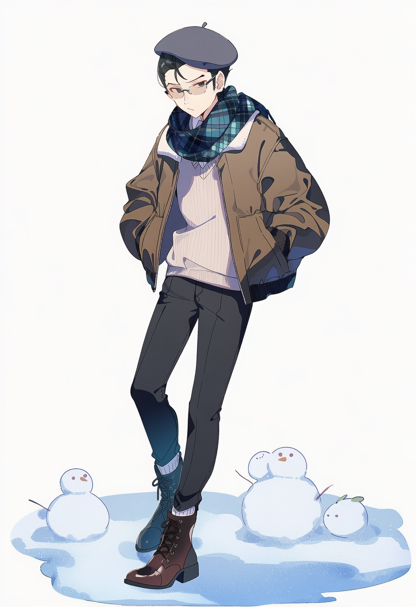
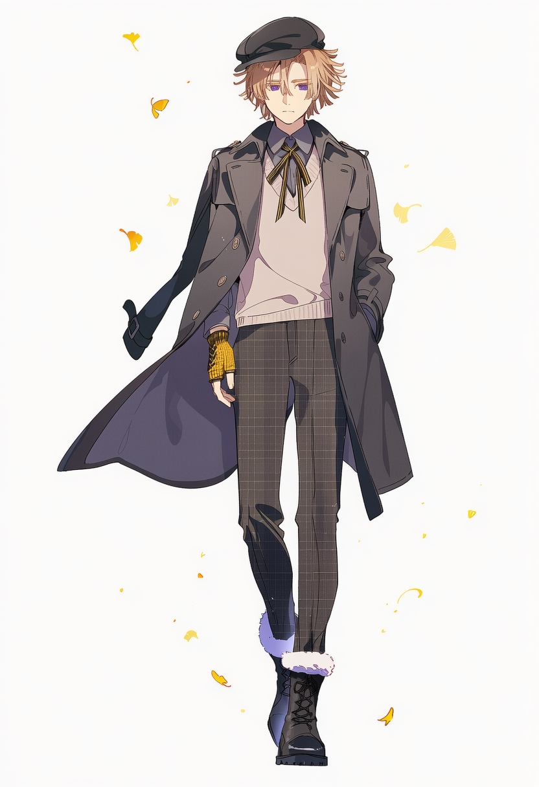

# 角色图鉴 / Fate / A组 / Crypter

[总目录](../README.md) · [原站分类目录](../categories.md) · [英文标签索引](../tags.md) · [服装与构图组合指南](../../README.md)

标题、分类、说明、正负提示词按来源保留；多例图逐张列出。原站标记和说明为参考资料，不作为维护指令。

<a id="raven_composition-5840"></a>

## 卡多克·泽姆露普斯

ID：`raven_composition-5840`；分类：角色图鉴 / Fate / A组 / Crypter；来源标记：`safe`。

来源说明：

> 作品：Fate
> 性别：男
> 登场时间：2018
> 阵营（如有）：A组 / Crypter

正向提示词：

```text
kadoc_zemlupus
```



[在线例图](https://assets.quicktagcloud.com/images/raven_composition/raven_composition-5840.jpg?v=cef5a60024da2168)

<a id="raven_composition-5841"></a>

## 基尔什塔利亚·沃戴姆

ID：`raven_composition-5841`；分类：角色图鉴 / Fate / A组 / Crypter；来源标记：`safe`。

来源说明：

> 作品：Fate
> 性别：男
> 登场时间：2018
> 阵营（如有）：A组 / Crypter

正向提示词：

```text
kirschtaria_wodime
```


[在线例图](https://assets.quicktagcloud.com/images/raven_composition/raven_composition-5841.jpg?v=991ca5e26fe628c6)

<a id="raven_composition-5842"></a>

## 奥菲莉娅·法姆索罗涅

ID：`raven_composition-5842`；分类：角色图鉴 / Fate / A组 / Crypter；来源标记：`safe`。

来源说明：

> 作品：Fate
> 性别：女
> 登场时间：2018
> 阵营（如有）：A组 / Crypter

正向提示词：

```text
ophelia_phamrsolone
```



[在线例图](https://assets.quicktagcloud.com/images/raven_composition/raven_composition-5842.jpg?v=393c145cc2bbee23)

<a id="raven_composition-5843"></a>

## 芥雏子

ID：`raven_composition-5843`；分类：角色图鉴 / Fate / A组 / Crypter；来源标记：`safe`。

来源说明：

> 作品：Fate
> 性别：女
> 登场时间：2018
> 阵营（如有）：A组 / Crypter

正向提示词：

```text
akuta_hinako
```



[在线例图](https://assets.quicktagcloud.com/images/raven_composition/raven_composition-5843.jpg?v=0e29d0fecfd88bf8)

<a id="raven_composition-5844"></a>

## 斯堪的纳维亚·佩佩隆奇诺

ID：`raven_composition-5844`；分类：角色图鉴 / Fate / A组 / Crypter；来源标记：`safe`。

来源说明：

> 作品：Fate
> 性别：男
> 登场时间：2018
> 阵营（如有）：A组 / Crypter

正向提示词：

```text
scandinavia_peperoncino
```



[在线例图](https://assets.quicktagcloud.com/images/raven_composition/raven_composition-5844.jpg?v=08a9f7ff6d31334b)

<a id="raven_composition-5845"></a>

## 贝里尔·伽特

ID：`raven_composition-5845`；分类：角色图鉴 / Fate / A组 / Crypter；来源标记：`safe`。

来源说明：

> 作品：Fate
> 性别：男
> 登场时间：2018
> 阵营（如有）：A组 / Crypter

正向提示词：

```text
beryl_gut
```



[在线例图](https://assets.quicktagcloud.com/images/raven_composition/raven_composition-5845.jpg?v=c0433b5e9db6d700)

<a id="raven_composition-5846"></a>

## 戴比特·泽姆·沃伊德

ID：`raven_composition-5846`；分类：角色图鉴 / Fate / A组 / Crypter；来源标记：`safe`。

来源说明：

> 作品：Fate
> 性别：男
> 登场时间：2018
> 阵营（如有）：A组 / Crypter

正向提示词：

```text
daybit_seml_void
```



[在线例图](https://assets.quicktagcloud.com/images/raven_composition/raven_composition-5846.jpg?v=df7d40103f69bd87)
