# 角色图鉴 / 碧蓝航线 / 白鹰

[总目录](../README.md) · [原站分类目录](../categories.md) · [英文标签索引](../tags.md) · [服装与构图组合指南](../../README.md)

标题、分类、说明、正负提示词按来源保留；多例图逐张列出。原站标记和说明为参考资料，不作为维护指令。

<a id="raven_composition-5871"></a>

## 奥利克

ID：`raven_composition-5871`；分类：角色图鉴 / 碧蓝航线 / 白鹰；来源标记：`safe`。

来源说明：

> 作品：碧蓝航线
> 角色英文名：Aulick
> 首次登场时间（国服实装）：2017-05-25
> 阵营：白鹰

正向提示词：

```text
aulick_(azur_lane)
```


[在线例图](https://assets.quicktagcloud.com/images/raven_composition/raven_composition-5871.jpg?v=567804b31f17063f)

<a id="raven_composition-5874"></a>

## 卡辛

ID：`raven_composition-5874`；分类：角色图鉴 / 碧蓝航线 / 白鹰；来源标记：`safe`。

来源说明：

> 作品：碧蓝航线
> 角色英文名：Cassin
> 首次登场时间（国服实装）：2017-05-25
> 阵营：白鹰

正向提示词：

```text
cassin_(azur_lane)
```

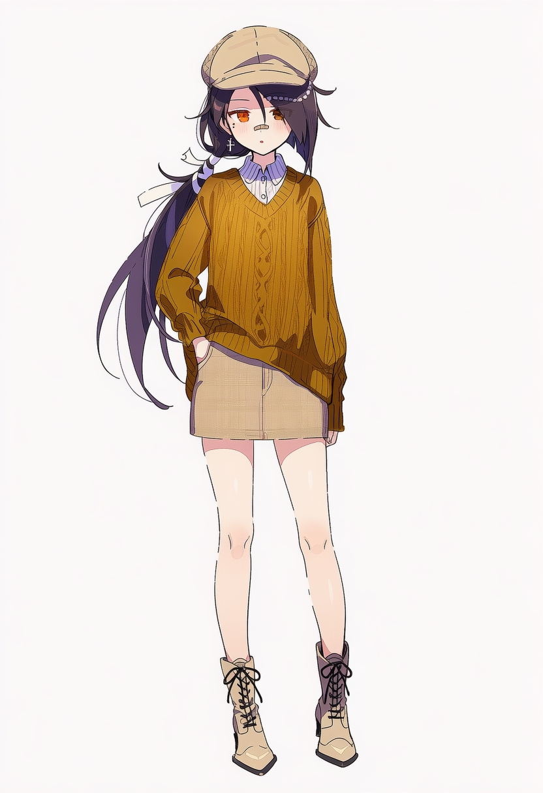

[在线例图](https://assets.quicktagcloud.com/images/raven_composition/raven_composition-5874.jpg?v=39252154a7a74608)

<a id="raven_composition-5876"></a>

## 克雷文

ID：`raven_composition-5876`；分类：角色图鉴 / 碧蓝航线 / 白鹰；来源标记：`safe`。

来源说明：

> 作品：碧蓝航线
> 角色英文名：Craven
> 首次登场时间（国服实装）：2017-05-25
> 阵营：白鹰

正向提示词：

```text
craven_(azur_lane)
```


[在线例图](https://assets.quicktagcloud.com/images/raven_composition/raven_composition-5876.jpg?v=ce41e412d98a620c)

<a id="raven_composition-5879"></a>

## 唐斯

ID：`raven_composition-5879`；分类：角色图鉴 / 碧蓝航线 / 白鹰；来源标记：`safe`。

来源说明：

> 作品：碧蓝航线
> 角色英文名：Downes
> 首次登场时间（国服实装）：2017-05-25
> 阵营：白鹰

正向提示词：

```text
downes_(azur_lane)
```

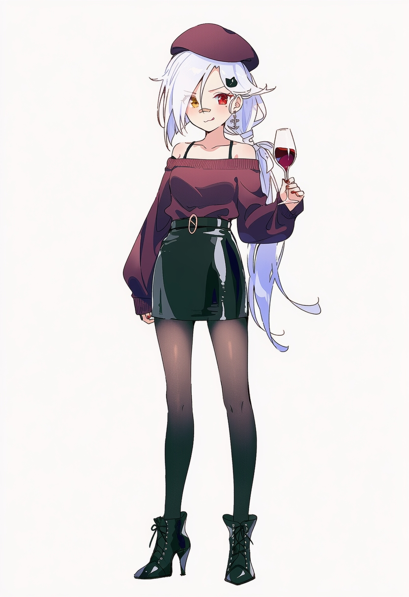

[在线例图](https://assets.quicktagcloud.com/images/raven_composition/raven_composition-5879.jpg?v=e81239cfea2c2e6f)

<a id="raven_composition-5882"></a>

## 麦考尔

ID：`raven_composition-5882`；分类：角色图鉴 / 碧蓝航线 / 白鹰；来源标记：`safe`。

来源说明：

> 作品：碧蓝航线
> 角色英文名：McCall
> 首次登场时间（国服实装）：2017-05-25
> 阵营：白鹰

正向提示词：

```text
mccall_(azur_lane)
```


[在线例图](https://assets.quicktagcloud.com/images/raven_composition/raven_composition-5882.jpg?v=70209ffde71f508a)

<a id="raven_composition-5886"></a>

## 弗莱彻

ID：`raven_composition-5886`；分类：角色图鉴 / 碧蓝航线 / 白鹰；来源标记：`safe`。

来源说明：

> 作品：碧蓝航线
> 角色英文名：Fletcher
> 首次登场时间（国服实装）：2017-05-25
> 阵营：白鹰

正向提示词：

```text
fletcher_(azur_lane)
```


[在线例图](https://assets.quicktagcloud.com/images/raven_composition/raven_composition-5886.jpg?v=f039425573ed9c37)

<a id="raven_composition-5888"></a>

## 格里德利

ID：`raven_composition-5888`；分类：角色图鉴 / 碧蓝航线 / 白鹰；来源标记：`safe`。

来源说明：

> 作品：碧蓝航线
> 角色英文名：Gridley
> 首次登场时间（国服实装）：2017-05-25
> 阵营：白鹰

正向提示词：

```text
gridley_(azur_lane)
```


[在线例图](https://assets.quicktagcloud.com/images/raven_composition/raven_composition-5888.jpg?v=0f6b967421a34111)

<a id="raven_composition-5889"></a>

## 哈曼

ID：`raven_composition-5889`；分类：角色图鉴 / 碧蓝航线 / 白鹰；来源标记：`safe`。

来源说明：

> 作品：碧蓝航线
> 角色英文名：Hammann
> 首次登场时间（国服实装）：2017-05-25
> 阵营：白鹰

正向提示词：

```text
hammann_(azur_lane)
```

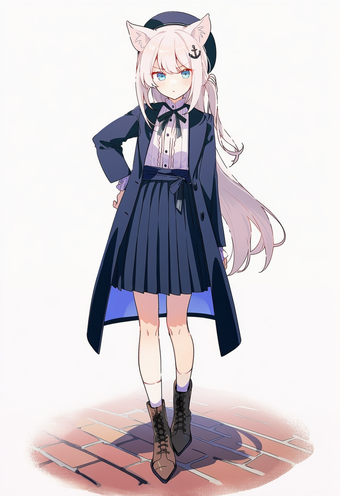

[在线例图](https://assets.quicktagcloud.com/images/raven_composition/raven_composition-5889.jpg?v=0c62bdf0c45979b4)

<a id="raven_composition-5893"></a>

## 西姆斯

ID：`raven_composition-5893`；分类：角色图鉴 / 碧蓝航线 / 白鹰；来源标记：`safe`。

来源说明：

> 作品：碧蓝航线
> 角色英文名：Sims
> 首次登场时间（国服实装）：2017-05-25
> 阵营：白鹰

正向提示词：

```text
sims_(azur_lane)
```

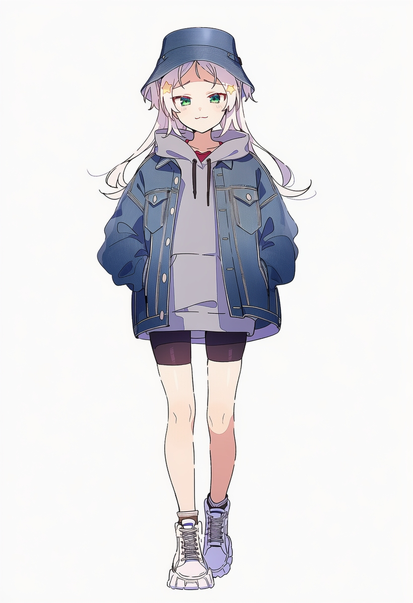

[在线例图](https://assets.quicktagcloud.com/images/raven_composition/raven_composition-5893.jpg?v=69ef472b948800cb)

<a id="raven_composition-5894"></a>

## 撒切尔

ID：`raven_composition-5894`；分类：角色图鉴 / 碧蓝航线 / 白鹰；来源标记：`safe`。

来源说明：

> 作品：碧蓝航线
> 角色英文名：Thatcher
> 首次登场时间（国服实装）：2017-05-25
> 阵营：白鹰

正向提示词：

```text
thatcher_(azur_lane)
```


[在线例图](https://assets.quicktagcloud.com/images/raven_composition/raven_composition-5894.jpg?v=c3edb98ce51f1e2d)

<a id="raven_composition-5895"></a>

## 查尔斯·奥斯本

ID：`raven_composition-5895`；分类：角色图鉴 / 碧蓝航线 / 白鹰；来源标记：`safe`。

来源说明：

> 作品：碧蓝航线
> 角色英文名：Charles Ausburne
> 首次登场时间（国服实装）：2017-05-25
> 阵营：白鹰

正向提示词：

```text
charles_ausburne_(azur_lane)
```


[在线例图](https://assets.quicktagcloud.com/images/raven_composition/raven_composition-5895.jpg?v=05a6f9ea61a6d09a)

<a id="raven_composition-5898"></a>

## 拉菲

ID：`raven_composition-5898`；分类：角色图鉴 / 碧蓝航线 / 白鹰；来源标记：`safe`。

来源说明：

> 作品：碧蓝航线
> 角色英文名：Laffey
> 首次登场时间（国服实装）：2017-05-25
> 阵营：白鹰

正向提示词：

```text
laffey_(azur_lane)
```

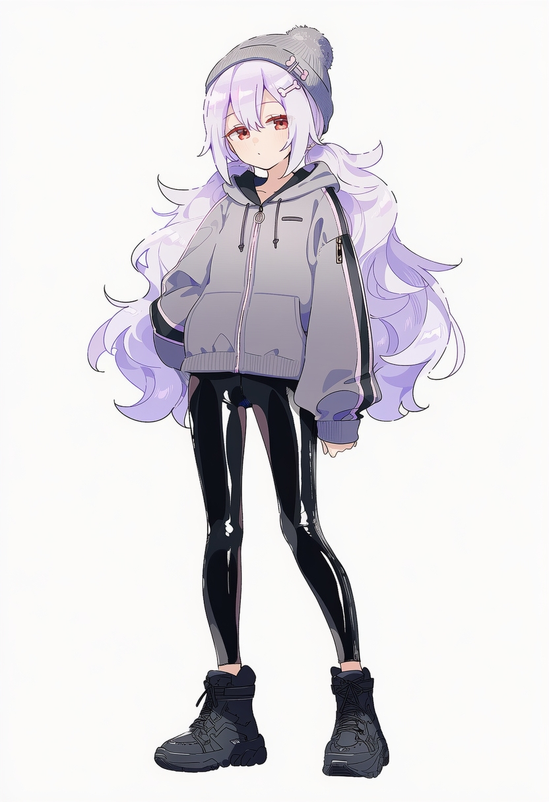

[在线例图](https://assets.quicktagcloud.com/images/raven_composition/raven_composition-5898.jpg?v=cfec4e215c1197f1)

<a id="raven_composition-5899"></a>

## 莫里

ID：`raven_composition-5899`；分类：角色图鉴 / 碧蓝航线 / 白鹰；来源标记：`safe`。

来源说明：

> 作品：碧蓝航线
> 角色英文名：Maury
> 首次登场时间（国服实装）：2017-05-25
> 阵营：白鹰

正向提示词：

```text
maury_(azur_lane)
```

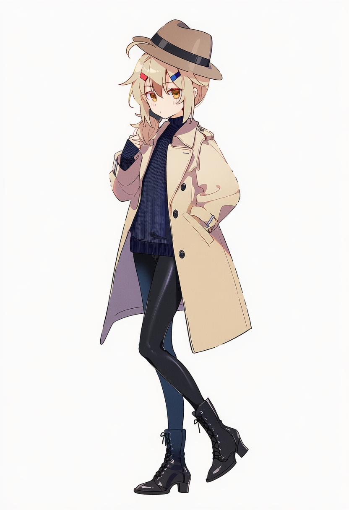

[在线例图](https://assets.quicktagcloud.com/images/raven_composition/raven_composition-5899.jpg?v=90519e593e55dbf7)

<a id="raven_composition-5903"></a>

## 埃尔德里奇

ID：`raven_composition-5903`；分类：角色图鉴 / 碧蓝航线 / 白鹰；来源标记：`safe`。

来源说明：

> 作品：碧蓝航线
> 角色英文名：Eldridge
> 首次登场时间（国服实装）：2017-05-25
> 阵营：白鹰

正向提示词：

```text
eldridge_(azur_lane)
```

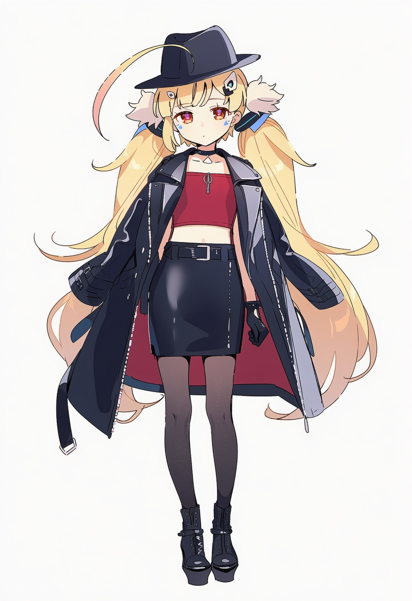

[在线例图](https://assets.quicktagcloud.com/images/raven_composition/raven_composition-5903.jpg?v=605aa1fdd89a2043)

<a id="raven_composition-5909"></a>

## 奥马哈

ID：`raven_composition-5909`；分类：角色图鉴 / 碧蓝航线 / 白鹰；来源标记：`safe`。

来源说明：

> 作品：碧蓝航线
> 角色英文名：Omaha
> 首次登场时间（国服实装）：2017-05-25
> 阵营：白鹰

正向提示词：

```text
omaha_(azur_lane)
```


[在线例图](https://assets.quicktagcloud.com/images/raven_composition/raven_composition-5909.jpg?v=0d2de4397cf912db)

<a id="raven_composition-5910"></a>

## 罗利

ID：`raven_composition-5910`；分类：角色图鉴 / 碧蓝航线 / 白鹰；来源标记：`safe`。

来源说明：

> 作品：碧蓝航线
> 角色英文名：Raleigh
> 首次登场时间（国服实装）：2017-05-25
> 阵营：白鹰

正向提示词：

```text
raleigh_(azur_lane)
```

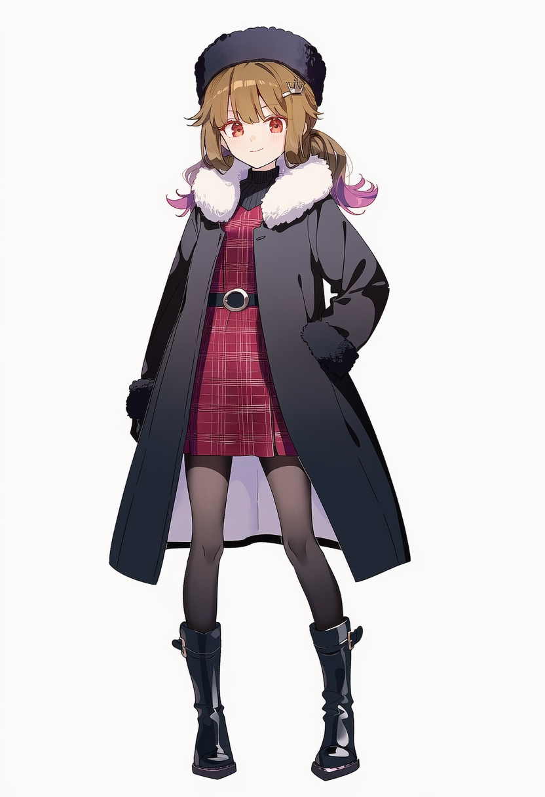

[在线例图](https://assets.quicktagcloud.com/images/raven_composition/raven_composition-5910.jpg?v=1394f8cb7cb9e1d0)

<a id="raven_composition-5914"></a>

## 亚特兰大

ID：`raven_composition-5914`；分类：角色图鉴 / 碧蓝航线 / 白鹰；来源标记：`safe`。

来源说明：

> 作品：碧蓝航线
> 角色英文名：Atlanta
> 首次登场时间（国服实装）：2017-05-25
> 阵营：白鹰

正向提示词：

```text
atlanta_(azur_lane)
```


[在线例图](https://assets.quicktagcloud.com/images/raven_composition/raven_composition-5914.jpg?v=551473583f5d4c31)

<a id="raven_composition-5915"></a>

## 布鲁克林

ID：`raven_composition-5915`；分类：角色图鉴 / 碧蓝航线 / 白鹰；来源标记：`safe`。

来源说明：

> 作品：碧蓝航线
> 角色英文名：Brooklyn
> 首次登场时间（国服实装）：2017-05-25
> 阵营：白鹰

正向提示词：

```text
brooklyn_(azur_lane)
```


[在线例图](https://assets.quicktagcloud.com/images/raven_composition/raven_composition-5915.jpg?v=57e8c9f04ce042dc)

<a id="raven_composition-5917"></a>

## 朱诺

ID：`raven_composition-5917`；分类：角色图鉴 / 碧蓝航线 / 白鹰；来源标记：`safe`。

来源说明：

> 作品：碧蓝航线
> 角色英文名：Juneau
> 首次登场时间（国服实装）：2017-05-25
> 阵营：白鹰

正向提示词：

```text
juneau_(azur_lane)
```

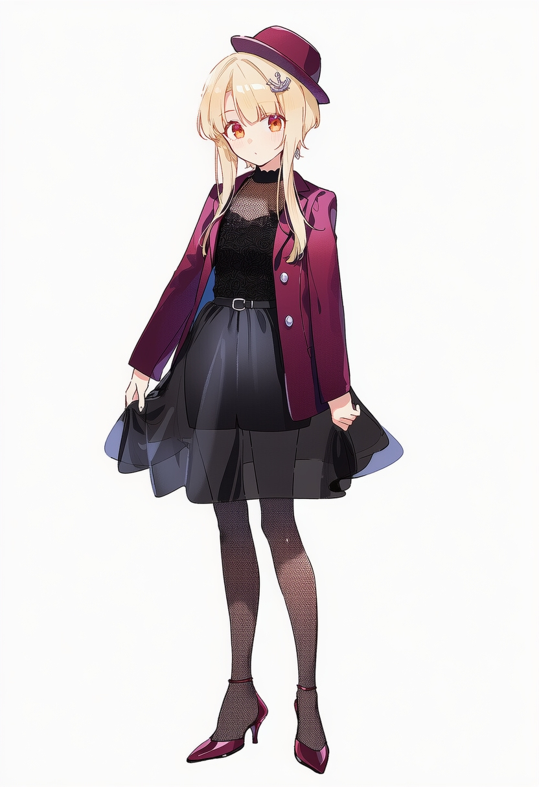

[在线例图](https://assets.quicktagcloud.com/images/raven_composition/raven_composition-5917.jpg?v=4245817d6d24972d)

<a id="raven_composition-5919"></a>

## 菲尼克斯

ID：`raven_composition-5919`；分类：角色图鉴 / 碧蓝航线 / 白鹰；来源标记：`safe`。

来源说明：

> 作品：碧蓝航线
> 角色英文名：Phoenix
> 首次登场时间（国服实装）：2017-05-25
> 阵营：白鹰

正向提示词：

```text
phoenix_(azur_lane)
```

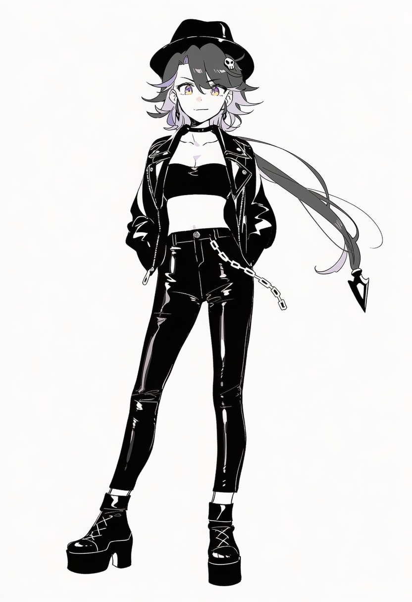

[在线例图](https://assets.quicktagcloud.com/images/raven_composition/raven_composition-5919.jpg?v=7fa69bc2b8c5e5e3)

<a id="raven_composition-5920"></a>

## 克利夫兰

ID：`raven_composition-5920`；分类：角色图鉴 / 碧蓝航线 / 白鹰；来源标记：`safe`。

来源说明：

> 作品：碧蓝航线
> 角色英文名：Cleveland
> 首次登场时间（国服实装）：2017-05-25
> 阵营：白鹰

正向提示词：

```text
cleveland_(azur_lane)
```


[在线例图](https://assets.quicktagcloud.com/images/raven_composition/raven_composition-5920.jpg?v=e640feafc5997a35)

<a id="raven_composition-5921"></a>

## 海伦娜

ID：`raven_composition-5921`；分类：角色图鉴 / 碧蓝航线 / 白鹰；来源标记：`safe`。

来源说明：

> 作品：碧蓝航线
> 角色英文名：Helena
> 首次登场时间（国服实装）：2017-05-25
> 阵营：白鹰

正向提示词：

```text
helena_(azur_lane)
```


[在线例图](https://assets.quicktagcloud.com/images/raven_composition/raven_composition-5921.jpg?v=7167bb780f02a28e)

<a id="raven_composition-5925"></a>

## 圣地亚哥

ID：`raven_composition-5925`；分类：角色图鉴 / 碧蓝航线 / 白鹰；来源标记：`safe`。

来源说明：

> 作品：碧蓝航线
> 角色英文名：San Diego
> 首次登场时间（国服实装）：2017-05-25
> 阵营：白鹰

正向提示词：

```text
san_diego_(azur_lane)
```


[在线例图](https://assets.quicktagcloud.com/images/raven_composition/raven_composition-5925.jpg?v=878991aa26d1f3ed)

<a id="raven_composition-5928"></a>

## 彭萨科拉

ID：`raven_composition-5928`；分类：角色图鉴 / 碧蓝航线 / 白鹰；来源标记：`safe`。

来源说明：

> 作品：碧蓝航线
> 角色英文名：Pensacola
> 首次登场时间（国服实装）：2017-05-25
> 阵营：白鹰

正向提示词：

```text
pensacola_(azur_lane)
```


[在线例图](https://assets.quicktagcloud.com/images/raven_composition/raven_composition-5928.jpg?v=9ac319c6895ea548)

<a id="raven_composition-5929"></a>

## 芝加哥

ID：`raven_composition-5929`；分类：角色图鉴 / 碧蓝航线 / 白鹰；来源标记：`safe`。

来源说明：

> 作品：碧蓝航线
> 角色英文名：Chicago
> 首次登场时间（国服实装）：2017-05-25
> 阵营：白鹰

正向提示词：

```text
chicago_(azur_lane)
```

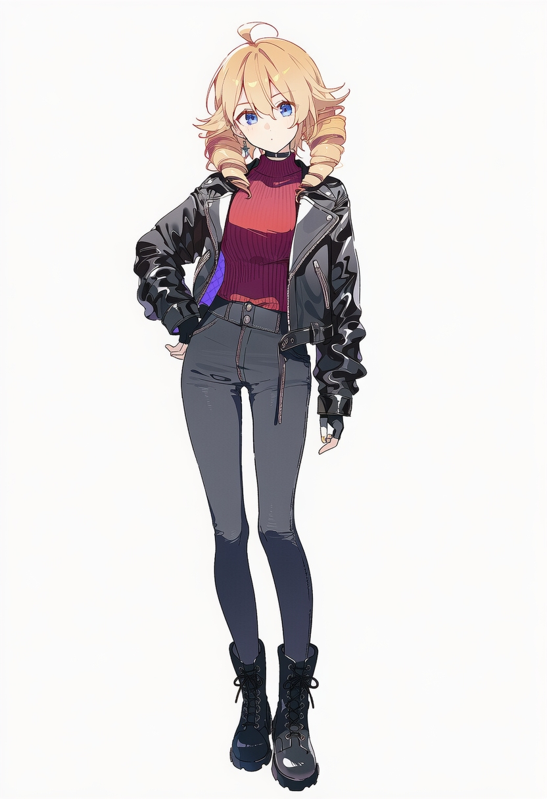

[在线例图](https://assets.quicktagcloud.com/images/raven_composition/raven_composition-5929.jpg?v=13f19671b6f3f66a)

<a id="raven_composition-5932"></a>

## 北安普敦

ID：`raven_composition-5932`；分类：角色图鉴 / 碧蓝航线 / 白鹰；来源标记：`safe`。

来源说明：

> 作品：碧蓝航线
> 角色英文名：Northampton
> 首次登场时间（国服实装）：2017-05-25
> 阵营：白鹰

正向提示词：

```text
northampton_(azur_lane)
```

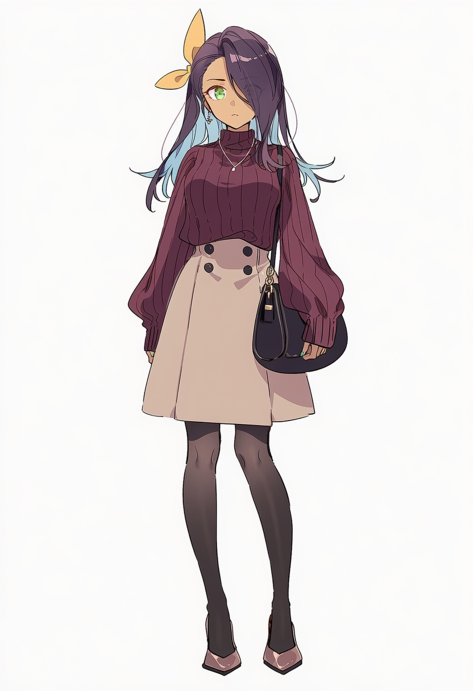

[在线例图](https://assets.quicktagcloud.com/images/raven_composition/raven_composition-5932.jpg?v=589ec7bf25af28e1)

<a id="raven_composition-5933"></a>

## 波特兰

ID：`raven_composition-5933`；分类：角色图鉴 / 碧蓝航线 / 白鹰；来源标记：`safe`。

来源说明：

> 作品：碧蓝航线
> 角色英文名：Portland
> 首次登场时间（国服实装）：2017-05-25
> 阵营：白鹰

正向提示词：

```text
portland_(azur_lane)
```

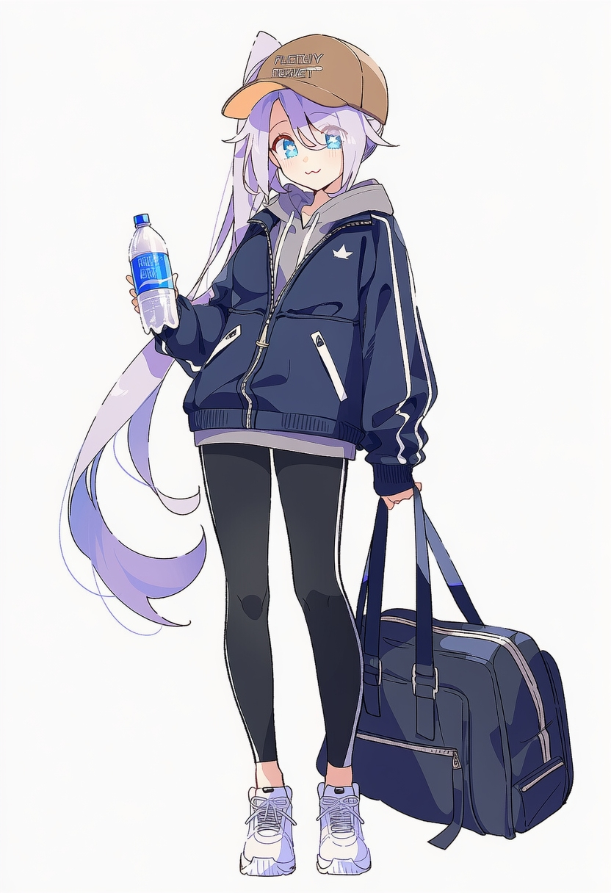

[在线例图](https://assets.quicktagcloud.com/images/raven_composition/raven_composition-5933.jpg?v=516d4d56a8f6fc5e)

<a id="raven_composition-5938"></a>

## 休斯敦

ID：`raven_composition-5938`；分类：角色图鉴 / 碧蓝航线 / 白鹰；来源标记：`safe`。

来源说明：

> 作品：碧蓝航线
> 角色英文名：Houston
> 首次登场时间（国服实装）：2017-05-25
> 阵营：白鹰

正向提示词：

```text
houston_(azur_lane)
```

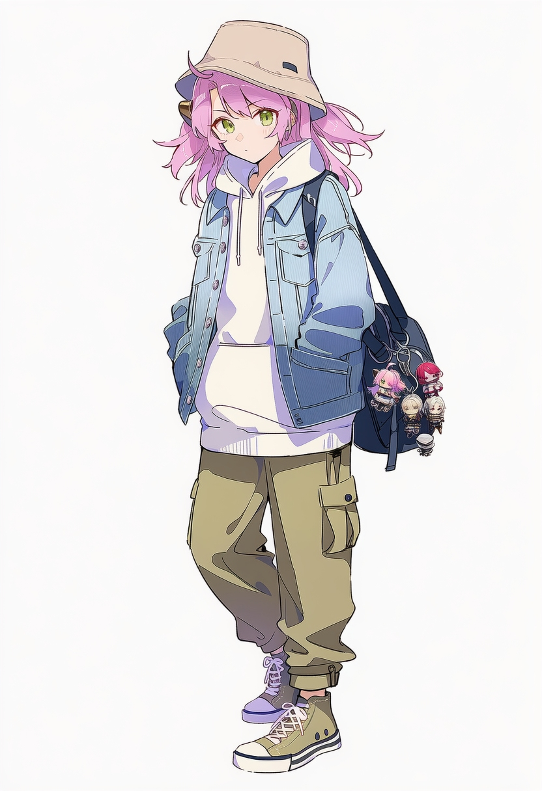

[在线例图](https://assets.quicktagcloud.com/images/raven_composition/raven_composition-5938.jpg?v=d99a0a8b5f6c58b0)

<a id="raven_composition-5939"></a>

## 印第安纳波利斯

ID：`raven_composition-5939`；分类：角色图鉴 / 碧蓝航线 / 白鹰；来源标记：`safe`。

来源说明：

> 作品：碧蓝航线
> 角色英文名：Indianapolis
> 首次登场时间（国服实装）：2017-05-25
> 阵营：白鹰

正向提示词：

```text
indianapolis_(azur_lane)
```

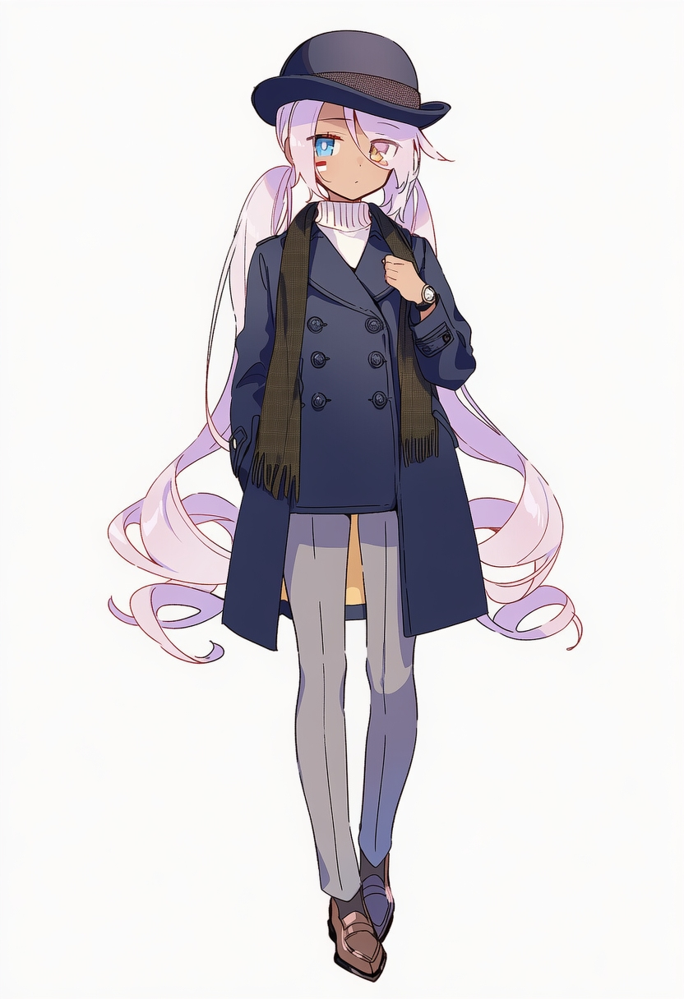

[在线例图](https://assets.quicktagcloud.com/images/raven_composition/raven_composition-5939.jpg?v=e368d68765c69a5c)

<a id="raven_composition-5941"></a>

## 威奇塔

ID：`raven_composition-5941`；分类：角色图鉴 / 碧蓝航线 / 白鹰；来源标记：`safe`。

来源说明：

> 作品：碧蓝航线
> 角色英文名：Wichita
> 首次登场时间（国服实装）：2017-05-25
> 阵营：白鹰

正向提示词：

```text
wichita_(azur_lane)
```


[在线例图](https://assets.quicktagcloud.com/images/raven_composition/raven_composition-5941.jpg?v=0cb5db331ec84b76)

<a id="raven_composition-5948"></a>

## 内华达

ID：`raven_composition-5948`；分类：角色图鉴 / 碧蓝航线 / 白鹰；来源标记：`safe`。

来源说明：

> 作品：碧蓝航线
> 角色英文名：Nevada
> 首次登场时间（国服实装）：2017-05-25
> 阵营：白鹰

正向提示词：

```text
nevada_(azur_lane)
```


[在线例图](https://assets.quicktagcloud.com/images/raven_composition/raven_composition-5948.jpg?v=0c0deb16acd5d437)

<a id="raven_composition-5949"></a>

## 俄克拉荷马

ID：`raven_composition-5949`；分类：角色图鉴 / 碧蓝航线 / 白鹰；来源标记：`safe`。

来源说明：

> 作品：碧蓝航线
> 角色英文名：Oklahoma
> 首次登场时间（国服实装）：2017-05-25
> 阵营：白鹰

正向提示词：

```text
oklahoma_(azur_lane)
```

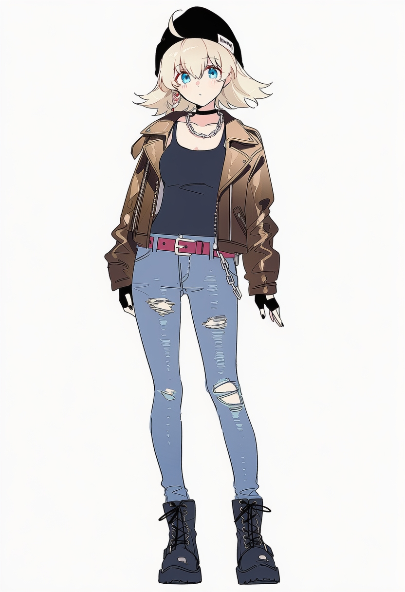

[在线例图](https://assets.quicktagcloud.com/images/raven_composition/raven_composition-5949.jpg?v=7344d4eface23b22)

<a id="raven_composition-5950"></a>

## 加利福尼亚

ID：`raven_composition-5950`；分类：角色图鉴 / 碧蓝航线 / 白鹰；来源标记：`safe`。

来源说明：

> 作品：碧蓝航线
> 角色英文名：California
> 首次登场时间（国服实装）：2017-05-25
> 阵营：白鹰

正向提示词：

```text
california_(azur_lane)
```

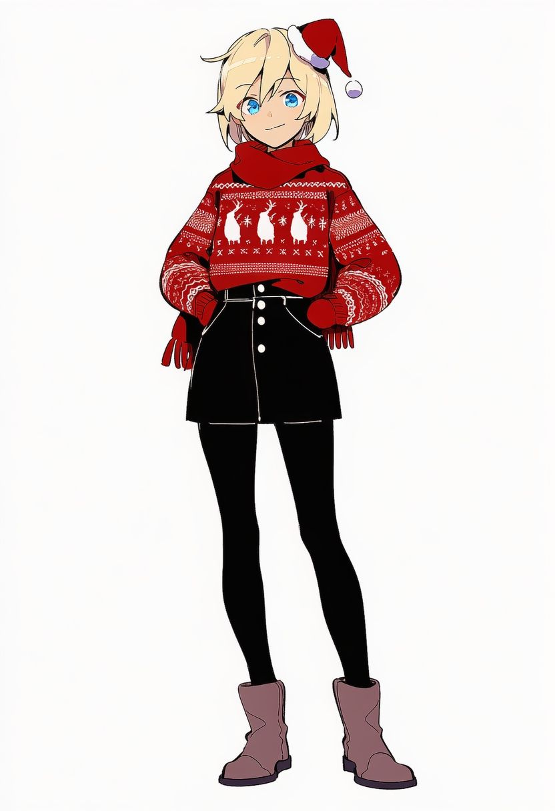

[在线例图](https://assets.quicktagcloud.com/images/raven_composition/raven_composition-5950.jpg?v=44c2312515fcdc08)

<a id="raven_composition-5952"></a>

## 宾夕法尼亚

ID：`raven_composition-5952`；分类：角色图鉴 / 碧蓝航线 / 白鹰；来源标记：`safe`。

来源说明：

> 作品：碧蓝航线
> 角色英文名：Pennsylvania
> 首次登场时间（国服实装）：2017-05-25
> 阵营：白鹰

正向提示词：

```text
pennsylvania_(azur_lane)
```

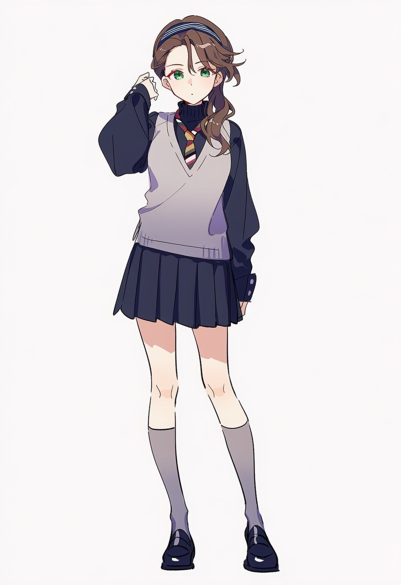

[在线例图](https://assets.quicktagcloud.com/images/raven_composition/raven_composition-5952.jpg?v=6496a76db12f98f2)

<a id="raven_composition-5953"></a>

## 田纳西

ID：`raven_composition-5953`；分类：角色图鉴 / 碧蓝航线 / 白鹰；来源标记：`safe`。

来源说明：

> 作品：碧蓝航线
> 角色英文名：Tennessee
> 首次登场时间（国服实装）：2017-05-25
> 阵营：白鹰

正向提示词：

```text
tennessee_(azur_lane)
```

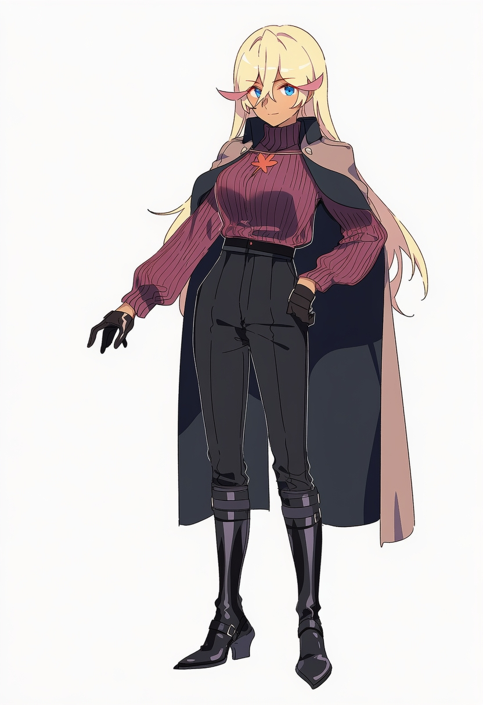

[在线例图](https://assets.quicktagcloud.com/images/raven_composition/raven_composition-5953.jpg?v=e4892939f038630b)

<a id="raven_composition-5955"></a>

## 亚利桑那

ID：`raven_composition-5955`；分类：角色图鉴 / 碧蓝航线 / 白鹰；来源标记：`safe`。

来源说明：

> 作品：碧蓝航线
> 角色英文名：Arizona
> 首次登场时间（国服实装）：2017-05-25
> 阵营：白鹰

正向提示词：

```text
arizona_(azur_lane)
```

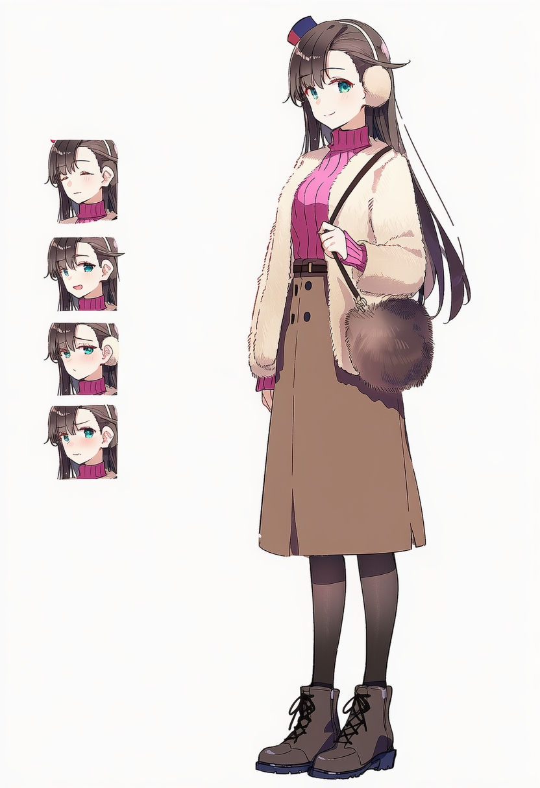

[在线例图](https://assets.quicktagcloud.com/images/raven_composition/raven_composition-5955.jpg?v=0b2d9e58da4b71da)

<a id="raven_composition-5959"></a>

## 南达科他

ID：`raven_composition-5959`；分类：角色图鉴 / 碧蓝航线 / 白鹰；来源标记：`safe`。

来源说明：

> 作品：碧蓝航线
> 角色英文名：South Dakota
> 首次登场时间（国服实装）：2017-05-25
> 阵营：白鹰

正向提示词：

```text
south_dakota_(azur_lane)
```

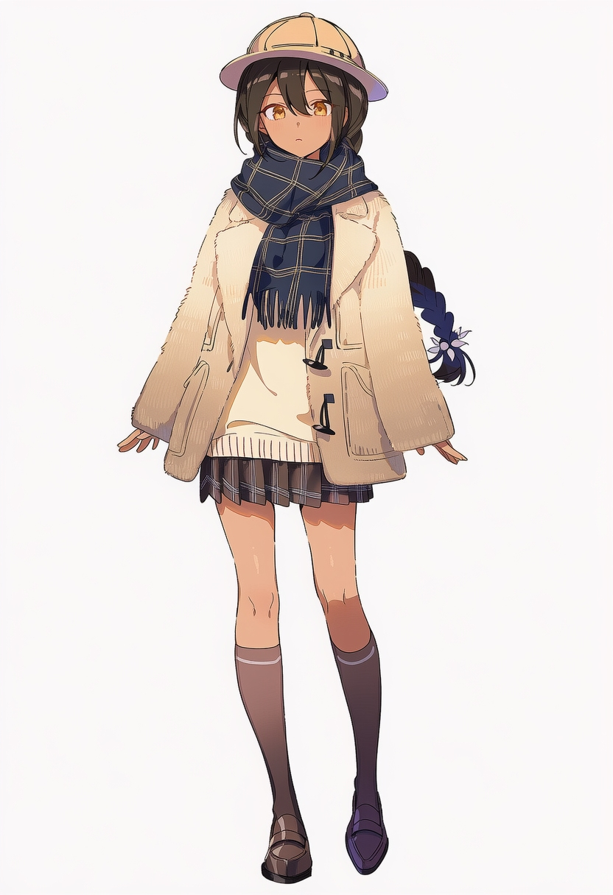

[在线例图](https://assets.quicktagcloud.com/images/raven_composition/raven_composition-5959.jpg?v=4128cd4d8fbe6487)

<a id="raven_composition-5963"></a>

## 博格

ID：`raven_composition-5963`；分类：角色图鉴 / 碧蓝航线 / 白鹰；来源标记：`safe`。

来源说明：

> 作品：碧蓝航线
> 角色英文名：Bogue
> 首次登场时间（国服实装）：2017-05-25
> 阵营：白鹰

正向提示词：

```text
bogue_(azur_lane)
```

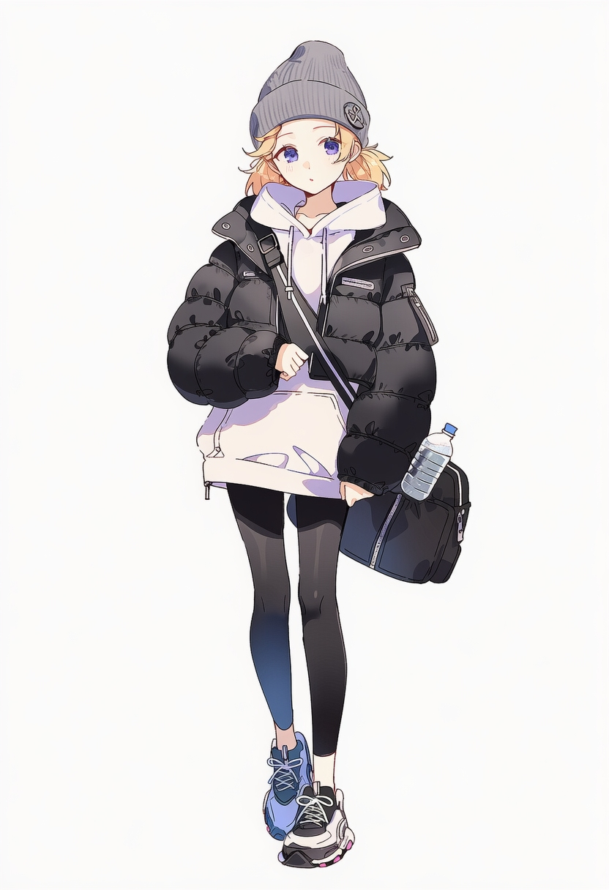

[在线例图](https://assets.quicktagcloud.com/images/raven_composition/raven_composition-5963.jpg?v=3d894e22e14ef5c9)

<a id="raven_composition-5965"></a>

## 兰利

ID：`raven_composition-5965`；分类：角色图鉴 / 碧蓝航线 / 白鹰；来源标记：`safe`。

来源说明：

> 作品：碧蓝航线
> 角色英文名：Langley
> 首次登场时间（国服实装）：2017-05-25
> 阵营：白鹰

正向提示词：

```text
langley_(azur_lane)
```

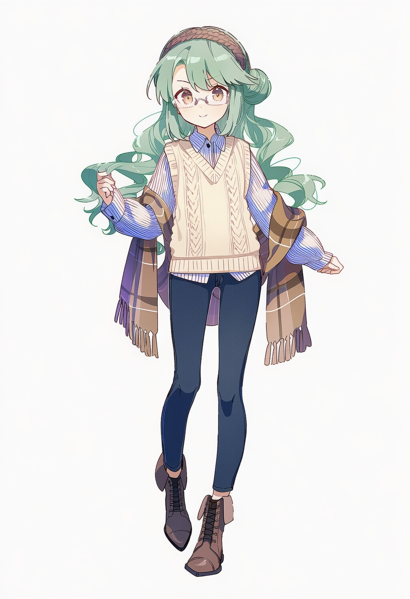

[在线例图](https://assets.quicktagcloud.com/images/raven_composition/raven_composition-5965.jpg?v=416ceb4460529ddc)

<a id="raven_composition-5966"></a>

## 突击者

ID：`raven_composition-5966`；分类：角色图鉴 / 碧蓝航线 / 白鹰；来源标记：`safe`。

来源说明：

> 作品：碧蓝航线
> 角色英文名：Ranger
> 首次登场时间（国服实装）：2017-05-25
> 阵营：白鹰

正向提示词：

```text
ranger_(azur_lane)
```

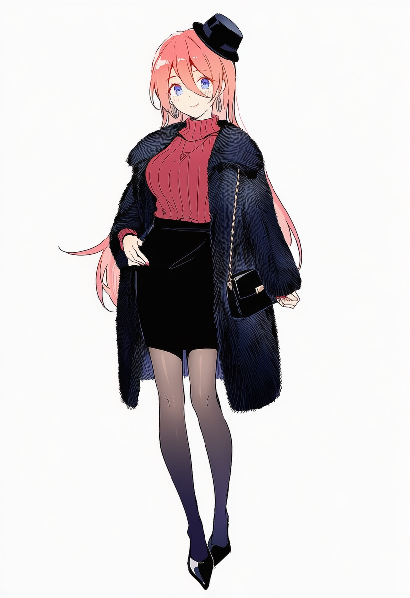

[在线例图](https://assets.quicktagcloud.com/images/raven_composition/raven_composition-5966.jpg?v=ae58e847c61dad8e)

<a id="raven_composition-5967"></a>

## 长岛

ID：`raven_composition-5967`；分类：角色图鉴 / 碧蓝航线 / 白鹰；来源标记：`safe`。

来源说明：

> 作品：碧蓝航线
> 角色英文名：Long Island
> 首次登场时间（国服实装）：2017-05-25
> 阵营：白鹰

正向提示词：

```text
long_island_(azur_lane)
```

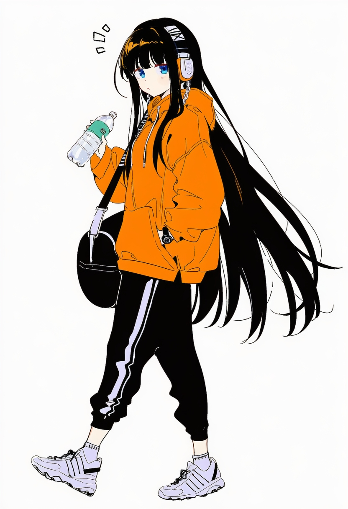

[在线例图](https://assets.quicktagcloud.com/images/raven_composition/raven_composition-5967.jpg?v=899a411d2542c3a6)

<a id="raven_composition-5973"></a>

## 大黄蜂

ID：`raven_composition-5973`；分类：角色图鉴 / 碧蓝航线 / 白鹰；来源标记：`safe`。

来源说明：

> 作品：碧蓝航线
> 角色英文名：Hornet
> 首次登场时间（国服实装）：2017-05-25
> 阵营：白鹰

正向提示词：

```text
hornet_(azur_lane)
```

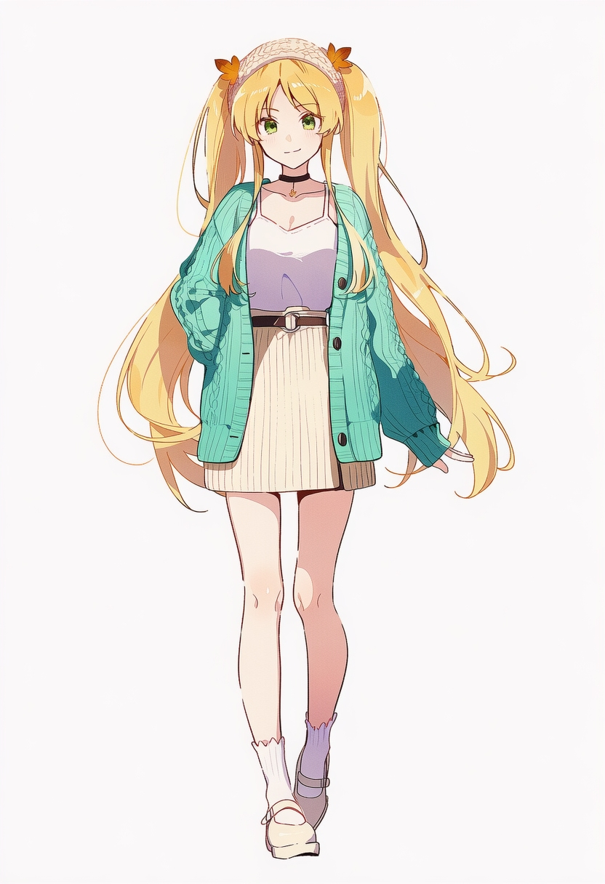

[在线例图](https://assets.quicktagcloud.com/images/raven_composition/raven_composition-5973.jpg?v=62f15ce474578ec6)

<a id="raven_composition-5974"></a>

## 列克星敦

ID：`raven_composition-5974`；分类：角色图鉴 / 碧蓝航线 / 白鹰；来源标记：`safe`。

来源说明：

> 作品：碧蓝航线
> 角色英文名：Lexington
> 首次登场时间（国服实装）：2017-05-25
> 阵营：白鹰

正向提示词：

```text
lexington_(azur_lane)
```

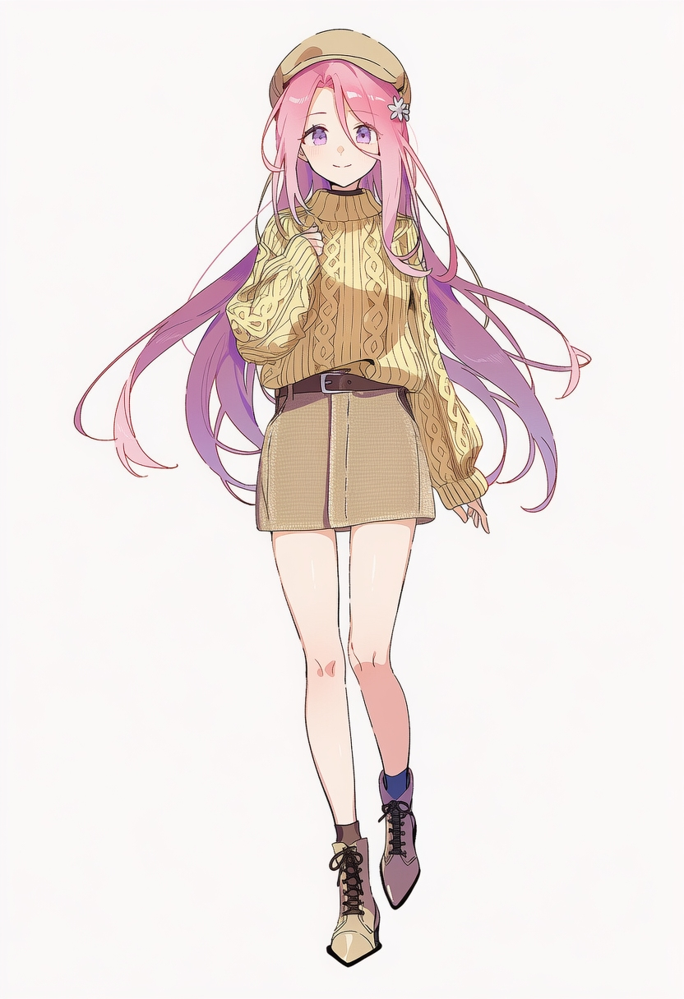

[在线例图](https://assets.quicktagcloud.com/images/raven_composition/raven_composition-5974.jpg?v=43bc853ac3eb6884)

<a id="raven_composition-5975"></a>

## 萨拉托加

ID：`raven_composition-5975`；分类：角色图鉴 / 碧蓝航线 / 白鹰；来源标记：`safe`。

来源说明：

> 作品：碧蓝航线
> 角色英文名：Saratoga
> 首次登场时间（国服实装）：2017-05-25
> 阵营：白鹰

正向提示词：

```text
saratoga_(azur_lane)
```


[在线例图](https://assets.quicktagcloud.com/images/raven_composition/raven_composition-5975.jpg?v=e637ddc3dd7a25b8)

<a id="raven_composition-5977"></a>

## 约克城

ID：`raven_composition-5977`；分类：角色图鉴 / 碧蓝航线 / 白鹰；来源标记：`safe`。

来源说明：

> 作品：碧蓝航线
> 角色英文名：Yorktown
> 首次登场时间（国服实装）：2017-05-25
> 阵营：白鹰

正向提示词：

```text
yorktown_(azur_lane)
```


[在线例图](https://assets.quicktagcloud.com/images/raven_composition/raven_composition-5977.jpg?v=dbc9d7f4d76262b9)

<a id="raven_composition-5979"></a>

## 企业

ID：`raven_composition-5979`；分类：角色图鉴 / 碧蓝航线 / 白鹰；来源标记：`safe`。

来源说明：

> 作品：碧蓝航线
> 角色英文名：Enterprise
> 首次登场时间（国服实装）：2017-05-25
> 阵营：白鹰

正向提示词：

```text
enterprise_(azur_lane)
```


[在线例图](https://assets.quicktagcloud.com/images/raven_composition/raven_composition-5979.jpg?v=6fecae2406f58eb7)

<a id="raven_composition-5985"></a>

## 本森

ID：`raven_composition-5985`；分类：角色图鉴 / 碧蓝航线 / 白鹰；来源标记：`safe`。

来源说明：

> 作品：碧蓝航线
> 角色英文名：Benson
> 首次登场时间（国服实装）：2017-06-01
> 阵营：白鹰

正向提示词：

```text
benson_(azur_lane)
```

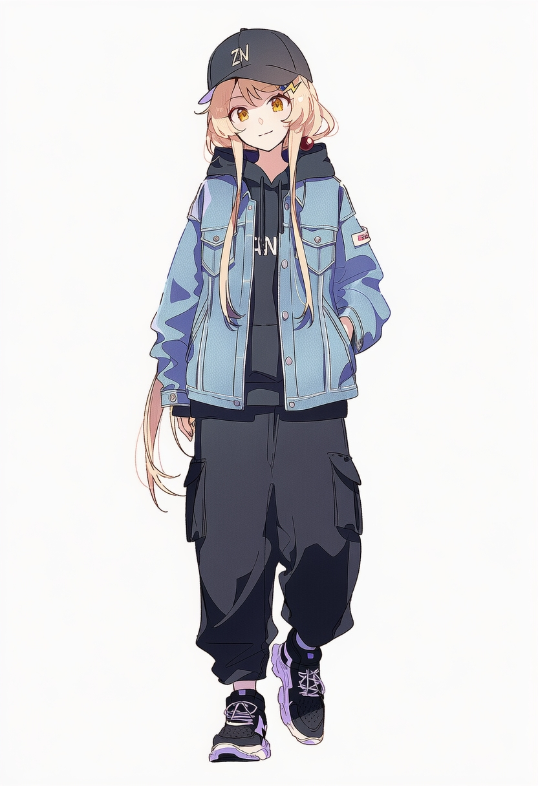

[在线例图](https://assets.quicktagcloud.com/images/raven_composition/raven_composition-5985.jpg?v=1edc31447c52f7d3)

<a id="raven_composition-5991"></a>

## 盐湖城

ID：`raven_composition-5991`；分类：角色图鉴 / 碧蓝航线 / 白鹰；来源标记：`safe`。

来源说明：

> 作品：碧蓝航线
> 角色英文名：Salt Lake City
> 首次登场时间（国服实装）：2017-06-23
> 阵营：白鹰

正向提示词：

```text
salt_lake_city_(azur_lane)
```

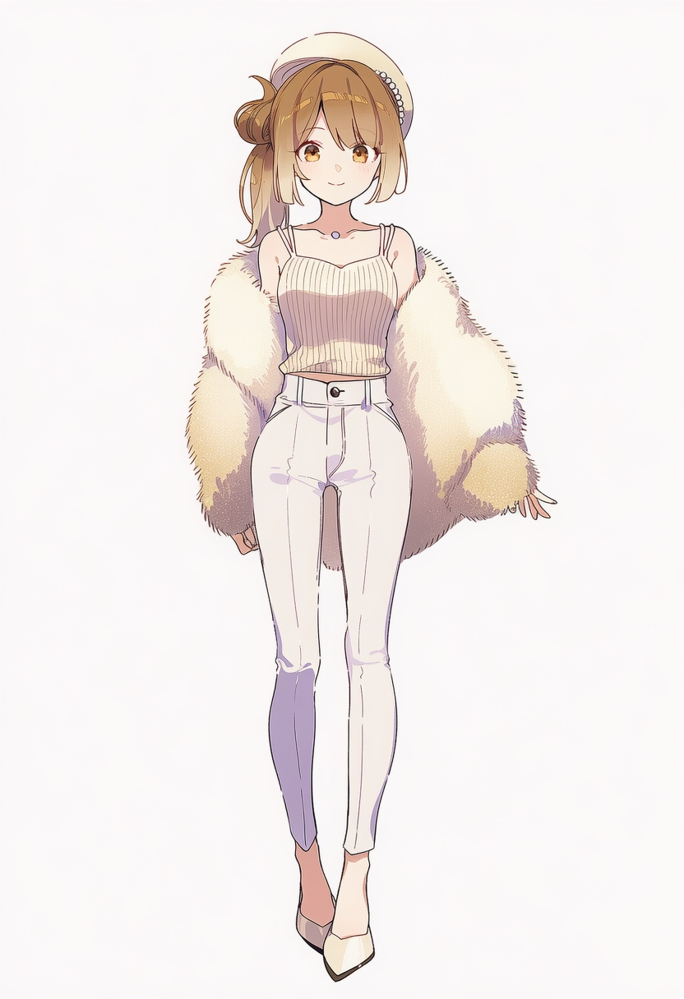

[在线例图](https://assets.quicktagcloud.com/images/raven_composition/raven_composition-5991.jpg?v=b1912e4d2efd9035)

<a id="raven_composition-5995"></a>

## 贝利

ID：`raven_composition-5995`；分类：角色图鉴 / 碧蓝航线 / 白鹰；来源标记：`safe`。

来源说明：

> 作品：碧蓝航线
> 角色英文名：Bailey
> 首次登场时间（国服实装）：2017-07-01
> 阵营：白鹰

正向提示词：

```text
bailey_(azur_lane)
```


[在线例图](https://assets.quicktagcloud.com/images/raven_composition/raven_composition-5995.jpg?v=460acf2eaf2e847c)

<a id="raven_composition-6021"></a>

## 里士满

ID：`raven_composition-6021`；分类：角色图鉴 / 碧蓝航线 / 白鹰；来源标记：`safe`。

来源说明：

> 作品：碧蓝航线
> 角色英文名：Richmond
> 首次登场时间（国服实装）：2017-09-08
> 阵营：白鹰

正向提示词：

```text
richmond_(azur_lane)
```

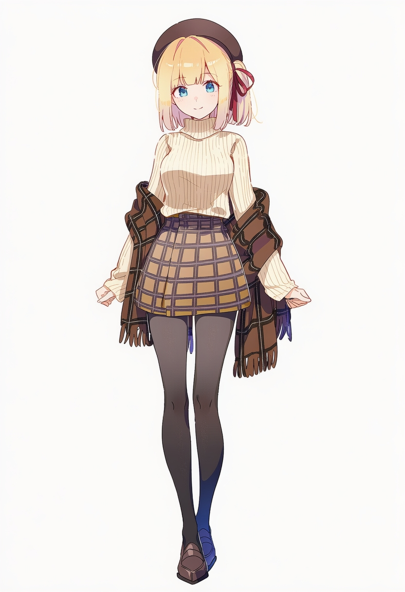

[在线例图](https://assets.quicktagcloud.com/images/raven_composition/raven_composition-6021.jpg?v=b981f3bcb07a7754)

<a id="raven_composition-6022"></a>

## 杰金斯

ID：`raven_composition-6022`；分类：角色图鉴 / 碧蓝航线 / 白鹰；来源标记：`safe`。

来源说明：

> 作品：碧蓝航线
> 角色英文名：Jenkins
> 首次登场时间（国服实装）：2017-09-20
> 阵营：白鹰

正向提示词：

```text
jenkins_(azur_lane)
```


[在线例图](https://assets.quicktagcloud.com/images/raven_composition/raven_composition-6022.jpg?v=5880e910f858ecd6)

<a id="raven_composition-6023"></a>

## 拉德福特

ID：`raven_composition-6023`；分类：角色图鉴 / 碧蓝航线 / 白鹰；来源标记：`safe`。

来源说明：

> 作品：碧蓝航线
> 角色英文名：Radford
> 首次登场时间（国服实装）：2017-09-20
> 阵营：白鹰

正向提示词：

```text
radford_(azur_lane)
```


[在线例图](https://assets.quicktagcloud.com/images/raven_composition/raven_composition-6023.jpg?v=beeda1e91bc37723)

<a id="raven_composition-6024"></a>

## 尼古拉斯

ID：`raven_composition-6024`；分类：角色图鉴 / 碧蓝航线 / 白鹰；来源标记：`safe`。

来源说明：

> 作品：碧蓝航线
> 角色英文名：Nicholas
> 首次登场时间（国服实装）：2017-09-20
> 阵营：白鹰

正向提示词：

```text
nicholas_(azur_lane)
```

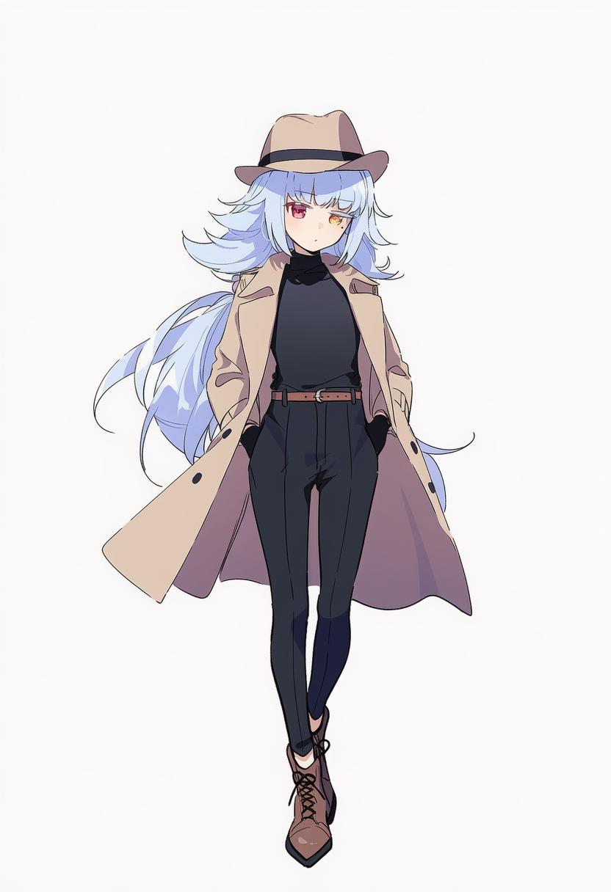

[在线例图](https://assets.quicktagcloud.com/images/raven_composition/raven_composition-6024.jpg?v=cbe78fbc835232d6)

<a id="raven_composition-6040"></a>

## 火奴鲁鲁

ID：`raven_composition-6040`；分类：角色图鉴 / 碧蓝航线 / 白鹰；来源标记：`safe`。

来源说明：

> 作品：碧蓝航线
> 角色英文名：Honolulu
> 首次登场时间（国服实装）：2017-11-16
> 阵营：白鹰

正向提示词：

```text
honolulu_(azur_lane)
```

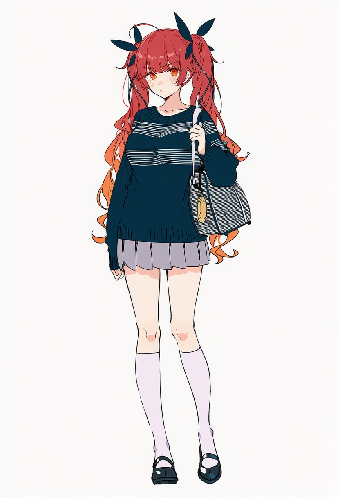

[在线例图](https://assets.quicktagcloud.com/images/raven_composition/raven_composition-6040.jpg?v=98cfe9155aae6df5)

<a id="raven_composition-6042"></a>

## 圣路易斯

ID：`raven_composition-6042`；分类：角色图鉴 / 碧蓝航线 / 白鹰；来源标记：`safe`。

来源说明：

> 作品：碧蓝航线
> 角色英文名：St. Louis
> 首次登场时间（国服实装）：2017-11-16
> 阵营：白鹰

正向提示词：

```text
st._louis_(azur_lane)
```

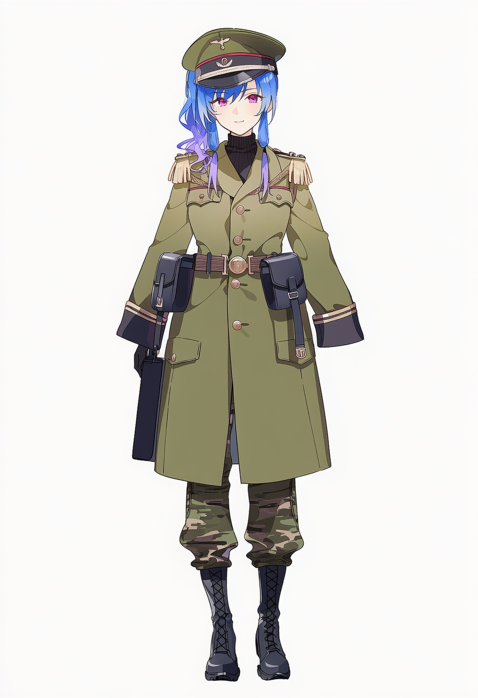

[在线例图](https://assets.quicktagcloud.com/images/raven_composition/raven_composition-6042.jpg?v=d796baf32af8a2cc)

<a id="raven_composition-6051"></a>

## 科罗拉多

ID：`raven_composition-6051`；分类：角色图鉴 / 碧蓝航线 / 白鹰；来源标记：`safe`。

来源说明：

> 作品：碧蓝航线
> 角色英文名：Colorado
> 首次登场时间（国服实装）：2017-12-29
> 阵营：白鹰

正向提示词：

```text
colorado_(azur_lane)
```

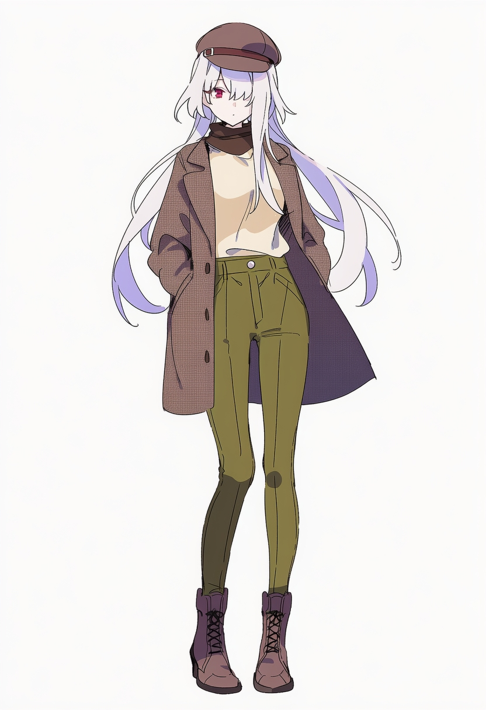

[在线例图](https://assets.quicktagcloud.com/images/raven_composition/raven_composition-6051.jpg?v=5c6af916d54ace67)

<a id="raven_composition-6052"></a>

## 马里兰

ID：`raven_composition-6052`；分类：角色图鉴 / 碧蓝航线 / 白鹰；来源标记：`safe`。

来源说明：

> 作品：碧蓝航线
> 角色英文名：Maryland
> 首次登场时间（国服实装）：2017-12-29
> 阵营：白鹰

正向提示词：

```text
maryland_(azur_lane)
```


[在线例图](https://assets.quicktagcloud.com/images/raven_composition/raven_composition-6052.jpg?v=77238aa92fa915d5)

<a id="raven_composition-6053"></a>

## 西弗吉尼亚

ID：`raven_composition-6053`；分类：角色图鉴 / 碧蓝航线 / 白鹰；来源标记：`safe`。

来源说明：

> 作品：碧蓝航线
> 角色英文名：West Virginia
> 首次登场时间（国服实装）：2017-12-29
> 阵营：白鹰

正向提示词：

```text
west_virginia_(azur_lane)
```

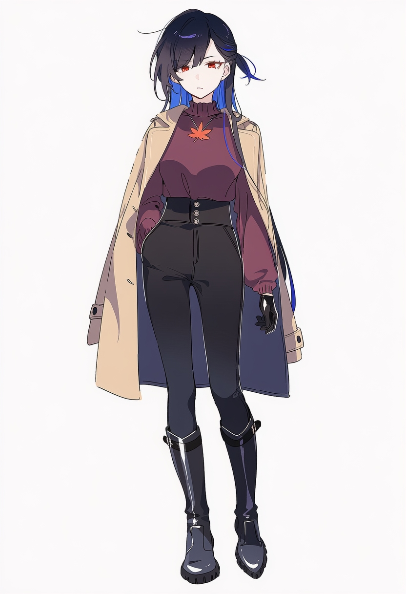

[在线例图](https://assets.quicktagcloud.com/images/raven_composition/raven_composition-6053.jpg?v=f3dc70cadcf7136c)

<a id="raven_composition-6054"></a>

## 北卡罗来纳

ID：`raven_composition-6054`；分类：角色图鉴 / 碧蓝航线 / 白鹰；来源标记：`safe`。

来源说明：

> 作品：碧蓝航线
> 角色英文名：North Carolina
> 首次登场时间（国服实装）：2017-12-29
> 阵营：白鹰

正向提示词：

```text
north_carolina_(azur_lane)
```

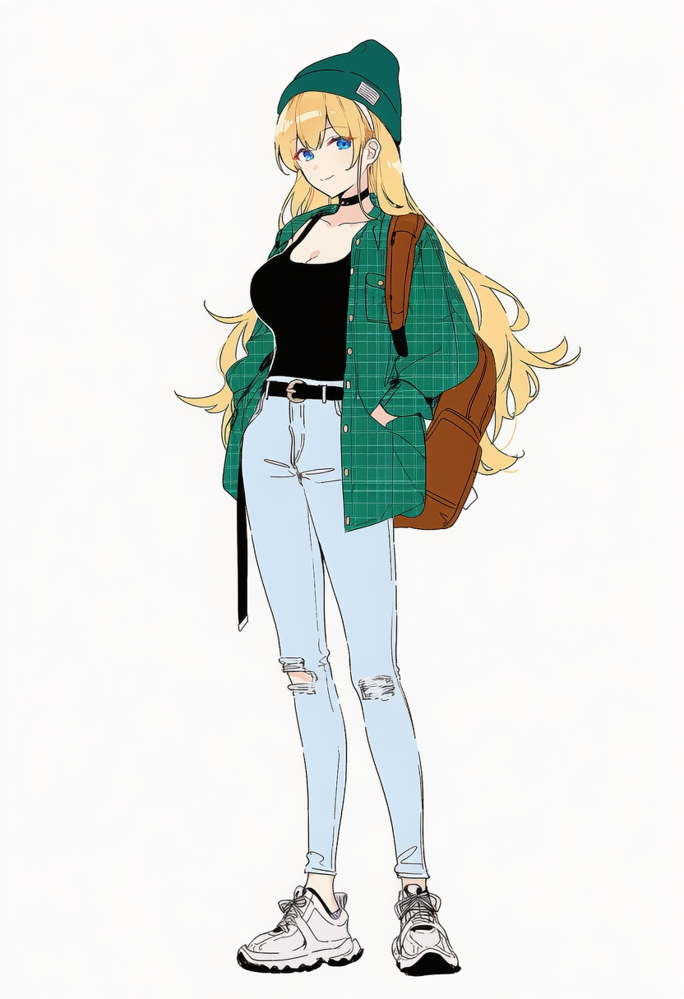

[在线例图](https://assets.quicktagcloud.com/images/raven_composition/raven_composition-6054.jpg?v=892f52d628bec642)

<a id="raven_composition-6055"></a>

## 华盛顿

ID：`raven_composition-6055`；分类：角色图鉴 / 碧蓝航线 / 白鹰；来源标记：`safe`。

来源说明：

> 作品：碧蓝航线
> 角色英文名：Washington
> 首次登场时间（国服实装）：2017-12-29
> 阵营：白鹰

正向提示词：

```text
washington_(azur_lane)
```

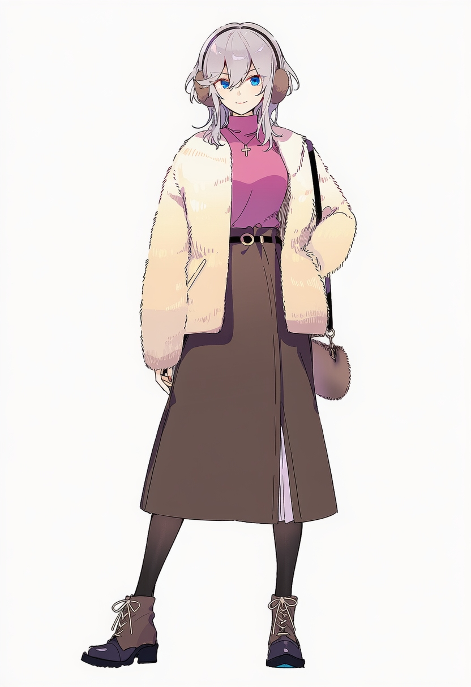

[在线例图](https://assets.quicktagcloud.com/images/raven_composition/raven_composition-6055.jpg?v=881fcfca8c6d174f)

<a id="raven_composition-6056"></a>

## 胡蜂

ID：`raven_composition-6056`；分类：角色图鉴 / 碧蓝航线 / 白鹰；来源标记：`safe`。

来源说明：

> 作品：碧蓝航线
> 角色英文名：Wasp
> 首次登场时间（国服实装）：2017-12-29
> 阵营：白鹰

正向提示词：

```text
wasp_(azur_lane)
```


[在线例图](https://assets.quicktagcloud.com/images/raven_composition/raven_composition-6056.jpg?v=a31744df10080d4a)

<a id="raven_composition-6076"></a>

## 哥伦比亚

ID：`raven_composition-6076`；分类：角色图鉴 / 碧蓝航线 / 白鹰；来源标记：`safe`。

来源说明：

> 作品：碧蓝航线
> 角色英文名：Columbia
> 首次登场时间（国服实装）：2018-03-21
> 阵营：白鹰

正向提示词：

```text
columbia_(azur_lane)
```


[在线例图](https://assets.quicktagcloud.com/images/raven_composition/raven_composition-6076.jpg?v=ee6596f6e373c53e)

<a id="raven_composition-6077"></a>

## 丹佛

ID：`raven_composition-6077`；分类：角色图鉴 / 碧蓝航线 / 白鹰；来源标记：`safe`。

来源说明：

> 作品：碧蓝航线
> 角色英文名：Denver
> 首次登场时间（国服实装）：2018-03-21
> 阵营：白鹰

正向提示词：

```text
denver_(azur_lane)
```


[在线例图](https://assets.quicktagcloud.com/images/raven_composition/raven_composition-6077.jpg?v=a6414e49a470d938)

<a id="raven_composition-6078"></a>

## 蒙彼利埃

ID：`raven_composition-6078`；分类：角色图鉴 / 碧蓝航线 / 白鹰；来源标记：`safe`。

来源说明：

> 作品：碧蓝航线
> 角色英文名：Montpelier
> 首次登场时间（国服实装）：2018-03-21
> 阵营：白鹰

正向提示词：

```text
montpelier_(azur_lane)
```

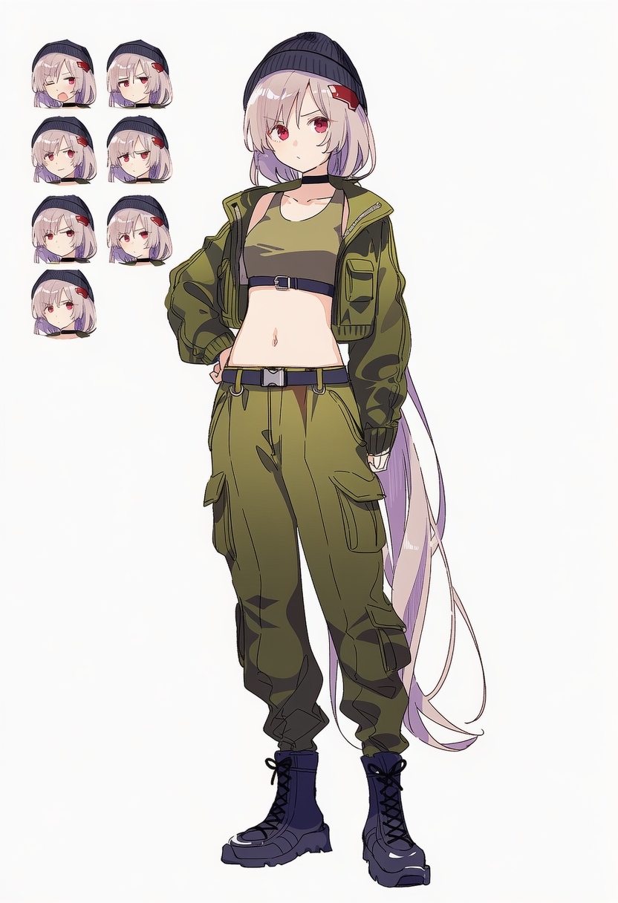

[在线例图](https://assets.quicktagcloud.com/images/raven_composition/raven_composition-6078.jpg?v=9c2104ad500d302f)

<a id="raven_composition-6097"></a>

## 鲦鱼

ID：`raven_composition-6097`；分类：角色图鉴 / 碧蓝航线 / 白鹰；来源标记：`safe`。

来源说明：

> 作品：碧蓝航线
> 角色英文名：Dace
> 首次登场时间（国服实装）：2018-05-31
> 阵营：白鹰

正向提示词：

```text
dace_(azur_lane)
```


[在线例图](https://assets.quicktagcloud.com/images/raven_composition/raven_composition-6097.jpg?v=59435f7f15fe91c5)

<a id="raven_composition-6117"></a>

## 阿斯托利亚

ID：`raven_composition-6117`；分类：角色图鉴 / 碧蓝航线 / 白鹰；来源标记：`safe`。

来源说明：

> 作品：碧蓝航线
> 角色英文名：Astoria
> 首次登场时间（国服实装）：2018-07-17
> 阵营：白鹰

正向提示词：

```text
astoria_(azur_lane)
```

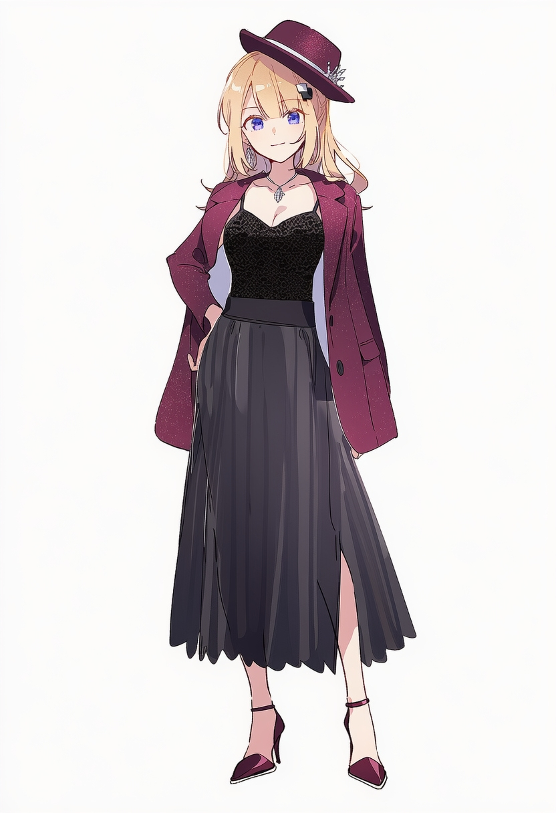

[在线例图](https://assets.quicktagcloud.com/images/raven_composition/raven_composition-6117.jpg?v=1dfa67634c8e5375)

<a id="raven_composition-6118"></a>

## 昆西

ID：`raven_composition-6118`；分类：角色图鉴 / 碧蓝航线 / 白鹰；来源标记：`safe`。

来源说明：

> 作品：碧蓝航线
> 角色英文名：Quincy
> 首次登场时间（国服实装）：2018-07-17
> 阵营：白鹰

正向提示词：

```text
quincy_(azur_lane)
```


[在线例图](https://assets.quicktagcloud.com/images/raven_composition/raven_composition-6118.jpg?v=9e12e666c3cf394d)

<a id="raven_composition-6119"></a>

## 文森斯

ID：`raven_composition-6119`；分类：角色图鉴 / 碧蓝航线 / 白鹰；来源标记：`safe`。

来源说明：

> 作品：碧蓝航线
> 角色英文名：Vincennes
> 首次登场时间（国服实装）：2018-07-17
> 阵营：白鹰

正向提示词：

```text
vincennes_(azur_lane)
```

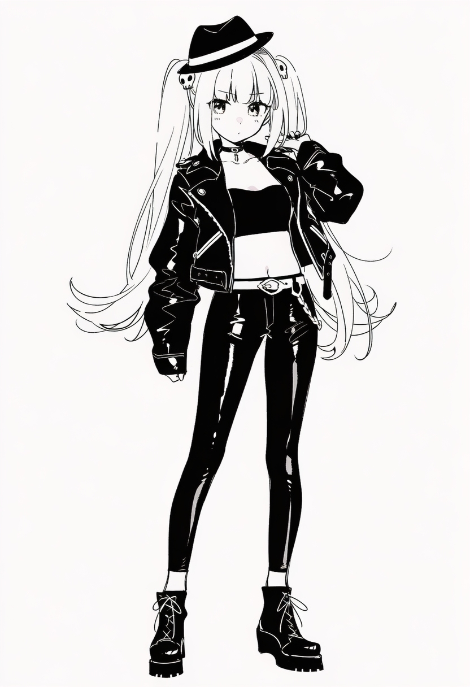

[在线例图](https://assets.quicktagcloud.com/images/raven_composition/raven_composition-6119.jpg?v=cf6dc49e88f0971e)

<a id="raven_composition-6127"></a>

## 马萨诸塞

ID：`raven_composition-6127`；分类：角色图鉴 / 碧蓝航线 / 白鹰；来源标记：`safe`。

来源说明：

> 作品：碧蓝航线
> 角色英文名：Massachusetts
> 首次登场时间（国服实装）：2018-07-26
> 阵营：白鹰

正向提示词：

```text
massachusetts_(azur_lane)
```

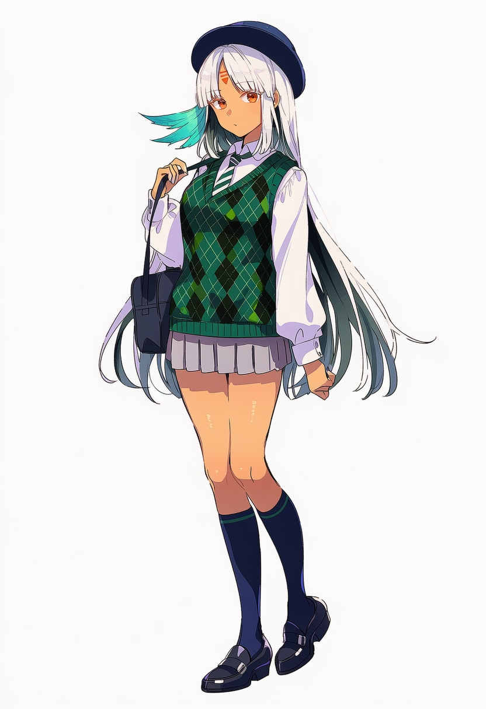

[在线例图](https://assets.quicktagcloud.com/images/raven_composition/raven_composition-6127.jpg?v=d30ea6698a8cf5f0)

<a id="raven_composition-6129"></a>

## 布什

ID：`raven_composition-6129`；分类：角色图鉴 / 碧蓝航线 / 白鹰；来源标记：`safe`。

来源说明：

> 作品：碧蓝航线
> 角色英文名：Bush
> 首次登场时间（国服实装）：2018-08
> 阵营：白鹰

正向提示词：

```text
bush_(azur_lane)
```

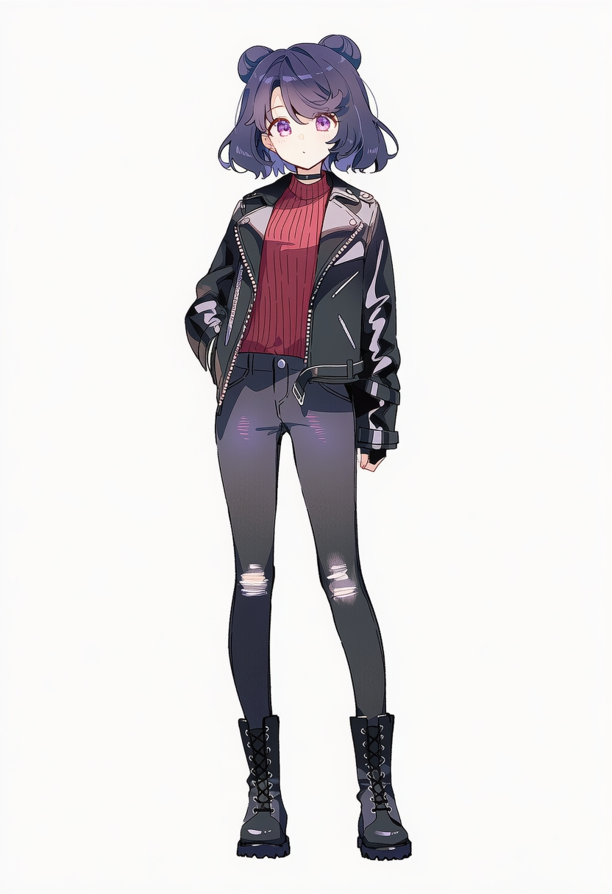

[在线例图](https://assets.quicktagcloud.com/images/raven_composition/raven_composition-6129.jpg?v=fa3a0a6b5f561795)

<a id="raven_composition-6133"></a>

## 埃塞克斯

ID：`raven_composition-6133`；分类：角色图鉴 / 碧蓝航线 / 白鹰；来源标记：`safe`。

来源说明：

> 作品：碧蓝航线
> 角色英文名：Essex
> 首次登场时间（国服实装）：2018-09-14
> 阵营：白鹰

正向提示词：

```text
essex_(azur_lane)
```

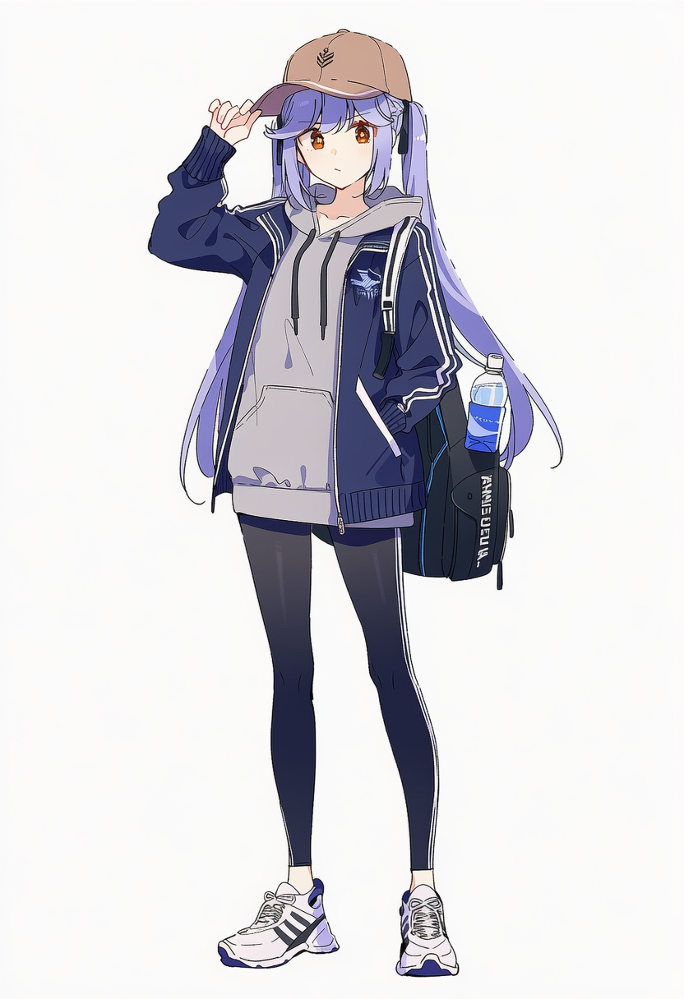

[在线例图](https://assets.quicktagcloud.com/images/raven_composition/raven_composition-6133.jpg?v=f8f4a134b33d2e7b)

<a id="raven_composition-6135"></a>

## 大青花鱼

ID：`raven_composition-6135`；分类：角色图鉴 / 碧蓝航线 / 白鹰；来源标记：`safe`。

来源说明：

> 作品：碧蓝航线
> 角色英文名：Albacore
> 首次登场时间（国服实装）：2018-09-14
> 阵营：白鹰

正向提示词：

```text
albacore_(azur_lane)
```

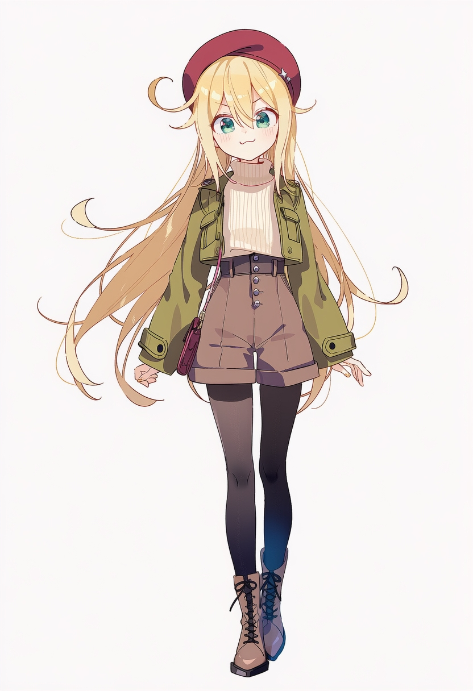

[在线例图](https://assets.quicktagcloud.com/images/raven_composition/raven_composition-6135.jpg?v=8983e26718d2b681)

<a id="raven_composition-6137"></a>

## 孟菲斯

ID：`raven_composition-6137`；分类：角色图鉴 / 碧蓝航线 / 白鹰；来源标记：`safe`。

来源说明：

> 作品：碧蓝航线
> 角色英文名：Memphis
> 首次登场时间（国服实装）：2018-10
> 阵营：白鹰

正向提示词：

```text
memphis_(azur_lane)
```


[在线例图](https://assets.quicktagcloud.com/images/raven_composition/raven_composition-6137.jpg?v=d1cfb63615e2c77b)

<a id="raven_composition-6138"></a>

## 霍比

ID：`raven_composition-6138`；分类：角色图鉴 / 碧蓝航线 / 白鹰；来源标记：`safe`。

来源说明：

> 作品：碧蓝航线
> 角色英文名：Hobby
> 首次登场时间（国服实装）：2018-10-25
> 阵营：白鹰

正向提示词：

```text
hobby_(azur_lane)
```

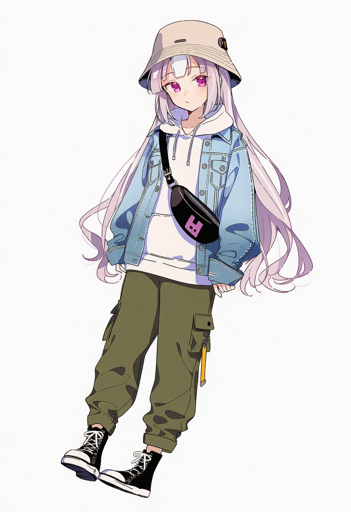

[在线例图](https://assets.quicktagcloud.com/images/raven_composition/raven_composition-6138.jpg?v=df3b49b8d06af6b0)

<a id="raven_composition-6139"></a>

## 科尔克

ID：`raven_composition-6139`；分类：角色图鉴 / 碧蓝航线 / 白鹰；来源标记：`safe`。

来源说明：

> 作品：碧蓝航线
> 角色英文名：Kalk
> 首次登场时间（国服实装）：2018-10-25
> 阵营：白鹰

正向提示词：

```text
kalk_(azur_lane)
```


[在线例图](https://assets.quicktagcloud.com/images/raven_composition/raven_composition-6139.jpg?v=49d7979161f3895a)

<a id="raven_composition-6140"></a>

## 明尼阿波利斯

ID：`raven_composition-6140`；分类：角色图鉴 / 碧蓝航线 / 白鹰；来源标记：`safe`。

来源说明：

> 作品：碧蓝航线
> 角色英文名：Minneapolis
> 首次登场时间（国服实装）：2018-10-25
> 阵营：白鹰

正向提示词：

```text
minneapolis_(azur_lane)
```


[在线例图](https://assets.quicktagcloud.com/images/raven_composition/raven_composition-6140.jpg?v=c78b580540ff99b2)

<a id="raven_composition-6141"></a>

## 黑泽伍德

ID：`raven_composition-6141`；分类：角色图鉴 / 碧蓝航线 / 白鹰；来源标记：`safe`。

来源说明：

> 作品：碧蓝航线
> 角色英文名：Hazelwood
> 首次登场时间（国服实装）：2018-11
> 阵营：白鹰

正向提示词：

```text
hazelwood_(azur_lane)
```


[在线例图](https://assets.quicktagcloud.com/images/raven_composition/raven_composition-6141.jpg?v=e9b8ec51ca14e765)

<a id="raven_composition-6142"></a>

## 康克德

ID：`raven_composition-6142`；分类：角色图鉴 / 碧蓝航线 / 白鹰；来源标记：`safe`。

来源说明：

> 作品：碧蓝航线
> 角色英文名：Concord
> 首次登场时间（国服实装）：2018-11-14
> 阵营：白鹰

正向提示词：

```text
concord_(azur_lane)
```

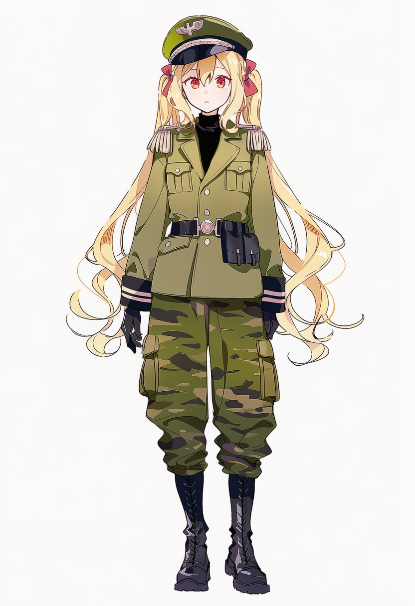

[在线例图](https://assets.quicktagcloud.com/images/raven_composition/raven_composition-6142.jpg?v=7cbe26d4b19475b3)

<a id="raven_composition-6153"></a>

## 金伯利

ID：`raven_composition-6153`；分类：角色图鉴 / 碧蓝航线 / 白鹰；来源标记：`safe`。

来源说明：

> 作品：碧蓝航线
> 角色英文名：Kimberly
> 首次登场时间（国服实装）：2019-01-31
> 阵营：白鹰

正向提示词：

```text
kimberly_(azur_lane)
```

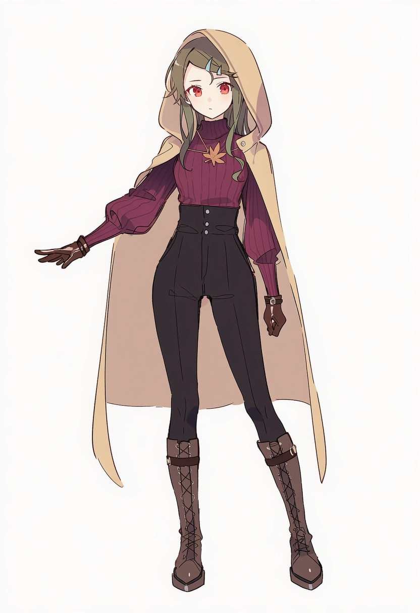

[在线例图](https://assets.quicktagcloud.com/images/raven_composition/raven_composition-6153.jpg?v=f506ad87d116d32a)

<a id="raven_composition-6154"></a>

## 马拉尼

ID：`raven_composition-6154`；分类：角色图鉴 / 碧蓝航线 / 白鹰；来源标记：`safe`。

来源说明：

> 作品：碧蓝航线
> 角色英文名：Mullany
> 首次登场时间（国服实装）：2019-01-31
> 阵营：白鹰

正向提示词：

```text
mullany_(azur_lane)
```

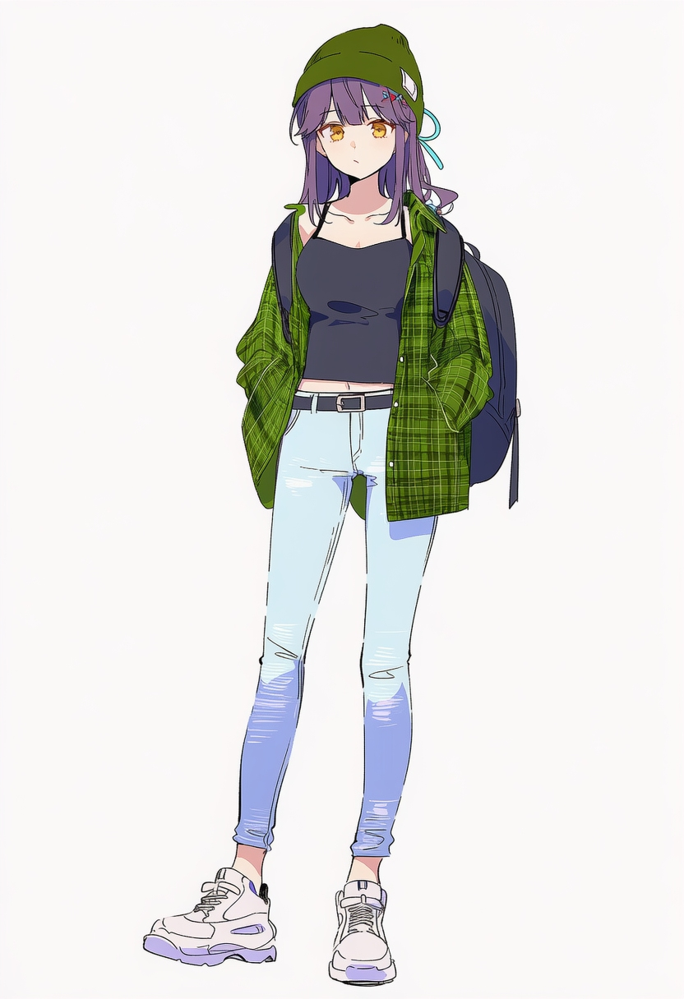

[在线例图](https://assets.quicktagcloud.com/images/raven_composition/raven_composition-6154.jpg?v=d8bdc25b2d8e0646)
