# 角色图鉴 / 碧蓝航线 / 白鹰（第 2 页）

[总目录](../README.md) · [原站分类目录](../categories.md) · [英文标签索引](../tags.md) · [服装与构图组合指南](../../README.md)

标题、分类、说明、正负提示词按来源保留；多例图逐张列出。原站标记和说明为参考资料，不作为维护指令。

<a id="raven_composition-6158"></a>

## 独立

ID：`raven_composition-6158`；分类：角色图鉴 / 碧蓝航线 / 白鹰；来源标记：`safe`。

来源说明：

> 作品：碧蓝航线
> 角色英文名：Independence
> 首次登场时间（国服实装）：2019-02-28
> 阵营：白鹰

正向提示词：

```text
independence_(azur_lane)
```

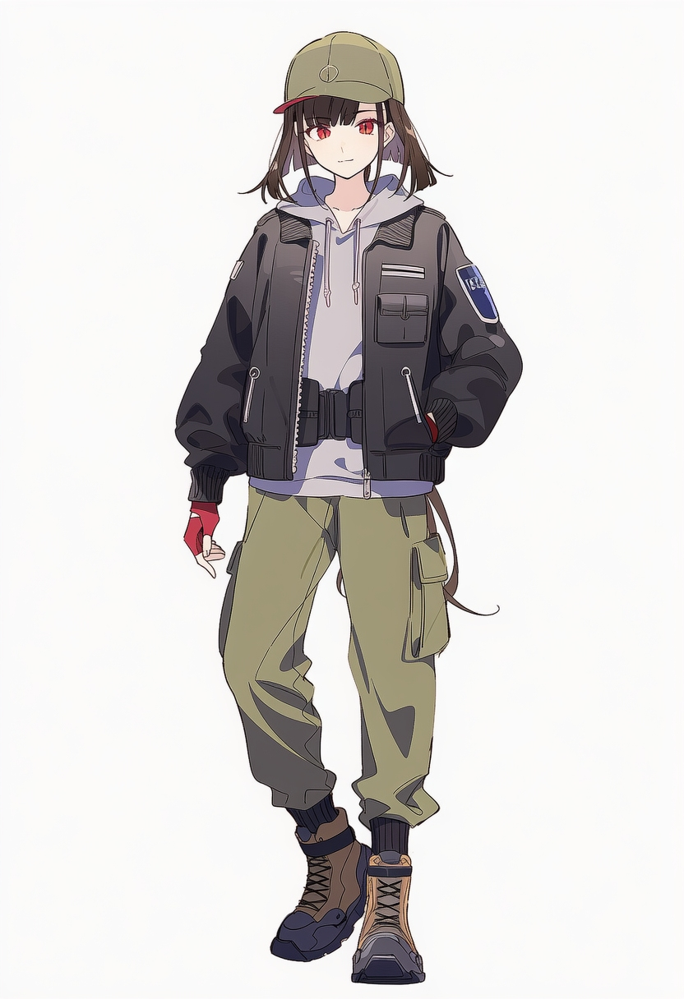

[在线例图](https://assets.quicktagcloud.com/images/raven_composition/raven_composition-6158.jpg?v=96de3d8c45139b19)

<a id="raven_composition-6159"></a>

## 香格里拉

ID：`raven_composition-6159`；分类：角色图鉴 / 碧蓝航线 / 白鹰；来源标记：`safe`。

来源说明：

> 作品：碧蓝航线
> 角色英文名：Shangri-La
> 首次登场时间（国服实装）：2019-02-28
> 阵营：白鹰

正向提示词：

```text
shangri-la_(azur_lane)
```

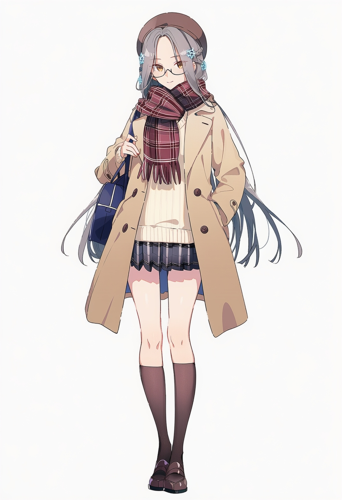

[在线例图](https://assets.quicktagcloud.com/images/raven_composition/raven_composition-6159.jpg?v=65b94462bb0b1d55)

<a id="raven_composition-6163"></a>

## 杜威

ID：`raven_composition-6163`；分类：角色图鉴 / 碧蓝航线 / 白鹰；来源标记：`safe`。

来源说明：

> 作品：碧蓝航线
> 角色英文名：Dewey
> 首次登场时间（国服实装）：2019-03-22
> 阵营：白鹰

正向提示词：

```text
dewey_(azur_lane)
```


[在线例图](https://assets.quicktagcloud.com/images/raven_composition/raven_composition-6163.jpg?v=9724e7dc7aaa85cb)

<a id="raven_composition-6164"></a>

## 邦克山

ID：`raven_composition-6164`；分类：角色图鉴 / 碧蓝航线 / 白鹰；来源标记：`safe`。

来源说明：

> 作品：碧蓝航线
> 角色英文名：Bunker Hill
> 首次登场时间（国服实装）：2019-03-22
> 阵营：白鹰

正向提示词：

```text
bunker_hill_(azur_lane)
```


[在线例图](https://assets.quicktagcloud.com/images/raven_composition/raven_composition-6164.jpg?v=0617333c68af1eb9)

<a id="raven_composition-6194"></a>

## 艾尔温

ID：`raven_composition-6194`；分类：角色图鉴 / 碧蓝航线 / 白鹰；来源标记：`safe`。

来源说明：

> 作品：碧蓝航线
> 角色英文名：Aylwin
> 首次登场时间（国服实装）：2019-07-31
> 阵营：白鹰

正向提示词：

```text
aylwin_(azur_lane)
```


[在线例图](https://assets.quicktagcloud.com/images/raven_composition/raven_composition-6194.jpg?v=b6a2d45c6bcc8de7)

<a id="raven_composition-6195"></a>

## 圣胡安

ID：`raven_composition-6195`；分类：角色图鉴 / 碧蓝航线 / 白鹰；来源标记：`safe`。

来源说明：

> 作品：碧蓝航线
> 角色英文名：San Juan
> 首次登场时间（国服实装）：2019-07-31
> 阵营：白鹰

正向提示词：

```text
san_juan_(azur_lane)
```


[在线例图](https://assets.quicktagcloud.com/images/raven_composition/raven_composition-6195.jpg?v=fd9c9d2ba01258d6)

<a id="raven_composition-6196"></a>

## 伯明翰

ID：`raven_composition-6196`；分类：角色图鉴 / 碧蓝航线 / 白鹰；来源标记：`safe`。

来源说明：

> 作品：碧蓝航线
> 角色英文名：Birmingham
> 首次登场时间（国服实装）：2019-07-31
> 阵营：白鹰

正向提示词：

```text
birmingham_(azur_lane)
```

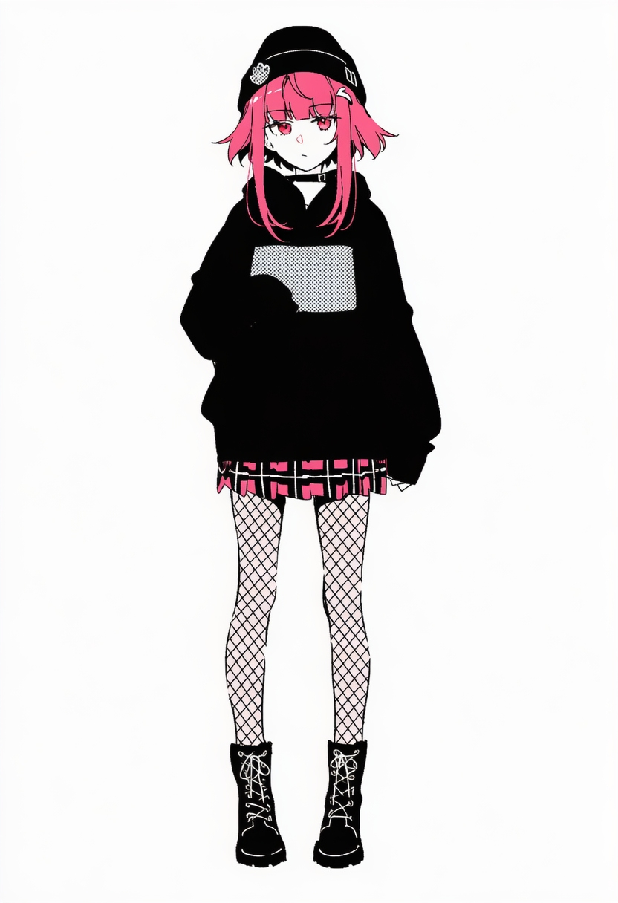

[在线例图](https://assets.quicktagcloud.com/images/raven_composition/raven_composition-6196.jpg?v=55ea738206fbc25a)

<a id="raven_composition-6197"></a>

## 巴尔的摩

ID：`raven_composition-6197`；分类：角色图鉴 / 碧蓝航线 / 白鹰；来源标记：`safe`。

来源说明：

> 作品：碧蓝航线
> 角色英文名：Baltimore
> 首次登场时间（国服实装）：2019-07-31
> 阵营：白鹰

正向提示词：

```text
baltimore_(azur_lane)
```


[在线例图](https://assets.quicktagcloud.com/images/raven_composition/raven_composition-6197.jpg?v=62d76454fdf4a745)

<a id="raven_composition-6198"></a>

## 阿拉巴马

ID：`raven_composition-6198`；分类：角色图鉴 / 碧蓝航线 / 白鹰；来源标记：`safe`。

来源说明：

> 作品：碧蓝航线
> 角色英文名：Alabama
> 首次登场时间（国服实装）：2019-07-31
> 阵营：白鹰

正向提示词：

```text
alabama_(azur_lane)
```

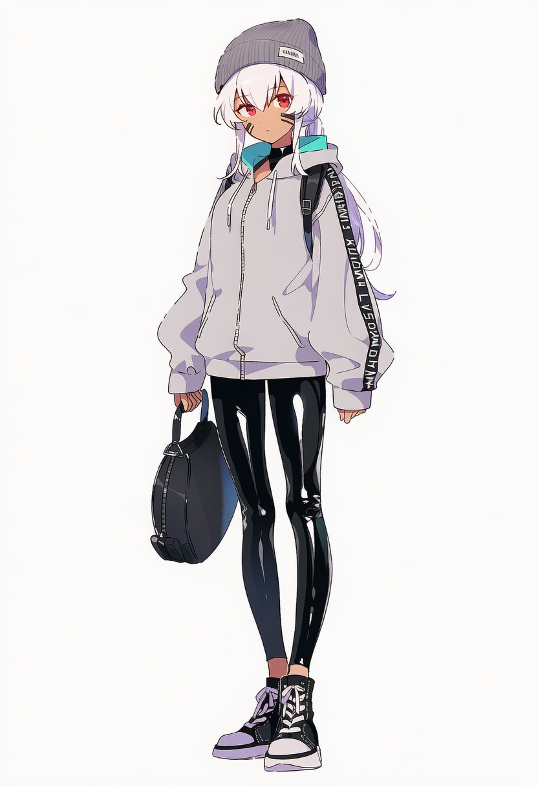

[在线例图](https://assets.quicktagcloud.com/images/raven_composition/raven_composition-6198.jpg?v=7d685c2b3ede8bd0)

<a id="raven_composition-6199"></a>

## 巴丹

ID：`raven_composition-6199`；分类：角色图鉴 / 碧蓝航线 / 白鹰；来源标记：`safe`。

来源说明：

> 作品：碧蓝航线
> 角色英文名：Bataan
> 首次登场时间（国服实装）：2019-07-31
> 阵营：白鹰

正向提示词：

```text
bataan_(azur_lane)
```

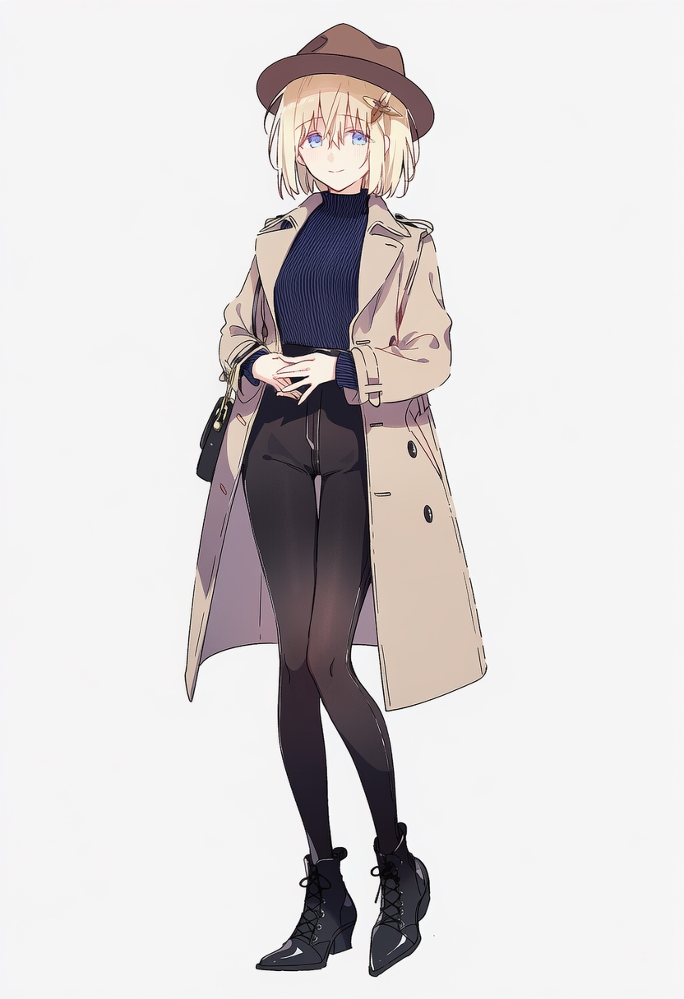

[在线例图](https://assets.quicktagcloud.com/images/raven_composition/raven_composition-6199.jpg?v=e46cf1f6d9e3e289)

<a id="raven_composition-6200"></a>

## 棘鳍

ID：`raven_composition-6200`；分类：角色图鉴 / 碧蓝航线 / 白鹰；来源标记：`safe`。

来源说明：

> 作品：碧蓝航线
> 角色英文名：Cavalla
> 首次登场时间（国服实装）：2019-07-31
> 阵营：白鹰

正向提示词：

```text
cavalla_(azur_lane)
```


[在线例图](https://assets.quicktagcloud.com/images/raven_composition/raven_composition-6200.jpg?v=053d9206ecf4a31c)

<a id="raven_composition-6201"></a>

## 贝奇

ID：`raven_composition-6201`；分类：角色图鉴 / 碧蓝航线 / 白鹰；来源标记：`safe`。

来源说明：

> 作品：碧蓝航线
> 角色英文名：Bache
> 首次登场时间（国服实装）：2019-08-29
> 阵营：白鹰

正向提示词：

```text
bache_(azur_lane)
```


[在线例图](https://assets.quicktagcloud.com/images/raven_composition/raven_composition-6201.jpg?v=7d3bf654d5432dce)

<a id="raven_composition-6204"></a>

## 斯坦利

ID：`raven_composition-6204`；分类：角色图鉴 / 碧蓝航线 / 白鹰；来源标记：`safe`。

来源说明：

> 作品：碧蓝航线
> 角色英文名：Stanly
> 首次登场时间（国服实装）：2019-09-05
> 阵营：白鹰

正向提示词：

```text
stanly_(azur_lane)
```


[在线例图](https://assets.quicktagcloud.com/images/raven_composition/raven_composition-6204.jpg?v=aee66811e6fe8492)

<a id="raven_composition-6213"></a>

## 克利夫兰μ

ID：`raven_composition-6213`；分类：角色图鉴 / 碧蓝航线 / 白鹰；来源标记：`safe`。

来源说明：

> 作品：碧蓝航线
> 角色英文名：Cleveland µ
> 首次登场时间（国服实装）：2019-10-31
> 阵营：白鹰

正向提示词：

```text
cleveland_(muse)_(azur_lane)
```


[在线例图](https://assets.quicktagcloud.com/images/raven_composition/raven_composition-6213.jpg?v=db79b0489196546f)

<a id="raven_composition-6225"></a>

## 哈尔西·鲍威尔

ID：`raven_composition-6225`；分类：角色图鉴 / 碧蓝航线 / 白鹰；来源标记：`safe`。

来源说明：

> 作品：碧蓝航线
> 角色英文名：Halsey Powell
> 首次登场时间（国服实装）：2020-01-21
> 阵营：白鹰

正向提示词：

```text
halsey_powell_(azur_lane)
```

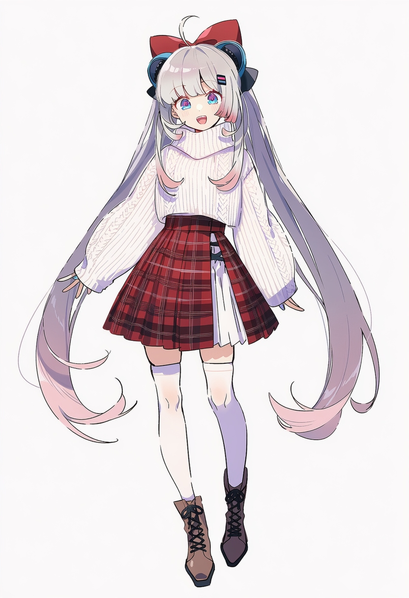

[在线例图](https://assets.quicktagcloud.com/images/raven_composition/raven_composition-6225.jpg?v=f687ec5293fa25a6)

<a id="raven_composition-6227"></a>

## 比洛克西

ID：`raven_composition-6227`；分类：角色图鉴 / 碧蓝航线 / 白鹰；来源标记：`safe`。

来源说明：

> 作品：碧蓝航线
> 角色英文名：Biloxi
> 首次登场时间（国服实装）：2020-01-21
> 阵营：白鹰

正向提示词：

```text
biloxi_(azur_lane)
```

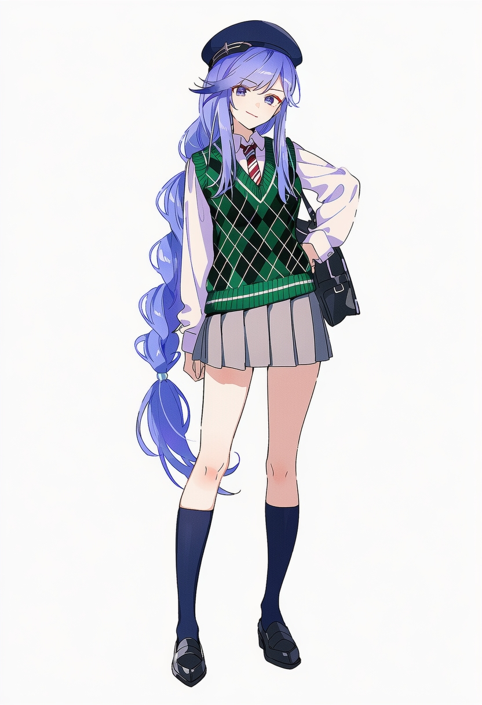

[在线例图](https://assets.quicktagcloud.com/images/raven_composition/raven_composition-6227.jpg?v=d7af0b4825b95289)

<a id="raven_composition-6237"></a>

## 库珀

ID：`raven_composition-6237`；分类：角色图鉴 / 碧蓝航线 / 白鹰；来源标记：`safe`。

来源说明：

> 作品：碧蓝航线
> 角色英文名：Cooper
> 首次登场时间（国服实装）：2020-03-26
> 阵营：白鹰

正向提示词：

```text
cooper_(azur_lane)
```

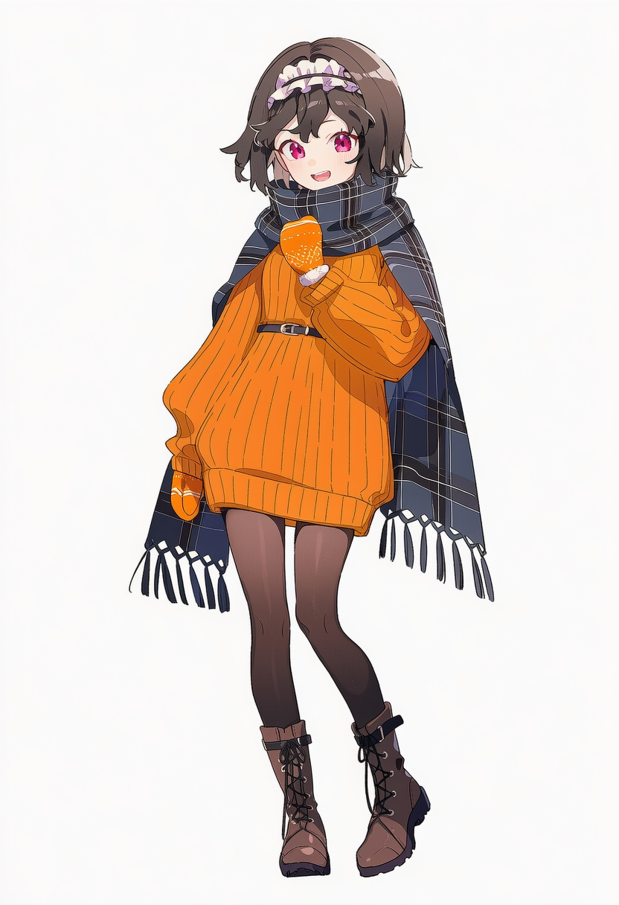

[在线例图](https://assets.quicktagcloud.com/images/raven_composition/raven_composition-6237.jpg?v=7482bfba07236a09)

<a id="raven_composition-6238"></a>

## 马布尔黑德

ID：`raven_composition-6238`；分类：角色图鉴 / 碧蓝航线 / 白鹰；来源标记：`safe`。

来源说明：

> 作品：碧蓝航线
> 角色英文名：Marblehead
> 首次登场时间（国服实装）：2020-03-26
> 阵营：白鹰

正向提示词：

```text
marblehead_(azur_lane)
```

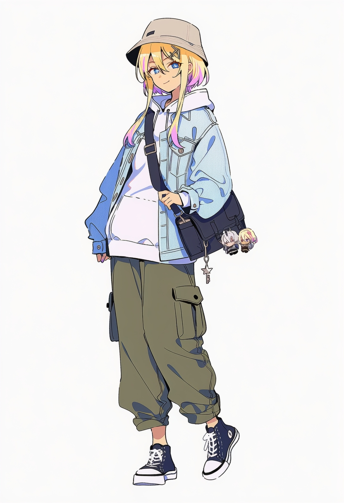

[在线例图](https://assets.quicktagcloud.com/images/raven_composition/raven_composition-6238.jpg?v=558722910b79ab13)

<a id="raven_composition-6239"></a>

## 里诺

ID：`raven_composition-6239`；分类：角色图鉴 / 碧蓝航线 / 白鹰；来源标记：`safe`。

来源说明：

> 作品：碧蓝航线
> 角色英文名：Reno
> 首次登场时间（国服实装）：2020-03-26
> 阵营：白鹰

正向提示词：

```text
reno_(azur_lane)
```

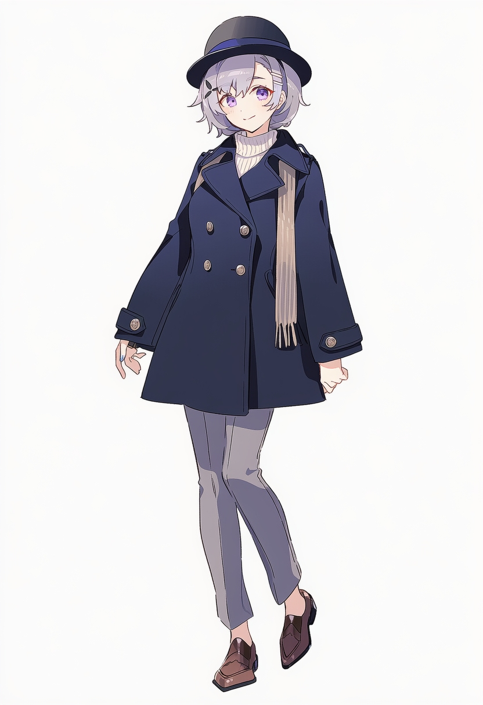

[在线例图](https://assets.quicktagcloud.com/images/raven_composition/raven_composition-6239.jpg?v=f5fe4a82fec6dd14)

<a id="raven_composition-6240"></a>

## 布莱默顿

ID：`raven_composition-6240`；分类：角色图鉴 / 碧蓝航线 / 白鹰；来源标记：`safe`。

来源说明：

> 作品：碧蓝航线
> 角色英文名：Bremerton
> 首次登场时间（国服实装）：2020-03-26
> 阵营：白鹰

正向提示词：

```text
bremerton_(azur_lane)
```

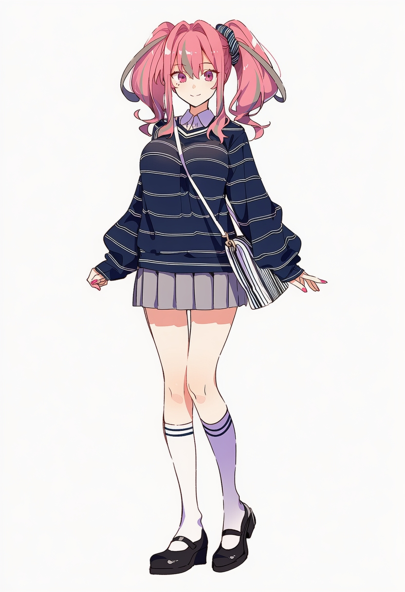

[在线例图](https://assets.quicktagcloud.com/images/raven_composition/raven_composition-6240.jpg?v=ea2d8697fc38a461)

<a id="raven_composition-6241"></a>

## 卡萨布兰卡

ID：`raven_composition-6241`；分类：角色图鉴 / 碧蓝航线 / 白鹰；来源标记：`safe`。

来源说明：

> 作品：碧蓝航线
> 角色英文名：Casablanca
> 首次登场时间（国服实装）：2020-03-26
> 阵营：白鹰

正向提示词：

```text
casablanca_(azur_lane)
```

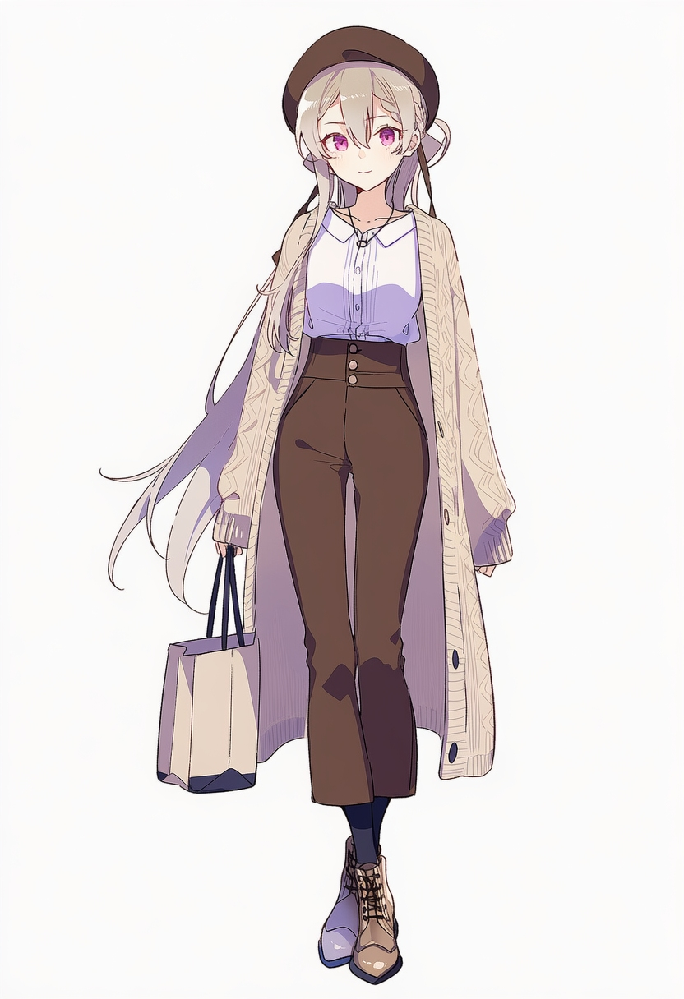

[在线例图](https://assets.quicktagcloud.com/images/raven_composition/raven_composition-6241.jpg?v=cf4f988a796b1117)

<a id="raven_composition-6242"></a>

## 无畏

ID：`raven_composition-6242`；分类：角色图鉴 / 碧蓝航线 / 白鹰；来源标记：`safe`。

来源说明：

> 作品：碧蓝航线
> 角色英文名：Intrepid
> 首次登场时间（国服实装）：2020-03-26
> 阵营：白鹰

正向提示词：

```text
intrepid_(azur_lane)
```

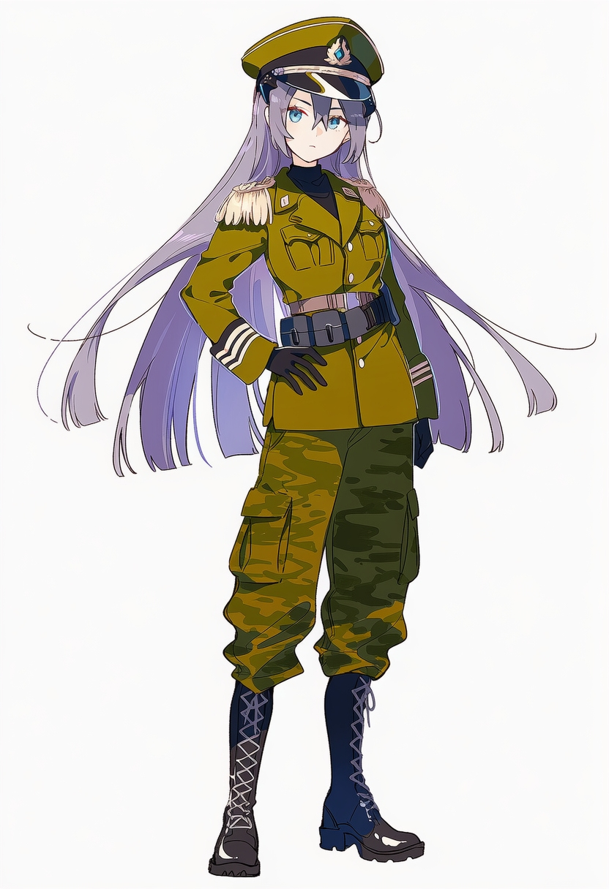

[在线例图](https://assets.quicktagcloud.com/images/raven_composition/raven_composition-6242.jpg?v=c9abd3260fb74629)

<a id="raven_composition-6243"></a>

## 蓝鳃鱼

ID：`raven_composition-6243`；分类：角色图鉴 / 碧蓝航线 / 白鹰；来源标记：`safe`。

来源说明：

> 作品：碧蓝航线
> 角色英文名：Bluegill
> 首次登场时间（国服实装）：2020-03-26
> 阵营：白鹰

正向提示词：

```text
bluegill_(azur_lane)
```

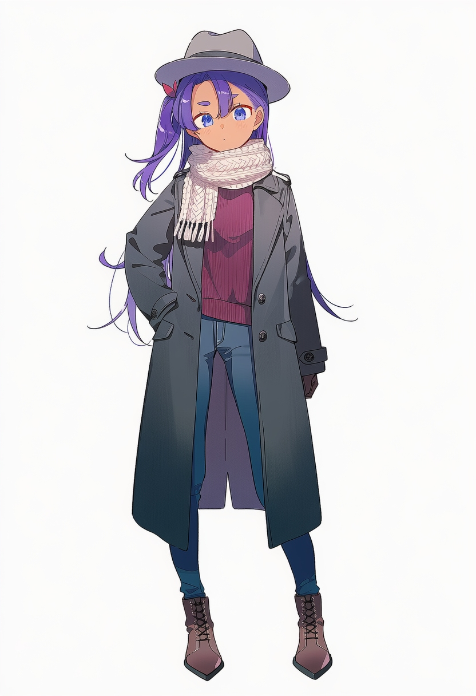

[在线例图](https://assets.quicktagcloud.com/images/raven_composition/raven_composition-6243.jpg?v=08731d9a34a74145)

<a id="raven_composition-6278"></a>

## 普林斯顿

ID：`raven_composition-6278`；分类：角色图鉴 / 碧蓝航线 / 白鹰；来源标记：`safe`。

来源说明：

> 作品：碧蓝航线
> 角色英文名：Princeton
> 首次登场时间（国服实装）：2020-10-12
> 阵营：白鹰

正向提示词：

```text
princeton_(azur_lane)
```

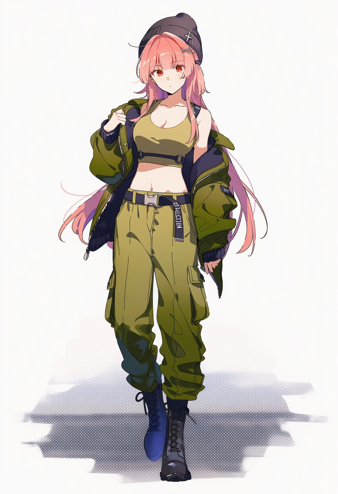

[在线例图](https://assets.quicktagcloud.com/images/raven_composition/raven_composition-6278.jpg?v=d31f8a6dc2780506)

<a id="raven_composition-6282"></a>

## 巴尔的摩μ

ID：`raven_composition-6282`；分类：角色图鉴 / 碧蓝航线 / 白鹰；来源标记：`safe`。

来源说明：

> 作品：碧蓝航线
> 角色英文名：Baltimore µ
> 首次登场时间（国服实装）：2020-10-29
> 阵营：白鹰

正向提示词：

```text
baltimore_(muse)_(azur_lane)
```


[在线例图](https://assets.quicktagcloud.com/images/raven_composition/raven_composition-6282.jpg?v=cfd603be2715943c)

<a id="raven_composition-6309"></a>

## 史蒂芬·波特

ID：`raven_composition-6309`；分类：角色图鉴 / 碧蓝航线 / 白鹰；来源标记：`safe`。

来源说明：

> 作品：碧蓝航线
> 角色英文名：Stephen Potter
> 首次登场时间（国服实装）：2021-03-25
> 阵营：白鹰

正向提示词：

```text
stephen_potter_(azur_lane)
```


[在线例图](https://assets.quicktagcloud.com/images/raven_composition/raven_composition-6309.jpg?v=47e9fff0c8c689e9)

<a id="raven_composition-6310"></a>

## 艾伦·萨姆纳

ID：`raven_composition-6310`；分类：角色图鉴 / 碧蓝航线 / 白鹰；来源标记：`safe`。

来源说明：

> 作品：碧蓝航线
> 角色英文名：Allen M. Sumner
> 首次登场时间（国服实装）：2021-03-25
> 阵营：白鹰

正向提示词：

```text
allen_m._sumner_(azur_lane)
```

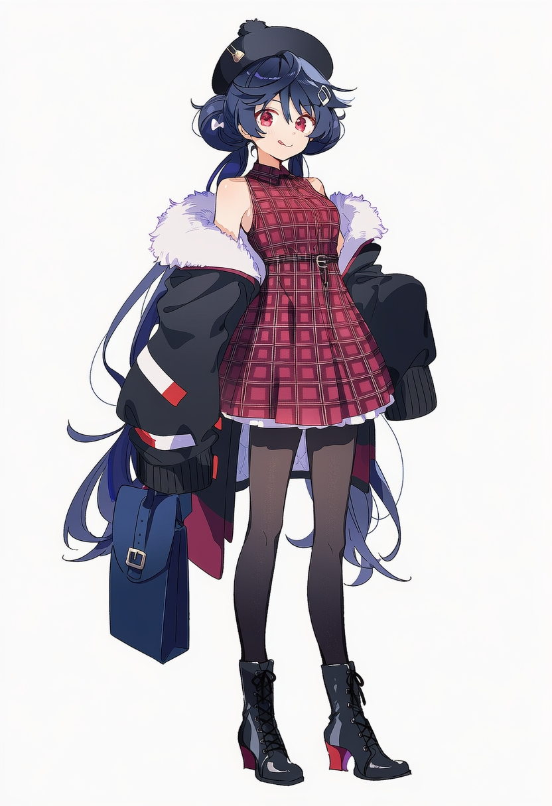

[在线例图](https://assets.quicktagcloud.com/images/raven_composition/raven_composition-6310.jpg?v=aecffdfc0881b47e)

<a id="raven_composition-6320"></a>

## 莫里森

ID：`raven_composition-6320`；分类：角色图鉴 / 碧蓝航线 / 白鹰；来源标记：`safe`。

来源说明：

> 作品：碧蓝航线
> 角色英文名：Morrison
> 首次登场时间（国服实装）：2021-05-27
> 阵营：白鹰

正向提示词：

```text
morrison_(azur_lane)
```


[在线例图](https://assets.quicktagcloud.com/images/raven_composition/raven_composition-6320.jpg?v=910ee4f37c01c7af)

<a id="raven_composition-6321"></a>

## 博伊西

ID：`raven_composition-6321`；分类：角色图鉴 / 碧蓝航线 / 白鹰；来源标记：`safe`。

来源说明：

> 作品：碧蓝航线
> 角色英文名：Boise
> 首次登场时间（国服实装）：2021-05-27
> 阵营：白鹰

正向提示词：

```text
boise_(azur_lane)
```

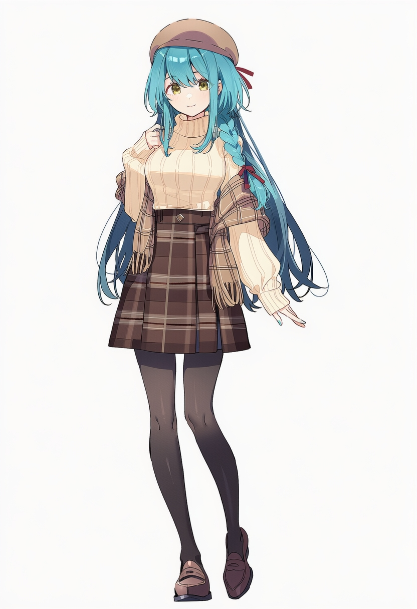

[在线例图](https://assets.quicktagcloud.com/images/raven_composition/raven_composition-6321.jpg?v=ef75b42bec345149)

<a id="raven_composition-6322"></a>

## 旧金山

ID：`raven_composition-6322`；分类：角色图鉴 / 碧蓝航线 / 白鹰；来源标记：`safe`。

来源说明：

> 作品：碧蓝航线
> 角色英文名：San Francisco
> 首次登场时间（国服实装）：2021-05-27
> 阵营：白鹰

正向提示词：

```text
san_francisco_(azur_lane)
```


[在线例图](https://assets.quicktagcloud.com/images/raven_composition/raven_composition-6322.jpg?v=168bb9ef62a2a0a3)

<a id="raven_composition-6323"></a>

## 新泽西

ID：`raven_composition-6323`；分类：角色图鉴 / 碧蓝航线 / 白鹰；来源标记：`safe`。

来源说明：

> 作品：碧蓝航线
> 角色英文名：New Jersey
> 首次登场时间（国服实装）：2021-05-27
> 阵营：白鹰

正向提示词：

```text
new_jersey_(azur_lane)
```

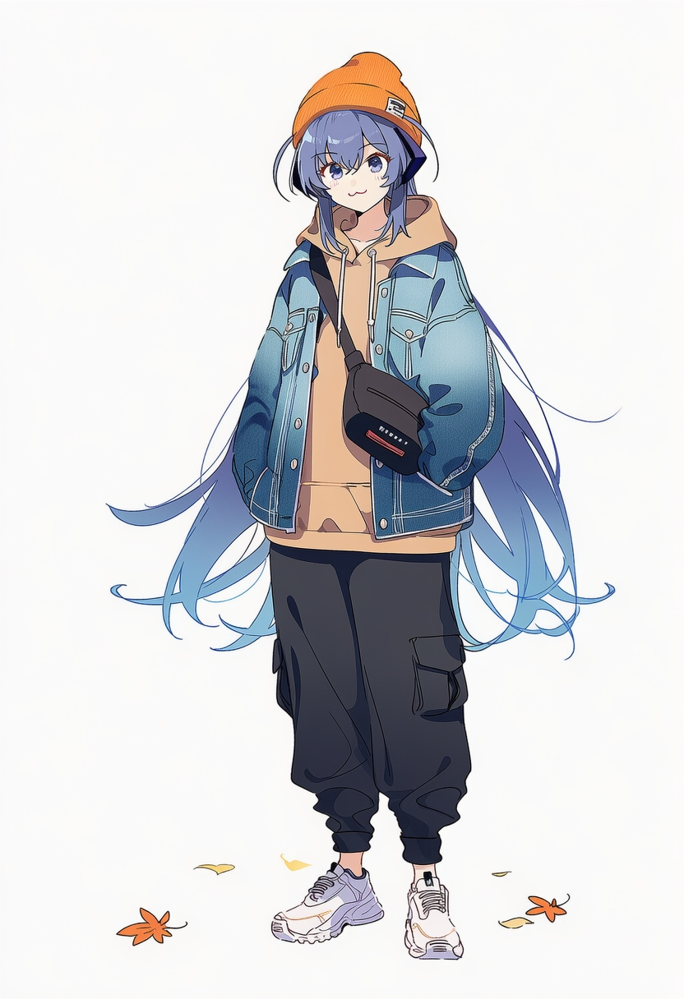

[在线例图](https://assets.quicktagcloud.com/images/raven_composition/raven_composition-6323.jpg?v=1d9b42d671a73953)

<a id="raven_composition-6324"></a>

## 小企业

ID：`raven_composition-6324`；分类：角色图鉴 / 碧蓝航线 / 白鹰；来源标记：`safe`。

来源说明：

> 作品：碧蓝航线
> 角色英文名：Little Enterprise
> 首次登场时间（国服实装）：2021-05-27
> 阵营：白鹰

正向提示词：

```text
little_enterprise_(azur_lane)
```

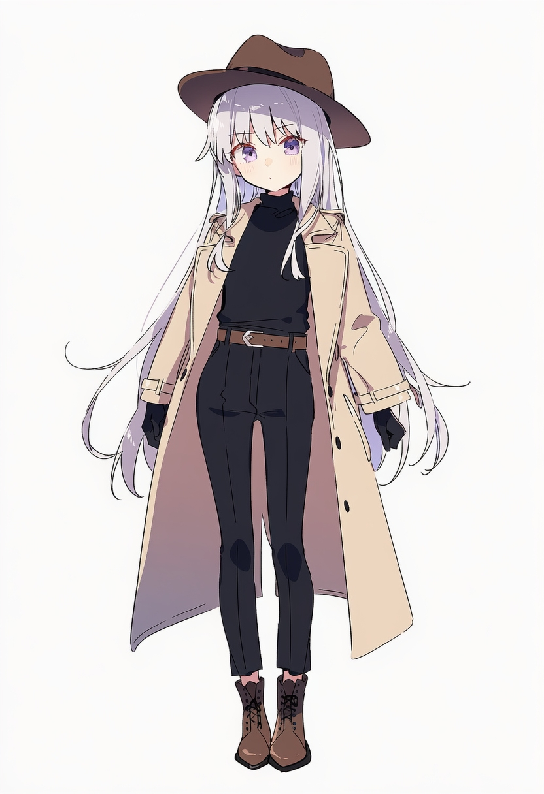

[在线例图](https://assets.quicktagcloud.com/images/raven_composition/raven_composition-6324.jpg?v=cb65eabe0e2f4571)

<a id="raven_composition-6325"></a>

## 提康德罗加

ID：`raven_composition-6325`；分类：角色图鉴 / 碧蓝航线 / 白鹰；来源标记：`safe`。

来源说明：

> 作品：碧蓝航线
> 角色英文名：Ticonderoga
> 首次登场时间（国服实装）：2021-05-27
> 阵营：白鹰

正向提示词：

```text
ticonderoga_(azur_lane)
```

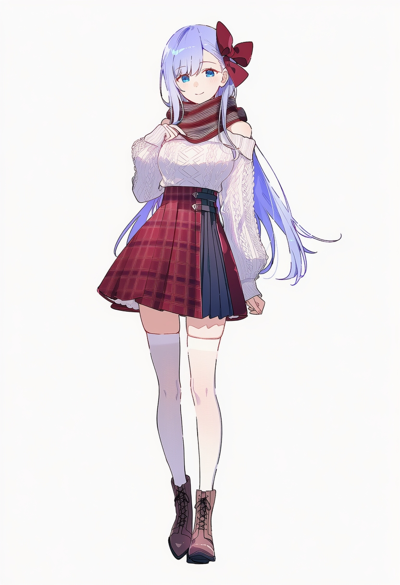

[在线例图](https://assets.quicktagcloud.com/images/raven_composition/raven_composition-6325.jpg?v=916533403448cdc7)

<a id="raven_composition-6326"></a>

## 射水鱼

ID：`raven_composition-6326`；分类：角色图鉴 / 碧蓝航线 / 白鹰；来源标记：`safe`。

来源说明：

> 作品：碧蓝航线
> 角色英文名：Archerfish
> 首次登场时间（国服实装）：2021-05-27
> 阵营：白鹰

正向提示词：

```text
archerfish_(azur_lane)
```


[在线例图](https://assets.quicktagcloud.com/images/raven_composition/raven_composition-6326.jpg?v=e0188951527f46d9)

<a id="raven_composition-6335"></a>

## 英格拉罕

ID：`raven_composition-6335`；分类：角色图鉴 / 碧蓝航线 / 白鹰；来源标记：`safe`。

来源说明：

> 作品：碧蓝航线
> 角色英文名：Ingraham
> 首次登场时间（国服实装）：2021-08-19
> 阵营：白鹰

正向提示词：

```text
ingraham_(azur_lane)
```

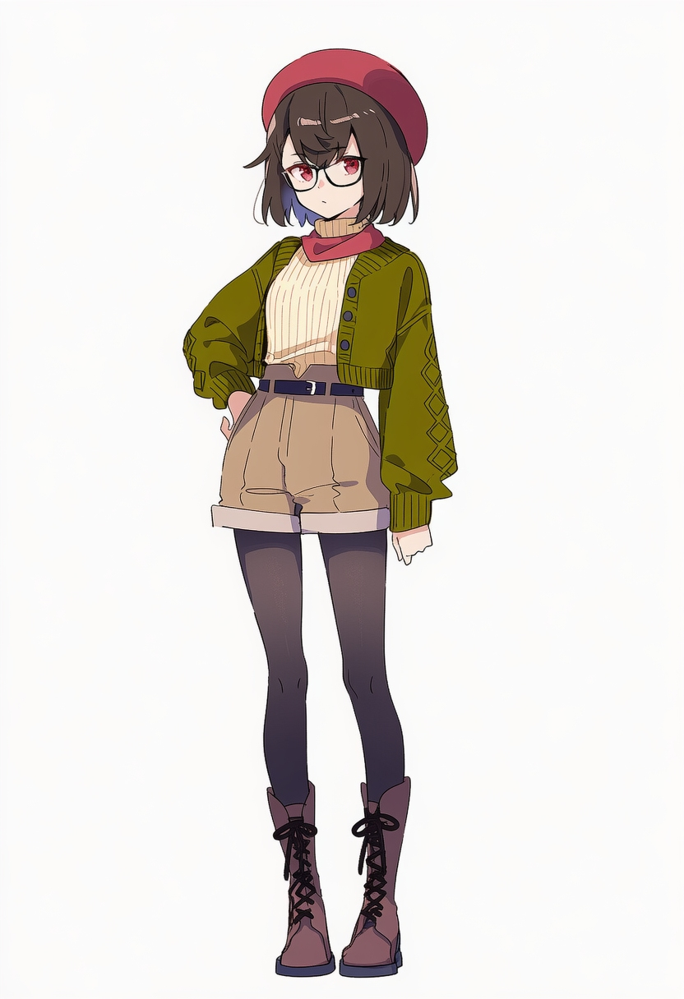

[在线例图](https://assets.quicktagcloud.com/images/raven_composition/raven_composition-6335.jpg?v=9db85eb3655c9e4d)

<a id="raven_composition-6336"></a>

## 鹦鹉螺

ID：`raven_composition-6336`；分类：角色图鉴 / 碧蓝航线 / 白鹰；来源标记：`safe`。

来源说明：

> 作品：碧蓝航线
> 角色英文名：Nautilus
> 首次登场时间（国服实装）：2021-08-19
> 阵营：白鹰

正向提示词：

```text
nautilus_(azur_lane)
```

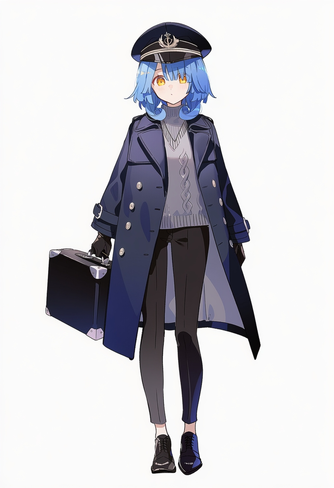

[在线例图](https://assets.quicktagcloud.com/images/raven_composition/raven_composition-6336.jpg?v=03f9e382f27f1c4c)

<a id="raven_composition-6345"></a>

## 新奥尔良

ID：`raven_composition-6345`；分类：角色图鉴 / 碧蓝航线 / 白鹰；来源标记：`safe`。

来源说明：

> 作品：碧蓝航线
> 角色英文名：New Orleans
> 首次登场时间（国服实装）：2021-10-21
> 阵营：白鹰

正向提示词：

```text
new_orleans_(azur_lane)
```

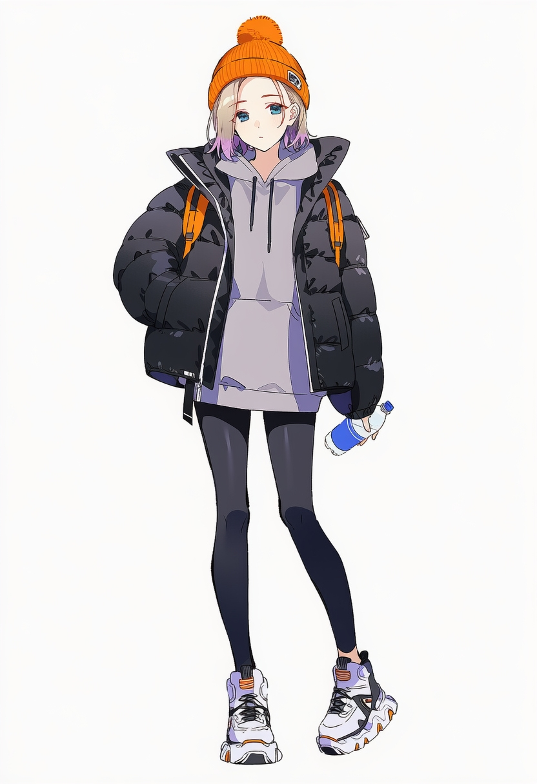

[在线例图](https://assets.quicktagcloud.com/images/raven_composition/raven_composition-6345.jpg?v=b41163ee591a5dae)

<a id="raven_composition-6356"></a>

## 布里斯托尔

ID：`raven_composition-6356`；分类：角色图鉴 / 碧蓝航线 / 白鹰；来源标记：`safe`。

来源说明：

> 作品：碧蓝航线
> 角色英文名：Bristol
> 首次登场时间（国服实装）：2022-01-27
> 阵营：白鹰

正向提示词：

```text
bristol_(azur_lane)
```

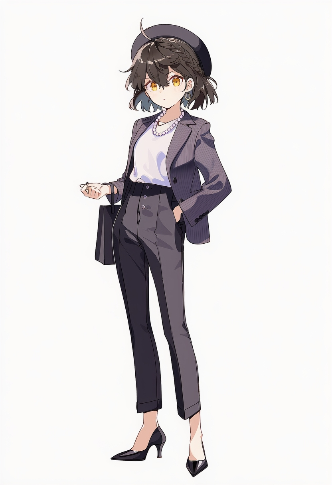

[在线例图](https://assets.quicktagcloud.com/images/raven_composition/raven_composition-6356.jpg?v=9ecb7cbaa7c7fcef)

<a id="raven_composition-6417"></a>

## 哈曼II

ID：`raven_composition-6417`；分类：角色图鉴 / 碧蓝航线 / 白鹰；来源标记：`safe`。

来源说明：

> 作品：碧蓝航线
> 角色英文名：Hammann II
> 首次登场时间（国服实装）：2022-12-22
> 阵营：白鹰

正向提示词：

```text
hammann_ii_(azur_lane)
```

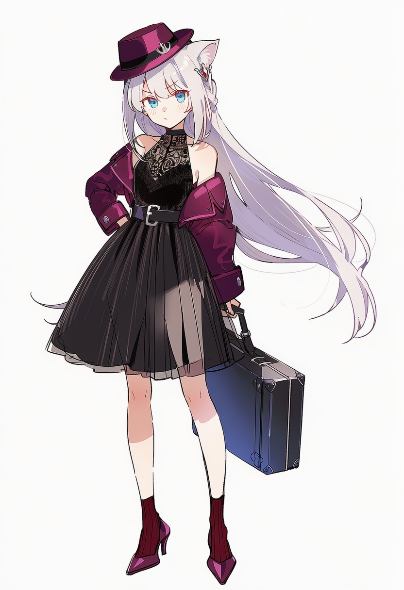

[在线例图](https://assets.quicktagcloud.com/images/raven_composition/raven_composition-6417.jpg?v=aad6a941eb7cc19f)

<a id="raven_composition-6418"></a>

## 北安普敦II

ID：`raven_composition-6418`；分类：角色图鉴 / 碧蓝航线 / 白鹰；来源标记：`safe`。

来源说明：

> 作品：碧蓝航线
> 角色英文名：Northampton II
> 首次登场时间（国服实装）：2022-12-22
> 阵营：白鹰

正向提示词：

```text
northampton_ii_(azur_lane)
```

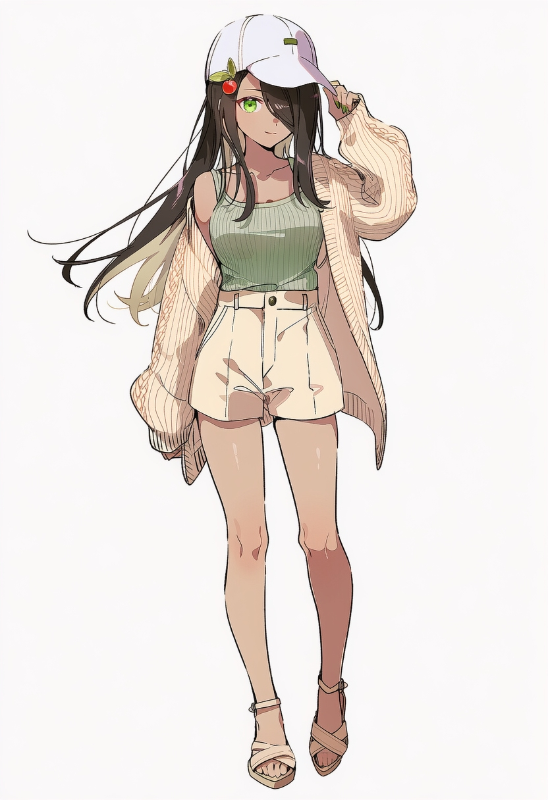

[在线例图](https://assets.quicktagcloud.com/images/raven_composition/raven_composition-6418.jpg?v=48a90abaedd52104)

<a id="raven_composition-6419"></a>

## 兰利II

ID：`raven_composition-6419`；分类：角色图鉴 / 碧蓝航线 / 白鹰；来源标记：`safe`。

来源说明：

> 作品：碧蓝航线
> 角色英文名：Langley II
> 首次登场时间（国服实装）：2022-12-22
> 阵营：白鹰

正向提示词：

```text
langley_ii_(azur_lane)
```

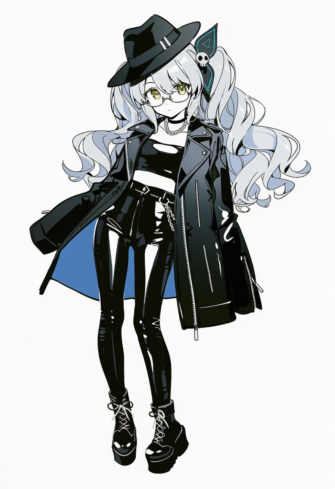

[在线例图](https://assets.quicktagcloud.com/images/raven_composition/raven_composition-6419.jpg?v=51a1a29e40777fcf)

<a id="raven_composition-6420"></a>

## 大黄蜂II

ID：`raven_composition-6420`；分类：角色图鉴 / 碧蓝航线 / 白鹰；来源标记：`safe`。

来源说明：

> 作品：碧蓝航线
> 角色英文名：Hornet II
> 首次登场时间（国服实装）：2022-12-22
> 阵营：白鹰

正向提示词：

```text
hornet_ii_(azur_lane)
```


[在线例图](https://assets.quicktagcloud.com/images/raven_composition/raven_composition-6420.jpg?v=2cabf96ea85ce41a)

<a id="raven_composition-6421"></a>

## 约克城II

ID：`raven_composition-6421`；分类：角色图鉴 / 碧蓝航线 / 白鹰；来源标记：`safe`。

来源说明：

> 作品：碧蓝航线
> 角色英文名：Yorktown II
> 首次登场时间（国服实装）：2022-12-22
> 阵营：白鹰

正向提示词：

```text
yorktown_ii_(azur_lane)
```

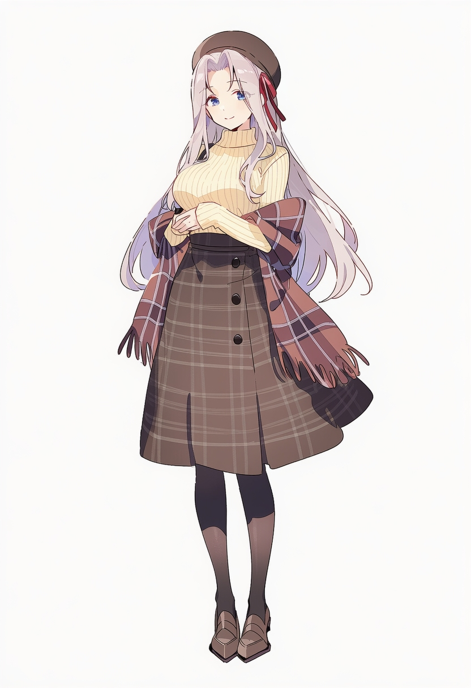

[在线例图](https://assets.quicktagcloud.com/images/raven_composition/raven_composition-6421.jpg?v=be47630d1d82939c)

<a id="raven_composition-6467"></a>

## 休斯敦II

ID：`raven_composition-6467`；分类：角色图鉴 / 碧蓝航线 / 白鹰；来源标记：`safe`。

来源说明：

> 作品：碧蓝航线
> 角色英文名：Houston II
> 首次登场时间（国服实装）：2023-10-19
> 阵营：白鹰

正向提示词：

```text
houston_ii_(azur_lane)
```

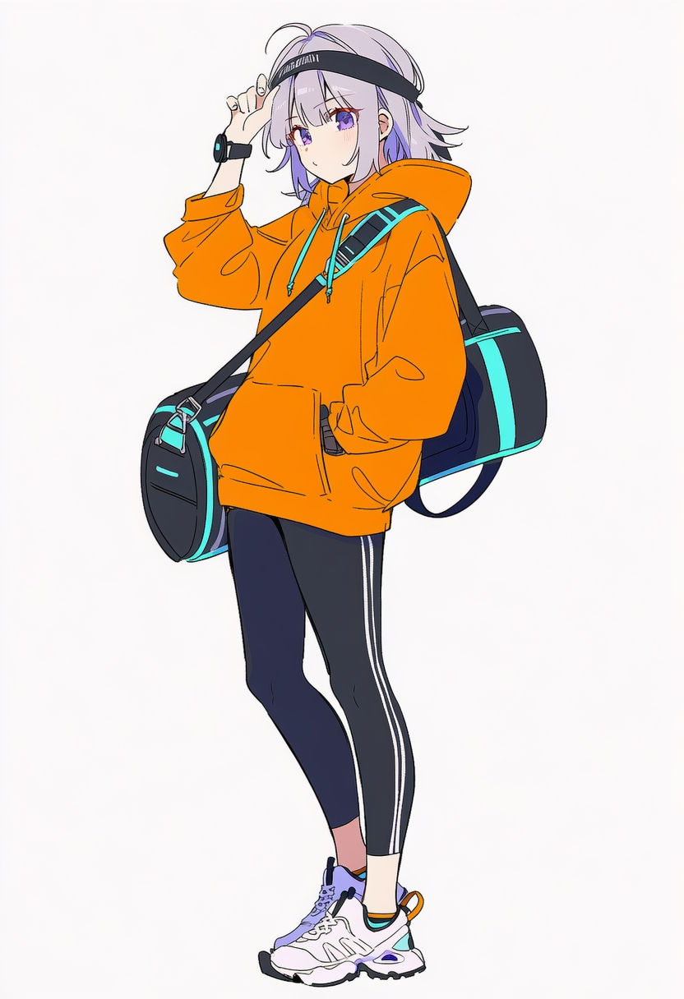

[在线例图](https://assets.quicktagcloud.com/images/raven_composition/raven_composition-6467.jpg?v=49d79bed83f35167)

<a id="raven_composition-6475"></a>

## 拉菲II

ID：`raven_composition-6475`；分类：角色图鉴 / 碧蓝航线 / 白鹰；来源标记：`safe`。

来源说明：

> 作品：碧蓝航线
> 角色英文名：Laffey II
> 首次登场时间（国服实装）：2023-12-21
> 阵营：白鹰

正向提示词：

```text
laffey_ii_(azur_lane)
```

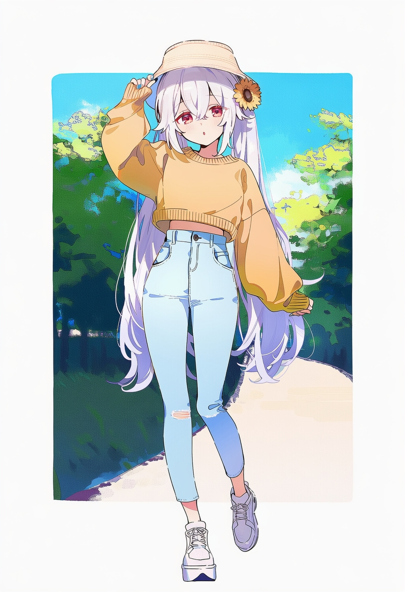

[在线例图](https://assets.quicktagcloud.com/images/raven_composition/raven_composition-6475.jpg?v=5c1b979eba99b432)

<a id="raven_composition-6476"></a>

## 路易斯维尔

ID：`raven_composition-6476`；分类：角色图鉴 / 碧蓝航线 / 白鹰；来源标记：`safe`。

来源说明：

> 作品：碧蓝航线
> 角色英文名：Louisville
> 首次登场时间（国服实装）：2023-12-21
> 阵营：白鹰

正向提示词：

```text
louisville_(azur_lane)
```


[在线例图](https://assets.quicktagcloud.com/images/raven_composition/raven_composition-6476.jpg?v=e54a3e211746269d)

<a id="raven_composition-6477"></a>

## 关岛

ID：`raven_composition-6477`；分类：角色图鉴 / 碧蓝航线 / 白鹰；来源标记：`safe`。

来源说明：

> 作品：碧蓝航线
> 角色英文名：Guam
> 首次登场时间（国服实装）：2023-12-21
> 阵营：白鹰

正向提示词：

```text
guam_(azur_lane)
```


[在线例图](https://assets.quicktagcloud.com/images/raven_composition/raven_composition-6477.jpg?v=10c4712a43e12b8f)

<a id="raven_composition-6478"></a>

## 星座

ID：`raven_composition-6478`；分类：角色图鉴 / 碧蓝航线 / 白鹰；来源标记：`safe`。

来源说明：

> 作品：碧蓝航线
> 角色英文名：Constellation
> 首次登场时间（国服实装）：2023-12-21
> 阵营：白鹰

正向提示词：

```text
constellation_(azur_lane)
```

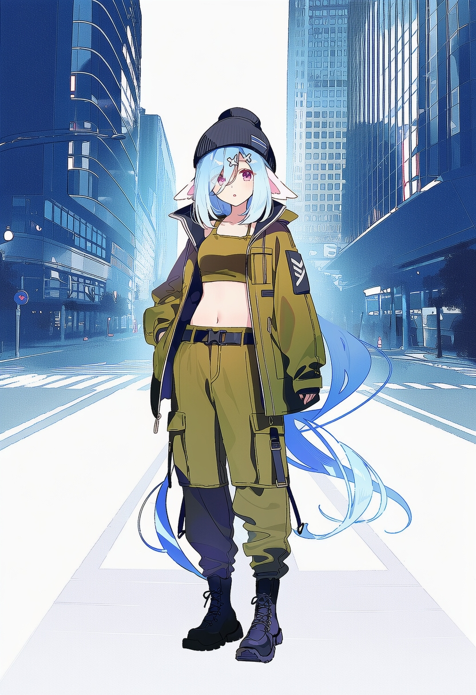

[在线例图](https://assets.quicktagcloud.com/images/raven_composition/raven_composition-6478.jpg?v=45e2c5d73565aedb)

<a id="raven_composition-6479"></a>

## 圣哈辛托

ID：`raven_composition-6479`；分类：角色图鉴 / 碧蓝航线 / 白鹰；来源标记：`safe`。

来源说明：

> 作品：碧蓝航线
> 角色英文名：San Jacinto
> 首次登场时间（国服实装）：2023-12-21
> 阵营：白鹰

正向提示词：

```text
san_jacinto_(azur_lane)
```

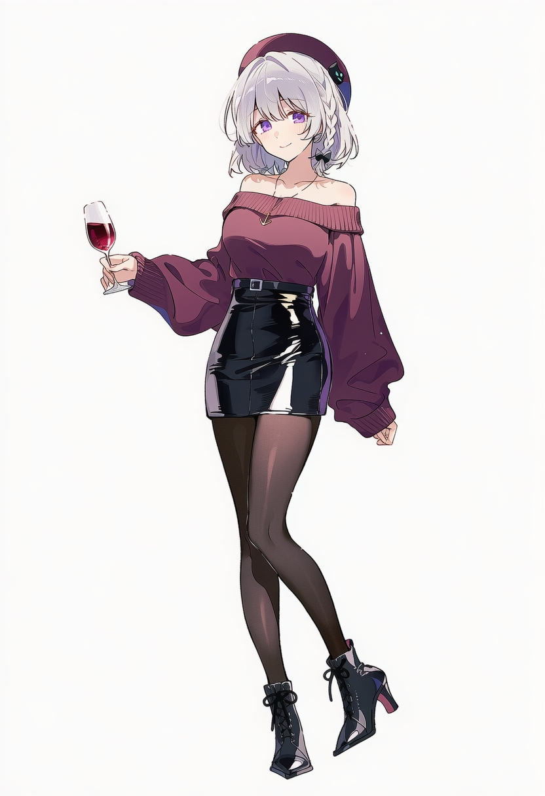

[在线例图](https://assets.quicktagcloud.com/images/raven_composition/raven_composition-6479.jpg?v=b0ca03463b74362e)

<a id="raven_composition-6480"></a>

## 闪光

ID：`raven_composition-6480`；分类：角色图鉴 / 碧蓝航线 / 白鹰；来源标记：`safe`。

来源说明：

> 作品：碧蓝航线
> 角色英文名：Flasher
> 首次登场时间（国服实装）：2023-12-21
> 阵营：白鹰

正向提示词：

```text
flasher_(azur_lane)
```


[在线例图](https://assets.quicktagcloud.com/images/raven_composition/raven_composition-6480.jpg?v=2069ef34f34ce2ed)

<a id="raven_composition-6498"></a>

## 博伊西μ

ID：`raven_composition-6498`；分类：角色图鉴 / 碧蓝航线 / 白鹰；来源标记：`safe`。

来源说明：

> 作品：碧蓝航线
> 角色英文名：Boise µ
> 首次登场时间（国服实装）：2024-04-25
> 阵营：白鹰

正向提示词：

```text
boise_(muse)_(azur_lane)
```

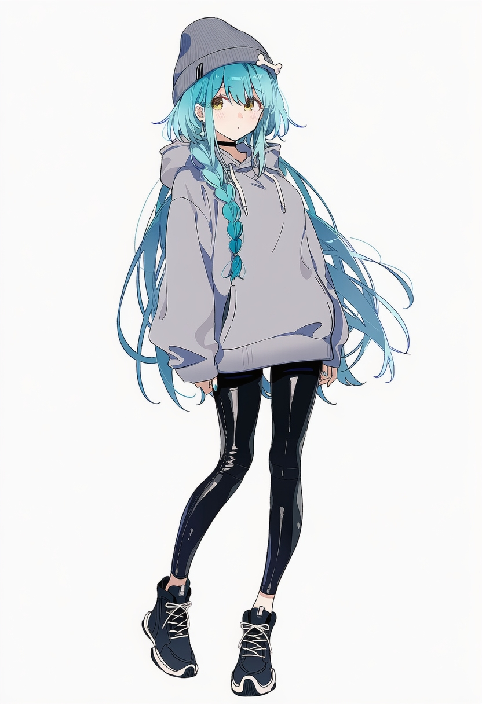

[在线例图](https://assets.quicktagcloud.com/images/raven_composition/raven_composition-6498.jpg?v=86b504f9076e0ca4)

<a id="raven_composition-6526"></a>

## 贝尔

ID：`raven_composition-6526`；分类：角色图鉴 / 碧蓝航线 / 白鹰；来源标记：`safe`。

来源说明：

> 作品：碧蓝航线
> 角色英文名：Bell
> 首次登场时间（国服实装）：2024-08-15
> 阵营：白鹰

正向提示词：

```text
bell_(azur_lane)
```

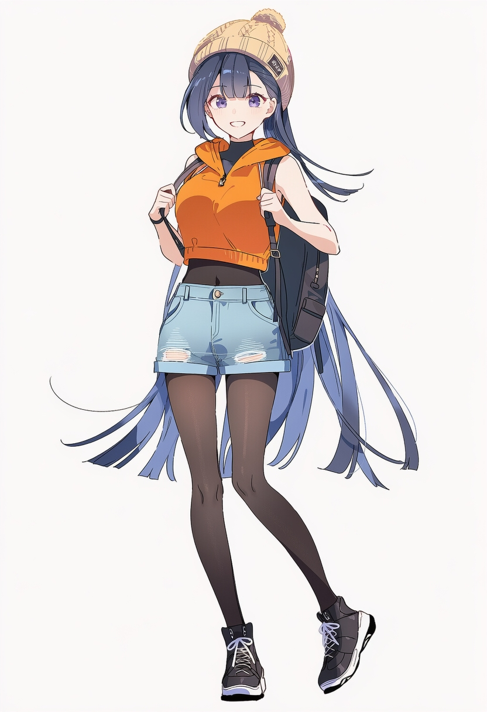

[在线例图](https://assets.quicktagcloud.com/images/raven_composition/raven_composition-6526.jpg?v=c925092f94911a6c)

<a id="raven_composition-6527"></a>

## 法戈

ID：`raven_composition-6527`；分类：角色图鉴 / 碧蓝航线 / 白鹰；来源标记：`safe`。

来源说明：

> 作品：碧蓝航线
> 角色英文名：Fargo
> 首次登场时间（国服实装）：2024-08-15
> 阵营：白鹰

正向提示词：

```text
fargo_(azur_lane)
```

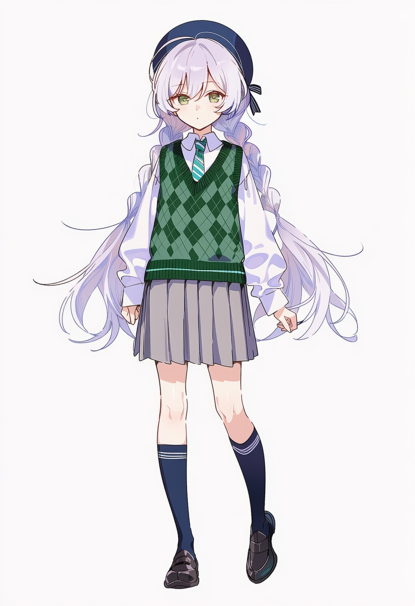

[在线例图](https://assets.quicktagcloud.com/images/raven_composition/raven_composition-6527.jpg?v=796331a5a13fe45c)

<a id="raven_composition-6528"></a>

## 匹兹堡

ID：`raven_composition-6528`；分类：角色图鉴 / 碧蓝航线 / 白鹰；来源标记：`safe`。

来源说明：

> 作品：碧蓝航线
> 角色英文名：Pittsburgh
> 首次登场时间（国服实装）：2024-08-15
> 阵营：白鹰

正向提示词：

```text
pittsburgh_(azur_lane)
```

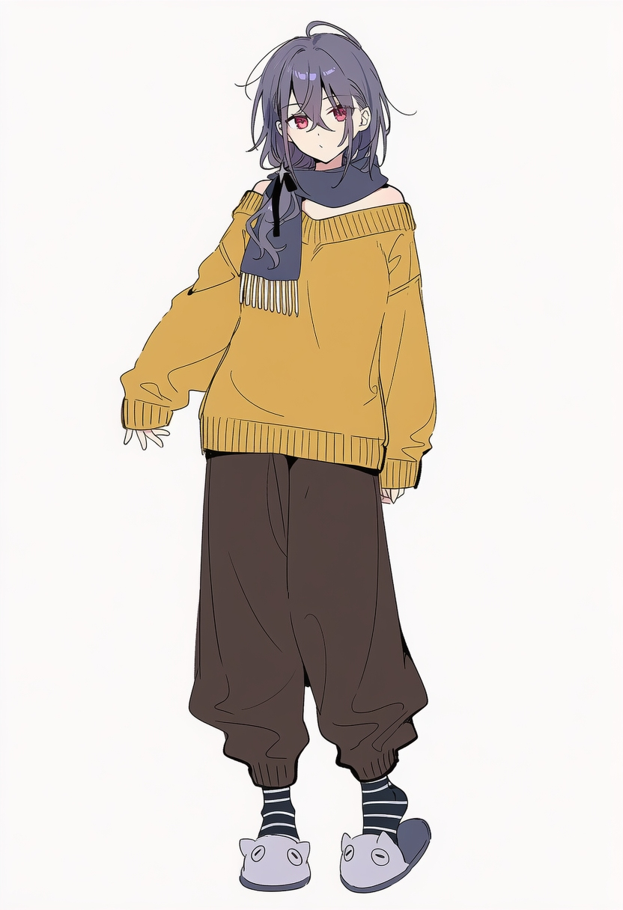

[在线例图](https://assets.quicktagcloud.com/images/raven_composition/raven_composition-6528.jpg?v=d91b50f808edbfd4)

<a id="raven_composition-6529"></a>

## 印第安纳

ID：`raven_composition-6529`；分类：角色图鉴 / 碧蓝航线 / 白鹰；来源标记：`safe`。

来源说明：

> 作品：碧蓝航线
> 角色英文名：Indiana
> 首次登场时间（国服实装）：2024-08-15
> 阵营：白鹰

正向提示词：

```text
indiana_(azur_lane)
```

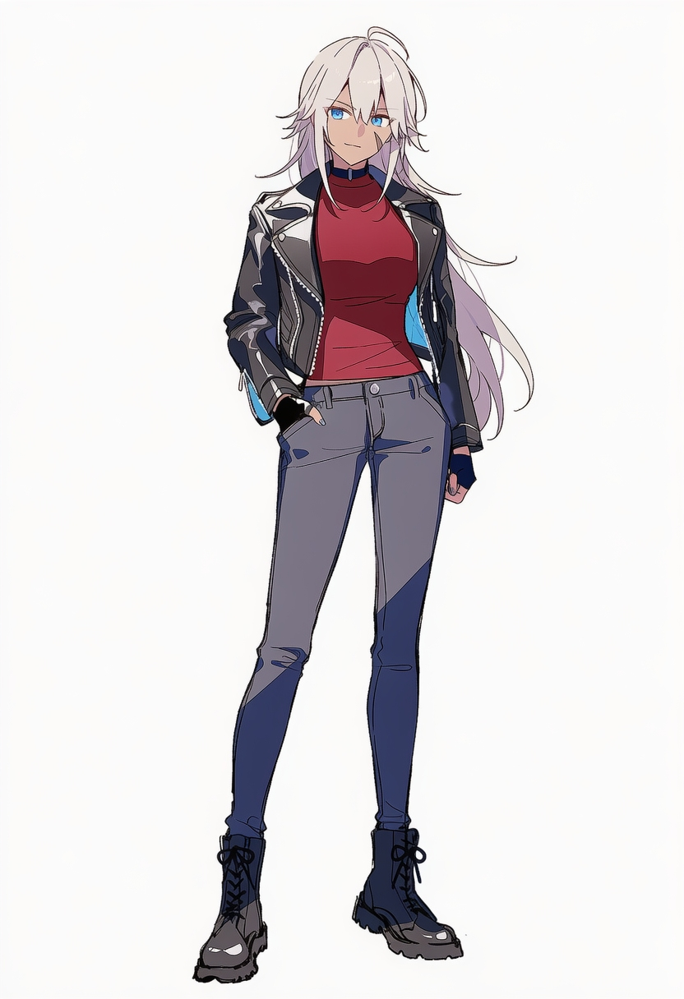

[在线例图](https://assets.quicktagcloud.com/images/raven_composition/raven_composition-6529.jpg?v=da12c98e5d1f9355)

<a id="raven_composition-6530"></a>

## 鲱鱼

ID：`raven_composition-6530`；分类：角色图鉴 / 碧蓝航线 / 白鹰；来源标记：`safe`。

来源说明：

> 作品：碧蓝航线
> 角色英文名：Herring
> 首次登场时间（国服实装）：2024-08-15
> 阵营：白鹰

正向提示词：

```text
herring_(azur_lane)
```

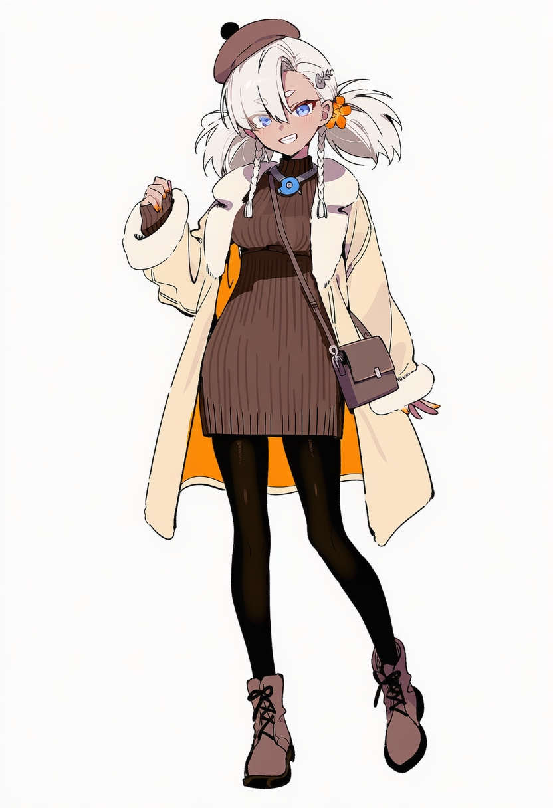

[在线例图](https://assets.quicktagcloud.com/images/raven_composition/raven_composition-6530.jpg?v=38663b9478df7359)

<a id="raven_composition-6562"></a>

## 米勒

ID：`raven_composition-6562`；分类：角色图鉴 / 碧蓝航线 / 白鹰；来源标记：`safe`。

来源说明：

> 作品：碧蓝航线
> 角色英文名：Miller
> 首次登场时间（国服实装）：2025-03-27
> 阵营：白鹰

正向提示词：

```text
miller_(azur_lane)
```


[在线例图](https://assets.quicktagcloud.com/images/raven_composition/raven_composition-6562.jpg?v=8f83212280ae55c9)

<a id="raven_composition-6563"></a>

## 圣菲

ID：`raven_composition-6563`；分类：角色图鉴 / 碧蓝航线 / 白鹰；来源标记：`safe`。

来源说明：

> 作品：碧蓝航线
> 角色英文名：Santa Fe
> 首次登场时间（国服实装）：2025-03-27
> 阵营：白鹰

正向提示词：

```text
santa_fe_(azur_lane)
```

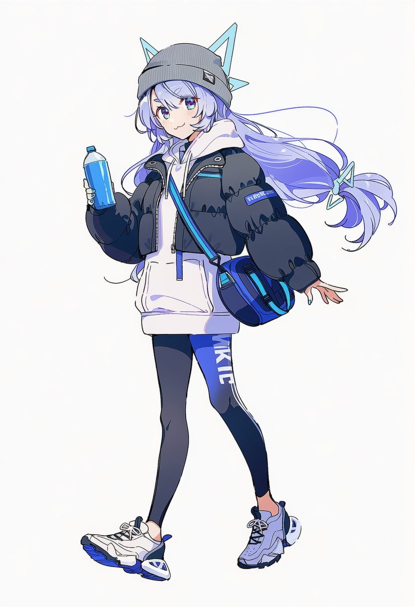

[在线例图](https://assets.quicktagcloud.com/images/raven_composition/raven_composition-6563.jpg?v=9d8c6400fd37965b)

<a id="raven_composition-6564"></a>

## 富兰克林

ID：`raven_composition-6564`；分类：角色图鉴 / 碧蓝航线 / 白鹰；来源标记：`safe`。

来源说明：

> 作品：碧蓝航线
> 角色英文名：Franklin
> 首次登场时间（国服实装）：2025-03-27
> 阵营：白鹰

正向提示词：

```text
franklin_(azur_lane)
```


[在线例图](https://assets.quicktagcloud.com/images/raven_composition/raven_composition-6564.jpg?v=429d62f68fca64f3)

<a id="raven_composition-6583"></a>

## 堪萨斯

ID：`raven_composition-6583`；分类：角色图鉴 / 碧蓝航线 / 白鹰；来源标记：`safe`。

来源说明：

> 作品：碧蓝航线
> 角色英文名：Kansas
> 首次登场时间（国服实装）：2025-07-10
> 阵营：白鹰

正向提示词：

```text
kansas_(azur_lane)
```


[在线例图](https://assets.quicktagcloud.com/images/raven_composition/raven_composition-6583.jpg?v=0db81bbfaa90c4e4)

<a id="raven_composition-6607"></a>

## 克拉伦斯·K·布朗森

ID：`raven_composition-6607`；分类：角色图鉴 / 碧蓝航线 / 白鹰；来源标记：`safe`。

来源说明：

> 作品：碧蓝航线
> 角色英文名：Clarence K. Bronson
> 首次登场时间（国服实装）：2025-12-18
> 阵营：白鹰

正向提示词：

```text
clarence_k._bronson_(azur_lane)
```

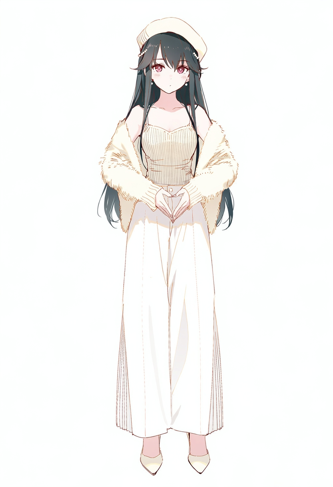

[在线例图](https://assets.quicktagcloud.com/images/raven_composition/raven_composition-6607.jpg?v=ee413e134269943f)

<a id="raven_composition-6608"></a>

## 威廉·D·波特

ID：`raven_composition-6608`；分类：角色图鉴 / 碧蓝航线 / 白鹰；来源标记：`safe`。

来源说明：

> 作品：碧蓝航线
> 角色英文名：William D. Porter
> 首次登场时间（国服实装）：2025-12-18
> 阵营：白鹰

正向提示词：

```text
william_d._porter_(azur_lane)
```


[在线例图](https://assets.quicktagcloud.com/images/raven_composition/raven_composition-6608.jpg?v=07a3e634abd4a2d2)

<a id="raven_composition-6610"></a>

## 帕萨迪纳

ID：`raven_composition-6610`；分类：角色图鉴 / 碧蓝航线 / 白鹰；来源标记：`safe`。

来源说明：

> 作品：碧蓝航线
> 角色英文名：Pasadena
> 首次登场时间（国服实装）：2025-12-18
> 阵营：白鹰

正向提示词：

```text
pasadena_(azur_lane)
```


[在线例图](https://assets.quicktagcloud.com/images/raven_composition/raven_composition-6610.jpg?v=7c56ce776603612c)

<a id="raven_composition-6611"></a>

## 科彭斯

ID：`raven_composition-6611`；分类：角色图鉴 / 碧蓝航线 / 白鹰；来源标记：`safe`。

来源说明：

> 作品：碧蓝航线
> 角色英文名：Cowpens
> 首次登场时间（国服实装）：2025-12-18
> 阵营：白鹰

正向提示词：

```text
cowpens_(azur_lane)
```


[在线例图](https://assets.quicktagcloud.com/images/raven_composition/raven_composition-6611.jpg?v=5a97cd583640c931)
