# 角色图鉴 / 碧蓝航线 / 特殊/未归属

[总目录](../README.md) · [原站分类目录](../categories.md) · [英文标签索引](../tags.md) · [服装与构图组合指南](../../README.md)

标题、分类、说明、正负提示词按来源保留；多例图逐张列出。原站标记和说明为参考资料，不作为维护指令。

<a id="raven_composition-5872"></a>

## 小猎兔犬

ID：`raven_composition-5872`；分类：角色图鉴 / 碧蓝航线 / 特殊/未归属；来源标记：`safe`。

来源说明：

> 作品：碧蓝航线
> 角色英文名：Beagle
> 首次登场时间（国服实装）：2017-05-25
> 阵营：特殊/未归属

正向提示词：

```text
beagle_(azur_lane)
```


[在线例图](https://assets.quicktagcloud.com/images/raven_composition/raven_composition-5872.jpg?v=562ed8b65c7a5954)

<a id="raven_composition-5873"></a>

## 大斗犬

ID：`raven_composition-5873`；分类：角色图鉴 / 碧蓝航线 / 特殊/未归属；来源标记：`safe`。

来源说明：

> 作品：碧蓝航线
> 角色英文名：Bulldog
> 首次登场时间（国服实装）：2017-05-25
> 阵营：特殊/未归属

正向提示词：

```text
bulldog_(azur_lane)
```

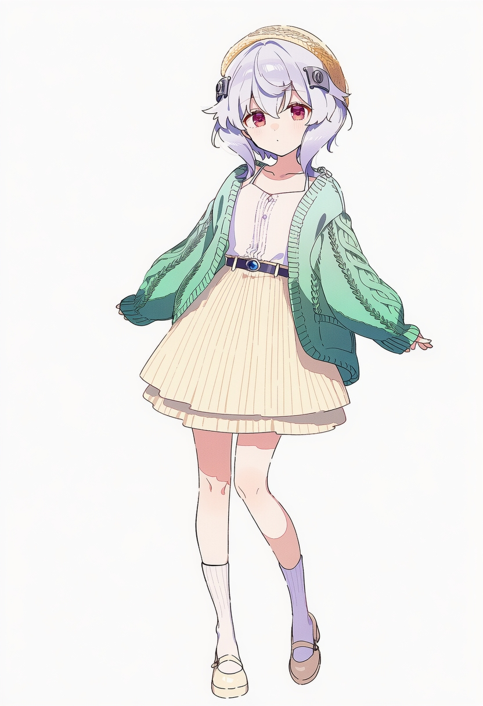

[在线例图](https://assets.quicktagcloud.com/images/raven_composition/raven_composition-5873.jpg?v=4c6a0bdab40a019e)

<a id="raven_composition-5875"></a>

## 彗星

ID：`raven_composition-5875`；分类：角色图鉴 / 碧蓝航线 / 特殊/未归属；来源标记：`safe`。

来源说明：

> 作品：碧蓝航线
> 角色英文名：Comet
> 首次登场时间（国服实装）：2017-05-25
> 阵营：特殊/未归属

正向提示词：

```text
comet_(azur_lane)
```

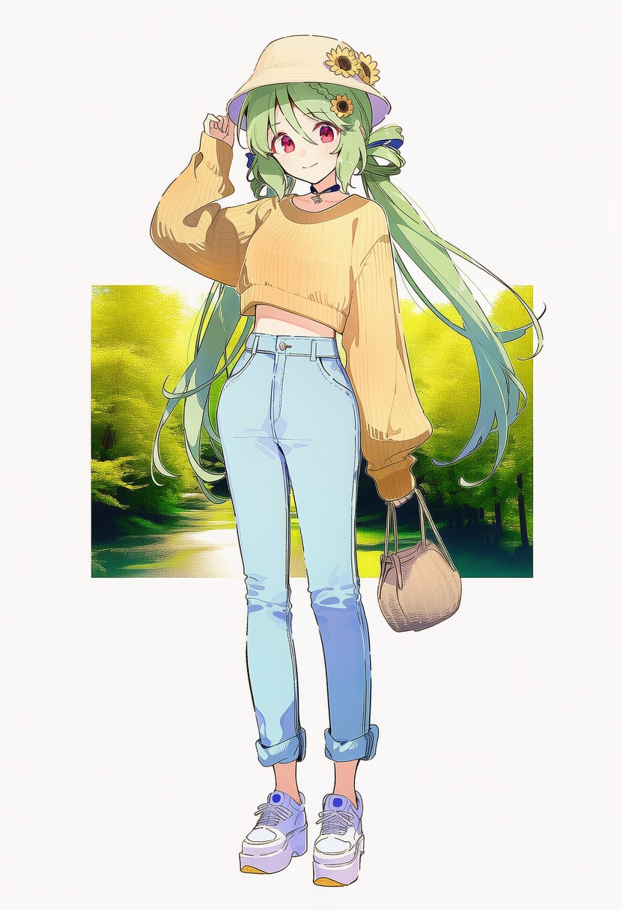

[在线例图](https://assets.quicktagcloud.com/images/raven_composition/raven_composition-5875.jpg?v=f3cc5cd83155c679)

<a id="raven_composition-5877"></a>

## 新月

ID：`raven_composition-5877`；分类：角色图鉴 / 碧蓝航线 / 特殊/未归属；来源标记：`safe`。

来源说明：

> 作品：碧蓝航线
> 角色英文名：Crescent
> 首次登场时间（国服实装）：2017-05-25
> 阵营：特殊/未归属

正向提示词：

```text
crescent_(azur_lane)
```


[在线例图](https://assets.quicktagcloud.com/images/raven_composition/raven_composition-5877.jpg?v=df3d8a3e7746e79c)

<a id="raven_composition-5878"></a>

## 小天鹅

ID：`raven_composition-5878`；分类：角色图鉴 / 碧蓝航线 / 特殊/未归属；来源标记：`safe`。

来源说明：

> 作品：碧蓝航线
> 角色英文名：Cygnet
> 首次登场时间（国服实装）：2017-05-25
> 阵营：特殊/未归属

正向提示词：

```text
cygnet_(azur_lane)
```

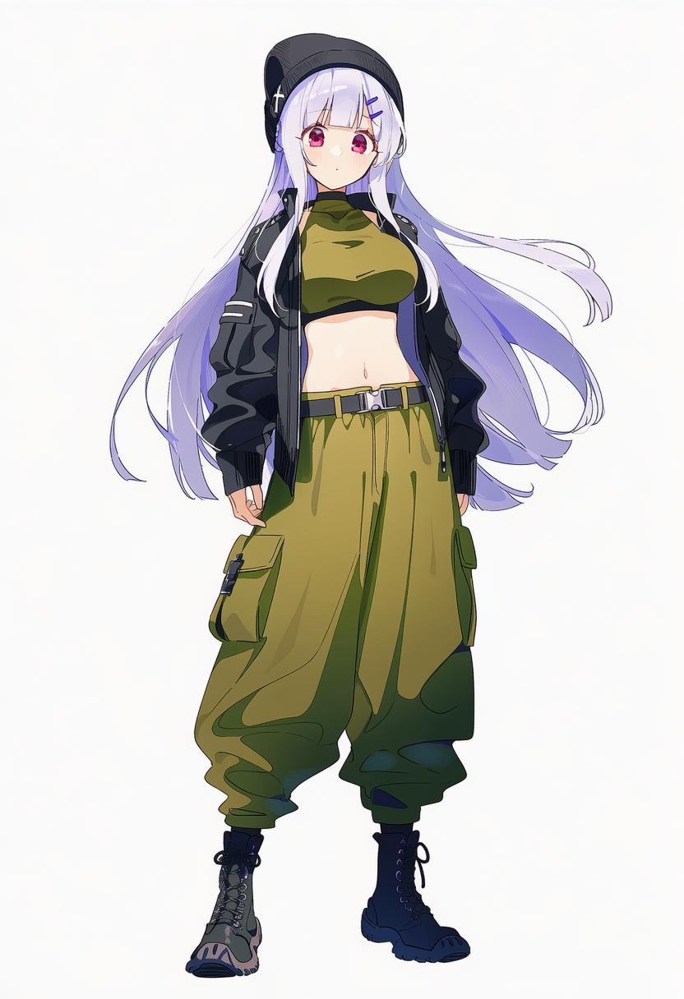

[在线例图](https://assets.quicktagcloud.com/images/raven_composition/raven_composition-5878.jpg?v=e02559bcfe4d6f45)

<a id="raven_composition-5880"></a>

## 富特

ID：`raven_composition-5880`；分类：角色图鉴 / 碧蓝航线 / 特殊/未归属；来源标记：`safe`。

来源说明：

> 作品：碧蓝航线
> 角色英文名：Foote
> 首次登场时间（国服实装）：2017-05-25
> 阵营：特殊/未归属

正向提示词：

```text
foote_(azur_lane)
```

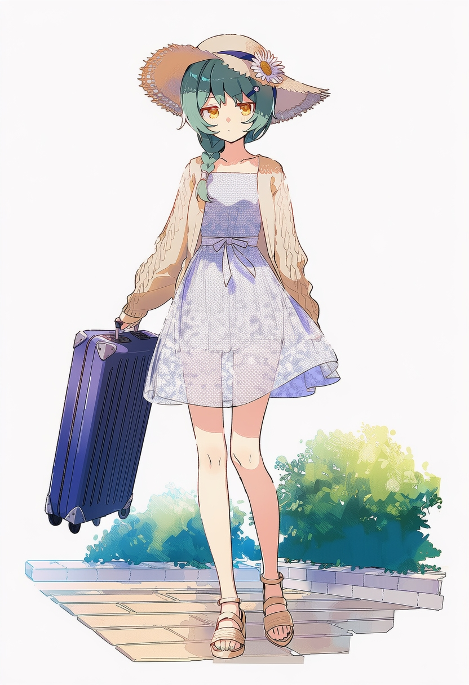

[在线例图](https://assets.quicktagcloud.com/images/raven_composition/raven_composition-5880.jpg?v=f924f0e584a2bf59)

<a id="raven_composition-5881"></a>

## 狐提

ID：`raven_composition-5881`；分类：角色图鉴 / 碧蓝航线 / 特殊/未归属；来源标记：`safe`。

来源说明：

> 作品：碧蓝航线
> 角色英文名：Foxhound
> 首次登场时间（国服实装）：2017-05-25
> 阵营：特殊/未归属

正向提示词：

```text
foxhound_(azur_lane)
```


[在线例图](https://assets.quicktagcloud.com/images/raven_composition/raven_composition-5881.jpg?v=10a5284540dd02a4)

<a id="raven_composition-5883"></a>

## 不知火

ID：`raven_composition-5883`；分类：角色图鉴 / 碧蓝航线 / 特殊/未归属；来源标记：`safe`。

来源说明：

> 作品：碧蓝航线
> 角色英文名：Shiranui
> 首次登场时间（国服实装）：2017-05-25
> 阵营：特殊/未归属

正向提示词：

```text
shiranui_(azur_lane)
```

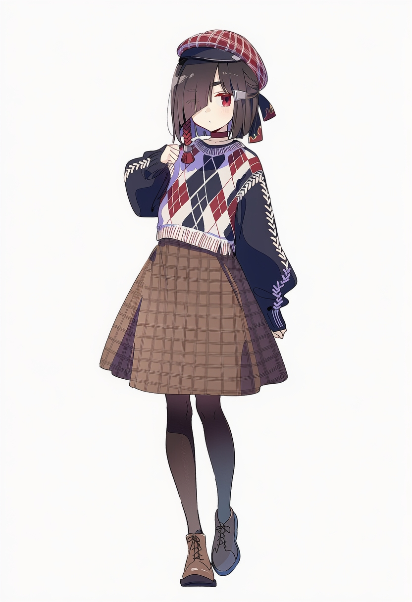

[在线例图](https://assets.quicktagcloud.com/images/raven_composition/raven_composition-5883.jpg?v=aabed8cf28c2cc62)

<a id="raven_composition-5884"></a>

## 斯彭斯

ID：`raven_composition-5884`；分类：角色图鉴 / 碧蓝航线 / 特殊/未归属；来源标记：`safe`。

来源说明：

> 作品：碧蓝航线
> 角色英文名：Spence
> 首次登场时间（国服实装）：2017-05-25
> 阵营：特殊/未归属

正向提示词：

```text
spence_(azur_lane)
```

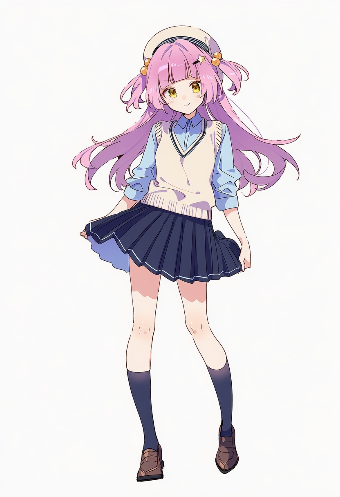

[在线例图](https://assets.quicktagcloud.com/images/raven_composition/raven_composition-5884.jpg?v=c068e160a7b1206c)

<a id="raven_composition-5982"></a>

## 女灶神

ID：`raven_composition-5982`；分类：角色图鉴 / 碧蓝航线 / 特殊/未归属；来源标记：`safe`。

来源说明：

> 作品：碧蓝航线
> 角色英文名：Vestal
> 首次登场时间（国服实装）：2017-05-25
> 阵营：特殊/未归属

正向提示词：

```text
vestal_(azur_lane)
```


[在线例图](https://assets.quicktagcloud.com/images/raven_composition/raven_composition-5982.jpg?v=0fa48845efdcbaad)

<a id="raven_composition-6015"></a>

## 如月

ID：`raven_composition-6015`；分类：角色图鉴 / 碧蓝航线 / 特殊/未归属；来源标记：`safe`。

来源说明：

> 作品：碧蓝航线
> 角色英文名：Kisaragi
> 首次登场时间（国服实装）：2017-08-28
> 阵营：特殊/未归属

正向提示词：

```text
kisaragi_(azur_lane)
```

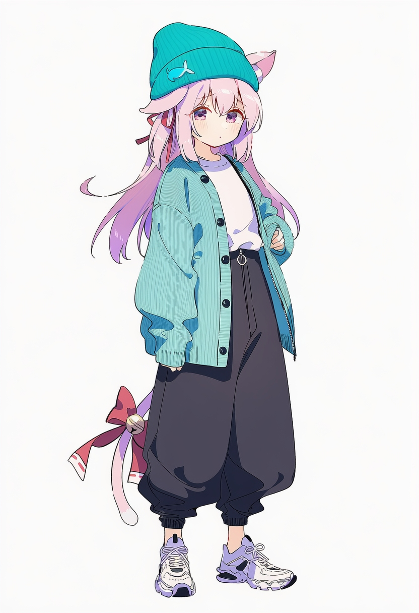

[在线例图](https://assets.quicktagcloud.com/images/raven_composition/raven_composition-6015.jpg?v=905d1d23cef2f8e3)

<a id="raven_composition-6016"></a>

## 睦月

ID：`raven_composition-6016`；分类：角色图鉴 / 碧蓝航线 / 特殊/未归属；来源标记：`safe`。

来源说明：

> 作品：碧蓝航线
> 角色英文名：Mutsuki
> 首次登场时间（国服实装）：2017-08-28
> 阵营：特殊/未归属

正向提示词：

```text
mutsuki_(azur_lane)
```


[在线例图](https://assets.quicktagcloud.com/images/raven_composition/raven_composition-6016.jpg?v=13b55e217c51adab)

<a id="raven_composition-6038"></a>

## 三日月

ID：`raven_composition-6038`；分类：角色图鉴 / 碧蓝航线 / 特殊/未归属；来源标记：`safe`。

来源说明：

> 作品：碧蓝航线
> 角色英文名：Mikazuki
> 首次登场时间（国服实装）：2017-11-16
> 阵营：特殊/未归属

正向提示词：

```text
mikazuki_(azur_lane)
```

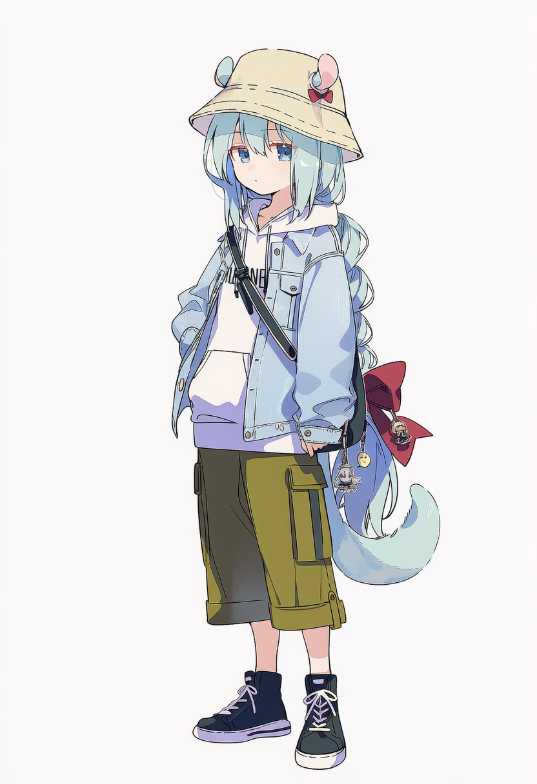

[在线例图](https://assets.quicktagcloud.com/images/raven_composition/raven_composition-6038.jpg?v=2ba0b4af39447e87)

<a id="raven_composition-6039"></a>

## 水无月

ID：`raven_composition-6039`；分类：角色图鉴 / 碧蓝航线 / 特殊/未归属；来源标记：`safe`。

来源说明：

> 作品：碧蓝航线
> 角色英文名：Minazuki
> 首次登场时间（国服实装）：2017-11-16
> 阵营：特殊/未归属

正向提示词：

```text
minazuki_(azur_lane)
```

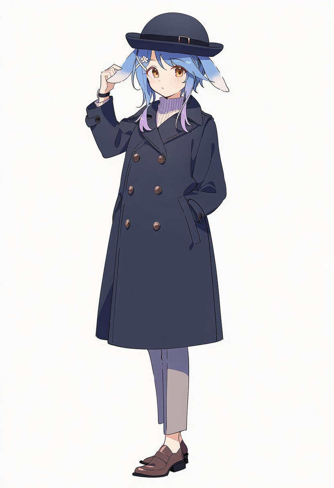

[在线例图](https://assets.quicktagcloud.com/images/raven_composition/raven_composition-6039.jpg?v=7261b5ac8a970991)

<a id="raven_composition-6049"></a>

## 卯月

ID：`raven_composition-6049`；分类：角色图鉴 / 碧蓝航线 / 特殊/未归属；来源标记：`safe`。

来源说明：

> 作品：碧蓝航线
> 角色英文名：Uzuki
> 首次登场时间（国服实装）：2017-12-07
> 阵营：特殊/未归属

正向提示词：

```text
uzuki_(azur_lane)
```


[在线例图](https://assets.quicktagcloud.com/images/raven_composition/raven_composition-6049.jpg?v=767f55146d501fe7)

<a id="raven_composition-6128"></a>

## 絮库夫

ID：`raven_composition-6128`；分类：角色图鉴 / 碧蓝航线 / 特殊/未归属；来源标记：`safe`。

来源说明：

> 作品：碧蓝航线
> 角色英文名：Surcouf
> 首次登场时间（国服实装）：2018-07-26
> 阵营：特殊/未归属

正向提示词：

```text
surcouf_(azur_lane)
```

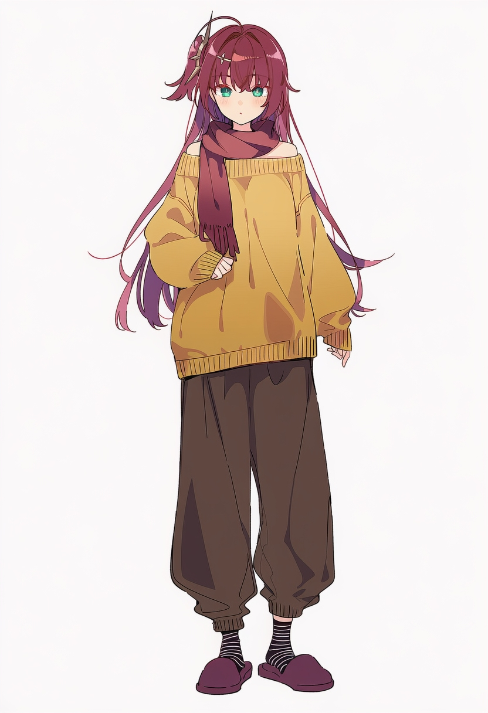

[在线例图](https://assets.quicktagcloud.com/images/raven_composition/raven_composition-6128.jpg?v=642415e143c929f8)

<a id="raven_composition-6168"></a>

## 佐治亚

ID：`raven_composition-6168`；分类：角色图鉴 / 碧蓝航线 / 特殊/未归属；来源标记：`safe`。

来源说明：

> 作品：碧蓝航线
> 角色英文名：Georgia
> 首次登场时间（国服实装）：2019-04-18
> 阵营：特殊/未归属

正向提示词：

```text
georgia_(azur_lane)
```

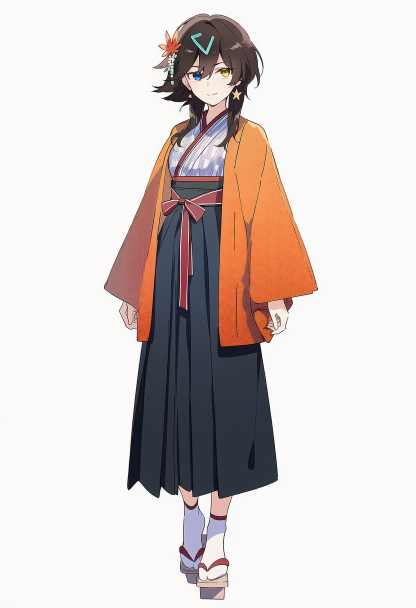

[在线例图](https://assets.quicktagcloud.com/images/raven_composition/raven_composition-6168.jpg?v=0b30295c9ac16889)

<a id="raven_composition-6170"></a>

## 西雅图

ID：`raven_composition-6170`；分类：角色图鉴 / 碧蓝航线 / 特殊/未归属；来源标记：`safe`。

来源说明：

> 作品：碧蓝航线
> 角色英文名：Seattle
> 首次登场时间（国服实装）：2019-04-18
> 阵营：特殊/未归属

正向提示词：

```text
seattle_(azur_lane)
```

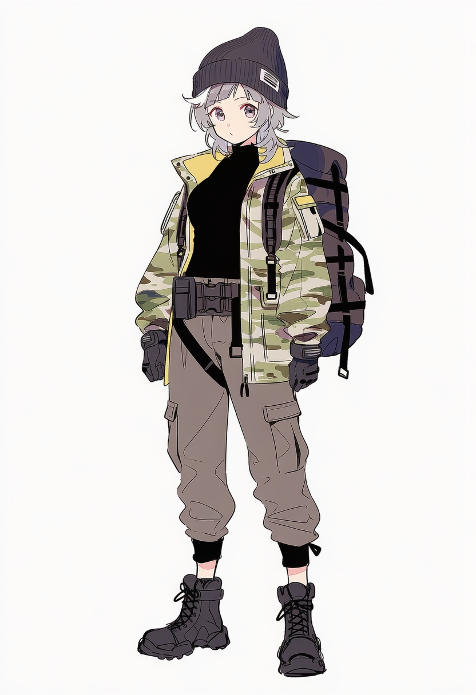

[在线例图](https://assets.quicktagcloud.com/images/raven_composition/raven_composition-6170.jpg?v=0223b919150438eb)

<a id="raven_composition-6182"></a>

## 小克利夫兰

ID：`raven_composition-6182`；分类：角色图鉴 / 碧蓝航线 / 特殊/未归属；来源标记：`safe`。

来源说明：

> 作品：碧蓝航线
> 角色英文名：Clevelad
> 首次登场时间（国服实装）：2019-05-30
> 阵营：特殊/未归属

正向提示词：

```text
clevelad_(azur_lane)
```


[在线例图](https://assets.quicktagcloud.com/images/raven_composition/raven_composition-6182.jpg?v=94cdb58b9c3f9051)

<a id="raven_composition-6183"></a>

## 小海伦娜

ID：`raven_composition-6183`；分类：角色图鉴 / 碧蓝航线 / 特殊/未归属；来源标记：`safe`。

来源说明：

> 作品：碧蓝航线
> 角色英文名：Lena
> 首次登场时间（国服实装）：2019-05-30
> 阵营：特殊/未归属

正向提示词：

```text
lena_(azur_lane)
```

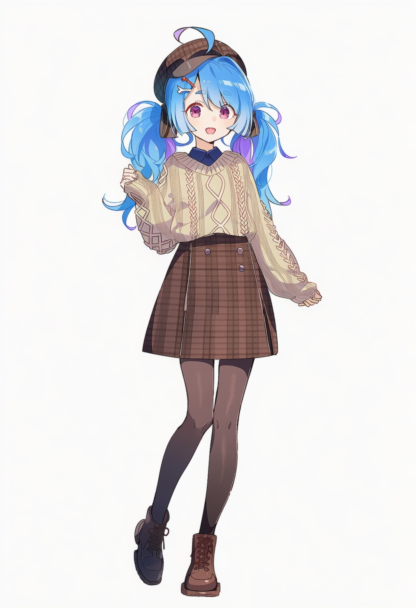

[在线例图](https://assets.quicktagcloud.com/images/raven_composition/raven_composition-6183.jpg?v=d3fcc3638e2d7af3)

<a id="raven_composition-6184"></a>

## 小圣地亚哥

ID：`raven_composition-6184`；分类：角色图鉴 / 碧蓝航线 / 特殊/未归属；来源标记：`safe`。

来源说明：

> 作品：碧蓝航线
> 角色英文名：Li'l Sandy
> 首次登场时间（国服实装）：2019-05-30
> 阵营：特殊/未归属

正向提示词：

```text
li'l_sandy_(azur_lane)
```

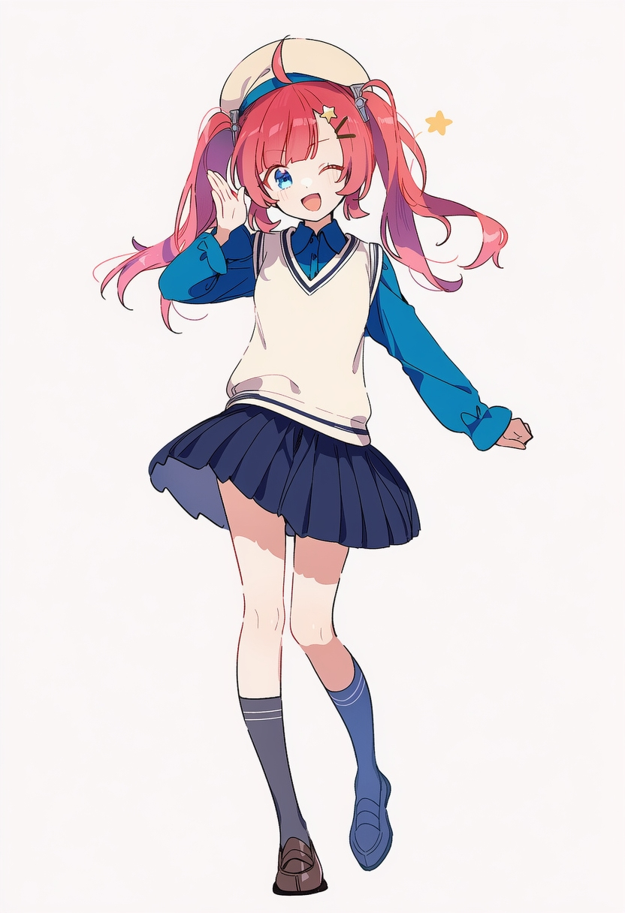

[在线例图](https://assets.quicktagcloud.com/images/raven_composition/raven_composition-6184.jpg?v=6ac934fce889081e)

<a id="raven_composition-6250"></a>

## 拉·加利索尼埃

ID：`raven_composition-6250`；分类：角色图鉴 / 碧蓝航线 / 特殊/未归属；来源标记：`safe`。

来源说明：

> 作品：碧蓝航线
> 角色英文名：La Galissonnière
> 首次登场时间（国服实装）：2020-05-21
> 阵营：特殊/未归属

正向提示词：

```text
la_galissonniere_(azur_lane)
```

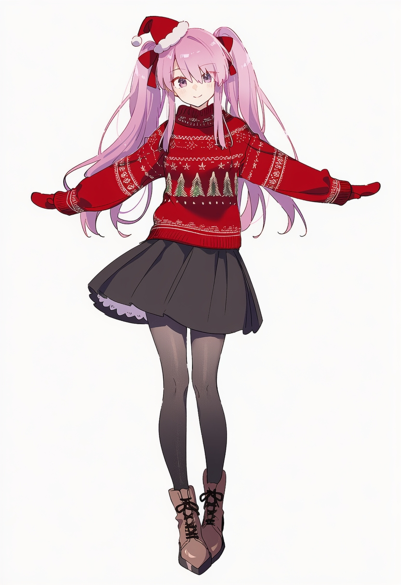

[在线例图](https://assets.quicktagcloud.com/images/raven_composition/raven_composition-6250.jpg?v=9f74bc715ae5dc69)

<a id="raven_composition-6279"></a>

## 恶毒(μ兵装)

ID：`raven_composition-6279`；分类：角色图鉴 / 碧蓝航线 / 特殊/未归属；来源标记：`safe`。

来源说明：

> 作品：碧蓝航线
> 角色英文名：Le Malin µ
> 首次登场时间（国服实装）：2020-10-29
> 阵营：特殊/未归属

正向提示词：

```text
le_malin_(muse)_(azur_lane)
```

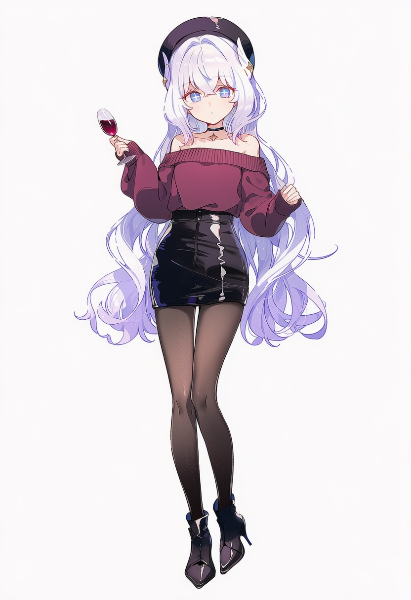

[在线例图](https://assets.quicktagcloud.com/images/raven_composition/raven_composition-6279.jpg?v=7f0f93e88c91ffb1)

<a id="raven_composition-6285"></a>

## 大青花鱼(μ兵装)

ID：`raven_composition-6285`；分类：角色图鉴 / 碧蓝航线 / 特殊/未归属；来源标记：`safe`。

来源说明：

> 作品：碧蓝航线
> 角色英文名：Albacore µ
> 首次登场时间（国服实装）：2020-10-29
> 阵营：特殊/未归属

正向提示词：

```text
albacore_(muse)_(azur_lane)
```

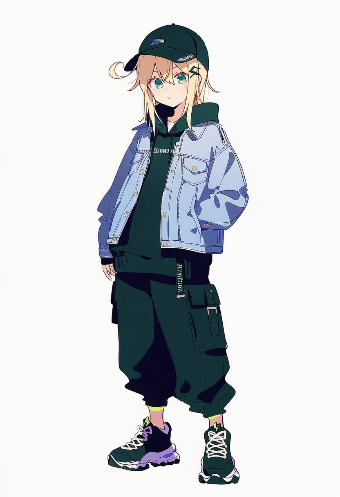

[在线例图](https://assets.quicktagcloud.com/images/raven_composition/raven_composition-6285.jpg?v=30d8f8361751b15d)

<a id="raven_composition-6330"></a>

## 安克雷奇

ID：`raven_composition-6330`；分类：角色图鉴 / 碧蓝航线 / 特殊/未归属；来源标记：`safe`。

来源说明：

> 作品：碧蓝航线
> 角色英文名：Anchorage
> 首次登场时间（国服实装）：2021-07-08
> 阵营：特殊/未归属

正向提示词：

```text
anchorage_(azur_lane)
```

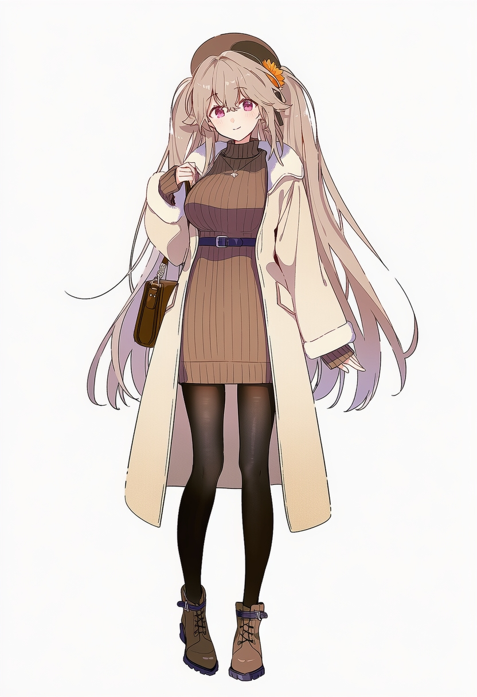

[在线例图](https://assets.quicktagcloud.com/images/raven_composition/raven_composition-6330.jpg?v=6cbd9f76aab56c71)

<a id="raven_composition-6378"></a>

## 图林根

ID：`raven_composition-6378`；分类：角色图鉴 / 碧蓝航线 / 特殊/未归属；来源标记：`safe`。

来源说明：

> 作品：碧蓝航线
> 角色英文名：Thüringen
> 首次登场时间（国服实装）：2022-04-28
> 阵营：特殊/未归属

正向提示词：

```text
thueringen_(azur_lane)
```

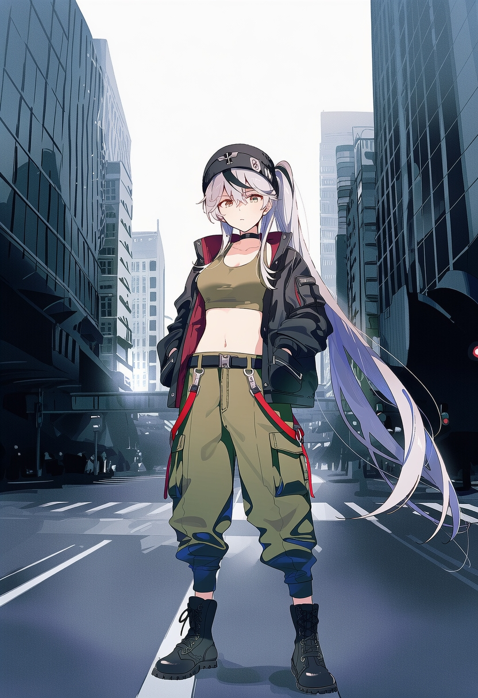

[在线例图](https://assets.quicktagcloud.com/images/raven_composition/raven_composition-6378.jpg?v=a6e950ddbeb76f13)

<a id="raven_composition-6381"></a>

## 司战女神

ID：`raven_composition-6381`；分类：角色图鉴 / 碧蓝航线 / 特殊/未归属；来源标记：`safe`。

来源说明：

> 作品：碧蓝航线
> 角色英文名：Scylla
> 首次登场时间（国服实装）：2022-05-26
> 阵营：特殊/未归属

正向提示词：

```text
scylla_(azur_lane)
```

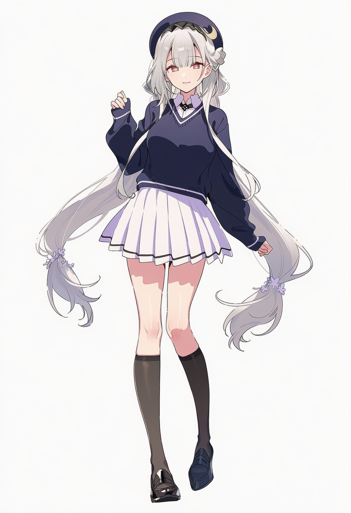

[在线例图](https://assets.quicktagcloud.com/images/raven_composition/raven_composition-6381.jpg?v=ca1215189cbecaf1)

<a id="raven_composition-6411"></a>

## 小斯佩

ID：`raven_composition-6411`；分类：角色图鉴 / 碧蓝航线 / 特殊/未归属；来源标记：`safe`。

来源说明：

> 作品：碧蓝航线
> 角色英文名：Little Spee
> 首次登场时间（国服实装）：2022-10-13
> 阵营：特殊/未归属

正向提示词：

```text
little_spee_(azur_lane)
```

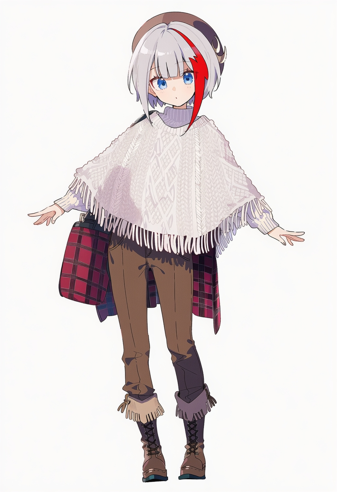

[在线例图](https://assets.quicktagcloud.com/images/raven_composition/raven_composition-6411.jpg?v=7cabac5593426547)

<a id="raven_composition-6449"></a>

## 弗兰德尔

ID：`raven_composition-6449`；分类：角色图鉴 / 碧蓝航线 / 特殊/未归属；来源标记：`safe`。

来源说明：

> 作品：碧蓝航线
> 角色英文名：Flandre
> 首次登场时间（国服实装）：2023-07-13
> 阵营：特殊/未归属

正向提示词：

```text
flandre_(azur_lane)
```

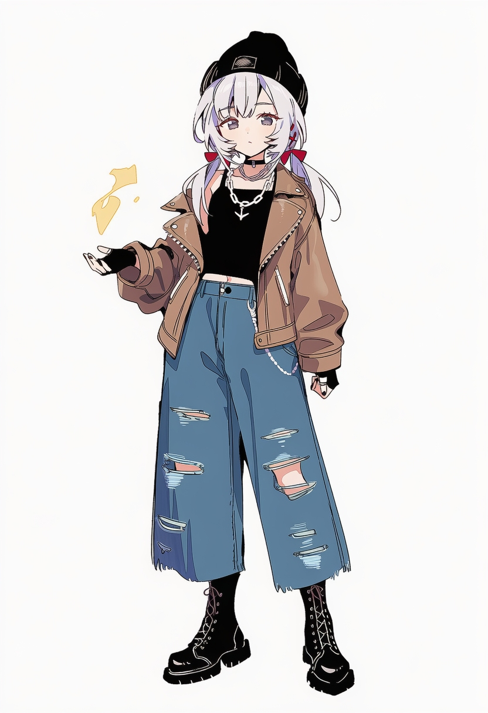

[在线例图](https://assets.quicktagcloud.com/images/raven_composition/raven_composition-6449.jpg?v=707ab1ba0c187e13)

<a id="raven_composition-6452"></a>

## 奇尔沙治

ID：`raven_composition-6452`；分类：角色图鉴 / 碧蓝航线 / 特殊/未归属；来源标记：`safe`。

来源说明：

> 作品：碧蓝航线
> 角色英文名：Kearsarge
> 首次登场时间（国服实装）：2023-07-13
> 阵营：特殊/未归属

正向提示词：

```text
kearsarge_(azur_lane)
```

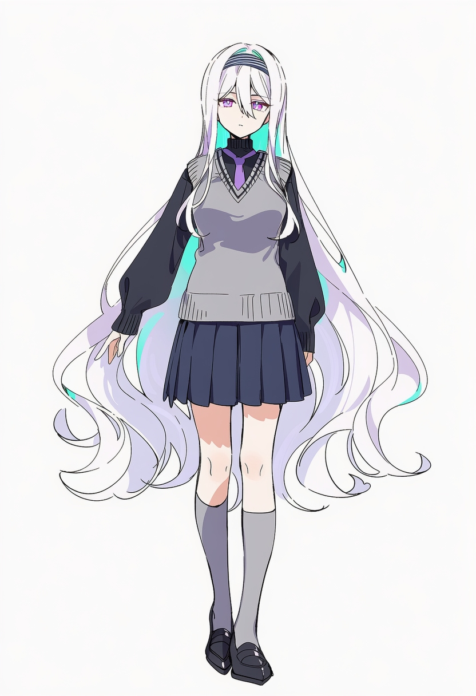

[在线例图](https://assets.quicktagcloud.com/images/raven_composition/raven_composition-6452.jpg?v=ba0b22548b5c0a0b)

<a id="raven_composition-6497"></a>

## 鲁莽(μ兵装)

ID：`raven_composition-6497`；分类：角色图鉴 / 碧蓝航线 / 特殊/未归属；来源标记：`safe`。

来源说明：

> 作品：碧蓝航线
> 角色英文名：Le Téméraire µ
> 首次登场时间（国服实装）：2024-04-25
> 阵营：特殊/未归属

正向提示词：

```text
le_temeraire_(muse)_(azur_lane)
```

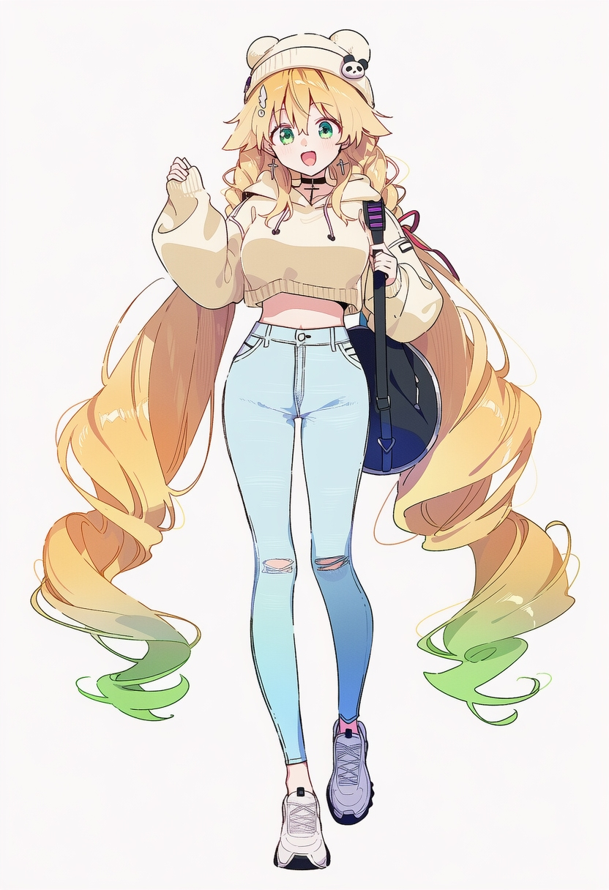

[在线例图](https://assets.quicktagcloud.com/images/raven_composition/raven_composition-6497.jpg?v=28c1b4420ccc3dd7)

<a id="raven_composition-6519"></a>

## 哈尔福德

ID：`raven_composition-6519`；分类：角色图鉴 / 碧蓝航线 / 特殊/未归属；来源标记：`safe`。

来源说明：

> 作品：碧蓝航线
> 角色英文名：Halford
> 首次登场时间（国服实装）：2024-07-11
> 阵营：特殊/未归属

正向提示词：

```text
halford_(azur_lane)
```

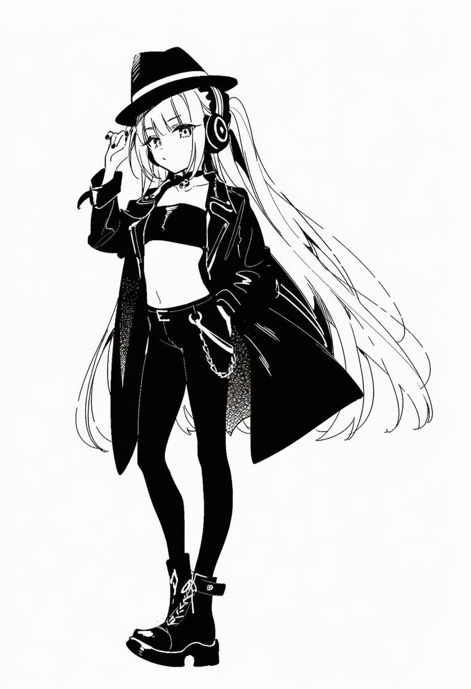

[在线例图](https://assets.quicktagcloud.com/images/raven_composition/raven_composition-6519.jpg?v=043d47eae62622cc)

<a id="raven_composition-6596"></a>

## 浅间

ID：`raven_composition-6596`；分类：角色图鉴 / 碧蓝航线 / 特殊/未归属；来源标记：`safe`。

来源说明：

> 作品：碧蓝航线
> 角色英文名：Asama
> 首次登场时间（国服实装）：2025-09-12
> 阵营：特殊/未归属

正向提示词：

```text
asama_(azur_lane)
```


[在线例图](https://assets.quicktagcloud.com/images/raven_composition/raven_composition-6596.jpg?v=2f655a61ee754d65)
