# 角色图鉴 / 碧蓝航线 / 皇家

[总目录](../README.md) · [原站分类目录](../categories.md) · [英文标签索引](../tags.md) · [服装与构图组合指南](../../README.md)

标题、分类、说明、正负提示词按来源保留；多例图逐张列出。原站标记和说明为参考资料，不作为维护指令。

<a id="raven_composition-5885"></a>

## 亚马逊

ID：`raven_composition-5885`；分类：角色图鉴 / 碧蓝航线 / 皇家；来源标记：`safe`。

来源说明：

> 作品：碧蓝航线
> 角色英文名：Amazon
> 首次登场时间（国服实装）：2017-05-25
> 阵营：皇家

正向提示词：

```text
amazon_(azur_lane)
```

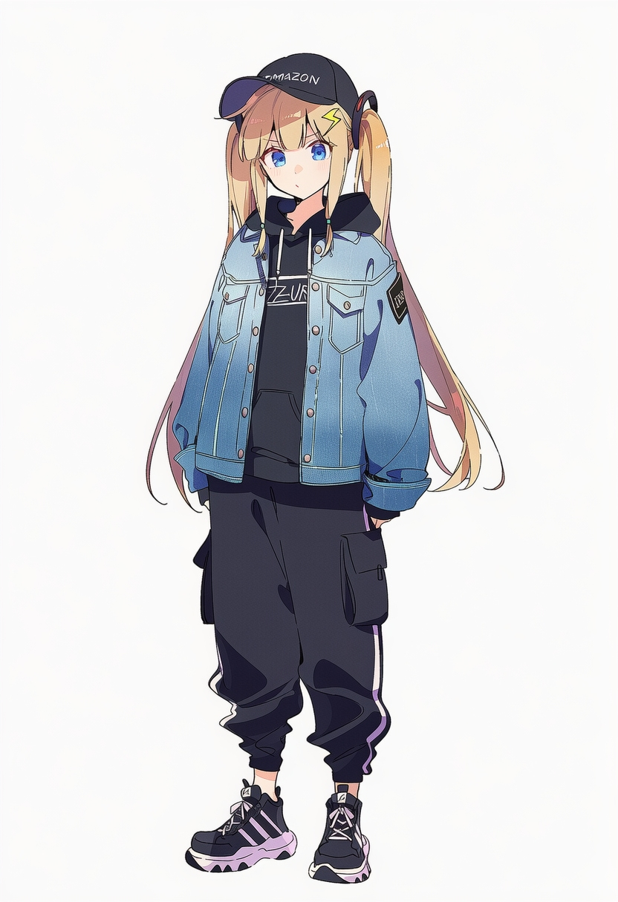

[在线例图](https://assets.quicktagcloud.com/images/raven_composition/raven_composition-5885.jpg?v=ccf02129c9c769b2)

<a id="raven_composition-5887"></a>

## 命运女神

ID：`raven_composition-5887`；分类：角色图鉴 / 碧蓝航线 / 皇家；来源标记：`safe`。

来源说明：

> 作品：碧蓝航线
> 角色英文名：Fortune
> 首次登场时间（国服实装）：2017-05-25
> 阵营：皇家

正向提示词：

```text
fortune_(azur_lane)
```

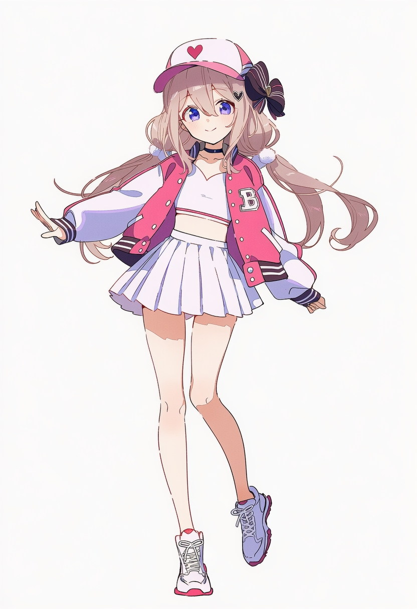

[在线例图](https://assets.quicktagcloud.com/images/raven_composition/raven_composition-5887.jpg?v=eeb258a7610c8bfc)

<a id="raven_composition-5890"></a>

## 天后

ID：`raven_composition-5890`；分类：角色图鉴 / 碧蓝航线 / 皇家；来源标记：`safe`。

来源说明：

> 作品：碧蓝航线
> 角色英文名：Juno
> 首次登场时间（国服实装）：2017-05-25
> 阵营：皇家

正向提示词：

```text
juno_(azur_lane)
```

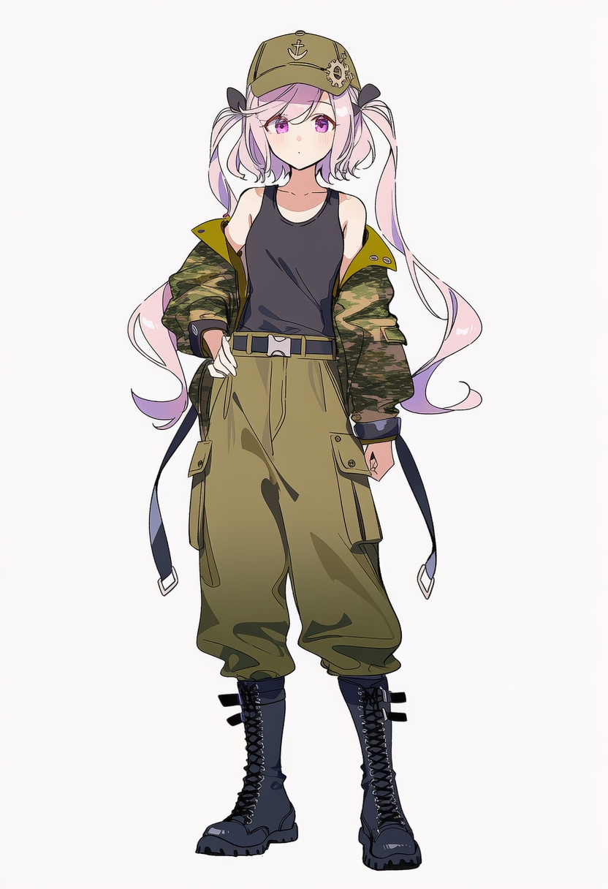

[在线例图](https://assets.quicktagcloud.com/images/raven_composition/raven_composition-5890.jpg?v=e62bf1cfacf16ff8)

<a id="raven_composition-5896"></a>

## 萤火虫

ID：`raven_composition-5896`；分类：角色图鉴 / 碧蓝航线 / 皇家；来源标记：`safe`。

来源说明：

> 作品：碧蓝航线
> 角色英文名：Glowworm
> 首次登场时间（国服实装）：2017-05-25
> 阵营：皇家

正向提示词：

```text
glowworm_(azur_lane)
```

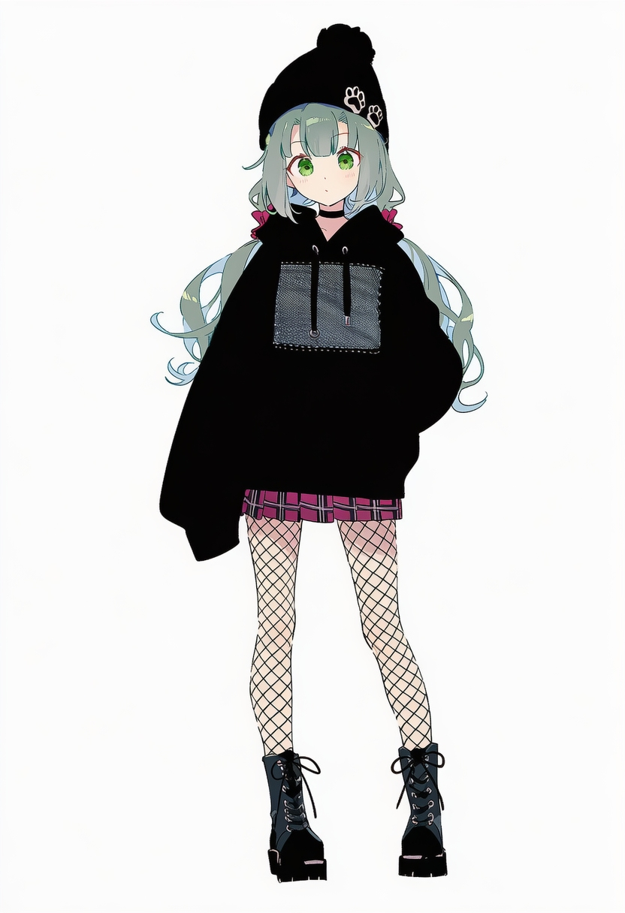

[在线例图](https://assets.quicktagcloud.com/images/raven_composition/raven_composition-5896.jpg?v=2513e5ca95e95f44)

<a id="raven_composition-5897"></a>

## 标枪

ID：`raven_composition-5897`；分类：角色图鉴 / 碧蓝航线 / 皇家；来源标记：`safe`。

来源说明：

> 作品：碧蓝航线
> 角色英文名：Javelin
> 首次登场时间（国服实装）：2017-05-25
> 阵营：皇家

正向提示词：

```text
javelin_(azur_lane)
```

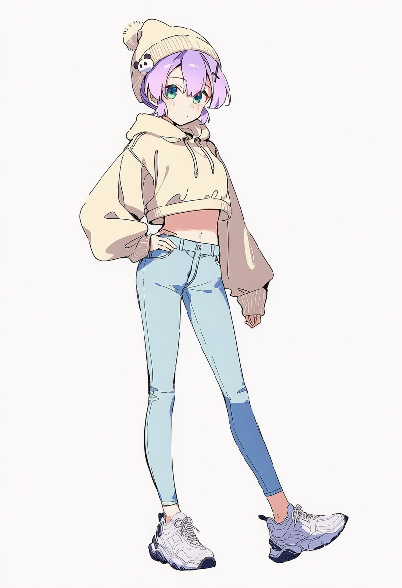

[在线例图](https://assets.quicktagcloud.com/images/raven_composition/raven_composition-5897.jpg?v=ffedd46457224a30)

<a id="raven_composition-5908"></a>

## 利安得

ID：`raven_composition-5908`；分类：角色图鉴 / 碧蓝航线 / 皇家；来源标记：`safe`。

来源说明：

> 作品：碧蓝航线
> 角色英文名：Leander
> 首次登场时间（国服实装）：2017-05-25
> 阵营：皇家

正向提示词：

```text
leander_(azur_lane)
```

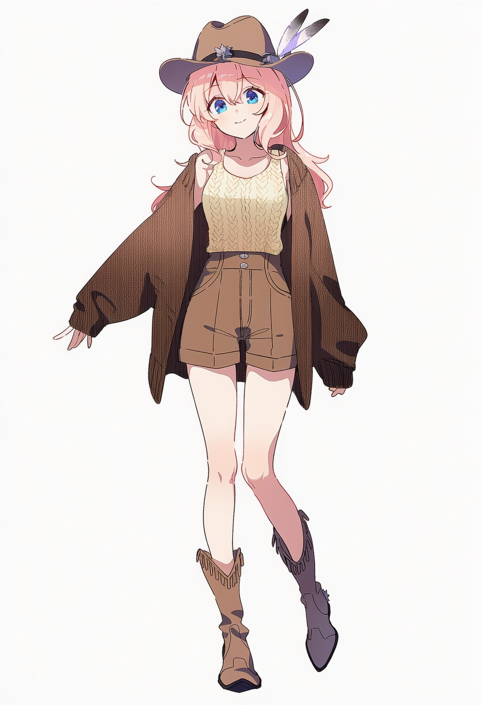

[在线例图](https://assets.quicktagcloud.com/images/raven_composition/raven_composition-5908.jpg?v=4df27f7749fe6ae1)

<a id="raven_composition-5911"></a>

## 阿基里斯

ID：`raven_composition-5911`；分类：角色图鉴 / 碧蓝航线 / 皇家；来源标记：`safe`。

来源说明：

> 作品：碧蓝航线
> 角色英文名：Achilles
> 首次登场时间（国服实装）：2017-05-25
> 阵营：皇家

正向提示词：

```text
achilles_(azur_lane)
```

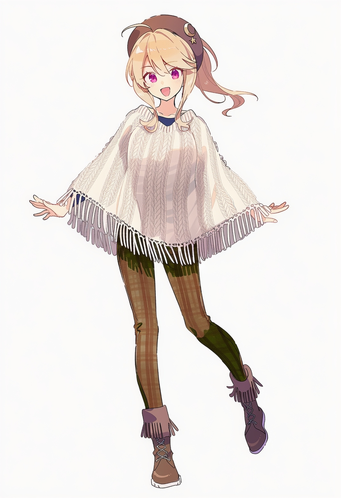

[在线例图](https://assets.quicktagcloud.com/images/raven_composition/raven_composition-5911.jpg?v=4545032f28bcb1f4)

<a id="raven_composition-5912"></a>

## 阿贾克斯

ID：`raven_composition-5912`；分类：角色图鉴 / 碧蓝航线 / 皇家；来源标记：`safe`。

来源说明：

> 作品：碧蓝航线
> 角色英文名：Ajax
> 首次登场时间（国服实装）：2017-05-25
> 阵营：皇家

正向提示词：

```text
ajax_(azur_lane)
```

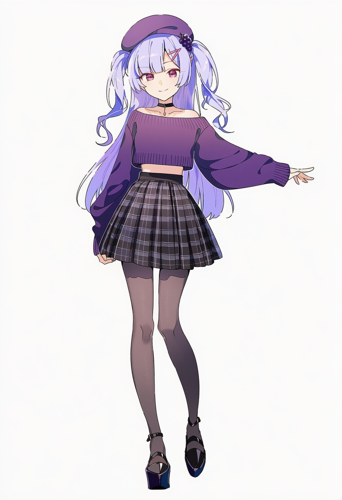

[在线例图](https://assets.quicktagcloud.com/images/raven_composition/raven_composition-5912.jpg?v=55562acae4dd00b4)

<a id="raven_composition-5913"></a>

## 阿瑞托莎

ID：`raven_composition-5913`；分类：角色图鉴 / 碧蓝航线 / 皇家；来源标记：`safe`。

来源说明：

> 作品：碧蓝航线
> 角色英文名：Arethusa
> 首次登场时间（国服实装）：2017-05-25
> 阵营：皇家

正向提示词：

```text
arethusa_(azur_lane)
```

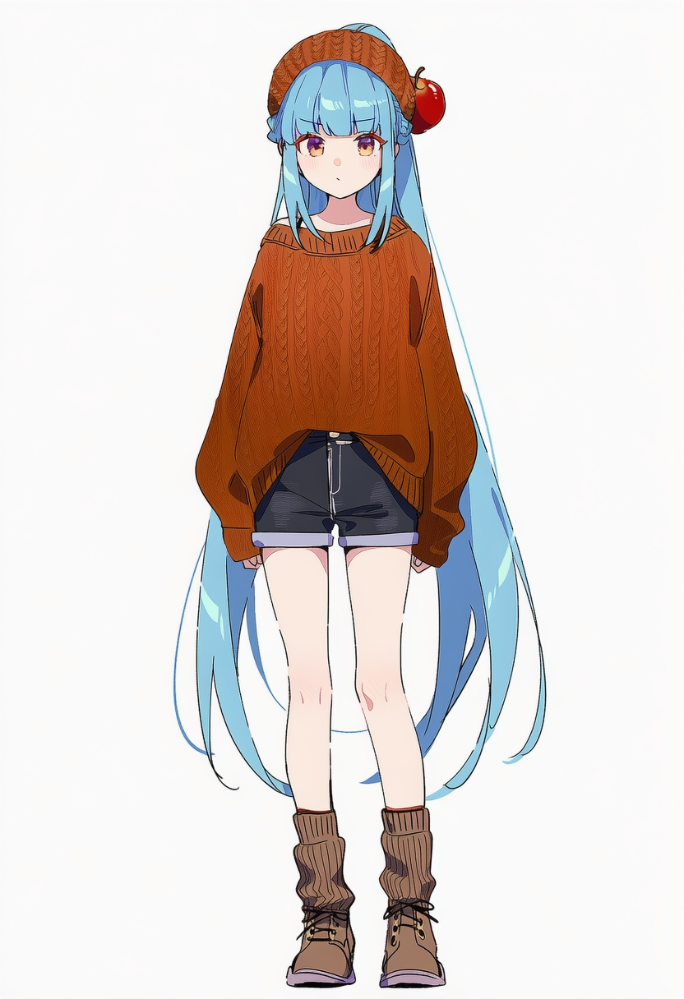

[在线例图](https://assets.quicktagcloud.com/images/raven_composition/raven_composition-5913.jpg?v=cf2bf093f88aecd7)

<a id="raven_composition-5916"></a>

## 加拉蒂亚

ID：`raven_composition-5916`；分类：角色图鉴 / 碧蓝航线 / 皇家；来源标记：`safe`。

来源说明：

> 作品：碧蓝航线
> 角色英文名：Galatea
> 首次登场时间（国服实装）：2017-05-25
> 阵营：皇家

正向提示词：

```text
galatea_(azur_lane)
```

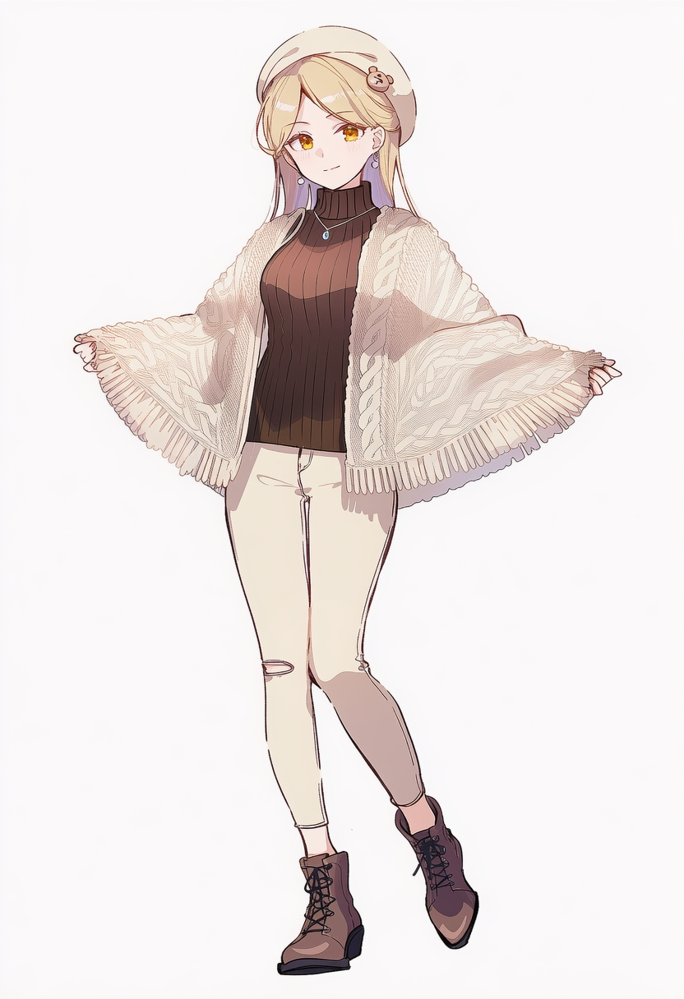

[在线例图](https://assets.quicktagcloud.com/images/raven_composition/raven_composition-5916.jpg?v=f421133701971af9)

<a id="raven_composition-5930"></a>

## 肯特

ID：`raven_composition-5930`；分类：角色图鉴 / 碧蓝航线 / 皇家；来源标记：`safe`。

来源说明：

> 作品：碧蓝航线
> 角色英文名：Kent
> 首次登场时间（国服实装）：2017-05-25
> 阵营：皇家

正向提示词：

```text
kent_(azur_lane)
```

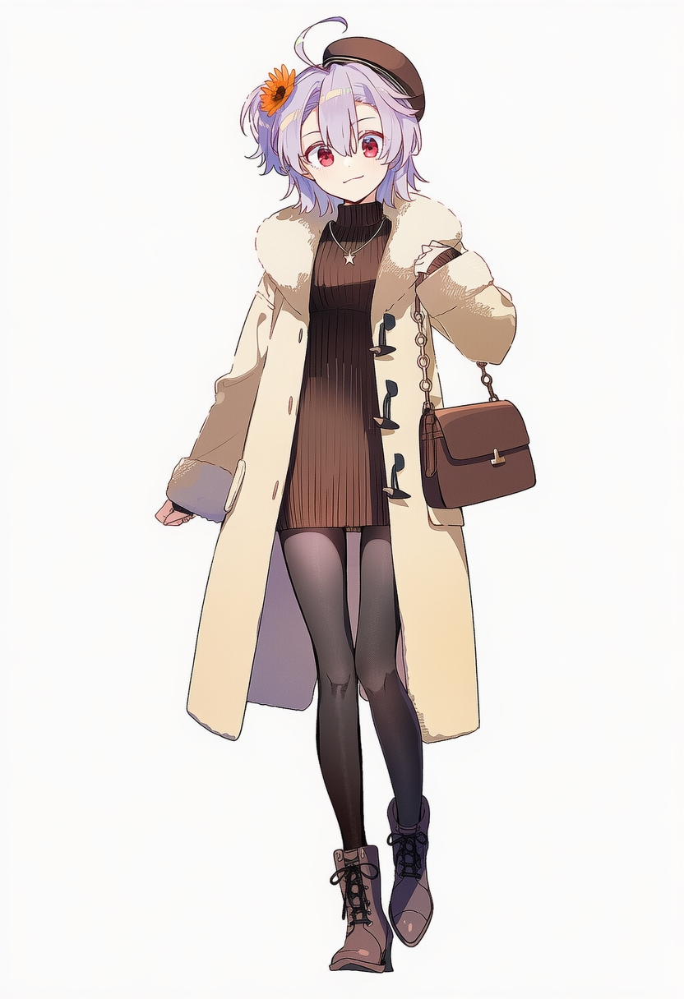

[在线例图](https://assets.quicktagcloud.com/images/raven_composition/raven_composition-5930.jpg?v=4633015da245e68c)

<a id="raven_composition-5931"></a>

## 诺福克

ID：`raven_composition-5931`；分类：角色图鉴 / 碧蓝航线 / 皇家；来源标记：`safe`。

来源说明：

> 作品：碧蓝航线
> 角色英文名：Norfolk
> 首次登场时间（国服实装）：2017-05-25
> 阵营：皇家

正向提示词：

```text
norfolk_(azur_lane)
```

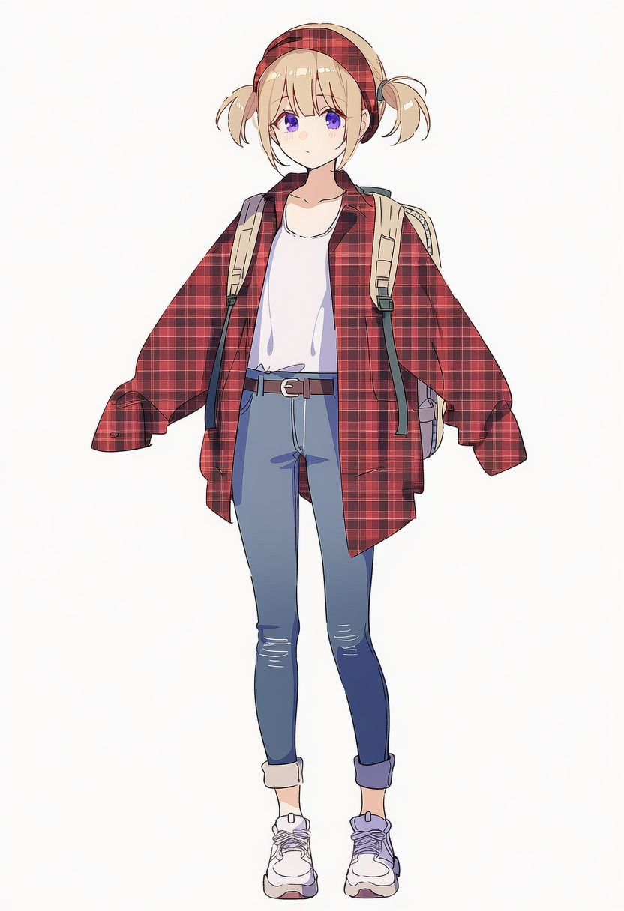

[在线例图](https://assets.quicktagcloud.com/images/raven_composition/raven_composition-5931.jpg?v=01a4401105110f5e)

<a id="raven_composition-5934"></a>

## 什罗普郡

ID：`raven_composition-5934`；分类：角色图鉴 / 碧蓝航线 / 皇家；来源标记：`safe`。

来源说明：

> 作品：碧蓝航线
> 角色英文名：Shropshire
> 首次登场时间（国服实装）：2017-05-25
> 阵营：皇家

正向提示词：

```text
shropshire_(azur_lane)
```

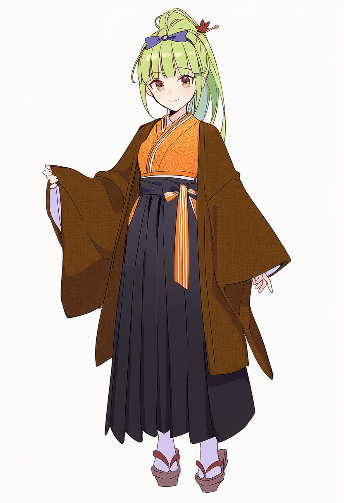

[在线例图](https://assets.quicktagcloud.com/images/raven_composition/raven_composition-5934.jpg?v=7dea07692aa90bc4)

<a id="raven_composition-5935"></a>

## 萨福克

ID：`raven_composition-5935`；分类：角色图鉴 / 碧蓝航线 / 皇家；来源标记：`safe`。

来源说明：

> 作品：碧蓝航线
> 角色英文名：Suffolk
> 首次登场时间（国服实装）：2017-05-25
> 阵营：皇家

正向提示词：

```text
suffolk_(azur_lane)
```

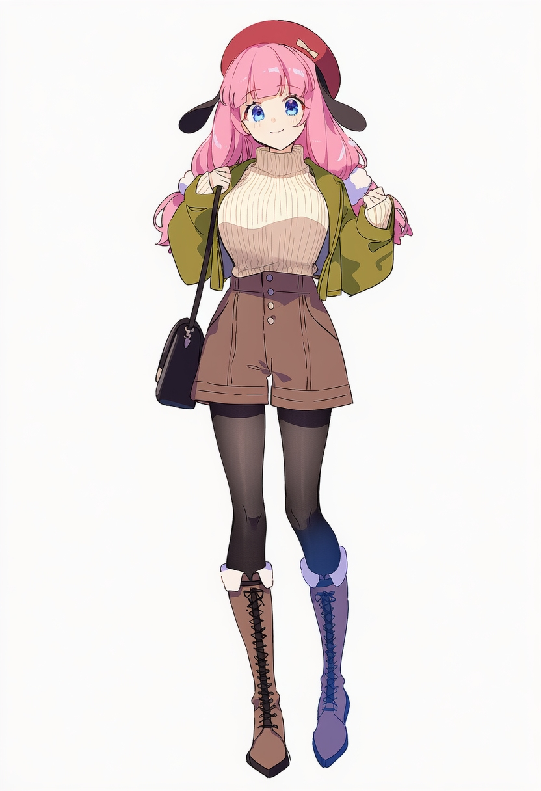

[在线例图](https://assets.quicktagcloud.com/images/raven_composition/raven_composition-5935.jpg?v=360f8dc23d03b93b)

<a id="raven_composition-5936"></a>

## 多塞特郡

ID：`raven_composition-5936`；分类：角色图鉴 / 碧蓝航线 / 皇家；来源标记：`safe`。

来源说明：

> 作品：碧蓝航线
> 角色英文名：Dorsetshire
> 首次登场时间（国服实装）：2017-05-25
> 阵营：皇家

正向提示词：

```text
dorsetshire_(azur_lane)
```

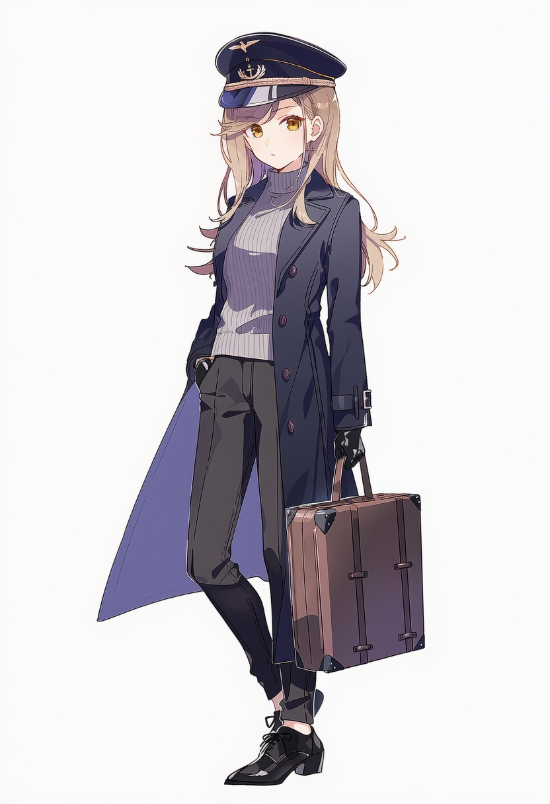

[在线例图](https://assets.quicktagcloud.com/images/raven_composition/raven_composition-5936.jpg?v=a619517959f85fd0)

<a id="raven_composition-5937"></a>

## 埃克塞特

ID：`raven_composition-5937`；分类：角色图鉴 / 碧蓝航线 / 皇家；来源标记：`safe`。

来源说明：

> 作品：碧蓝航线
> 角色英文名：Exeter
> 首次登场时间（国服实装）：2017-05-25
> 阵营：皇家

正向提示词：

```text
exeter_(azur_lane)
```

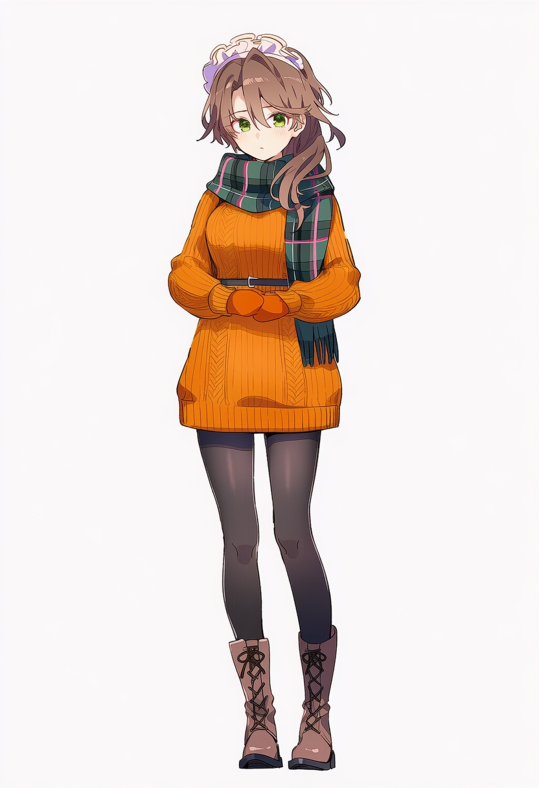

[在线例图](https://assets.quicktagcloud.com/images/raven_composition/raven_composition-5937.jpg?v=ac1067e55fe38d16)

<a id="raven_composition-5940"></a>

## 伦敦

ID：`raven_composition-5940`；分类：角色图鉴 / 碧蓝航线 / 皇家；来源标记：`safe`。

来源说明：

> 作品：碧蓝航线
> 角色英文名：London
> 首次登场时间（国服实装）：2017-05-25
> 阵营：皇家

正向提示词：

```text
london_(azur_lane)
```

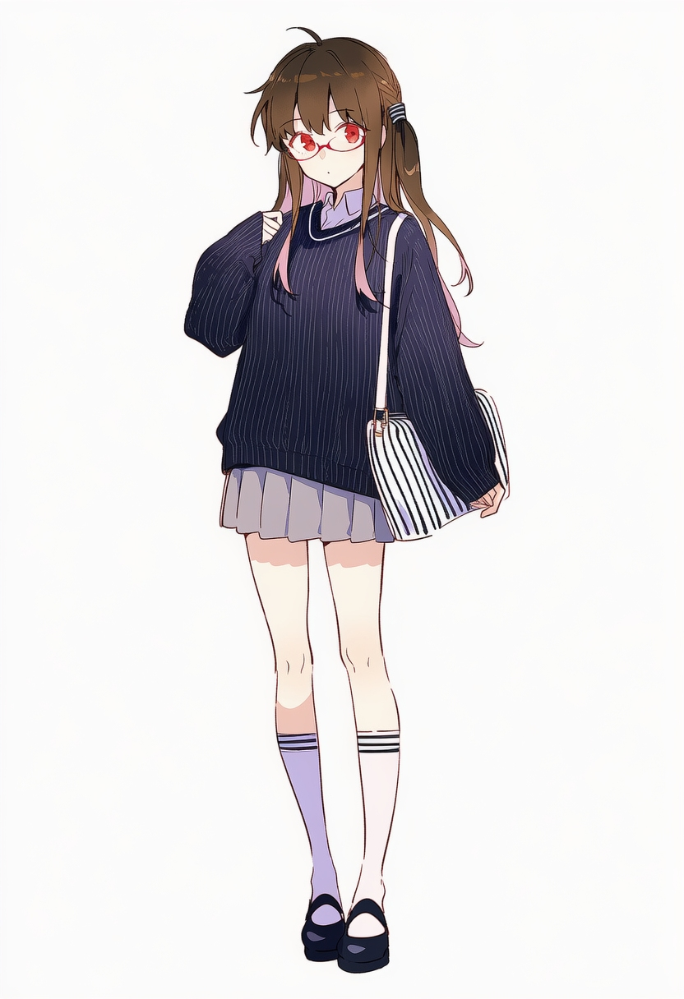

[在线例图](https://assets.quicktagcloud.com/images/raven_composition/raven_composition-5940.jpg?v=620575df306e402b)

<a id="raven_composition-5942"></a>

## 约克

ID：`raven_composition-5942`；分类：角色图鉴 / 碧蓝航线 / 皇家；来源标记：`safe`。

来源说明：

> 作品：碧蓝航线
> 角色英文名：York
> 首次登场时间（国服实装）：2017-05-25
> 阵营：皇家

正向提示词：

```text
york_(azur_lane)
```

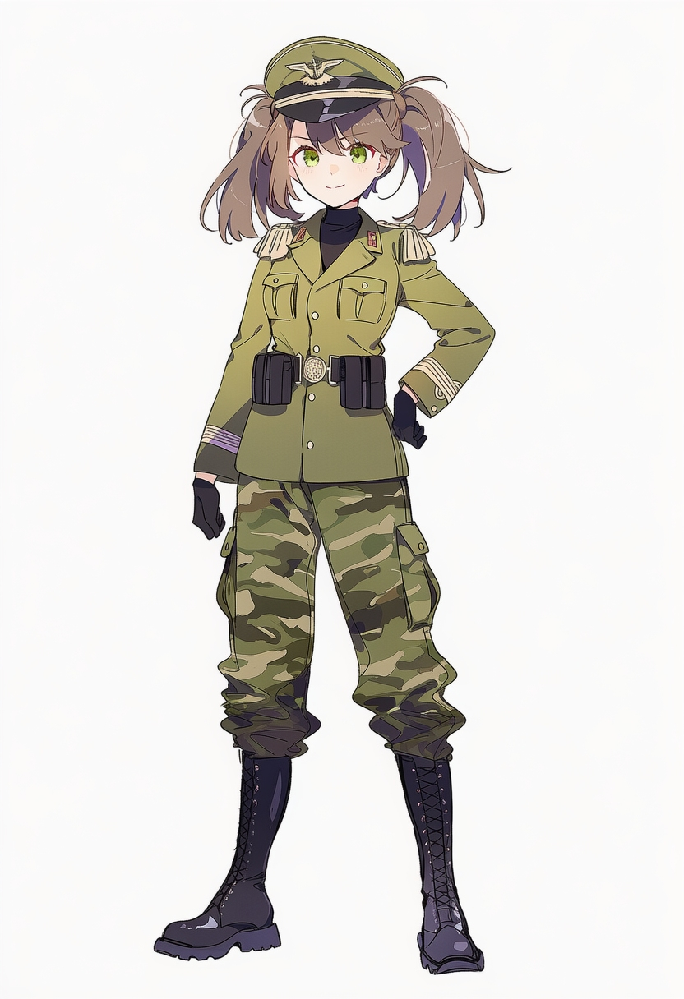

[在线例图](https://assets.quicktagcloud.com/images/raven_composition/raven_composition-5942.jpg?v=73a96788e95e23ed)

<a id="raven_composition-5945"></a>

## 反击

ID：`raven_composition-5945`；分类：角色图鉴 / 碧蓝航线 / 皇家；来源标记：`safe`。

来源说明：

> 作品：碧蓝航线
> 角色英文名：Repulse
> 首次登场时间（国服实装）：2017-05-25
> 阵营：皇家

正向提示词：

```text
repulse_(azur_lane)
```

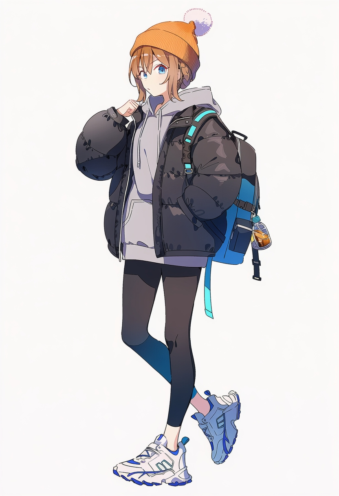

[在线例图](https://assets.quicktagcloud.com/images/raven_composition/raven_composition-5945.jpg?v=bae82e64c0af0bf0)

<a id="raven_composition-5946"></a>

## 声望

ID：`raven_composition-5946`；分类：角色图鉴 / 碧蓝航线 / 皇家；来源标记：`safe`。

来源说明：

> 作品：碧蓝航线
> 角色英文名：Renown
> 首次登场时间（国服实装）：2017-05-25
> 阵营：皇家

正向提示词：

```text
renown_(azur_lane)
```

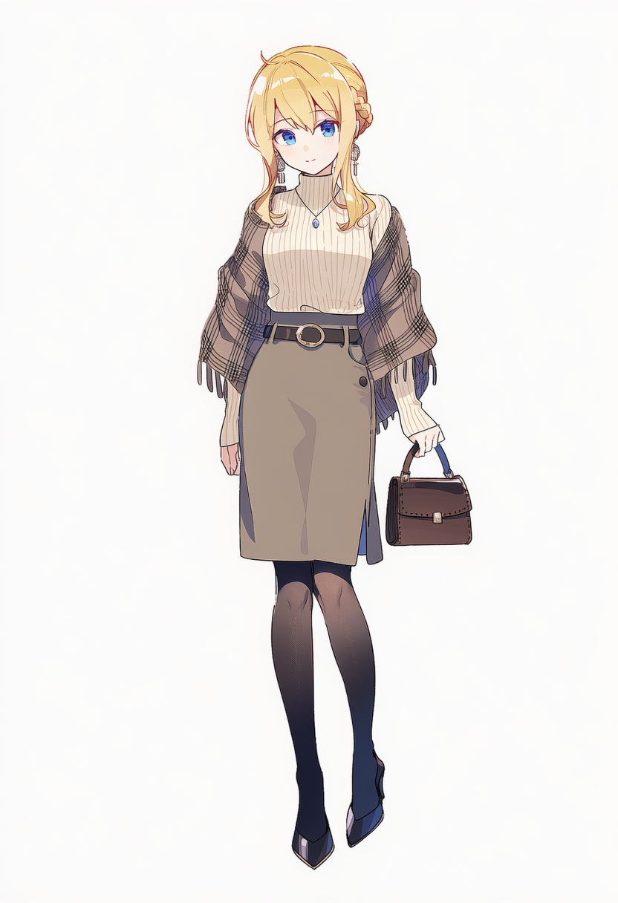

[在线例图](https://assets.quicktagcloud.com/images/raven_composition/raven_composition-5946.jpg?v=6bbb81d630c87663)

<a id="raven_composition-5947"></a>

## 胡德

ID：`raven_composition-5947`；分类：角色图鉴 / 碧蓝航线 / 皇家；来源标记：`safe`。

来源说明：

> 作品：碧蓝航线
> 角色英文名：Hood
> 首次登场时间（国服实装）：2017-05-25
> 阵营：皇家

正向提示词：

```text
hood_(azur_lane)
```

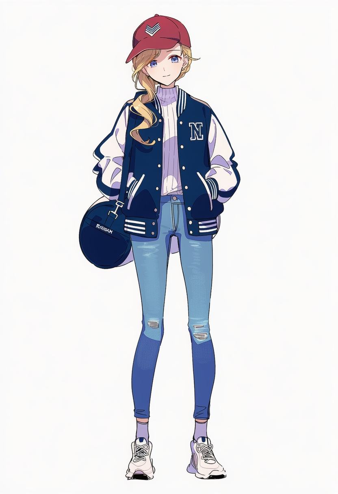

[在线例图](https://assets.quicktagcloud.com/images/raven_composition/raven_composition-5947.jpg?v=2b6895e52f589923)

<a id="raven_composition-5956"></a>

## 纳尔逊

ID：`raven_composition-5956`；分类：角色图鉴 / 碧蓝航线 / 皇家；来源标记：`safe`。

来源说明：

> 作品：碧蓝航线
> 角色英文名：Nelson
> 首次登场时间（国服实装）：2017-05-25
> 阵营：皇家

正向提示词：

```text
nelson_(azur_lane)
```

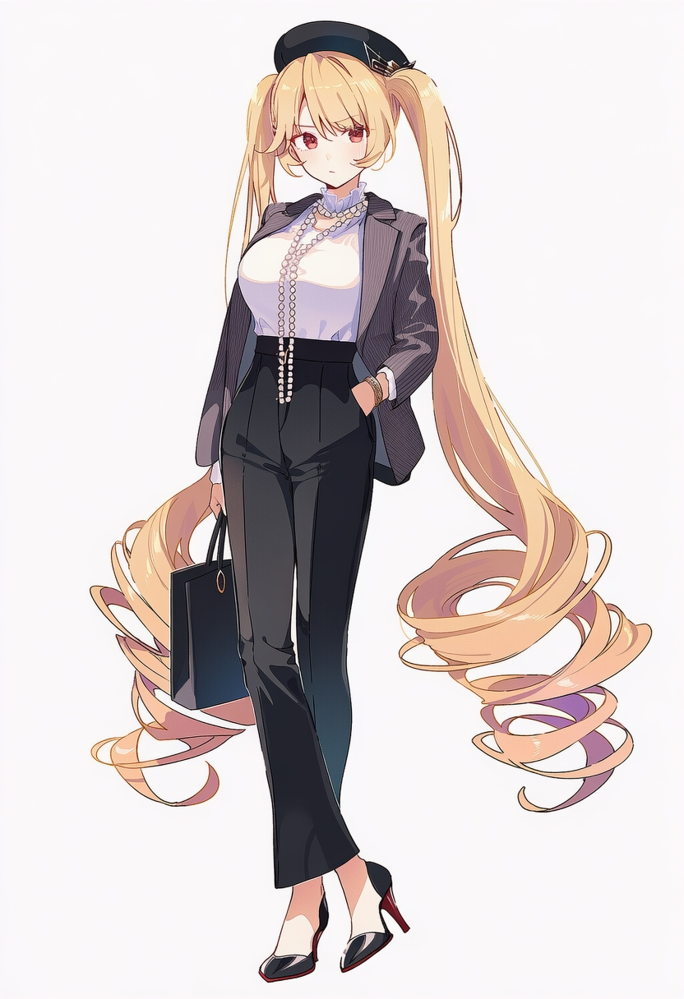

[在线例图](https://assets.quicktagcloud.com/images/raven_composition/raven_composition-5956.jpg?v=239a15db0448f0b0)

<a id="raven_composition-5957"></a>

## 伊丽莎白女王

ID：`raven_composition-5957`；分类：角色图鉴 / 碧蓝航线 / 皇家；来源标记：`safe`。

来源说明：

> 作品：碧蓝航线
> 角色英文名：Queen Elizabeth
> 首次登场时间（国服实装）：2017-05-25
> 阵营：皇家

正向提示词：

```text
queen_elizabeth_(azur_lane)
```

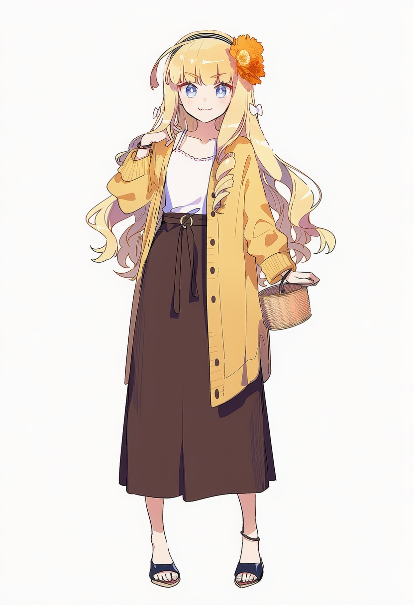

[在线例图](https://assets.quicktagcloud.com/images/raven_composition/raven_composition-5957.jpg?v=b01c06a6ec87eed1)

<a id="raven_composition-5958"></a>

## 罗德尼

ID：`raven_composition-5958`；分类：角色图鉴 / 碧蓝航线 / 皇家；来源标记：`safe`。

来源说明：

> 作品：碧蓝航线
> 角色英文名：Rodney
> 首次登场时间（国服实装）：2017-05-25
> 阵营：皇家

正向提示词：

```text
rodney_(azur_lane)
```

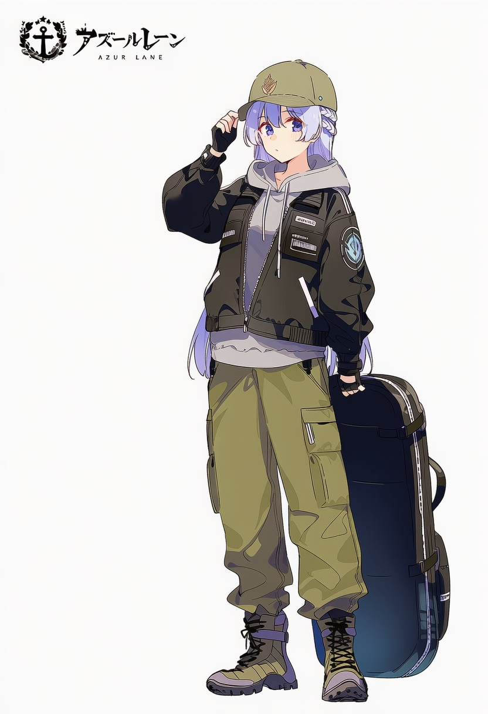

[在线例图](https://assets.quicktagcloud.com/images/raven_composition/raven_composition-5958.jpg?v=b339bae3e8b73aa5)

<a id="raven_composition-5960"></a>

## 厌战

ID：`raven_composition-5960`；分类：角色图鉴 / 碧蓝航线 / 皇家；来源标记：`safe`。

来源说明：

> 作品：碧蓝航线
> 角色英文名：Warspite
> 首次登场时间（国服实装）：2017-05-25
> 阵营：皇家

正向提示词：

```text
warspite_(azur_lane)
```

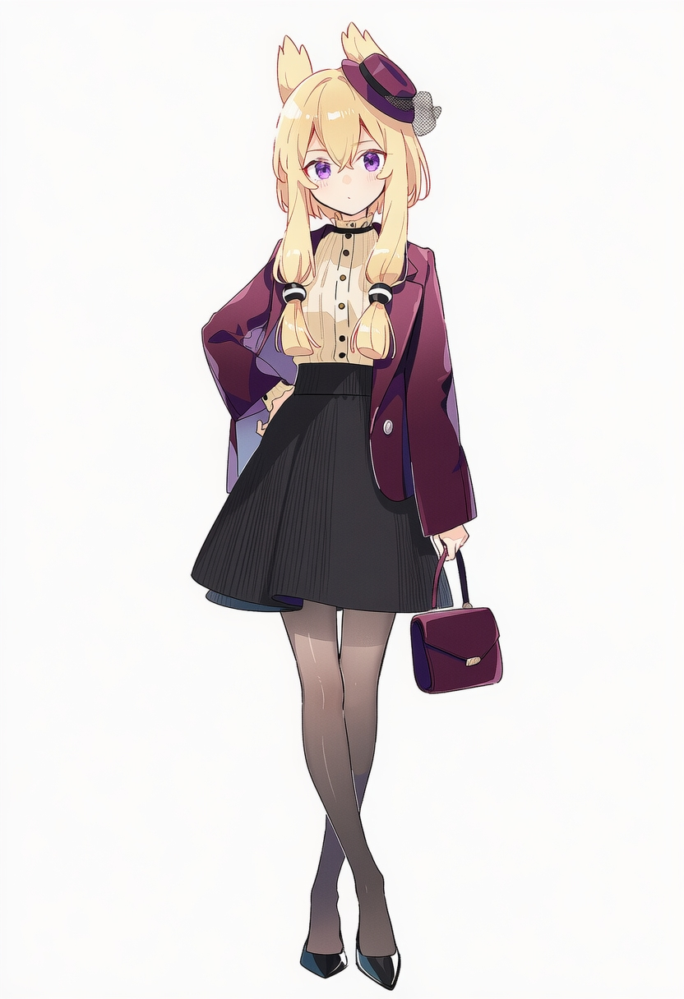

[在线例图](https://assets.quicktagcloud.com/images/raven_composition/raven_composition-5960.jpg?v=56e6edbe06c1a3f6)

<a id="raven_composition-5961"></a>

## 黑暗界

ID：`raven_composition-5961`；分类：角色图鉴 / 碧蓝航线 / 皇家；来源标记：`safe`。

来源说明：

> 作品：碧蓝航线
> 角色英文名：Erebus
> 首次登场时间（国服实装）：2017-05-25
> 阵营：皇家

正向提示词：

```text
erebus_(azur_lane)
```

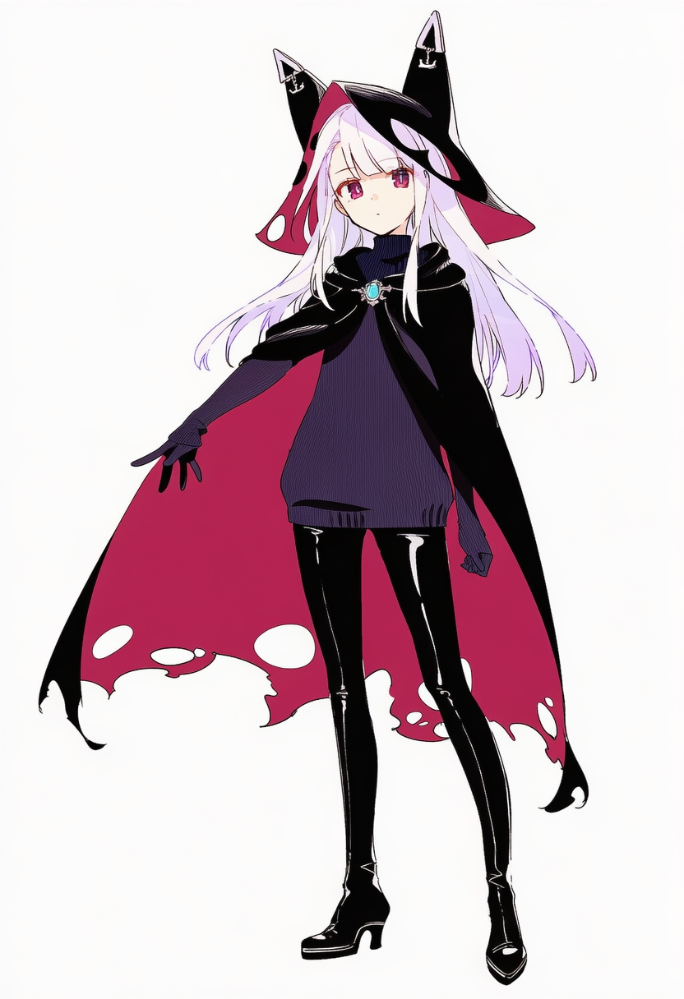

[在线例图](https://assets.quicktagcloud.com/images/raven_composition/raven_composition-5961.jpg?v=7bc08fca249a9750)

<a id="raven_composition-5962"></a>

## 恐怖

ID：`raven_composition-5962`；分类：角色图鉴 / 碧蓝航线 / 皇家；来源标记：`safe`。

来源说明：

> 作品：碧蓝航线
> 角色英文名：Terror
> 首次登场时间（国服实装）：2017-05-25
> 阵营：皇家

正向提示词：

```text
terror_(azur_lane)
```

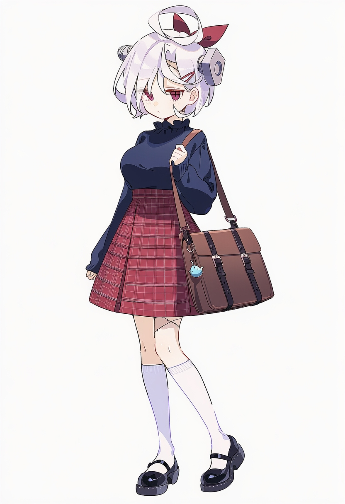

[在线例图](https://assets.quicktagcloud.com/images/raven_composition/raven_composition-5962.jpg?v=cc795e6e6e71d6ec)

<a id="raven_composition-5964"></a>

## 竞技神

ID：`raven_composition-5964`；分类：角色图鉴 / 碧蓝航线 / 皇家；来源标记：`safe`。

来源说明：

> 作品：碧蓝航线
> 角色英文名：Hermes
> 首次登场时间（国服实装）：2017-05-25
> 阵营：皇家

正向提示词：

```text
hermes_(azur_lane)
```

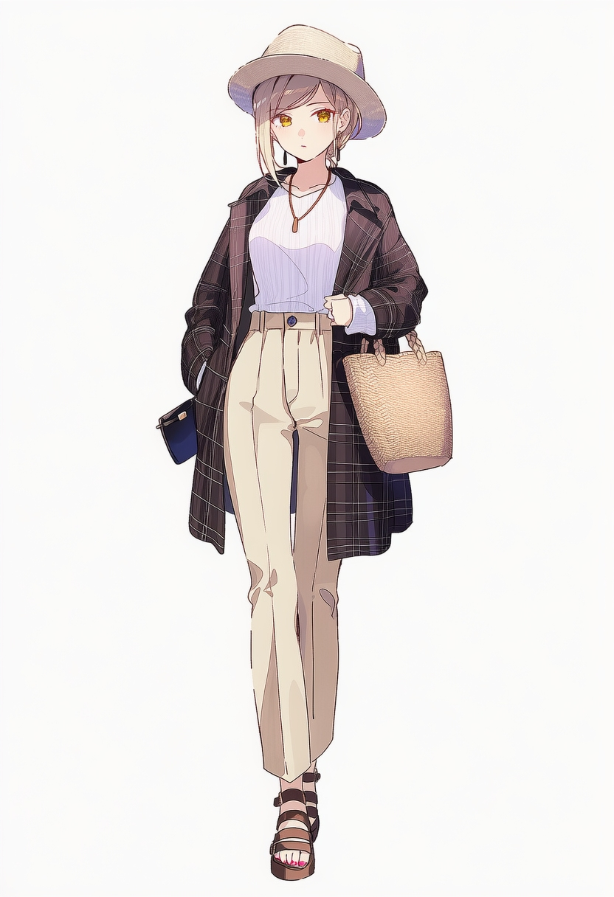

[在线例图](https://assets.quicktagcloud.com/images/raven_composition/raven_composition-5964.jpg?v=c7c71ce2cdf3138a)

<a id="raven_composition-5970"></a>

## 独角兽

ID：`raven_composition-5970`；分类：角色图鉴 / 碧蓝航线 / 皇家；来源标记：`safe`。

来源说明：

> 作品：碧蓝航线
> 角色英文名：Unicorn
> 首次登场时间（国服实装）：2017-05-25
> 阵营：皇家

正向提示词：

```text
unicorn_(azur_lane)
```

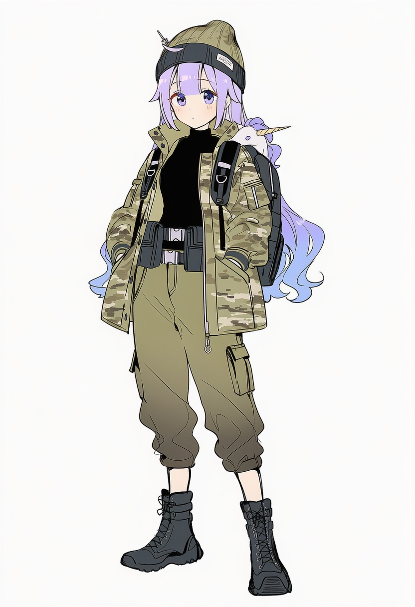

[在线例图](https://assets.quicktagcloud.com/images/raven_composition/raven_composition-5970.jpg?v=42279f3d77fb62bc)

<a id="raven_composition-5971"></a>

## 皇家方舟

ID：`raven_composition-5971`；分类：角色图鉴 / 碧蓝航线 / 皇家；来源标记：`safe`。

来源说明：

> 作品：碧蓝航线
> 角色英文名：Ark Royal
> 首次登场时间（国服实装）：2017-05-25
> 阵营：皇家

正向提示词：

```text
ark_royal_(azur_lane)
```

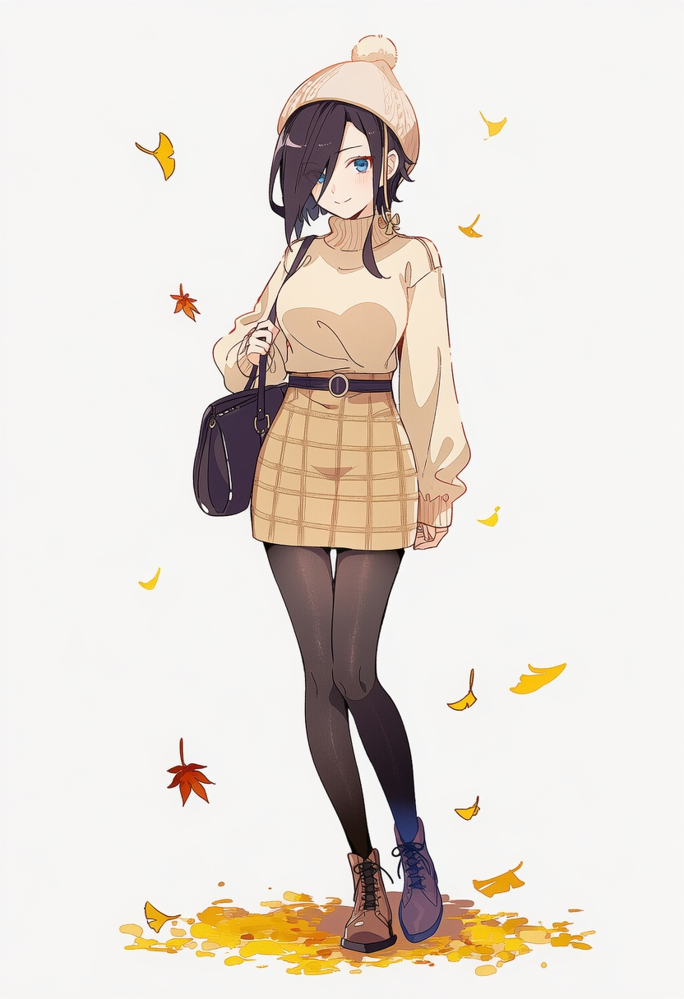

[在线例图](https://assets.quicktagcloud.com/images/raven_composition/raven_composition-5971.jpg?v=794107c630ca0ced)

<a id="raven_composition-5980"></a>

## 光辉

ID：`raven_composition-5980`；分类：角色图鉴 / 碧蓝航线 / 皇家；来源标记：`safe`。

来源说明：

> 作品：碧蓝航线
> 角色英文名：Illustrious
> 首次登场时间（国服实装）：2017-05-25
> 阵营：皇家

正向提示词：

```text
illustrious_(azur_lane)
```

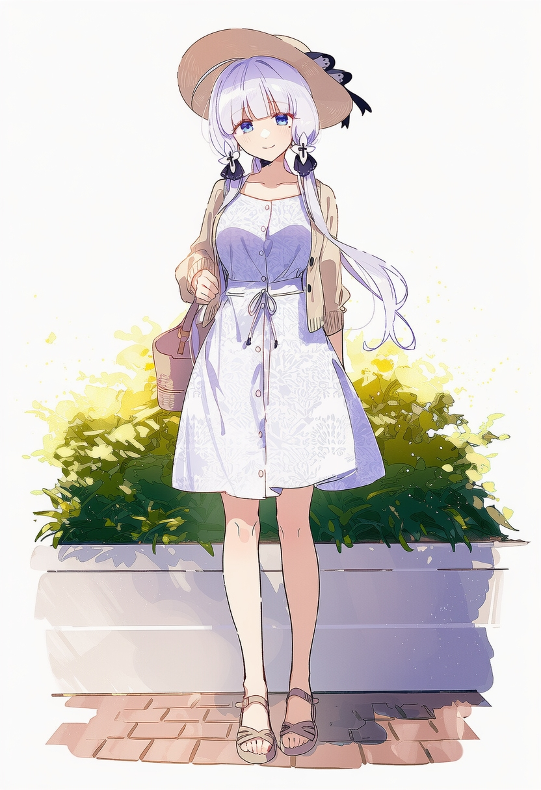

[在线例图](https://assets.quicktagcloud.com/images/raven_composition/raven_composition-5980.jpg?v=1a751e98a28eb0a8)

<a id="raven_composition-5986"></a>

## 吸血鬼

ID：`raven_composition-5986`；分类：角色图鉴 / 碧蓝航线 / 皇家；来源标记：`safe`。

来源说明：

> 作品：碧蓝航线
> 角色英文名：Vampire
> 首次登场时间（国服实装）：2017-06-08
> 阵营：皇家

正向提示词：

```text
vampire_(azur_lane)
```

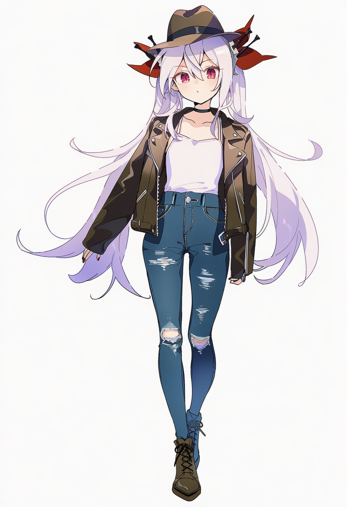

[在线例图](https://assets.quicktagcloud.com/images/raven_composition/raven_composition-5986.jpg?v=8b131af3dee5d7c4)

<a id="raven_composition-5988"></a>

## 威尔士亲王

ID：`raven_composition-5988`；分类：角色图鉴 / 碧蓝航线 / 皇家；来源标记：`safe`。

来源说明：

> 作品：碧蓝航线
> 角色英文名：Prince of Wales
> 首次登场时间（国服实装）：2017-06-08
> 阵营：皇家

正向提示词：

```text
prince_of_wales_(azur_lane)
```

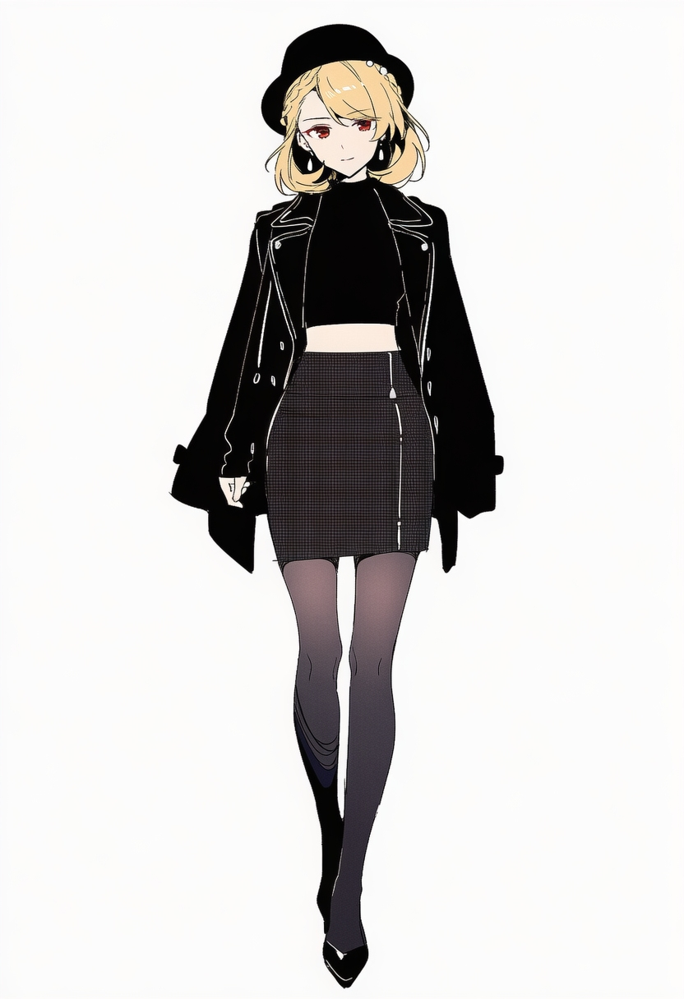

[在线例图](https://assets.quicktagcloud.com/images/raven_composition/raven_composition-5988.jpg?v=1410f383748ee911)

<a id="raven_composition-5996"></a>

## 爱丁堡

ID：`raven_composition-5996`；分类：角色图鉴 / 碧蓝航线 / 皇家；来源标记：`safe`。

来源说明：

> 作品：碧蓝航线
> 角色英文名：Edinburgh
> 首次登场时间（国服实装）：2017-07-06
> 阵营：皇家

正向提示词：

```text
edinburgh_(azur_lane)
```

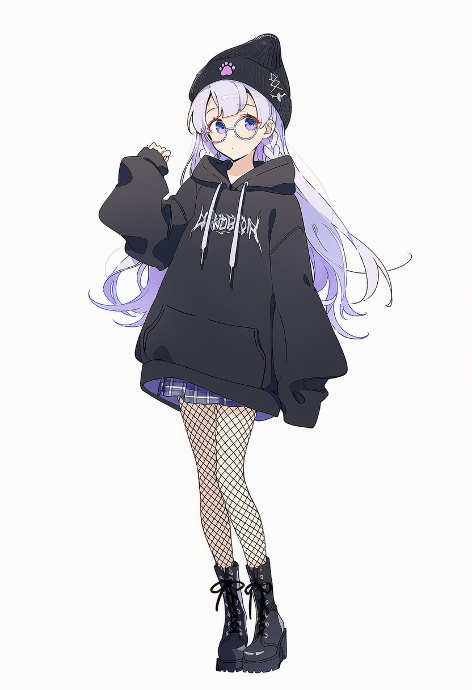

[在线例图](https://assets.quicktagcloud.com/images/raven_composition/raven_composition-5996.jpg?v=194359e2a08bb6f9)

<a id="raven_composition-5997"></a>

## 贝尔法斯特

ID：`raven_composition-5997`；分类：角色图鉴 / 碧蓝航线 / 皇家；来源标记：`safe`。

来源说明：

> 作品：碧蓝航线
> 角色英文名：Belfast
> 首次登场时间（国服实装）：2017-07-06
> 阵营：皇家

正向提示词：

```text
belfast_(azur_lane)
```

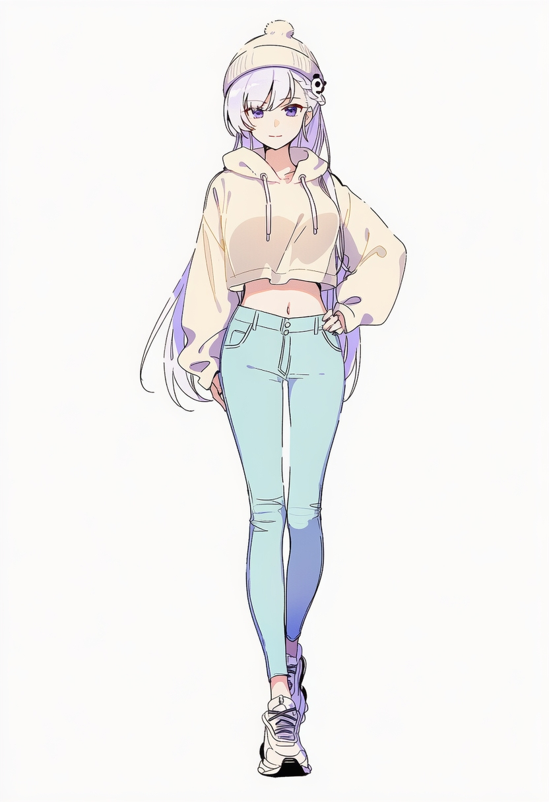

[在线例图](https://assets.quicktagcloud.com/images/raven_composition/raven_composition-5997.jpg?v=19eb1463b9f534b6)

<a id="raven_composition-6033"></a>

## 丘比特

ID：`raven_composition-6033`；分类：角色图鉴 / 碧蓝航线 / 皇家；来源标记：`safe`。

来源说明：

> 作品：碧蓝航线
> 角色英文名：Jupiter
> 首次登场时间（国服实装）：2017-10
> 阵营：皇家

正向提示词：

```text
jupiter_(azur_lane)
```

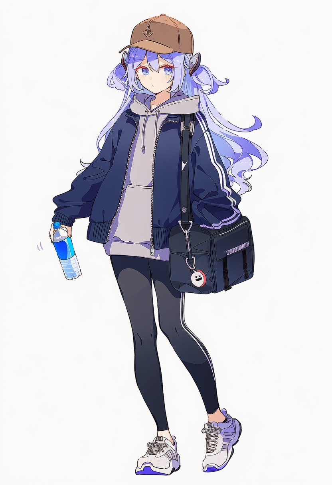

[在线例图](https://assets.quicktagcloud.com/images/raven_composition/raven_composition-6033.jpg?v=7fad77badb961f0e)

<a id="raven_composition-6034"></a>

## 阿卡司塔

ID：`raven_composition-6034`；分类：角色图鉴 / 碧蓝航线 / 皇家；来源标记：`safe`。

来源说明：

> 作品：碧蓝航线
> 角色英文名：Acasta
> 首次登场时间（国服实装）：2017-10-26
> 阵营：皇家

正向提示词：

```text
acasta_(azur_lane)
```

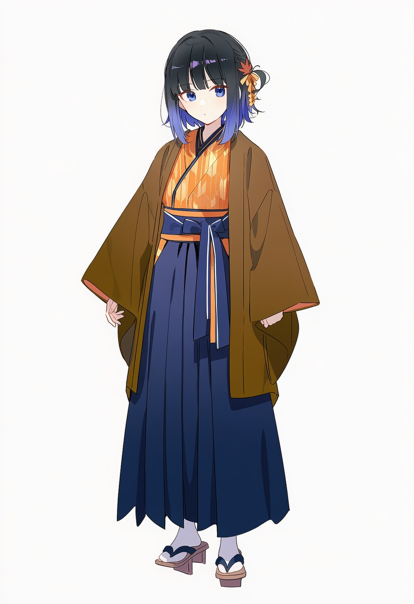

[在线例图](https://assets.quicktagcloud.com/images/raven_composition/raven_composition-6034.jpg?v=52fd3e67a2da7002)

<a id="raven_composition-6035"></a>

## 热心

ID：`raven_composition-6035`；分类：角色图鉴 / 碧蓝航线 / 皇家；来源标记：`safe`。

来源说明：

> 作品：碧蓝航线
> 角色英文名：Ardent
> 首次登场时间（国服实装）：2017-10-26
> 阵营：皇家

正向提示词：

```text
ardent_(azur_lane)
```

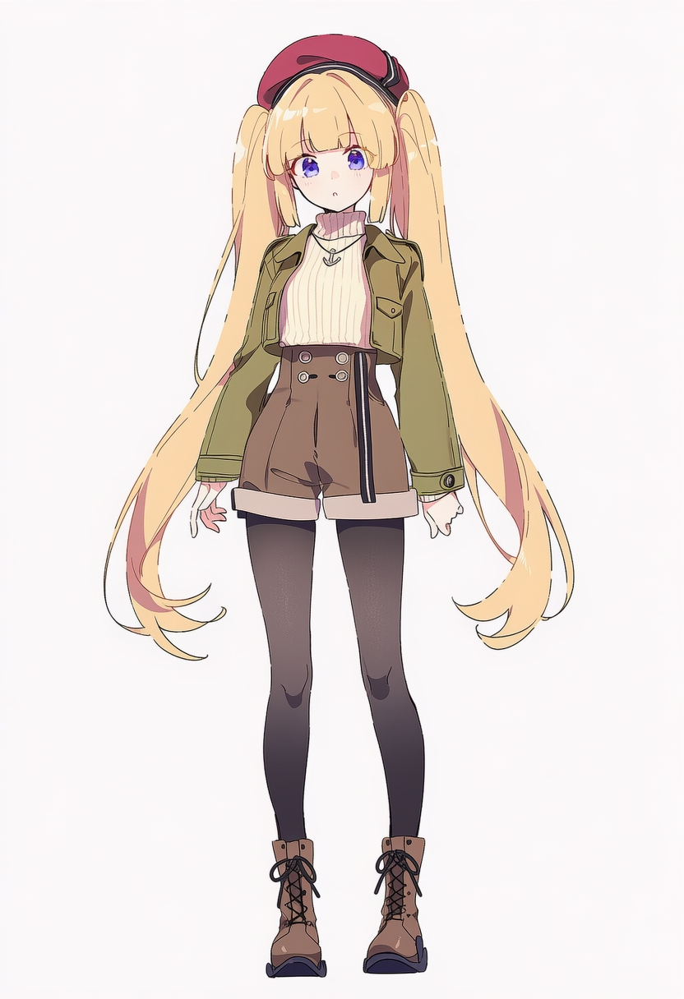

[在线例图](https://assets.quicktagcloud.com/images/raven_composition/raven_composition-6035.jpg?v=8747276f6060a1a0)

<a id="raven_composition-6036"></a>

## 光荣

ID：`raven_composition-6036`；分类：角色图鉴 / 碧蓝航线 / 皇家；来源标记：`safe`。

来源说明：

> 作品：碧蓝航线
> 角色英文名：Glorious
> 首次登场时间（国服实装）：2017-10-26
> 阵营：皇家

正向提示词：

```text
glorious_(azur_lane)
```

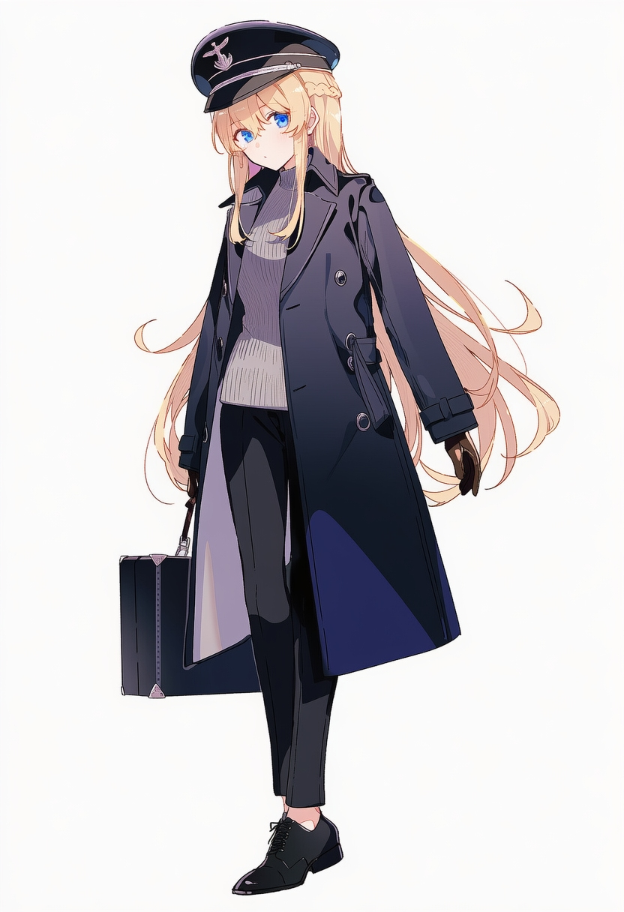

[在线例图](https://assets.quicktagcloud.com/images/raven_composition/raven_composition-6036.jpg?v=afbbf5a19dbbde3e)

<a id="raven_composition-6037"></a>

## 泽西

ID：`raven_composition-6037`；分类：角色图鉴 / 碧蓝航线 / 皇家；来源标记：`safe`。

来源说明：

> 作品：碧蓝航线
> 角色英文名：Jersey
> 首次登场时间（国服实装）：2017-11
> 阵营：皇家

正向提示词：

```text
jersey_(azur_lane)
```

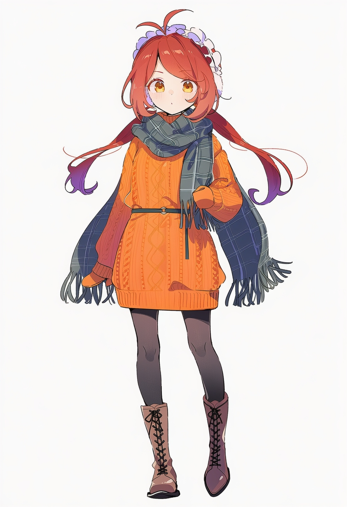

[在线例图](https://assets.quicktagcloud.com/images/raven_composition/raven_composition-6037.jpg?v=7cecd7f9802b5bff)

<a id="raven_composition-6065"></a>

## 欧若拉

ID：`raven_composition-6065`；分类：角色图鉴 / 碧蓝航线 / 皇家；来源标记：`safe`。

来源说明：

> 作品：碧蓝航线
> 角色英文名：Aurora
> 首次登场时间（国服实装）：2018-02-12
> 阵营：皇家

正向提示词：

```text
aurora_(azur_lane)
```

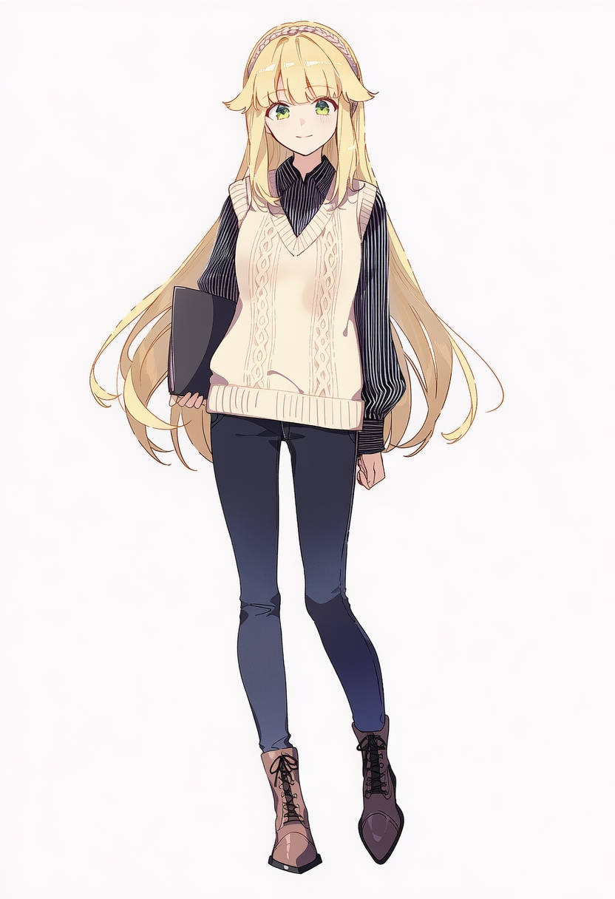

[在线例图](https://assets.quicktagcloud.com/images/raven_composition/raven_composition-6065.jpg?v=ae10233204744b57)

<a id="raven_composition-6066"></a>

## 无敌

ID：`raven_composition-6066`；分类：角色图鉴 / 碧蓝航线 / 皇家；来源标记：`safe`。

来源说明：

> 作品：碧蓝航线
> 角色英文名：Matchless
> 首次登场时间（国服实装）：2018-02-26
> 阵营：皇家

正向提示词：

```text
matchless_(azur_lane)
```

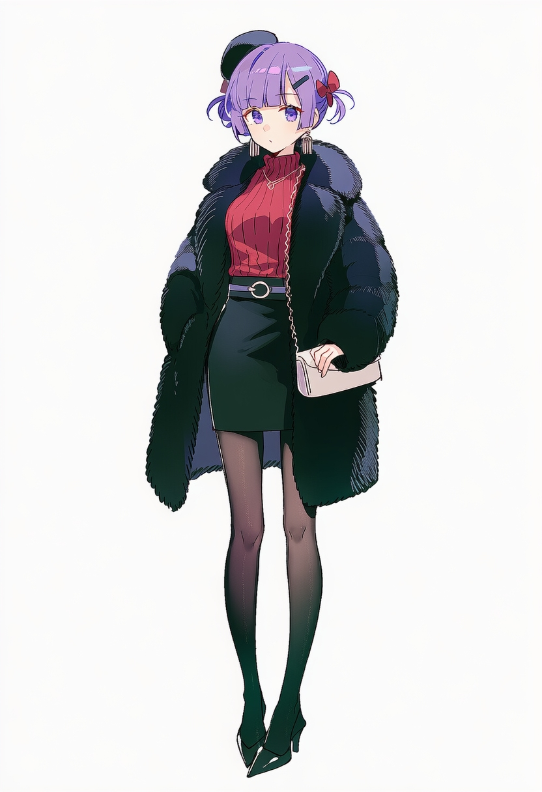

[在线例图](https://assets.quicktagcloud.com/images/raven_composition/raven_composition-6066.jpg?v=42fe198df8579eac)

<a id="raven_composition-6067"></a>

## 火枪手

ID：`raven_composition-6067`；分类：角色图鉴 / 碧蓝航线 / 皇家；来源标记：`safe`。

来源说明：

> 作品：碧蓝航线
> 角色英文名：Musketeer
> 首次登场时间（国服实装）：2018-02-26
> 阵营：皇家

正向提示词：

```text
musketeer_(azur_lane)
```

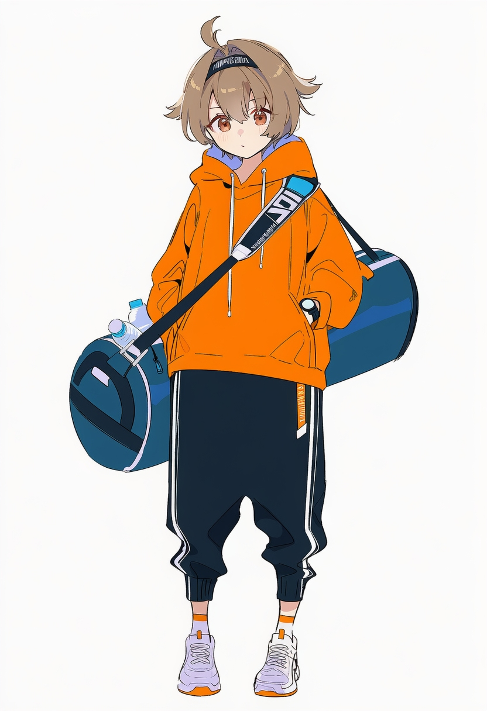

[在线例图](https://assets.quicktagcloud.com/images/raven_composition/raven_composition-6067.jpg?v=d454cbb5768e01c2)

<a id="raven_composition-6068"></a>

## 斐济

ID：`raven_composition-6068`；分类：角色图鉴 / 碧蓝航线 / 皇家；来源标记：`safe`。

来源说明：

> 作品：碧蓝航线
> 角色英文名：Fiji
> 首次登场时间（国服实装）：2018-02-26
> 阵营：皇家

正向提示词：

```text
fiji_(azur_lane)
```

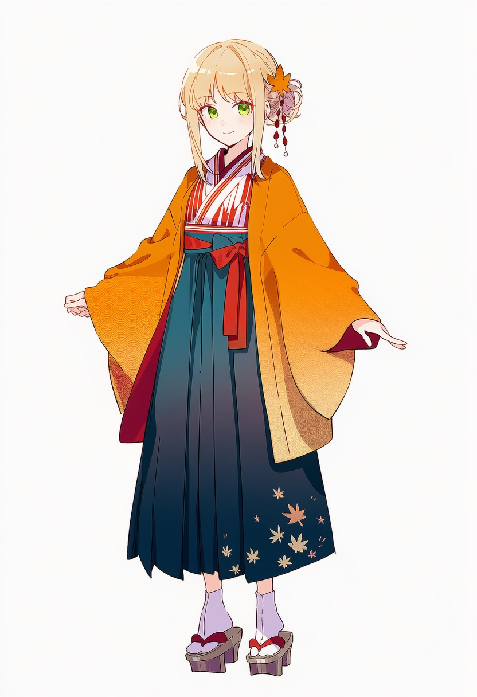

[在线例图](https://assets.quicktagcloud.com/images/raven_composition/raven_composition-6068.jpg?v=aed0554ef4bd8715)

<a id="raven_composition-6069"></a>

## 牙买加

ID：`raven_composition-6069`；分类：角色图鉴 / 碧蓝航线 / 皇家；来源标记：`safe`。

来源说明：

> 作品：碧蓝航线
> 角色英文名：Jamaica
> 首次登场时间（国服实装）：2018-02-26
> 阵营：皇家

正向提示词：

```text
jamaica_(azur_lane)
```

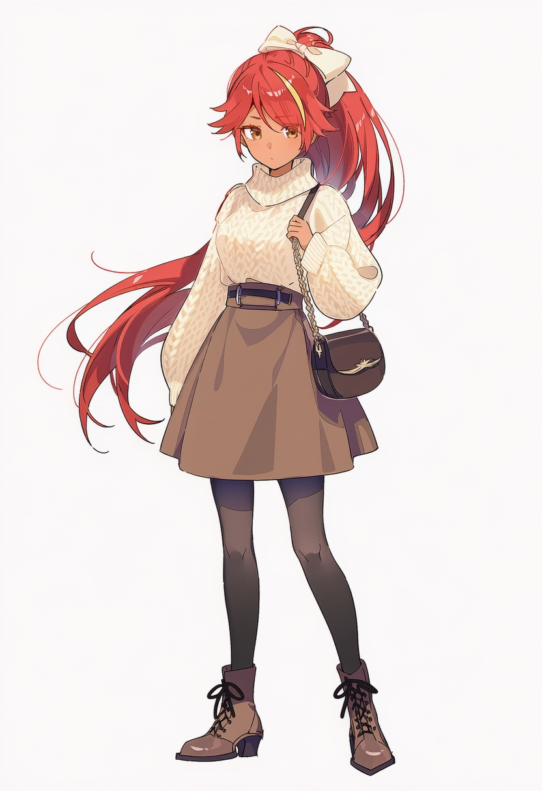

[在线例图](https://assets.quicktagcloud.com/images/raven_composition/raven_composition-6069.jpg?v=ac2d6331daa951aa)

<a id="raven_composition-6070"></a>

## 谢菲尔德

ID：`raven_composition-6070`；分类：角色图鉴 / 碧蓝航线 / 皇家；来源标记：`safe`。

来源说明：

> 作品：碧蓝航线
> 角色英文名：Sheffield
> 首次登场时间（国服实装）：2018-02-26
> 阵营：皇家

正向提示词：

```text
sheffield_(azur_lane)
```

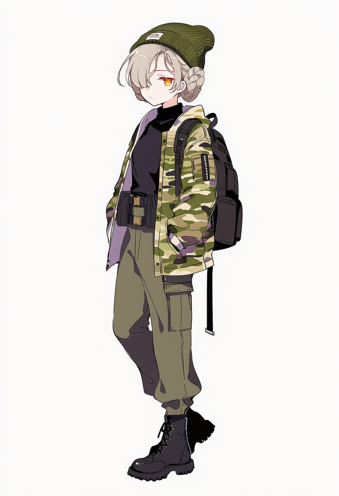

[在线例图](https://assets.quicktagcloud.com/images/raven_composition/raven_composition-6070.jpg?v=02390534539cc69f)

<a id="raven_composition-6071"></a>

## 约克公爵

ID：`raven_composition-6071`；分类：角色图鉴 / 碧蓝航线 / 皇家；来源标记：`safe`。

来源说明：

> 作品：碧蓝航线
> 角色英文名：Duke of York
> 首次登场时间（国服实装）：2018-02-26
> 阵营：皇家

正向提示词：

```text
duke_of_york_(azur_lane)
```

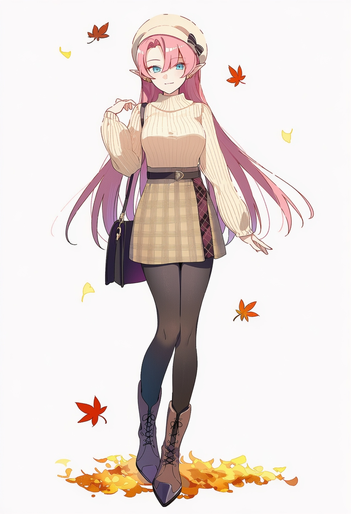

[在线例图](https://assets.quicktagcloud.com/images/raven_composition/raven_composition-6071.jpg?v=8e8090f62d24cc9f)

<a id="raven_composition-6072"></a>

## 胜利

ID：`raven_composition-6072`；分类：角色图鉴 / 碧蓝航线 / 皇家；来源标记：`safe`。

来源说明：

> 作品：碧蓝航线
> 角色英文名：Victorious
> 首次登场时间（国服实装）：2018-02-26
> 阵营：皇家

正向提示词：

```text
victorious_(azur_lane)
```

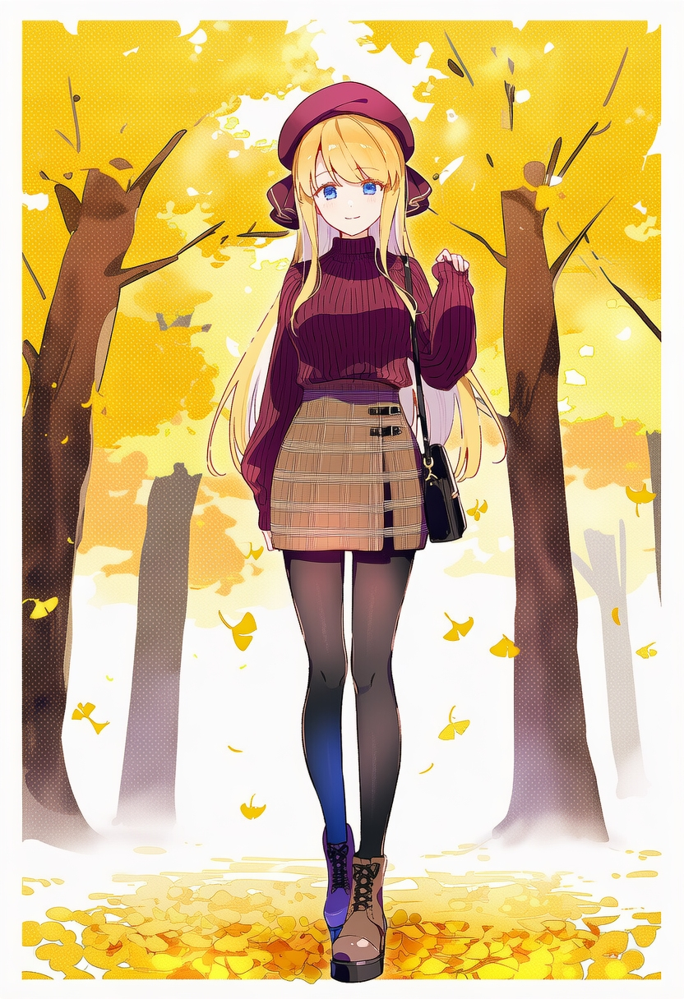

[在线例图](https://assets.quicktagcloud.com/images/raven_composition/raven_composition-6072.jpg?v=c7b6d6a08f0e308b)

<a id="raven_composition-6083"></a>

## 小贝法

ID：`raven_composition-6083`；分类：角色图鉴 / 碧蓝航线 / 皇家；来源标记：`safe`。

来源说明：

> 作品：碧蓝航线
> 角色英文名：Little Bel
> 首次登场时间（国服实装）：2018-04-26
> 阵营：皇家

正向提示词：

```text
little_bel_(azur_lane)
```

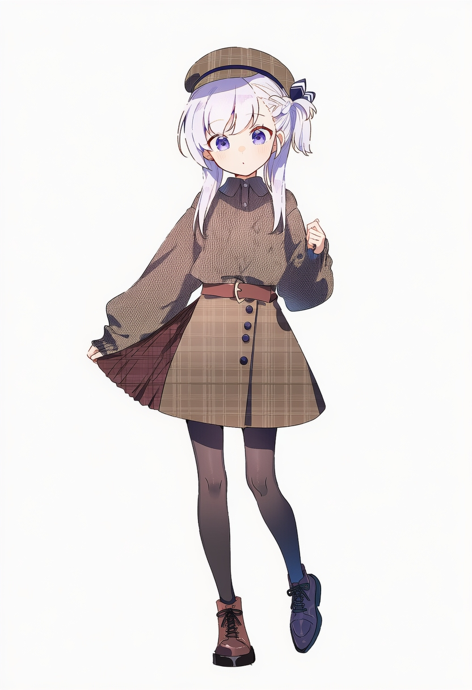

[在线例图](https://assets.quicktagcloud.com/images/raven_composition/raven_composition-6083.jpg?v=b6e7aefe3fa53e1d)

<a id="raven_composition-6089"></a>

## 君主

ID：`raven_composition-6089`；分类：角色图鉴 / 碧蓝航线 / 皇家；来源标记：`safe`。

来源说明：

> 作品：碧蓝航线
> 角色英文名：Monarch
> 首次登场时间（国服实装）：2018-04-26
> 阵营：皇家

正向提示词：

```text
monarch_(azur_lane)
```

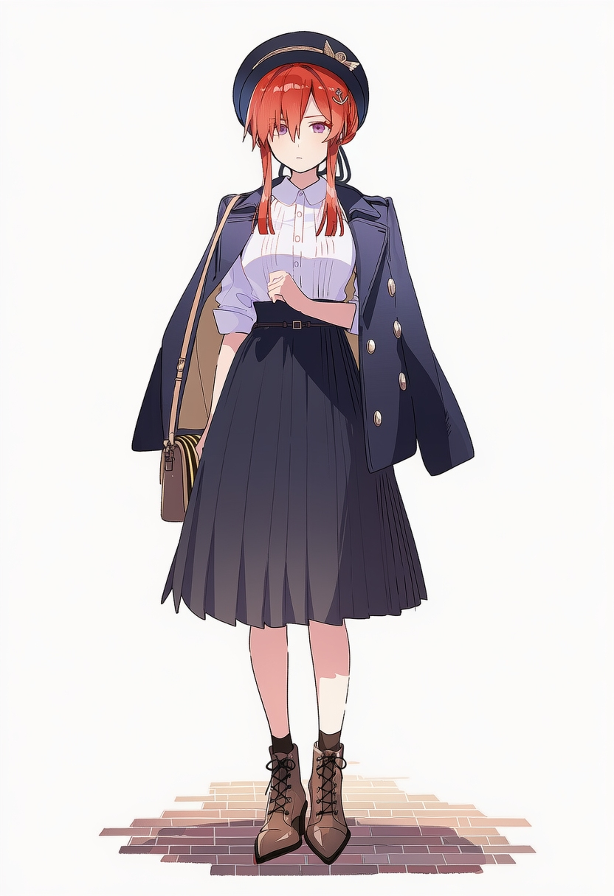

[在线例图](https://assets.quicktagcloud.com/images/raven_composition/raven_composition-6089.jpg?v=eb100b15112e5b5c)

<a id="raven_composition-6090"></a>

## 海王星

ID：`raven_composition-6090`；分类：角色图鉴 / 碧蓝航线 / 皇家；来源标记：`safe`。

来源说明：

> 作品：碧蓝航线
> 角色英文名：Neptune
> 首次登场时间（国服实装）：2018-04-26
> 阵营：皇家

正向提示词：

```text
neptune_(azur_lane)
```


[在线例图](https://assets.quicktagcloud.com/images/raven_composition/raven_composition-6090.jpg?v=7de1754788ac10ea)

<a id="raven_composition-6094"></a>

## 苏塞克斯

ID：`raven_composition-6094`；分类：角色图鉴 / 碧蓝航线 / 皇家；来源标记：`safe`。

来源说明：

> 作品：碧蓝航线
> 角色英文名：Sussex
> 首次登场时间（国服实装）：2018-05-10
> 阵营：皇家

正向提示词：

```text
sussex_(azur_lane)
```


[在线例图](https://assets.quicktagcloud.com/images/raven_composition/raven_composition-6094.jpg?v=37b79aab51ad8939)

<a id="raven_composition-6095"></a>

## 阿贝克隆比

ID：`raven_composition-6095`；分类：角色图鉴 / 碧蓝航线 / 皇家；来源标记：`safe`。

来源说明：

> 作品：碧蓝航线
> 角色英文名：Abercrombie
> 首次登场时间（国服实装）：2018-05-10
> 阵营：皇家

正向提示词：

```text
abercrombie_(azur_lane)
```


[在线例图](https://assets.quicktagcloud.com/images/raven_composition/raven_composition-6095.jpg?v=8779ba00b5c5bf15)

<a id="raven_composition-6130"></a>

## 半人马

ID：`raven_composition-6130`；分类：角色图鉴 / 碧蓝航线 / 皇家；来源标记：`safe`。

来源说明：

> 作品：碧蓝航线
> 角色英文名：Centaur
> 首次登场时间（国服实装）：2018-08-20
> 阵营：皇家

正向提示词：

```text
centaur_(azur_lane)
```


[在线例图](https://assets.quicktagcloud.com/images/raven_composition/raven_composition-6130.jpg?v=d49f4c8a71877c4f)

<a id="raven_composition-6136"></a>

## 纽卡斯尔

ID：`raven_composition-6136`；分类：角色图鉴 / 碧蓝航线 / 皇家；来源标记：`safe`。

来源说明：

> 作品：碧蓝航线
> 角色英文名：Newcastle
> 首次登场时间（国服实装）：2018-09-28
> 阵营：皇家

正向提示词：

```text
newcastle_(azur_lane)
```


[在线例图](https://assets.quicktagcloud.com/images/raven_composition/raven_composition-6136.jpg?v=f4cf19baf5f0e9dd)

<a id="raven_composition-6151"></a>

## 格伦维尔

ID：`raven_composition-6151`；分类：角色图鉴 / 碧蓝航线 / 皇家；来源标记：`safe`。

来源说明：

> 作品：碧蓝航线
> 角色英文名：Grenville
> 首次登场时间（国服实装）：2019-01-24
> 阵营：皇家

正向提示词：

```text
grenville_(azur_lane)
```


[在线例图](https://assets.quicktagcloud.com/images/raven_composition/raven_composition-6151.jpg?v=38b34d44c4b3a971)

<a id="raven_composition-6152"></a>

## 天狼星

ID：`raven_composition-6152`；分类：角色图鉴 / 碧蓝航线 / 皇家；来源标记：`safe`。

来源说明：

> 作品：碧蓝航线
> 角色英文名：Sirius
> 首次登场时间（国服实装）：2019-01-24
> 阵营：皇家

正向提示词：

```text
sirius_(azur_lane)
```


[在线例图](https://assets.quicktagcloud.com/images/raven_composition/raven_composition-6152.jpg?v=b5b1b1946466910a)

<a id="raven_composition-6155"></a>

## 库拉索

ID：`raven_composition-6155`；分类：角色图鉴 / 碧蓝航线 / 皇家；来源标记：`safe`。

来源说明：

> 作品：碧蓝航线
> 角色英文名：Curacoa
> 首次登场时间（国服实装）：2019-01-31
> 阵营：皇家

正向提示词：

```text
curacoa_(azur_lane)
```


[在线例图](https://assets.quicktagcloud.com/images/raven_composition/raven_composition-6155.jpg?v=3d57b57e96b50df0)

<a id="raven_composition-6156"></a>

## 杓鹬

ID：`raven_composition-6156`；分类：角色图鉴 / 碧蓝航线 / 皇家；来源标记：`safe`。

来源说明：

> 作品：碧蓝航线
> 角色英文名：Curlew
> 首次登场时间（国服实装）：2019-01-31
> 阵营：皇家

正向提示词：

```text
curlew_(azur_lane)
```


[在线例图](https://assets.quicktagcloud.com/images/raven_composition/raven_composition-6156.jpg?v=93684b35ddf1f4e8)

<a id="raven_composition-6157"></a>

## 追赶者

ID：`raven_composition-6157`；分类：角色图鉴 / 碧蓝航线 / 皇家；来源标记：`safe`。

来源说明：

> 作品：碧蓝航线
> 角色英文名：Chaser
> 首次登场时间（国服实装）：2019-01-31
> 阵营：皇家

正向提示词：

```text
chaser_(azur_lane)
```


[在线例图](https://assets.quicktagcloud.com/images/raven_composition/raven_composition-6157.jpg?v=054131b788ad8af0)

<a id="raven_composition-6160"></a>

## 猎人

ID：`raven_composition-6160`；分类：角色图鉴 / 碧蓝航线 / 皇家；来源标记：`safe`。

来源说明：

> 作品：碧蓝航线
> 角色英文名：Hunter
> 首次登场时间（国服实装）：2019-03-07
> 阵营：皇家

正向提示词：

```text
hunter_(azur_lane)
```


[在线例图](https://assets.quicktagcloud.com/images/raven_composition/raven_composition-6160.jpg?v=be53fbd456eb360d)

<a id="raven_composition-6161"></a>

## 勇敢

ID：`raven_composition-6161`；分类：角色图鉴 / 碧蓝航线 / 皇家；来源标记：`safe`。

来源说明：

> 作品：碧蓝航线
> 角色英文名：Hardy
> 首次登场时间（国服实装）：2019-03-07
> 阵营：皇家

正向提示词：

```text
hardy_(azur_lane)
```


[在线例图](https://assets.quicktagcloud.com/images/raven_composition/raven_composition-6161.jpg?v=b818f2abc4a0bd03)

<a id="raven_composition-6176"></a>

## 回声

ID：`raven_composition-6176`；分类：角色图鉴 / 碧蓝航线 / 皇家；来源标记：`safe`。

来源说明：

> 作品：碧蓝航线
> 角色英文名：Echo
> 首次登场时间（国服实装）：2019-05-23
> 阵营：皇家

正向提示词：

```text
echo_(azur_lane)
```


[在线例图](https://assets.quicktagcloud.com/images/raven_composition/raven_composition-6176.jpg?v=82c7510f15677f8c)

<a id="raven_composition-6179"></a>

## 英王乔治五世

ID：`raven_composition-6179`；分类：角色图鉴 / 碧蓝航线 / 皇家；来源标记：`safe`。

来源说明：

> 作品：碧蓝航线
> 角色英文名：King George V
> 首次登场时间（国服实装）：2019-05-23
> 阵营：皇家

正向提示词：

```text
king_george_v_(azur_lane)
```


[在线例图](https://assets.quicktagcloud.com/images/raven_composition/raven_composition-6179.jpg?v=135679f08e05a421)

<a id="raven_composition-6185"></a>

## 南安普顿

ID：`raven_composition-6185`；分类：角色图鉴 / 碧蓝航线 / 皇家；来源标记：`safe`。

来源说明：

> 作品：碧蓝航线
> 角色英文名：Southampton
> 首次登场时间（国服实装）：2019-06
> 阵营：皇家

正向提示词：

```text
southampton_(azur_lane)
```


[在线例图](https://assets.quicktagcloud.com/images/raven_composition/raven_composition-6185.jpg?v=7491f9edacd5b41a)

<a id="raven_composition-6186"></a>

## 确捷

ID：`raven_composition-6186`；分类：角色图鉴 / 碧蓝航线 / 皇家；来源标记：`safe`。

来源说明：

> 作品：碧蓝航线
> 角色英文名：Swiftsure
> 首次登场时间（国服实装）：2019-06-13
> 阵营：皇家

正向提示词：

```text
swiftsure_(azur_lane)
```


[在线例图](https://assets.quicktagcloud.com/images/raven_composition/raven_composition-6186.jpg?v=ede4fba408a0bfec)

<a id="raven_composition-6202"></a>

## 黑太子

ID：`raven_composition-6202`；分类：角色图鉴 / 碧蓝航线 / 皇家；来源标记：`safe`。

来源说明：

> 作品：碧蓝航线
> 角色英文名：Black Prince
> 首次登场时间（国服实装）：2019-08-29
> 阵营：皇家

正向提示词：

```text
black_prince_(azur_lane)
```


[在线例图](https://assets.quicktagcloud.com/images/raven_composition/raven_composition-6202.jpg?v=308b12e268fe7999)

<a id="raven_composition-6211"></a>

## 可畏

ID：`raven_composition-6211`；分类：角色图鉴 / 碧蓝航线 / 皇家；来源标记：`safe`。

来源说明：

> 作品：碧蓝航线
> 角色英文名：Formidable
> 首次登场时间（国服实装）：2019-09-11
> 阵营：皇家

正向提示词：

```text
formidable_(azur_lane)
```


[在线例图](https://assets.quicktagcloud.com/images/raven_composition/raven_composition-6211.jpg?v=4893c248fa376f9e)

<a id="raven_composition-6214"></a>

## 谢菲尔德μ

ID：`raven_composition-6214`；分类：角色图鉴 / 碧蓝航线 / 皇家；来源标记：`safe`。

来源说明：

> 作品：碧蓝航线
> 角色英文名：Sheffield µ
> 首次登场时间（国服实装）：2019-10-31
> 阵营：皇家

正向提示词：

```text
sheffield_(muse)_(azur_lane)
```


[在线例图](https://assets.quicktagcloud.com/images/raven_composition/raven_composition-6214.jpg?v=cba4c32319d99392)

<a id="raven_composition-6218"></a>

## 格拉斯哥

ID：`raven_composition-6218`；分类：角色图鉴 / 碧蓝航线 / 皇家；来源标记：`safe`。

来源说明：

> 作品：碧蓝航线
> 角色英文名：Glasgow
> 首次登场时间（国服实装）：2019-11-14
> 阵营：皇家

正向提示词：

```text
glasgow_(azur_lane)
```


[在线例图](https://assets.quicktagcloud.com/images/raven_composition/raven_composition-6218.jpg?v=6f7a1333ac926add)

<a id="raven_composition-6228"></a>

## 格洛斯特

ID：`raven_composition-6228`；分类：角色图鉴 / 碧蓝航线 / 皇家；来源标记：`safe`。

来源说明：

> 作品：碧蓝航线
> 角色英文名：Gloucester
> 首次登场时间（国服实装）：2020-01-21
> 阵营：皇家

正向提示词：

```text
gloucester_(azur_lane)
```


[在线例图](https://assets.quicktagcloud.com/images/raven_composition/raven_composition-6228.jpg?v=389d77d9e8154241)

<a id="raven_composition-6229"></a>

## 黛朵

ID：`raven_composition-6229`；分类：角色图鉴 / 碧蓝航线 / 皇家；来源标记：`safe`。

来源说明：

> 作品：碧蓝航线
> 角色英文名：Dido
> 首次登场时间（国服实装）：2020-01-21
> 阵营：皇家

正向提示词：

```text
dido_(azur_lane)
```


[在线例图](https://assets.quicktagcloud.com/images/raven_composition/raven_composition-6229.jpg?v=6344f7caf8558bc8)

<a id="raven_composition-6246"></a>

## 小声望

ID：`raven_composition-6246`；分类：角色图鉴 / 碧蓝航线 / 皇家；来源标记：`safe`。

来源说明：

> 作品：碧蓝航线
> 角色英文名：Little Renown
> 首次登场时间（国服实装）：2020-04-23
> 阵营：皇家

正向提示词：

```text
little_renown_(azur_lane)
```


[在线例图](https://assets.quicktagcloud.com/images/raven_composition/raven_composition-6246.jpg?v=e918639bdad4fc86)

<a id="raven_composition-6255"></a>

## 小光辉

ID：`raven_composition-6255`；分类：角色图鉴 / 碧蓝航线 / 皇家；来源标记：`safe`。

来源说明：

> 作品：碧蓝航线
> 角色英文名：Little Illustrious
> 首次登场时间（国服实装）：2020-05-28
> 阵营：皇家

正向提示词：

```text
little_illustrious_(azur_lane)
```


[在线例图](https://assets.quicktagcloud.com/images/raven_composition/raven_composition-6255.jpg?v=d5d2360fddafb62d)

<a id="raven_composition-6256"></a>

## 爱斯基摩人

ID：`raven_composition-6256`；分类：角色图鉴 / 碧蓝航线 / 皇家；来源标记：`safe`。

来源说明：

> 作品：碧蓝航线
> 角色英文名：Eskimo
> 首次登场时间（国服实装）：2020-06-03
> 阵营：皇家

正向提示词：

```text
eskimo_(azur_lane)
```


[在线例图](https://assets.quicktagcloud.com/images/raven_composition/raven_composition-6256.jpg?v=2d18b016facf77b0)

<a id="raven_composition-6258"></a>

## 柴郡

ID：`raven_composition-6258`；分类：角色图鉴 / 碧蓝航线 / 皇家；来源标记：`safe`。

来源说明：

> 作品：碧蓝航线
> 角色英文名：Cheshire
> 首次登场时间（国服实装）：2020-07-09
> 阵营：皇家

正向提示词：

```text
cheshire_(azur_lane)
```


[在线例图](https://assets.quicktagcloud.com/images/raven_composition/raven_composition-6258.jpg?v=2a5dc98c31e615fd)

<a id="raven_composition-6261"></a>

## 德雷克

ID：`raven_composition-6261`；分类：角色图鉴 / 碧蓝航线 / 皇家；来源标记：`safe`。

来源说明：

> 作品：碧蓝航线
> 角色英文名：Drake
> 首次登场时间（国服实装）：2020-07-09
> 阵营：皇家

正向提示词：

```text
drake_(azur_lane)
```


[在线例图](https://assets.quicktagcloud.com/images/raven_composition/raven_composition-6261.jpg?v=f47fbb376030fd2d)

<a id="raven_composition-6262"></a>

## 伊卡洛斯

ID：`raven_composition-6262`；分类：角色图鉴 / 碧蓝航线 / 皇家；来源标记：`safe`。

来源说明：

> 作品：碧蓝航线
> 角色英文名：Icarus
> 首次登场时间（国服实装）：2020-07-23
> 阵营：皇家

正向提示词：

```text
icarus_(azur_lane)
```


[在线例图](https://assets.quicktagcloud.com/images/raven_composition/raven_composition-6262.jpg?v=e48e1c52b7b6aa79)

<a id="raven_composition-6263"></a>

## 赫敏

ID：`raven_composition-6263`；分类：角色图鉴 / 碧蓝航线 / 皇家；来源标记：`safe`。

来源说明：

> 作品：碧蓝航线
> 角色英文名：Hermione
> 首次登场时间（国服实装）：2020-07-23
> 阵营：皇家

正向提示词：

```text
hermione_(azur_lane)
```


[在线例图](https://assets.quicktagcloud.com/images/raven_composition/raven_composition-6263.jpg?v=919520018cff925a)

<a id="raven_composition-6264"></a>

## 英勇

ID：`raven_composition-6264`；分类：角色图鉴 / 碧蓝航线 / 皇家；来源标记：`safe`。

来源说明：

> 作品：碧蓝航线
> 角色英文名：Valiant
> 首次登场时间（国服实装）：2020-07-23
> 阵营：皇家

正向提示词：

```text
valiant_(azur_lane)
```


[在线例图](https://assets.quicktagcloud.com/images/raven_composition/raven_composition-6264.jpg?v=28bf7a49147b4274)
